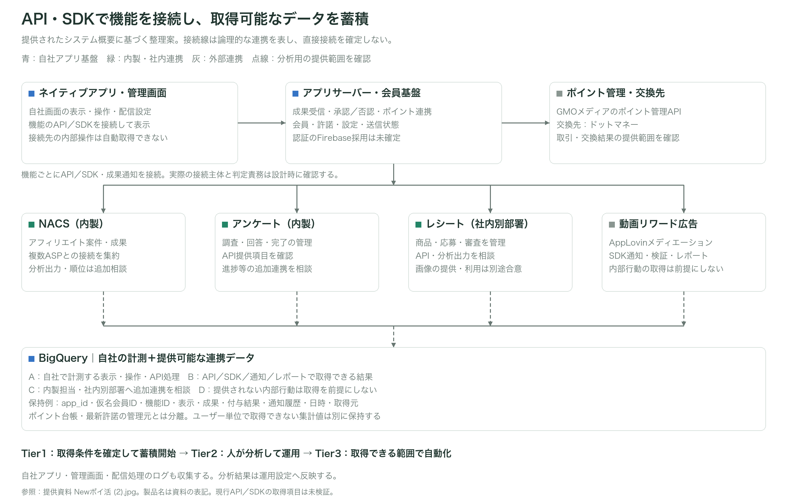
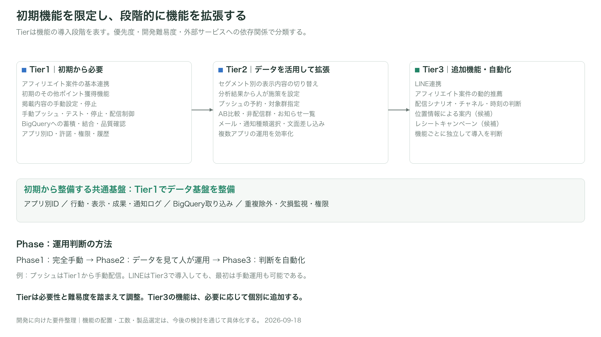
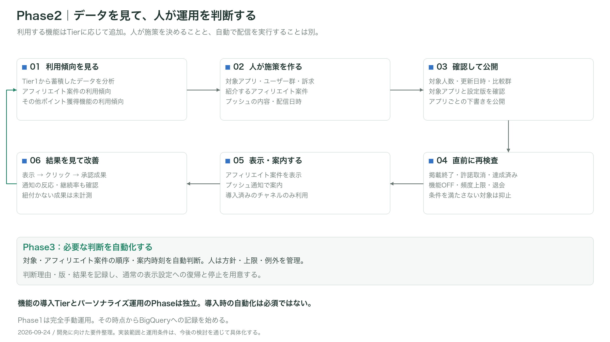

# ポイ活アプリ：段階的な機能拡張とデータ基盤
## 開発に向けた要件整理 v0.9

2026-09-18｜**サービスの目指す姿と段階的な機能拡張について、要件と検討事項をまとめた資料である。**

最小限の機能でリリースし、ユーザーの利用状況や事業の変化に合わせて機能を拡張することを目指す。そのための共通基盤として、**データの収集・蓄積・結合に必要な基盤を初期から整備する**。高度なレコメンドや配信チャネルは、段階的に追加する想定である。

本書は、サービス企画で整理した方針をもとに、開発範囲や実現方法を検討するための資料である。実装方式、APIの連携条件、工数・スケジュールは、今後の検討を通じて具体化する。

本書は、前提・用語・TierとPhaseの定義を示した後、システム構成・設計原則・データ項目例をまとめる。具体的な機能別Tierと運用方法は後半に記載する。構成やデータ項目も確定仕様ではなく、API・SDKの調査結果に応じて更新する。

## 1. 前提

| サービスの方針 | 内容 |
|---|---|
| 段階的に機能を追加する | サービスの要件は今後変更される可能性がある。機能ごとに導入範囲と導入時期を調整できる構成とする |
| データ基盤は初期から整備 | BigQueryに基本的な利用・表示・成果・通知のデータが蓄積され、結合・品質確認できる状態でリリースする |
| プッシュ通知は初期から | Tier1に手動のプッシュ通知配信を含める。自動で配信対象者や配信時刻を選ぶ機能は後のTier |
| LINEは後のTier | LINE連携はTier3。初期にLINEの連携・宛先収集を必須にしない |
| アフィリエイトはNACS経由 | 複数ASPとAPIで接続するNACSを利用する。アプリからASPへ個別に接続する構成ではない |
| 配信基盤 | Brazeは使用しない。プッシュ・メール・LINEの具体的な実装手段は開発チームと検討する |
| 複数アプリ展開 | タメルコは1本目の仮名称。将来のキャラクター等の知的財産（IP）とのコラボレーションに対応するため、処理を再利用し、設定・データはアプリごとに分ける |

「初期からデータ基盤」は、将来の全データを事前に収集する意味ではない。初期機能に必要なデータを確実に記録し、将来のイベントを追加できるID・形式・運用を整える。位置情報などは対応機能の導入時に目的と許諾を確認する。

## 2. 用語

| 用語 | この資料での意味 |
|---|---|
| アフィリエイト案件 | カード発行、口座開設、EC購入、ゲームアプリ利用等の成果条件を満たすと、広告収益やユーザーへのポイント還元につながる広告 |
| ASP | アフィリエイト案件や成果を扱う事業者。NACSが複数社との接続を管理する |
| NACS | アフィリエイト案件の配信、クリック計測、成果の受け付け・承認・通知を担う社内サービスである。詳細は別添に記載する |
| その他ポイント獲得機能 | 動画リワード広告、歩数、アンケート、ミニゲーム、将来のレシートキャンペーン機能等。すべてを初期実装する意味ではない |
| 動画リワード広告 | 動画広告の視聴等、定められた条件の成立に応じてポイントを付与する機能 |
| レシートキャンペーン機能 | 対象店舗・商品の購入レシートを提出し、条件・重複等の確認後にポイントを付与する将来機能 |
| セグメント | 利用状況や関心で分けたユーザー群。例：新規、継続利用、EC購入への関心が高いユーザー |
| 成果（CV） | アフィリエイト案件の利用条件が達成された記録。発生、承認、否認等の状態を持つ |
| イベント | 表示、クリック、達成、通知送信等、システムで記録する行動や処理 |
| 配信チャネル | プッシュ通知、メール、LINE等の通知手段 |
| 導線 | ユーザーが画面や機能へ移動するためのリンク、ボタン、バナー等 |
| 許諾 | 通知やデータ利用に対してユーザーが与える許可 |
| SUR | 複数の達成段階があり、段階ごとに報酬が発生するアフィリエイト案件 |
| AB比較 | ユーザーを複数のグループに分け、異なる施策の結果を比較する方法 |
| パーソナライズ | ユーザーごと／セグメントごとに、おすすめするアフィリエイト案件やその他ポイント獲得機能への導線、案内内容を変えること |

アフィリエイト案件として掲載するゲーム広告と、アプリ内で提供するミニゲームは別の機能である。成果の判定主体・報酬の仕組みも別に確認する。

## 3. TierとPhaseの定義

**Tierは機能の導入段階、Phaseは運用判断の方法を表す。** Tierは、導入優先度、想定される開発難易度、外部サービスへの依存関係をもとに分類する。開発工数のみを表す分類ではない。初期リリースに必要な機能は、難易度が高い場合もTier1に含める。

| 区分 | 意味 | 例 |
|---|---|---|
| Tier1 | 初期リリースに最低限必要 | 手動運用、基本プッシュ通知、BigQueryのデータ基盤 |
| Tier2 | 蓄積したデータを活用し、機能を拡張する | セグメント別の表示内容の切り替え、比較分析、メール配信候補 |
| Tier3 | 外部連携や高度な制御を伴う拡張 | LINE、動的レコメンド、位置情報、レシートキャンペーン候補 |

| 運用Phase | 運用判断の方法 |
|---|---|
| Phase1：完全手動運用 | 人が掲載内容・順序・配信内容・公開／停止を直接決める |
| Phase2：データを見て人が運用 | 分析結果を見て、人が対象・訴求・日時を決める |
| Phase3：判断を自動化 | システムが対象・順序・時刻を判断し、人が方針・上限・例外を管理する |

例：Tier1でプッシュを人が配信し、Tier2で分析結果から対象を人が選び、Tier3で配信タイミングを自動化する。LINEを導入しても、導入時は担当者が配信を判断する運用も可能である。TierとPhaseは独立した分類であり、番号が同じでも対応するとは限らない。

「完全手動」とは、施策の判断と設定を担当者が行う運用を指す。データ収集、通常のAPI処理、ポイント処理、重複防止まで人手にする意味ではない。

## 4. システム全体像と連携範囲

提供されたシステム概要図「Newポイ活 (2).jpg」と今回の説明を構成の前提とする。ネイティブアプリは、各機能をAPI・SDKで接続して表示する。**自社画面の操作を記録できることと、接続先の内部行動・成果を取得できることは別である。** API・SDKを接続するだけで全データが得られるとは扱わない。

| 領域 | 構成の前提 | データ連携・変更の扱い |
|---|---|---|
| アプリ・アプリサーバー・管理画面 | 内製のアプリ基盤。表示、成果ポストバック受信、承認・否認、キャンペーン設定等を担う構成 | 自社の表示・操作・受信・処理結果を計測する。機能側の判定とアプリ側の承認・否認の責務は機能ごとに確認する |
| アフィリエイト | 内製NACSを経由して複数ASPを接続 | NACSの分析API・出力項目・表示順変更は追加開発を相談できる。ただしASPが提供しない閲覧行動や成果情報まで取得できるとは限らない |
| アンケート | 内製アンケートシステムをAPI接続 | 一覧・回答開始・完了・報酬等の連携追加を相談できる。設問別行動・回答内容の利用は目的と提供範囲を別途確認する |
| レシート | 社内別部署のシステムをAPI接続 | 商品・小売・応募・審査・報酬の連携追加を相談する。部門間の担当・利用目的・開発範囲の合意が必要である |
| 動画リワード広告 | 図ではAppLovinのメディエーションをSDK接続 | SDKで通知されるイベントと、サーバー検証・管理画面・レポートで取得できるデータを分ける。ネットワーク内部の行動は前提としない |
| ポイント管理 | 図ではGMOメディアのポイント管理へAPI接続 | 残高・付与・取消等はポイント基盤を管理元とする。アプリサーバーは依頼・結果を記録し、分析用に提供可能な取引データを取り込む |
| 会員・認証 | 内製会員基盤。図のFirebaseは候補表記 | 会員ID・許諾を自社で管理し、連携先とのID対応を用意する。認証製品の採用は未確定である |
| 交換先 | 図ではドットマネーに接続 | 交換要求・結果・取消等の提供範囲と、ポイント管理基盤を含む処理主体を確認する |

図の「11月〜連携開発可能」は提供資料上の記載であり、レシート機能のリリース日やTier変更を確定するものではない。また、NACSの移植は図に記載された検討事項であり、本書だけで開発範囲に含めない。図のGET／POSTは接続の概要として扱い、正式なAPI契約は別途確認する。

## 5. データの保存先と各システムの役割

| 保存先／機能 | 主な責務 | 導入タイミング |
|---|---|---|
| 自社の会員・設定DB | アプリ別会員、許諾、機能ON/OFF、公開設定、送信先参照 | T1 |
| 自社の配信処理・状態管理 | プッシュの送信意図・受付・抑止・再試行。後に予約や自動配信を追加 | T1から段階拡張 |
| NACS（内製） | アフィリエイト案件・成果の管理元、複数ASP連携。分析出力・個人別順位は追加相談 | 接続T1、推薦はT2/T3 |
| アンケート（内製） | 調査・回答・完了判定の管理元。提供項目と追加イベントを相談 | 初期採用時T1、詳細分析は段階追加 |
| レシート（社内別部署） | 商品・応募・審査等の管理元。API・分析用出力を相談 | T3候補。接続範囲により見直す |
| 動画リワードSDK・広告事業者 | 広告配信・報酬イベント等。提供される範囲のみ取得 | 初期採用時T1 |
| GMOメディアのポイント管理／交換先 | ポイント取引・交換の管理。自社側はAPI依頼・結果と連携元の取引を照合 | 初期接続。責務と履歴取得を確認 |
| BigQuery | 利用・表示・クリック・成果・通知履歴、データ品質確認 | **T1から稼働** |
| 集計済みのプロフィール | 現在のセグメント、判定版・時刻・有効期限。表示時に参照できる保存先 | T2以降 |
| 自動判断処理 | アフィリエイト案件の推薦、案内時刻、判断理由・ルール版 | T3の選択機能 |

BigQueryは履歴の保存・分析用に使い、会員の最新許諾やポイント残高・履歴の管理元とは分ける。自社のアプリサーバーは成果受信・承認／否認・ポイント連携を調整するが、ポイント台帳を独自に新設する前提ではない。図にあるGMOメディア側と交換先の責務・接続経路を確認する。表示のたびにBigQueryで全履歴を集計する構成は採用しない方針である。DB製品、API／ジョブの実装基盤、更新頻度は開発チームと検討する。プッシュにFCM、LINEにMessaging APIを使う案は候補であり、採用済みではない。

## 6. 設計原則

- 処理と設定テンプレートを共通化する。会員・ポイント残高・許諾・送信先はアプリ別に分離する。
- 共通値や他アプリの設定は下書きにコピーし、個別に確認して公開する。宛先・履歴・秘密鍵はコピーしない。
- その他ポイント獲得機能の追加は、管理画面の項目追加だけでは完了しない。アプリ画面・達成判定・不正対策・ポイント処理・イベント記録を一体として実装する。
- 表示回数、詳細閲覧、URL発行、NACSクリック、成果発生、承認、ポイント付与を区別する。
- 成果が発生したアフィリエイト案件を一律に表示対象外とせず、再利用できるEC購入等の条件を確認する。
- 分析の再処理からポイント付与処理を実行しない。成果通知の重複やSURの段階別成果に対応する。
- IDFA／GAIDを自社推薦の必須キーにしない。連携先が要求する用途がある場合だけ別途確認する。
- 保持期間、権限、退会時の削除、許諾、配信上限は関係者との確認が必要である。未合意の属性や精密位置は収集しない。

## 7. BigQueryで保持するデータと取得条件（案）

**初期から「誰に、何を、どこで表示し、どの行動・成果につながったか」を確認できるデータを蓄積する。** 保存項目だけでなく、1件の記録が表す単位、取得元、結合用ID、収集開始時期を定義する。以下は分析に必要なデータの一覧案であり、物理テーブル名やAPIの確定仕様ではない。項目名は説明用の例である。

Tier1は初期に採用した機能の記録を対象とする。Tier2・3の機能は導入時に記録を追加し、未導入機能のために個人情報を先行収集しない。NACSや配信サービスが提供する項目・粒度は連携先との確認が必要である。

### 7.1 取得可能性の分類

以下の項目一覧は取得を希望するデータの設計案であり、すべての項目が既存APIで取得可能であることを示さない。取得条件を次の4区分で管理する。

| 区分 | 意味 | 例 |
|---|---|---|
| A：自社で計測を実装 | 自社が制御する画面・処理に計測を追加できる。現時点で計測済みという意味ではない | 導線表示、ボタン操作、API要求・応答、ポストバック受信 |
| B：連携仕様の確認が必要 | API応答・SDKコールバック・成果通知・レポートに存在する場合に取得できる | 正式な回答完了、広告報酬確認、ポイント取引結果 |
| C：追加連携を相談 | 現行の提供範囲を確認後、内製担当・社内別部署へ追加開発を相談する | NACSの成果更新履歴、アンケート開始・離脱、レシート審査履歴 |
| D：取得を前提にしない | 接続先から提供されず、自社から観測もできない情報 | 広告主サイト内の入力過程、他社SDK内部の全操作、未提供のユーザー別売上 |

| 機能・接続先 | 自社で計測する範囲（A） | 提供仕様を確認する範囲（B） | 追加相談・取得上の制約（C／D） |
|---|---|---|---|
| アフィリエイト／NACS | 自社一覧・詳細の表示、参加操作、URL発行の要求・結果 | クリックID、成果ID・状態・段階、還元ポイント・収益 | C：NACSの分析用出力、履歴、順位。D：ASP・広告主から届かない内部行動 |
| 内製アンケート | 自社の導線・一覧表示、回答画面への遷移要求 | 調査ID、回答セッションID、完了・対象外・途中終了・報酬の提供範囲 | C：回答開始・進捗・離脱のイベント。回答画面を別システムが描画する場合、自社画面と同じ粒度では測れない |
| 社内別部署のレシート | 自社の商品・キャンペーン導線、応募画面への遷移 | 商品・小売ID、応募ID、受付・審査・承認・否認・報酬 | C：審査履歴・理由コード・分析出力。画像やOCR結果を自由に取得・二次利用できるとは扱わない |
| 動画リワード／SDK | 広告表示の要求、SDK呼出し、アプリに返るコールバックの受信 | 読込・表示・閉じる・報酬コールバック、サーバー検証、広告収益レポートの提供範囲 | B：SDK版・ネットワーク・設定により範囲が異なる。D：広告内部操作や未提供のユーザー別収益 |
| ポイント管理／API | 付与・取消等の要求ID、応答・通知、照合結果 | 取引ID、確定状態、残高・増減、訂正・失効・交換履歴の提供範囲 | B／C：履歴取得や分析用出力を担当へ確認。要求成功だけで付与確定としない |
| 交換先／API | 自社からの交換要求・照会結果 | 交換受付・完了・失敗・取消、対応する取引ID | B：非同期確定や再照会の方法。D：交換先で提供されない利用履歴 |
| プッシュ等の配信 | 送信意図、要求、応答、アプリで観測したタップ | 配達・開封・エラー等の提供範囲 | D：未観測を未閲覧と断定しない。サービス受付は端末到達の証明ではない |

Tier1ではAの計測と、初期機能の成立・付与・照合に必要なBの連携を実装する。高度な推薦に必要なCは段階的に追加する。ただし、報酬の成立確認に不可欠な情報が不足する場合は、分析機能の制約として済ませず、そのポイント獲得機能を公開できる条件として解決する。

SDK・WebView・APIの返却結果によって描画主体が異なる。自社が導線を表示したログを、接続先のコンテンツ表示・回答開始・広告視聴として記録しない。外部画面からアプリへ戻っただけでは、成果成立と扱わない。

### 7.2 共通の記録項目

| 項目 | 内容・扱い |
|---|---|
| app_id、environment | 対象アプリと本番・検証の区分。検証データを本番集計から除外する |
| analytics_user_id | アプリ別の仮名分析ID。会員IDとの対応は権限を限定した別の保存先で管理する。アプリをまたいだ同一人物の統合は行わない |
| event_id、event_name、schema_version | 行動・処理を識別するID、種類、項目定義の版。同じイベントの再送ではIDを維持する |
| occurred_at、received_at、loaded_at | 発生日時、収集側の受信日時、BigQueryへの取り込み日時。UTCで保存し、集計日の基準時刻を別に定義する |
| observation_type、availability_status | 自社操作・SDK通知・サーバー検証・集計レポートを区別する。項目定義ではA〜Dの取得条件と確認状況を管理する |
| source_system、source_record_id、source_version | アプリ・自社サーバー・NACS等の取得元と元データID・版。提供されない項目は取得不可と分かるようにする |
| session_id、app_version、os_family、os_version | 利用のまとまりと実行環境。必要なイベントに付与する。サーバー処理等で該当しない値を作らない |
| ingestion_batch_id、quality_status | 取り込み処理の識別子と品質確認結果。再処理や欠損調査に利用する |

イベント以外のマスター・日次集計には、そのデータのキー、対象日、更新日時、定義版を持たせる。イベント用項目をすべての記録へ無理に付与しない。値がない場合は「不明」「未取得」「該当なし」を区別し、数値の0や状態の未達成で代用しない。

### 7.3 初期機能で保存するデータ（取得条件付き）

| データ・1件の単位 | 主な項目例 | 取得元 | 用途・導入条件 |
|---|---|---|---|
| 会員の分析用プロフィール／会員の状態変更1件 | 仮名分析ID、登録日、登録経路、会員状態、退会日、SMS認証完了状態、変更日時 | 自社会員基盤 | T1。新規・継続・休眠の分析。SMS認証は導入する場合のみ。電話番号自体は含めない |
| 許諾・受信設定履歴／設定変更1件 | 許諾の種類、状態、取得・取消日時、規約・説明文の版、取得画面、OS通知許可の最終確認日時 | 会員基盤・アプリ | T1。配信可能だった理由を確認する。現在の送信判定は運用DBを参照する |
| アプリ利用／行動1件 | 起動、画面表示、タブ選択、セッションID、画面ID、前画面、アプリ版 | アプリ | T1。継続率、利用頻度、時間帯、画面間の移動を分析する |
| アフィリエイト案件情報／内容の版1件 | NACSのアフィリエイト案件ID、ASP識別子、名称、カテゴリ、対象OS、掲載状態・期間、成果条件の版、報酬ポイント、反復利用可否 | NACS経由（B、拡張はC） | T1。表示時点の条件を再現する。ASP等の非提供項目を推測して補わない |
| アフィリエイト案件の表示／表示対象1件 | impression_id、アフィリエイト案件ID、一覧ID、配置枠ID、表示順位、画面ID、表示条件・設定版 | アプリ・表示API | T1。掲載順位を含めたクリック率の分析。APIで返しただけの候補と実際の表示を区別する |
| アフィリエイト案件の操作／操作1件 | 詳細閲覧、参加ボタン操作、URL発行結果、interaction_id、参照できるimpression_id、NACSクリックID | アプリ・自社API・NACS | T1。閲覧→参加を確認する。URL発行成功とNACSでのクリック成立は別の記録とする |
| アフィリエイト成果／成果の状態変更1件 | conversion_id、アフィリエイト案件ID、NACSユーザー対応用参照、click_id、SUR段階ID、取得できる成果状態、発生・承認・更新日時、広告収益・通貨、還元ポイント | NACS経由（B、拡張はC） | T1。提供される状態・金額のみ保存する。承認だけを取得できる場合、発生・否認の全履歴があるとは扱わない |
| ポイント取引の分析用記録／取引1件 | transaction_id、原因となった成果・達成ID、付与・取消・交換・失効の区分、増減ポイント、状態、成立日時 | GMOメディアのポイント管理API・提供履歴（B） | T1。ポイント原資・付与結果の照合。残高の管理元や付与処理はBigQueryに移さない |
| その他ポイント獲得機能／利用・達成・報酬処理1件 | feature_id、機能種別、機能利用ID、開始・完了・サーバー確認・付与状態、報酬ポイント、失敗理由、設定版 | アプリの導線（A）、各機能のAPI・SDK・通知（B／C） | T1。初期採用した動画リワード広告・歩数・アンケート・ミニゲーム等のみ。アプリの完了表示と正式な達成を区別する |
| 広告・特集の設定履歴／公開設定の版1件 | placement_id、creative_id・版、施策ID、アフィリエイト案件・特集の参照ID、公開期間、対象アプリ、公開・停止状態 | 管理画面・配信基盤 | T1。何を掲載したかを再現する。画像本体は保存せず素材IDを参照する |
| バナー・POPUPの反応／表示・操作1件 | impression_id、配置枠、素材ID・版、施策ID、表示・クリック・閉じる、遷移先種別・ID | アプリ | T1。枠・素材別の反応を分析する。表示の計測条件を揃える |
| プッシュ配信／対象選定・送信意図・試行・状態更新1件 | 施策ID・版、message_intent_id、attempt_id、送信先の仮名参照、対象選定日時、送信サービス受付ID、受付・失敗・抑止・タップ、理由、日時 | 配信処理・サービス・アプリ | T1。対象者数、送信数、失敗、反応を区別する。端末到達・閲覧は観測できる場合のみ |
| 運用操作／設定変更・公開操作1件 | 操作者の管理用ID、対象アプリ、機能・設定ID、変更前後の版、操作・公開・停止日時、結果 | 管理画面 | T1。施策変更と成果の関係を確認する。認証情報や文面内の個人情報は記録しない |
| データ品質／取り込み処理・検査1件 | 取得元、処理ID、受信・正常・重複・エラー件数、遅延、欠損項目、最終成功日時、再処理結果 | 収集・集計処理 | T1。欠損・重複・遅延を検知し、データを使えるか判断する |

動画リワード広告は自社の広告要求IDと、取得できるSDKイベント・報酬確認のID、歩数は対象日・達成区分、内製アンケートは提供される調査ID・完了通知ID、ミニゲームはプレイID・結果区分、ミッションは定義版・達成IDを、必要な範囲で機能別に追加する。広告収益は提供される粒度を保持し、日次合計しかない値を個々のユーザーの売上として割り振らない。アンケート回答本文、歩行経路、ゲームの不正対策用情報等は分析イベントへ一括でコピーしない。

### 7.4 機能拡張時に追加するデータ

| データ・1件の単位 | 主な項目例 | 取得元 | 用途・導入Tier |
|---|---|---|---|
| 任意属性／属性変更1件 | 年代、本人が選択した関心カテゴリ、取得方法・日時、未回答区分 | アプリ・会員基盤 | T2候補。利用目的が定まった属性のみ。性別等も用途を確認して採否を決め、推測で補完しない |
| 検索・絞り込み／操作1件 | 選択カテゴリ、フィルター、結果件数、検索後のアフィリエイト案件操作 | アプリ | T2候補。自由入力文字列は初期の標準収集対象にしない。検索機能を初期採用する場合はカテゴリ操作等をT1から記録可能とする |
| 利用傾向の集計／会員・対象期間1件 | 利用日数、最終利用日、カテゴリ別表示・参加・承認数、獲得ポイント、対象期間、集計版 | BigQueryで集計 | T2。高額アフィリエイト案件・日常買い物・隙間時間の利用傾向を識別する |
| セグメント所属／判定1件 | segment_id、判定版、対象期間、判定日時、有効期限、所属・離脱 | 集計・セグメント管理 | T2。配信時点の所属を再現する。複数所属を許容するかは別途定義する |
| AB比較／割り当て・対象露出1件 | experiment_id、variant_id、非配信群区分、割り当て単位・日時、施策版、露出日時、評価期間 | 実験管理・アプリ・配信処理 | T2。割り当てと実際の露出を区別し、途中の群変更による偏りを防ぐ |
| メール・お知らせ／配信・状態変更1件 | 共通配信ID、チャネル、受付・エラー・解除、お知らせの既読・期限、差し込みテンプレート版 | 配信サービス・アプリ | T2候補。開封計測は取得制約を記録し、実際の閲覧と同一視しない |
| LINE／連携状態・配信結果1件 | 連携済み状態、連携・解除日時、共通配信ID、取得できる反応 | 連携基盤・LINE接続処理 | T3。LINE側識別子の原値は運用側で管理し、分析では仮名参照を使う |
| 推薦判断／推薦要求・候補1件 | recommendation_id、候補アフィリエイト案件ID、表示順位、ルール・モデル版、スコア、除外理由、通常順への復帰理由 | NACS・推薦処理 | T3。何を推薦したかと、その後の反応を結合する。NACS側の提供範囲を確認する |
| 配信シナリオ／実行・段階変更1件 | scenario_id・版、run_id、開始理由、段階、待機・分岐・終了・再参加、判断理由、送信意図ID | 自動配信処理 | T3。自動判断の原因と結果、送信しなかった理由を確認する |
| 位置を利用した案内／条件成立1件 | 粗い地域・店舗ID、条件種別、成立時刻、許諾版、施策ID | 許諾済みのアプリ・判定処理 | T3候補。正確な座標や移動履歴は標準保存しない。必要な場合は目的・精度・保持期間を別途定義する |
| レシートキャンペーン／応募・審査変更1件 | campaign_id、小売・商品ID、応募ID、購入日、対象数量、審査状態・理由、重複判定結果、付与ID | 社内別部署のレシートシステム（B／C） | T3候補。画像・OCR全文は連携元の管理方針に従い、BigQueryには合意した分析項目のみ連携する |

### 7.5 データの結合方法

| 確認したい流れ | 主な結合キー | 注意点 |
|---|---|---|
| 表示→詳細閲覧→参加 | app_id、analytics_user_id、impression_id、interaction_id | 参照元がない直接流入は別扱いとし、直前の表示へ無条件に結合しない |
| 参加→NACS成果→ポイント付与 | NACSクリックID、conversion_id、SUR段階ID、transaction_idと原因ID | NACSとのID連携契約を確認する。ユーザー・時刻だけの一致を確定した成果帰属にしない |
| 通知→タップ→アプリ内操作 | 施策ID・版、message_intent_id、遷移時の参照ID | 許可した参照IDのみを引き継ぎ、署名付き参加URLを改変しない |
| 設定変更→表示・成果の変化 | app_id、設定ID・版、素材ID・版、発効期間 | 最新設定で過去を上書きしない |
| AB割り当て→露出→成果 | app_id、analytics_user_id、experiment_id、variant_id、評価期間 | 非配信群には送信イベントがないため、割り当て記録から母数を作る |

連携できない成果は「帰属不明」として件数・金額を別集計する。通知を見た後に成果が出た事実と、その通知によって成果が増えたという因果関係は区別する。計測方法や集計期間は指標ごとに定義する。

### 7.6 保存・品質・利用のルール

| 項目 | 方針案・確定する内容 |
|---|---|
| 履歴と最新状態 | 許諾、アフィリエイト案件条件、成果状態の変更履歴を保持し、最新状態の分析用データを別に作る。送信・付与の判断は各運用基盤が担う |
| 重複・訂正・遅延 | 再送、後日の承認・否認、訂正を区別する。成果IDだけで後続の状態更新を削除しない。集計を再作成してもポイントを再付与しない |
| 表示・達成の定義 | 表示範囲・表示時間・再表示の扱い、セッションの区切りを確定する。アプリ操作とサーバーで確認した成立を区別する |
| 金額・単位 | 広告収益とユーザーへの付与ポイントを別項目にする。通貨と換算ルールの版を記録し、発生額・承認額・確定額を混同しない |
| 保存しないデータ | パスワード、API秘密鍵、署名付き参加URL、メール・電話番号・通知トークンの原値は分析イベントに含めない。IDFA／GAIDも自社推薦の必須キーにしない |
| 保持と削除 | データ分類ごとに目的、保持期間、退会・許諾取消時の扱い、削除対象を定義する。生データだけでなくプロフィール・集計・コピー先にも適用範囲を決める |
| 権限 | アプリ別・用途別に閲覧範囲を制限する。横断集計は必要な担当者だけに認め、会員単位のデータを他アプリの運用に流用しない |
| 鮮度・監視 | 取得元ごとの更新頻度、許容遅延、欠損・不一致の検知基準、担当者、再処理手順を定義する。未取得と0件を区別する |
| 費用と再利用 | データ量、保持期間、集計頻度を見積もる。日次集計等を再利用し、同じ全履歴の集計を繰り返さない。具体的な構成は設計時に決める |

初期着手前に、各データの提供可否・担当・収集開始日・更新頻度・保持期間を確定する。特にNACSの成果ID、クリックID、状態変更、広告収益の提供範囲は確認が必要である。取得できないデータは代替手段と分析上の制約を記載し、取得済みとは扱わない。

## 8. NACS連携に関する参考資料

NACSとの連携に必要な情報を、本書末尾の「別添：NACS連携ガイド」と同梱の参考仕様にまとめている。新アプリの開発に関係する範囲を中心に参照できる構成としている。

これらはアプリ側から見た連携仕様であり、NACSそのものの完全なAPI仕様ではない。実装着手に向けて、NACS担当から現行のAPI定義・認証方式・検証環境・成果通知仕様・窓口を提供する。秘密鍵や本番認証情報はこの資料に含めない。

旧アプリの全仕様、変更経緯、モックの途中案は本書の前提にしない。旧アプリの参加条件や制限を、新アプリへ自動的に引き継ぐとは扱わない。

## 9. 機能別のTier分類（案）

プッシュ通知とデータ基盤はTier1、LINE連携はTier3を想定する。それ以外の機能の配置や難易度は現時点の案であり、実現性・工数・依存関係を確認しながら調整する。

難易度は低＝既存処理の設定中心、中＝アプリ・サーバー・計測の接続、高＝外部契約・審査／精度検証・複雑な状態制御を含む、という相対的な目安である。具体的な工数・費用は別途見積もる。配信・運用機能はBrazeの公式資料も参考に整理した。参照元[B1]〜[B7]は13章に記載する。Tierへの配置と実装範囲は本サービスの検討案である。

| 機能 | 初期の実装範囲 | 追加する機能 | Tier／想定難易度・依存 |
|---|---|---|---|
| アフィリエイト案件の表示・参加 | NACS経由の一覧・詳細・外部遷移、成果との連携 | セグメント別表示→動的な順位 | 基本T1：中〜高。NACSの接続条件に依存 |
| 掲載・広告の手動運用 | 担当者がメニュー、バナー、特集、掲載順を設定・停止 | 対象別設定、比較実験 | 基本T1：中。初期掲載面を絞る |
| その他ポイント獲得機能 | 初期対象に採用した動画リワード広告・内製アンケート等のAPI／SDK接続と、取得可能な達成・付与結果の連携 | 機能への導線・表示内容の切り替え、新機能を追加 | 基本T1：機能ごとに中〜高。全機能を必須にしない |
| プッシュ通知 | 人が本文・アプリ内リンクを設定し、当該アプリの許諾済みユーザーへ手動配信。テスト・履歴・停止 | T2：予約・対象群指定。T3：行動・時刻に応じた自動判断 | T1：中。トークン管理・権限・抑止が必要 |
| データ基盤 | ID・イベント設計、BigQuery取り込み、成果対応、重複除外・欠損監視・検証用集計 | 派生指標、セグメント、学習用データ | **T1：中〜高でも初期必須** |
| セグメント別運用 | 初期は個別最適化なし | 人が利用傾向を見て対象群・アフィリエイト案件を選ぶ | T2：中〜高。NACSの表示内容の切り替え対応に依存 |
| 可視化・AB比較 | T1は記録品質を確認する基本集計 | 施策・素材・対象群別の効果比較。利用者単位の固定したAB割り当てと非配信群、施策版・期間・指標を管理。複数施策共通の非配信群はT3候補 | T2：中。ID結合・標本数・指標の定義が必要 [B7] |
| メール配信 | 初期必須にしない | 配信サービス接続、宛先・許諾、解除、手動／予約配信 | T2候補：中。チャネル・送信ドメイン等の準備に依存 |
| LINE連携 | 初期は実装しない | アカウント対応付け、許諾・連携解除、メッセージ配信 | **T3：中〜高**。外部連携と運用設計が必要 |
| 動的レコメンド | 初期は手動の通常順 | 関心や達成傾向でアフィリエイト案件の順序を自動決定 | T3：高。履歴、評価、NACS拡張が前提 |
| 自動リマインド | 初期は担当者が送る | 未達成・利用時間帯に応じた案内、送信直前の再確認 | T3：高。状態・重複・頻度の制御が必要 |
| 位置情報による案内 | 初期は収集しない | 周辺店舗の案内、移動時の通知等 | T3候補：高。店舗データ・許諾・OS制約が前提 |
| レシートキャンペーン機能 | 共通のID・報酬記録に将来追加できるようにする | 社内別部署のレシートシステムに接続し、商品一覧・応募・審査結果・付与を連携 | T3候補：中〜高。既存APIと追加開発範囲に依存。OCR・審査の新規構築を前提にしない |
| 複数アプリ展開 | T1からapp_idでデータ・設定を分離 | 2本目に合わせた設定コピー、IP素材制御、共通運用 | 基礎T1、管理拡張T2候補：中〜高。T3完了を待たない |
| 配信回数・時間帯・速度の制御 | アプリ別のユーザー送信回数上限、送信禁止時間、配信処理全体の速度上限。禁止時間は送信を拒否し、理由を記録 | チャネル追加時に複数チャネル合計の回数制御 | 基本T1：中、拡張T2以降：中。上限・時間帯・計数条件の確定が必要 [B1] |
| 配信前の確認・履歴 | 下書き、対象アプリ・人数・本文・リンクの確認、テスト送信、実行者・設定版の履歴、未送信分の停止 | 複数人による承認フロー | 基本T1：中、承認T2候補：中。権限設計に依存 [B2] |
| アプリ内メッセージ | 初期に採用するバナー・POPUPの手動公開、掲載期間・表示回数・閉じる操作、他の表示物との競合制御 | 行動・セグメントによる対象変更 | 基本T1：中、対象別T2：中〜高。広告ネットワークの表示とは区別 [B3] |
| アプリ内のお知らせ一覧 | 初期必須にしない | 後から確認できる案内、未読・既読・掲載期限、セグメント別掲載 | T2候補：中。アプリ画面の追加が必要 [B4] |
| 通知の受信設定 | アプリ別の基本プッシュ受信設定とOS許可状態を確認 | 「買い物情報」「ミッション案内」等の種類別選択。チャネル導入に合わせて設定を拡張 | 基本T1：中、種類別T2：中。最新許諾を送信直前に確認 [B5] |
| テンプレート・差し込み表示 | 初期は固定の文面と素材で運用 | 文面・素材の再利用、限定した項目の差し込み、欠損時の代替文面または配信停止 | T2：中。任意のコード入力は前提としない [B6] |
| 最新の掲載情報との連動 | 掲載終了・機能OFF等を確認 | 自社API経由でNACSの最新情報を文面へ反映。取得失敗時は古い報酬額を確定情報として送らない | 基本T1：中、動的文面T2：中〜高。NACSの提供項目・鮮度に依存 [B6] |
| 複数段階の配信シナリオ | 初期は担当者が単発配信 | 開始・待機・分岐・終了・再参加条件と、送信直前の状態確認。例：登録後、一定期間未利用なら案内 | T3：高。限定したシナリオから開始し、自由な図形編集画面は必須にしない [B3] |
| チャネル・時刻の最適化 | 初期は担当者が決める | 反応と受信設定から導入済みチャネル・送信時刻を選択。履歴不足時は通常ルールを使用し、判断理由を保存 | T3：高。LINE導入とは独立に判断する [B1][B3] |

Tier3の機能を一括開発する前提ではない。LINE・位置情報・レシート等は独立に選択できる。依存先と計測が整っている機能から追加し、利用価値が低ければ見送る。

## 10. 運用方法

### Tier1：手動運用

担当者が管理画面で掲載内容とプッシュ本文・遷移先を設定する。テスト配信で確認し、対象アプリを明示して手動配信する。未送信分を停止でき、送信履歴とエラーを確認できる。全員向けとは、許諾済み・有効な宛先を持つ当該アプリの利用者への配信を指す。

プッシュ通知の許諾確認と重複送信の防止は、Tier1から実装する。許諾取消・退会・無効トークン・機能停止・配信上限を確認する。配信サービスによる受付、端末への配達、ユーザーによる閲覧は、それぞれ異なる状態として記録する。再試行で同じ送信意図を増やさず、送信結果が不明な場合は未送信と断定せず、状態を確認してから再送を判断する。既にサービス受付済みの通知は取消できない場合がある。

### Tier2：分析結果に基づく手動運用

BigQueryの分析で、例えば「EC購入に関心があるユーザー」を確認し、担当者が表示するアフィリエイト案件や案内内容・日時を決める。比較群も含めて成果を確認する。自動の配信実行や集計があっても、施策を決定するのは担当者である。

### Tier3：追加機能と自動化

動的レコメンド、自動リマインド、LINE、位置情報、レシートキャンペーン機能から、効果・難易度・依存関係を見て導入を選ぶ。自動化する場合は停止・通常の表示設定への復帰・判断理由の記録を備える。LINE等の新チャネルは手動運用から開始することも可能である。

### 配信・表示の運用条件

**Tier1の手動配信**では、担当者が配信を実行しても、送信禁止時間・回数上限・許諾取消・退会・停止中のアプリには配信しない。送信禁止時間に該当する手動配信は実行を拒否し、理由を表示する案とする。自動的な翌日配信はT1の要件に含めない。基準時刻は初期の対象地域に合わせて明示し、具体的な時間帯・上限値・上限の計数対象は実装前に確定する。回数上限はユーザー単位、速度上限は配信処理全体に適用する。並行した配信でも上限を超えないことを確認する。

**アプリ内メッセージ**では、プッシュの受信許可とアプリ内表示の条件を区別する。同じ画面で複数のPOPUPが重ならないようにし、表示済み・閉じた状態・期限を記録する。初期対象の広告表示と、後から追加する個人別の案内を区別する。広告ネットワークのインタースティシャル広告は別の配信元であり、自社POPUPとの競合条件を確認する。

**配信内容の再利用**では、共通テンプレートを各アプリの下書きへコピーする。送信先・許諾・認証情報はコピーしない。差し込み項目の値がない場合、HTML等の表示に影響する文字を含む場合、参照先が終了している場合をテストする。NACSの短時間で失効する参加URLを通知本文に保存せず、アプリ内のアフィリエイト案件詳細へ遷移させる。

**比較分析**では、配信対象に選ばれたことと実際に送れたことを分ける。表示・タップ・成果・承認までの期間と、利用者単位の集計方法を決める。配信後の成果をすべて配信の効果とは見なさず、非配信群と比較する。必要な標本数に達しない比較では優劣を確定しない。

**Tier3の自動配信**では、条件を満たした時点から送信までの間に状態が変わることを前提とする。許諾取消・掲載終了・機能OFF・対象条件の変化を送信直前に再確認する。アフィリエイト案件の達成後に案内を止めるかは、そのアフィリエイト案件の再利用条件によって決める。NACSから状態を取得できない場合、未達成と推定して自動配信しない。

## 11. 開発開始前の検討事項

| テーマ | 想定する要件 | 相談・確認事項 |
|---|---|---|
| Tier1の機能 | 最小リリース＋基本プッシュ＋初期データ基盤は必須 | 初期のその他ポイント獲得機能、工数、依存、公開までの条件 |
| データ取得 | 自社計測と連携先の提供データを分けて初日から記録する | 各API／SDKの提供項目、粒度、ID、通知・訂正・再送、保持、追加開発担当・費用 |
| プッシュ | 最初は人が内容を決めて配信 | 認証、宛先管理、テスト、停止、件数上限、静穏時間、ログ |
| NACSの責務 | 複数ASP接続を自社アプリで作り直さない | 現行API、契約、推薦拡張の主体、窓口と担当分担 |
| 将来の追加 | Tier2/3を必要なものから段階的に追加する | 再利用可能な部分、機能ごとに開発が必要な部分、概算 |
| 複数アプリ | app_idを初期から扱う | データ・権限・配信チャネルの分離、2本目時の追加範囲 |

## 12. Tier1のリリース確認例（協議用）

1. 初期対象のアフィリエイト案件とその他ポイント獲得機能を、管理画面から設定・停止できる。
2. 許諾済みのテスト利用者へプッシュを送れ、遷移先と履歴を確認できる。許諾取消・退会後は新たに送信しない。
3. 自社画面の表示・操作と、連携契約で取得可能な成立結果がBigQueryへ届く。app_idと仮名会員IDの対応を確認し、集計値のみのデータや取得不可項目は区別する。
4. 同じイベントの再送を重複計上せず、欠損や取り込み遅延を担当者が検知・調査できる。
5. NACSで取得可能な成果と自社ログの対応が確認できる。対応を確認できないデータは理由と件数が分かる。
6. 他アプリの設定・会員・許諾を参照できず、分析処理の失敗でポイントを二重付与しない。
7. 配信禁止時間・ユーザー別回数上限・全体の速度上限・停止が働き、抑止理由を確認できる。同時実行や再送で上限・重複防止を回避しない。
8. テスト配信で本文・遷移先・対象アプリを確認でき、実行者と設定版が履歴に残る。
9. ログの追加方法・版管理、保持・削除・権限、運用担当と障害時の手順が決まっている。

## 13. 資料の位置づけと参照先

本文と図には、サービスとして実現したい内容と段階的な導入案を記載している。Tierの詳細、難易度、実装方式は検討事項である。別添にはNACSの概要をまとめており、実装に必要なAPI定義や検証環境は別途用意する。

構成の参照元：提供資料「Newポイ活 (2).jpg」と、アフィリエイト・アンケートは内製、レシートは社内別部署のシステムを利用するという説明。製品名は提供資料の表記に基づき、現行API・SDKの取得項目を検証済みとは扱わない。

参考：BigQueryの分析基盤としての位置づけ、FCMのサーバー送信、LINEの送信方式は、下記公式資料を2026-09-18に確認した。製品の選定・費用・構成を確定するものではない。

- [BigQuery概要](https://docs.cloud.google.com/bigquery/docs/introduction)
- [FCMのサーバー環境](https://firebase.google.com/docs/cloud-messaging/server-environment)
- [LINEメッセージ送信](https://developers.line.biz/en/docs/messaging-api/sending-messages/)

以下は機能の確認元である。Tierへの配置、難易度、自社で実装する範囲は本資料の提案であり、Brazeの推奨や互換性を示すものではない。確認日：2026-09-18。

| 記号 | 公式資料 | 確認した内容 |
|---|---|---|
| B1 | [Braze：Auto-Scheduling Features](https://www.braze.com/resources/articles/braze-auto-scheduling-features) | 配信除外、時間帯、頻度、速度、個人別送信時刻 |
| B2 | [Braze：Send Test Messages](https://www.braze.com/docs/user_guide/messaging/messaging_fundamentals/sending_test_messages) | テスト利用者・テストメッセージによる確認。自社の承認フローは追加提案 |
| B3 | [Braze：Canvas Flow](https://www.braze.com/resources/articles/how-braze-canvas-flow-helps-brands-meet-todays-customer-journey-needs)・[配信手順と終了条件](https://www.braze.com/resources/articles/building-braze-how-braze-built-our-canvas-flow-customer-journey-tool) | チャネルを組み合わせた手順、待機・分岐・終了、配信制御 |
| B4 | [Braze：Content Cards](https://www.braze.com/product/content-cards) | アプリ等に組み込む継続的なコンテンツ表示 |
| B5 | [Braze：Preference Center](https://www-origin.braze.com/resources/articles/preference-center) | 利用者による通知種類等の選択 |
| B6 | [Braze：Connected Content](https://www.braze.com/resources/articles/braze-connected-content) | 外部データを利用した文面の差し込み |
| B7 | [Braze：Global Control Groups](https://www.braze.com/resources/articles/using-global-control-groups-to-measure-the-impact-of-customer-engagement) | 非配信群による効果測定 |
