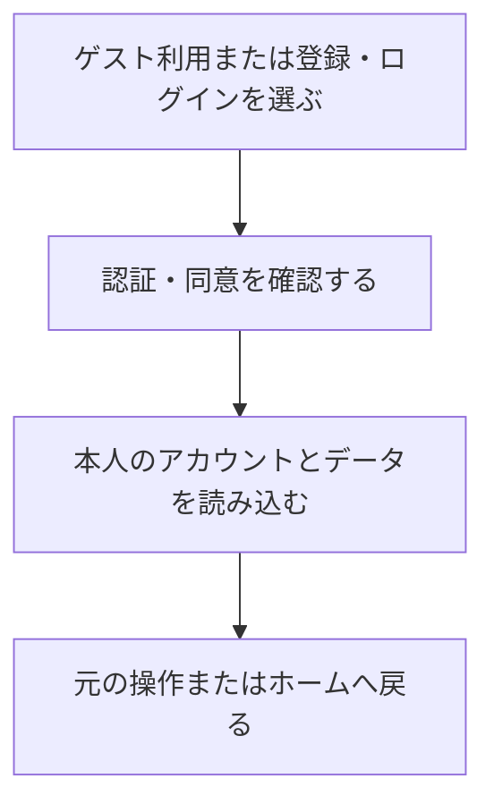

# F01｜会員登録・認証・利用者情報 PRD（レビュー前）

> ④業務ルールと⑦以降はユーザーレビュー未完了。機能・画面・操作は現在の4189モックを正とし、優先順位はスプレッドシートを正とする。本PRDはTier1のみを定義する。

参照するモック：`Tameruko-Preview-20261013` の4189（2026-10-15確認）。未接続の外部API・実端末機能は、接続済みとして扱わず末尾に記載する。

| 基本情報 | 内容 |
| --- | --- |
| 機能ID | F01 |
| 概要 | 会員登録・認証・利用者情報 |
| 対象領域 | アプリ／管理画面／外部連携 |
| 関連機能 | [F12](F12-points.md)、[F13](F13-point-exchange.md)、[F14](F14-referral.md) |
| 更新日 | 2026-10-15 |
| 版 | レビュー前（初版未確定） |

## ① 目的・今回作る範囲

目的：利用者とポイントの持ち主を正しく管理するため

評価指標：登録完了率/認証失敗率/アカウントに関する問い合わせ件数

優先順位は[アプリ詳細要件のTier列](https://docs.google.com/spreadsheets/d/1g00ZxLGprVNT4T4uSmzw--vRpp95HQ1Uq9i8GnJpmS4/edit#gid=1107057215)を正とする。モックに存在してもTier2・Tier3・空欄の要件は本PRDの定義対象に含めない。

| 要件ID | Tier1の範囲 |
| --- | --- |
| F01-1 | ポイント交換のたびにSMS認証で本人確認できる |
| F01-2 | ユーザーがGoogle・Appleのアカウントで新規会員登録・ログインできる |
| F01-3 | 本人の会員データだけを参照・更新できる |
| F01-4 | ユーザーがログアウトし、共通の認証画面から再ログインできる |
| F01-5 | ユーザーが再ログインして元のプロフィール・残高・履歴を利用できる |
| F01-6 | ユーザーが退会を申請し、会員利用・ポイント利用・通知を停止できる |
| F01-7 | ゲストユーザーが新規会員登録時に獲得ポイントを引き継ぐことができる |
| F01-8 | 初めて利用するユーザーがオンボーディング後に登録なしでゲスト利用を開始できる |
| F01-9 | ユーザーが利用開始時・マイページ・再認証時に共通の会員登録・ログイン画面を利用できる |
| F01-10 | 未成年の利用開始前に保護者の同意を確認できる |
| F01-11 | 認証システムが自社のメール登録・パスワード管理を設けず外部認証IDで会員を識別できる |
| F01-12 | ユーザーがログイン後、半年間ログイン状態を保持して利用できる |

要件名に旧モックとの相違がある場合、優先順位は維持し、現在の表示・動きとユーザー指定を②以降へ反映する。実装方式の具体化は仕様設計で扱う。

## ② 画面イメージ

[アプリの該当画面](http://127.0.0.1:4189/mock-app/#auth/start)

- ゲストでの利用開始、Google・Appleによる登録・ログイン、ログアウト、アカウント情報の変更、退会を行う。
- 新規登録時はゲストのデータを引き継ぐ。既存会員へのログインではその会員のデータを表示し、ゲスト残高を加算しない。
- 交換のたびにSMS認証を行い、本人確認完了後に交換へ進む。招待では初回の電話番号登録を行う。

## ③ 操作フロー

## ④ 業務ルール・制約

> ユーザーレビュー未完了。アプリ上の表示に関わるルールを記載する。

### 表示する対象ユーザー

| 対象ユーザー | 利用・表示 |
| --- | --- |
| 会員 | 登録済みの方法でログインし、本人のアカウント情報を確認する |
| 非会員（ゲスト） | 登録なしで利用を開始し、新規会員登録へ進む |

### 表示条件

| 状態・条件 | 表示のルール |
| --- | --- |
| 初回利用 | オンボーディングとゲスト利用の入口を表示する |
| 新規会員登録 | 利用中のゲストデータを引き継いだ本人の情報を表示する |
| 登録済みの会員でログイン | その会員の情報を表示する |
| ログアウト後 | 非会員の画面へ切り替える |
| ポイント交換の開始時 | 毎回SMS本人確認の画面を表示する |

### 画面に置く要素・操作

| 画面・要素 | 表示・操作のルール |
| --- | --- |
| Google・Appleの認証ボタン | 同じ認証画面から新規登録・ログインへ進む |
| ゲスト利用の入口 | オンボーディング後に登録なしでホームへ進む |
| アカウント情報 | 本人の登録情報とログアウト・退会への入口を表示する |
| SMS本人確認 | 電話番号・確認コードの入力、再送、本人確認完了を表示する |
| 未成年の利用開始 | 保護者同意の確認を表示する |

## ⑤ 管理画面

新規作成・変更・削除は、現在の管理画面で操作できる範囲を示す。「外部管理」はNACS・EDOCODE等の担当範囲、「未実装」は操作画面がない項目。削除と公開停止は分けて記載する。

| 対象項目 | 新規作成 | 変更 | 削除 | 管理画面での操作・反映範囲 |
| --- | --- | --- | --- | --- |
| 会員の登録・プロフィール・退会 | 不可 | 不可 | 不可 | 管理画面の会員操作UIはない。登録・変更・退会は本人がアプリで行う。 |
| 認証方式・SMSコード・セッション設定 | 不可 | 不可 | 不可 | 外部認証とSMSはモックの再現。管理画面からの設定変更UIはない。 |

## ⑥ 例外処理・エラーハンドリング

| 状況 | 表示・処理・復帰 |
| --- | --- |
| 認証失敗・コード期限切れ | 入力内容と理由を表示し、再入力・再送へ進める。 |
| ログイン中の会員が切り替わる | 前の会員の処理を現在の会員に付けない。本人の操作からやり直す。 |

## ⑦ 達成条件・未決事項

> 本節以降はユーザーレビュー未完了。

### Tier1の達成条件

- [ ] F01-1：ポイント交換のたびにSMS認証で本人確認できる。
- [ ] F01-2：ユーザーがGoogle・Appleのアカウントで新規会員登録・ログインできる。
- [ ] F01-3：本人の会員データだけを参照・更新できる。
- [ ] F01-4：ユーザーがログアウトし、共通の認証画面から再ログインできる。
- [ ] F01-5：ユーザーが再ログインして元のプロフィール・残高・履歴を利用できる。
- [ ] F01-6：ユーザーが退会を申請し、会員利用・ポイント利用・通知を停止できる。
- [ ] F01-7：ゲストユーザーが新規会員登録時に獲得ポイントを引き継ぐことができる。
- [ ] F01-8：初めて利用するユーザーがオンボーディング後に登録なしでゲスト利用を開始できる。
- [ ] F01-9：ユーザーが利用開始時・マイページ・再認証時に共通の会員登録・ログイン画面を利用できる。
- [ ] F01-10：未成年の利用開始前に保護者の同意を確認できる。
- [ ] F01-11：認証システムが自社のメール登録・パスワード管理を設けず外部認証IDで会員を識別できる。
- [ ] F01-12：ユーザーがログイン後、半年間ログイン状態を保持して利用できる。
- [ ] ⑥の対象となる空・失敗・中断などの状態から、表示内容と次の操作を確認できる。

### まだ決まっていないこと

| 確認事項 | 相談先 |
| --- | --- |
| 退会後の会員情報・取引記録の保存期間 | 事業・運用 |

## モックへの未反映・対象外

### モックへの未反映

| 項目 | 未反映の内容 |
| --- | --- |
| 外部認証・SMS送信 | Google・Appleの本番認証、実際のSMS送信・照合は未接続 |
| 会員データの保存 | サーバーでの本人情報の保存・再ログイン時の復元・退会処理は未接続 |

### 今回の対象外

| 項目 | 対象外の内容 |
| --- | --- |
| 自社のメール登録・パスワード管理 | 外部アカウントによる認証を利用するため、独自の登録・復旧画面は作成しない |

## 変更履歴

| 版 | 日付 | 変更内容 |
| --- | --- | --- |
| レビュー前 | 2026-10-15 | F10レビューの共通フィードバックを反映。⑤を管理画面へ変更し、④を対象ユーザー・表示条件・配置要素に整理。例外処理と仕様設計事項の重複を除き、未反映と対象外を別表に分離。個別レビューは未完了。 |
