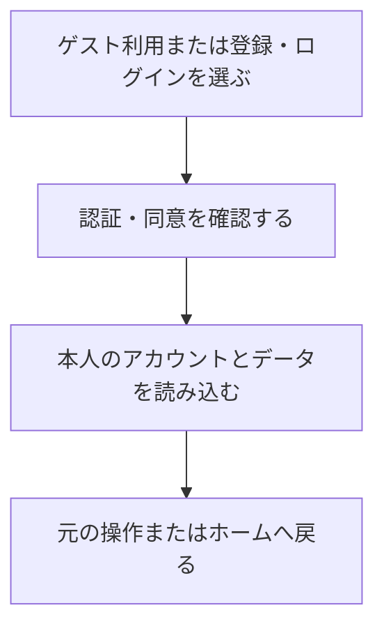

# F01｜会員登録・認証・利用者情報 PRD（レビュー前）

> ④業務ルールと⑦以降はユーザーレビュー未完了。機能・画面・操作は現在の4189モックを正とし、優先順位はスプレッドシートを正とする。本PRDはTier1のみを定義する。

参照するモック：`Tameruko-Preview-20261013` の4189（2026-10-20、オンボーディングの表示・分岐を照合）。未接続の外部API・実端末機能は、接続済みとして扱わず末尾に記載する。

| 基本情報 | 内容 |
| --- | --- |
| 機能ID | F01 |
| 概要 | 会員登録・認証・利用者情報 |
| 対象領域 | アプリ／管理画面／外部連携 |
| 関連機能 | [F12](F12-points.md)、[F13](F13-point-exchange.md)、[F14](F14-referral.md) |
| 更新日 | 2026-10-21 |
| 版 | レビュー前（初版未確定） |

## ① 目的・今回作る範囲

目的：利用者とポイントの持ち主を正しく管理するため

評価指標：登録完了率/認証失敗率/アカウントに関する問い合わせ件数

優先順位は[アプリ詳細要件のTier列](https://docs.google.com/spreadsheets/d/1tI26I_4vbSHIOzMdJz7g8-DjeLyyVUKoksVHhZ0AQhU/edit#gid=1107057215)を正とする。モックに存在してもTier2・Tier3・空欄の要件は本PRDの定義対象に含めない。

| 要件ID | Tier1の範囲 |
| --- | --- |
| F01-1 | ポイント交換のたびにSMS認証で本人確認できる |
| F01-2 | ユーザーがGoogle・Appleのアカウントで新規会員登録・ログインできる |
| F01-3 | 本人の会員データだけを参照・更新できる |
| F01-4 | ユーザーがログアウトし、共通の認証画面から再ログインできる |
| F01-5 | ユーザーが再ログインして元のプロフィール・残高・履歴を利用できる |
| F01-6 | ユーザーが退会を申請し、会員利用・ポイント利用・通知を停止できる |
| F01-7 | ゲストユーザーが新規会員登録時に獲得ポイントを引き継ぐことができる |
| F01-8 | 初めて利用するユーザーがオンボーディング後に登録なしでゲスト利用を開始できる |
| F01-9 | ユーザーが利用開始時・マイページ・再認証時に共通の会員登録・ログイン画面を利用できる |
| F01-10 | 未成年の利用開始前に保護者の同意を確認できる |
| F01-11 | 認証システムが自社のメール登録・パスワード管理を設けず外部認証IDで会員を識別できる |
| F01-12 | ユーザーがログイン後、半年間ログイン状態を保持して利用できる |

要件名に旧モックとの相違がある場合、優先順位は維持し、現在の表示・動きとユーザー指定を②以降へ反映する。実装方式の具体化は仕様設計で扱う。

## ② 画面イメージ

[登録・ログイン](http://127.0.0.1:4189/mock-app/#auth/start)／[オンボーディング1枚目](http://localhost:4189/mock-app/#onboarding/1)／[2枚目](http://localhost:4189/mock-app/#onboarding/2)／[生年月日・性別](http://localhost:4189/mock-app/#account/demographics)

- ゲストでの利用開始、Google・Appleによる登録・ログイン、ログアウト、アカウント情報の確認、退会を行う。
- オンボーディングは「ポイントをためる」「現金や好きなサービスへ交換する」の2枚。1枚目の説明文は次の2文を各文1行・全2行で表示する： 自分に合ったお仕事でポイントを貯めよう。 「これならできる！」がきっと見つかる。 イラスト・次へ・スキップを表示し、2枚目には戻るも表示する。完了条件・中断後の扱いは末尾のレビュー観点で確認する。
- 2枚目は交換先イラストのコイン上部に「＼手数料無料でまるごとおトク／」を独立したテキストとして中央揃えで表示する。画像・下部説明文・操作は維持する。交換手数料の条件を本項で変更・確定するものではない。
- 交換訴求は共通フォントとサーモンピンクを使う。両端の装飾線は本文より濃く・小さく・下寄せとし、「で」は本文より小さくする。「手数料無料」のみ字間を半角スペース約3分の1分広げ、左の装飾線と「手」の間にも同程度の間隔を置く。「で」の左右は半角スペースの半分、「まるごとおトク」の字間は通常のままとする。
- 新規登録時はゲストのデータを引き継ぐ。既存会員へのログインではその会員のデータを表示し、ゲスト残高を加算しない。
- 交換のたびにSMS認証を行い、本人確認完了後に交換へ進む。招待では初回の電話番号登録を行う。
- 交換の電話番号入力画面の説明は「SMSを受信できる携帯電話番号を入力してください。」とする。交換ごとの認証条件を変えず、繰り返しの説明文は表示しない。

## ③ 操作フロー

## ④ 業務ルール・制約

> ユーザーレビュー未完了。アプリ上の表示に関わるルールを記載する。

### 表示する対象ユーザー

| 対象ユーザー | 利用・表示 |
| --- | --- |
| 会員 | 登録済みの方法でログインし、本人のアカウント情報を確認する |
| 非会員（ゲスト） | 登録なしで利用を開始し、新規会員登録へ進む |

### 表示条件

| 状態・条件 | 表示のルール |
| --- | --- |
| 初回利用 | オンボーディングとゲスト利用の入口を表示する |
| 新規会員登録 | 利用中のゲストデータを引き継いだ本人の情報を表示する |
| 登録済みの会員でログイン | その会員の情報を表示する |
| ログアウト後 | 非会員の画面へ切り替える |
| 最後のログインから半年が経過 | ログアウトと同じく非ログイン（ゲスト）状態へ切り替え、「ログインの有効期限が切れました」ダイアログで「ログインする」「ゲストのまま使う」を選べるようにする。アプリを利用しても期限は延びず、再ログインした日から半年を数え直す |
| ポイント交換の開始時 | 毎回SMS本人確認の画面を表示する |

### 画面に置く要素・操作

| 画面・要素 | 表示・操作のルール |
| --- | --- |
| Google・Appleの認証ボタン | 同じ認証画面から新規登録・ログインへ進む |
| オンボーディングの説明 | 2枚のイラスト・説明文と次へ・スキップ、2枚目の戻るを表示する。現モックでは最後の次へとスキップが同じ後続処理へ進む |
| 利用開始前のプロフィール・同意 | 生年月日・性別の入力と、未成年の保護者同意を確認する。広告配信先の年齢別ルールはF09を参照する |
| ゲスト利用の入口 | オンボーディング後の登録・ログイン画面にある「さっそくはじめる」から登録なしでホームへ進む。プロフィール未確認時は、その前に入力・必要な保護者同意へ進む |
| アカウント情報 | ユーザーID・登録方法・電話番号の下4桁とログアウト・退会への入口を表示する。アカウント情報は編集できず、ニックネームは保持しない |
| SMS本人確認 | 電話番号・確認コードの入力、再送、本人確認完了を表示する |
| 未成年の利用開始 | 保護者同意の確認を表示する |

## ⑤ 管理画面

新規作成・変更・削除は、現在の管理画面で操作できる範囲を示す。「外部管理」はNACS・EDOCODE等の担当範囲、「未実装」は操作画面がない項目。削除と公開停止は分けて記載する。

| 対象項目 | 新規作成 | 変更 | 削除 | 管理画面での操作・反映範囲 |
| --- | --- | --- | --- | --- |
| 会員の登録・プロフィール・退会 | 不可 | 不可 | 不可 | 管理画面の会員操作UIはない。登録・変更・退会は本人がアプリで行う。 |
| 認証方式・SMSコード・セッション設定 | 不可 | 不可 | 不可 | 外部認証とSMSはモックの再現。管理画面からの設定変更UIはない。 |

## ⑥ 例外処理・エラーハンドリング

| 状況 | 表示・処理・復帰 |
| --- | --- |
| 認証失敗・コード期限切れ | 入力内容と理由を表示し、再入力・再送へ進める。 |
| ログイン中の会員が切り替わる | 前の会員の処理を現在の会員に付けない。本人の操作からやり直す。 |
| ログインの有効期限切れ | 非ログイン状態へ切り替え、会員のポイント・履歴はアカウントに残す。再ログインすると続きから利用できる。 |

## ⑦ 達成条件・未決事項

> 本節以降はユーザーレビュー未完了。

### Tier1の達成条件

- [ ] アカウント情報にはユーザーID・登録方法・電話番号の下4桁のみを表示し、編集操作を提供しない。ニックネームは保持しない。ログアウト・退会の入口は維持する。

- [ ] F01-1：ポイント交換のたびにSMS認証で本人確認できる。
- [ ] F01-2：ユーザーがGoogle・Appleのアカウントで新規会員登録・ログインできる。
- [ ] F01-3：本人の会員データだけを参照・更新できる。
- [ ] F01-4：ユーザーがログアウトし、共通の認証画面から再ログインできる。
- [ ] F01-5：ユーザーが再ログインして元のプロフィール・残高・履歴を利用できる。
- [ ] F01-6：ユーザーが退会を申請し、会員利用・ポイント利用・通知を停止できる。
- [ ] F01-7：ゲストユーザーが新規会員登録時に獲得ポイントを引き継ぐことができる。
- [ ] F01-8：初めて利用するユーザーがオンボーディング後に登録なしでゲスト利用を開始できる。説明画面の次へ・戻る・スキップと、プロフィール・同意から登録／ゲスト開始までの分岐をレビューできる。
- [ ] F01-9：ユーザーが利用開始時・マイページ・再認証時に共通の会員登録・ログイン画面を利用できる。
- [ ] F01-10：未成年の利用開始前に保護者の同意を確認できる。
- [ ] F01-11：認証システムが自社のメール登録・パスワード管理を設けず外部認証IDで会員を識別できる。
- [ ] F01-12：ユーザーがログイン後、半年間ログイン状態を保持して利用できる。最後のログインから半年が経過したら非ログイン状態になり、案内ダイアログから再ログインかゲスト利用を選べる。モックでは「表示・動作の確認」＞「会員登録・認証の確認」の「最後のログインから半年経過させる」で確認できる。
- [ ] ⑥の対象となる空・失敗・中断などの状態から、表示内容と次の操作を確認できる。

### まだ決まっていないこと

| 確認事項 | 相談先 |
| --- | --- |
| 退会後の会員情報・取引記録の保存期間 | 事業・運用 |

## モックへの未反映・対象外

### モックへの未反映

| 項目 | 未反映の内容 |
| --- | --- |
| 外部認証・SMS送信 | Google・Appleの本番認証、実際のSMS送信・照合は未接続 |
| 会員データの保存 | サーバーでの本人情報の保存・再ログイン時の復元・退会処理は未接続 |

### 今回の対象外

| 項目 | 対象外の内容 |
| --- | --- |
| 自社のメール登録・パスワード管理 | 外部アカウントによる認証を利用するため、独自の登録・復旧画面は作成しない |

## 変更履歴

| 版 | 日付 | 変更内容 |
| --- | --- | --- |
| レビュー前 | 2026-10-22 | アカウント情報を表示専用とし、ユーザーID・登録方法・電話番号の下4桁を表示。編集操作・ニックネームの保持を廃止し、モックにも反映。 |
| レビュー前 | 2026-10-21 | オンボーディングの最終文言と字間・装飾線の指定を本文へ整理。交換時のSMS案内を短縮し、都度認証の条件は維持。 |
| レビュー前 | 2026-10-21 | ユーザー指定の交換訴求をオンボーディング2枚目の画像上へテキスト追加。共通フォント・ブランド色を使用し、両端の装飾線を濃く・小さくして下げ、接続詞「で」は読みやすさを保つ大きさに調整。1枚目の説明文は各文が1行ずつ、全2行に収まるよう調整。画像や交換条件は変更しない。 |
| レビュー前 | 2026-10-21 | オンボーディング1枚目の説明文を、自分に合ったお仕事でポイントを貯めることと「これならできる！」が見つかることを伝える文章へ変更。2枚目の文言・デザイン・操作は維持。 |
| レビュー前 | 2026-10-15 | F10レビューの共通フィードバックを反映。⑤を管理画面へ変更し、④を対象ユーザー・表示条件・配置要素に整理。例外処理と仕様設計事項の重複を除き、未反映と対象外を別表に分離。個別レビューは未完了。 |
| レビュー前 | 2026-10-20 | オンボーディングの画面・操作・利用開始までの分岐を追記し、初回表示・中断復帰・必須入力・保護者同意・ゲスト開始の仕様確認観点を追加。現モックの観察と未決の事業判断を区別し、Tier・認証方式の採用範囲は維持。 |
| レビュー前 | 2026-10-20 | ユーザー指定により認証方式はGoogle・Appleの記載を維持し、追加の認証方式の採否確認項目を削除。 |
| レビュー前 | 2026-10-21 | ユーザー指定によりF01-12を「最後のログインから半年経過で非ログイン状態にする」と定義。モックの期限切れ時の動きをログイン画面への固定からゲスト状態への切り替えに変更し、案内ダイアログと確認用の操作を追加。 |

## レビュー時の確認項目：オンボーディング

F01-8・F01-9・F01-10の確認観点。以下の「現モック」は現在の表示・処理の観察であり、未レビューの挙動を採用済み仕様とは扱わない。生年月日・性別はF09-6と関連し、登録・利用開始までの導線をF01で確認する。

| 確認対象 | 現モックの表示・動き | 仕様確認の観点 |
| --- | --- | --- |
| 初回表示・再表示 | ローカル保存データがなく画面URLを指定しない初回起動では1枚目を開く。完了情報を保存する処理がある。再起動時の判定は完了情報ではなく保存データの有無を使う | 初回の開始画面、表示対象、完了とみなす時点、完了後の再起動・ログアウト時の再表示要否を確認する |
| 説明の内容と順番 | 1枚目の説明文：自分に合ったお仕事でポイントを貯めよう。 「これならできる！」がきっと見つかる。 2枚目は交換を説明する。説明中は下部のメインメニューを表示しない | この2枚構成・イラスト・下部メニュー非表示でよいか。2枚目の説明文、表示上のページ案内と各ボタンの配置も確認する |
| 次へ・戻る | 1枚目の次へで2枚目へ、2枚目の戻るで1枚目へ進む。2枚目の次へで説明を終了する | 両方向の遷移と最終画面の文言を確認する。戻る操作で完了扱いにしないことを確認する |
| スキップ | どちらの説明画面からも終了でき、最後の次へと同じ後続処理へ進む | スキップできる範囲は説明だけか。プロフィールや保護者同意を省略できる意味にしないかを確認する |
| 生年月日・性別 | 未確認時は入力画面へ進む。空欄では登録できず、日付・性別を検証する。登録後は編集できず、生年月日を公開しないと案内する | 必須項目、性別の選択肢、入力エラー、登録後の変更可否・表示範囲、確認済みの場合の入力省略を確認する |
| 未成年の保護者同意 | 18歳未満は同意画面へ進み、チェック前は次へが非活性。閉じると入力画面へ戻る。規約・プライバシーポリシーは仮の案内 | 同意文・チェック操作・戻り先・未同意時の利用制限を確認する。正式文書の掲載先は未設定として扱う |
| 登録・ログイン・ゲスト開始 | プロフィール・同意の完了後に共通認証画面へ進む。「さっそくはじめる」でゲストとしてホームへ進む。プロフィール確認済みなら説明終了後に共通認証画面へ進む | 登録を必須にせず開始できること、既存会員のログイン導線とゲストへの案内文、各分岐の遷移先を確認する |
| 中断・再起動・通信失敗 | 説明のページ番号はURL、未確定の入力値は画面内の状態、確認済みプロフィール・同意はローカル保存で扱う。本番の復帰は未接続 | 説明途中・プロフィール入力途中・同意前後で閉じた場合の復帰位置と入力保持を決める。保存失敗時に利用開始済みにならないか確認する |

- [ ] 上記8観点をモックで確認し、採用する表示・分岐と変更する点を記録する。
- [ ] オンボーディング1枚目に指定の説明文が各文1行・全2行で表示され、2枚目の文章と「次へ」「戻る」「スキップ」の動作が変わらない。
- [ ] 2枚目だけに指定の交換訴求が画像上で中央揃えに表示され、コイン・交換先・注記に重ならない。
- [ ] 初回起動・完了情報の永続化・再インストール後の扱いは、ローカル表示の確認と本番要件を区別して確認する。

参照実装：[`account-ui.js`](../../../mock-app/account-ui.js) の説明画面・`finish-onboarding`・`finishDemographics`、[`app.js`](../../../mock-app/app.js) の初回表示判定、[`demographics.js`](../../../mock-app/demographics.js) の必須入力・年齢・同意の表示。実端末での初回起動や本番の保存を確認済みとは扱わない。
