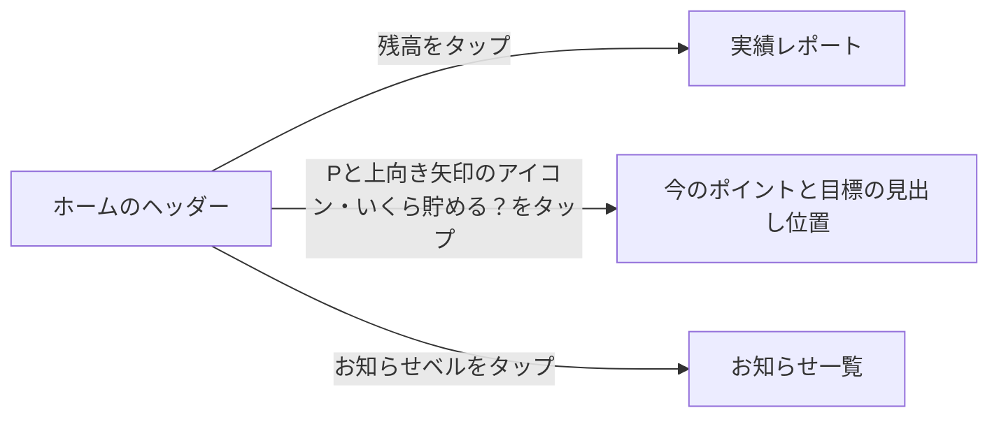
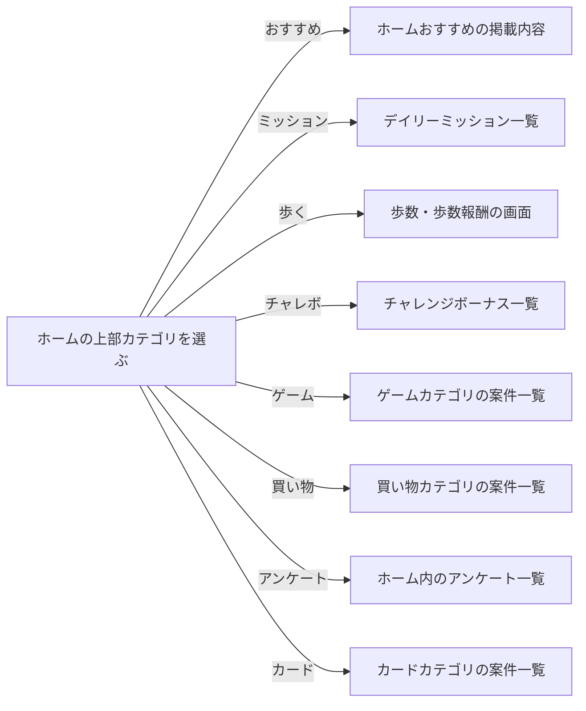
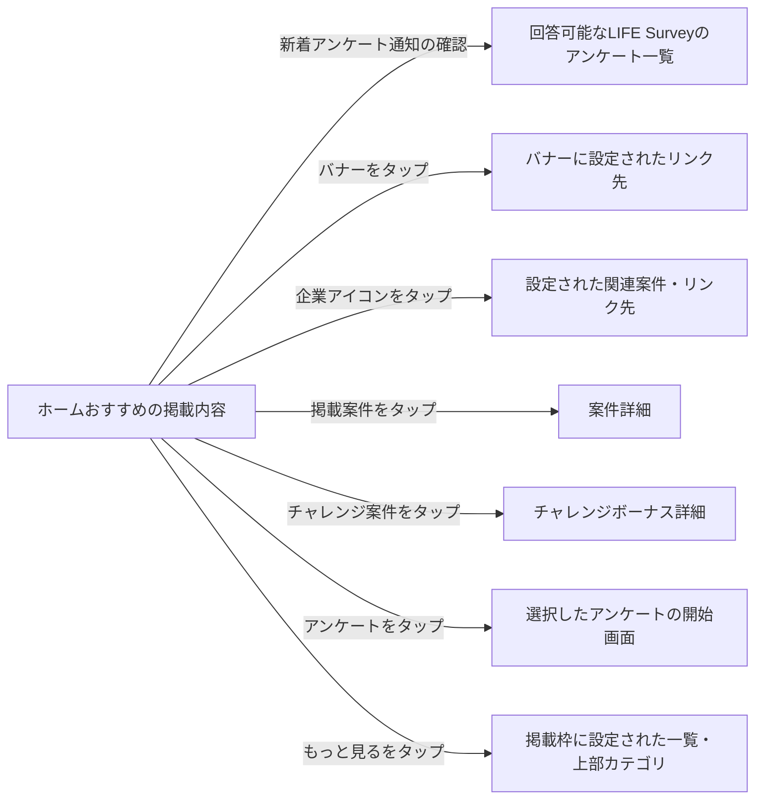
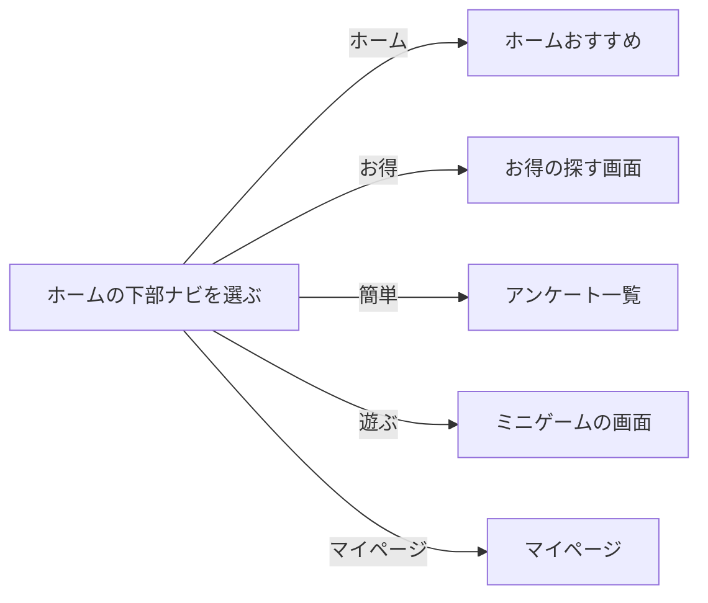
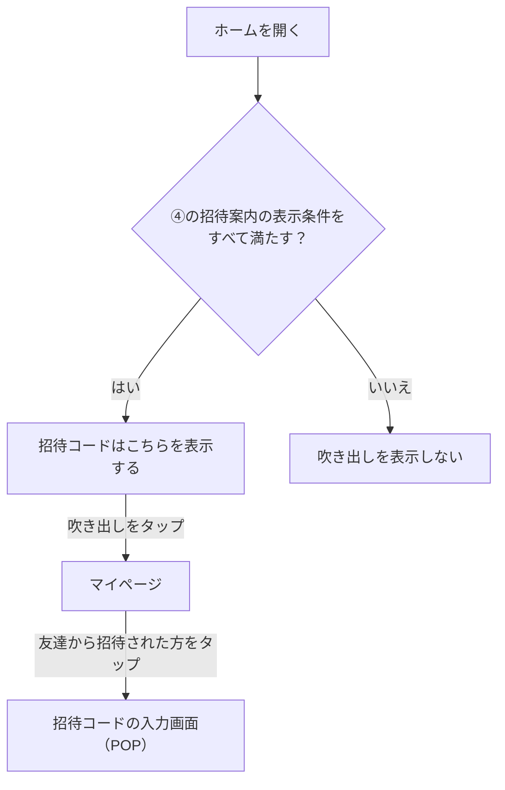

# F02｜ホーム・画面構成・上部メニュー PRD（レビュー前）

参照モック：本リポジトリの `mock-app/`・`mock-admin/`（2026-10-29照合）。本番API・実端末での動作は未確認。

| 基本情報 | 内容 |
| --- | --- |
| 機能ID | F02 |
| 概要 | ホーム・画面構成・上部メニュー |
| 対象領域 | アプリ／管理画面／外部連携 |
| 関連機能 | [F03](F03-offer-list.md)、[F07](F07-daily-mission.md)、[F08](F08-walking.md)、[F10](F10-surveys.md)、[F11](F11-mini-games.md)、[F12](F12-points.md)、[F14](F14-referral.md)、[F18](F18-mypage-support.md) |
| 更新日 | 2026-10-29 |
| 版 | レビュー前（初版未確定） |

## ① 目的・今回作る範囲

ホームで残高や本日の進捗を確認し、カテゴリや下部ナビからポイント獲得などの各機能へ移動できるようにする。

開発対象は[アプリ詳細要件のTier列](https://docs.google.com/spreadsheets/d/1tI26I_4vbSHIOzMdJz7g8-DjeLyyVUKoksVHhZ0AQhU/edit#gid=1107057215)でTier1の要件とする。Tier2・Tier3・空欄の要件は対象外とする。

| 要件ID | Tier1の範囲 |
| --- | --- |
| F02-1 | ユーザーが下部5タブからホーム・お得・簡単・遊ぶ・マイページへ移動できる |
| F02-2 | ユーザーがホーム画面のカテゴリ入口から対象のポイント獲得機能へ移動できる |
| F02-3 | 直前に見ていた画面へ表示状態を保って戻ることができる |
| F02-4 | ユーザーがホーム画面で残高を確認して実績レポートへ移動できる |
| F02-7 | ユーザーがホームのヘッダーの「いくら貯める？」から「今のポイントと目標」へ移動できる |

管理側は[管理画面詳細要件のTier列](https://docs.google.com/spreadsheets/d/1tI26I_4vbSHIOzMdJz7g8-DjeLyyVUKoksVHhZ0AQhU/edit#gid=1341040600)にある以下のTier1を関連範囲とする。NACS本体の内製要件にはしない。

| 要件ID | Tier1の運用範囲 |
| --- | --- |
| ADM-F01-3 | 運営担当者がホームタブに表示するカテゴリを事前に設定して、指定日時に自動で切り替えられる |

## ② 画面イメージ

ホームは読み込み中・取得エラー・表示対象が0件の場合も、残高ヘッダー、「Pと上向き矢印のアイコン」、上部カテゴリ、下部ナビ、「おすすめ」サイドバーの表示位置を維持する。

すべての上部カテゴリに、以下の操作ルールを適用する。今後追加するカテゴリも対象とし、通常・読み込み中・取得失敗・0件でも操作を維持する。

| 対象 | 表示・操作 |
| --- | --- |
| 選択状態 | 現在選択中のカテゴリが分かるように表示する |
| スクロール位置 | ユーザーが手動でスクロールした位置を保持する。全体が見えているカテゴリを選んだ場合や本文の更新・再描画では、タブ列を自動移動しない |
| 見切れたアイコンの選択 | 選んだカテゴリアイコンが一部見切れている場合だけ、全体が見える最寄りの位置まで横スクロールする。途中でユーザーが手動操作を始めたら自動移動を止め、その位置を保持する |
| 動きを減らす設定 | 必要な位置への移動を即時に行い、スクロールアニメーションを再生しない |

[アプリの該当画面](http://127.0.0.1:4173/mock-app/#home)

- 下部ナビは「ホーム」「お得」「簡単」「遊ぶ」「マイページ」の5つ。
- 上部カテゴリは「おすすめ」「ミッション」「歩く」「チャレボ」「ゲーム」「買い物」「アンケート」「カード」を表示し、横スクロールで切り替える。「ミッション」はデイリーミッション、「チャレボ」はチャレンジボーナスを開く。
- ヘッダーの残高をタップすると、実績レポートへ移動する。
- ヘッダーの「Pと上向き矢印のアイコン」は静止表示する。このアイコン、または「いくら貯める？」をタップすると、「今のポイントと目標」へ移動する。遷移先の詳細は[F12](F12-points.md)に従う。
- お知らせベルをタップすると、お知らせ一覧へ移動する。詳細は[F17](F17-notifications.md)に従う。
- ホームでは、どのカテゴリを選んでもヘッダー・上部カテゴリ・「おすすめ」サイドバーを表示する。「いくら貯める？」の吹き出しはホームを開いてから5秒間表示し、カテゴリを切り替えても表示時間をリセットしない。
- ホームの上部カテゴリ「アンケート」と下部ナビ「簡単」は、同じアンケート一覧を上部バナーの下に表示する。ホーム経由では上部カテゴリを表示し、下部ナビ「ホーム」を選択中とする。「簡単」経由では上部カテゴリを表示せず、下部ナビ「簡単」を選択中とする。詳細は[F10](F10-surveys.md)に従う。
- ゲーム・買い物・カードのカテゴリ案件は開閉なしで一覧表示し、件数の上限はお得タブの「もっと見る」と同じ最大100件とする。並び順はASPから送られてくるEPCの降順とし、同値の場合は案件IDが新しい順、EPCがない案件は最下部に表示する（[F03](F03-offer-list.md)のカテゴリ別案件一覧と共通）。

### 上部バナーの入稿規定

ホームの全カテゴリと下部「簡単」の上部バナーの入稿規定は320×100px（16:5）とする。画面幅に合わせて、縦横比を保って表示する。

下部バナー・起動時POPUP・画面間広告は掲載場所ごとの別サイズを使用する。入稿・配信・広告種別の詳細は[F15](F15-ad-placements.md)を参照する。

### 招待コード入力への吹き出し

ホームの下部ナビ「マイページ」の上に、「招待コードはこちら」の吹き出しを表示する。表示条件と非表示になるタイミングは④に定義する。

| 要素 | 表示・操作 |
| --- | --- |
| 文言 | 「招待コードはこちら」 |
| 配置 | 表示条件を満たす間は、スクロールしても下部ナビ「マイページ」の上に表示し続ける |
| タップ時 | マイページへ移動する。マイページで「友達から招待された方」をタップすると、招待コードの入力画面（POP）を開く。入力・適用の詳細は[F14](F14-referral.md)、マイページの詳細は[F18](F18-mypage-support.md)に従う |

### ホーム「おすすめ」

案件掲載枠の見出しは管理画面で設定する。「期間限定ポイントアップ！」「人気案件」「おすすめ案件」は初期表示名の例とする。

ホームを開いた際は上部の「おすすめ」を最初に表示する。「ミッション」は独立した上部タブとして維持し、全ミッション・進捗・報酬の受取操作は[F07](F07-daily-mission.md)に従う。下部「お得」内の案件検索タブは「探す」と表示する。

| 表示順 | 要素 | 表示と遷移 |
| --- | --- | --- |
| ヘッダー | 残高と交換案内 | 本人の有効残高を円相当で表示する。「1,000,000円相当」まで他の要素と重ならず確認できる。交換案内の初期文言は「ドットマネーへの／交換手数料ゼロ」 |
| 1 | 新着アンケート通知 | 手紙アイコン、「アプリ限定の新着アンケートが届いています」、獲得できる最大ポイントの合計、「確認」と通知ドットを表示する。「確認」をタップすると、回答可能なLIFE Surveyのアンケート一覧を開く。通知の対象・表示条件は④に従う |
| 2 | バナー | ホーム最上部の掲載設定に従ってバナーを表示し、タップすると設定されたリンク先へ移動する。掲載条件は④に従う |
| 3 | 企業アイコン（ポイント・マイル） | 管理画面に登録した企業ポイント・マイル・サイトから、ホームの表示対象として選択したアイコンを最大5件表示する。登録された画像と並び順を使用し、タップすると設定された関連案件・リンク先へ移動する |
| 4 | 横スクロールの案件枠（初期名例：期間限定ポイントアップ！） | 最大8件の案件画像を横スクロールで表示。順位番号は表示しない。吹き出し設定で指定された表示位置に任意の文言を表示する。「もっと見る」はお得の案件一覧へ |
| 5 | デイリーミッション | リストで2件表示。未受取を優先し、受取済みはチェック付き。進捗は上部「ミッション」で確認する。「もっと見る」をタップすると上部「ミッション」へ移動する |
| 6 | カード一覧の案件枠（初期名例：人気案件） | 最大6件を表示。案件画像・案件名・報酬を表示し、案件詳細へ移動する |
| 7 | チャレンジボーナス | 掲載条件を満たす全案件を横スクロールで表示。各案件には画像・終了までの日数・案件名・達成ボーナスを表示する。「もっと見る」をタップすると上部「チャレボ」へ、案件をタップすると詳細へ移動する |
| 8 | アンケート | F10の配信元ごとの条件に従って、回答可能な案件を表示する。案件をタップすると回答開始画面へ移動する |
| 9 | カード一覧の案件枠（初期名例：おすすめ案件） | 最大6件を表示。案件選択で詳細へ移動する |

チャレンジボーナスの表示項目は上部「チャレボ」でも共通とする。カード列は左右端までスクロールできる。「おすすめ」サイドバーを閉じているときも、画面右側に「おすすめ」タブを表示する。

## ③ 操作フロー

ホームを開くと、上部カテゴリの「おすすめ」を最初に表示する。掲載条件を満たす入口だけを表示する。遷移後の入力・参加・受取などの詳細操作は各機能の仕様に従う。

### ヘッダーからの遷移

残高と目標の詳細は[F12](F12-points.md)、お知らせは[F17](F17-notifications.md)に従う。実績レポートの下部ナビの選択状態は④に従う。

### 上部カテゴリからの遷移

上部「ゲーム」は案件カテゴリ、下部「遊ぶ」はミニゲームの入口として区別する。ホーム内では、どのカテゴリへ切り替えても上部カテゴリを維持する。各機能の詳細は[F03](F03-offer-list.md)・[F06](F06-challenge-bonus.md)・[F07](F07-daily-mission.md)・[F08](F08-walking.md)・[F10](F10-surveys.md)を参照する。

### ホームおすすめ内のコンテンツからの遷移

「もっと見る」は、案件枠ではお得の案件一覧、デイリーミッションでは上部「ミッション」、チャレンジボーナスでは上部「チャレボ」を初期の遷移先とする。管理画面で遷移先リンクを設定した掲載枠では、保存された設定に従う。設定項目は⑤を参照する。

デイリーミッションの各項目の実施先・受取操作は[F07](F07-daily-mission.md)、案件詳細は[F04](F04-offer-entry.md)、チャレンジ詳細は[F06](F06-challenge-bonus.md)、アンケートは[F10](F10-surveys.md)に従う。

### 下部ナビからの遷移

下部「簡単」から開くアンケート一覧では、ホームの上部カテゴリを表示しない。遷移先の詳細は[F03](F03-offer-list.md)・[F10](F10-surveys.md)・[F11](F11-mini-games.md)・[F18](F18-mypage-support.md)を参照する。

### 招待コード案内からの遷移

入力・適用の詳細は[F14](F14-referral.md)を参照する。

## ④ 業務ルール・制約

### 表示する対象ユーザー

| 対象ユーザー | 利用・表示 |
| --- | --- |
| 会員 | ホームと各機能への入口を表示する |
| 非会員（ゲスト） | ホームと各機能への入口を表示する |

### 表示条件

| 状態・条件 | 表示のルール |
| --- | --- |
| 実績レポート | 遷移元の下部タブの選択状態を維持する。再読み込みや「戻る／進む」でも同様とする。ホームから開いた場合は「ホーム」、マイページから開いた場合は「マイページ」を選択中とする |
| ホームの招待コード案内 | ユーザーID発行から72時間未満、かつ招待コード未適用、かつ友達招待が開始中の場合に限り表示する。会員登録日時ではなく、ユーザーIDの発行日時を72時間の起点とする |
| 招待コード案内の非表示 | ユーザーID発行から72時間経過（72時間ちょうどを含む）・招待コード適用完了・友達招待の停止のいずれかで非表示にする。友達招待の開始前も表示しない |

### おすすめのデータ・掲載ルール

| 対象 | ルール |
| --- | --- |
| ヘッダーの残高 | マイページの「あなたのポイント」と同じ本人の有効残高（失効分を除いた交換可能ポイント）を100pt＝1円相当で表示する。準備中のポイントは含めない。付与確定・交換・失効・利用者切替後は、本人の有効残高に合わせて更新する |
| 取り消し線付きの比較額 | 本人の有効残高を基準に算出し、ヘッダーに常時表示する |
| 交換案内 | 有効な契約・提供条件に従った文言を掲載する |
| 新着アンケート通知 | 対象は回答可能なLIFE Surveyの案件のみ。回答済み・募集終了など回答不可の案件を除き、回答後に追加で回答可能になった案件は含める。対象案件ごとに獲得できる最大ポイントを合算する。対象が0件の場合は通知帯全体を非表示にする |
| バナー | 公開条件・掲載期間・配信対象を満たすバナーを表示する。対象がない場合はバナー枠を非表示にする |
| バンドル属性で取得する案件掲載枠 | 管理画面で指定したバンドル属性（案件をグループ分けする属性）に一致し、公開・掲載期間・配信対象の条件を満たす案件を表示する |
| 吹き出し | 対象掲載枠・文言・何枠目の案件に表示するかを設定する。実際に表示される案件順を基準とし、対象枠の掲載期間外・指定位置の案件なしでは表示しない。最高還元などの訴求は運営が表示根拠を確認する |
| ミッション | F07の当日一覧と同じ達成・受取状態、報酬額を表示する。アンケートとミニゲームの報酬には「最大」を付ける |
| チャレンジボーナス | 指定したバンドル属性に一致し、チャレンジ枠と案件の双方の公開状態・掲載期間・配信対象を満たすものを全件表示。案件のOS・解禁条件も適用する。報酬の条件・付与はチャレンジボーナスの個別PRDを参照する |
| 設定の保存 | 保存成功後にホームの掲載内容・ヘッダーへ反映する。入力エラー時は前回の保存内容を保持する |

## ⑤ 管理画面

[実行設定の管理画面](http://127.0.0.1:4173/mock-admin/#top-menu)

| 対象項目 | 新規作成 | 変更 | 削除 | 管理画面での操作・反映範囲 |
| --- | --- | --- | --- | --- |
| 上部メニューの設定一式・適用日時（ADM-F01-3） | 可能 | 可能 | 可能 | TOP画面上部のメニュー。設定を追加・予約・編集・削除する。適用中の削除後は直前の有効設定へ戻る。 |
| 下部ナビ・ヘッダー（「Pと上向き矢印のアイコン」・「いくら貯める？」を含む） | 不可 | 不可 | 不可 | アプリ側で表示内容を管理する。 |

### ホームおすすめ設定

デイリーミッションは専用の掲載チェックで表示を切り替える。掲載ON/OFFを変更しても、設定済みの表示位置と活動条件を保持する。

管理画面の見出しは「案件掲載枠の追加・削除」「案件詳細の並べ替え」「案件吹き出しの追加」「ヘッダー吹き出しの変更」「ポイント別案件枠の追加・削除」とする。案件吹き出しの文言は1行で表示する。

| 設定項目 | 入力・制約 | アプリへの反映 |
| --- | --- | --- |
| ヘッダーの交換案内 | 表示ON/OFF、2行の文言（1行目9文字・2行目7文字以内） | 残高右側の吹き出しに反映 |
| 企業アイコン（ポイント・マイル） | 企業ポイント・マイル・サイトを新規登録し、名前・画像・リンク・吹き出し文言を編集する。登録数は上限なし。各項目の表示先を「ホーム」「お得」のチェックで選択し、それぞれ最大5件、合計10チェックまで設定できる。同じ項目を両画面に選択した場合は2チェックと数える。新規登録時は両方未選択。ドラッグまたは上下キーで並べ替える | 選択した項目を各画面に表示する。画像・リンク・吹き出し文言・並び順はホームとお得で共通。吹き出しは20文字以内、空欄で非表示。ホームの企業アイコン欄を掲載OFFにしても個別設定を保持する。保存後は選択した画面へ反映する |
| 各掲載枠 | 掲載枠の追加・削除、掲載枠名（1〜40文字）、バンドル属性、掲載開始日・終了日、「もっと見る」の遷移先リンク、ドラッグによる配置順 | 掲載期間内の枠を設定順に表示。新規追加した案件枠には最大6件の案件を表示する |
| 横スクロールの案件枠 | バンドル属性（80文字以内） | 対象案件を横スクロールで表示 |
| 吹き出し | 対象の案件掲載枠（管理画面で設定した枠名から選択）、任意の文言（1〜20文字）、何枠目の案件に表示するか | 指定枠の指定位置に表示。複数登録・削除ができる。同じ枠・同じ位置の重複は保存できない |
| カード一覧の案件枠 | 枠ごとのバンドル属性（80文字以内） | 各枠に最大6件を表示 |
| アンケート通知 | 対象提供元・合計方法・確認先は固定 | LIFE Surveyの回答可能案件が1件以上の場合だけ通知帯を自動生成。0件時は通知帯全体を非表示にし、運営が通知内の件数・報酬を直接入力しない |
| デイリーミッション | おすすめ内の掲載ON/OFF。活動条件・報酬はF07の設定を参照 | おすすめ内がOFFでもミッションタブと活動条件は維持。ONの場合はおすすめの2件とミッションタブの全件に同じ活動結果を反映 |
| おすすめ内のチャレンジボーナス | バンドル属性・保存した案件順と、チャレンジ枠・案件双方の配信条件を参照 | この設定の反映先はホームおすすめ内のみ。上部チャレボの対象・順序はチャレンジ設定に従い、ホームおすすめ設定の影響を受けない |
| バナー | ホーム最上部の掲載設定を参照 | ④の掲載条件に従って表示する |

新着アンケート通知・最上部バナー・企業アイコン・デイリーミッションは、それぞれ専用の設定で管理する。案件掲載枠の一覧で設定できる項目は、上表の「各掲載枠」に示す項目とする。

#### 掲載枠の名前・対象・順序

- 保存した掲載枠名を、アプリの案件枠・ミッション・アンケートの見出しや通知文、管理画面の選択肢に反映する。バナー・企業アイコンの枠名は管理用とする。
- 対象案件はバンドル属性で選ぶ。属性は候補から選択または直接入力でき、案件の属性変更は次回表示時に反映する。属性未設定・一致案件なしの場合は、その枠を表示しない。
- 枠の表示順はドラッグまたは上下キーで指定する。
- 表示上限は横スクロールの案件枠が8件、カード一覧の案件枠が各6件、チャレンジボーナスが掲載条件を満たす全件。掲載枠名を変更しても、表示方法と上限は維持する。

#### 案件の並べ替え・吹き出し

- 対象案件の名前・ID・アプリ上の表示位置を一覧で確認し、ドラッグで並べ替えられる。初期状態は配信順とする。
- 並べ替え結果は操作中の掲載枠にだけ反映する。バンドル本体・他の掲載枠の順序は維持する。
- 新たに属性が一致した案件は末尾に追加し、属性が外れた案件は対象から外す。公開条件・掲載上限によって表示されない案件も一覧で識別できる。
- 吹き出しは指定した表示位置に付ける。位置選択にはその位置の案件名を併記し、並べ替え後の案件名に更新する。

[ホームおすすめ設定](http://127.0.0.1:4173/mock-admin/#home-recommend)

## ⑥ 例外処理・エラーハンドリング

| 状況 | 表示・処理・復帰 |
| --- | --- |
| メニュー設定がない | 利用可能な既定のメニューを表示する。 |
| 遷移先が終了・停止している | 遷移先機能の表示に従い、戻る入口を維持する。 |

## ⑦ 達成条件・未決事項

### ホーム「おすすめ」の達成条件

- [ ] 案件が非公開・期間外・対象OS外・未解禁の場合、おすすめのチャレンジに表示しない。
- [ ] バナーの配信対象がない場合は枠を非表示にする。
- [ ] LIFE Surveyの回答可能な案件が0件の場合は新着アンケート通知帯全体を非表示にする。
- [ ] おすすめ内のチャレンジ設定を変更しても、上部チャレボの対象・順序は変更しない。

- [ ] 上部「おすすめ」と「ミッション」が別タブで表示され、下部「お得」内の案件検索タブは「探す」と表示される。
- [ ] LIFE Survey限定の通知対象・合計・確認先が一致し、他社のアンケート一覧は維持される。
- [ ] 管理画面で保存した枠名がアプリの見出しと吹き出しの対象枠選択に反映される。
- [ ] 掲載枠を追加・削除し、枠名・期間・バンドル属性・「もっと見る」の遷移先リンクを設定できる。枠と案件の順序をドラッグで変更できる。
- [ ] 新着アンケート通知・最上部バナー・企業アイコン・デイリーミッションを専用設定で管理し、企業アイコン欄全体の掲載ON/OFFを切り替えられる。
- [ ] 吹き出しの対象掲載枠・文言・表示位置を保存できる。指定位置に案件がない場合と掲載期間外の枠には表示せず、同じ枠・位置の重複は保存できない。
- [ ] 企業アイコンをドラッグで並べ替え、名前・画像・遷移先を保存してアプリへ反映できる。キャンセルと入力エラーでは保存済み内容を保持する。
- [ ] 登録済みの企業ポイント・マイル・サイトから、ホーム・お得それぞれ最大5件、合計10チェックまで表示対象を選択できる。同じ項目を両画面に選択した場合は2チェックと数え、各画面に選択したアイコンが表示される。
- [ ] 企業アイコンを新規登録できる。画像・リンク・吹き出し文言・並び順の変更は、掲載している両画面に反映される。
- [ ] 管理画面の掲載案件・企業アイコン・交換案内を保存し、アプリで反映を確認できる。空の掲載枠名・文字数超過・表示順の重複・不正な掲載期間は保存できない。
- [ ] ミッションを2件表示し、「もっと見る」から上部「ミッション」へ移動して進捗を確認できる。
- [ ] チャレンジボーナスの全件を横1列で表示し、「もっと見る」で上部チャレボタブに移動できる。
- [ ] 1,000,000円相当の残高でも交換案内とアイコンが重ならない。

### Tier1の達成条件

- [ ] ホームは読み込み中・取得エラー・表示対象が0件の場合も、残高ヘッダー、「Pと上向き矢印のアイコン」、上部カテゴリ、下部ナビ、「おすすめ」サイドバーの表示位置を維持する。

- [ ] ホーム内でどのカテゴリへ切り替えても、ヘッダー・上部カテゴリ・「おすすめ」サイドバーを表示し、下部ナビ「ホーム」を選択中とする。
- [ ] 「いくら貯める？」の吹き出しはホームを開いてから5秒間表示され、カテゴリを切り替えても表示時間をリセットしない。
- [ ] 追加カテゴリを含むすべての上部カテゴリで、読み込み中／取得失敗／0件でも操作と手動スクロール位置を維持する。
- [ ] 一部見切れたアイコンを選んだ場合だけスクロールして全体が見える近い端の位置へ移動し、全体が見えているアイコンの選択・再描画では手動スクロール位置を変えない。手動操作で自動移動を中断でき、動きを減らす設定では即時に位置を合わせる。現在選択中のカテゴリが分かるように表示する。
- [ ] ヘッダーの「Pと上向き矢印のアイコン」は静止表示し、このアイコンと「いくら貯める？」のどちらをタップしても「今のポイントと目標」へ移動する。
- [ ] ヘッダーに、本人の有効残高を基準に算出した比較額が取り消し線付きで常時表示される。
- [ ] F02-1：ユーザーが下部5タブからホーム・お得・簡単・遊ぶ・マイページへ移動できる。
- [ ] F02-2：ユーザーがホーム画面のカテゴリ入口から対象のポイント獲得機能へ移動できる。
- [ ] ヘッダー・上部カテゴリ・おすすめ内のコンテンツ・下部ナビ・招待案内から、それぞれ設定された画面へ遷移できる。上部「ゲーム」は案件カテゴリ、下部「遊ぶ」はミニゲームを開く。アンケートはホーム経由では上部カテゴリを表示し、下部「簡単」経由では表示しない。
- [ ] ゲーム・買い物・カードのカテゴリ案件が、開閉なしで最大100件、EPCの降順（同値は案件IDが新しい順、EPCなしは最下部）で表示される。
- [ ] F02-3：直前に見ていた画面へ表示状態を保って戻ることができる。
- [ ] F02-4：ユーザーがホーム画面で残高を確認して実績レポートへ移動できる。
- [ ] 実績レポートを開いたときは、遷移元の下部タブの選択状態を維持する。再読み込みや「戻る／進む」でも同様とする。ホームから開いた場合は「ホーム」、マイページから開いた場合は「マイページ」を選択中とする。
- [ ] F02-7：ユーザーがホームのヘッダーの「いくら貯める？」から「今のポイントと目標」へ移動できる。
- [ ] ホームの全カテゴリと下部「簡単」の上部バナーは、入稿規定320×100px（16:5）の縦横比を保って画面幅に合わせて表示される。
- [ ] ホームの「招待コードはこちら」は、ユーザーID発行から72時間未満・招待コード未適用・友達招待が開始中の3条件をすべて満たす場合だけ表示される。会員登録日時がユーザーID発行日時と異なる場合も、ユーザーID発行日時を起点に判定する。
- [ ] ユーザーID発行から72時間ちょうど以降・コード適用完了・友達招待停止時は吹き出しを非表示にし、開始前も表示しない。
- [ ] 「招待コードはこちら」のタップでマイページへ進み、マイページの「友達から招待された方」をタップすると招待コードの入力画面（POP）が開く。
- [ ] 表示条件を満たす間は、スクロールしても「招待コードはこちら」の吹き出しを下部ナビ「マイページ」の上に表示し続ける。
- [ ] 上部メニューの設定を追加・予約・編集・削除でき、指定日時に適用される。適用中の設定を削除した場合は直前の有効設定へ戻る。
- [ ] メニュー設定がない場合も利用可能な既定の入口を表示する。遷移先が終了・停止している場合も戻る操作ができる。

- [ ] 残高が0ptの場合や、付与確定・交換・失効・利用者切替後も、ヘッダーの円相当額が本人の有効残高・マイページと一致する。準備中のポイントは計算対象から除く。

### まだ決まっていないこと

- 上部メニュー設定（ADM-F01-3）ではカテゴリ名とアイコンを設定できるが、タブ選択時の表示内容を指定する方法が未整備。既存カテゴリの編集・追加に対応する管理画面の修正範囲を確認する。
- 案件の自動選定・集計を導入するかどうかと、導入する場合の基準は未定。
- 新着アンケート通知の取得タイミング・再取得・失敗時の扱いはF10側と調整する。通知対象はLIFE Surveyの回答可能な案件とする。
- 認証・API接続などの具体的な方法は、別途仕様設計で定める。

## モックへの未反映

| 項目 | 未反映の内容 |
| --- | --- |
| アンケート通知の取得 | LIFE Surveyとの本番API接続・取得失敗からの復帰は未接続。通知の対象絞り込みと還元額合計はローカルデータで再現 |
| 案件の自動選定 | 指定バンドルと保存した案件順で表示。自動選定・集計の追加は別途検討 |
| メニュー設定の配信 | 管理画面で保存した設定を本番アプリへ配信する処理は未接続 |
| 企業アイコン設定の保存 | 本番の保存APIは未接続 |
| カテゴリ案件の件数・開閉 | モックは最初の9件を表示し、残りをその場で開閉する。開閉なし・最大100件は未反映（EPC順は反映済み） |
| 招待コード案内の開始前判定 | 最新mainのモックでは `state.operationSettings?.invite?.enabled !== false` を参照し、招待停止中（enabled === false）の案内非表示は反映済み。友達招待の開始前の状態定義・操作は現モック上で確認できないため、開始前の非表示は未反映として残す |
| 招待コード案内の72時間の起点 | 照合したmainのモックではデモ日時と利用開始日のデータ（state.date／state.user.registered）で判定している。本番の判定起点は会員登録日時ではなくユーザーID発行日時。実際のユーザーID発行日時との連携は未接続 |

## 変更履歴

- 2026-10-29：企業アイコンを特定サービスの列挙ではなく、登録項目から表示対象を選ぶ仕様に統一。ホーム・お得各5件、合計10チェックの上限と両画面への選択時の数え方を本文・管理画面・達成条件に記載。

- 2026-10-29：ホームの表示・操作と業務条件の重複を整理。残高の重複説明、遷移先の演出詳細、モック専用設定の説明を本文から削除し、企業アイコンなどの呼称と達成条件を統一。管理画面の説明を設定項目・掲載ルール・並べ替えに分け、未接続情報は末尾に集約。

- 2026-10-29：アンケート配信元の表記をF10と同じ「LIFE Survey」に統一。

- 2026-10-29：本文に残る旧仕様との比較表現を現在の動作・設定ルールに整理。「探す」は下部「お得」内の案件検索タブの表示名として本文・達成条件を統一。モックの動作は変更していない。

- 2026-10-29：招待吹き出しのカウントダウン非表示に関する記述を本文・達成条件から削除。72時間の表示条件とモックの動作は変更していない。

- 2026-10-29：PRDの改定要否・書き方に関する説明と空の対象外表を削除。達成条件を資料の確認ではなく機能の動作で記載し、管理画面の未解決事項を「まだ決まっていないこと」へ集約。開発範囲・仕様・未実装情報は維持。

- 2026-10-29：招待吹き出しの配置説明から「しっぽ」「すぐ上」を削除し、表示条件を満たす間はスクロールしても下部ナビ「マイページ」の上に表示し続ける説明へ統一。本文・達成条件を更新。表示条件と非表示のタイミング、モックは変更していない。

- 2026-10-29：本文・管理画面の説明・達成条件から、デザインコンポーネントの使用指定、見た目の参照、文字組み・色・カード形状の指定を削除。選択状態の識別、表示条件、操作・遷移、入稿規定、掲載件数・入力制約は維持。招待の吹き出しはスクロールしても「マイページ」のすぐ上に表示される説明に統一。過去の変更記録は保持し、モック・他PRD・機能要件表は変更していない。

- 2026-10-29：現行仕様の「目標入口」「目標アイコン」などの曖昧な呼称を「Pと上向き矢印のアイコン」に統一し、吹き出しは表示文言で記載。本文・操作フロー・表示ルール・管理画面の対象・達成条件を更新。「今のポイントと目標」への遷移を明記し、遷移先の詳細はF12への参照に整理。過去の変更記録、モック・他PRD・機能要件表は変更していない。

- 2026-10-29：ヘッダー・カテゴリメニュー・おすすめサイド表示と目標吹き出しの表示時間を、特定カテゴリに限定しないホーム共通の仕様として整理。上部バナーの入稿規定・可変表示・見出しの共通部品はホームの全カテゴリと下部「簡単」を対象としてまとめ、本文・操作フローの補足・達成条件を統一。入口による上部カテゴリの表示差とF15への参照は維持。文言整理のみで、モック・他PRD・機能要件表は変更していない。

- 2026-10-29：実績レポートの下部タブ選択を、アンケートなど特定の入口に限定しない「遷移元の選択状態を維持する」という説明へ統一。本文・表示条件・達成条件を更新し、再読み込み・戻る／進むとホーム／マイページの例を明記。モックは変更していない。

- 2026-10-29：ヘッダーの残高と目標への遷移説明を分離し、目標への入口を「Pと上向き矢印のアイコン」と表記。アイコンと「いくら貯める？」のどちらからも「今のポイントと目標」へ移動することを明記。文言整理のみで遷移先・モックは変更していない。

- 2026-10-29：他のカテゴリアイコンと記載粒度を揃え、「おすすめ」の星アイコンを個別に説明する本文・達成条件を削除。モック・共通コンポーネントの参照方針は維持し、アイコン自体は変更していない。

以下は過去の変更記録であり、当時の寸法・配色・コンポーネントの指定などを現在の要件として扱わない。

- 2026-10-29：本文・達成条件から文字サイズ・ウェイト・色コード・余白・線幅・アイコン座標・幅配分・スクロール時間などのデザイン詳細を削除し、モック・共通コンポーネントへの参照に整理。表示条件・遷移・固定配置・全文表示・手動スクロール優先・掲載件数と入力文字数の上限、バナー入稿規定は維持。過去の変更履歴は記録として保持し、モック・他PRD・機能要件表は変更していない。

- 2026-10-29：ホームの操作フローをヘッダー・上部カテゴリ・おすすめ内のコンテンツ・下部ナビ・招待案内の5図に分割。抽象的な「対応する機能の画面」を具体的な遷移先に置き換え、各機能の詳細は担当PRDへの参照に整理。招待案内の条件分岐と掲載枠の設定リンクも示し、確認条件を追加。仕様・モック・他PRD・機能要件表は変更していない。

- 2026-10-29：ユーザー指定により、ホームの「招待コードはこちら」の表示・非表示条件、ユーザーID発行日時を起点とする72時間判定、マイページ経由でコード入力POPを開く導線、背景・文字組み・固定位置・カウントダウン非表示を本文・操作フロー・達成条件に整理。最新main（c6dab1f）を照合し、友達招待の開始・停止判定と本番のユーザーID発行日時連携をモック未反映として記載。F14・F18・モック・機能要件表は変更していない。

- 2026-10-29：現在のローカルモックを照合し、参照日・URLを更新。カテゴリの共通寸法・配色・手動位置保持・約700msの移動・50%幅の選択バー、静止した目標入口、ホーム経由の実績レポートでの下部タブ選択維持、上部バナーの比率・余白、アンケートの白背景を本文・達成条件へ反映。遷移先の巾着表示はF12を参照。カテゴリ案件9件＋開閉のモック未反映、版・Tier・未決事項は維持。

- 2026-10-28：目標入口の外周を中心（10,11）・半径9の円弧へ整え、線の端数配置を修正。外周2px・内部1.5px・24px枠の静止表示を維持。

- 2026-10-28：目標入口のPリングを共通アイコンの外周2px・内部1.5pxへ調整。ユーザー指定によりコイン・矢印のアニメーションを削除して静止表示に変更。

- 2026-10-28：アンケートを含むカテゴリの共通配色・寸法を維持し、追加カテゴリにも適用するルールと回帰確認を追加。手動スクロール位置を保持し、見切れたアイコンの選択時だけ約700msで移動。赤い選択バーを中央揃えの半分幅へ変更。目標入口は添付を参照してSVG化したPリング＋上向き矢印へ変更。

- 2026-10-28：企業アイコン管理を手書きイメージに合わせ、名前／出面（ホーム・お得）／リンク／吹き出し文言の列へ整理。吹き出しは20文字以内の自由入力・空欄で非表示。登録数は上限なし、掲載チェックのみ各画面5件・計10個。

- 2026-10-28：企業ポイント・サイト別の共通管理にホーム／お得の表示先チェックを追加。各画面最大5件・合計10チェック。企業の新規追加は両方未選択で登録でき、SALE・画像・リンク先は共通。登録企業数と掲載件数は区別する。

- 2026-10-28：おすすめサイドタブの位置をホーム基準で共通化。お得・遊ぶもプレビュー下端から196pxに揃え、タブの寸法・開閉・リンク先は維持。

- 2026-10-28：マイルの飛行機が右下へずれる原因だった20pxの旧ロゴ領域を共通36×28pxへ統一。飛行機・外枠のサイズは維持し、ホームとお得で中央配置する。

- 2026-10-28：「期間限定ポイントアップ！」の見出しから最高還元ラベルまでの見える余白を24pxから12pxへ縮小。案件一覧下のパディング16px・マージン12pxを8px・6pxへ半減し、続くデイリーミッションを上に詰める。他セクションの余白・案件サイズは維持。

- 2026-10-28：上部タブに残っていた文字領域の最小高さ25pxを14pxへ修正。アイコン32px・文字10px・間隔1pxは維持し、余分な11pxを削ってバナー以下も上へ移動。

- 2026-10-28：上部カテゴリのアイコンと文字の間隔を2pxから1pxへ半減。固定の高さを追加せずタブの高さも1px縮め、バナー以下を同じ分だけ上へ移動。アイコン・文字のサイズと上下余白は維持。

- 2026-10-28：ヘッダー残高枠の最小幅158pxを解除し、比較額・円相当額の桁数に合わせて幅を自動調整する。小額時は縮め、大きな金額では内容に合わせて広げる。Pコイン・取り消し線・高さは維持。

- 2026-10-28：ホームとお得の企業アイコンを共通設定・共通描画へ統一。SALEチェックを共通編集画面へ追加し、両画面へ反映。お得の旧独立設定は保持するが参照しない。

- 2026-10-28：お得の企業アイコンの枠高・幅配分・ロゴサイズ・間隔をホームに統一。Vポイントのラベル表記を「SALE」に修正。企業・並び順・リンク先の設定は維持。

- 2026-10-28：最上部バナーと企業アイコンの間の縦余白を13px縮小。アイコン・楕円ラベルの寸法と横配置は維持。

- 2026-10-28：Vポイント上のラベルをしっぽのない横長の楕円形（44×14px）・白文字「SALL」に変更。案件の吹き出しスタイルから分離し、上下の指定競合による潰れを解消。

- 2026-10-28：企業アイコンの枠だけ横幅を広げ、5個が均等に横幅を使う配置へ調整。ロゴのサイズは維持。Vポイントに共通コーラルの「SALE」吹き出しを表示する見本を追加（実際のセール判定・管理設定は未接続）。

- 2026-10-28：5個の企業アイコンを既存サイズのまま横幅いっぱいに均等配置し、アイコン間の余白を拡大。

- 2026-10-28：ホームのポイント・マイル入口からPontaを外して5個にし、既存サイズのまま中央揃えに変更。お得タブや交換先は変更しない。

- 2026-10-27：目標入口を円の中のPと右上への曲線矢印に変更し、コインと粒がふわっと上昇するアニメーションを追加。動きを減らす設定に対応。

- 2026-10-27：巾着を「上向き矢印の中にP」のアイコンへ変更。隣のお知らせベルと表示寸法・外形線幅・色を統一。

- 2026-10-27：ポチ袋を32pxに拡大し、袋の色塗り・細かい折り目を削除。外形と口元の横線に簡素化してPコインの視認性を確保。

- 2026-10-27：上部「おすすめ」の稲妻を共通部品の星アイコンへ変更。色・寸法・文言・タブ切替は維持。

- 2026-10-27：目標設定のポチ袋を共通アイコン部品へ変更。コーラルの袋・黄色いPコインを用い、サイズ・線幅・丸みを共通化。目標画面への遷移は維持。

- 2026-10-27：ヘッダーの取り消し線付き比較額だけを常時表示に戻した。残高の計算・他画面の表示設定は変更しない。

| 版 | 日付 | 変更内容 |
| --- | --- | --- |
| レビュー前 | 2026-10-27 | katadaさんのFBを反映。チャレンジは枠・案件双方の配信条件で判定し、設定の反映先をおすすめ内に限定。アンケート0件の通知帯と配信対象なしのバナーを非表示にする条件・達成条件を明記。 |
| レビュー前 | 2026-10-27 | 案件掲載枠名を固定文言から初期表示名の例へ整理。運営による名称変更と、名称に依存しない表示・設定ルールを明記。 |
| レビュー前 | 2026-10-27 | デイリーミッションを案件掲載枠の表から分離し、専用の掲載ON/OFFで管理する形に変更。表示位置・活動条件は保持。 |
| レビュー前 | 2026-10-27 | 掲載枠の追加・削除と「もっと見る」のディープリンクを追加。新着通知・バナー・ポイント入口を枠の表から分離し、公開チェック・表示形式列を削除。ポイント入口欄全体の掲載ON/OFFを追加。 |
| レビュー前 | 2026-10-27 | 指定バンドルの案件名・ID・表示位置の確認と、掲載枠ごとの案件並べ替えを追加。吹き出しの位置選択にも案件名を表示する。 |
| レビュー前 | 2026-10-27 | 目標・招待案内の吹き出しの文字組みを統一し、簡単ボタンと同じグラデーション・白文字に変更。 |
| レビュー前 | 2026-10-27 | 目標設定の入口を初心者マークから提供画像の閉じたポチ袋に変更。遷移先は維持。 |
| レビュー前 | 2026-10-27 | 目標設定の入口画像を閉じたポチ袋から積み重なったコインに変更。遷移先は維持。 |
| レビュー前 | 2026-10-27 | ユーザー指定により目標設定の入口画像を閉じた巾着袋に戻した。遷移先は維持。 |
| レビュー前 | 2026-10-26 | 最高還元の属性指定を「吹き出し」設定へ変更。対象掲載枠・任意の文言・案件の表示位置を指定する方式に統一。 |
| レビュー前 | 2026-10-26 | 枠・ポイント入口をドラッグ並べ替えに変更。入口の表示名・画像・遷移先種別／遷移先を編集可能にし、追加・削除・掲載可否を設定可能に変更。 |
| レビュー前 | 2026-10-26 | 掲載枠名を自由入力に変更し、案件の個別指定を廃止。案件枠と最高還元はバンドル属性で取得する方式へ変更。 |
| レビュー前 | 2026-10-26 | 管理画面を他の掲載設定に合わせ、枠の公開・停止・期間・順序、案件の追加・削除・順序、保存・キャンセルを追加。変更を保存するまでアプリへ反映しない。 |
| レビュー前 | 2026-10-26 | ホームおすすめの表示順・LIFE Survey限定通知・ポイント入口・掲載枠・2件のミッション・横1列のチャレンジ・交換案内と管理設定を追加。上部タブへの遷移と配色・余白を整理。 |
| レビュー前 | 2026-10-23 | ホームの通常・読み込み中・取得エラー・0件を共通の外枠へ統一。おすすめの位置判定も外枠へ集約。カテゴリの現行寸法をアプリと部品集で共用。 |
| レビュー前 | 2026-10-23 | ホームのアンケートでカテゴリ名・初心者マーク・吹き出し・おすすめが欠ける不整合を修正。カテゴリメニューとホーム領域の表示判定を共通化。 |
| レビュー前 | 2026-10-19 | 目的を書き換え。F02-7をホームのヘッダーの「いくら貯める」から今のポイントと目標への移動に変更。Tier1以外のF02-5（赤ポチ）・F02-6／ADM-F01-1（カテゴリの追加・並べ替え）は定義対象外とし、赤ポチの表示ルール・達成条件・モック未反映の記載を削除。 |
| レビュー前 | 2026-10-19 | ホームのラベル・上下余白・アイコン維持、いくら貯める？からの目標見出しへの遷移、重複入口削除、カテゴリ別赤ポチ条件を整理。アンケート赤ポチの実装差分を明記。 |
| レビュー前 | 2026-10-19 | ホーム上部カテゴリの「クレカ」を「カード」に改名。アイコン・順序・遷移先は維持。 |
| レビュー前 | 2026-10-15 | F10レビューの共通フィードバックを反映。⑤を管理画面へ変更し、④を対象ユーザー・表示条件・配置要素に整理。例外処理と仕様設計事項の重複を除き、未反映と対象外を別表に分離。個別レビューは未完了。 |
| レビュー前 | 2026-10-20 | アンケート一覧の入口を区別。ホームではカテゴリーメニューを維持、下部「簡単」からは非表示とする。アンケート・バナーの表示内容は共用。 |
| レビュー前 | 2026-10-20 | ヘッダーの固定見本額を撤去し、マイページと同じ本人の有効残高を表示する方針・確認条件を反映。 |
| レビュー前 | 2026-10-20 | 児玉さんの相互レビューを反映。冒頭の注記を優先順位とTier1の記載だけに短縮。基本情報のモックレビュー・PRDレビュー・共有メモの3行、評価指標、④と⑦冒頭のユーザーレビュー未完了の注記を削除。「外部管理」をEDOCODE社が運営するACS側の担当範囲と明記。カテゴリ案件を9件表示＋開閉から、開閉なし・最大100件（お得タブの「もっと見る」と同じ上限）・EPC順（同値は案件ID順、EPCなしは最下部。F03と共通）に変更し、達成条件とモック未反映に追記。 |
| レビュー前 | 2026-10-20 | モックでカテゴリ案件のEPC順が反映済みとなったため、モック未反映を「開閉なし・最大100件」だけに更新。 |
