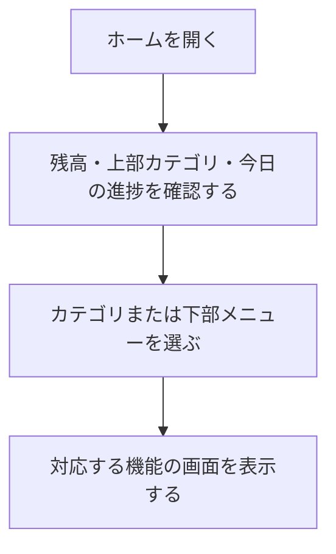

# F02｜ホーム・画面構成・上部メニュー PRD（レビュー前）

> ④業務ルールと⑦以降はユーザーレビュー未完了。本日の変更箇所はローカル4180モックとユーザー指定を参照し、優先順位はスプレッドシートを正とする。本PRDはTier1のみを定義する。

参照するモック：本リポジトリのローカル4180。未接続の外部API・実端末機能は、接続済みとして扱わず末尾に記載する。

| 基本情報 | 内容 |
| --- | --- |
| 機能ID | F02 |
| 概要 | ホーム・画面構成・上部メニュー |
| 対象領域 | アプリ／管理画面／外部連携 |
| 関連機能 | [F03](F03-offer-list.md)、[F07](F07-daily-mission.md)、[F08](F08-walking.md)、[F10](F10-surveys.md)、[F11](F11-mini-games.md)、[F12](F12-points.md) |
| 更新日 | 2026-10-20 |
| 版 | レビュー前（初版未確定） |
| モックレビュー | 完了（2026-10-20ユーザー共有） |
| PRDレビュー | メンバーによるレビュー待ち |
| 共有メモ | 2 → D |

## ① 目的・今回作る範囲

目的：アプリを開いた際に最初に表示されるホームとして、デイリーミッションやヘッダータブからユーザーを誘導し、ポイント獲得案件などの各種機能に迷わず進めるようにするため

評価指標：ホームからの遷移率/機能別利用率/対象画面の閲覧数/離脱率

優先順位は[アプリ詳細要件のTier列](https://docs.google.com/spreadsheets/d/1tI26I_4vbSHIOzMdJz7g8-DjeLyyVUKoksVHhZ0AQhU/edit#gid=1107057215)を正とする。モックに存在してもTier2・Tier3・空欄の要件は本PRDの定義対象に含めない。

| 要件ID | Tier1の範囲 |
| --- | --- |
| F02-1 | ユーザーが下部5タブからホーム・お得・簡単・遊ぶ・マイページへ移動できる |
| F02-2 | ユーザーがホーム画面のカテゴリ入口から対象のポイント獲得機能へ移動できる |
| F02-3 | 直前に見ていた画面へ表示状態を保って戻ることができる |
| F02-4 | ユーザーがホーム画面で残高を確認して実績レポートへ移動できる |
| F02-7 | ユーザーがホームのヘッダーで「いくら貯める」を確認して、今のポイントと目標へ移動できる |

管理側は[管理画面詳細要件のTier列](https://docs.google.com/spreadsheets/d/1tI26I_4vbSHIOzMdJz7g8-DjeLyyVUKoksVHhZ0AQhU/edit#gid=1341040600)にある以下のTier1を関連範囲とする。NACS本体の内製要件にはしない。

| 要件ID | Tier1の運用範囲 |
| --- | --- |
| ADM-F01-3 | 運営担当者がホームタブに表示するカテゴリを事前に設定して、指定日時に自動で切り替えられる |

## ② 画面イメージ

[アプリの該当画面](http://127.0.0.1:4180/mock-app/#home)

- 下部メニューはホーム・お得・簡単・遊ぶ・マイページの5つ。
- 上部カテゴリはデイリーミッション・歩く・チャレンジボーナス・ゲーム・買い物・アンケート・カードを表示し、横スクロールで切り替える。文字数の都合上、デイリーミッションは「デイリー」、チャレンジボーナスは「チャレボ」と表示する。
- ヘッダーの残高から実績レポートへ、初心者マークの「いくら貯める？」から「今のポイントと目標」の見出し位置へ進む。
- ホームヘッダーアイコンのアンケートは簡単タブと同じ一覧を上部バナーの下に置く。ホーム経由では上部カテゴリーメニューを表示し、下部ホームを選択中とする。下部「簡単」から開く場合はカテゴリーメニューを非表示とし、簡単を選択中とする。入口別の詳細は[F10](F10-surveys.md)に記載する。
- ゲーム・買い物・カードはグレーの背景にバナーと案件を表示する。カテゴリ案件は9件を最初に表示し、残りをその場で開閉する。

ヘッダーの残高は、マイページの「あなたのポイント」と同じ本人の有効残高（失効分を除いた交換可能ポイント）を100pt＝1円相当で表示する。準備中は含めない。従来の固定見本額は使用せず、付与確定・交換・失効・利用者切替後に同じ残高へ更新する。取り消し線の比較額も、その残高を基準に算出する。

## ③ 操作フロー

## ④ 業務ルール・制約

> ユーザーレビュー未完了。アプリ上の表示に関わるルールを記載する。

### 表示する対象ユーザー

| 対象ユーザー | 利用・表示 |
| --- | --- |
| 会員 | ホームと各機能への入口を表示する |
| 非会員（ゲスト） | ホームと各機能への入口を表示する |

### 表示条件

| 状態・条件 | 表示のルール |
| --- | --- |
| ホーム表示時 | 本人の残高・カテゴリ入口・本日の進捗を表示する |
| 選択中のメニュー・カテゴリ | 選択状態をサーモンピンクのアイコン・文字で示す |
| 非選択のメニュー・カテゴリ | 通常のグレーのアイコン・文字で示す |
| ゲーム・買い物・カード | グレー背景にバナーとカテゴリ別の案件を表示する |

### 画面に置く要素・操作

| 画面・要素 | 表示・操作のルール |
| --- | --- |
| ヘッダーの残高 | ポイント残高を表示し、押すと実績レポートへ進む |
| 上部カテゴリ | デイリー・歩く・チャレボ・ゲーム・買い物・アンケート・カードを横スクロールで切り替える |
| 下部メニュー | ホーム・お得・簡単・遊ぶ・マイページへ進む |
| 目標設定の入口 | ヘッダーの初心者マークに「いくら貯める？」を表示し、タップすると「今のポイントと目標」の見出し・比較グラフの上端へ移動する |
| カテゴリ別の案件 | 最初の9件を表示し、残りをその場で開閉する |

## ⑤ 管理画面

新規作成・変更・削除は、現在の管理画面で操作できる範囲を示す。「外部管理」はNACS・EDOCODE等の担当範囲、「未実装」は操作画面がない項目。削除と公開停止は分けて記載する。

[実行設定の管理画面](http://127.0.0.1:4180/mock-admin/#top-menu)

| 対象項目 | 新規作成 | 変更 | 削除 | 管理画面での操作・反映範囲 |
| --- | --- | --- | --- | --- |
| 上部メニューの設定一式・適用日時（ADM-F01-3） | 可能 | 可能 | 可能 | TOP画面上部のメニュー。設定を追加・予約・編集・削除する。適用中の削除後は直前の有効設定へ戻る。 |
| 下部5メニュー・ヘッダー・目標設定入口 | 不可 | 不可 | 不可 | アプリで定義したUI。上部メニュー設定からは変更しない。 |

## ⑥ 例外処理・エラーハンドリング

| 状況 | 表示・処理・復帰 |
| --- | --- |
| メニュー設定がない | 利用可能な既定の入口を表示する。存在しない画面を利用可能にしない。 |
| 遷移先が終了・停止している | 遷移先機能の表示に従い、戻る入口を維持する。 |

## ⑦ 達成条件・未決事項

> 本節以降はユーザーレビュー未完了。

### Tier1の達成条件

- [ ] F02-1：ユーザーが下部5タブからホーム・お得・簡単・遊ぶ・マイページへ移動できる。
- [ ] F02-2：ユーザーがホーム画面のカテゴリ入口から対象のポイント獲得機能へ移動できる。
- [ ] F02-3：直前に見ていた画面へ表示状態を保って戻ることができる。
- [ ] F02-4：ユーザーがホーム画面で残高を確認して実績レポートへ移動できる。
- [ ] F02-7：ユーザーがホームのヘッダーで「いくら貯める」を確認して、今のポイントと目標へ移動できる。
- [ ] ①の管理側Tier1に対応する操作について、⑤の新規作成・変更・削除可否と反映範囲を確認できる。
- [ ] ⑥の対象となる空・失敗・中断などの状態から、表示内容と次の操作を確認できる。

- [ ] ヘッダーの円相当額が本人の有効残高・マイページと一致し、0pt・付与確定・交換・失効・利用者切替後も固定値に戻らない。準備中だけが増えた場合は有効残高を増やさない。

### まだ決まっていないこと

なし。認証・API接続などの具体的な方法は、別途仕様設計で定める。

## モックへの未反映・対象外

### モックへの未反映

| 項目 | 未反映の内容 |
| --- | --- |
| メニュー設定の配信 | 管理画面で保存した設定を本番アプリへ配信する処理は未接続 |

### 今回の対象外

| 項目 | 対象外の内容 |
| --- | --- |
| なし | — |

## 変更履歴

| 版 | 日付 | 変更内容 |
| --- | --- | --- |
| レビュー前 | 2026-10-19 | 目的を書き換え。F02-7をホームのヘッダーの「いくら貯める」から今のポイントと目標への移動に変更。Tier1以外のF02-5（赤ポチ）・F02-6／ADM-F01-1（カテゴリの追加・並べ替え）は定義対象外とし、赤ポチの表示ルール・達成条件・モック未反映の記載を削除。 |
| レビュー前 | 2026-10-19 | ホームのラベル・上下余白・アイコン維持、いくら貯める？からの目標見出しへの遷移、重複入口削除、カテゴリ別赤ポチ条件を整理。アンケート赤ポチの実装差分を明記。 |
| レビュー前 | 2026-10-19 | ホーム上部カテゴリの「クレカ」を「カード」に改名。アイコン・順序・遷移先は維持。 |
| レビュー前 | 2026-10-15 | F10レビューの共通フィードバックを反映。⑤を管理画面へ変更し、④を対象ユーザー・表示条件・配置要素に整理。例外処理と仕様設計事項の重複を除き、未反映と対象外を別表に分離。個別レビューは未完了。 |
| レビュー前 | 2026-10-20 | アンケート一覧の入口を区別。ホームではカテゴリーメニューを維持、下部「簡単」からは非表示とする。アンケート・バナーの表示内容は共用。 |
| レビュー前 | 2026-10-20 | ヘッダーの固定見本額を撤去し、マイページと同じ本人の有効残高を表示する方針・確認条件を反映。 |

## レビュー時の確認項目

> レビュー完了後、このセクションごと削除する。

| 項目 | 確認してほしいこと |
| --- | --- |
| ⑤ 上部メニューの設定一式・適用日時（ADM-F01-3） | 今の管理画面では、ヘッダータブにカテゴリ名とアイコンは設定できるが、そのタブを選んだときに何が表示されるかを決める手段がない |
| ⑤ 上部メニューの設定一式・適用日時（ADM-F01-3） | 既存のカテゴリを微修正・追加する形ではなく、0からカテゴリを決める管理画面仕様になっているため、モック自体の修正が必要 |
