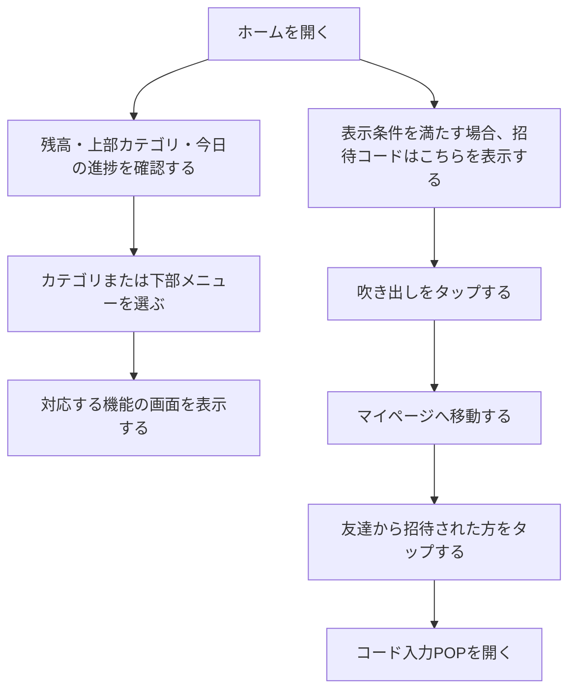

# F02｜ホーム・画面構成・上部メニュー PRD（レビュー前）

> 優先順位はスプレッドシートを正とする。本PRDはTier1のみを定義する。

参照するモック：本リポジトリの `mock-app/`・`mock-admin/` のローカル修正版（2026-10-29、コード・既存テストと照合）。この記載はGitHubのmainへの反映完了や本番API・実端末での動作確認を示さない。未接続・未反映の内容は末尾に記載する。

| 基本情報 | 内容 |
| --- | --- |
| 機能ID | F02 |
| 概要 | ホーム・画面構成・上部メニュー |
| 対象領域 | アプリ／管理画面／外部連携 |
| 関連機能 | [F03](F03-offer-list.md)、[F07](F07-daily-mission.md)、[F08](F08-walking.md)、[F10](F10-surveys.md)、[F11](F11-mini-games.md)、[F12](F12-points.md)、[F14](F14-referral.md)、[F18](F18-mypage-support.md) |
| 更新日 | 2026-10-29 |
| 版 | レビュー前（初版未確定） |

## ① 目的・今回作る範囲

目的：アプリを開いた際に最初に表示されるホームとして、デイリーミッションやヘッダータブからユーザーを誘導し、ポイント獲得案件などの各種機能に迷わず進めるようにするため

優先順位は[アプリ詳細要件のTier列](https://docs.google.com/spreadsheets/d/1tI26I_4vbSHIOzMdJz7g8-DjeLyyVUKoksVHhZ0AQhU/edit#gid=1107057215)を正とする。モックに存在してもTier2・Tier3・空欄の要件は本PRDの定義対象に含めない。

| 要件ID | Tier1の範囲 |
| --- | --- |
| F02-1 | ユーザーが下部5タブからホーム・お得・簡単・遊ぶ・マイページへ移動できる |
| F02-2 | ユーザーがホーム画面のカテゴリ入口から対象のポイント獲得機能へ移動できる |
| F02-3 | 直前に見ていた画面へ表示状態を保って戻ることができる |
| F02-4 | ユーザーがホーム画面で残高を確認して実績レポートへ移動できる |
| F02-7 | ユーザーがホームのヘッダーで「いくら貯める」を確認して、今のポイントと目標へ移動できる |

管理側は[管理画面詳細要件のTier列](https://docs.google.com/spreadsheets/d/1tI26I_4vbSHIOzMdJz7g8-DjeLyyVUKoksVHhZ0AQhU/edit#gid=1341040600)にある以下のTier1を関連範囲とする。NACS本体の内製要件にはしない。

| 要件ID | Tier1の運用範囲 |
| --- | --- |
| ADM-F01-3 | 運営担当者がホームタブに表示するカテゴリを事前に設定して、指定日時に自動で切り替えられる |

## ② 画面イメージ

ホームは通常・読み込み中・取得エラー・0件でも、残高ヘッダー、目標入口アイコン、上部カテゴリ、下部ナビ、おすすめの位置を維持する。

上部カテゴリはアンケートと今後追加するカテゴリにも、以下の共通ルールを適用する。通常・読み込み中・取得失敗・0件で見た目や操作を変えない。

| 対象 | 表示・操作 |
| --- | --- |
| 共通寸法 | アイコン枠32px、文字10px、項目の上下3px、アイコンと文字の間1px。横幅には約6.4項目を配置し、左右8pxの余白を設ける。歩くの絵は見た目の大きさを揃える24pxの個別補正を維持する |
| 配色 | 未選択はグレー#707A75、選択中はコーラル#EF7264。切替対象外のアイコンの色・サイズを変えない |
| 選択バー | 項目幅の50%・高さ3pxの赤いバーを、アイコンと同じ中央位置に置く |
| スクロール位置 | ユーザーが手動でスクロールした位置を保持する。全体が見えているカテゴリを選んだ場合や本文の更新・再描画では、タブ列を自動移動しない |
| 見切れたアイコンの選択 | アイコンが一部見切れている状態でそのカテゴリを押した場合だけ、全体が見える近い端の位置へ約700msで移動する。右端で見切れていれば右端、左端で見切れていれば左端で全体を見せる。移動中にユーザーが手動操作を始めたら自動移動を止め、その位置を保持する |
| 動きを減らす設定 | 必要な位置への移動を即時に行い、スクロールアニメーションを再生しない |

[アプリの該当画面](http://127.0.0.1:4173/mock-app/#home)

- 下部メニューはホーム・お得・簡単・遊ぶ・マイページの5つ。
- 上部カテゴリはおすすめ・ミッション・歩く・チャレンジボーナス・ゲーム・買い物・アンケート・カードを表示し、横スクロールで切り替える。文字数の都合上、デイリーミッションは「ミッション」、チャレンジボーナスは「チャレボ」と表示する。
- 「おすすめ」のアイコンは共通部品ルールに沿った角の丸い星とし、選択時はコーラル、非選択時はグレーで表示する。
- ヘッダーの残高から実績レポートへ進む。静止したPリングと塗りの上向き矢印の目標入口、または「いくら貯める？」から「今のポイントと目標」の見出し位置へ進む。
- ホームの各カテゴリ・ホーム経由のアンケートから実績レポートを開いた場合は、下部の「ホーム」を選択したままにする。再読み込みや「戻る／進む」でも入口に対応した選択を保つ。マイページから開き直した場合は「マイページ」を選択する。
- ホームのアンケートも他のカテゴリと同じヘッダー・カテゴリメニューを使用し、「ミッション」表記、目標入口アイコン、目標の吹き出し、おすすめサイド表示を維持する。目標の吹き出しはホームへ入ってから5秒間の既存動作を維持し、カテゴリ間の移動で表示期限をリセットしない。
- ホームの上部カテゴリ「アンケート」は簡単タブと同じ一覧を上部バナーの下に置く。ホーム経由では上部カテゴリーメニューを表示し、下部ホームを選択中とする。下部「簡単」から開く場合はカテゴリーメニューを非表示とし、簡単を選択中とする。バナー・見出し・項目を囲む背景は現在の白背景を維持し、アンケートだけ薄いグレーへ変更しない。入口別の詳細は[F10](F10-surveys.md)に記載する。
- ゲーム・買い物・カードはバナー周囲を白、カテゴリ別の案件一覧の周囲をグレーで表示する。カテゴリ案件は開閉なしで一覧表示し、件数の上限はお得タブの「もっと見る」と同じ最大100件とする。並び順はASPから送られてくるEPCの降順とし、同値の場合は案件IDが新しい順、EPCがない案件は最下部に表示する（[F03](F03-offer-list.md)のカテゴリ別案件一覧と共通）。

ヘッダーの残高は、マイページの「あなたのポイント」と同じ本人の有効残高（失効分を除いた交換可能ポイント）を100pt＝1円相当で表示する。準備中は含めない。従来の固定見本額は使用せず、付与確定・交換・失効・利用者切替後に同じ残高へ更新する。取り消し線の比較額も、その残高を基準に算出する。ヘッダーは比較額を取り消し線付きで常時表示し、モックの「目減りゼロ表示」のON/OFFによってこの行を非表示にしない。

### 上部バナーと見出しの共通表示

ホームの各上部バナーとアンケートの上部バナーは、入稿サイズ320×100pxの比率（16:5）を維持し、画面幅に合わせて表示する。320×100pxは入稿規定であり、アンケートだけ表示寸法を320×100px固定にしない。ミッション・歩く・チャレボ・ゲーム・買い物・カード・アンケートの上部バナーの左右余白は共通の16px（画面幅360px以下では12px）とする。「おすすめ」内のバナーは同画面の掲載枠内の幅で表示する。

チャレボ・ゲーム・買い物・カードとアンケートでは、バナー直後の一覧見出し側の上余白を共通の16pxとする。バナー側の下余白・表示点の領域も共通部品を使い、「おすすめアンケート」との間隔だけを変えない。アンケートはホーム経由と下部「簡単」の両方へ適用する。

下部バナー・起動時POPUP・画面間広告は掲載場所ごとの別サイズを使用する。入稿・配信・広告種別の詳細は[F15](F15-ad-placements.md)を参照する。

### 目標画面への入口と巾着表示

ヘッダーの目標入口は24pxの静止アイコンとし、遷移先の「今のポイントと目標」では、確認済みのチェック柄・コーラルの紐の巾着とコインの演出を表示する。本人の有効残高を使用し、演出でポイントを付与しない。目標の選択肢・計算・金額変更時の再生・再表示と動きを減らす設定での最終状態は[F12](F12-points.md)に従う。

### 招待コード入力への吹き出し

ホームの下部ナビ「マイページ」の上に、「招待コードはこちら」の吹き出しを表示する。表示条件と非表示になるタイミングは④に定義する。

| 要素 | 表示・操作 |
| --- | --- |
| 文言 | 「招待コードはこちら」。残り時間のカウントダウンは表示しない |
| 見た目 | 背景はチャコールグレー（#373F45）、文字は白色。同色の吹き出しのしっぽで下部ナビ「マイページ」を指す |
| 文字組み | 「いくら貯める？」と文字サイズ・太さ・文字間隔・行高を揃える。共通の文字組みは④「目標・招待案内の吹き出し」を参照 |
| 配置 | スクロール中も、下部ナビ「マイページ」の上に位置を固定する |
| タップ時 | マイページへ遷移する。マイページの「友達から招待された方」をタップするとコード入力POPを開く。吹き出しから直接コード入力POPは開かない。入力・適用の詳細は[F14](F14-referral.md)、マイページの要素は[F18](F18-mypage-support.md)を参照 |

### ホーム「おすすめ」

案件掲載枠の見出し文言は固定しない。「期間限定ポイントアップ！」「人気案件」「おすすめ案件」は初期表示名の例であり、運営が管理画面で任意の名称へ変更できる。以下では表示方法と設定・反映ルールを定義し、名称の変更だけでPRD改定を必要としない。

ホームを開いた際は上部の「おすすめ」を最初に表示する。「ミッション」は独立した上部タブとして維持し、全ミッション・進捗・報酬の受取操作は[F07](F07-daily-mission.md)に従う。下部「お得」内にあった「おすすめ」の表記は「探す」にする。

| 表示順 | 要素 | 表示と遷移 |
| --- | --- | --- |
| ヘッダー | 残高と交換案内 | 本人の有効残高を円相当で表示する。「1,000,000円相当」まで残高・吹き出し・右側アイコンが重ならない幅を確保する。交換案内は白背景、カテゴリタブの未選択アイコンと同じグレーの文字・枠線で2行表示。初期文言は「ドットマネーへの／交換手数料ゼロ」。残高自体は固定額にしない |
| 1 | 新着アンケート通知 | 画面幅いっぱいのコンパクトなグレー帯。手紙アイコン、「アプリ限定の新着アンケートが届いています」、最大ポイントの合計、「確認」を表示。「確認」の右上に赤い通知ドットを付ける。通知対象・合計・確認先は回答可能なライフサーベイ案件のみ。回答可能案件が0件の場合は通知帯全体（文言・合計・確認ボタン・通知ドット）を表示しない。提供元の説明をアプリUIへ追加しない |
| 2 | バナー | ホーム最上部の既存バナーを共用し、設定されたリンクへ移動する。公開条件・掲載期間などを満たす配信対象がない場合はバナー枠を表示せず、固定画像で補完しない |
| 3 | ポイント・マイルの入口 | 見出しとサービス名ラベルを置かず、小さなロゴ枠を横に並べる。マイルは文字なしの飛行機アイコン。Vポイント・楽天・PayPay・dポイントはサービスロゴを表示。Pontaを外した5個を、アイコンの大きさを変えず、コンテンツの横幅いっぱいに等間隔で配置する。左右対称の中央揃えとし、アイコン間の余白を広げる。関連する案件へ移動し、交換先の確定・交換申込みとは区別する |
| 4 | 横スクロールの案件枠（初期名例：期間限定ポイントアップ！） | 最大8件の丸い案件画像を横スクロールで表示。枠のグラデーションは下部「簡単」と同じ色調。順位番号は表示しない。吹き出し設定で指定された表示位置に任意の文言を表示する。「もっと見る」はお得の案件一覧へ |
| 5 | デイリーミッション | 丸印付きのコンパクトなリストで2件表示。未受取を優先し、受取済みはチェック付き。太いコーラルピンクの外枠と白背景、見出し下は影を使わず1pxの区切り線とする。ポイント数はコーラルピンク。文字サイズは同ページの見出し・案件名・ポイントと揃える。進捗バーを置かず、右上の「もっと見る」から上部ミッションタブへ移動する。表示しただけでは達成・受取状態を変えない |
| 6 | カード一覧の案件枠（初期名例：人気案件） | 最大6件、3列×2行で表示。案件画像・案件名・報酬を表示し、案件詳細へ移動する |
| 7 | チャレンジボーナス | 薄いピーチ色の背景。掲載条件を満たす全案件を横1列のスクロールで表示。画像・終了までの日数・案件名・達成ボーナスだけを表示し、通常報酬・参加人数・進捗メーターは置かない。右上の「もっと見る」から上部チャレボタブへ。案件選択で詳細へ移動する |
| 8 | アンケート | 回答可能な案件を表示。通知帯のライフサーベイ限定条件はこの一覧や下部「簡単」全体には適用しない |
| 9 | カード一覧の案件枠（初期名例：おすすめ案件） | 最大6件、3列×2行で表示。案件選択で詳細へ移動する |

チャレンジボーナスの簡略表示と薄いピーチ色の背景は上部チャレボタブでも共通とする。カード列は左右端までスクロールでき、初期位置の左側には余白を設ける。見出し・カードの左端、上下の余白を揃える。右側の「おすすめ」サイドバーは閉じているときに取っ手以外のパネルや線がはみ出さない。

## ③ 操作フロー

## ④ 業務ルール・制約

### 表示する対象ユーザー

| 対象ユーザー | 利用・表示 |
| --- | --- |
| 会員 | ホームと各機能への入口を表示する |
| 非会員（ゲスト） | ホームと各機能への入口を表示する |

### 表示条件

| 状態・条件 | 表示のルール |
| --- | --- |
| ホーム表示時 | 本人の残高・カテゴリ入口・本日の進捗を表示する |
| 選択中のメニュー・カテゴリ | 選択状態をサーモンピンクのアイコン・文字で示す |
| 非選択のメニュー・カテゴリ | 通常のグレーのアイコン・文字で示す |
| ゲーム・買い物・カード | バナー周囲は白、カテゴリ別の案件一覧の周囲はグレーで表示する |
| ホームのアンケート・下部の簡単 | バナーと一覧の周囲は白背景。見出し側の上余白と上部バナーの比率・左右余白は他カテゴリと共通にする |
| ホーム経由の実績レポート | 下部ホームの選択を維持する。入口に応じた下部タブの選択は、再読み込み・戻る／進むでも維持する |
| ホームの招待コード案内 | ユーザーID発行から72時間未満、かつ招待コード未適用、かつ友達招待が開始中の場合に限り表示する。会員登録日時ではなく、ユーザーIDの発行日時を72時間の起点とする |
| 招待コード案内の非表示 | ユーザーID発行から72時間経過（72時間ちょうどを含む）・招待コード適用完了・友達招待の停止のいずれかで非表示にする。友達招待の開始前も表示しない |

### おすすめのデータ・掲載ルール

| 対象 | ルール |
| --- | --- |
| 新着アンケート | ライフサーベイの回答可能な案件を対象とする。回答済み・募集終了など回答不可の案件を除き、回答後に追加で回答可能になった案件は含める。最大ポイントはユーザー向けの還元額で合算する。他社案件を合計や確認先に混ぜない |
| バンドル属性で取得する案件掲載枠 | 管理画面で掲載枠名とバンドル属性を設定し、属性に一致する案件を取得する。非公開・掲載終了・配信対象外の案件をアプリに表示しない。選択されているからといって配信条件を上書きしない |
| 吹き出し | 対象掲載枠・文言・何枠目の案件に表示するかを設定する。実際に表示される案件順を基準とし、対象枠の掲載期間外・指定位置の案件なしでは表示しない。最高還元などの訴求は運営が表示根拠を確認する |
| ミッション | F07の当日一覧と同じ状態・表示報酬を参照する。アンケートとミニゲームの報酬には「最大」を付ける。プレビューの表示件数で本来のミッション数・達成条件を変えない |
| チャレンジボーナス | 指定したバンドル属性に一致し、チャレンジ枠と案件の双方の公開状態・掲載期間・配信対象を満たすものを全件表示。案件のOS・解禁条件も適用する。報酬の条件・付与はチャレンジボーナスの個別PRDを参照する |
| 設定の保存 | 保存成功後にホームの掲載内容・ヘッダーへ反映する。入力エラー時は前回の保存内容を保持する |

### 画面に置く要素・操作

| 画面・要素 | 表示・操作のルール |
| --- | --- |
| ヘッダーの残高 | 本人の有効残高を円相当で表示し、押すと実績レポートへ進む。ホームから開いた場合は下部ホームの選択を維持する |
| 上部カテゴリ | おすすめ・ミッション・歩く・チャレボ・ゲーム・買い物・アンケート・カードを横スクロールで切り替える |
| 下部メニュー | ホーム・お得・簡単・遊ぶ・マイページへ進む |
| 目標設定の入口 | ユーザー添付を参照してSVG化したグレーのPリングと、右下に重なる塗りの上向き矢印を表示。「いくら貯める？」から「今のポイントと目標」の見出し・比較グラフの上端へ移動する。表示枠はベルと同じ24px、外周は共通ルールの2px・内部Pは1.5px、リングは#626C69、矢印は共通コーラル#EF7264。アニメーションのない静止表示とする。 |
| 目標・招待案内の吹き出し | 「いくら貯める？」と「招待コードはこちら」は13px・太字・行高18px・通常の文字間隔に統一。目標案内の背景は下部「簡単」ボタンと同じグラデーション、招待案内は以前の目標案内と同じチャコールグレー（#373F45）とし、どちらも白文字とする。表示位置・表示期限はそれぞれの仕様を維持する。 |
| カテゴリ別の案件 | 開閉なしで最大100件を表示する（お得タブの「もっと見る」と同じ上限）。EPCの降順、同値の場合は案件IDが新しい順、EPCがない案件は最下部 |

## ⑤ 管理画面

新規作成・変更・削除は、現在の管理画面で操作できる範囲を示す。「外部管理」は、EDOCODE社が運営するACS側の担当範囲を指す。「未実装」は操作画面がない項目。削除と公開停止は分けて記載する。

[実行設定の管理画面](http://127.0.0.1:4173/mock-admin/#top-menu)

| 対象項目 | 新規作成 | 変更 | 削除 | 管理画面での操作・反映範囲 |
| --- | --- | --- | --- | --- |
| 上部メニューの設定一式・適用日時（ADM-F01-3） | 可能 | 可能 | 可能 | TOP画面上部のメニュー。設定を追加・予約・編集・削除する。適用中の削除後は直前の有効設定へ戻る。 |
| 下部5メニュー・ヘッダー・目標設定入口 | 不可 | 不可 | 不可 | アプリで定義したUI。上部メニュー設定からは変更しない。 |

### ホームおすすめ設定

デイリーミッションは案件掲載枠の追加・削除の対象から外し、専用の掲載チェックだけで表示を切り替える。設定済みの表示位置と活動条件は保持する。

管理画面の見出しは「案件掲載枠の追加・削除」「案件詳細の並べ替え」「案件吹き出しの追加」「ヘッダー吹き出しの変更」「ポイント別案件枠の追加・削除」とする。案件吹き出しの文言は1行で表示する。

| 設定項目 | 入力・制約 | アプリへの反映 |
| --- | --- | --- |
| ヘッダーの交換案内 | 表示ON/OFF、2行の文言（1行目9文字・2行目7文字以内） | 残高右側の吹き出しに反映。配色・最大残高のレイアウトは共通UIとして固定 |
| ポイント・マイル | 企業アイコン設定で、名前・画像・表示先（ホーム／お得）・リンク・吹き出し文言を編集する。登録数は上限なし、各画面最大5件・合計10チェック。新規追加時は両方未選択。ドラッグまたは上下キーで並べ替え | 画像・リンク・吹き出し文言・並び順は共通、掲載先だけを画面別に選択する。吹き出しは20文字以内、空欄で非表示。ホーム全体の掲載OFFでは個別設定を保持する。保存後は選択した画面へ反映する。実保存APIは未接続。 |
| 各掲載枠 | 掲載枠の追加・削除、掲載枠名（1〜40文字）、バンドル属性、掲載開始日・終了日、「もっと見る」のディープリンク、ドラッグによる配置順 | 掲載期間内の枠を設定順に表示。追加する案件枠は3列×2行以内。新着通知・最上部バナー・ポイント入口・デイリーミッションはこの表に含めず、公開チェック・表示形式列も設けない |
| 横スクロールの案件枠 | バンドル属性（80文字以内） | 対象案件の丸いカードを横1列に表示 |
| 吹き出し | 対象の案件掲載枠（管理画面で設定した枠名から選択）、任意の文言（1〜20文字）、何枠目の案件に表示するか | 指定枠の指定位置に表示。複数登録・削除ができる。同じ枠・同じ位置の重複は保存できない |
| カード一覧の案件枠 | 枠ごとのバンドル属性（80文字以内） | 各枠の3列×2行以内で表示 |
| アンケート通知 | 対象提供元・合計方法・確認先は固定 | ライフサーベイの回答可能案件が1件以上の場合だけ通知帯を自動生成。0件時は通知帯全体を非表示にし、運営が通知内の件数・報酬を直接入力しない |
| デイリーミッション | おすすめ内の掲載ON/OFF。活動条件・報酬はF07の設定を参照 | おすすめ内がOFFでもミッションタブと活動条件は維持。ONの場合はおすすめの2件とミッションタブの全件に同じ活動結果を反映 |
| おすすめ内のチャレンジボーナス | バンドル属性・保存した案件順と、チャレンジ枠・案件双方の配信条件を参照 | この設定の反映先はホームおすすめ内のみ。上部チャレボの対象・順序は従来のチャレンジ設定を参照し、ここで変更しない |
| バナー | ホーム最上部の既存掲載設定を参照 | 配信対象がある場合だけ表示。対象がない場合に固定バナーを表示しない |

掲載枠名は運営が決め、保存した文言をアプリの見出しと管理画面の選択肢に反映する。初期表示名を内部の固定条件として扱わない。案件枠の見出し・ミッション・アンケートの見出しと通知文に反映し、バナー・ポイント入口の名前は管理用とする。案件の個別ID一覧を登録する方式は使用しない。バンドル属性は候補から選択または直接入力し、属性が更新された案件も次回表示時に自動で対象へ反映する。属性未設定・一致案件なしの場合は、その案件枠を表示しない。枠の表示順は運営がドラッグ＆ドロップで指定し（上下キーでも移動可能）。表示上限は横スクロールの案件枠が8件、カード一覧の案件枠が各6件、チャレンジボーナスが全件とする。表示方法と上限は枠名によって変更しない。

指定バンドルの中身は案件名・案件ID・アプリの表示位置とともに一覧で確認でき、ドラッグで並べ替えられる。初期状態は元の配信順を使用する。変更はこの掲載枠だけに保存し、バンドル本体や他の掲載枠の順序は変更しない。新たに属性一致した案件は末尾に追加し、属性が外れた案件は対象から外す。公開条件・掲載上限で表示されない案件を区別する。吹き出しの位置選択には、その位置の案件名を併記し、並べ替えに合わせて更新する。吹き出しは指定位置に付き、特定案件には固定しない。

[ホームおすすめ設定](http://127.0.0.1:4173/mock-admin/#home-recommend)

## ⑥ 例外処理・エラーハンドリング

| 状況 | 表示・処理・復帰 |
| --- | --- |
| メニュー設定がない | 利用可能な既定の入口を表示する。存在しない画面を利用可能にしない。 |
| 遷移先が終了・停止している | 遷移先機能の表示に従い、戻る入口を維持する。 |

## ⑦ 達成条件・未決事項

### おすすめ追加分の達成条件

- [ ] 案件が非公開・期間外・対象OS外・未解禁の場合、おすすめのチャレンジに表示しない。
- [ ] バナーの配信対象がない場合は枠を非表示にし、期限切れの固定バナーで補完しない。
- [ ] 回答可能なライフサーベイが0件の場合は新着通知帯全体を非表示にする。
- [ ] おすすめ内のチャレンジ設定を変更しても、上部チャレボの対象・順序は変更しない。

- [ ] 上部おすすめとミッションが別タブで表示され、お得の入口は「探す」と表示される。
- [ ] ライフサーベイ限定の通知対象・合計・確認先が一致し、他社のアンケート一覧は維持される。
- [ ] 初期表示名に依存せず、管理画面で変更した枠名がアプリの見出しと吹き出しの対象枠選択に反映される。
- [ ] 掲載枠を追加・削除し、枠名・期間・バンドル属性・「もっと見る」のディープリンクを設定できる。枠と案件の順序をドラッグで変更できる。
- [ ] 新着通知・最上部バナー・ポイント入口を掲載枠表に含めず、ポイント入口は専用設定で欄全体の掲載ON/OFFを切り替えられる。
- [ ] 吹き出しの対象掲載枠・文言・表示位置を保存できる。指定位置に案件がない場合と掲載期間外の枠には表示せず、同じ枠・位置の重複は保存できない。
- [ ] ポイント入口をドラッグで並べ替え、表示名・画像・遷移先を保存してアプリへ反映できる。キャンセルと入力エラーでは保存済み内容を変更しない。
- [ ] 管理画面の掲載案件・ポイント入口・交換案内を保存し、アプリで反映を確認できる。空の掲載枠名・文字数超過・表示順の重複・不正な掲載期間は保存できない。
- [ ] ミッションを2件表示し、「もっと見る」でミッションタブに移動できる。進捗はプレビューに表示しない。
- [ ] チャレンジボーナスの全件を横1列で表示し、「もっと見る」で上部チャレボタブに移動できる。
- [ ] 1,000,000円相当の残高でも交換案内とアイコンが重ならない。

### Tier1の達成条件

- [ ] ホームは通常・読み込み中・取得エラー・0件でも、残高ヘッダー、目標入口アイコン、上部カテゴリ、下部ナビ、おすすめの位置を維持する。カテゴリの現行寸法はアイコン32px・文字10px・上下3px・アイコンと文字の間1px。

- [ ] ホームのアンケートへ移動しても「ミッション」表記と目標入口アイコン・表示期限内の目標吹き出し・おすすめサイド表示を維持し、下部ホームを選択中とする。
- [ ] アンケート・追加カテゴリ・読み込み中／取得失敗／0件でも、他のカテゴリの色・サイズと手動スクロール位置を維持する。
- [ ] 一部見切れたアイコンを選んだ場合だけ約700msで全体が見える近い端の位置へ移動し、全体が見えているアイコンの選択・再描画では手動スクロール位置を変えない。手動操作で自動移動を中断でき、動きを減らす設定では即時に位置を合わせる。選択バーは項目幅の50%・高さ3pxで中央に揃う。
- [ ] おすすめは共通の星アイコン、目標入口は添付を参照してSVG化したPリング＋塗りの上向き矢印を24px枠・外周2px／内部1.5pxで静止表示する。
- [ ] 残高ヘッダーの比較額は「目減りゼロ表示」のON/OFFとも取り消し線付きで表示され、有効残高の計算を変更しない。
- [ ] F02-1：ユーザーが下部5タブからホーム・お得・簡単・遊ぶ・マイページへ移動できる。
- [ ] F02-2：ユーザーがホーム画面のカテゴリ入口から対象のポイント獲得機能へ移動できる。
- [ ] ゲーム・買い物・カードのカテゴリ案件が、開閉なしで最大100件、EPCの降順（同値は案件IDが新しい順、EPCなしは最下部）で表示される。
- [ ] F02-3：直前に見ていた画面へ表示状態を保って戻ることができる。
- [ ] F02-4：ユーザーがホーム画面で残高を確認して実績レポートへ移動できる。
- [ ] ホームの各カテゴリ・ホーム経由のアンケートから実績レポートを開いても、下部ホームの選択を維持する。再読み込み・戻る／進むでも維持し、マイページから開き直した場合はマイページを選択する。
- [ ] F02-7：ユーザーがホームのヘッダーで「いくら貯める」を確認して、今のポイントと目標へ移動できる。
- [ ] 目標画面への入口は静止表示を保ち、遷移先の巾着はF12の金額変更・再表示・動きを減らす設定の条件に応じて表示される。目標の選択や演出で残高を増やさない。
- [ ] アンケートの上部バナーは他の上部バナーと同じ16:5の比率・左右余白で画面幅に合わせて表示し、一覧見出し側の上余白を16pxに揃える。ホーム経由・簡単経由とも一覧周囲の白背景を維持する。
- [ ] 目標・招待の吹き出しは文字組みが揃い、目標案内は「簡単」と同じ背景色、招待案内はチャコールグレー（#373F45）背景で、どちらも白文字で表示される。
- [ ] ホームの「招待コードはこちら」は、ユーザーID発行から72時間未満・招待コード未適用・友達招待が開始中の3条件をすべて満たす場合だけ表示される。会員登録日時がユーザーID発行日時と異なる場合も、ユーザーID発行日時を起点に判定する。
- [ ] ユーザーID発行から72時間ちょうど以降・コード適用完了・友達招待停止時は吹き出しを非表示にし、開始前も表示しない。
- [ ] 吹き出しのタップでマイページへ進み、「友達から招待された方」のタップでコード入力POPが開く。吹き出しから直接POPを開かない。
- [ ] スクロールしても吹き出しは下部ナビ「マイページ」の上に固定され、同色のしっぽがマイページを指す。残り時間のカウントダウンは表示しない。
- [ ] ①の管理側Tier1に対応する操作について、⑤の新規作成・変更・削除可否と反映範囲を確認できる。
- [ ] ⑥の対象となる空・失敗・中断などの状態から、表示内容と次の操作を確認できる。

- [ ] ヘッダーの円相当額が本人の有効残高・マイページと一致し、0pt・付与確定・交換・失効・利用者切替後も固定値に戻らない。準備中だけが増えた場合は有効残高を増やさない。

### まだ決まっていないこと

- 案件の自動選定・集計を導入する場合の基準は別途検討する。掲載枠名だけからランキングや自動推薦の処理を必須としない。「最高還元」など任意の訴求文言を使う場合は運営が表示根拠を確認する。
- アンケート配信APIの取得タイミング・再取得・失敗時の扱いはF10側と調整する。ライフサーベイ限定という対象条件は維持する。
- 交換手数料の案内は有効な契約・提供条件に従って掲載する。
- 認証・API接続などの具体的な方法は、別途仕様設計で定める。

## モックへの未反映・対象外

### モックへの未反映

| 項目 | 未反映の内容 |
| --- | --- |
| アンケート通知の取得 | ライフサーベイとの本番API接続・取得失敗からの復帰は未接続。通知の対象絞り込みと還元額合計はローカルデータで再現 |
| 案件の自動選定 | 指定バンドルと保存した案件順で表示。自動選定・集計の追加は別途検討 |
| メニュー設定の配信 | 管理画面で保存した設定を本番アプリへ配信する処理は未接続 |
| カテゴリ案件の件数・開閉 | モックは最初の9件を表示し、残りをその場で開閉する。開閉なし・最大100件は未反映（EPC順は反映済み） |
| 招待コード案内の開始・停止判定 | 照合したmain（c6dab1f）では、招待吹き出しの判定に友達招待の開始・停止状態を参照していない。開始中のみ表示・開始前と停止時は非表示にする条件は未反映 |
| 招待コード案内の72時間の起点 | 照合したmainのモックではデモ日時と利用開始日のデータ（state.date／state.user.registered）で判定している。本番の判定起点は会員登録日時ではなくユーザーID発行日時。実際のユーザーID発行日時との連携は未接続 |

### 今回の対象外

| 項目 | 対象外の内容 |
| --- | --- |
| なし | — |

## 変更履歴

- 2026-10-29：ユーザー指定により、ホームの「招待コードはこちら」の表示・非表示条件、ユーザーID発行日時を起点とする72時間判定、マイページ経由でコード入力POPを開く導線、背景・文字組み・固定位置・カウントダウン非表示を本文・操作フロー・達成条件に整理。最新main（c6dab1f）を照合し、友達招待の開始・停止判定と本番のユーザーID発行日時連携をモック未反映として記載。F14・F18・モック・機能要件表は変更していない。

- 2026-10-29：現在のローカルモックを照合し、参照日・URLを更新。カテゴリの共通寸法・配色・手動位置保持・約700msの移動・50%幅の選択バー、静止した目標入口、ホーム経由の実績レポートでの下部タブ選択維持、上部バナーの比率・余白、アンケートの白背景を本文・達成条件へ反映。遷移先の巾着表示はF12を参照。カテゴリ案件9件＋開閉のモック未反映、版・Tier・未決事項は維持。

- 2026-10-28：目標入口の外周を中心（10,11）・半径9の円弧へ整え、線の端数配置を修正。外周2px・内部1.5px・24px枠の静止表示を維持。

- 2026-10-28：目標入口のPリングを共通アイコンの外周2px・内部1.5pxへ調整。ユーザー指定によりコイン・矢印のアニメーションを削除して静止表示に変更。

- 2026-10-28：アンケートを含むカテゴリの共通配色・寸法を維持し、追加カテゴリにも適用するルールと回帰確認を追加。手動スクロール位置を保持し、見切れたアイコンの選択時だけ約700msで移動。赤い選択バーを中央揃えの半分幅へ変更。目標入口は添付を参照してSVG化したPリング＋上向き矢印へ変更。

- 2026-10-28：企業アイコン管理を手書きイメージに合わせ、名前／出面（ホーム・お得）／リンク／吹き出し文言の列へ整理。吹き出しは20文字以内の自由入力・空欄で非表示。登録数は上限なし、掲載チェックのみ各画面5件・計10個。

- 2026-10-28：企業ポイント・サイト別の共通管理にホーム／お得の表示先チェックを追加。各画面最大5件・合計10チェック。企業の新規追加は両方未選択で登録でき、SALE・画像・リンク先は共通。登録企業数と掲載件数は区別する。

- 2026-10-28：おすすめサイドタブの位置をホーム基準で共通化。お得・遊ぶもプレビュー下端から196pxに揃え、タブの寸法・開閉・リンク先は維持。

- 2026-10-28：マイルの飛行機が右下へずれる原因だった20pxの旧ロゴ領域を共通36×28pxへ統一。飛行機・外枠のサイズは維持し、ホームとお得で中央配置する。

- 2026-10-28：「期間限定ポイントアップ！」の見出しから最高還元ラベルまでの見える余白を24pxから12pxへ縮小。案件一覧下のパディング16px・マージン12pxを8px・6pxへ半減し、続くデイリーミッションを上に詰める。他セクションの余白・案件サイズは維持。

- 2026-10-28：上部タブに残っていた文字領域の最小高さ25pxを14pxへ修正。アイコン32px・文字10px・間隔1pxは維持し、余分な11pxを削ってバナー以下も上へ移動。

- 2026-10-28：上部カテゴリのアイコンと文字の間隔を2pxから1pxへ半減。固定の高さを追加せずタブの高さも1px縮め、バナー以下を同じ分だけ上へ移動。アイコン・文字のサイズと上下余白は維持。

- 2026-10-28：ヘッダー残高枠の最小幅158pxを解除し、比較額・円相当額の桁数に合わせて幅を自動調整する。小額時は縮め、大きな金額では内容に合わせて広げる。Pコイン・取り消し線・高さは維持。

- 2026-10-28：ホームとお得の企業アイコンを共通設定・共通描画へ統一。SALEチェックを共通編集画面へ追加し、両画面へ反映。お得の旧独立設定は保持するが参照しない。

- 2026-10-28：お得の企業アイコンの枠高・幅配分・ロゴサイズ・間隔をホームに統一。Vポイントのラベル表記を「SALE」に修正。企業・並び順・リンク先の設定は維持。

- 2026-10-28：最上部バナーと企業アイコンの間の縦余白を13px縮小。アイコン・楕円ラベルの寸法と横配置は維持。

- 2026-10-28：Vポイント上のラベルをしっぽのない横長の楕円形（44×14px）・白文字「SALL」に変更。案件の吹き出しスタイルから分離し、上下の指定競合による潰れを解消。

- 2026-10-28：企業アイコンの枠だけ横幅を広げ、5個が均等に横幅を使う配置へ調整。ロゴのサイズは維持。Vポイントに共通コーラルの「SALE」吹き出しを表示する見本を追加（実際のセール判定・管理設定は未接続）。

- 2026-10-28：5個の企業アイコンを既存サイズのまま横幅いっぱいに均等配置し、アイコン間の余白を拡大。

- 2026-10-28：ホームのポイント・マイル入口からPontaを外して5個にし、既存サイズのまま中央揃えに変更。お得タブや交換先は変更しない。

- 2026-10-27：目標入口を円の中のPと右上への曲線矢印に変更し、コインと粒がふわっと上昇するアニメーションを追加。動きを減らす設定に対応。

- 2026-10-27：巾着を「上向き矢印の中にP」のアイコンへ変更。隣のお知らせベルと表示寸法・外形線幅・色を統一。

- 2026-10-27：ポチ袋を32pxに拡大し、袋の色塗り・細かい折り目を削除。外形と口元の横線に簡素化してPコインの視認性を確保。

- 2026-10-27：上部「おすすめ」の稲妻を共通部品の星アイコンへ変更。色・寸法・文言・タブ切替は維持。

- 2026-10-27：目標設定のポチ袋を共通アイコン部品へ変更。コーラルの袋・黄色いPコインを用い、サイズ・線幅・丸みを共通化。目標画面への遷移は維持。

- 2026-10-27：ヘッダーの取り消し線付き比較額だけを常時表示に戻した。残高の計算・他画面の表示設定は変更しない。

| 版 | 日付 | 変更内容 |
| --- | --- | --- |
| レビュー前 | 2026-10-27 | katadaさんのFBを反映。チャレンジは枠・案件双方の配信条件で判定し、設定の反映先をおすすめ内に限定。アンケート0件の通知帯と配信対象なしのバナーを非表示にする条件・達成条件を明記。 |
| レビュー前 | 2026-10-27 | 案件掲載枠名を固定文言から初期表示名の例へ整理。運営による名称変更と、名称に依存しない表示・設定ルールを明記。 |
| レビュー前 | 2026-10-27 | デイリーミッションを案件掲載枠の表から分離し、専用の掲載ON/OFFで管理する形に変更。表示位置・活動条件は保持。 |
| レビュー前 | 2026-10-27 | 掲載枠の追加・削除と「もっと見る」のディープリンクを追加。新着通知・バナー・ポイント入口を枠の表から分離し、公開チェック・表示形式列を削除。ポイント入口欄全体の掲載ON/OFFを追加。 |
| レビュー前 | 2026-10-27 | 指定バンドルの案件名・ID・表示位置の確認と、掲載枠ごとの案件並べ替えを追加。吹き出しの位置選択にも案件名を表示する。 |
| レビュー前 | 2026-10-27 | 目標・招待案内の吹き出しの文字組みを統一し、簡単ボタンと同じグラデーション・白文字に変更。 |
| レビュー前 | 2026-10-27 | 目標設定の入口を初心者マークから提供画像の閉じたポチ袋に変更。遷移先は維持。 |
| レビュー前 | 2026-10-27 | 目標設定の入口画像を閉じたポチ袋から積み重なったコインに変更。遷移先は維持。 |
| レビュー前 | 2026-10-27 | ユーザー指定により目標設定の入口画像を閉じた巾着袋に戻した。遷移先は維持。 |
| レビュー前 | 2026-10-26 | 最高還元の属性指定を「吹き出し」設定へ変更。対象掲載枠・任意の文言・案件の表示位置を指定する方式に統一。 |
| レビュー前 | 2026-10-26 | 枠・ポイント入口をドラッグ並べ替えに変更。入口の表示名・画像・遷移先種別／遷移先を編集可能にし、追加・削除・掲載可否を設定可能に変更。 |
| レビュー前 | 2026-10-26 | 掲載枠名を自由入力に変更し、案件の個別指定を廃止。案件枠と最高還元はバンドル属性で取得する方式へ変更。 |
| レビュー前 | 2026-10-26 | 管理画面を他の掲載設定に合わせ、枠の公開・停止・期間・順序、案件の追加・削除・順序、保存・キャンセルを追加。変更を保存するまでアプリへ反映しない。 |
| レビュー前 | 2026-10-26 | ホームおすすめの表示順・ライフサーベイ限定通知・ポイント入口・掲載枠・2件のミッション・横1列のチャレンジ・交換案内と管理設定を追加。上部タブへの遷移と配色・余白を整理。 |
| レビュー前 | 2026-10-23 | ホームの通常・読み込み中・取得エラー・0件を共通の外枠へ統一。おすすめの位置判定も外枠へ集約。カテゴリの現行寸法をアプリと部品集で共用。 |
| レビュー前 | 2026-10-23 | ホームのアンケートでカテゴリ名・初心者マーク・吹き出し・おすすめが欠ける不整合を修正。カテゴリメニューとホーム領域の表示判定を共通化。 |
| レビュー前 | 2026-10-19 | 目的を書き換え。F02-7をホームのヘッダーの「いくら貯める」から今のポイントと目標への移動に変更。Tier1以外のF02-5（赤ポチ）・F02-6／ADM-F01-1（カテゴリの追加・並べ替え）は定義対象外とし、赤ポチの表示ルール・達成条件・モック未反映の記載を削除。 |
| レビュー前 | 2026-10-19 | ホームのラベル・上下余白・アイコン維持、いくら貯める？からの目標見出しへの遷移、重複入口削除、カテゴリ別赤ポチ条件を整理。アンケート赤ポチの実装差分を明記。 |
| レビュー前 | 2026-10-19 | ホーム上部カテゴリの「クレカ」を「カード」に改名。アイコン・順序・遷移先は維持。 |
| レビュー前 | 2026-10-15 | F10レビューの共通フィードバックを反映。⑤を管理画面へ変更し、④を対象ユーザー・表示条件・配置要素に整理。例外処理と仕様設計事項の重複を除き、未反映と対象外を別表に分離。個別レビューは未完了。 |
| レビュー前 | 2026-10-20 | アンケート一覧の入口を区別。ホームではカテゴリーメニューを維持、下部「簡単」からは非表示とする。アンケート・バナーの表示内容は共用。 |
| レビュー前 | 2026-10-20 | ヘッダーの固定見本額を撤去し、マイページと同じ本人の有効残高を表示する方針・確認条件を反映。 |
| レビュー前 | 2026-10-20 | 児玉さんの相互レビューを反映。冒頭の注記を優先順位とTier1の記載だけに短縮。基本情報のモックレビュー・PRDレビュー・共有メモの3行、評価指標、④と⑦冒頭のユーザーレビュー未完了の注記を削除。「外部管理」をEDOCODE社が運営するACS側の担当範囲と明記。カテゴリ案件を9件表示＋開閉から、開閉なし・最大100件（お得タブの「もっと見る」と同じ上限）・EPC順（同値は案件ID順、EPCなしは最下部。F03と共通）に変更し、達成条件とモック未反映に追記。 |
| レビュー前 | 2026-10-20 | モックでカテゴリ案件のEPC順が反映済みとなったため、モック未反映を「開閉なし・最大100件」だけに更新。 |

## レビュー時の確認項目

> レビュー完了後、このセクションごと削除する。

| 項目 | 確認してほしいこと |
| --- | --- |
| ⑤ 上部メニューの設定一式・適用日時（ADM-F01-3） | 今の管理画面では、ヘッダータブにカテゴリ名とアイコンは設定できるが、そのタブを選んだときに何が表示されるかを決める手段がない |
| ⑤ 上部メニューの設定一式・適用日時（ADM-F01-3） | 既存のカテゴリを微修正・追加する形ではなく、0からカテゴリを決める管理画面仕様になっているため、モック自体の修正が必要 |
