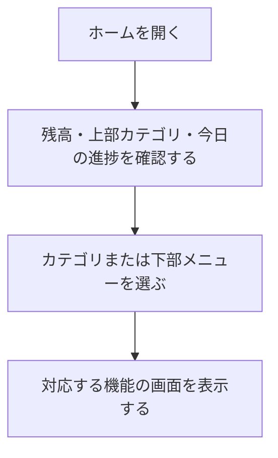

# F02｜ホーム・画面構成・上部メニュー PRD（レビュー前）

> 優先順位はスプレッドシートを正とする。本PRDはTier1のみを定義する。

参照するモック：本リポジトリのローカル4180。未接続の外部API・実端末機能は、接続済みとして扱わず末尾に記載する。

| 基本情報 | 内容 |
| --- | --- |
| 機能ID | F02 |
| 概要 | ホーム・画面構成・上部メニュー |
| 対象領域 | アプリ／管理画面／外部連携 |
| 関連機能 | [F03](F03-offer-list.md)、[F07](F07-daily-mission.md)、[F08](F08-walking.md)、[F10](F10-surveys.md)、[F11](F11-mini-games.md)、[F12](F12-points.md) |
| 更新日 | 2026-10-27 |
| 版 | レビュー前（初版未確定） |

## ① 目的・今回作る範囲

目的：アプリを開いた際に最初に表示されるホームとして、デイリーミッションやヘッダータブからユーザーを誘導し、ポイント獲得案件などの各種機能に迷わず進めるようにするため

優先順位は[アプリ詳細要件のTier列](https://docs.google.com/spreadsheets/d/1tI26I_4vbSHIOzMdJz7g8-DjeLyyVUKoksVHhZ0AQhU/edit#gid=1107057215)を正とする。モックに存在してもTier2・Tier3・空欄の要件は本PRDの定義対象に含めない。

| 要件ID | Tier1の範囲 |
| --- | --- |
| F02-1 | ユーザーが下部5タブからホーム・お得・簡単・遊ぶ・マイページへ移動できる |
| F02-2 | ユーザーがホーム画面のカテゴリ入口から対象のポイント獲得機能へ移動できる |
| F02-3 | 直前に見ていた画面へ表示状態を保って戻ることができる |
| F02-4 | ユーザーがホーム画面で残高を確認して実績レポートへ移動できる |
| F02-7 | ユーザーがホームのヘッダーで「いくら貯める」を確認して、今のポイントと目標へ移動できる |

管理側は[管理画面詳細要件のTier列](https://docs.google.com/spreadsheets/d/1tI26I_4vbSHIOzMdJz7g8-DjeLyyVUKoksVHhZ0AQhU/edit#gid=1341040600)にある以下のTier1を関連範囲とする。NACS本体の内製要件にはしない。

| 要件ID | Tier1の運用範囲 |
| --- | --- |
| ADM-F01-3 | 運営担当者がホームタブに表示するカテゴリを事前に設定して、指定日時に自動で切り替えられる |

## ② 画面イメージ

ホームは通常・読み込み中・取得エラー・0件でも、残高ヘッダー、初心者マーク、上部カテゴリ、下部ナビ、おすすめの位置を維持する。カテゴリの現行寸法はアイコン32px・文字10px・上下3px・アイコンと文字の間2px。

[アプリの該当画面](http://127.0.0.1:4180/mock-app/#home)

- 下部メニューはホーム・お得・簡単・遊ぶ・マイページの5つ。
- 上部カテゴリはおすすめ・ミッション・歩く・チャレンジボーナス・ゲーム・買い物・アンケート・カードを表示し、横スクロールで切り替える。文字数の都合上、デイリーミッションは「ミッション」、チャレンジボーナスは「チャレボ」と表示する。
- ヘッダーの残高から実績レポートへ、初心者マークの「いくら貯める？」から「今のポイントと目標」の見出し位置へ進む。
- ホームのアンケートも他のカテゴリと同じヘッダー・カテゴリメニューを使用し、「ミッション」表記、初心者マーク、目標の吹き出し、おすすめサイド表示を維持する。目標の吹き出しはホームへ入ってから5秒間の既存動作を維持し、カテゴリ間の移動で表示期限をリセットしない。
- ホームヘッダーアイコンのアンケートは簡単タブと同じ一覧を上部バナーの下に置く。ホーム経由では上部カテゴリーメニューを表示し、下部ホームを選択中とする。下部「簡単」から開く場合はカテゴリーメニューを非表示とし、簡単を選択中とする。入口別の詳細は[F10](F10-surveys.md)に記載する。
- ゲーム・買い物・カードはグレーの背景にバナーと案件を表示する。カテゴリ案件は開閉なしで一覧表示し、件数の上限はお得タブの「もっと見る」と同じ最大100件とする。並び順はASPから送られてくるEPCの降順とし、同値の場合は案件IDが新しい順、EPCがない案件は最下部に表示する（[F03](F03-offer-list.md)のカテゴリ別案件一覧と共通）。

ヘッダーの残高は、マイページの「あなたのポイント」と同じ本人の有効残高（失効分を除いた交換可能ポイント）を100pt＝1円相当で表示する。準備中は含めない。従来の固定見本額は使用せず、付与確定・交換・失効・利用者切替後に同じ残高へ更新する。取り消し線の比較額も、その残高を基準に算出する。

### ホーム「おすすめ」

ホームを開いた際は上部の「おすすめ」を最初に表示する。「ミッション」は独立した上部タブとして維持し、全ミッション・進捗・報酬の受取操作は[F07](F07-daily-mission.md)に従う。下部「お得」内にあった「おすすめ」の表記は「探す」にする。

| 表示順 | 要素 | 表示と遷移 |
| --- | --- | --- |
| ヘッダー | 残高と交換案内 | 本人の有効残高を円相当で表示する。「1,000,000円相当」まで残高・吹き出し・右側アイコンが重ならない幅を確保する。交換案内は白背景、カテゴリタブの未選択アイコンと同じグレーの文字・枠線で2行表示。初期文言は「ドットマネーへの／交換手数料ゼロ」。残高自体は固定額にしない |
| 1 | 新着アンケート通知 | 画面幅いっぱいのコンパクトなグレー帯。手紙アイコン、「アプリ限定の新着アンケートが届いています」、最大ポイントの合計、「確認」を表示。「確認」の右上に赤い通知ドットを付ける。通知対象・合計・確認先は回答可能なライフサーベイ案件のみ。提供元の説明をアプリUIへ追加しない |
| 2 | バナー | ホーム最上部の既存バナーを共用し、設定されたリンクへ移動する |
| 3 | ポイント・マイルの入口 | 見出しとサービス名ラベルを置かず、小さなロゴ枠を横に並べる。マイルは文字なしの飛行機アイコン。Vポイント・楽天・PayPay・dポイント・Pontaはサービスロゴを表示。上下とアイコン間の余白を詰め、関連する案件へ移動する。交換先の確定・交換申込みとは区別する |
| 4 | 期間限定ポイントアップ！ | 最大8件の丸い案件画像を横スクロールで表示。枠のグラデーションは下部「簡単」と同じ色調。順位番号は表示しない。吹き出し設定で指定された表示位置に任意の文言を表示する。「もっと見る」はお得の案件一覧へ |
| 5 | デイリーミッション | 丸印付きのコンパクトなリストで2件表示。未受取を優先し、受取済みはチェック付き。太いコーラルピンクの外枠と白背景、見出し下は影を使わず1pxの区切り線とする。ポイント数はコーラルピンク。文字サイズは同ページの見出し・案件名・ポイントと揃える。進捗バーを置かず、右上の「もっと見る」から上部ミッションタブへ移動する。表示しただけでは達成・受取状態を変えない |
| 6 | 人気案件 | 最大6件、3列×2行で表示。案件画像・案件名・報酬を表示し、案件詳細へ移動する |
| 7 | チャレンジボーナス | 薄いピーチ色の背景。掲載条件を満たす全案件を横1列のスクロールで表示。画像・終了までの日数・案件名・達成ボーナスだけを表示し、通常報酬・参加人数・進捗メーターは置かない。右上の「もっと見る」から上部チャレボタブへ。案件選択で詳細へ移動する |
| 8 | アンケート | 回答可能な案件を表示。通知帯のライフサーベイ限定条件はこの一覧や下部「簡単」全体には適用しない |
| 9 | おすすめ案件 | 最大6件、3列×2行で表示。案件選択で詳細へ移動する |

チャレンジボーナスの簡略表示と薄いピーチ色の背景は上部チャレボタブでも共通とする。カード列は左右端までスクロールでき、初期位置の左側には余白を設ける。見出し・カードの左端、上下の余白を揃える。右側の「おすすめ」サイドバーは閉じているときに取っ手以外のパネルや線がはみ出さない。

## ③ 操作フロー

## ④ 業務ルール・制約

### 表示する対象ユーザー

| 対象ユーザー | 利用・表示 |
| --- | --- |
| 会員 | ホームと各機能への入口を表示する |
| 非会員（ゲスト） | ホームと各機能への入口を表示する |

### 表示条件

| 状態・条件 | 表示のルール |
| --- | --- |
| ホーム表示時 | 本人の残高・カテゴリ入口・本日の進捗を表示する |
| 選択中のメニュー・カテゴリ | 選択状態をサーモンピンクのアイコン・文字で示す |
| 非選択のメニュー・カテゴリ | 通常のグレーのアイコン・文字で示す |
| ゲーム・買い物・カード | グレー背景にバナーとカテゴリ別の案件を表示する |

### おすすめのデータ・掲載ルール

| 対象 | ルール |
| --- | --- |
| 新着アンケート | ライフサーベイの回答可能な案件を対象とする。回答済み・募集終了など回答不可の案件を除き、回答後に追加で回答可能になった案件は含める。最大ポイントはユーザー向けの還元額で合算する。他社案件を合計や確認先に混ぜない |
| 期間限定ポイントアップ・人気・おすすめ案件 | 管理画面で掲載枠名とバンドル属性を設定し、属性に一致する案件を取得する。非公開・掲載終了・配信対象外の案件をアプリに表示しない。選択されているからといって配信条件を上書きしない |
| 吹き出し | 対象掲載枠・文言・何枠目の案件に表示するかを設定する。実際に表示される案件順を基準とし、対象枠の掲載期間外・指定位置の案件なしでは表示しない。最高還元などの訴求は運営が表示根拠を確認する |
| ミッション | F07の当日一覧と同じ状態・表示報酬を参照する。アンケートとミニゲームの報酬には「最大」を付ける。プレビューの表示件数で本来のミッション数・達成条件を変えない |
| チャレンジボーナス | 指定したバンドル属性と掲載期間・配信対象・公開状態を満たすものを全件表示。報酬の条件・付与はチャレンジボーナスの個別PRDを参照する |
| 設定の保存 | 保存成功後にホームの掲載内容・ヘッダーへ反映する。入力エラー時は前回の保存内容を保持する |

### 画面に置く要素・操作

| 画面・要素 | 表示・操作のルール |
| --- | --- |
| ヘッダーの残高 | ポイント残高を表示し、押すと実績レポートへ進む |
| 上部カテゴリ | おすすめ・ミッション・歩く・チャレボ・ゲーム・買い物・アンケート・カードを横スクロールで切り替える |
| 下部メニュー | ホーム・お得・簡単・遊ぶ・マイページへ進む |
| 目標設定の入口 | ヘッダーの初心者マークに「いくら貯める？」を表示し、タップすると「今のポイントと目標」の見出し・比較グラフの上端へ移動する |
| カテゴリ別の案件 | 開閉なしで最大100件を表示する（お得タブの「もっと見る」と同じ上限）。EPCの降順、同値の場合は案件IDが新しい順、EPCがない案件は最下部 |

## ⑤ 管理画面

新規作成・変更・削除は、現在の管理画面で操作できる範囲を示す。「外部管理」は、EDOCODE社が運営するACS側の担当範囲を指す。「未実装」は操作画面がない項目。削除と公開停止は分けて記載する。

[実行設定の管理画面](http://127.0.0.1:4180/mock-admin/#top-menu)

| 対象項目 | 新規作成 | 変更 | 削除 | 管理画面での操作・反映範囲 |
| --- | --- | --- | --- | --- |
| 上部メニューの設定一式・適用日時（ADM-F01-3） | 可能 | 可能 | 可能 | TOP画面上部のメニュー。設定を追加・予約・編集・削除する。適用中の削除後は直前の有効設定へ戻る。 |
| 下部5メニュー・ヘッダー・目標設定入口 | 不可 | 不可 | 不可 | アプリで定義したUI。上部メニュー設定からは変更しない。 |

### ホームおすすめ設定

デイリーミッションは案件掲載枠の追加・削除の対象から外し、専用の掲載チェックだけで表示を切り替える。設定済みの表示位置と活動条件は保持する。

管理画面の見出しは「案件掲載枠の追加・削除」「案件詳細の並べ替え」「案件吹き出しの追加」「ヘッダー吹き出しの変更」「ポイント別案件枠の追加・削除」とする。案件吹き出しの文言は1行で表示する。

| 設定項目 | 入力・制約 | アプリへの反映 |
| --- | --- | --- |
| ヘッダーの交換案内 | 表示ON/OFF、2行の文言（1行目9文字・2行目7文字以内） | 残高右側の吹き出しに反映。配色・最大残高のレイアウトは共通UIとして固定 |
| ポイント・マイル | 欄全体の掲載ON/OFFと、各入口の表示名・画像URL／アップロード・遷移先種別・遷移先・掲載可否。入口を最大12件追加・削除し、ドラッグで並べ替え | 欄全体がOFFの場合は個別設定を保持したまま欄を非表示にする。ONの場合は各入口の掲載可否・設定順に表示。遷移先はバンドル属性の案件一覧・案件詳細・設定URLから指定。お得タブとは独立した設定 |
| 各掲載枠 | 掲載枠の追加・削除、掲載枠名（1〜40文字）、バンドル属性、掲載開始日・終了日、「もっと見る」のディープリンク、ドラッグによる配置順 | 掲載期間内の枠を設定順に表示。追加する案件枠は3列×2行以内。新着通知・最上部バナー・ポイント入口・デイリーミッションはこの表に含めず、公開チェック・表示形式列も設けない |
| 期間限定ポイントアップ | バンドル属性（80文字以内） | 対象案件の丸いカードを横1列に表示 |
| 吹き出し | 対象掲載枠（ポイントアップ・人気・おすすめ・チャレンジ）、任意の文言（1〜20文字）、何枠目の案件に表示するか | 指定枠の指定位置に表示。複数登録・削除ができる。同じ枠・同じ位置の重複は保存できない |
| 人気案件・おすすめ案件 | 枠ごとのバンドル属性（80文字以内） | 各枠の3列×2行以内で表示 |
| アンケート通知 | 対象提供元・合計方法・確認先は固定 | ライフサーベイの回答可能案件から自動生成。運営が通知内の件数・報酬を直接入力しない |
| デイリーミッション | おすすめ内の掲載ON/OFF。活動条件・報酬はF07の設定を参照 | おすすめ内がOFFでもミッションタブと活動条件は維持。ONの場合はおすすめの2件とミッションタブの全件に同じ活動結果を反映 |
| チャレンジボーナス・バナー | チャレンジはバンドル属性と既存掲載条件、バナーは既存の掲載設定を参照 | おすすめと上部チャレボの対象案件、ホーム最上部バナーに反映 |

掲載枠名は運営が決める。案件枠の見出し・ミッション・アンケートの見出しと通知文に反映し、バナー・ポイント入口の名前は管理用とする。案件の個別ID一覧を登録する方式は使用しない。バンドル属性は候補から選択または直接入力し、属性が更新された案件も次回表示時に自動で対象へ反映する。属性未設定・一致案件なしの場合は、その案件枠を表示しない。枠の表示順は運営がドラッグ＆ドロップで指定し（上下キーでも移動可能）。表示上限はポイントアップ8件、人気・おすすめ各6件、チャレンジは全件とする。

指定バンドルの中身は案件名・案件ID・アプリの表示位置とともに一覧で確認でき、ドラッグで並べ替えられる。初期状態は元の配信順を使用する。変更はこの掲載枠だけに保存し、バンドル本体や他の掲載枠の順序は変更しない。新たに属性一致した案件は末尾に追加し、属性が外れた案件は対象から外す。公開条件・掲載上限で表示されない案件を区別する。吹き出しの位置選択には、その位置の案件名を併記し、並べ替えに合わせて更新する。吹き出しは指定位置に付き、特定案件には固定しない。

[ホームおすすめ設定](http://127.0.0.1:4173/mock-admin/#home-recommend)

## ⑥ 例外処理・エラーハンドリング

| 状況 | 表示・処理・復帰 |
| --- | --- |
| メニュー設定がない | 利用可能な既定の入口を表示する。存在しない画面を利用可能にしない。 |
| 遷移先が終了・停止している | 遷移先機能の表示に従い、戻る入口を維持する。 |

## ⑦ 達成条件・未決事項

### おすすめ追加分の達成条件

- [ ] 上部おすすめとミッションが別タブで表示され、お得の入口は「探す」と表示される。
- [ ] ライフサーベイ限定の通知対象・合計・確認先が一致し、他社のアンケート一覧は維持される。
- [ ] 掲載枠を追加・削除し、枠名・期間・バンドル属性・「もっと見る」のディープリンクを設定できる。枠と案件の順序をドラッグで変更できる。
- [ ] 新着通知・最上部バナー・ポイント入口を掲載枠表に含めず、ポイント入口は専用設定で欄全体の掲載ON/OFFを切り替えられる。
- [ ] 吹き出しの対象掲載枠・文言・表示位置を保存できる。指定位置に案件がない場合と掲載期間外の枠には表示せず、同じ枠・位置の重複は保存できない。
- [ ] ポイント入口をドラッグで並べ替え、表示名・画像・遷移先を保存してアプリへ反映できる。キャンセルと入力エラーでは保存済み内容を変更しない。
- [ ] 管理画面の掲載案件・ポイント入口・交換案内を保存し、アプリで反映を確認できる。空の掲載枠名・文字数超過・表示順の重複・不正な掲載期間は保存できない。
- [ ] ミッションを2件表示し、「もっと見る」でミッションタブに移動できる。進捗はプレビューに表示しない。
- [ ] チャレンジボーナスの全件を横1列で表示し、「もっと見る」で上部チャレボタブに移動できる。
- [ ] 1,000,000円相当の残高でも交換案内とアイコンが重ならない。

### Tier1の達成条件

- [ ] ホームは通常・読み込み中・取得エラー・0件でも、残高ヘッダー、初心者マーク、上部カテゴリ、下部ナビ、おすすめの位置を維持する。カテゴリの現行寸法はアイコン32px・文字10px・上下3px・アイコンと文字の間2px。

- [ ] ホームのアンケートへ移動しても「ミッション」表記と初心者マーク・表示期限内の目標吹き出し・おすすめサイド表示を維持し、下部ホームを選択中とする。
- [ ] F02-1：ユーザーが下部5タブからホーム・お得・簡単・遊ぶ・マイページへ移動できる。
- [ ] F02-2：ユーザーがホーム画面のカテゴリ入口から対象のポイント獲得機能へ移動できる。
- [ ] ゲーム・買い物・カードのカテゴリ案件が、開閉なしで最大100件、EPCの降順（同値は案件IDが新しい順、EPCなしは最下部）で表示される。
- [ ] F02-3：直前に見ていた画面へ表示状態を保って戻ることができる。
- [ ] F02-4：ユーザーがホーム画面で残高を確認して実績レポートへ移動できる。
- [ ] F02-7：ユーザーがホームのヘッダーで「いくら貯める」を確認して、今のポイントと目標へ移動できる。
- [ ] ①の管理側Tier1に対応する操作について、⑤の新規作成・変更・削除可否と反映範囲を確認できる。
- [ ] ⑥の対象となる空・失敗・中断などの状態から、表示内容と次の操作を確認できる。

- [ ] ヘッダーの円相当額が本人の有効残高・マイページと一致し、0pt・付与確定・交換・失効・利用者切替後も固定値に戻らない。準備中だけが増えた場合は有効残高を増やさない。

### まだ決まっていないこと

- 人気・おすすめの自動選定・集計期間と「最高還元」の判定基準は別途確定する。運営による属性指定と属性内の自動並べ替えを混同しない。
- アンケート配信APIの取得タイミング・再取得・失敗時の扱いはF10側と調整する。ライフサーベイ限定という対象条件は維持する。
- 交換手数料の案内は有効な契約・提供条件に従って掲載する。
- 認証・API接続などの具体的な方法は、別途仕様設計で定める。

## モックへの未反映・対象外

### モックへの未反映

| 項目 | 未反映の内容 |
| --- | --- |
| アンケート通知の取得 | ライフサーベイとの本番API接続・取得失敗からの復帰は未接続。通知の対象絞り込みと還元額合計はローカルデータで再現 |
| 人気・おすすめの自動選定 | 現在の案件表示順を使用。集計期間や本番での自動選定ロジックは未確定 |
| メニュー設定の配信 | 管理画面で保存した設定を本番アプリへ配信する処理は未接続 |
| カテゴリ案件の件数・開閉 | モックは最初の9件を表示し、残りをその場で開閉する。開閉なし・最大100件は未反映（EPC順は反映済み） |

### 今回の対象外

| 項目 | 対象外の内容 |
| --- | --- |
| なし | — |

## 変更履歴

| 版 | 日付 | 変更内容 |
| --- | --- | --- |
| レビュー前 | 2026-10-27 | デイリーミッションを案件掲載枠の表から分離し、専用の掲載ON/OFFで管理する形に変更。表示位置・活動条件は保持。 |
| レビュー前 | 2026-10-27 | 掲載枠の追加・削除と「もっと見る」のディープリンクを追加。新着通知・バナー・ポイント入口を枠の表から分離し、公開チェック・表示形式列を削除。ポイント入口欄全体の掲載ON/OFFを追加。 |
| レビュー前 | 2026-10-27 | 指定バンドルの案件名・ID・表示位置の確認と、掲載枠ごとの案件並べ替えを追加。吹き出しの位置選択にも案件名を表示する。 |
| レビュー前 | 2026-10-26 | 最高還元の属性指定を「吹き出し」設定へ変更。対象掲載枠・任意の文言・案件の表示位置を指定する方式に統一。 |
| レビュー前 | 2026-10-26 | 枠・ポイント入口をドラッグ並べ替えに変更。入口の表示名・画像・遷移先種別／遷移先を編集可能にし、追加・削除・掲載可否を設定可能に変更。 |
| レビュー前 | 2026-10-26 | 掲載枠名を自由入力に変更し、案件の個別指定を廃止。案件枠と最高還元はバンドル属性で取得する方式へ変更。 |
| レビュー前 | 2026-10-26 | 管理画面を他の掲載設定に合わせ、枠の公開・停止・期間・順序、案件の追加・削除・順序、保存・キャンセルを追加。変更を保存するまでアプリへ反映しない。 |
| レビュー前 | 2026-10-26 | ホームおすすめの表示順・ライフサーベイ限定通知・ポイント入口・掲載枠・2件のミッション・横1列のチャレンジ・交換案内と管理設定を追加。上部タブへの遷移と配色・余白を整理。 |
| レビュー前 | 2026-10-23 | ホームの通常・読み込み中・取得エラー・0件を共通の外枠へ統一。おすすめの位置判定も外枠へ集約。カテゴリの現行寸法をアプリと部品集で共用。 |
| レビュー前 | 2026-10-23 | ホームのアンケートでカテゴリ名・初心者マーク・吹き出し・おすすめが欠ける不整合を修正。カテゴリメニューとホーム領域の表示判定を共通化。 |
| レビュー前 | 2026-10-19 | 目的を書き換え。F02-7をホームのヘッダーの「いくら貯める」から今のポイントと目標への移動に変更。Tier1以外のF02-5（赤ポチ）・F02-6／ADM-F01-1（カテゴリの追加・並べ替え）は定義対象外とし、赤ポチの表示ルール・達成条件・モック未反映の記載を削除。 |
| レビュー前 | 2026-10-19 | ホームのラベル・上下余白・アイコン維持、いくら貯める？からの目標見出しへの遷移、重複入口削除、カテゴリ別赤ポチ条件を整理。アンケート赤ポチの実装差分を明記。 |
| レビュー前 | 2026-10-19 | ホーム上部カテゴリの「クレカ」を「カード」に改名。アイコン・順序・遷移先は維持。 |
| レビュー前 | 2026-10-15 | F10レビューの共通フィードバックを反映。⑤を管理画面へ変更し、④を対象ユーザー・表示条件・配置要素に整理。例外処理と仕様設計事項の重複を除き、未反映と対象外を別表に分離。個別レビューは未完了。 |
| レビュー前 | 2026-10-20 | アンケート一覧の入口を区別。ホームではカテゴリーメニューを維持、下部「簡単」からは非表示とする。アンケート・バナーの表示内容は共用。 |
| レビュー前 | 2026-10-20 | ヘッダーの固定見本額を撤去し、マイページと同じ本人の有効残高を表示する方針・確認条件を反映。 |
| レビュー前 | 2026-10-20 | 児玉さんの相互レビューを反映。冒頭の注記を優先順位とTier1の記載だけに短縮。基本情報のモックレビュー・PRDレビュー・共有メモの3行、評価指標、④と⑦冒頭のユーザーレビュー未完了の注記を削除。「外部管理」をEDOCODE社が運営するACS側の担当範囲と明記。カテゴリ案件を9件表示＋開閉から、開閉なし・最大100件（お得タブの「もっと見る」と同じ上限）・EPC順（同値は案件ID順、EPCなしは最下部。F03と共通）に変更し、達成条件とモック未反映に追記。 |
| レビュー前 | 2026-10-20 | モックでカテゴリ案件のEPC順が反映済みとなったため、モック未反映を「開閉なし・最大100件」だけに更新。 |

## レビュー時の確認項目

> レビュー完了後、このセクションごと削除する。

| 項目 | 確認してほしいこと |
| --- | --- |
| ⑤ 上部メニューの設定一式・適用日時（ADM-F01-3） | 今の管理画面では、ヘッダータブにカテゴリ名とアイコンは設定できるが、そのタブを選んだときに何が表示されるかを決める手段がない |
| ⑤ 上部メニューの設定一式・適用日時（ADM-F01-3） | 既存のカテゴリを微修正・追加する形ではなく、0からカテゴリを決める管理画面仕様になっているため、モック自体の修正が必要 |
