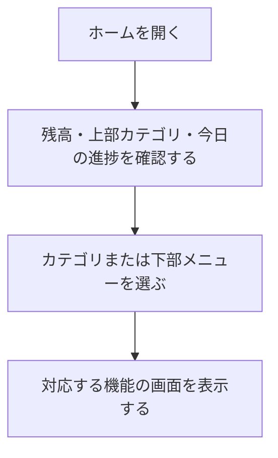

# F02｜ホーム・画面構成・上部メニュー PRD（レビュー前）

> ④業務ルールと⑦以降はユーザーレビュー未完了。本日の変更箇所はローカル4180モックとユーザー指定を参照し、優先順位はスプレッドシートを正とする。本PRDはTier1のみを定義する。

参照するモック：本リポジトリのローカル4180（2026-10-19の変更箇所を照合）。未接続の外部API・実端末機能は、接続済みとして扱わず末尾に記載する。

| 基本情報 | 内容 |
| --- | --- |
| 機能ID | F02 |
| 概要 | ホーム・画面構成・上部メニュー |
| 対象領域 | アプリ／管理画面／外部連携 |
| 関連機能 | [F03](F03-offer-list.md)、[F07](F07-daily-mission.md)、[F08](F08-walking.md)、[F10](F10-surveys.md)、[F11](F11-mini-games.md)、[F12](F12-points.md) |
| 更新日 | 2026-10-19 |
| 版 | レビュー前（初版未確定） |

## ① 目的・今回作る範囲

目的：ポイント獲得機能や新しいお得情報へ迷わず進めるようにするため

評価指標：ホームからの遷移率/機能別利用率/対象画面の閲覧数/離脱率

優先順位は[アプリ詳細要件のTier列](https://docs.google.com/spreadsheets/d/1g00ZxLGprVNT4T4uSmzw--vRpp95HQ1Uq9i8GnJpmS4/edit#gid=1107057215)を正とする。モックに存在してもTier2・Tier3・空欄の要件は本PRDの定義対象に含めない。

| 要件ID | Tier1の範囲 |
| --- | --- |
| F02-1 | ユーザーが下部5タブからホーム・お得・簡単・遊ぶ・マイページへ移動できる |
| F02-2 | ユーザーがホーム画面のカテゴリ入口から対象のポイント獲得機能へ移動できる |
| F02-3 | 直前に見ていた画面へ表示状態を保って戻ることができる |
| F02-4 | ユーザーがホーム画面で残高を確認してポイント獲得履歴へ移動できる |
| F02-7 | ユーザーがホームの目標設定入口から追加目標の選択へ進める |

管理側は[管理画面詳細要件のTier列](https://docs.google.com/spreadsheets/d/1g00ZxLGprVNT4T4uSmzw--vRpp95HQ1Uq9i8GnJpmS4/edit#gid=1341040600)にある以下のTier1を関連範囲とする。NACS本体の内製要件にはしない。

| 要件ID | Tier1の運用範囲 |
| --- | --- |
| ADM-F01-3 | 運営担当者がホームタブに表示するカテゴリを事前に設定して、指定日時に自動で切り替えられる |

要件名に旧モックとの相違がある場合、優先順位は維持し、現在の表示・動きとユーザー指定を②以降へ反映する。実装方式の具体化は仕様設計で扱う。

## ② 画面イメージ

[アプリの該当画面](http://127.0.0.1:4180/mock-app/#home)

- 下部メニューはホーム・お得・簡単・遊ぶ・マイページの5つ。「遊ぶ」は既存のミニゲーム一覧へ進む。
- 上部カテゴリはデイリーミッション・歩く・チャレンジボーナス・ゲーム・買い物・アンケート・カードを表示し、横スクロールで切り替える。
- ヘッダーの残高からポイント履歴へ、初心者マークの「いくら貯める？」から「今のポイントと目標」の見出し位置へ進む。ホームのアンケートは簡単タブと同じ一覧を開く。
- ゲーム・買い物・カードはグレーの背景にバナーと案件を表示する。カテゴリ案件は9件を最初に表示し、残りをその場で開閉する。

- 上部の「アンケ」は「アンケート」、「クレカ」は「カード」と表示する。アイコンは元のサイズを維持し、ラベルだけ従来より2px小さくする。アイコン上・文字下の縦余白、アイコンと文字の間隔は従来の半分。iPhoneの絵文字ではなく共通のアイコン・画像を使用する。

## ③ 操作フロー

## ④ 業務ルール・制約

> ユーザーレビュー未完了。アプリ上の表示に関わるルールを記載する。

### 表示する対象ユーザー

| 対象ユーザー | 利用・表示 |
| --- | --- |
| 会員 | ホームと各機能への入口を表示する |
| 非会員（ゲスト） | ホームと各機能への入口を表示する |

### 表示条件

| 状態・条件 | 表示のルール |
| --- | --- |
| ホーム表示時 | 本人の残高・カテゴリ入口・本日の進捗を表示する |
| 選択中のメニュー・カテゴリ | 選択状態をサーモンピンクのアイコン・文字で示す |
| 非選択のメニュー・カテゴリ | 通常のグレーのアイコン・文字で示す |
| ゲーム・買い物・カード | グレー背景にバナーとカテゴリ別の案件を表示する |

### 画面に置く要素・操作

| 画面・要素 | 表示・操作のルール |
| --- | --- |
| ヘッダーの残高 | ポイント残高を表示し、押すとポイント履歴へ進む |
| 上部カテゴリ | デイリー・歩く・チャレボ・ゲーム・買い物・アンケート・カードを横スクロールで切り替える |
| 下部メニュー | ホーム・お得・簡単・遊ぶ・マイページへ進む |
| 目標設定の入口 | ヘッダーの初心者マークに「いくら貯める？」を表示し、タップすると「今のポイントと目標」の見出し・比較グラフの上端へ移動する。金額選択の途中を遷移先にしない。本文中の重複する「いくら貯める」カードは表示しない |
| カテゴリ別の案件 | 最初の9件を表示し、残りをその場で開閉する |

### ホーム上部の赤ポチ

| タブ | 表示条件 | 消える条件 |
| --- | --- | --- |
| 歩く | 歩数更新により受取可能な報酬があり、未獲得である | 受取可能な報酬をすべて獲得したとき。画面を開いただけでは消さない |
| チャレボ・カード・ゲーム・買い物 | 未確認の新規案件または案件内容の更新がある | 対象タブを一度確認したとき。新たな更新があれば再表示する |
| アンケート | 案件の新規配信・更新があり、未回答かつ回答可能な案件がある | 対象の未回答・回答可能な案件がなくなったとき。一覧を開くだけでは消さない |

並び替えだけを案件内容の更新として扱わない。対象ユーザーに表示できない案件は赤ポチの対象にしない。ベル・プッシュ通知とは独立したアプリ内の状態表示とする。

## ⑤ 管理画面

新規作成・変更・削除は、現在の管理画面で操作できる範囲を示す。「外部管理」はNACS・EDOCODE等の担当範囲、「未実装」は操作画面がない項目。削除と公開停止は分けて記載する。

[実行設定の管理画面](http://127.0.0.1:4180/mock-admin/#top-menu)

| 対象項目 | 新規作成 | 変更 | 削除 | 管理画面での操作・反映範囲 |
| --- | --- | --- | --- | --- |
| 上部メニューの設定一式・適用日時 | 可能 | 可能 | 可能 | TOP画面上部のメニュー。設定を追加・予約・編集・削除する。適用中の削除後は直前の有効設定へ戻る。 |
| 下部5メニュー・ヘッダー・目標設定入口 | 不可 | 不可 | 不可 | アプリで定義したUI。上部メニュー設定からは変更しない。 |

## ⑥ 例外処理・エラーハンドリング

| 状況 | 表示・処理・復帰 |
| --- | --- |
| メニュー設定がない | 利用可能な既定の入口を表示する。存在しない画面を利用可能にしない。 |
| 遷移先が終了・停止している | 遷移先機能の表示に従い、戻る入口を維持する。 |

## ⑦ 達成条件・未決事項

> 本節以降はユーザーレビュー未完了。

### Tier1の達成条件

- [ ] 上部は「アンケート」「カード」、下部は「遊ぶ」の表記で、アイコン寸法・遷移先を維持する。
- [ ] 初心者マークから「今のポイントと目標」の見出し位置へ移動し、本文中に同じ入口カードを重複表示しない。
- [ ] 歩く・更新型4カテゴリ・アンケートの赤ポチが、それぞれの表示・消灯条件に従う。

- [ ] F02-1：ユーザーが下部5タブからホーム・お得・簡単・遊ぶ・マイページへ移動できる。
- [ ] F02-2：ユーザーがホーム画面のカテゴリ入口から対象のポイント獲得機能へ移動できる。
- [ ] F02-3：直前に見ていた画面へ表示状態を保って戻ることができる。
- [ ] F02-4：ユーザーがホーム画面で残高を確認してポイント獲得履歴へ移動できる。
- [ ] F02-7：ユーザーがホームの目標設定入口から追加目標の選択へ進める。
- [ ] ①の管理側Tier1に対応する操作について、⑤の新規作成・変更・削除可否と反映範囲を確認できる。
- [ ] ⑥の対象となる空・失敗・中断などの状態から、表示内容と次の操作を確認できる。

### まだ決まっていないこと

なし。認証・API接続などの具体的な方法は、別途仕様設計で定める。

## モックへの未反映・対象外

### モックへの未反映

| 項目 | 未反映の内容 |
| --- | --- |
| アンケートの赤ポチ | 現モックは一覧表示時に既読となり、未回答案件が残っていても消える。上記の「一覧を開くだけでは消さない」指定は未反映。本番の更新検知・ユーザー別既読同期も未接続 |
| メニュー設定の配信 | 管理画面で保存した設定を本番アプリへ配信する処理は未接続 |

### 今回の対象外

| 項目 | 対象外の内容 |
| --- | --- |
| なし | — |

## 変更履歴

| 版 | 日付 | 変更内容 |
| --- | --- | --- |
| レビュー前 | 2026-10-19 | ホームのラベル・上下余白・アイコン維持、いくら貯める？からの目標見出しへの遷移、重複入口削除、カテゴリ別赤ポチ条件を整理。アンケート赤ポチの実装差分を明記。 |
| レビュー前 | 2026-10-19 | ホーム上部カテゴリの「クレカ」を「カード」に改名。アイコン・順序・遷移先は維持。 |
| レビュー前 | 2026-10-15 | F10レビューの共通フィードバックを反映。⑤を管理画面へ変更し、④を対象ユーザー・表示条件・配置要素に整理。例外処理と仕様設計事項の重複を除き、未反映と対象外を別表に分離。個別レビューは未完了。 |
