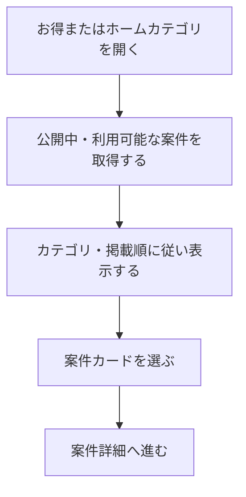

# F03｜アフィリエイト案件の一覧・検索・カテゴリ・並び順 PRD（レビュー前）

> ④業務ルールと⑦以降はユーザーレビュー未完了。機能・画面・操作は現在の4189モックを正とし、優先順位はスプレッドシートを正とする。本PRDはTier1のみを定義する。

参照するモック：`Tameruko-Preview-20261013` の4189（2026-10-15確認）。未接続の外部API・実端末機能は、接続済みとして扱わず末尾に記載する。

| 基本情報 | 内容 |
| --- | --- |
| 機能ID | F03 |
| 概要 | アフィリエイト案件の一覧・検索・カテゴリ・並び順 |
| 対象領域 | アプリ／管理画面／外部連携 |
| 関連機能 | [F04](F04-offer-entry.md)、[F15](F15-ad-placements.md) |
| 更新日 | 2026-10-15 |
| 版 | レビュー前（初版未確定） |

## ① 目的・今回作る範囲

目的：利用できるアフィリエイト案件を見つけやすくするため

評価指標：案件詳細の閲覧率/参加操作率/承認成果率

優先順位は[アプリ詳細要件のTier列](https://docs.google.com/spreadsheets/d/1g00ZxLGprVNT4T4uSmzw--vRpp95HQ1Uq9i8GnJpmS4/edit#gid=1107057215)を正とする。モックに存在してもTier2・Tier3・空欄の要件は本PRDの定義対象に含めない。

| 要件ID | Tier1の範囲 |
| --- | --- |
| F03-1 | ユーザーがお得画面のおすすめ一覧で公開中のアフィリエイト案件を確認できる |
| F03-2 | ユーザーがお得内・ホームから開く案件一覧をカテゴリ別に絞って確認できる |
| F03-3 | 運営担当者がお得内とホームから開くカテゴリ別案件一覧の掲載案件・並び順を一箇所で設定できる |
| F03-4 | 案件が取得できない場合に状態を確認して再試行できる |
| F03-7 | ユーザーがお得の使い方ガイドを確認でき、運営担当者が案内内容を編集できる |
| F03-9 | ユーザーがホームから開くカテゴリ別案件一覧で案件を3列カードで確認できる |
| F03-11 | ユーザーがお得画面で残高を確認してポイント獲得履歴へ移動できる |

管理側は[管理画面詳細要件のTier列](https://docs.google.com/spreadsheets/d/1g00ZxLGprVNT4T4uSmzw--vRpp95HQ1Uq9i8GnJpmS4/edit#gid=1341040600)にある以下のTier1を関連範囲とする。NACS本体の内製要件にはしない。

| 要件ID | Tier1の運用範囲 |
| --- | --- |
| ADM-F01-2 | 運営担当者がホームタブのカテゴリ別のアフィリエイト案件箇所・お得タブ内タグにNACSのバンドル属性を割り当てできる |

要件名に旧モックとの相違がある場合、優先順位は維持し、現在の表示・動きとユーザー指定を②以降へ反映する。実装方式の具体化は仕様設計で扱う。

## ② 画面イメージ

[アプリの該当画面](http://127.0.0.1:4189/mock-app/#offers)

- お得のおすすめ一覧とホームのカテゴリ別一覧で公開案件を確認する。カテゴリ別の一覧は3列の案件カードで表示する。
- カードを選ぶと案件詳細へ進む。案件の画像・名前・報酬を確認できる。
- 一覧はNACSの一覧コードを参照する。ピン留めを先頭にし、残りは当日を含む3暦日JSTのクリック数順、同数は候補順とする。
- 「いま注目の案件」は最大100件、その他の一覧は最大20件、ピン留めは一覧ごとに最大20件。ホームカテゴリは最初9件と残りの開閉を表示する。

## ③ 操作フロー

## ④ 業務ルール・制約

> ユーザーレビュー未完了。アプリ上の表示に関わるルールを記載する。

### 表示する対象ユーザー

| 対象ユーザー | 利用・表示 |
| --- | --- |
| 会員 | 公開中で利用条件に合う案件の一覧を確認する |
| 非会員（ゲスト） | 公開中で利用条件に合う案件の一覧を確認する |

### 表示条件

| 状態・条件 | 表示のルール |
| --- | --- |
| 掲載中・期間内の案件 | OS・利用者条件に合う案件を表示する |
| 掲載停止・期間外・対象外の案件 | 一覧に表示しない |
| ピン留めされた案件 | 対象条件を満たす案件を先頭に表示する |
| ピン留め以外 | 当日を含む3暦日JSTのクリック数順、同数は候補順で表示する |

### 画面に置く要素・操作

| 画面・要素 | 表示・操作のルール |
| --- | --- |
| おすすめ・カテゴリ別の一覧 | 案件画像・案件名・報酬を表示し、カードを押すと詳細へ進む |
| カテゴリ別の案件カード | 3列で表示する |
| 報酬 | 定額・定率・段階報酬を区別して表示する |
| 案件の表示範囲 | いま注目の案件は最大100件、その他は最大20件。ホームカテゴリは最初9件と残りの開閉を表示する |
| お得の使い方ガイド | 利用前の準備・利用手順を確認できる |
| 残高 | 本人の残高を表示し、押すとポイント履歴へ進む |

## ⑤ 管理画面

新規作成・変更・削除は、現在の管理画面で操作できる範囲を示す。「外部管理」はNACS・EDOCODE等の担当範囲、「未実装」は操作画面がない項目。削除と公開停止は分けて記載する。

[実行設定の管理画面](http://127.0.0.1:4189/mock-admin/legacy.html#screens)

| 対象項目 | 新規作成 | 変更 | 削除 | 管理画面での操作・反映範囲 |
| --- | --- | --- | --- | --- |
| お得の案件グループ設定・表示順・名称 | 可能 | 可能 | 可能 | 案件グループ設定で設定一式と行を管理する。案件本文はここで編集しない。 |
| 案件・一覧コード・掲載案件・ピン留め | 外部管理 | 外部管理 | 外部管理 | NACS側の操作。現在のNACS再現画面には作成・編集・削除・ピン留めがある。LIST_ALL自体は削除不可。 |
| ユーザーの選択カテゴリ | 対象外 | 対象外 | 対象外 | ユーザーが一覧を切り替える操作。 |

## ⑥ 例外処理・エラーハンドリング

| 状況 | 表示・処理・復帰 |
| --- | --- |
| 表示できる案件がない | 該当する案件がない案内を表示し、カテゴリ変更へ戻れる。 |
| 取得失敗 | 取得失敗と再読み込みを案内する。取得失敗を0件として表示しない。 |

## ⑦ 達成条件・未決事項

> 本節以降はユーザーレビュー未完了。

### Tier1の達成条件

- [ ] F03-1：ユーザーがお得画面のおすすめ一覧で公開中のアフィリエイト案件を確認できる。
- [ ] F03-2：ユーザーがお得内・ホームから開く案件一覧をカテゴリ別に絞って確認できる。
- [ ] F03-3：運営担当者がお得内とホームから開くカテゴリ別案件一覧の掲載案件・並び順を一箇所で設定できる。
- [ ] F03-4：案件が取得できない場合に状態を確認して再試行できる。
- [ ] F03-7：ユーザーがお得の使い方ガイドを確認でき、運営担当者が案内内容を編集できる。
- [ ] F03-9：ユーザーがホームから開くカテゴリ別案件一覧で案件を3列カードで確認できる。
- [ ] F03-11：ユーザーがお得画面で残高を確認してポイント獲得履歴へ移動できる。
- [ ] ①の管理側Tier1に対応する操作について、⑤の新規作成・変更・削除可否と反映範囲を確認できる。
- [ ] ⑥の対象となる空・失敗・中断などの状態から、表示内容と次の操作を確認できる。

### まだ決まっていないこと

なし。認証・API接続などの具体的な方法は、別途仕様設計で定める。

## モックへの未反映・対象外

### モックへの未反映

| 項目 | 未反映の内容 |
| --- | --- |
| NACS連携 | 本番の案件一覧取得・掲載設定の同期・クリック集計は未接続 |

### 今回の対象外

| 項目 | 対象外の内容 |
| --- | --- |
| NACS本体の内製 | 案件・一覧の管理は外部NACSとの連携範囲として扱う |

## 変更履歴

| 版 | 日付 | 変更内容 |
| --- | --- | --- |
| レビュー前 | 2026-10-15 | F10レビューの共通フィードバックを反映。⑤を管理画面へ変更し、④を対象ユーザー・表示条件・配置要素に整理。例外処理と仕様設計事項の重複を除き、未反映と対象外を別表に分離。個別レビューは未完了。 |
