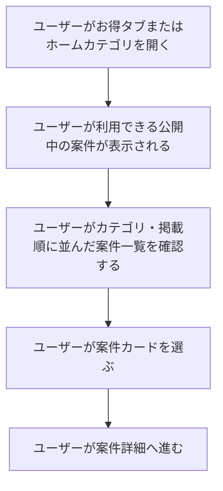

# F03｜アフィリエイト案件の一覧・検索窓での検索・カテゴリ・並び順 PRD（レビュー前）

> 優先順位はスプレッドシートを正とする。本PRDはTier1のみを定義する。

参照するモック：本リポジトリのローカル4180（2026-10-19の変更箇所を照合）。未接続の外部API・実端末機能は、接続済みとして扱わず末尾に記載する。

| 基本情報 | 内容 |
| --- | --- |
| 機能ID | F03 |
| 概要 | アフィリエイト案件の一覧・検索窓での検索・カテゴリ・並び順 |
| 対象領域 | アプリ／管理画面／外部連携 |
| 関連機能 | [F04](F04-offer-entry.md)、[F15](F15-ad-placements.md) |
| 更新日 | 2026-10-20 |
| 版 | レビュー前（初版未確定） |

## ① 目的・今回作る範囲

目的：利用できるアフィリエイト案件を見つけやすくするため

優先順位は[アプリ詳細要件のTier列](https://docs.google.com/spreadsheets/d/1tI26I_4vbSHIOzMdJz7g8-DjeLyyVUKoksVHhZ0AQhU/edit#gid=1107057215)を正とする。モックに存在してもTier2・Tier3・空欄の要件は本PRDの定義対象に含めない。

| 要件ID | Tier1の範囲 |
| --- | --- |
| F03-1 | ユーザーがお得タブのおすすめ一覧で公開中のアフィリエイト案件を確認できる |
| F03-2 | ユーザーがお得タブ内・ホームから開く案件一覧をカテゴリ別に絞って確認できる |
| F03-3 | 運営担当者がお得タブ内とホームから開くカテゴリ別案件一覧の掲載案件・並び順を一箇所で設定できる |
| F03-4 | 案件が取得できない場合に状態を確認して再試行できる |
| F03-7 | ユーザーがお得タブの使い方ガイドを確認でき、運営担当者が案内内容を編集できる |
| F03-9 | ユーザーがホームから開くカテゴリ別案件一覧で案件を3列カードで確認できる |
| F03-11 | ユーザーがお得タブで残高を確認して実績レポートへ移動できる |

管理側は[管理画面詳細要件のTier列](https://docs.google.com/spreadsheets/d/1tI26I_4vbSHIOzMdJz7g8-DjeLyyVUKoksVHhZ0AQhU/edit#gid=1341040600)にある以下のTier1を関連範囲とする。ACSはEDOCODE社のシステムを利用する想定とし、本体の内製要件にはしない。

| 要件ID | Tier1の運用範囲 |
| --- | --- |
| ADM-F01-2 | 運営担当者がホームタブのカテゴリ別のアフィリエイト案件箇所・お得タブ内タグにACSのバンドル属性を割り当てできる |

要件名に旧モックとの相違がある場合、優先順位は維持し、モックのUI・UXを②以降へ反映する。実装方式の具体化は仕様設計で扱う。

## ② 画面イメージ

[アプリの該当画面](http://127.0.0.1:4180/mock-app/#offers)

- お得タブのおすすめ一覧とホームのカテゴリ別一覧で公開案件を確認する。カテゴリ別の一覧は3列の案件カードで表示する。
- カードを選ぶと案件詳細へ進む。案件の画像・名前・報酬を確認できる。通常のSURアフィリエイト案件は、一覧カード・ランキング・横長リストでは、ポイントマークの前に「最大」を表示する。報酬数値のフォントサイズ・文字間隔・ポイントマークのサイズは、同じ表示形式の通常案件とそろえる。チャレンジボーナスの案件表示に限り「(最大)」を表示しない。報酬額・段階条件は変えない。
- 検索窓での検索は案件名のみの部分一致。カテゴリ名・成果条件は対象外。検索窓での検索時は選択中カテゴリに限定せず、公開・ユーザー・OS等の表示条件を満たす案件全体を対象にする。検索窓での検索結果は直近30日間の発生CV数の降順（JSTで当日を含む30暦日。承認日ではなく発生日で集計し、承認・未承認・否認の状態で絞り込まない）とし、同値の場合は案件IDが新しい順にする。検索窓での検索中はキャンペーン告知のテキストバナーとカテゴリーチップを非表示にし、検索窓を空欄にして検索すると通常表示に戻す。PRバナー等は維持する。
- 検索窓での検索結果が0件の場合は「該当する案件が見つかりませんでした」と「別のキーワードで探してみてください。」を表示する。
- 人気ランキングのタイトルエリアは、冠アイコンと「人気ランキング」を表示し、見出しの下に「みんなに人気の案件に挑戦しよう」を文字の左端に揃えて表示する。説明文は共通フォント・12px／W3（300）・行高1.6・補助色#707A75、見出し下3pxの余白とする。見出しはチャレンジボーナスと同じ共通フォント・16px／W6（600）・行高1.4。冠アイコンはデザインルールに沿った単色の丸い線画を使い、20×20pxで見出しの縦中央へ揃える。
- 人気ランキングのカテゴリーは「総合／カード／口座開設／ゲーム／エンタメ／買い物／旅行」の順。対象案件は開発後にバンドル属性名で指定する。チップはPG-A02の高さ30px・左右余白10px・間隔8pxとし、文字数に合わせた可変幅で横スクロールする。お得タブの上部カテゴリーは変更しない。
- おすすめ下部の人気ランキングは最大9件のリスト表示。順位・40pxの正方形画像・1行の案件名・右寄せの報酬を表示し、1行は約56pxとする。条件説明やタグは省き、案件詳細で確認する。カテゴリーは上部と同じ小さい横並びチップを使用する。ランキング位置は維持し、案件は直近30日間のCV数順とする。
- 「新着」「ポイント高還元」の「もっと見る」から開いた一覧は、ヘッダー左上の「＜」で遷移元に戻れる。元のスクロール位置を復元し、直接URLで開いた場合はお得タブのおすすめへ戻る。
- 「もっと見る」の遷移先は上部タブを表示せず、ヘッダーを戻るボタンと「新着」または「ポイント高還元」のページタイトルだけにする。バナーと一覧内の見出し・サブタイトルは表示しない。
- 「新着」「ポイント高還元」はおすすめ画面では各最大6件（横3列×縦2行）。「もっと見る」の遷移先はアンケートと共通の横長リスト形式で各最大100件とし、表示対象の絞り込み・並び替え後の先頭100件を表示する。
- 新着・ポイント高還元の遷移先の案件一覧は、左側に正方形バナー、中央に案件名・報酬、右側に「詳細を見る」を配置する。行全体から案件詳細へ進む。
- 「新着」は、表示条件に合う公開中の案件をACSから新着順で取得し、返された順序のまま自動表示する。お得タブのおすすめ内は先頭最大6件、「もっと見る」は同じ順序で最大100件とする。ピン留め案件は手動指定順で先頭に表示し、残りはACSの新着順を維持する。
- おすすめ内の「ポイント高還元」とその「もっと見る」は、運営担当者が案件と掲載順を手動で設定する。表示条件に合う設定済み案件を同じ掲載順で表示する。
- おすすめのサービス名リンクの上下余白は12pxに統一する。リンク行の下余白と検索窓の上余白を重ねず、サービスアイコンのボタンから検索窓までを上側と同じ12pxにする。
- お得タブのサービス名リンクはおすすめだけに5枠を横一列に配置し、サービスアイコンを20px四方に収め、白地・薄いグレーの横長の楕円形に近い枠内にアイコンと10pxのサービス名を表示する。枠の高さは名称が見切れないように調整する。
- 「買い物」「旅行」などのカテゴリ別案件一覧は、ASPから送られてくるEPCの降順に表示する。同値の場合は案件IDが新しい順にする。
- ホーム上部のアフィリエイトカテゴリ（ゲーム・買い物・カード等）内の案件は、[F02](F02-home.md)と共通で、開閉なし・最大100件の一覧として表示する。案件の並び順はお得タブのカテゴリ別案件一覧と同じEPC降順とする。専用の「もっと見る」一覧は各100件、人気ランキングは最大9件とする。

- おすすめ内は「チャレンジボーナス」「新着」「ポイント高還元」をセクションとして上部に配置し、既存セクションに加え、バンドル属性で指定できる条件に限りセクションを追加できる。追加セクションは「新着」「ポイント高還元」と同じ階層に置き、案件の並び順は任意に手動指定できる。おすすめ内は最大6件（横3列×縦2行）、「もっと見る」は同じ掲載順で最大100件の横長リストとし、詳細への移動・ヘッダー・戻る操作も新着・ポイント高還元の仕様に沿う。ACS側で追加セクションの見出し・バンドル属性・掲載案件・案件順・公開／停止を設定する。自社管理画面では、既存セクションを含むセクションの配置順だけを変更できる。人気ランキングは必ず全セクションの下に固定する。チャレンジボーナスは既存の表示名・案件カード・開催内容を維持する。枠の背景は見出し上から全件表示ボタン下の余白まで淡いピンク#FCE9E1とし、次の「新着」等の見出し前でグレーへ切り替える。5件以上の全件表示はF06の専用一覧を使い、戻る＋タイトルのヘッダーと同じ2列タイルで配信中の全件を表示する。ホームタブへは遷移しない。
- サービス名リンクは、管理画面でサービス名・サービスアイコン画像・リンク先を変更できる。楽天・PayPay等の名称に固定しない。アプリにはサービスアイコンのみを表示し、設定したサービス名は読み上げ用名称に使用する。遷移先は①任意のバンドル属性名でまとめたアフィリエイト案件一覧ページ、②指定した案件の詳細ページ、③指定したリンク（URL）の3種類から選び、それぞれバンドル属性・案件ID・URLを設定する。

ヘッダーの残高は、マイページの「あなたのポイント」と同じ本人の有効残高（失効分を除いた交換可能ポイント）を100pt＝1円相当で表示する。準備中は含めない。従来の固定見本額は使用せず、付与確定・交換・失効・利用者切替後に同じ残高へ更新する。取り消し線の比較額も、その残高を基準に算出する。

## ③ 操作フロー

## ④ 業務ルール・制約

### 表示する対象ユーザー

| 対象ユーザー | 利用・表示 |
| --- | --- |
| 会員 | 公開中で利用条件に合う案件の一覧を確認する |
| 非会員（ゲスト） | 公開中で利用条件に合う案件の一覧を確認する |

### 表示条件

| 状態・条件 | 表示のルール |
| --- | --- |
| 掲載中・期間内の案件 | OS・利用者条件に合う案件を表示する |
| 掲載停止・期間外・対象外の案件 | 一覧に表示しない |
| カテゴリ別案件一覧 | ASPから送られてくるEPCの降順。同値の場合は案件IDが新しい順で表示する |

### 画面に置く要素・操作

| 画面・要素 | 表示・操作のルール |
| --- | --- |
| おすすめ・カテゴリ別の一覧 | 案件画像・案件名・報酬を表示し、カードを押すと詳細へ進む |
| カテゴリ別の案件カード | 3列で表示する |
| 新着・ポイント高還元の遷移先 | 左に正方形バナーを置いた横長リスト。アンケートと共通の白背景・区切り線・詳細ボタンを使用する。 |
| 報酬 | 定額・定率・段階報酬を区別して表示する。還元額の数値と単位「pt」は同じ色で表示する |
| 案件の表示範囲 | 新着・ポイント高還元のプレビューは各最大6件、各「もっと見る」は最大100件、ランキングは最大9件。ホーム上部のアフィリエイトカテゴリ内の案件は、開閉なしで最大100件を表示する（F02と共通） |
| お得タブの使い方ガイド | 利用前の準備・利用手順を確認できる |
| 残高 | 本人の残高を表示し、押すとポイント履歴へ進む |

### 一覧ごとの並び順を分離する

- EPCはASPから送られてくる値を使用し、自社で再集計しない。EPCがない案件はEPCがある案件より下に表示する。EPCがない案件同士も案件IDが新しい順に表示する。
- ピン留めは、新着・カテゴリ別一覧・検索結果・人気ランキング等、すべての自動表示の掲載先に適用する。手動運用先には適用しない。掲載先ごとに対象案件とピン留め案件同士の並び順を手動指定でき、登録件数の上限は設けない。
- ピン留め案件を手動指定順で先頭に表示し、その後に残りの案件をEPC順・新着順・CV数順等で表示する。同一案件は重複表示しない。ピン留めは自動の並び順より優先するが、公開状態・OS・利用者条件・カテゴリ・検索条件等の表示対象条件は維持する。各画面の表示上限は、ピン留め優先で並べた後に適用する。以下の自動の並び順はピン留め案件の後に適用する。

| 表示面 | 並び順・設定 |
| --- | --- |
| 検索窓での検索結果 | 案件名だけの部分一致。直近30日間の発生CV数の降順。JSTで当日を含む30暦日を発生日で集計し、同値の場合は案件IDが新しい順 |
| お得タブのおすすめ内のセクション | 既存セクションと追加セクションの配置順を運営が変更可能。追加はバンドル属性で指定できる条件に限る。チャレンジボーナスとポイント高還元の掲載案件・掲載順は手動設定、新着はACSの新着順で自動表示する |
| 新着の一覧・「もっと見る」 | 表示条件に合う公開中の案件をACSから新着順で取得し、返された順序のまま自動表示する。おすすめ内は先頭最大6件、「もっと見る」は同じ順序で最大100件。ピン留め案件は手動指定順で先頭に表示し、残りはACSの新着順を維持する |
| ポイント高還元の一覧・「もっと見る」 | 運営が案件と掲載順を手動設定。表示条件に合う設定済み案件を、おすすめ内は先頭最大6件、「もっと見る」は同じ順で最大100件表示する |
| 追加セクション | バンドル属性に合う案件の掲載順を任意に手動指定。おすすめ内は先頭最大6件、「もっと見る」は同じ順で最大100件。表示形式・遷移・戻る操作は新着・ポイント高還元と共通 |
| 人気ランキング | 全セクションの下に固定し、カテゴリ別に最大9件。直近30日間の発生CV数の降順。同値の場合は案件IDが新しい順 |
| ホーム・お得タブのカテゴリ別案件一覧 | ASPから送られてくるEPCの降順。同値の場合は案件IDが新しい順。EPCがない案件は末尾に表示し、その中でも案件IDが新しい順とする。カテゴリタブ自体の配置順ではなく、選択したカテゴリ内の案件の並び順を指す |

## ⑤ 管理画面

画面上の場所ごとに、設定する内容と追加・変更・削除の対象を示す。以下は要求仕様であり、現在のモックとの差分は「モックへの未反映」に記載する。

### チャレンジボーナスの役割分担

- **ACS側**：対象案件・開催期間・目標人数・達成ボーナス・公開／停止を設定する。ACSはEDOCODE社のシステムを利用する想定。
- **自社管理画面**：おすすめ内のセクション配置順を設定する。チャレンジボーナスの掲載案件・案件順は自社管理画面の「チャレンジボーナス」で設定する。ポイント高還元・追加セクションの掲載案件・案件順はACS側で設定する。
- おすすめ内の掲載解除は、そのセクションから非表示にする操作とし、チャレンジ自体の公開停止・削除とは分ける。開催・達成・ボーナス付与の詳細は[F06](F06-challenge-bonus.md)で扱う。

### 管理画面の対象項目

| 対象項目 | 追加 | 変更 | 削除・掲載解除 | 管理画面での操作・反映範囲 |
| --- | --- | --- | --- | --- |
| ホーム・お得タブのカテゴリ設定 | カテゴリタブを追加 | 表示名・タブの順序・対応するバンドル属性を変更 | カテゴリタブを削除 | 「買い物」「旅行」などを設定する。カテゴリ内の案件はASPから送られてくるEPCの降順（同値の場合は案件IDが新しい順）で自動表示する。タブの順序と案件の並び順は別の設定として扱う。 |
| 案件情報・配信設定（ACS側） | ACS側で案件を登録 | ACS側で説明・ポイント獲得条件・注意事項・配信設定を変更 | 案件の削除と掲載停止は別の操作 | ACSはEDOCODE社のシステムを利用する想定。個々の案件の説明・ポイント獲得条件・注意事項は、自社管理画面のカテゴリ設定では編集しない。 |
| おすすめ内のセクション管理（ACS側） | バンドル属性で指定できる条件のセクションを追加 | 名称・バンドル属性・掲載案件・案件順・公開／停止を変更 | 追加セクションを削除 | ACS側で内容を管理する。公開停止・削除はアプリにも反映する。 |
| おすすめ内のセクション配置順（自社管理画面） | 追加不可 | ACSで登録されたセクションの配置順を変更 | 削除不可 | 人気ランキングは最下部固定。セクション内容の編集はACS側で行う。 |
| おすすめタブ「チャレンジボーナス」の掲載案件・表示順 | 既存案件を選んで掲載 | 掲載案件・並び順を変更 | このセクションへの掲載を解除 | 自社管理画面の「チャレンジボーナス」で掲載案件と案件順を設定する。ACSの「おすすめセクション・掲載案件」では重複設定しない。開催条件の編集やチャレンジ自体の公開停止・削除とは分けて扱う。 |
| お得タブのおすすめ内「新着」の自動表示 | ピン留めで優先掲載 | ピン留め対象・ピン留め内の順番を変更 | ピン留めを解除（通常の新着順に戻る） | ACSから新着順で取得し、返された順序のまま自動表示する。ピン留め案件は手動指定順で先頭に表示する。「新着」自体の配置順は上記のセクション配置順で変更できる。 |
| おすすめタブ「ポイント高還元」の掲載案件・掲載順 | 案件を選んで掲載 | 掲載案件・掲載順を手動変更 | このセクションへの掲載を解除 | ACS側で設定し、おすすめ内と「もっと見る」に同じ設定を反映する。掲載解除は案件自体の掲載停止とは分ける。 |
| 案件のピン留め（ACS側） | 案件を手動でピン留め | ピン留め対象・案件の掲載順を変更 | ピン留めを解除 | EDOCODE社にACS側のピン留め機能を実装してもらう。すべての自動表示の掲載先に適用し、登録件数の上限は設けない。ピン留め内の掲載順も手動指定でき、EPC順・新着順等より優先する。手動運用先には適用しない。各画面の表示上限は別途適用する。 |
| おすすめタブのサービス名リンク設定 | ボタン数は固定5件 | サービスアイコン画像・サービス名・遷移先種別とその設定値を変更 | ボタン削除不可 | [サービス名リンク](http://127.0.0.1:4180/mock-admin/#quick-links)でボタンを設定する。名称は任意に変更でき、アプリにも表示する。遷移先はバンドル属性別案件一覧・案件詳細・指定URLから選び、対応するバンドル属性・案件ID・URLを設定する。おすすめタブだけに表示する。 |

## ⑥ 例外処理・エラーハンドリング

| 状況 | 表示・処理・復帰 |
| --- | --- |
| 通常一覧に表示できる案件がない | 該当する案件がない案内を表示し、カテゴリ変更へ戻れる。 |
| 検索窓での検索結果が0件 | 「該当する案件が見つかりませんでした」「別のキーワードで探してみてください。」と表示し、検索欄で再検索できる |
| 取得失敗 | 取得失敗と再読み込みを案内する。取得失敗を0件として表示しない。 |

## ⑦ 達成条件・未決事項

### Tier1の達成条件

#### 案件一覧・案件詳細への移動

- [ ] ポイント経済圏リンクがアイコンのみで表示され、読み上げ名称と設定済みの遷移先を維持する。
- [ ] F03-1：ユーザーがお得タブのおすすめで、自分の利用条件・OSに合う公開中のアフィリエイト案件を確認できる。案件カードを押すと案件詳細へ進める。
- [ ] F03-9：ホームから開くカテゴリ別案件一覧では、案件が3列のカードで、開閉なし・最大100件表示される。並び順はお得タブと同じEPC降順とし、同値は案件IDが新しい順、EPCなしは末尾とする。ピン留めの優先ルールは共通で適用する。
- [ ] 通常のSUR案件は、一覧カード・人気ランキング・横長リストの報酬に「最大」が表示される。チャレンジボーナスの案件表示では「(最大)」が表示されない。
- [ ] 人気ランキングの見出し・説明文・冠アイコンが②の指定どおりに表示される。見出しの文字はチャレンジボーナスと同じ書式で、説明文は見出しの文字の左端に揃う。

#### 検索窓での検索・カテゴリ・並び順

- [ ] F03-2：ユーザーがお得タブ内・ホームから開く案件一覧でカテゴリを選ぶと、選んだカテゴリに紐づく案件が表示される。
- [ ] 「買い物」「旅行」などのカテゴリ別案件一覧はEPCが高い順に表示され、同値の場合は案件IDが新しい順になる。
- [ ] カテゴリの並び順にはASP提供のEPCを使用し、EPCがない案件は一番下に表示される。
- [ ] 人気ランキングは直近30日間の発生CV数が多い順に表示され、同数の場合は案件IDが新しい順になる。
- [ ] 人気ランキングのカテゴリは「総合・カード・口座開設・ゲーム・エンタメ・買い物・旅行」の順に表示され、ボタン幅は文字数に合わせて変わる。この設定によって、お得タブの上部のカテゴリ名・順番は変わらない。
- [ ] 検索窓での検索では、案件名の一部が一致する案件が表示される。カテゴリ名・成果条件だけの一致では表示されない。選択中のカテゴリに限らず、ユーザーに表示できる公開中の案件全体が検索対象になる。
- [ ] 検索窓での検索結果は、直近30日間の発生CV数が多い順に表示される。同数の場合は案件IDが新しい順に表示される。
- [ ] 検索窓での検索中は、キャンペーン告知のテキストバナーとカテゴリ選択ボタンが表示されない。検索窓を空欄にして検索すると通常表示に戻る。
- [ ] お得タブのおすすめ内の「ポイント高還元」と、その「もっと見る」を押した先の案件一覧には、運営が手動設定した案件が掲載順どおりに表示される。公開・OS・利用者条件を満たさない案件は表示されない。見出しとページタイトルは「ポイント高還元」とする。

- [ ] お得タブのおすすめ内の「新着」と「もっと見る」の案件一覧が、ACSから取得した新着順で自動表示される。ピン留め案件は手動指定順で先頭に表示され、残りはACSの新着順になる。

#### 「もっと見る」と戻る操作

- [ ] お得タブのおすすめ内の「新着」「ポイント高還元」は各最大6件で表示され、それぞれの「もっと見る」を押すと各最大100件の案件一覧が表示される。対象が100件以下の場合は全件、101件以上の場合は先頭100件が表示される。
- [ ] 「新着」「ポイント高還元」の「もっと見る」を押した先は横長リストで、左に案件画像、中央に案件名・報酬、右に「詳細を見る」が表示される。行を押すと案件詳細へ進める。
- [ ] 「新着」「ポイント高還元」の「もっと見る」を押した先では、ヘッダーに戻るボタンとページタイトルだけが表示される。ページ上部のバナー・タブ、一覧内の見出し・サブタイトルは表示されない。
- [ ] 「新着」「ポイント高還元」の案件一覧で左上の「＜」を押すと、遷移元のスクロール位置に戻れる。案件一覧のURLを直接開いた場合は、お得タブのおすすめへ戻れる。

#### サービス名リンク・残高・使い方ガイド

- [ ] お得タブのおすすめに5つのサービス名リンクが横一列に表示される。画像・枠・余白は②の指定どおりで、設定したサービス名がアイコンとともに表示される。リンクを押すと、設定に応じてバンドル属性別案件一覧・案件詳細・指定URLのいずれかへ進める。
- [ ] F03-11：お得タブのヘッダーに、マイページと同じ本人の交換可能ポイントが100pt＝1円相当で表示される。残高を押すと実績レポートへ進める。
- [ ] 残高が0ptの場合も正しく表示され、ポイントの付与確定・交換・失効・利用者の切り替え後に更新される。準備中のポイントは残高に含まれない。
- [ ] F03-7：ユーザーがお得タブの使い方ガイドを開き、利用前の準備と利用手順を確認できる。運営担当者が管理画面で案内内容を編集できる。

#### 管理画面での設定

- [ ] F03-3／ADM-F01-2：管理画面でホーム・お得タブのカテゴリを追加・変更・削除できる。カテゴリの表示名・タブの順番・紐づくバンドル属性を一箇所で設定できる。カテゴリ内の案件はEPC順で自動表示され、同値の場合は案件IDが新しい順になる。
- [ ] お得タブのおすすめ内にある「チャレンジボーナス」「新着」「ポイント高還元」と追加セクションの表示順を管理画面から変更できる。「人気ランキング」は常にその下に表示される。
- [ ] 上記の表示順を変更しても、チャレンジボーナスの案件名・開催期間・達成条件・報酬は変更されない。
- [ ] ACS側でチャレンジボーナスの対象案件・開催期間・目標人数・達成ボーナス・公開／停止を設定できる。自社管理画面ではこれらを編集しない。
- [ ] 自社管理画面の「チャレンジボーナス」でおすすめの掲載案件・案件順を設定でき、アプリに反映される。おすすめから掲載を解除しても、チャレンジ自体は公開停止されない。
- [ ] 管理画面で5つのサービス名リンクそれぞれにサービスアイコン画像・任意のサービス名を設定できる。遷移先の3種類を選択し、バンドル属性・案件ID・URLを設定・変更できる。
- [ ] ACS側でバンドル属性を指定してセクションを追加でき、見出し・条件・案件順・公開／停止の変更と追加セクションの削除ができる。アプリには指定属性に合い、表示条件を満たす案件が手動指定順で表示される。おすすめ内は最大6件、「もっと見る」は同じ順で最大100件とし、表示形式・詳細への移動・ヘッダー・戻る操作は新着・ポイント高還元と共通になる。
- [ ] ACS側で「ポイント高還元」の案件を手動選択・並べ替え・掲載解除でき、おすすめ内と「もっと見る」の両方に反映される。
- [ ] EDOCODE社が実装するACS側の機能で、すべての自動表示の掲載先で案件をピン留め・変更・解除でき、掲載順も手動指定できる。ピン留め登録件数の上限はなく、ピン留め案件が手動指定順で先頭に表示され、残りは自動ルール順で表示される。重複はなく、表示対象条件と各画面の表示上限は維持される。手動運用先には適用されない。
- [ ] 管理画面では、カテゴリタブの順番、おすすめ内のセクション配置順を、それぞれ別の設定として変更できる。追加・削除できる対象は⑤に従う。

#### 案件がない場合・読み込みに失敗した場合

- [ ] 通常の案件一覧に表示できる案件がない場合は案内が表示され、別のカテゴリを選べる。
- [ ] 検索窓での検索結果が0件の場合は「該当する案件が見つかりませんでした」「別のキーワードで探してみてください。」が表示され、検索窓から再検索できる。
- [ ] F03-4：案件の読み込みに失敗した場合は、読み込み失敗の案内と再読み込みの操作が表示される。案件が0件の場合と区別できる。

### まだ決まっていないこと

#### EDOCODE社のシステムで、チャレンジボーナスの設定・連携ができるか

- **決まっていること**：対象案件・開催期間・目標人数・達成ボーナス・公開／停止はACS側で設定し、おすすめへのチャレンジボーナスの掲載案件・案件順と、セクション配置順は自社管理画面で設定する。
- **確認すること**：EDOCODE社のシステムで上記の開催内容を設定できるか。また、その設定内容と公開／停止の状態を、自社の管理画面・アプリへ反映できるか。
- **未対応だった場合に決めること**：どの機能・連携処理を追加する必要があり、どちらが開発するか。現在のモックで操作できることだけでは、実システムでも対応できると判断しない。

## モックへの未反映・対象外

### モックへの未反映

以下は、現在のモックにまだ反映されていない項目。反映済みの項目は変更履歴に記録する。

| 項目 | 未反映の内容 |
| --- | --- |
| ホームカテゴリの表示件数・開閉 | モックは最初9件と残りの開閉表示が残っている。EPC順は反映済みだが、開閉なし・最大100件は未反映 |
| 外部データとの接続 | EPC・ACS新着順・CV数はモック用データで再現。ASP／ACSの実API接続とEDOCODE社による本番実装は未確認 |

### 今回の対象外

| 項目 | 対象外の内容 |
| --- | --- |
| ACS本体の内製 | ACSはEDOCODE社のシステムを利用する想定とし、案件・一覧の管理は同システムとの連携範囲として扱う |

## 変更履歴

変更履歴は当時の記録。現行仕様は①〜⑦を参照する。

| 版 | 日付 | 変更内容 |
| --- | --- | --- |
| レビュー前 | 2026-10-23 | ポイント経済圏リンクをアイコンのみのボタンへ変更。サービス名は読み上げ用に保持し、既存の遷移先を維持。 ローカルモックへ反映・未push。 |
| レビュー前 | 2026-10-19 | 当日の最終指示に合わせ、運用枠・ポイント経済圏リンク・月別高還元・見出し・ランキング・検索窓での検索を横断整理。各一覧の並び順を分離し、管理UI・ポイント高還元順の実装差分を未反映事項に追記。 |
| レビュー前 | 2026-10-19 | 検索窓での検索結果の並び順を直近30日間の発生CV数の降順に確定。モックの期間内集計と境界テストを追加。 |
| レビュー前 | 2026-10-19 | 検索窓での案件名のみの部分一致検索、検索窓での検索結果の告知・カテゴリー欄非表示、CV数降順と0件案内を反映。CV集計条件は未定のためモックは確認用サンプル値を使用。 |
| レビュー前 | 2026-10-19 | ユーザー提示の参考画像に合わせ、ポイント経済圏リンクを小さいロゴと横長の角丸枠へ調整。モックへ反映。 |
| レビュー前 | 2026-10-19 | 「もっと見る」の全件一覧に「＜」の戻るボタンを追加。既存のアプリ内履歴・スクロール位置の復元を利用。 |
| レビュー前 | 2026-10-19 | 新着・ポイント高還元順の「もっと見る」遷移先を各最大100件に制限。 |
| レビュー前 | 2026-10-19 | ガポガポ・すぐできるのポイント経済圏アイコン欄をアイコン・余白ごと非表示に修正。おすすめのみ表示する。 |
| レビュー前 | 2026-10-19 | ガポガポを高還元に改名。タブの遷移先をポイント高還元順の「もっと見る」と共通の最大100件一覧へ変更。 |
| レビュー前 | 2026-10-19 | 新着・高還元の「もっと見る」遷移先と高還元・すぐできるをアンケートと共通の横長リストへ変更し、左に正方形バナーを配置。高還元の上部PR枠を復元。 |
| レビュー前 | 2026-10-19 | 高還元タブを共通の残高ヘッダーに変更。案件の高還元順・上限・リスト形式・上部PR枠を維持。 |
| レビュー前 | 2026-10-19 | 「もっと見る」遷移先のヘッダーを戻るボタンとページタイトルだけにし、上部タブと一覧の見出し・サブタイトルを非表示化。 |
| レビュー前 | 2026-10-19 | 「ポイント高還元順」の「もっと見る」遷移先タイトルを同名に統一し、遷移先のバナーを非表示化。通常の高還元タブのバナーは維持。 |
| レビュー前 | 2026-10-19 | 高還元タブを100万pt以上の自動抽出＋期間・順序付き手動掲載に分離。おすすめ内のポイント高還元順は変更対象外。人気順の集計期間・指標は後日決定とし、モックは登録順の仮表示。 |
| レビュー前 | 2026-10-19 | 高還元タブの手動枠を月別最大20件に変更。翌月予約と月初切替、翌月未設定時の前月継続、不足分と21件目以降の自動補充を追加。人気順の条件は引き続き後日決定。 |
| レビュー前 | 2026-10-19 | 掲載判定を変えず、未設定のモックに限り手動掲載サンプル6件を初期登録し、既存リスト形式で確認可能にした。 |
| レビュー前 | 2026-10-19 | 人気ランキングのタブを総合・クレカ・銀行／証券・旅行・ゲームの順に変更し、金融の絞り込みを分割。上部カテゴリーは維持。 |
| レビュー前 | 2026-10-19 | 人気ランキングのみカテゴリー名・順序を更新し、エンタメ・買い物を追加。ボタン幅は文字数に応じた共通チップ寸法とし、お得タブの上部カテゴリーは維持。 |
| レビュー前 | 2026-10-15 | F10レビューの共通フィードバックを反映。⑤を管理画面へ変更し、④を対象ユーザー・表示条件・配置要素に整理。例外処理と仕様設計事項の重複を除き、未反映と対象外を別表に分離。個別レビューは未完了。 |
| レビュー前 | 2026-10-19 | 一覧の「(最大)」を詳細へ集約。お得タブのチャレンジボーナス枠の淡いピンクとグレーへの切替境界、専用全件一覧への遷移をF06と整合。その他の一覧の並び順・上限は維持。 |
| レビュー前 | 2026-10-20 | ヘッダーの固定見本額を撤去し、マイページと同じ本人の有効残高を表示する方針・確認条件を反映。 |
| レビュー前 | 2026-10-20 | ポイント経済圏アイコンのボタンの下から検索窓までの余白を、上側と同じ12pxへ統一。重複していた検索窓の上余白を除去。 |
| レビュー前 | 2026-10-20 | 人気ランキングの説明文を削除し、見出しの文字をチャレンジボーナスと同じ16px／W6・行高1.4へ統一。冠アイコンを新規作成し、同じ20pxでタイトルの縦中央へ配置。集計・カテゴリー・案件表示は維持。 |
| レビュー前 | 2026-10-20 | 追加指定で「みんなに人気の案件に挑戦しよう」を元の12px／W3・行高1.6・補助色で復元。人気ランキングの文字の下に左揃えとし、冠はタイトル行の縦中央を維持。 |
| レビュー前 | 2026-10-20 | ⑤管理画面を画面上の場所と具体的な操作対象で再整理。利用者のカテゴリ選択の行を除外し、おすすめの各セクションを分離。カテゴリCV順・ポイント経済圏リンクのボタンのバンドル属性別一覧への遷移を記載。新着の表示順とピン留めは未決事項として残し、モックとの差分を明記。 |
| レビュー前 | 2026-10-20 | 本文・管理画面・達成条件・未反映事項・変更履歴の呼称を「ポイント経済圏リンク」に統一。関連するボタン・アイコンの呼称も統一。 |
| レビュー前 | 2026-10-20 | レビューフィードバックを反映。ポイント経済圏リンクをバンドル属性別一覧への遷移に統一。当時はカテゴリ・人気順を直近30日CV数順、同数時を入稿日の新しい順へ変更（後続の変更で更新済み。現行仕様はカテゴリ別案件一覧がASP提供EPCの降順、人気ランキング・検索窓での検索結果が直近30日間の発生CV数の降順。同値の場合はいずれも案件IDが新しい順）。通常SURの最大表記を復元し、チャレンジボーナスだけ非表示。ACSへ名称統一、フローをユーザー視点へ変更、掲載設定を随時変更・日時指定予約へ変更。不要な注記を削除。高還元条件のおすすめへの統合は未決として残す。モックは変更なし。 |
| レビュー前 | 2026-10-20 | 検索機能の呼称を「検索窓での検索」に統一。 |
| レビュー前 | 2026-10-20 | 告知要素の呼称を「キャンペーン告知のテキストバナー」に統一。 |
| レビュー前 | 2026-10-20 | 独立した高還元タブのUI・掲載条件・管理設定・予約・達成条件・関連未決事項を現行仕様から削除。おすすめ内の「ポイント高還元順」と「もっと見る」はポイント降順の自動表示として維持。過去の変更履歴は記録として保持。 |
| レビュー前 | 2026-10-20 | 「ピル枠」の呼称を「角丸枠」に変更。 |
| レビュー前 | 2026-10-20 | Tier2の「すぐできる」タブに関する表示仕様・達成条件・管理画面の差分記載を現行仕様から削除。おすすめの各セクションと過去の変更履歴は保持。 |
| レビュー前 | 2026-10-20 | ACSの位置づけを「EDOCODE社のシステムを利用する想定」に変更。 |
| レビュー前 | 2026-10-20 | チャレンジボーナスのACS側と自社管理画面の役割分担を追記。開催条件・公開停止と表示設定・掲載解除を区別し、F06参照と実システムの機能・APIの確認事項を追加。 |
| レビュー前 | 2026-10-20 | Tier1の達成条件を画面・操作ごとに整理。対象の画面・項目名を明示し、重複する条件を統合。表示寸法は②を参照し、役割分担・表示上限・並び順・例外時の確認内容を維持。 |
| レビュー前 | 2026-10-20 | 全体の呼称を「お得タブ」に統一。 |
| レビュー前 | 2026-10-20 | 未決事項を4項目に分け、確定済みの内容・確認事項・決める内容を具体化。 |
| レビュー前 | 2026-10-20 | ユーザー指定により、新着はACSから新着順で取得して自動表示する仕様に統一。手動選択・並べ替えの記載と関連未決事項を削除し、達成条件・モックとの差分を更新。 |
| レビュー前 | 2026-10-20 | ピン留めは今回対象外の高還元・すぐできるタブの手動指定として扱い、Tier1本文のピン留め上限・表示条件・管理画面の注記・未決事項を削除。 |
| レビュー前 | 2026-10-20 | 今回はAPIの具体的な実装方法を検討対象としないため、CV取得APIの未決事項と本番API未接続の注記を削除。表示要件とモックの表示・操作上の差分は維持。 |
| レビュー前 | 2026-10-20 | ローカルのアプリモック（pochipo-latest-app-20261020）で通常SUR案件の最大表記とポイント経済圏リンクの属性別絞り込みを反映。チャレンジボーナスは最大表記なし。属性未設定の架空案件には確認用の属性対応を使用。 |

| レビュー前 | 2026-10-20 | サービス名・アイコンを可変にし、アプリで名称表示、遷移先を属性別一覧・案件詳細・指定URLの3種類に変更。カテゴリをEPC順、同値時を案件ID順に変更。「ポイント高還元」を手動運用へ変更。EDOCODE社によるACS側のピン留めと、バンドル属性によるおすすめセクション追加を要求仕様へ反映。モックは未変更。 |

| レビュー前 | 2026-10-20 | 同順位は案件IDが新しい順と確定。EPCはASP提供値を使用し、未提供案件は最下部に表示。追加セクションの案件順を手動指定とし、表示件数・その他表示仕様を新着・ポイント高還元と共通化。ピン留めは全手動運用先に適用し、登録上限なし・手動並べ替え可能と確定。対応する未決事項を削除。 |

| レビュー前 | 2026-10-20 | ピン留めを全自動表示先に適用し、手動運用先を対象外に訂正。登録上限なし・ピン留め内の手動順指定を維持し、EPC順・新着順等より優先。新着の管理操作・達成条件も更新。 |

| レビュー前 | 2026-10-20 | ローカルモックでサービス名・画像・遷移先3種類、カテゴリEPC順と同値時の案件ID順、人気ランキングCV順、ポイント高還元の手動掲載、属性指定のセクション追加、ACS側の自動表示先へのピン留めを反映。管理画面の保存とアプリ反映を確認。EPC・新着順・CV数は確認用データを使用し、本番連携は未実装。 |

| レビュー前 | 2026-10-20 | ローカルモックのSUR報酬表示を「最大→ポイントマーク→数値」に統一。SURだけ数値・文字間隔・アイコンを縮小するCSSを削除し、通常案件と共通の表示規則へ変更。チャレンジボーナスの最大非表示は維持。 |

| レビュー前 | 2026-10-20 | 報酬数値とptの同色ルールを明記し、ランキングで単位だけ異色だったローカルモックの表示を修正。 |

| レビュー前 | 2026-10-20 | セクション追加・名称・属性・掲載案件・案件順・公開停止をACS側へ移管。自社管理画面はセクション配置順のみ編集。ローカルモックも同じ役割分担へ変更。サービス名を10pxにし、リンクの枠を横長の楕円形へ調整。 |

| レビュー前 | 2026-10-20 | ACSの手動セクション編集に案件選択・「案件を追加」・セクション内の保存ボタンを追加。追加案件は末尾の掲載順で選択され、保存後にアプリへ反映する。 |

| レビュー前 | 2026-10-20 | ACSのおすすめセクション設定からチャレボの重複編集を削除。チャレンジボーナスの掲載案件・案件順は自社管理画面の設定を参照し、旧ACSセクション設定で上書きされないよう修正。 |

| レビュー前 | 2026-10-20 | 堅田さんのレビューを反映。F03-11と達成条件の残高タップ時の遷移先名を「実績レポート」に統一。過去の並び順の変更履歴に後続変更による更新済みの注記と現行ルールを追記し、本文との混同を解消。 |

| レビュー前 | 2026-10-20 | 最新mainのF02に合わせ、ホーム上部のアフィリエイトカテゴリ内の案件を「最初9件＋開閉」から「開閉なし・最大100件・EPC降順」に統一。カテゴリタブ自体の配置順と案件の並び順を区別し、達成条件・モック未反映を更新。 |
