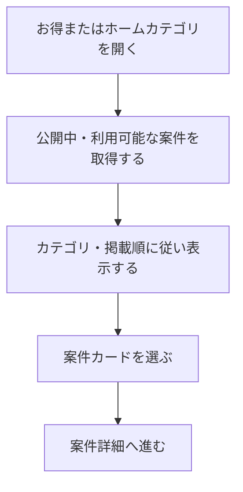

# F03｜アフィリエイト案件の一覧・検索・カテゴリ・並び順 PRD（レビュー前）

> ④業務ルールと⑦以降はユーザーレビュー未完了。本日の変更箇所はローカル4180モックとユーザー指定を参照し、優先順位はスプレッドシートを正とする。本PRDはTier1のみを定義する。

参照するモック：本リポジトリのローカル4180（2026-10-19の変更箇所を照合）。未接続の外部API・実端末機能は、接続済みとして扱わず末尾に記載する。

| 基本情報 | 内容 |
| --- | --- |
| 機能ID | F03 |
| 概要 | アフィリエイト案件の一覧・検索・カテゴリ・並び順 |
| 対象領域 | アプリ／管理画面／外部連携 |
| 関連機能 | [F04](F04-offer-entry.md)、[F15](F15-ad-placements.md) |
| 更新日 | 2026-10-19 |
| 版 | レビュー前（初版未確定） |

## ① 目的・今回作る範囲

目的：利用できるアフィリエイト案件を見つけやすくするため

評価指標：案件詳細の閲覧率/参加操作率/承認成果率

優先順位は[アプリ詳細要件のTier列](https://docs.google.com/spreadsheets/d/1g00ZxLGprVNT4T4uSmzw--vRpp95HQ1Uq9i8GnJpmS4/edit#gid=1107057215)を正とする。モックに存在してもTier2・Tier3・空欄の要件は本PRDの定義対象に含めない。

| 要件ID | Tier1の範囲 |
| --- | --- |
| F03-1 | ユーザーがお得画面のおすすめ一覧で公開中のアフィリエイト案件を確認できる |
| F03-2 | ユーザーがお得内・ホームから開く案件一覧をカテゴリ別に絞って確認できる |
| F03-3 | 運営担当者がお得内とホームから開くカテゴリ別案件一覧の掲載案件・並び順を一箇所で設定できる |
| F03-4 | 案件が取得できない場合に状態を確認して再試行できる |
| F03-7 | ユーザーがお得の使い方ガイドを確認でき、運営担当者が案内内容を編集できる |
| F03-9 | ユーザーがホームから開くカテゴリ別案件一覧で案件を3列カードで確認できる |
| F03-11 | ユーザーがお得画面で残高を確認してポイント獲得履歴へ移動できる |

管理側は[管理画面詳細要件のTier列](https://docs.google.com/spreadsheets/d/1g00ZxLGprVNT4T4uSmzw--vRpp95HQ1Uq9i8GnJpmS4/edit#gid=1341040600)にある以下のTier1を関連範囲とする。NACS本体の内製要件にはしない。

| 要件ID | Tier1の運用範囲 |
| --- | --- |
| ADM-F01-2 | 運営担当者がホームタブのカテゴリ別のアフィリエイト案件箇所・お得タブ内タグにNACSのバンドル属性を割り当てできる |

要件名に旧モックとの相違がある場合、優先順位は維持し、現在の表示・動きとユーザー指定を②以降へ反映する。実装方式の具体化は仕様設計で扱う。

## ② 画面イメージ

[アプリの該当画面](http://127.0.0.1:4180/mock-app/#offers)

- お得のおすすめ一覧とホームのカテゴリ別一覧で公開案件を確認する。カテゴリ別の一覧は3列の案件カードで表示する。
- カードを選ぶと案件詳細へ進む。案件の画像・名前・報酬を確認できる。一覧カード・ランキング・横長リストではSURの「(最大)」を表示せず、案件詳細だけに残す。報酬額・段階条件は変えない。
- 検索は案件名のみの部分一致。カテゴリ名・成果条件は対象外。検索時は選択中カテゴリに限定せず、公開・ユーザー・OS等の表示条件を満たす案件全体を対象にする。検索結果は直近30日間の発生CV数の降順（JSTで当日を含む30暦日。承認日ではなく発生日で集計し、承認・未承認・否認の状態で絞り込まない）とし、同数は候補順を維持する。検索中は告知ピルとカテゴリーチップを非表示にし、空欄で検索すると通常表示に戻す。PRバナー等は維持する。
- 検索結果が0件の場合は「該当する案件が見つかりませんでした」と「別のキーワードで探してみてください。」を表示する。
- 人気ランキングのカテゴリーは「総合／カード／口座開設／ゲーム／エンタメ／買い物／旅行」の順。カードはクレジットカード、口座開設は既存の銀行・決済／証券・投資の分類を使用する。エンタメはエンタメ分類または動画・音楽・映画・電子書籍等のアプリ案件を対象とし、一般ニュース・ゲームとは分ける。チップはPG-A02の高さ30px・左右余白10px・間隔8pxとし、文字数に合わせた可変幅で横スクロールする。お得画面の上部カテゴリーは変更しない。
- おすすめ下部の人気ランキングは最大9件のコンパクトなリスト表示。順位・40pxの正方形画像・1行の案件名・右寄せの報酬を表示し、1行は約56pxとする。条件説明やタグは省き、案件詳細で確認する。カテゴリーは上部と同じ小さい横並びチップを使用する。ランキング位置と既存の案件順は変更しない。
- 「新着」「ポイント高還元順」の「もっと見る」から開いた一覧は、ヘッダー左上の「＜」で遷移元に戻れる。元のスクロール位置を復元し、直接URLで開いた場合はお得のおすすめへ戻る。
- 「もっと見る」の遷移先は上部タブを表示せず、ヘッダーを戻るボタンと「新着」または「ポイント高還元順」のページタイトルだけにする。バナーと一覧内の見出し・サブタイトルは表示しない。通常の高還元タブのヘッダー・見出し・バナーは変更しない。
- 「新着」「ポイント高還元順」はおすすめ画面では各最大6件（横3列×縦2行）。「もっと見る」の遷移先はアンケートと共通の横長リスト形式で各最大100件とし、表示対象の絞り込み・並び替え後の先頭100件を表示する。
- 新着・ポイント高還元順の遷移先と「高還元」「すぐできる」の案件一覧は、左側に正方形バナー、中央に案件名・報酬、右側に「詳細を見る」を配置する。行全体から案件詳細へ進む。高還元・すぐできるは一覧の上に管理画面で設定したPRバナーを表示する。
- お得の上部タブは「おすすめ」「高還元」「すぐできる」。高還元タブはおすすめ・すぐできると同じ残高・ガイド・お知らせのヘッダーを表示し、上部PRバナーを維持する。「もっと見る」から開く一覧には引き続き左上に「＜」を表示する。
- 高還元タブは独立した月別掲載設定を使用する。上位20件までを運営が管理画面で選び、1〜20の表示順を指定する。手動は100万pt未満でも掲載可能。20件に満たない枠と21件目以降は、最大付与ポイントが1,000,000pt以上の公開案件を自動補充し、人気順に表示する（集計期間・指標は未定）。同一案件は手動側の1件だけ表示し、合計最大100件の上限を維持する。自動対象も不足する場合は表示可能な件数のみ表示する。
- 手動設定は月単位で保存し、翌月以降を事前予約できる。日本時間の月初に切り替え、対象月が未設定なら前月の手動設定を継続する（連続未設定時は直近の保存済み過去月を継続）。初回で過去の設定もなければ自動案件のみ。明示的に0件で保存した月は自動のみの設定として扱う。公開停止・案件自体の公開期間・OS等の表示条件は手動でも尊重し、除外分を自動補充する。モックは管理画面の確認日で月を判定する。
- 条件別報酬は最大付与ポイントで判定する。段階報酬は全段階達成時の合計。率だけで最大ポイントが不明な案件は自動枠に含めず、提供側の最大付与ポイントを受け取れる場合に判定する。
- おすすめ内の「ポイント高還元順」とその「もっと見る」は、高還元タブの月別手動設定・100万pt条件の適用対象外。既存のポイント順の自動表示を維持し、高還元タブと連動させない。
- お得の企業リンクはおすすめだけに5枠を横一列に配置し、ロゴを24px四方に収めて高さ38pxの横長・白地・薄いグレーのピル枠の中央に表示する。サービス名は表示しない。高還元・すぐできるでは企業アイコン欄全体を表示せず、欄の余白も残さない。
- NACSの一覧コードを使う通常カテゴリ一覧は、ピン留めを先頭にし、残りを当日を含む3暦日JSTのクリック数順、同数は候補順とする。この既存ルールを検索・高還元タブ・おすすめの個別セクションへ一律に適用しない。
- NACSの通常一覧は「いま注目の案件」が最大100件、その他が最大20件、ピン留めは一覧ごとに最大20件。ホームカテゴリは最初9件と残りの開閉を表示する。専用の「もっと見る」一覧・高還元タブは各100件、ランキングは9件という別の上限を適用する。

- おすすめ内は「チャレンジボーナス」「新着」「ポイント高還元順」を運用枠として上部に配置し、3枠の順番を管理画面で変更できる。人気ランキングは必ず全運用枠の下に固定する。チャレンジボーナスは既存の表示名・案件カード・開催内容を維持する。枠の背景は見出し上から全件表示ボタン下の余白まで淡いピンク#FCE9E1とし、次の「新着」等の見出し前でグレーへ切り替える。5件以上の全件表示はF06の専用一覧を使い、戻る＋タイトルのヘッダーと同じ2列タイルで配信中の全件を表示する。ホームタブへは遷移しない。
- 高還元タブの見出しは「一気に稼げるおすすめ案件」、サブタイトルは「10,000円相当以上の高還元案件に挑戦しよう」。すぐできるタブは「気軽にポイントゲット」、その下に「すぐできるおすすめ案件はこちら」。タブ名自体は「高還元」「すぐできる」のままとする。
- 企業リンクのモック画像は楽天／PayPay／Vポイント／dポイント／Ponta。可視のサービス名は表示せず、読み上げ用名称は保持する。各枠は画像と遷移先を管理し、①アフィリエイト案件一覧、②案件詳細、③管理画面で指定したURLの3種類から選ぶ。

## ③ 操作フロー

## ④ 業務ルール・制約

> ユーザーレビュー未完了。アプリ上の表示に関わるルールを記載する。

### 表示する対象ユーザー

| 対象ユーザー | 利用・表示 |
| --- | --- |
| 会員 | 公開中で利用条件に合う案件の一覧を確認する |
| 非会員（ゲスト） | 公開中で利用条件に合う案件の一覧を確認する |

### 表示条件

| 状態・条件 | 表示のルール |
| --- | --- |
| 掲載中・期間内の案件 | OS・利用者条件に合う案件を表示する |
| 掲載停止・期間外・対象外の案件 | 一覧に表示しない |
| NACS通常一覧のピン留め案件 | 対象条件を満たす案件を先頭に表示する。検索結果のCV順や高還元タブの月別手動設定とは別 |
| NACS通常一覧のピン留め以外 | 当日を含む3暦日JSTのクリック数順、同数は候補順で表示する |

### 画面に置く要素・操作

| 画面・要素 | 表示・操作のルール |
| --- | --- |
| おすすめ・カテゴリ別の一覧 | 案件画像・案件名・報酬を表示し、カードを押すと詳細へ進む |
| カテゴリ別の案件カード | 3列で表示する |
| 新着・ポイント高還元順の遷移先／高還元・すぐできる | 左に正方形バナーを置いた横長リスト。アンケートと共通の白背景・区切り線・詳細ボタンを使用する。高還元・すぐできるの上部PR枠を表示する |
| 報酬 | 定額・定率・段階報酬を区別して表示する |
| 案件の表示範囲 | 新着・ポイント高還元順のプレビューは各最大6件、各「もっと見る」と高還元タブは最大100件、ランキングは最大9件。NACS通常一覧は「いま注目」が100件、その他が20件。ホームカテゴリは最初9件と残りの開閉を表示する |
| お得の使い方ガイド | 利用前の準備・利用手順を確認できる |
| 残高 | 本人の残高を表示し、押すとポイント履歴へ進む |

### 一覧ごとの並び順を分離する

| 表示面 | 並び順・設定 |
| --- | --- |
| 検索結果 | 案件名だけの部分一致。直近30日間の発生CV数の降順。JSTで当日を含む30暦日を発生日で集計し、同数は候補順 |
| おすすめの運用3枠 | 枠の表示順を運営が変更可能。チャレンジボーナス・新着の掲載案件と順番を管理できる。ポイント高還元順は最新指定に従いポイント順の自動表示を維持する |
| 新着の「もっと見る」 | 公開対象を新着順に最大100件。モックでは更新日時の降順、同日時は案件名順 |
| ポイント高還元順の「もっと見る」 | 公開対象をポイント降順に最大100件。高還元タブの手動入稿・閾値とは独立 |
| 高還元タブ | 月別の手動設定最大20件を先頭にし、足りない分と21件目以降を100万pt以上の案件で自動補充。自動部分は人気順を予定し、集計指標・期間は未定 |
| 人気ランキング | 全運用枠の下に固定し、カテゴリ別に最大9件。今回の検索CV順の指定を自動的に流用しない。現在のモックは報酬順の仮表示 |
| NACS通常カテゴリ一覧 | 既存のピン留め＋3日間クリック数順。上の専用一覧とは分離 |

## ⑤ 管理画面

新規作成・変更・削除は、現在の管理画面で操作できる範囲を示す。「外部管理」はNACS・EDOCODE等の担当範囲、「未実装」は操作画面がない項目。削除と公開停止は分けて記載する。

[実行設定の管理画面](http://127.0.0.1:4180/mock-admin/#screens)

| 対象項目 | 新規作成 | 変更 | 削除 | 管理画面での操作・反映範囲 |
| --- | --- | --- | --- | --- |
| お得の案件グループ設定・表示順・名称 | 可能 | 可能 | 可能 | 案件グループ設定で設定一式と行を管理する。案件本文はここで編集しない。 |
| 案件・一覧コード・掲載案件・ピン留め | 外部管理 | 外部管理 | 外部管理 | NACS側の操作。現在のNACS再現画面には作成・編集・削除・ピン留めがある。LIST_ALL自体は削除不可。 |
| ユーザーの選択カテゴリ | 対象外 | 対象外 | 対象外 | ユーザーが一覧を切り替える操作。 |
| おすすめ運用枠の順序 | 不可 | 可能 | 不可 | [お得タブ表示設定](http://127.0.0.1:4180/mock-admin/#tametoku-order)で3枠を並べ替える。人気ランキングの最下部固定は変更不可 |
| 運用枠の掲載案件・順序 | 既存案件を選択 | 可能 | 掲載解除 | チャレンジボーナス・新着の掲載と順番を設定。案件本体の登録・停止とは別。ポイント高還元順の手動並べ替えUIは最新指定との不整合があり、下記に記載 |
| 高還元タブの月別手動枠 | 月別設定を作成 | 可能 | 掲載解除 | [高還元タブ掲載設定](http://127.0.0.1:4180/mock-admin/#high-reward)で対象月・案件・重複しない1〜20の順番を保存。翌月予約、未設定月の前月継続、空設定での自動のみ表示に対応 |
| おすすめの企業リンク5枠 | 固定5枠 | 可能 | 枠削除不可 | [企業リンク](http://127.0.0.1:4180/mock-admin/#quick-links)で画像・管理用名称・遷移種別・遷移先を設定。アプリ表示はおすすめだけ。名称は画面上に併記しない |

## ⑥ 例外処理・エラーハンドリング

| 状況 | 表示・処理・復帰 |
| --- | --- |
| 通常一覧に表示できる案件がない | 該当する案件がない案内を表示し、カテゴリ変更へ戻れる。 |
| 検索結果が0件 | 「該当する案件が見つかりませんでした」「別のキーワードで探してみてください。」と表示し、検索欄で再検索できる |
| 取得失敗 | 取得失敗と再読み込みを案内する。取得失敗を0件として表示しない。 |

## ⑦ 達成条件・未決事項

> 本節以降はユーザーレビュー未完了。

### Tier1の達成条件

- [ ] 一覧カード・ランキング・横長リストで「(最大)」を表示せず、SUR案件詳細では確認できる。

- [ ] おすすめの3運用枠を並べ替えても、人気ランキングは必ず最下部にある。チャレンジボーナスの名前・内容は維持される。
- [ ] ランキングの7カテゴリが指定順で、ボタン幅が文字数に応じて変わる。お得上部の通常カテゴリは変更されない。
- [ ] 企業リンク5枠の画像と3種類の遷移先を設定でき、高還元・すぐできるには表示されない。
- [ ] 高還元・すぐできるの見出しとサブタイトルが指定文言・順序になっている。

- [ ] 検索は案件名の部分一致だけでヒットし、直近30日間の発生CV数の降順に表示される。検索中の告知ピル・カテゴリーチップ非表示、0件案内、空欄検索での通常表示復帰を確認できる。

- [ ] 新着・高還元の「もっと見る」遷移先と高還元・すぐできるの一覧が横長リストで表示され、左側の正方形バナー・案件名・報酬・案件詳細への遷移を確認できる。高還元・すぐできるの上部PRバナーが表示される。
- [ ] 高還元タブの上位20件を月別に手動設定・翌月予約できる。月初切替・未設定時の前月継続・不足枠と21件目以降の自動補充・閾値未満の手動掲載・重複除外・公開停止の除外・合計100件上限を確認できる。おすすめ内のポイント高還元順には影響しない。
- [ ] 高還元タブの上部はおすすめ・すぐできると共通の残高ヘッダーで、PRバナーが表示される。「もっと見る」から開く一覧の戻る操作は維持する。
- [ ] 新着・ポイント高還元順の「もっと見る」遷移先は各最大100件で、101件目以降を表示しない。100件以下は表示対象をすべて表示する。
- [ ] 「もっと見る」の遷移先で「＜ 新着」「＜ ポイント高還元順」のヘッダーが表示され、バナー・上部タブ・一覧内の見出し・サブタイトルが表示されない。
- [ ] 新着・ポイント高還元順の全件一覧から「＜」を押すと遷移元のスクロール位置へ戻れる。直接アクセス時はお得のおすすめへ戻れる。
- [ ] おすすめの企業リンクは5枠が横一列に収まり、24px四方のロゴが高さ38pxの枠の中央に表示される。サービス名は非表示、各リンクの遷移設定は維持する。高還元・すぐできるには企業アイコン欄とその余白が表示されない。
- [ ] F03-1：ユーザーがお得画面のおすすめ一覧で公開中のアフィリエイト案件を確認できる。
- [ ] F03-2：ユーザーがお得内・ホームから開く案件一覧をカテゴリ別に絞って確認できる。
- [ ] F03-3：運営担当者がお得内とホームから開くカテゴリ別案件一覧の掲載案件・並び順を一箇所で設定できる。
- [ ] F03-4：案件が取得できない場合に状態を確認して再試行できる。
- [ ] F03-7：ユーザーがお得の使い方ガイドを確認でき、運営担当者が案内内容を編集できる。
- [ ] F03-9：ユーザーがホームから開くカテゴリ別案件一覧で案件を3列カードで確認できる。
- [ ] F03-11：ユーザーがお得画面で残高を確認してポイント獲得履歴へ移動できる。
- [ ] ①の管理側Tier1に対応する操作について、⑤の新規作成・変更・削除可否と反映範囲を確認できる。
- [ ] ⑥の対象となる空・失敗・中断などの状態から、表示内容と次の操作を確認できる。

### まだ決まっていないこと

- 検索の発生CV集計を取得する本番API項目は未定。集計条件は直近30日間の発生CV数で確定。モックは日別のサンプル発生CV件数から当日を含む30暦日JSTを合計し、個人の成果件数やクリック数を全体CVとして代用しない。集計値が未取得の案件はモック上0件扱い。

- 高還元タブの人気順の集計期間・指標（ユーザー判断で後日決定）。既存の3日間クリック数順を確定仕様として流用しない。決定まではモックの自動枠を案件データの登録順で仮表示し、管理画面に未定であることを明記する。
- 条件別の最大付与ポイントの提供API項目。モックでは段階報酬の合計または `maxRewardPoints` を利用し、上限不明の率案件は自動枠から除外する。認証・API接続などの具体的な方法は、別途仕様設計で定める。

- 人気ランキングの本番の人気集計指標・期間。この日の変更は表示密度・カテゴリー・配置のみで、検索の30日発生CV順をランキングへ適用する指定はない。

## モックへの未反映・対象外

### モックへの未反映

| 項目 | 未反映の内容 |
| --- | --- |
| NACS連携 | 本番の案件一覧取得・掲載設定の同期・クリック集計は未接続 |
| 検索CVの実データ | 30日間の発生CV集計ロジックは反映済みだが、本番全ユーザーのCV取得は未接続。モック専用の日別サンプル値で表示 |
| おすすめ内のポイント高還元順 | 管理画面で保存した任意順がプレビュー枠に適用される実装が残る。最新指定の「ポイント順の自動表示を維持」と不整合。「もっと見る」はポイント降順で、高還元タブの月別設定とは非連動 |
| 企業リンク管理画面 | アプリはおすすめだけに表示するが、管理画面には高還元・すぐできるの設定欄と旧「ガポガポ」の説明が残る。非表示タブの設定をアプリへ表示しない |
| 人気ランキングの人気集計 | 現モックは報酬降順の仮表示で、本番の人気指標によるランキング取得は未接続 |

| 高還元タブの人気順 | 集計期間・指標が未定のため未実装。自動抽出と手動掲載はモック反映済み。本番の期間切替はサーバー時刻で判定する必要がある |

モックでは月別設定が一度も保存されていない場合だけ、既存の公開案件6件を当月の手動掲載サンプルとして初期登録する。これは本番の初期掲載仕様ではなく、リスト表示確認用のデータ。100万pt未満を許容する手動枠の通常ロジックを使い、既存の月別設定・空設定・翌月予約は上書きしない。サンプルを解除して保存した後も自動再登録しない。

### 今回の対象外

| 項目 | 対象外の内容 |
| --- | --- |
| NACS本体の内製 | 案件・一覧の管理は外部NACSとの連携範囲として扱う |

## 変更履歴

| 版 | 日付 | 変更内容 |
| --- | --- | --- |
| レビュー前 | 2026-10-19 | 当日の最終指示に合わせ、運用枠・企業リンク・月別高還元・見出し・ランキング・検索を横断整理。各一覧の並び順を分離し、管理UI・ポイント高還元順の実装差分を未反映事項に追記。 |
| レビュー前 | 2026-10-19 | 検索結果の並び順を直近30日間の発生CV数の降順に確定。モックの期間内集計と境界テストを追加。 |
| レビュー前 | 2026-10-19 | 案件名のみの部分一致検索、検索結果の告知・カテゴリー欄非表示、CV数降順と0件案内を反映。CV集計条件は未定のためモックは確認用サンプル値を使用。 |
| レビュー前 | 2026-10-19 | ユーザー提示の参考画像に合わせ、企業リンクを小さいロゴと横長のピル枠へ調整。モックへ反映。 |
| レビュー前 | 2026-10-19 | 「もっと見る」の全件一覧に「＜」の戻るボタンを追加。既存のアプリ内履歴・スクロール位置の復元を利用。 |
| レビュー前 | 2026-10-19 | 新着・ポイント高還元順の「もっと見る」遷移先を各最大100件に制限。 |
| レビュー前 | 2026-10-19 | ガポガポ・すぐできるの企業アイコン欄をアイコン・余白ごと非表示に修正。おすすめのみ表示する。 |
| レビュー前 | 2026-10-19 | ガポガポを高還元に改名。タブの遷移先をポイント高還元順の「もっと見る」と共通の最大100件一覧へ変更。 |
| レビュー前 | 2026-10-19 | 新着・高還元の「もっと見る」遷移先と高還元・すぐできるをアンケートと共通の横長リストへ変更し、左に正方形バナーを配置。高還元の上部PR枠を復元。 |
| レビュー前 | 2026-10-19 | 高還元タブを共通の残高ヘッダーに変更。案件の高還元順・上限・リスト形式・上部PR枠を維持。 |
| レビュー前 | 2026-10-19 | 「もっと見る」遷移先のヘッダーを戻るボタンとページタイトルだけにし、上部タブと一覧の見出し・サブタイトルを非表示化。 |
| レビュー前 | 2026-10-19 | 「ポイント高還元順」の「もっと見る」遷移先タイトルを同名に統一し、遷移先のバナーを非表示化。通常の高還元タブのバナーは維持。 |
| レビュー前 | 2026-10-19 | 高還元タブを100万pt以上の自動抽出＋期間・順序付き手動掲載に分離。おすすめ内のポイント高還元順は変更対象外。人気順の集計期間・指標は後日決定とし、モックは登録順の仮表示。 |
| レビュー前 | 2026-10-19 | 高還元タブの手動枠を月別最大20件に変更。翌月予約と月初切替、翌月未設定時の前月継続、不足分と21件目以降の自動補充を追加。人気順の条件は引き続き後日決定。 |
| レビュー前 | 2026-10-19 | 掲載判定を変えず、未設定のモックに限り手動掲載サンプル6件を初期登録し、既存リスト形式で確認可能にした。 |
| レビュー前 | 2026-10-19 | 人気ランキングのタブを総合・クレカ・銀行／証券・旅行・ゲームの順に変更し、金融の絞り込みを分割。上部カテゴリーは維持。 |
| レビュー前 | 2026-10-19 | 人気ランキングのみカテゴリー名・順序を更新し、エンタメ・買い物を追加。ボタン幅は文字数に応じた共通チップ寸法とし、お得上部カテゴリーは維持。 |
| レビュー前 | 2026-10-15 | F10レビューの共通フィードバックを反映。⑤を管理画面へ変更し、④を対象ユーザー・表示条件・配置要素に整理。例外処理と仕様設計事項の重複を除き、未反映と対象外を別表に分離。個別レビューは未完了。 |
| レビュー前 | 2026-10-19 | 一覧の「(最大)」を詳細へ集約。お得のチャレンジボーナス枠の淡いピンクとグレーへの切替境界、専用全件一覧への遷移をF06と整合。その他の一覧の並び順・上限は維持。 |
