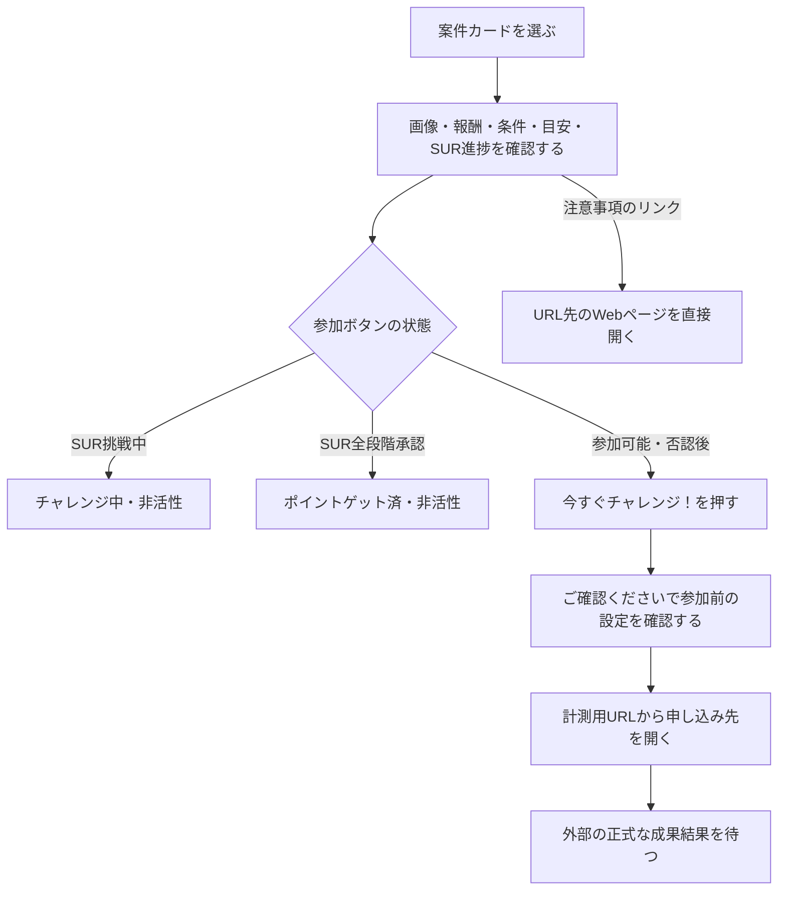

# F04｜アフィリエイト案件の詳細・参加 PRD（レビュー前）

> ④業務ルールと⑦以降はユーザーレビュー未完了。機能・画面・操作は現在の4189モックを正とし、優先順位はスプレッドシートを正とする。本PRDはTier1のみを定義する。

参照するモック：4189の最新ローカルモック（2026-10-19、ここまでのユーザー指定と照合済み）。②〜⑦は途中案ではなく現在の表示・操作を記載する。未接続の外部API・実端末機能は、接続済みとして扱わず末尾に記載する。今回の整理で優先順位・Tier・版・合意状態は変更しない。

| 基本情報 | 内容 |
| --- | --- |
| 機能ID | F04 |
| 概要 | アフィリエイト案件の詳細・参加 |
| 対象領域 | アプリ／管理画面／外部連携 |
| 関連機能 | [F03](F03-offer-list.md)、[F05](F05-my-offers.md)、[F06](F06-challenge-bonus.md) |
| 更新日 | 2026-10-20 |
| 版 | レビュー前（初版未確定） |
| モックレビュー | 完了（2026-10-20ユーザー共有） |
| PRDレビュー | メンバーによるレビュー待ち |
| 共有メモ | 1 → C |

## ① 目的・今回作る範囲

目的：案件の条件と報酬を理解したうえで参加できるようにするため

評価指標：詳細からの参加率/条件に関する問い合わせ件数/否認率

優先順位は[アプリ詳細要件のTier列](https://docs.google.com/spreadsheets/d/1tI26I_4vbSHIOzMdJz7g8-DjeLyyVUKoksVHhZ0AQhU/edit#gid=1107057215)を正とする。モックに存在してもTier2・Tier3・空欄の要件は本PRDの定義対象に含めない。

| 要件ID | Tier1の範囲 |
| --- | --- |
| F04-1 | ユーザーが案件詳細画面で報酬・獲得条件・対象外条件・概要・画像を確認できる |
| F04-2 | ユーザーが案件詳細画面でポイント付与目安を獲得条件と同じ形式で確認できる |
| F04-3 | ユーザーが案件詳細から注意事項のWebページを開いて確認できる |
| F04-4 | iOSユーザーが案件参加前のトラッキング許可状態に応じて設定または申し込みへ進むことができる |
| F04-5 | ユーザーが参加可能な案件の「今すぐチャレンジ！」から計測用URLへ進め、SURの参加状態に応じてボタンの文言・活性状態を確認できる |
| F04-6 | ユーザーがSUR案件の詳細で各段階の条件・報酬・達成済み件数を確認できる |
| F04-7 | 運営担当者がNACS／案件管理画面で案件本文・画像・計測用遷移先を手動登録・更新できる |
| F04-8 | 案件管理システムがASPの案件情報を定期取得し、変更差分を運営担当者へ提示できる |
| F04-10 | 運営担当者がASPの案件カタログをCSV等で一括登録できる |
| F04-11 | 運営担当者が案件の商流・条件を営業ロックして意図しない切替を防止できる |
| F04-12 | 運営担当者が案件の契約期間と期間限定単価を管理できる |
| F04-13 | 運営担当者がASP案件を審査し、掲載NGの案件を配信対象から除外できる |

要件名に旧モックとの相違がある場合、優先順位は維持し、現在の表示・動きとユーザー指定を②以降へ反映する。実装方式の具体化は仕様設計で扱う。

## ② 画面イメージ

| 確認対象 | モック |
| --- | --- |
| 通常の案件詳細 | [モリノマルシェ](http://localhost:4189/mock-app/#offer/marche) |
| SURの達成進捗カード・通常CTA | [星ねこクエスト](http://localhost:4189/mock-app/#offer/starquest) |
| SUR挑戦中の非活性CTA（初期データ） | [ガーデンパズル](http://localhost:4189/mock-app/#offer/game) |

### 詳細ページの構成

| 順 | 要素 | 表示・デザイン |
| --- | --- | --- |
| 1 | 案件画像・タイトル | 一覧と同じ案件アイコン画像を表示する。詳細へ遷移した後や再読み込み後も画像を一致させる。PR表示を維持する |
| 2 | ポイント数・獲得条件・ポイント付与目安 | 主報酬の数値とPアイコンは28px。「pt」とSURの「(最大)」は同じ16px。数値の文字間は達成進捗カード右上の合計ポイントと同じ通常の文字間（letter-spacing: normal）に揃え、一覧用の詰め設定を適用しない。獲得条件と付与目安は同じラベル＋本文のUIにする |
| 3 | SUR達成進捗カード | 段階条件を持つゲーム等のSUR案件に表示。獲得条件・目安の下、詳しい獲得条件の前に配置する。新ポイ活の共通部品PG-P09を使う |
| 4 | ポイント獲得条件・対象外条件・注意事項 | 条件を確認できる本文と、「ポイント獲得に関する注意事項」のWebページへのリンクを置く |
| 5 | 案件概要 | 案件の説明を表示する |
| 6 | 参加操作 | 通常の主CTAは「今すぐチャレンジ！」。SURの挑戦中・全段階承認後は非活性にし、否認後は活性に戻す。詳細は④の状態表に従う |

注意事項のリンクは[共通部品PG-A08](../../../mock-app/design-system/app-theme/library.html#PG-A08)の補足説明ボタンを使う。マイ案件の「ヘルプを確認」と同じ薄いグレー背景#EBEBED・濃いグレー文字／アイコン#454B58（ホバー#E1E1E4）の丸型とし、高さ44px・文字14px・上下8px／左右16px。主CTAは高さ56px・文字16pxとし、注意事項より目立たせる。既存のチャレンジボーナス付き詳細では合計の主報酬を20pxに維持し、合計ポイントの見出しをチャレンジボーナスと同じ16px、P記号を20pxとする。通常ポイントと矢印の比較表示・参加人数の文字ルールは[F06の詳細表示](F06-challenge-bonus.md)を参照。ボーナス自体のTier・採用範囲は今回変更しない。チャレンジボーナス付き詳細のCTAは現行モックの「このチャレンジに参加する」で、通常案件の「今すぐチャレンジ！」と同じ参加前確認へ進む。事前エントリー操作を追加する意味ではない。

### 通常の旅行案件の見本（2026-10-20）

`#offer/travel` は通常のAF案件詳細として表示する。独立した「ブースト案件」ページの定義はない。ユーザー指定により、過去のモック用の秋・冬の増額キャンペーンと対応する告知ピルを削除する。通常の案件報酬・条件・参加前確認は維持し、チャレンジボーナスの合計・人数・進捗は表示しない。保存済みデータにも同じ削除を適用し、過去の成果・ポイント履歴・残高は変更しない。管理画面から定義する一般の期間限定単価の機能を廃止する指定ではない。

### SURの達成進捗カード

- 上部に「すべての条件を達成で」と通常ポイントの合計を表示する。全段階承認時は「すべての条件を達成！」とする。チャレンジボーナスを合計に含めない。
- 「達成リスト」「達成済み n / 全段階数」と、段階ごとの条件・報酬を表示する。未達成はグレーの丸、達成済みはコーラルのチェック・強調文字で示す。
- 最初は3段階まで表示し、4段階以上は「すべて表示／折りたたむ」で開閉する。展開中は矢印を上向きにする。閲覧・開閉で成果状態やポイントは変化しない。

### 表示しないもの

- カテゴリ・期間限定UP・費用等の補足ラベル。
- マイ案件の「判定中」に反映されるまでの目安。
- 成果ステータス・日時・「マイ案件で確認」を含む案内枠と、その枠内の赤ポチ。マイ案件・ナビゲーション等の既存の更新通知は今回の削除対象に含めない。

補足ラベル等を削除しても、獲得条件・対象外条件・SURの段階表示・PR表示は維持する。

### 「ご確認ください」のフロート

- PCではモック端末の画面幅、スマホでは端末画面幅いっぱいに表示し、左右の外余白を設けない。短い画面ではフロート内をスクロールできる。
- Wi-Fiオフの図は電波・点・斜線の構成を維持し、ユーザー添付の参考イラストのコーラル・淡いピンク・チャコールと、丸い手描き線に合わせる。
- iOSのトラッキングは白い枠・ラベル・トグルの説明図にする。許可済みは右側のつまみと枠内ピンクのベタ塗り、未許可・確認中・取得不明は左側のつまみとグレーのOFF図を表示する。許可状態は文言でも併記する。
- 説明図は操作できるスイッチにせず、既存の設定案内・参加前確認の分岐を維持する。AndroidではWi-Fiの案内を表示し、iOS用のトラッキング項目は表示しない。

## ③ 操作フロー

事前エントリーを必須とする案件・増額施策は要件から削除する。「エントリーする」ボタン、エントリー前後の案内、参加時のエントリー判定は設けない。定額報酬や期間限定単価は維持し、通常の「今すぐチャレンジ！」から参加前確認・計測用URLへ進む。旧保存データに必須フラグやエントリー履歴が残っていても、参加の前提条件にはしない。非対象端末・期間外・配信停止等は参加できない。注意事項のリンクはダイアログを経由せず、閲覧だけでチャレンジや成果を記録しない。

外部認証・トラッキングの実端末接続は担当を確認する。計測URLを開く処理と、成果通知・ポイント付与の処理は別の操作として扱う。

## ④ 業務ルール・制約

> ユーザーレビュー未完了。アプリ上の表示に関わるルールを記載する。

### 表示する対象ユーザー

| 対象ユーザー | 利用・表示 |
| --- | --- |
| 会員 | 公開中の案件詳細と参加条件を確認する |
| 非会員（ゲスト） | 公開中の案件詳細と参加条件を確認する |

### 表示条件

| 状態・条件 | 表示のルール |
| --- | --- |
| 公開中で対象条件に合う案件 | 案件の内容と参加ボタンを表示する |
| ステップアップ案件 | 配信された段階条件・報酬とユーザー固有の成果状態を達成進捗カードへ反映する。閲覧・開閉では達成にもポイント付与にもしない |
| SURの成果ステータスが挑戦中 | 「チャレンジ中」を表示し非活性。未承認・一部の段階承認済みのいずれも含む。クリックしただけでは挑戦中にせず、NACSの成果状態で判断する |
| SURの全段階が承認済み | 「ポイントゲット済」を表示し非活性。SURはチャレンジボーナス対象外とし、段階報酬の全承認で完了とする |
| SURの否認後 | 通常の「今すぐチャレンジ！」を活性に戻し、再チャレンジ可能とする。過去の一部達成数だけを理由に非活性にしない。非対象端末・期間外等の既存の参加条件は適用する |
| 非SURの判定中・承認・否認 | 既存仕様どおり再チャレンジ可能。SURの完了非活性は適用しない |
| iOSのトラッキング許可確認が必要 | 許可状態に対応した案内と設定への入口を表示する |

状態の判定は、案件未発見・非対象端末・期間外を先に確認し、その後にSURの挑戦中・全段階承認を判定する。「挑戦中」はNACSの成果状態に基づき、申し込み先を開いただけでは成立させない。

### 画面に置く要素・操作

| 画面・要素 | 表示・操作のルール |
| --- | --- |
| 画像・案件名・概要 | 案件の内容を表示する |
| 報酬・獲得条件・対象外条件 | 参加前に確認できるよう表示する |
| ポイント付与目安 | 獲得条件と同じラベル＋本文のUIで表示する。判定中への反映目安は表示しない |
| 広告利用の注意事項 | URL先のWebページを直接開き、注意事項のダイアログは表示しない。正式URLは仕様フェーズでビジネス側が定義する。薄いグレー背景・濃いグレー文字の丸型ボタン（高さ44px・文字14px・上下8px／左右16px）とし、主CTAの56px／16pxより控えめにする |
| 今すぐチャレンジ！ | 通常時に計測用の申し込み先へ進む。トラッキング許可・参加条件の確認は維持する |
| チャレンジ中 | SURの挑戦中のみ。既存の主CTAと同じサイズのまま主色・白文字を不透明度30%にした非活性表示。外部リンクアイコンは表示しない |
| ポイントゲット済 | SURの全段階承認時のみ。主CTAと同じサイズを維持し、注意事項と同じグレー背景#EBEBED・文字#454B58の非活性表示。外部リンクアイコンは表示しない |

## ⑤ 管理画面

新規作成・変更・削除は、現在の管理画面で操作できる範囲を示す。「外部管理」はNACS・EDOCODE等の担当範囲、「未実装」は操作画面がない項目。削除と公開停止は分けて記載する。

| 対象項目 | 新規作成 | 変更 | 削除 | 管理画面での操作・反映範囲 |
| --- | --- | --- | --- | --- |
| 案件本文・報酬・条件・目安・画像 | 外部管理 | 外部管理 | 外部管理 | NACSの案件管理。自社管理画面へ同じ案件編集機能を重ねて作らない。 |
| ASP素材の取得経路・手動素材 | 外部管理 | 外部管理 | 外部管理 | NACS再現画面でAPI／手動を選択。実ASP取得は未接続。選択経路だけを配信する。 |
| 詳細画面の構成・参加ボタン | 不可 | 不可 | 不可 | アプリ共通UI。案件編集でボタンのサイズを自由変更する機能はない。 |

## ⑥ 例外処理・エラーハンドリング

| 状況 | 表示・処理・復帰 |
| --- | --- |
| 参加前確認を閉じた | 詳細へ戻る。閉じる操作だけでは成果・達成・ポイント付与を発生させない |
| SURの非活性ボタン | タップ・キーボード操作を受け付けず、外部ページの起動・新しいクリック・成果の作成を行わない |
| 無効なURL・起動失敗 | 理由を案内し、再試行できる。成功した成果として扱わない。 |
| 停止・対象外の案件 | 参加できない表示と戻る入口を表示する。 |

## ⑦ 達成条件・未決事項

> 本節以降はユーザーレビュー未完了。

### Tier1の達成条件

- [ ] 通常の旅行案件の見本は、初回・既存保存データのいずれでも秋・冬の旧増額キャンペーンを使わず、通常報酬で表示する。比較増額・キャンペーン期限・チャレボ人数は出ず、通常の参加前確認へ進める。既存の成果・履歴・残高は維持する。

- [ ] F04-1：ユーザーが案件詳細画面で報酬・獲得条件・対象外条件・概要・画像を確認できる。
- [ ] F04-2：ユーザーが案件詳細画面でポイント付与目安を獲得条件と同じ形式で確認できる。
- [ ] F04-3：案件詳細の注意事項リンクからWebページを直接開いて確認できる。注意事項のダイアログは表示しない。
- [ ] F04-4：iOSユーザーが案件参加前のトラッキング許可状態に応じて設定または申し込みへ進むことができる。
- [ ] F04-5：ユーザーが案件詳細画面の「今すぐチャレンジ！」ボタンから管理側が設定した計測用URLへ進むことができる。
- [ ] F04-6：ユーザーがSUR案件の詳細で、段階条件・各報酬・通常報酬合計・達成済み件数を確認できる。
- [ ] SURの未達成・一部達成・全達成が成果状態と一致し、4段階以上の展開・折りたたみでも報酬や達成状態が変わらない。
- [ ] トラッキング許可済みではピンクのベタ塗りON図、未許可ではグレーのOFF図と状態文言が表示され、既存の設定案内・遷移分岐が動作する。
- [ ] F04-7：運営担当者がNACS／案件管理画面で案件本文・画像・計測用遷移先を手動登録・更新できる。
- [ ] F04-8：案件管理システムがASPの案件情報を定期取得し、変更差分を運営担当者へ提示できる。
- [ ] F04-10：運営担当者がASPの案件カタログをCSV等で一括登録できる。
- [ ] F04-11：運営担当者が案件の商流・条件を営業ロックして意図しない切替を防止できる。
- [ ] F04-12：運営担当者が案件の契約期間と期間限定単価を管理できる。
- [ ] F04-13：運営担当者がASP案件を審査し、掲載NGの案件を配信対象から除外できる。
- [ ] ⑥の対象となる空・失敗・中断などの状態から、表示内容と次の操作を確認できる。
- [ ] 詳細の補足ラベル・判定中への反映目安がなく、獲得条件とポイント付与目安が同じUIで表示される。
- [ ] 定額報酬の案件で事前エントリーを要求しない。旧必須フラグ・履歴の有無にかかわらず「今すぐチャレンジ！」から参加前確認へ進み、エントリーCTA・案内は表示されない。
- [ ] タイトル下の主報酬が28px、チャレンジ合計が20px、単位「pt」とSUR案件の「(最大)」が同じ16pxで表示される。数値の文字間はSUR合計ポイントと一致する。Pアイコンの高さは数値の1emとなり、注意事項のリンクは主CTAより控えめに表示される。
- [ ] 詳細内に成果ステータス・日時・「マイ案件で確認」の案内枠と、その枠内の赤ポチが表示されない。
- [ ] SURの未達成・一部達成では成果状態が挑戦中なら「チャレンジ中」、全段階承認時は「ポイントゲット済」の非活性ボタンとなり、クリック・キー操作で新しいクリックや成果を作らない。
- [ ] 非SURの判定中・承認・否認は再チャレンジでき、SURの否認後も再参加できる。非対象端末・期間外の既存の判定優先順は維持する。
- [ ] 注意事項はPG-A08の補足説明ボタンでマイ案件ヘルプと配色を共用し、通常時は押せる。リンクからWebページへ直接遷移し、注意事項ダイアログは表示されない。「今すぐチャレンジ！」から既存の参加前確認へ進める。
- [ ] 一覧から開いた案件のアイコンが詳細と一致し、再読み込みしても同じ画像が表示される。
- [ ] 確認フロートの左右端が端末画面と揃い、Wi-Fi・トラッキングの図と許可状態を確認して閉じる／設定へ進むことができる。

### まだ決まっていないこと

| 確認事項 | 相談先・決定時期 |
| --- | --- |
| ポイント獲得に関する注意事項の正式な遷移先URL。既存ヘルプ等のURLを仮採用して確定扱いしない | ビジネス側が仕様フェーズで定義する |

認証・API接続などの具体的な方法は、別途仕様設計で定める。

## モックへの未反映・対象外

### モックへの未反映

| 項目 | 未反映の内容 |
| --- | --- |
| 注意事項の正式URL | 未定。モックでは `mock-app/affiliate-notice.html` の仮Webページを別タブで開き、ダイアログを経由しない。正式URLは仕様フェーズでビジネス側が定義し、接続先を差し替える。仮ページの本文は正式な注意事項ではない |
| NACS・成果の連携 | 本番の案件情報・計測用URL・SURの段階別成果は未接続。カードは既存モックの承認済み段階数で表示。正式な段階ID・状態・訂正の対応はAPI設計と結合試験で確認する |
| ゲームのSUR見本 | ガーデンパズルは既存の3段階。星ねこクエスト・こもれびカフェ物語・オーシャンタイルはUI確認用の4〜5段階の仮データ。各合計額は従来の通常報酬を維持。実案件の条件ではなく、既存の編集済みSUR・過去成果は自動で置き換えない |
| iOSの設定・復帰 | 実端末のトラッキング許可、設定画面からの復帰は未接続 |

### 今回の対象外

| 項目 | 対象外の内容 |
| --- | --- |
| NACS本体の内製 | 案件本文・画像・参加先の管理はNACSとの連携範囲として扱う |

## 変更履歴

| 版 | 日付 | 変更内容 |
| --- | --- | --- |
| レビュー前 | 2026-10-15 | F10レビューの共通フィードバックを反映。⑤を管理画面へ変更し、④を対象ユーザー・表示条件・配置要素に整理。例外処理と仕様設計事項の重複を除き、未反映と対象外を別表に分離。個別レビューは未完了。 |
| レビュー前 | 2026-10-19 | ユーザーの案件詳細UI指定を反映。補足ラベル・判定中反映目安を削除、主報酬を4px縮小しPアイコンを数値に合わせる。付与目安を獲得条件と共通UI化。注意事項をグレーの副操作とし、通常CTAを「チャレンジする」に変更。合意状態・Tierは維持。 |
| レビュー前 | 2026-10-19 | ユーザーの追加指定を反映。一覧と詳細の案件アイコンを共通化、通常CTAを「今すぐチャレンジ！」に変更。確認フロートを端末幅に揃え、Wi-Fi・トラッキングの説明図を添付の配色・手描き線・構成に合わせた。許可判定と外部遷移条件は維持。 |
| レビュー前 | 2026-10-19 | 許可済みON図をピンク一色、未許可をOFF図へ変更。指定Figmaとpoikatsu-contextを参照し、SUR達成進捗カード（PG-P09）を共通化。段階別の条件・報酬・達成数、全達成、4段階目以降の開閉を反映。 |
| レビュー前 | 2026-10-19 | 主報酬を修正前の32px（チャレンジ合計24px）へ戻し、SURの「(最大)」を半分の16pxへ変更。注意事項をダイアログからWebページへの直接リンクへ変更。正式URLは仕様フェーズでビジネス側が定義する未決事項とし、モックは仮ページで動線を確認する。 |
| レビュー前 | 2026-10-19 | 主報酬・アイコンを4px縮小し、ptと「(最大)」を同じ16pxへ変更。成果ステータス枠と枠内の赤ポチを削除。ユーザー確認に基づきSURのみ、挑戦中は主色30%の「チャレンジ中」、全段階承認後は注意事項と同じグレーの「ポイントゲット済」で非活性化。非SURの再利用を維持。追加指定として否認後のSURは通常CTAを活性に戻し、再チャレンジ可能とする。 |
| レビュー前 | 2026-10-19 | タイトル下のポイント数の文字間を、達成進捗カードの合計ポイントと同じ通常の文字間へ変更。数字サイズ・アイコンサイズ・単位と「(最大)」のサイズは維持。 |
| レビュー前 | 2026-10-19 | ここまでの詳細ページ修正を最終状態として②〜⑦へ整理。案件画像・報酬の寸法と文字間・削除要素・SUR進捗カード・状態別CTA・否認後の再参加・注意事項のWeb遷移・確認フロートを統合。正式URLの担当と決定時期、仮データ・未接続範囲を明記。優先順位・Tier・版・合意状態は変更しない。 |
| レビュー前 | 2026-10-19 | チャレンジ付き詳細の合計ポイント見出しを16px、P記号を20pxに統一。合計20pxを維持した通常ポイントとの比較行と、参加人数の同サイズ表示はF06に記録。Tier・仕様合意状態は維持。 |
| レビュー前 | 2026-10-19 | チャレンジボーナスはSUR対象外とするユーザー指定を反映。SUR詳細は通常の達成進捗・参加状態だけを扱い、人数達成型ボーナスと組み合わせない。対象の詳細はF06へ記録。 |
| レビュー前 | 2026-10-19 | ユーザー指定で「定額報酬＋事前エントリー必須」の要件を削除。機能名からエントリーを外し、CTA・案内・参加判定を撤去。定額報酬・期間限定単価・既存成果と残高は維持し、通常の参加導線へ統一。 |
| レビュー前 | 2026-10-19 | モック修正の累積内容を再照合。最終寸法・SUR限定の状態別CTA・否認後の再参加・事前エントリー削除を維持し、注意事項のPG-A08共通配色とチャレンジ付き詳細の参加導線を明記。分散していた履歴を変更履歴表へ集約。 |

### 参照根拠（2026-10-19）

- [Figma：SUR案件詳細](https://www.figma.com/design/OxKHX6jb2qWVEOs3UkzP8W/?node-id=58624-31621)、[達成進捗カード](https://www.figma.com/design/OxKHX6jb2qWVEOs3UkzP8W/?node-id=22062-206732)。未達成・一部達成・展開時の構成を確認し、配色・P記号・文字・角丸は新ポイ活の共通部品へ合わせる。
- poikatsu-context `product/glossary.md`：SURは複数の成果地点ごとに条件・報酬を持ち、各段階の達成に応じて付与する。`product/meetings/2026-05-25-channel-nacs-integration-deathroad.md`：案件詳細にユーザー固有の達成段階を返す既存スキーマを確認。旧サービスの記録であり、今回の実API接続が完了したことを意味しない。

- [Figma：フッターボタン](https://www.figma.com/design/OxKHX6jb2qWVEOs3UkzP8W/?node-id=22064-196265)：チャレンジ中の主色30%・白文字を新ポイ活の主色へ適用。完了後のグレー表示とSUR限定は今回のユーザー指定。
- poikatsu-contextの段階別成果の定義、および同リポジトリから参照するpoikatsu-spec `docs/domains/affiliate.md` §3.4・3.6：SURの挑戦中は一部承認も含み、全段階承認で承認。非SURは判定中・承認・否認でも再チャレンジ可能。SUR全承認後の非活性化は今回の追加要件。原本は変更しない。
| レビュー前 | 2026-10-20 | ユーザー指定で旅行案件の見本は通常案件として維持し、独立した仕様のない秋・冬の増額キャンペーン仮設定・対応告知ピル・デモ切替を削除。保存済みの旧設定にも適用し、一般の期間限定単価・他のチャレボ・既存成果と残高は維持。 |
