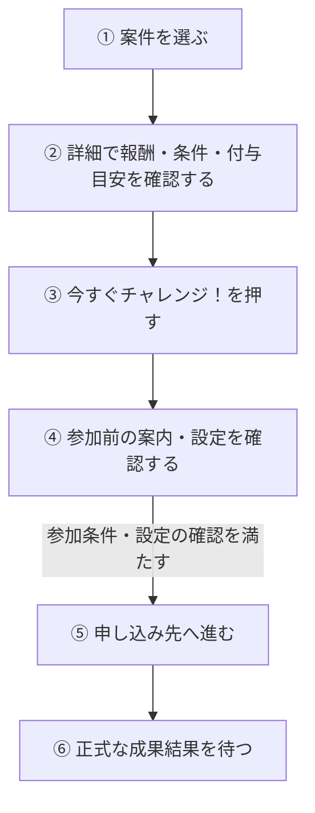

# F04｜アフィリエイト案件の詳細・参加 PRD（レビュー前）

F04の表示・操作・条件を定義する。相互レビュー・最終合意は未完了。未決事項とエドコードへの確認事項は末尾に分けて記載する。

> ④業務ルール・モックへの未反映・対象外・末尾の確認事項はユーザーレビュー未完了。機能・画面・操作は現在の4189モックを正とし、優先順位はスプレッドシートを正とする。本PRDはTier1のみを定義する。

参照するモック：4189のローカルモック。②〜⑥には求める表示・操作を記載する。モックへの反映・本番接続とは区別し、未反映・未確認の範囲を末尾に記載する。

| 基本情報 | 内容 |
| --- | --- |
| 機能ID | F04 |
| 概要 | アフィリエイト案件の詳細・参加 |
| 対象領域 | アプリ／管理画面／外部連携 |
| 関連機能 | [F03](F03-offer-list.md)、[F05](F05-my-offers.md)、[F06](F06-challenge-bonus.md) |
| 更新日 | 2026-10-20 |
| 版 | レビュー前（初版未確定） |
| モックレビュー | 完了（2026-10-20ユーザー共有）。本書の新しい要件の反映完了を意味しない |
| PRDレビュー | 担当者のレビュー内容を反映。青木さんとの相互レビュー待ち・最終未合意 |
| 共有メモ | 1 → C |

## ① 目的・今回作る範囲

目的：ユーザーが報酬・獲得条件・対象外条件を理解し、自分が条件を満たせるか判断したうえで、アフィリエイト案件へ参加できるようにするため。

案件を選んだ後に「何をすれば、どの報酬が、いつ頃もらえるか」を確認し、納得して申し込みへ進むための機能とする。条件や報酬の誤解を減らすため、参加ボタンだけでなく、獲得条件・対象外条件・付与目安を参加前に確認できるようにする。

評価指標：詳細からの参加率/条件に関する問い合わせ件数/否認率

優先順位は[アプリ詳細要件のTier列](https://docs.google.com/spreadsheets/d/1tI26I_4vbSHIOzMdJz7g8-DjeLyyVUKoksVHhZ0AQhU/edit#gid=1107057215)を正とする。モックに存在してもTier2・Tier3・空欄の要件は本PRDの定義対象に含めない。

| 要件ID | Tier1の範囲 |
| --- | --- |
| F04-1 | ユーザーが案件詳細画面で報酬・獲得条件・対象外条件・概要・画像を確認できる |
| F04-2 | ユーザーが案件詳細画面でポイント付与目安を獲得条件と同じ形式で確認できる |
| F04-3 | ユーザーが案件詳細から注意事項のWebページを開いて確認できる |
| F04-4 | iOSユーザーは、トラッキングが許可済みの場合だけ案件の申し込みへ進める。未許可の場合は設定方法を確認できるが、申し込みへは進めない。 |
| F04-5 | ユーザーが、参加できる案件の「今すぐチャレンジ！」を押して、参加前の確認後に申し込み先へ進める。SUR案件では、参加状況に応じてボタンの表示と押せる・押せない状態が切り替わる（詳細は④に記載）。 |
| F04-6 | ユーザーがSUR案件の詳細で各段階の条件・報酬・達成済み件数を確認できる |
| F04-7 | 運営担当者がACSで案件本文・画像・計測用遷移先を手動登録・更新できる |
| F04-8 | ACSがASPの案件情報を定期取得し、変更差分を運営担当者へ提示できる |
| F04-10 | 運営担当者がASPの案件カタログをCSV等で一括登録できる |
| F04-11 | 運営担当者が案件の商流・条件を営業ロックして意図しない切替を防止できる |
| F04-12 | 運営担当者が案件の契約期間と期間限定単価を管理できる |
| F04-13 | 運営担当者がASP案件を審査し、掲載NGの案件を配信対象から除外できる |

## ② 画面イメージ

文字サイズ・配色・背景・余白などの見た目は現行モックと[デザイン部品集](../../../mock-app/design-system/app-theme/library.html)を参照する。PRDには、表示する情報・操作・条件・結果を記載する。既存の表示デザインは変更しない。

| 確認対象 | モック |
| --- | --- |
| 通常の案件詳細 | [モリノマルシェ](http://localhost:4189/mock-app/#offer/marche) |
| SURの達成進捗カード・通常CTA | [星ねこクエスト](http://localhost:4189/mock-app/#offer/starquest) |
| SUR挑戦中の非活性CTA（初期データ） | [ガーデンパズル](http://localhost:4189/mock-app/#offer/game) |

### 詳細ページの構成

| 順 | 要素 | 表示・操作 |
| --- | --- | --- |
| 1 | 案件画像・タイトル | 一覧と同じ案件アイコン画像を表示する。詳細へ遷移した後や再読み込み後も画像を一致させる。PR表示を維持する |
| 2 | ポイント数・獲得条件・ポイント付与目安 | 報酬のポイント数と単位「pt」を表示し、SUR案件には「(最大)」を併記する。獲得条件とポイント付与目安を、それぞれのラベルと本文で確認できる。 |
| 3 | SUR達成進捗カード | 段階条件を持つゲーム等のSUR案件に表示し、各段階の条件・報酬・達成状況を確認できる。 |
| 4 | ポイント獲得条件・対象外条件・注意事項 | 条件を確認できる本文と、「ポイント獲得に関する注意事項」のWebページへのリンクを置く |
| 5 | 案件概要 | 案件の説明を表示する |
| 6 | 参加操作 | 参加ボタンには「今すぐチャレンジ！」と表示する。SUR案件では、挑戦中は「チャレンジ中」、すべての段階が承認された後は「ポイントゲット済」と表示し、ボタンは押せない。否認された後は、参加条件を満たしていれば「今すぐチャレンジ！」に戻り、再び参加できる。 |

- [チャレンジボーナス付き案件](F06-challenge-bonus.md)では、「このチャレンジに参加する」を押すと、通常案件と同じ参加前の確認画面へ進む。
- 別途、事前エントリーをする必要はない。

### 通常の旅行案件の見本

`#offer/travel` は通常のアフィリエイト案件詳細として、通常報酬・条件・参加前確認を表示する。独立した「ブースト案件」ページではない。

初回・既存保存データのいずれでも、秋・冬の旧増額キャンペーンと対応する告知ピルは使用しない。比較増額・キャンペーン期限・チャレンジボーナスの合計・人数・進捗は表示しない。過去の成果・ポイント履歴・残高は維持する。一般の期間限定単価の管理機能や、他のチャレンジボーナスは変更しない。

### SURの達成進捗カード

SURは段階ごとに獲得条件と報酬が異なるため、合計ポイントだけでは次に何を達成すればよいか分からない。各段階の条件・報酬と本人の達成状況を対応させ、残っている条件を確認できるようにする。

- 上部に「すべての条件を達成で」と通常ポイントの合計を表示する。全段階承認時は「すべての条件を達成！」とする。チャレンジボーナスを合計に含めない。
- 「達成リスト」「達成済み n / 全段階数」と、段階ごとの条件・報酬を表示する。各段階が未達成か達成済みかを区別できる。
- 最初は3段階まで表示し、4段階以上は「すべて表示／折りたたむ」で開閉する。閲覧・開閉で成果状態やポイントは変化しない。

### 表示しないもの

- カテゴリ・期間限定UP・費用等の補足ラベル。
- マイ案件の「判定中」に反映されるまでの目安。
- 成果ステータス・日時・「マイ案件で確認」を含む案内枠と、その枠内の赤ポチ。マイ案件・ナビゲーション等の既存の更新通知は今回の削除対象に含めない。

補足ラベル等を削除しても、獲得条件・対象外条件・SURの段階表示・PR表示は維持する。

### 「ご確認ください」のフロート

申し込み先へ進む前に、ユーザーが参加に関する設定案内を確認するための画面とする。案内を読んだことや説明図の表示を、端末の設定変更が完了したことと混同させない。

- 画面内に収まらない場合は、フロート内をスクロールして案内を確認できる。
- Wi-Fi接続がトラッキングに影響し、案件の計測が正常に行われない場合があるため、申し込み前にWi-Fiをオフにする案内を説明図とともに表示する。
- iOSではトラッキングの許可状態を説明図と文言で確認できる。許可済みはON、未許可・確認中・取得不明はOFFの図を表示する。
- iOSでは、許可済みと確認できた場合だけ申し込みへ進める。未許可・制限あり・確認中・取得不明の場合は、申し込み先を開かない。設定から戻った後も許可状態を確認し、許可済みでなければ進めない。
- 説明図は操作できるスイッチにせず、既存の設定案内・参加前確認の分岐を維持する。AndroidではWi-Fiの案内を表示し、iOS用のトラッキング項目は表示しない。

## ③ 操作フロー

### 申し込みまでの基本の流れ

参加条件を満たす場合の流れ。進めない場合の扱いは、下の表に記載する。

iPhoneでは、④でトラッキングが許可済みと確認できた場合だけ⑤へ進める。Androidにはこの許可確認を設けない。どちらも、案件ごとの参加条件を満たす必要がある。

### 進めない場合・途中でやめる場合

| 状況 | 表示・次の操作 |
| --- | --- |
| SURで挑戦中 | 「チャレンジ中」と表示し、参加ボタンは押せない。 |
| SURの全段階が承認済み | 「ポイントゲット済」と表示し、参加ボタンは押せない。 |
| iPhoneでトラッキングが未許可・制限あり・確認中・取得不明 | 申し込みへ進めず、設定・確認の案内を表示する。設定から戻った後も許可状態を確認し、許可済みでなければ進めない。閉じると案件詳細へ戻る。 |
| 非対象端末・期間外・配信停止など | 申し込みへ進めない。参加できない旨と戻る入口を表示する。 |
| 参加前確認を閉じる | 案件詳細へ戻る。閉じるだけでは成果・ポイントは発生しない。 |

SURの否認後は、参加条件を満たしていれば③から再参加できる。再参加時の報酬・進捗の扱いは④に従う。

### 詳細画面でできるその他の操作

- 注意事項を押すと、ダイアログを経由せずWebページを直接開く。閲覧だけでは参加・成果を記録しない。
- 戻ると、元の一覧・ホームのタブなどへスクロール位置を保って戻る。案件の比較を見ていた位置から続けられるよう、タブの先頭へは戻さない。

別途の事前エントリーは不要。「エントリーする」ボタンやエントリー済みかの判定は設けず、旧保存データにエントリー履歴等が残っていても参加条件にしない。定額報酬・期間限定単価は維持する。

⑤は計測用URLから申し込み先を開く操作であり、それだけでは成果・ポイント付与は確定しない。実端末での設定・復帰や成果連携の未接続範囲は「モックへの未反映」に記載する。

## ④ 業務ルール・制約

> ユーザーレビュー未完了。アプリ上の表示に関わるルールを記載する。

### 表示する対象ユーザー

| 対象ユーザー | 利用・表示 |
| --- | --- |
| 会員 | 公開中の案件詳細と参加条件を確認する。対象条件を満たす案件に参加でき、報酬の対象となる |
| 非会員（ゲスト） | 公開中の案件詳細と参加条件を確認する。会員と同様に、対象条件を満たす案件に参加でき、報酬の対象となる |

チャレンジボーナス付き案件を含むアフィリエイト案件への参加・報酬獲得に、アプリの会員登録・SMS認証は必須としない。各案件の獲得条件・対象外条件は、会員・ゲストともに適用する。

アフィリエイト案件への参加・報酬獲得と、獲得したポイントを交換する条件は分けて扱う。ゲストも案件でポイントを獲得できるが、そのポイントを交換する際には会員登録とSMS認証が必要。会員は交換のたびにSMS認証を完了する。登録・認証は[F01](F01-account.md)、交換の条件・操作は[F13](F13-point-exchange.md)に従う。

### 表示条件

参加ボタンは、ユーザーが「今から申し込めるか」「すでに挑戦中か」「完了しているか」を区別するために、SURの成果状態に合わせて表示する。申し込み先を開いたことと、正式な成果が認められたことは分けて扱う。

同じ成果への報酬の二重付与を防ぐため、SURの挑戦中・全段階承認後は参加ボタンを押せない状態にする。

| 状態・条件 | 表示のルール |
| --- | --- |
| 公開中で対象条件に合う案件 | 案件の内容と参加ボタンを表示する |
| ステップアップ案件 | 配信された段階条件・報酬とユーザー固有の成果状態を達成進捗カードへ反映する。閲覧・開閉では達成にもポイント付与にもしない |
| SURの成果ステータスが挑戦中 | 「チャレンジ中」を表示し非活性。未承認・一部の段階承認済みのいずれも含む。クリックしただけでは挑戦中にせず、ACSの成果状態で判断する |
| SURの全段階が承認済み | 「ポイントゲット済」を表示し非活性。SURはチャレンジボーナス対象外とし、段階報酬の全承認で完了とする |
| SURの否認後 | 通常の「今すぐチャレンジ！」を活性に戻し、再チャレンジ可能とする。過去の一部達成数だけを理由に非活性にしない。非対象端末・期間外等の既存の参加条件は適用する |
| 非SURの判定中・承認・否認 | 成果状態だけを理由に参加ボタンを非活性にせず、SURの完了非活性は適用しない。再参加・再度の報酬獲得の条件は案件ごとに異なり、ボタンが押せることだけでは報酬対象になることを保証しない。 |
| iOSでトラッキングが許可済み | 他の参加条件も満たしていれば、参加前確認から申し込みへ進める。 |
| iOSで未許可・制限あり・確認中・取得不明 | 許可済みと確認できるまで申し込みへ進めず、申し込み先を開かない。設定方法や許可状態を確認する案内を表示する。会員・ゲストとも同じ条件とする。 |
| iOSの設定から戻ったとき | トラッキングの許可状態を再確認する。設定画面を開いたことだけでは許可済みと扱わない。 |

状態の判定は、案件未発見・非対象端末・期間外を先に確認し、その後にSURの挑戦中・全段階承認を判定する。「挑戦中」はACSの成果状態に基づき、申し込み先を開いただけでは成立させない。

### 補足：マイ案件への反映（画面には表示しない）

申し込み後、マイ案件の「判定中」への反映はASPから届く成果情報に従う。通常は半日程度が目安だが、ASPからの情報が届くタイミングによって異なり、半日以内の反映を保証するものではない。時間が経過しただけで「判定中」に変更したり、未反映を否認と扱ったりしない。これはポイント付与までの目安とは別である。

### 再参加時の条件・報酬

再参加の条件と、再参加時に報酬対象となる条件は案件ごとに定められた獲得条件・対象外条件に従う。再参加できることと、毎回報酬を獲得できることは同じではない。

再参加時は、再び報酬を獲得できる条件、過去の達成・獲得済み報酬の扱い、今回の進捗をユーザーが確認できるようにする。参加ボタンが押せるだけで、同じ達成の報酬を再びもらえると誤認させない。

SURで一部の段階が承認された後に否認・再参加した場合も、過去の達成・既に獲得した報酬・再参加後の報酬対象は案件ごとの条件と正式な成果判定に従う。達成表示には、その案件について連携された本人の段階別成果状態を反映する。一律に進捗をリセットしたり、同じ段階の報酬を再付与したりする仕様にはしない。

チャレンジボーナスは通常報酬とは別に[F06](F06-challenge-bonus.md)の条件に従い、同じ案件への再参加はボーナス対象外とする。

### 期間限定単価

報酬は、ユーザーが申し込んだ時点の案件単価を適用する。申し込み後にキャンペーン期間が終了したり単価が変更されたりしても、その申し込みには申し込み時点の単価を適用する。条件達成時・成果承認時の単価には置き換えない。

詳細を見てから申し込むまでに単価が変わった場合は、詳細で見た報酬と実際に適用される報酬に差が生じることを許容する。詳細を見た時点の単価は保証しない。単価の適用と報酬の付与は別であり、申し込んだだけでは付与せず、案件の獲得条件と正式な成果判定に従う。

### 画面に置く要素・操作

| 画面・要素 | 表示・操作のルール |
| --- | --- |
| 画像・案件名・概要 | 案件の内容を表示する |
| 報酬・獲得条件・対象外条件 | 参加前に確認できるよう表示する |
| ポイント付与目安 | 獲得条件と同じラベル＋本文のUIで表示する。判定中への反映目安は表示しない |
| 広告利用の注意事項 | URL先のWebページを直接開き、注意事項のダイアログは表示しない。正式な注意事項ページは後日作成し、掲載内容・URLを設定する。 |
| 今すぐチャレンジ！ | 参加前確認を経て計測用の申し込み先へ進む。参加条件・トラッキング許可を確認し、読み込み中・取得失敗中・申し込み先を開く処理中は重ねて実行できない。 |
| チャレンジ中 | SURの挑戦中のみ表示し、ボタンは押せない。外部リンクアイコンは表示しない。 |
| ポイントゲット済 | SURのすべての段階が承認されたときに表示し、ボタンは押せない。外部リンクアイコンは表示しない。 |

## ⑤ 管理画面

ユーザーが参加前に確認する案件情報と、運営が管理する報酬・条件・申し込み先を対応させるため、ACSを案件情報の管理元とする。自社管理画面に同じ編集機能を重ねず、誰がどこで内容を更新するかを明確にする。

新規作成・変更・削除は、現在の管理画面で操作できる範囲を示す。「外部管理」はACS等の担当範囲、「未実装」は操作画面がない項目。削除と公開停止は分けて記載する。

| 対象項目 | 新規作成 | 変更 | 削除 | 管理画面での操作・反映範囲 |
| --- | --- | --- | --- | --- |
| 案件本文・報酬・条件・目安・画像 | 外部管理 | 外部管理 | 外部管理 | ACSの案件管理。自社管理画面へ同じ案件編集機能を重ねて作らない。 |
| ASP素材の取得経路・手動素材 | 外部管理 | 外部管理 | 外部管理 | ACS再現画面でAPI／手動を選択。実ASP取得は未接続。選択経路だけを配信する。 |
| 詳細画面の構成・参加ボタン | 不可 | 不可 | 不可 | アプリ共通UI。案件編集でボタンのサイズを自由変更する機能はない。 |

ACSはエドコード側のシステムであり、自社で画面や内部処理を実装する範囲には含めない。運営が更新内容・配信への反映状況・登録の成否を見分け、失敗した案件をやり直せるよう、以下をエドコードへ依頼する要望として整理する。対応済みの仕様とは扱わない。

- 差分確認・営業ロック・掲載審査について、運営が確認・確定する内容と、配信へ反映されたかを確認できるようにしたい。
- 一括登録では、成功した案件と失敗した案件・失敗理由を見分け、失敗分だけを修正してやり直せるようにしたい。

対応可否、差分の承認要否、ロック対象・解除方法、審査NG後の扱い、配信への反映時点・再処理手順はエドコードへ確認する（R2）。報酬には申し込み時点の案件単価を適用し、その後の単価変更を参加済みの申し込みへ適用しない要件を先方へ伝える。自社管理画面への同等機能の追加は行わない。

## ⑥ 例外処理・エラーハンドリング

申し込みを中断したり、申し込み先を開けなかったりしたときに、完了したと誤認せず次の操作を選べるようにする。画面の閲覧・移動・復帰と、成果承認・ポイント付与を区別する。

| 状況 | 表示・処理・復帰 |
| --- | --- |
| 参加前確認を閉じた | 詳細へ戻る。閉じる操作だけでは成果・達成・ポイント付与を発生させない |
| SURの非活性ボタン | タップ・キーボード操作を受け付けず、外部ページの起動・新しいクリック・成果の作成を行わない |
| 案件詳細の読み込み中 | 読み込み中であることを表示し、必要な案件情報を取得できるまで参加操作を受け付けない。元の画面へ戻れる。 |
| 案件詳細の取得失敗 | 取得できなかった旨と、再読み込み・戻る入口を表示する。取得できていない条件や報酬を確定情報として扱わず、取得に成功するまで申し込みへ進めない。 |
| 参加ボタンの連続タップ | 参加前確認の表示中や申し込み先を開く処理中は、同じ操作を重ねて実行しない。複数の申し込み先画面を同時に開かない。 |
| 申し込み先を開けなかったことが確認できる | 失敗した旨を案内し、再試行・案件詳細へ戻る入口を表示する。再試行時も参加条件を確認する。URLが無効なままの場合は申し込み先を開かず、成功した成果として扱わない。 |
| 申し込み先から戻った・途中でやめた | 案件詳細へ戻る。戻ったことだけで成果・報酬を確定せず、自動で再度申し込み先を開かない。 |
| 申し込み済みか不明・結果が未反映 | 再申し込みを促すのではなく、[マイ案件](F05-my-offers.md)で成果状態を確認するよう案内する。未反映を否認と扱わない。解決しない場合はヘルプ・CSへの問い合わせを案内する。 |
| 停止・対象外の案件 | 参加できない表示と戻る入口を表示する。 |
| iOSで設定後も未許可・設定できない・許可状態を確認できない | 申し込みへ進めない旨を案内する。許可済みと確認できるまでは申し込み先を開かず、参加前確認を閉じて案件詳細へ戻れる。 |

成果状態の確認先・ヘルプの案内は[F05](F05-my-offers.md)と揃える。案件詳細に削除済みの成果ステータス枠を常設し直すのではなく、失敗・結果不明時の案内として扱う。

## モックへの未反映・対象外

### モックへの未反映

| 項目 | 未反映の内容 |
| --- | --- |
| 注意事項の正式URL | 正式なページは後日作成予定。作成後に接続先を正式URLへ差し替える。モックでは `mock-app/affiliate-notice.html` の仮Webページを別タブで開き、ダイアログを経由しない。仮ページの本文は正式な注意事項ではない |
| ACS・成果の連携 | 本番の案件情報・計測用URL・SURの段階別成果は未接続。カードは既存モックの承認済み段階数で表示。正式な段階ID・状態・訂正の対応はAPI設計と結合試験で確認する |
| ゲームのSUR見本 | ガーデンパズルは既存の3段階。星ねこクエスト・こもれびカフェ物語・オーシャンタイルはUI確認用の4〜5段階の仮データ。各合計額は従来の通常報酬を維持。実案件の条件ではなく、既存の編集済みSUR・過去成果は自動で置き換えない |
| iOSの設定・復帰 | 実端末のトラッキング許可、設定画面からの復帰は未接続。許可済みの場合だけ申し込みに進めること、設定から戻った後に再確認することは、実端末での動作が未確認。 |
| 読み込み・失敗・連続操作・外部からの復帰 | ⑥の参加制御、再試行と結果確認の区別、ヘルプ・CS案内を一連の操作として満たすことは未確認。今回モックは変更しない。 |
| 申し込み時点の単価 | 申し込み時点の単価を適用し、期間終了・単価変更後も参加済みの申し込みに維持する要件は、本番のASP・ACS連携で未確認。モックも本PRでは変更しない。 |
| 再参加時の説明・進捗 | 案件ごとの再度の報酬対象条件、過去の達成・獲得済み報酬の扱い、今回の進捗を利用者が確認できることは未確認。 |

### 今回の対象外

| 項目 | 対象外の内容 |
| --- | --- |
| ACS本体の内製 | ACSはエドコード側のシステム。案件本文・画像・参加先の管理に必要な運用上の要望を先方へ伝え、対応範囲・連携条件を確認する。自社でACS本体を実装するものではない。 |

## 未決事項・確認事項

本文の要件とは分け、まだ決まっていない内容・先方への確認が必要な内容だけを記載する。

| ID・場所 | 未決事項・確認事項 | 確認先・扱い |
| --- | --- | --- |
| R2｜⑤ ACSの運営操作 | 差分の承認要否、営業ロックの対象・解除方法、審査NG後の扱い、配信への反映時点、一括登録の失敗分を再処理する手順。 | エドコードへ⑤の要望を伝え、対応可否・操作手順を確認する。回答前に対応済みと扱わない。 |
