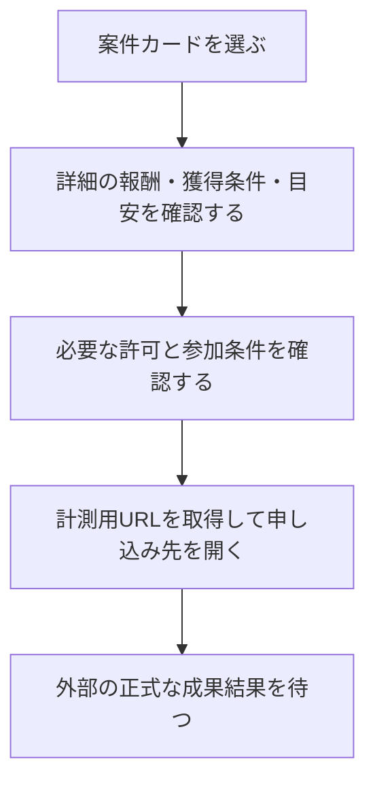

# F04｜アフィリエイト案件の詳細・参加・エントリー PRD（レビュー前）

> ④業務ルールと⑦以降はユーザーレビュー未完了。機能・画面・操作は現在の4189モックを正とし、優先順位はスプレッドシートを正とする。本PRDはTier1のみを定義する。

参照するモック：`Tameruko-Preview-20261013` の4189（2026-10-15確認）。未接続の外部API・実端末機能は、接続済みとして扱わず末尾に記載する。

| 基本情報 | 内容 |
| --- | --- |
| 機能ID | F04 |
| 概要 | アフィリエイト案件の詳細・参加・エントリー |
| 対象領域 | アプリ／管理画面／外部連携 |
| 関連機能 | [F03](F03-offer-list.md)、[F05](F05-my-offers.md)、[F06](F06-challenge-bonus.md) |
| 更新日 | 2026-10-15 |
| 版 | レビュー前（初版未確定） |

## ① 目的・今回作る範囲

目的：案件の条件と報酬を理解したうえで参加できるようにするため

評価指標：詳細からの参加率/条件に関する問い合わせ件数/否認率

優先順位は[アプリ詳細要件のTier列](https://docs.google.com/spreadsheets/d/1g00ZxLGprVNT4T4uSmzw--vRpp95HQ1Uq9i8GnJpmS4/edit#gid=1107057215)を正とする。モックに存在してもTier2・Tier3・空欄の要件は本PRDの定義対象に含めない。

| 要件ID | Tier1の範囲 |
| --- | --- |
| F04-1 | ユーザーが案件詳細画面で報酬・獲得条件・対象外条件・概要・画像を確認できる |
| F04-2 | ユーザーが案件詳細画面で判定中への反映目安とポイント付与目安を別々に確認できる |
| F04-3 | 案件参加前に広告利用の注意事項を確認できる |
| F04-4 | iOSユーザーが案件参加前のトラッキング許可状態に応じて設定または申し込みへ進むことができる |
| F04-5 | ユーザーが案件詳細画面の「ポイントゲット」ボタンから管理側が設定した計測用URLへ進むことができる |
| F04-6 | ユーザーがステップアップ案件の詳細で各段階の達成条件と報酬を確認できる |
| F04-7 | 運営担当者がNACS／案件管理画面で案件本文・画像・計測用遷移先を手動登録・更新できる |
| F04-8 | 案件管理システムがASPの案件情報を定期取得し、変更差分を運営担当者へ提示できる |
| F04-10 | 運営担当者がASPの案件カタログをCSV等で一括登録できる |
| F04-11 | 運営担当者が案件の商流・条件を営業ロックして意図しない切替を防止できる |
| F04-12 | 運営担当者が案件の契約期間と期間限定単価を管理できる |
| F04-13 | 運営担当者がASP案件を審査し、掲載NGの案件を配信対象から除外できる |

要件名に旧モックとの相違がある場合、優先順位は維持し、現在の表示・動きとユーザー指定を②以降へ反映する。実装方式の具体化は仕様設計で扱う。

## ② 画面イメージ

[アプリの該当画面](http://127.0.0.1:4189/mock-app/#offer/travel)

- 案件画像・案件名・報酬・獲得条件・対象外条件・ポイント付与目安・マイ案件の判定中反映目安を表示する。
- 「ポイントゲット」から計測用URLへ進む。iOSトラッキングの許可状態に応じて案内・設定確認を行う。
- ステップアップ案件は段階ごとの条件と報酬を表示する。

## ③ 操作フロー

外部認証・トラッキングの実端末接続は担当を確認する。計測URLを開く処理と、成果通知・ポイント付与の処理は別の操作として扱う。

## ④ 業務ルール・制約

> ユーザーレビュー未完了。アプリ上の表示に関わるルールを記載する。

### 表示する対象ユーザー

| 対象ユーザー | 利用・表示 |
| --- | --- |
| 会員 | 公開中の案件詳細と参加条件を確認する |
| 非会員（ゲスト） | 公開中の案件詳細と参加条件を確認する |

### 表示条件

| 状態・条件 | 表示のルール |
| --- | --- |
| 公開中で対象条件に合う案件 | 案件の内容と参加ボタンを表示する |
| ステップアップ案件 | 段階ごとの達成条件・報酬を表示する |
| iOSのトラッキング許可確認が必要 | 許可状態に対応した案内と設定への入口を表示する |

### 画面に置く要素・操作

| 画面・要素 | 表示・操作のルール |
| --- | --- |
| 画像・案件名・概要 | 案件の内容を表示する |
| 報酬・獲得条件・対象外条件 | 参加前に確認できるよう表示する |
| 判定中への反映目安 | マイ案件に反映される目安を表示する |
| ポイント付与目安 | 判定中への反映目安とは別に表示する |
| 広告利用の注意事項 | 参加前に確認できるよう表示する |
| ポイントゲット | 計測用の申し込み先へ進む |

## ⑤ 管理画面

新規作成・変更・削除は、現在の管理画面で操作できる範囲を示す。「外部管理」はNACS・EDOCODE等の担当範囲、「未実装」は操作画面がない項目。削除と公開停止は分けて記載する。

| 対象項目 | 新規作成 | 変更 | 削除 | 管理画面での操作・反映範囲 |
| --- | --- | --- | --- | --- |
| 案件本文・報酬・条件・目安・画像 | 外部管理 | 外部管理 | 外部管理 | NACSの案件管理。自社管理画面へ同じ案件編集機能を重ねて作らない。 |
| ASP素材の取得経路・手動素材 | 外部管理 | 外部管理 | 外部管理 | NACS再現画面でAPI／手動を選択。実ASP取得は未接続。選択経路だけを配信する。 |
| 詳細画面の構成・参加ボタン | 不可 | 不可 | 不可 | アプリ共通UI。案件編集でボタンのサイズを自由変更する機能はない。 |

## ⑥ 例外処理・エラーハンドリング

| 状況 | 表示・処理・復帰 |
| --- | --- |
| 無効なURL・起動失敗 | 理由を案内し、再試行できる。成功した成果として扱わない。 |
| 停止・対象外の案件 | 参加できない表示と戻る入口を表示する。 |

## ⑦ 達成条件・未決事項

> 本節以降はユーザーレビュー未完了。

### Tier1の達成条件

- [ ] F04-1：ユーザーが案件詳細画面で報酬・獲得条件・対象外条件・概要・画像を確認できる。
- [ ] F04-2：ユーザーが案件詳細画面で判定中への反映目安とポイント付与目安を別々に確認できる。
- [ ] F04-3：案件参加前に広告利用の注意事項を確認できる。
- [ ] F04-4：iOSユーザーが案件参加前のトラッキング許可状態に応じて設定または申し込みへ進むことができる。
- [ ] F04-5：ユーザーが案件詳細画面の「ポイントゲット」ボタンから管理側が設定した計測用URLへ進むことができる。
- [ ] F04-6：ユーザーがステップアップ案件の詳細で各段階の達成条件と報酬を確認できる。
- [ ] F04-7：運営担当者がNACS／案件管理画面で案件本文・画像・計測用遷移先を手動登録・更新できる。
- [ ] F04-8：案件管理システムがASPの案件情報を定期取得し、変更差分を運営担当者へ提示できる。
- [ ] F04-10：運営担当者がASPの案件カタログをCSV等で一括登録できる。
- [ ] F04-11：運営担当者が案件の商流・条件を営業ロックして意図しない切替を防止できる。
- [ ] F04-12：運営担当者が案件の契約期間と期間限定単価を管理できる。
- [ ] F04-13：運営担当者がASP案件を審査し、掲載NGの案件を配信対象から除外できる。
- [ ] ⑥の対象となる空・失敗・中断などの状態から、表示内容と次の操作を確認できる。

### まだ決まっていないこと

なし。認証・API接続などの具体的な方法は、別途仕様設計で定める。

## モックへの未反映・対象外

### モックへの未反映

| 項目 | 未反映の内容 |
| --- | --- |
| NACS・成果の連携 | 本番の案件情報・計測用URLの取得と正式な成果通知は未接続 |
| iOSの設定・復帰 | 実端末のトラッキング許可、設定画面からの復帰は未接続 |

### 今回の対象外

| 項目 | 対象外の内容 |
| --- | --- |
| NACS本体の内製 | 案件本文・画像・参加先の管理はNACSとの連携範囲として扱う |

## 変更履歴

| 版 | 日付 | 変更内容 |
| --- | --- | --- |
| レビュー前 | 2026-10-15 | F10レビューの共通フィードバックを反映。⑤を管理画面へ変更し、④を対象ユーザー・表示条件・配置要素に整理。例外処理と仕様設計事項の重複を除き、未反映と対象外を別表に分離。個別レビューは未完了。 |
