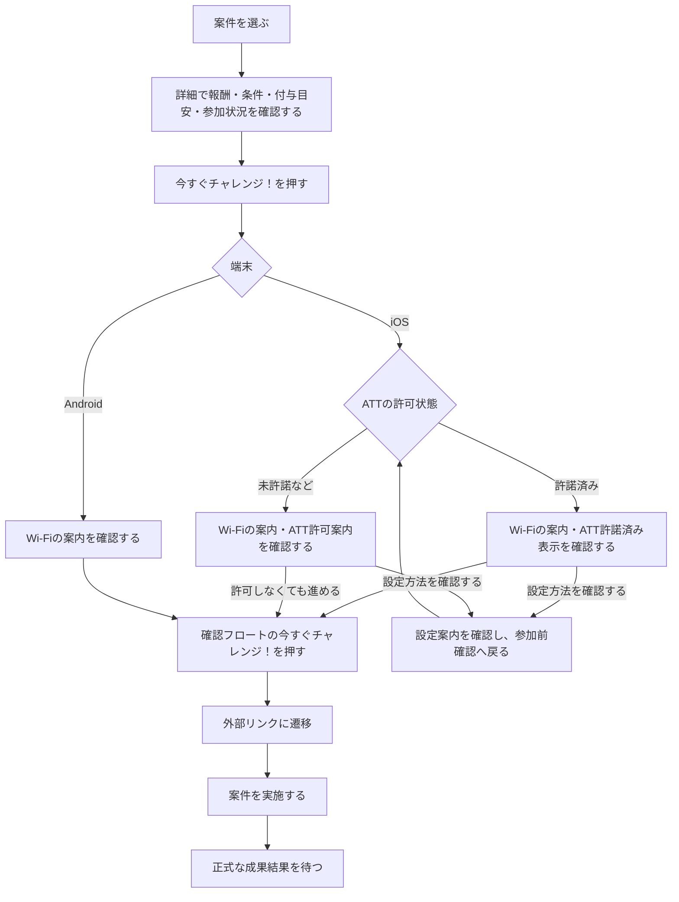

# F04｜アフィリエイト案件の詳細・参加 PRD（レビュー前）

F04の表示・操作・条件を定義する。相互レビュー・最終合意は未完了。未決事項とエドコードへの確認事項は末尾に分けて記載する。

> ④業務ルール・モックへの未反映・対象外・末尾の確認事項はユーザーレビュー未完了。機能・画面・操作は現在の4189モックを正とし、優先順位はスプレッドシートを正とする。本PRDはTier1のみを定義する。

参照するモック：4189のローカルモック。②〜⑥には求める表示・操作を記載する。モックへの反映・本番接続とは区別し、未反映・未確認の範囲を末尾に記載する。

| 基本情報 | 内容 |
| --- | --- |
| 機能ID | F04 |
| 概要 | アフィリエイト案件の詳細・参加 |
| 対象領域 | アプリ／管理画面／外部連携 |
| 関連機能 | [F03](F03-offer-list.md)、[F05](F05-my-offers.md)、[F06](F06-challenge-bonus.md) |
| 更新日 | 2026-10-20 |
| 版 | レビュー前（初版未確定） |
| モックレビュー | 完了（2026-10-20ユーザー共有）。本書の新しい要件の反映完了を意味しない |
| PRDレビュー | 担当者・青木さんの相互レビューを反映。再確認待ち・最終未合意 |
| 共有メモ | 1 → C |

## ① 目的・今回作る範囲

目的：ユーザーが報酬・獲得条件・対象外条件を理解し、自分が条件を満たせるか判断したうえで、アフィリエイト案件へ参加できるようにするため。

案件を選んだ後に「何をすれば、どの報酬が、いつ頃もらえるか」を確認し、納得して申し込みへ進むための機能とする。条件や報酬の誤解を減らすため、参加ボタンだけでなく、獲得条件・対象外条件・付与目安を参加前に確認できるようにする。

評価指標：詳細からの参加率/条件に関する問い合わせ件数/否認率

優先順位は[アプリ詳細要件のTier列](https://docs.google.com/spreadsheets/d/1tI26I_4vbSHIOzMdJz7g8-DjeLyyVUKoksVHhZ0AQhU/edit#gid=1107057215)を正とする。モックに存在してもTier2・Tier3・空欄の要件は本PRDの定義対象に含めない。

| 要件ID | Tier1の範囲 |
| --- | --- |
| F04-1 | ユーザーが案件詳細画面で報酬・獲得条件・対象外条件・概要・画像を確認できる |
| F04-2 | ユーザーが案件詳細画面でポイント付与目安を獲得条件と同じ形式で確認できる |
| F04-3 | ユーザーが案件詳細から注意事項のWebページを開いて確認できる |
| F04-4 | iOSユーザーは、申し込み前にトラッキングの許可案内と設定方法を確認できる。未許可でも案内を確認した後は申し込みへ進める。 |
| F04-5 | ユーザーが、参加できる案件の「今すぐチャレンジ！」を押して、参加前の確認後に申し込み先へ進める。参加状況に応じてボタンの表示と活性・非活性状態が切り替わる（詳細は④に記載）。 |
| F04-6 | ユーザーがSUR案件の詳細で各段階の条件・報酬・達成済み件数を確認できる |
| F04-7 | 運営担当者がACSで案件本文・画像・計測用遷移先を手動登録・更新できる |
| F04-8 | ACSがASPの案件情報を定期取得し、変更差分を運営担当者へ提示できる |
| F04-10 | 運営担当者がASPの案件カタログをCSV等で一括登録できる |
| F04-11 | 運営担当者が案件の商流・条件を営業ロックして意図しない切替を防止できる |
| F04-13 | 運営担当者がASP案件を審査し、掲載NGの案件を配信対象から除外できる |

## ② 画面イメージ

文字サイズ・配色・背景・余白などの見た目は現行モックと[デザイン部品集](../../../mock-app/design-system/app-theme/library.html)を参照する。PRDには、表示する情報・操作・条件・結果を記載する。既存の表示デザインは変更しない。

| 確認対象 | モック |
| --- | --- |
| 通常の案件詳細 | [モリノマルシェ](http://localhost:4189/mock-app/#offer/marche) |
| SURの達成進捗カード・通常CTA | [星ねこクエスト](http://localhost:4189/mock-app/#offer/starquest) |
| SUR挑戦中の非活性CTA（初期データ） | [ガーデンパズル](http://localhost:4189/mock-app/#offer/game) |

### 詳細ページの構成・要素

○は表示対象、×は表示しない要素。状態による切り替えは④に従う。

| 要素 | 通常案件 | SUR案件 | 表示条件・内容・操作・遷移先 |
| --- | --- | --- | --- |
| 戻るボタン | ○ | ○ | 元の一覧・ホームのタブなどへスクロール位置を保って戻る。案件の比較を続けられるよう、タブの先頭へは戻さない。 |
| 案件画像 | ○ | ○ | 一覧と同じ案件アイコン画像を表示する。詳細への遷移・再読み込み後も同じ案件の画像を表示する。 |
| 案件名 | ○ | ○ | ACSから配信された案件名を表示する。 |
| PRバッジ | ○ | ○ | 広告であることを示す「PR」を表示する。 |
| 報酬 | ○ | ○ | 定額はポイント数と「pt」、定率は配信された還元率を表示する。SURは各段階の報酬の合計ポイントを表示する。 |
| 「(最大)」表記 | × | ○ | SURの合計ポイントに併記する。 |
| 獲得条件の要約 | ○ | ○ | 報酬の近くにラベルと本文で表示する。 |
| ポイント付与目安 | ○ | ○ | 獲得条件と同じラベル＋本文の形式で表示する。 |
| 達成進捗カード | × | ○ | 段階ごとの条件・報酬・本人の達成状況を表示する。下記の定義に従う。 |
| 達成リストの開閉ボタン | × | ○ | 4段階以上の場合のみ「すべて表示／折りたたむ」で開閉する。 |
| ポイント獲得条件の本文 | ○ | ○ | 報酬を獲得するために必要な条件を表示する。 |
| 対象外条件の本文 | ○ | ○ | 報酬対象にならない条件を表示する。 |
| ポイント獲得に関する注意事項 | ○ | ○ | Webページを直接開く。ダイアログは経由しない。閲覧だけでは参加・成果を記録しない。正式なページは後日作成し、URLを設定する。 |
| 案件概要 | ○ | ○ | 案件の説明を表示する。 |
| 参加ボタン | ○ | ○ | ④の状態表に従って文言・活性状態を切り替える。「今すぐチャレンジ！」から参加前確認へ進む。読み込み中・取得失敗中・外部リンクへの遷移処理中は重ねて実行できない。 |
| 参加ボタンの外部リンクアイコン | ○ | ○ | 「今すぐチャレンジ！」の場合に表示する。「チャレンジ中」「ポイントゲット済」では表示しない。 |

### SURの達成進捗カード

SURは段階ごとに獲得条件と報酬が異なるため、各段階の条件・報酬と本人の達成状況を対応させ、残っている条件を確認できるようにする。

- 上部に「すべての条件を達成で」と通常ポイントの合計を表示する。全段階承認時は「すべての条件を達成！」とする。
- 「達成リスト」「達成済み n / 全段階数」と、段階ごとの条件・報酬を表示する。各段階が未達成か達成済みかを区別できる。
- 最初は3段階まで表示し、4段階以上は「すべて表示／折りたたむ」で開閉する。閲覧・開閉で成果状態やポイントは変化しない。

### 「ご確認ください」のフロート

申し込み前に計測に関する設定を確認するための画面。Wi-Fi接続がトラッキングに影響し、案件を正常に計測できない場合があるため、オフにすることを推奨する。Wi-FiやATTの設定変更は、申し込みへ進むための必須条件にはしない。

| 端末・ATT状態 | Wi-Fiの案内・イラスト | ATTの案内・イラスト | ボタン・リンク | 遷移先 |
| --- | --- | --- | --- | --- |
| iOS／許諾済み | オフを推奨する文言とWi-Fiをオフにした説明図 | 「トラッキングを許可」「許可済み」の文言とONの説明図 | 「今すぐチャレンジ！」／「トラッキングの設定方法」／閉じる | 参加ボタンで計測用URLを経由する外部の申し込み先へ。設定方法は設定案内へ。閉じると案件詳細へ。 |
| iOS／未許諾 | オフを推奨する文言とWi-Fiをオフにした説明図 | 許可を促す文言とOFFの説明図 | 「今すぐチャレンジ！」／「トラッキングの設定方法」／閉じる | 案内を表示した後は、許可しなくても参加ボタンから外部の申し込み先へ進める。設定方法は設定案内へ。閉じると案件詳細へ。 |
| Android | オフを推奨する文言とWi-Fiをオフにした説明図 | 表示しない | 「今すぐチャレンジ！」／閉じる | 参加ボタンで外部の申し込み先へ。閉じると案件詳細へ。 |

iOSの設定案内では設定手順を確認でき、戻ると参加前確認を表示する。設定後も未許諾であることを理由に申し込みを止めない。制限あり・確認中・取得不明の場合も許可済みとは表示せず、状態に応じた案内を表示する。許可状態を確認できるまで申し込みを待たせる条件は設けない。説明図は操作できるスイッチにはしない。

## ③ 操作フロー

参加可能な案件から外部の申し込み先へ進む流れを示す。参加ボタンの状態は④、失敗・中断時の扱いは⑥に記載する。

別途の事前エントリーは不要。「エントリーする」ボタンやエントリー済みかの判定は設けず、旧保存データにエントリー履歴等が残っていても参加条件にしない。

外部リンクへの遷移だけでは成果・ポイント付与は確定しない。報酬は案件の獲得条件と正式な成果判定に従う。

## ④ 業務ルール・制約

> ユーザーレビュー未完了。アプリ上の表示に関わるルールを記載する。

### 表示する対象ユーザー

| 対象ユーザー | 利用・表示 |
| --- | --- |
| 会員 | 公開中の案件詳細と参加条件を確認する。対象条件を満たす案件に参加でき、報酬の対象となる |
| 非会員（ゲスト） | 公開中の案件詳細と参加条件を確認する。会員と同様に、対象条件を満たす案件に参加でき、報酬の対象となる |

チャレンジボーナス付き案件を含むアフィリエイト案件への参加・報酬獲得に、アプリの会員登録・SMS認証は必須としない。各案件の獲得条件・対象外条件は、会員・ゲストともに適用する。

アフィリエイト案件への参加・報酬獲得と、獲得したポイントを交換する条件は分けて扱う。ゲストも案件でポイントを獲得できるが、そのポイントを交換する際には会員登録とSMS認証が必要。会員は交換のたびにSMS認証を完了する。登録・認証は[F01](F01-account.md)、交換の条件・操作は[F13](F13-point-exchange.md)に従う。

### 表示条件

掲載期間内・配信中で対象条件に合う案件を表示する。期間外・配信終了の案件は一覧・詳細とも表示しない。「配信停止」の状態や非対象端末専用の表示分岐は定義しない。

参加ボタンは、ユーザーが「今から申し込めるか」「すでに挑戦中か」「完了しているか」を区別できるよう、通常案件・SUR案件とも参加状況に合わせて表示する。同じ成果への報酬の二重付与を防ぐため、応募済み・承認済みの場合は非活性にする。

| 案件種別 | 参加状態 | ボタン文言 | 活性状態 | 達成進捗カード |
| --- | --- | --- | --- | --- |
| SUR案件 | 未挑戦 | 今すぐチャレンジ！ | 活性 | 各段階の条件・報酬と、連携された本人の達成状況を表示する。 |
| SUR案件 | 挑戦中（一部の段階承認済みを含む） | チャレンジ中 | 非活性 | 承認済みの段階と未承認の段階を区別する。 |
| SUR案件 | 達成だが未承認 | チャレンジ中 | 非活性 | 成果判定待ちの段階を承認済みにはしない。達成済み件数は承認済みの段階数とする。 |
| SUR案件 | 全段階達成かつ承認済み | ポイントゲット済 | 非活性 | 全段階を達成済みとし、「すべての条件を達成！」を表示する。 |
| SUR案件 | 達成したが否認 | 今すぐチャレンジ！ | 参加条件を満たす場合に活性 | 正式な段階別成果状態を表示する。過去の一部達成数だけを理由にボタンを非活性にしない。 |
| 通常案件 | 未挑戦 | 今すぐチャレンジ！ | 活性 | 表示しない。 |
| 通常案件 | 挑戦済みだが未承認 | チャレンジ中 | 非活性 | 表示しない。 |
| 通常案件 | 挑戦済みかつ承認済み | ポイントゲット済 | 非活性 | 表示しない。 |
| 通常案件 | 挑戦済みだが否認 | 今すぐチャレンジ！ | 参加条件を満たす場合に活性 | 表示しない。 |

参加状況・段階別の成果状態はACSの連携情報で判断する。申し込み先を開いただけでは「挑戦中」や承認済みと扱わない。閲覧・カードの開閉でも成果状態やポイントは変化しない。

### 再参加時の条件・報酬

再参加の条件と、再参加時に報酬対象となる条件は案件ごとに定められた獲得条件・対象外条件に従う。再参加できることと、毎回報酬を獲得できることは同じではない。

再参加時は、再び報酬を獲得できる条件、過去の達成・獲得済み報酬の扱い、今回の進捗をユーザーが確認できるようにする。参加ボタンが押せるだけで、同じ達成の報酬を再びもらえると誤認させない。

SURで一部の段階が承認された後に否認・再参加した場合も、過去の達成・既に獲得した報酬・再参加後の報酬対象は案件ごとの条件と正式な成果判定に従う。達成表示には、その案件について連携された本人の段階別成果状態を反映する。一律に進捗をリセットしたり、同じ段階の報酬を再付与したりする仕様にはしない。

チャレンジボーナスは通常報酬とは別に[F06](F06-challenge-bonus.md)の条件に従い、同じ案件への再参加はボーナス対象外とする。

### 単価について

報酬は、ユーザーが申し込んだ時点の案件単価を適用する。申し込み後にキャンペーン期間が終了したり単価が変更されたりしても、その申し込みには申し込み時点の単価を適用する。条件達成時・成果承認時の単価には置き換えない。

詳細を見てから申し込むまでに単価が変わった場合は、詳細で見た報酬と実際に適用される報酬に差が生じることを許容する。詳細を見た時点の単価は保証しない。単価の適用と報酬の付与は別であり、申し込んだだけでは付与せず、案件の獲得条件と正式な成果判定に従う。

## ⑤ 管理画面

ユーザーが参加前に確認する案件情報と、運営が管理する報酬・条件・申し込み先を対応させるため、ACSを案件情報の管理元とする。自社管理画面に同じ編集機能を重ねず、誰がどこで内容を更新するかを明確にする。

### EDOCODE社へ依頼する範囲

ACSはエドコード側のシステム。案件管理を次の3画面として整理する。以下は先方へ伝える要件であり、先方での実装完了・対応確認済みを意味しない。自社管理画面に同じ編集機能を追加しない。

| 画面名 | 何ができる画面か | 入口・操作後 |
| --- | --- | --- |
| 新規作成画面 | 案件情報・報酬・条件・画像・計測用遷移先を手動入稿する。 | 一覧の新規作成から開く。登録結果を確認し、一覧へ戻る。 |
| 編集画面 | 登録済み案件の内容を確認・変更する。ASP取得内容との差分、営業ロック、掲載審査の状態を確認する。 | 一覧で案件を選んで開く。更新結果と配信への反映状況を確認する。 |
| 一覧画面 | 案件を探し、登録・配信・審査の状態を確認する。新規作成・編集・一括登録・差分確認へ進む。 | 案件管理の入口。失敗した案件と理由を確認して再処理へ進む。 |

### 新規作成画面・編集画面の項目

共通する入稿項目を1行ずつ定義する。案件IDは登録済み案件を識別するための項目とし、編集画面では変更しない。詳細画面の構成や参加ボタン自体はアプリ共通UIであり、入稿項目には含めない。

| 項目 | 新規作成画面 | 編集画面 | 内容・条件 |
| --- | --- | --- | --- |
| 案件ID | 登録する案件を識別 | 表示のみ | ACSが管理する案件の識別子。 |
| 案件名 | 入稿 | 変更 | アプリの一覧・詳細に表示する案件名。 |
| 広告主 | 選択 | 変更 | 案件の提供元を対応づける。 |
| ASP | 指定 | 確認・変更 | 案件の連携元。営業ロックの適用範囲はR2で確認する。 |
| ASP側の案件ID | 入稿 | 確認・変更 | ASPから取得する案件・素材を識別する。 |
| カテゴリ | 選択 | 変更 | 案件の分類。カテゴリの定義は[F03](F03-offer-list.md)に従う。 |
| 報酬種別 | 選択 | 確認・変更 | 定額・定率・SUR。種別に応じた報酬項目を使用する。 |
| 広告主報酬額 | 入稿 | 変更 | 定額案件の報酬額。 |
| 広告主報酬率 | 入稿 | 変更 | 定率案件の報酬率。 |
| チャネル還元率 | 入稿 | 変更 | アプリへ配信する報酬の計算に使用する率。 |
| 配信する報酬 | 計算結果を確認 | 計算結果を確認 | ACSで計算した報酬をアプリへ配信する。 |
| SURの段階条件 | 段階ごとに入稿 | 段階ごとに変更 | SURの場合のみ、各段階で達成すべき条件を登録する。 |
| SURの段階報酬 | 段階ごとに入稿 | 段階ごとに変更 | 各段階の条件と対応する報酬額を登録する。 |
| 獲得条件 | 入稿 | 変更 | 報酬を獲得するために必要な条件。 |
| 対象外条件 | 入稿 | 変更 | 報酬対象にならない条件。 |
| ポイント付与目安 | 入稿 | 変更 | 条件達成後の付与までの目安。 |
| 案件概要 | 入稿 | 変更 | アプリ詳細に表示する説明。 |
| 計測用遷移先URL | 入稿 | 変更 | 参加前確認後にユーザーが進む計測用URL。 |
| 素材の取得経路 | 選択 | 変更 | ASPからの取得／手動入稿を選び、選択した経路の素材を配信する。 |
| 案件画像 | 取得・入稿 | 取得・差し替え | 一覧・詳細で使用する画像。 |
| 広告テキスト | 取得・入稿 | 取得・変更 | ASP提供または手動入稿の広告文。 |

保存した内容を、すでに参加した申し込みへ一律に適用するものではない。報酬には④の申し込み時点の単価を適用する。正式な入力制限・編集可能範囲・配信への反映時点は、エドコードとの確認対象とする。

### 編集画面の運用項目

| 要素 | 確認・操作する内容 |
| --- | --- |
| 変更差分 | ASPから取得した内容と登録済み内容の差を確認する。承認が必要か、確定操作は何かをR2で確認する。 |
| 営業ロック | 商流・条件の意図しない切り替えを防ぐために使用する。ロック対象・解除操作はR2で確認する。 |
| 掲載審査 | 審査結果を確認し、掲載NGの案件を配信対象から除外する。NG後の修正・再審査手順はR2で確認する。 |
| 保存結果 | 更新の成否と、失敗した場合の理由を確認する。 |
| 配信反映状況 | 保存・確定した変更がアプリ向け配信に反映されたかを確認する。 |

### 一覧画面の要素

| 要素 | 確認・操作する内容 |
| --- | --- |
| 案件ID | 対象案件を識別する。 |
| 案件名 | 登録した案件を確認する。 |
| 広告主 | 案件の提供元を確認する。 |
| ASP | 案件の連携元を確認する。 |
| カテゴリ | 案件の分類を確認する。 |
| 報酬種別 | 定額・定率・SURを確認する。 |
| 配信する報酬 | アプリへ配信する報酬を確認する。 |
| 掲載状況 | 配信中・期間外・配信終了を見分ける。停止・再開の操作は設けない。 |
| 審査状態 | 掲載審査の状況を確認する。 |
| 登録結果 | 一括登録を含め、成功した案件・失敗した案件を見分ける。 |
| 失敗理由 | 失敗した案件ごとに修正が必要な内容を確認する。 |
| 配信反映状況 | 登録・変更が配信へ反映されたかを確認する。 |
| 新規作成 | 新規作成画面へ進む。 |
| 編集 | 選択した案件の編集画面へ進む。 |
| ASP取得・差分確認 | 定期取得された案件情報の変更差分を確認する。 |
| 一括登録 | CSV等で案件カタログを取り込み、案件ごとの登録結果を確認する。 |
| 失敗分の再処理 | 失敗した案件だけを選び、修正してやり直す。操作手順はR2で確認する。 |

案件・素材の新規作成と変更はACSの担当範囲。削除の可否・条件もACS側で確認し、配信終了と混同しない。運営が何を確定すると配信に反映されるか、反映されない場合にどの案件をやり直すかを確認できるようにする。

## ⑥ 例外処理・エラーハンドリング

申し込みを中断したり、申し込み先を開けなかったりしたときに、完了したと誤認せず次の操作を選べるようにする。画面の閲覧・移動・復帰と、成果承認・ポイント付与を区別する。

| 状況 | 表示・処理・復帰 |
| --- | --- |
| 参加前確認を閉じた | 詳細へ戻る。閉じる操作だけでは成果・達成・ポイント付与を発生させない |
| 案件詳細の読み込み中 | 読み込み中であることを表示し、必要な案件情報を取得できるまで参加操作を受け付けない。元の画面へ戻れる。 |
| 案件詳細の取得失敗 | 取得できなかった旨と、再読み込み・戻る入口を表示する。取得できていない条件や報酬を確定情報として扱わず、取得に成功するまで申し込みへ進めない。 |
| 参加ボタンの連続タップ | 参加前確認の表示中や申し込み先を開く処理中は、同じ操作を重ねて実行しない。複数の申し込み先画面を同時に開かない。 |
| 申し込み先を開けなかったことが確認できる | 失敗した旨を案内し、再試行・案件詳細へ戻る入口を表示する。再試行時も参加条件を確認する。URLが無効なままの場合は申し込み先を開かず、成功した成果として扱わない。 |
| 申し込み先から戻った・途中でやめた | 案件詳細へ戻る。戻ったことだけで成果・報酬を確定せず、自動で再度申し込み先を開かない。 |
| 期間外・配信終了の案件のURLを開いた／遷移前に掲載が終了した | 案件内容と参加ボタンは表示しない。案件が見つからない旨を案内し、元の画面へ戻れるようにする。 |
| iOSで設定後も未許可・設定できない・許可状態を確認できない | 許可済みとは表示しない。②の参加前確認から、未許可でも申し込みへ進める。閉じると案件詳細へ戻る。 |

## モックへの未反映・対象外

### モックへの未反映

| 項目 | 未反映の内容 |
| --- | --- |
| 注意事項の正式URL | 正式なページは後日作成予定。作成後に接続先を正式URLへ差し替える。モックでは `mock-app/affiliate-notice.html` の仮Webページを別タブで開き、ダイアログを経由しない。仮ページの本文は正式な注意事項ではない |
| ACS・成果の連携 | 本番の案件情報・計測用URL・SURの段階別成果は未接続。カードは既存モックの承認済み段階数で表示。正式な段階ID・状態・訂正の対応はAPI設計と結合試験で確認する |
| ゲームのSUR見本 | ガーデンパズルは既存の3段階。星ねこクエスト・こもれびカフェ物語・オーシャンタイルはUI確認用の4〜5段階の仮データ。各合計額は従来の通常報酬を維持。実案件の条件ではなく、既存の編集済みSUR・過去成果は自動で置き換えない |
| iOSの参加前確認 | モックには未許可時に設定へ誘導する参加制御が残る。案内後は未許可でも申し込み可能とする②・③・⑥の要件は未反映。実端末の許可状態取得・設定からの復帰も未接続。 |
| 通常案件の参加ボタン | 応募済みは「チャレンジ中」、承認済みは「ポイントゲット済」とし非活性にする④の要件は未反映。 |
| 期間外・配信終了の案件 | モックには期間外の詳細表示や配信停止・再開の操作が残る。期間外・配信終了は一覧・詳細とも非表示とし、停止の概念を設けない要件は未反映。 |
| ACSの3画面・運用要件 | モックの新規・編集・一覧は確認用の再現。⑤の全入稿項目、差分・ロック・審査・失敗分の再処理が本番ACSで利用できることは未確認。 |
| 読み込み・失敗・連続操作・外部からの復帰 | ⑥の参加制御・再試行・戻る操作を一連の操作として満たすことは未確認。 |
| 申し込み時点の単価 | 申し込み時点の単価を適用し、期間終了・単価変更後も参加済みの申し込みに維持する要件は、本番のASP・ACS連携で未確認。モックも本PRでは変更しない。 |
| 再参加時の説明・進捗 | 案件ごとの再度の報酬対象条件、過去の達成・獲得済み報酬の扱い、今回の進捗を利用者が確認できることは未確認。 |

### 今回の対象外

| 項目 | 対象外の内容 |
| --- | --- |
| ACS本体の内製 | ACSはエドコード側のシステム。案件本文・画像・参加先の管理に必要な運用上の要望を先方へ伝え、対応範囲・連携条件を確認する。自社でACS本体を実装するものではない。 |

## 未決事項・確認事項

本文の要件とは分け、まだ決まっていない内容・先方への確認が必要な内容だけを記載する。

| ID・場所 | 未決事項・確認事項 | 確認先・扱い |
| --- | --- | --- |
| R2｜⑤ ACSの運営操作 | 3画面の入稿項目・入力制限・編集可能範囲・削除条件、差分の承認要否、営業ロックの対象・解除方法、審査NG後の扱い、配信への反映時点、一括登録の失敗分を再処理する手順。 | エドコードへ⑤の要件を伝え、対応可否・操作手順を確認する。回答前に対応済みと扱わない。 |
