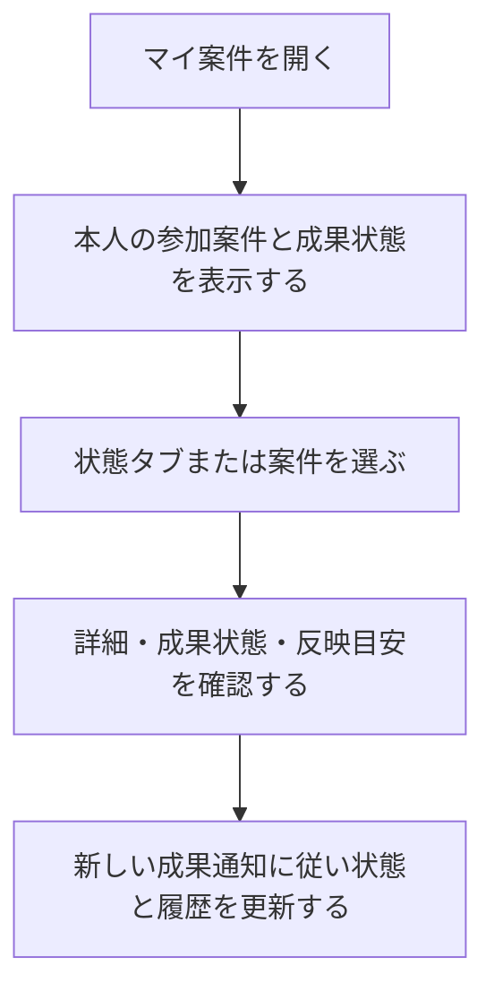

# F05｜マイ案件・成果状態・成果通知 PRD（レビュー前）

> ④業務ルールと⑦以降はユーザーレビュー未完了。機能・画面・操作は現在の4189モックを正とし、優先順位はスプレッドシートを正とする。本PRDはTier1のみを定義する。

参照するモック：[最新4189のマイ案件](http://localhost:4189/mock-app/#mycases)（2026-10-19更新）。未接続の外部API・実端末機能は、接続済みとして扱わず末尾に記載する。

| 基本情報 | 内容 |
| --- | --- |
| 機能ID | F05 |
| 概要 | マイ案件・成果状態・成果通知 |
| 対象領域 | アプリ／管理画面／外部連携 |
| 関連機能 | [F04](F04-offer-entry.md)、[F12](F12-points.md) |
| 更新日 | 2026-10-19 |
| 版 | レビュー前（初版未確定） |

## ① 目的・今回作る範囲

目的：参加した案件の進捗と成果を確認できるようにするため

評価指標：成果の未反映件数/成果の反映遅延/問い合わせ解決時間

優先順位は[アプリ詳細要件のTier列](https://docs.google.com/spreadsheets/d/1g00ZxLGprVNT4T4uSmzw--vRpp95HQ1Uq9i8GnJpmS4/edit#gid=1107057215)を正とする。モックに存在してもTier2・Tier3・空欄の要件は本PRDの定義対象に含めない。

| 要件ID | Tier1の範囲 |
| --- | --- |
| F05-1 | NACSがASPごとの成果情報をユーザー・案件・段階に紐付けて取り込むことができる |
| F05-2 | 挑戦中・判定中・承認・否認とポイント処理状態を区別できる |
| F05-3 | ポイント処理システムがステップアップ案件の各承認成果を一度だけ付与できる |
| F05-4 | 運営が未反映成果を照会してユーザーへのポイント付与承認/否認をNACSで手動でできる |
| F05-6 | 成果管理システムがバリューコマースの注文別レポートAPIを定期取得して成果へ反映できる |

要件名に旧モックとの相違がある場合、優先順位は維持し、現在の表示・動きとユーザー指定を②以降へ反映する。実装方式の具体化は仕様設計で扱う。

## ② 画面イメージ

[アプリの該当画面](http://127.0.0.1:4189/mock-app/#mycases)

基本は[タメルコのマイ案件画面](https://github.com/ca-media-poi/poikatsu-spec/blob/main/docs/screens/affiliate-my-affiliates.md)と[指定Figma](https://www.figma.com/design/OxKHX6jb2qWVEOs3UkzP8W?node-id=17277-445453&focus-id=19391-219060)を踏襲する。ユーザー指定の変更は次のとおり。

- 0件時のイラストは既存モックを維持する。「判定中の案件はありません」の `assets/mycases/judging.svg` を別の人物イラストへ差し替えない。他の状態の既存イラストも維持する。判定中の書類イラスト上の緑色の線は表示しない。
- 各案件のバナー・サムネイル・画像なしの代替枠は表示しない。画像列用の余白や文字ブロックの左パディングもなくし、案件名・条件・ポイント・日時を白い一覧枠の左端から16pxの同じ位置に揃える（枠の外側余白16pxと合わせて画面左端から32px）。空状態のイラストと見出しは従来の中央配置を維持する。
- レクタングル（MREC）広告は全タブから削除する。0件時・取得中・取得失敗時にも広告や広告用の空枠・高さを設けない。読み込み中も画像枠を置かず、テキストのスケルトンだけにする。

- 挑戦中・判定中・承認は、承認の見本と同じ「案件名 → 成果条件 → ポイント → 状態日時」の順に統一する。日付ラベルは挑戦日・判定日・承認日を使い分ける。
- 画面背景はグレー `#F5F6F6`、案件一覧・ヘルプ・空状態などの内容部分は白 `#FFFFFF`、案件間の区切りはグレー `#E5E8E7` とする。案件一覧全体を左右16pxの余白がある角丸12pxの白い枠で囲む。タブ下からヘルプ枠までと、ヘルプ枠下から案件一覧までを同じ16pxとする。ヘルプがない承認タブも一覧上に16px空ける。0件・取得失敗・掲載終了の状態表示も外側16px・角丸12pxの白い枠とし、0件イラストは120pxを維持する。案件内の情報順・文字階層・要素間隔は維持する。
- 「ヘルプを確認」は案件詳細の「ポイント獲得に関する注意事項」と共通の補足説明ボタン（PG-A08）とし、背景 `#EBEBED`・文字とアイコン `#454B58` を使用する。ホバーは `#E1E1E4`。高さ32pxと既存の文字・アイコン寸法を維持し、通常時も押せるボタンとして扱う。

案件名は全状態13px/600、条件12px、ポイント16px、日時12pxとし、行内8pxの間隔を維持する。案件名・条件は1行省略、日時の値は600とする。挑戦中への条件追加と文字の統一、一覧外側の角丸枠・余白の追加を除き、既存レイアウトを維持する。

## ③ 操作フロー

## ④ 業務ルール・制約

> ユーザーレビュー未完了。アプリ上の表示に関わるルールを記載する。

### 表示する対象ユーザー

| 対象ユーザー | 利用・表示 |
| --- | --- |
| 会員 | 本人の利用状況に対応する参加案件を確認する |
| 非会員（ゲスト） | 本人の利用状況に対応する参加案件を確認する |

### 表示条件

| 状態・条件 | 表示のルール |
| --- | --- |
| 本人の参加案件 | 該当する成果状態の一覧に表示する |
| 挑戦中・判定中・承認・否認 | 案件の状態ごとに分けて表示する |
| 他の利用者の案件 | 表示しない |
| 公開が終了した参加済み案件 | 既存の成果状態を確認する対象として扱う |

### 画面に置く要素・操作

| 画面・要素 | 表示・操作のルール |
| --- | --- |
| 状態タブ | 挑戦中・判定中・承認・否認を切り替える |
| 参加案件の一覧 | 成果1件につき1行。同じ案件の複数成果も別行とし、取得したデータの順を維持する。案件名・条件・報酬・状態日時をタブ別に表示する。案件画像・広告は置かない |
| 案件詳細への入口 | 選択した案件の内容を確認する |
| ヘルプへの入口 | 挑戦中・判定中・否認で表示し、承認では表示しない。0件時も同じルールとする。ヘルプページをアプリ内ブラウザで開き、閉じると元の一覧・選択タブへ戻る |
| ヘッダー | 戻るボタンと画面名を表示する。「更新」ボタンは置かない |

### 状態別の行表示

| タブ | 行に表示するもの |
| --- | --- |
| 挑戦中 | 案件名・成果条件1行・報酬・挑戦日 |
| 判定中 | 案件名・成果条件1行・報酬・判定日 |
| 承認 | 案件名・成果条件1行・報酬・承認日 |
| 否認 | 案件名・成果条件1行・否認日。報酬は表示しない |

日時は `yyyy/MM/dd HH:mm`、定額ポイントは `+60,000pt` のようにプラス・3桁区切り・単位を表示する。定率案件は既存の%表示を維持し、ptへ読み替えない。初期タブは挑戦中。SURの段階別進捗を一覧へ展開せず、[F04の案件詳細](F04-offer-entry.md)で確認する。成果状態の意味とポイント付与の条件は変更しない。

タメルコ同様、各タブの取得状態を独立させ、1ページ20件・末尾で追加取得、タブ内再試行・プルリフレッシュ・横スワイプ切替を本番の要件とする。これらの実API・実機の挙動は下記のモック未反映へ分け、ローカル表示だけで実装済みとは扱わない。

## ⑤ 管理画面

新規作成・変更・削除は、現在の管理画面で操作できる範囲を示す。「外部管理」はNACS・EDOCODE等の担当範囲、「未実装」は操作画面がない項目。削除と公開停止は分けて記載する。

[実行設定の管理画面](http://127.0.0.1:4189/mock-admin/legacy.html#cases)

| 対象項目 | 新規作成 | 変更 | 削除 | 管理画面での操作・反映範囲 |
| --- | --- | --- | --- | --- |
| 利用者の参加案件・成果状態 | 外部管理 | 外部管理 | 外部管理 | 正式な結果はNACS／成果連携。アプリの管理者が任意の成果を入稿する機能ではない。 |
| 成果承認・否認の確認操作 | 確認用のみ | 確認用のみ | 不可 | 管理画面「成果・解禁」は外部通知の再現。実際の成果の生成・承認権限ではない。 |
| マイ案件の表示文言・状態分類 | 不可 | 不可 | 不可 | アプリの共通表示。独立した文言入稿UIはない。 |

## ⑥ 例外処理・エラーハンドリング

| 状況 | 表示・処理・復帰 |
| --- | --- |
| 成果通知が遅れている | 未反映と否認を混同せず、目安とヘルプを表示する。 |
| 通知の再送・順不同 | 成果と段階のIDで照合し、同じ報酬を重ねない。 |

## ⑦ 達成条件・未決事項

> 本節以降はユーザーレビュー未完了。

### Tier1の達成条件

- [ ] F05-1：NACSがASPごとの成果情報をユーザー・案件・段階に紐付けて取り込むことができる。
- [ ] F05-2：挑戦中・判定中・承認・否認とポイント処理状態を区別できる。
- [ ] F05-3：ポイント処理システムがステップアップ案件の各承認成果を一度だけ付与できる。
- [ ] F05-4：運営が未反映成果を照会してユーザーへのポイント付与承認/否認をNACSで手動でできる。
- [ ] F05-6：成果管理システムがバリューコマースの注文別レポートAPIを定期取得して成果へ反映できる。
- [ ] 挑戦中・判定中・承認・否認の固定4タブで、上記の状態別の情報と日時を表示する。否認にポイントを表示しない。
- [ ] 案件行に画像・画像なし枠・左の画像用余白がなく、タイトル・条件・ポイント・日時が同じ左端に揃う。
- [ ] 全タブの通常・0件・取得中・取得失敗表示に、MRECとその空枠がない。0件の既存イラストは維持し、判定中の書類上の緑色の線だけを除く。
- [ ] ヘルプは承認以外のタブ（0件を含む）に表示し、アプリ内ブラウザで開閉できる。
- [ ] 挑戦中・判定中・承認は承認の見本に合わせた情報順と文字階層で表示し、日付ラベルを各状態に合わせる。
- [ ] グレーの画面背景・白い角丸の一覧枠・グレーの区切り線を使用する。ヘルプ枠の上下を16pxに揃え、案件内の情報配置と間隔を維持する。ヘッダーに更新ボタンがない。
- [ ] ヘルプボタンは補足説明用PG-A08の配色を使用し、既存のサイズ・操作を維持する。
- [ ] ⑥の対象となる空・失敗・中断などの状態から、表示内容と次の操作を確認できる。

### まだ決まっていないこと

ヘルプの正式URL・掲載内容は仕様設計で定義する。認証・API接続などの具体的な方法も別途仕様設計で定める。

## モックへの未反映・対象外

### モックへの未反映

| 項目 | 未反映の内容 |
| --- | --- |
| 成果・付与状態の連携 | NACS・EDOCODEの本番成果、訂正・取消と付与状態は未接続 |
| 実APIの一覧取得と操作 | 本番のタブ別取得・20件ページング・追加取得／失敗・プルリフレッシュ・横スワイプ切替は未接続。モックはローカル成果を表示し、タブ切替・取得失敗の再試行を確認できる |
| ヘルプの本番URL・実機連携 | 正式URL・掲載内容は仕様設計で定義。モックは `mycases-help.html` をWebView相当の枠で開く。実機WebViewブリッジは仮インターフェース |

### 今回の対象外

| 項目 | 対象外の内容 |
| --- | --- |
| NACS本体の内製 | 成果の取り込み・照会はNACSとの連携範囲として扱う |

## 変更履歴

| 版 | 日付 | 変更内容 |
| --- | --- | --- |
| レビュー前 | 2026-10-15 | F10レビューの共通フィードバックを反映。⑤を管理画面へ変更し、④を対象ユーザー・表示条件・配置要素に整理。例外処理と仕様設計事項の重複を除き、未反映と対象外を別表に分離。個別レビューは未完了。 |
| レビュー前 | 2026-10-19 | タメルコの画面仕様と指定Figmaを基本とする。ユーザー指定で0件イラストを維持、案件画像列を削除してテキストを左寄せ、全タブ・状態のMRECを削除。タブ別情報とヘルプ表示を整理し、段階別進捗は案件詳細へ集約。Tier・合意状態は維持。 |
| レビュー前 | 2026-10-19 | 追加指定で挑戦中・判定中・承認の行表示を承認の見本へ統一。既存レイアウトを維持したグレー背景・白い内容部分・グレー区切りと、補足説明ボタンPG-A08の共通配色を反映。 |
| レビュー前 | 2026-10-19 | 一覧を左右16pxの余白・角丸12pxの白い枠に変更し、ヘルプ枠の上下を16pxに統一。案件内の並びを維持し、ヘッダーの更新ボタンを削除。 |
| レビュー前 | 2026-10-19 | 判定中の空状態イラストから書類上の緑色の線を削除。その他の図形と表示寸法を維持。 |
| レビュー前 | 2026-10-19 | 累積修正を再照合し、白い一覧枠から16pxの文字位置、ヘルプ上下16px、空状態の角丸枠・120pxイラスト、状態別表記を最終状態に整理。更新ボタン削除・緑線削除と未確定のヘルプURLを確認条件・未決事項へ整合。 |
