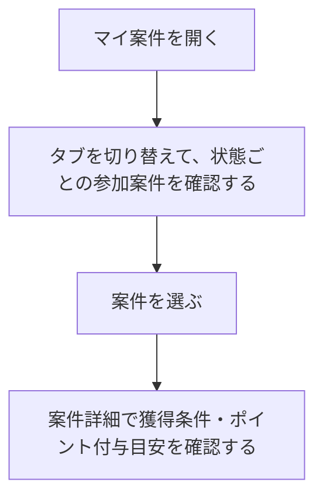

# F05｜マイ案件・成果状態・成果通知 PRD（レビュー前）

> ④業務ルールと⑦以降はユーザーレビュー未完了。機能・画面・操作はGitHub（ca-toju/pochipo）mainのモックを正とし、優先順位はスプレッドシートを正とする。本PRDはTier1のみを定義する。

参照するモック：GitHub（[ca-toju/pochipo](https://github.com/ca-toju/pochipo)）mainのモック（2026-10-20時点）。リポジトリを取得して `npm start` で起動すると、[マイ案件](http://localhost:4173/mock-app/#mycases)で確認できる。未接続の外部API・実端末機能は、接続済みとして扱わず末尾に記載する。

| 基本情報 | 内容 |
| --- | --- |
| 機能ID | F05 |
| 概要 | マイ案件・成果状態・成果通知 |
| 対象領域 | アプリ／管理画面／外部連携 |
| 関連機能 | [F04](F04-offer-entry.md)、[F12](F12-points.md) |
| 更新日 | 2026-10-20 |
| 版 | レビュー前（初版未確定） |

## ① 目的・今回作る範囲

目的：参加した案件の進捗と成果を確認できるようにするため

優先順位は[アプリ詳細要件のTier列](https://docs.google.com/spreadsheets/d/1tI26I_4vbSHIOzMdJz7g8-DjeLyyVUKoksVHhZ0AQhU/edit#gid=1107057215)を正とする。モックに存在してもTier2・Tier3・空欄の要件は本PRDの定義対象に含めない。

| 要件ID | Tier1の範囲 |
| --- | --- |
| F05-1 | ACSがASPごとの成果情報をユーザー・案件・段階に紐付けて取り込むことができる |
| F05-2 | 挑戦中・判定中・承認・否認とポイント処理状態を区別できる |
| F05-3 | ポイント処理システムがステップアップ案件の各承認成果を一度だけ付与できる |
| F05-4 | 運営が未反映成果を照会してユーザーへのポイント付与承認/否認をACSで手動でできる |
| F05-6 | 成果管理システムがバリューコマースの注文別レポートAPIを定期取得して成果へ反映できる |

実装方式の具体化は仕様設計で扱う。

## ② 画面イメージ

[アプリの該当画面](http://localhost:4173/mock-app/#mycases)（GitHubのモックを `npm start` で起動したもの）

- マイ案件への入口は、お得タブのヘッダー右上のマイ案件アイコン。参加案件の状態に更新があるときは、アイコンに赤ポチを表示する。マイページのヘッダーには置かない。
- ヘッダーは左上の戻るボタン「＜」と画面名「マイ案件」。「＜」を押すと、遷移元のお得タブに戻る。
- ヘッダーの下に挑戦中・判定中・承認・否認の4タブを並べ、選択中のタブは文字と下線をサーモンピンクで示す。初期表示は挑戦中。
- 画面の背景はグレー。挑戦中・判定中・否認のタブでは、タブの下に白い角丸の案内枠を置き、「案件進捗や結果についてお困りの方はヘルプをご確認ください」と「ヘルプを確認」ボタンを表示する。ボタンは案件詳細の「ポイント獲得に関する注意事項」と同じUIの補足説明ボタン。押すと、そのタブに対応する「マイ案件のヘルプ」をアプリ内ブラウザで開く（内容は④）。承認タブには案内枠を置かない。
- 案件は白い角丸の枠にまとめ、1件ずつ区切り線で分けて並べる。案件の画像・広告は置かない。
- 1件の表示は、案件名（太字・1行）→ 成果条件（1行）→ ポイント（サーモンピンクの大きめの文字）→ タブに応じた日時（挑戦日／判定日／承認日／否認日）の順。例：「【レベル達成でポイント】ガーデンパズル／初回インストール後30日以内にレベル17到達／+80,000pt／挑戦日 2026/09/15 22:00」。否認はポイントを出さず、否認日だけを表示する。
- 0件のときは、白い角丸の枠の中央に状態ごとのイラスト・見出し・説明を表示する。

| タブ | 0件の見出し | 0件の説明 |
| --- | --- | --- |
| 挑戦中 | 挑戦中の案件はありません | 気になる案件にチャレンジすると、ここで進捗を確認できます。 |
| 判定中 | 判定中の案件はありません | 条件達成後、ポイント付与の判定状況をここで確認できます。 |
| 承認 | 承認された案件はありません | 承認された案件と獲得ポイントをここで確認できます。 |
| 否認 | 否認された案件はありません | 否認された案件がある場合は、ここに表示されます。 |

- 読み込み中は、案件の文字部分だけのスケルトンを表示する。取得に失敗したときは、見出し「データの取得に失敗しました」、説明「通信環境の良い場所で再読み込みをお試しください。」と再読み込みボタンを表示する。

## ③ 操作フロー

## ④ 業務ルール・制約

### 表示する対象ユーザー

| 対象ユーザー | 利用・表示 |
| --- | --- |
| 会員 | 本人の利用状況に対応する参加案件を確認する |
| 非会員（ゲスト） | 本人の利用状況に対応する参加案件を確認する |

### 表示条件

| 状態・条件 | 表示のルール |
| --- | --- |
| 本人の参加案件 | 該当する成果状態の一覧に表示する |
| 挑戦中・判定中・承認・否認 | 案件の状態ごとに分けて表示する |
| 公開が終了した参加済み案件 | 既存の成果状態を確認する対象として扱う |

### 画面に置く要素・操作

| 画面・要素 | 表示・操作のルール |
| --- | --- |
| 状態タブ | 挑戦中・判定中・承認・否認を切り替える |
| 参加案件の一覧 | 成果1件につき1行。同じ案件の複数成果も別行とし、取得したデータの順を維持する。案件名・条件・報酬・タブに応じた日時（挑戦日／判定日／承認日／否認日）をタブ別に表示する。案件画像・広告は置かない |
| マイ案件への入口 | お得タブのヘッダー右上に置き、押すとマイ案件を開く。参加案件の状態に更新があるときは赤ポチを表示する |
| 案件詳細への入口 | 選択した案件の内容を確認する |
| ヘルプへの入口 | 挑戦中・判定中・否認で表示し、承認では表示しない。0件時も同じルールとする。押すと、そのタブに対応する「マイ案件のヘルプ」をアプリ内ブラウザで開き、閉じると元の一覧・選択タブへ戻る |
| ヘッダー | 戻るボタンと画面名を表示する。「更新」ボタンは置かない。戻るボタンを押すと、遷移元のお得タブへ戻る |

### マイ案件のヘルプの内容

ヘルプはタブごとに別ページとし、押したタブ（挑戦中・判定中・否認）に対応するページを開く。

| タブ | 見出し | 書いてあること |
| --- | --- | --- |
| 挑戦中 | 成果が反映されないとき | アプリの「今すぐチャレンジ！」から利用したか、獲得条件・対象外条件を確認する |
| 判定中 | 承認までの目安 | 承認までの目安は案件詳細の「ポイント付与目安」で確認する |
| 判定中 | 承認後のポイント | 承認後、ポイントは付与予定に登録され、判定後に交換できるようになる。マイ案件の承認表示が先になることがある |
| 判定中 | 成果が反映されないとき | アプリの「今すぐチャレンジ！」から利用したか、獲得条件・対象外条件を確認する |
| 否認 | 否認されたとき | 獲得条件・対象外条件を満たしていたかを確認する |

### 状態別の行表示

| タブ | 行に表示するもの |
| --- | --- |
| 挑戦中 | 案件名・成果条件1行・報酬・挑戦日 |
| 判定中 | 案件名・成果条件1行・報酬・判定日 |
| 承認 | 案件名・成果条件1行・報酬・承認日 |
| 否認 | 案件名・成果条件1行・否認日。報酬は表示しない |

日時は `yyyy/MM/dd HH:mm`、定額ポイントは `+60,000pt` のようにプラス・3桁区切り・単位を表示する。定率案件はptに書き換えず、「3%」のように%で表示する。SURの段階別進捗を一覧へ展開せず、[F04の案件詳細](F04-offer-entry.md)で確認する。

### 一覧の取得・操作

| 項目 | ルール |
| --- | --- |
| タブごとの取得 | 4タブはそれぞれ別に一覧を取得し、読み込み中・取得失敗・0件の状態もタブごとに持つ。あるタブの取得失敗は、他のタブの表示に影響しない |
| 件数と追加取得 | 1回に20件ずつ取得し、一覧の末尾までスクロールすると次の20件を追加で取得する |
| 再試行 | 取得に失敗したタブの中の再読み込みボタンで、そのタブの一覧を取り直す |
| プルリフレッシュ | 一覧を下に引くと、選択中のタブの一覧を取り直す |
| タブの切り替え | タブを押すほか、一覧を左右にスワイプして隣のタブへ切り替える |

## ⑤ 管理画面

新規作成・変更・削除は、現在の管理画面で操作できる範囲を示す。「外部管理」は、EDOCODE社が運営するACS側の担当範囲を指す。「未実装」は操作画面がない項目。削除と公開停止は分けて記載する。

[実行設定の管理画面](http://localhost:4173/mock-admin/legacy.html#cases)（GitHubのモックを `npm start` で起動したもの）

| 対象項目 | 新規作成 | 変更 | 削除 | 管理画面での操作・反映範囲 |
| --- | --- | --- | --- | --- |
| 利用者の参加案件・成果状態 | 外部管理 | 外部管理 | 外部管理 | 正式な結果はACS／成果連携。アプリの管理者が任意の成果を入稿する機能ではない。 |
| 成果承認・否認の確認操作 | 確認用のみ | 確認用のみ | 不可 | 管理画面「成果・解禁」は外部通知の再現。実際の成果の生成・承認権限ではない。 |
| マイ案件の表示文言・状態分類 | 不可 | 不可 | 不可 | アプリの共通表示。独立した文言入稿UIはない。 |

## ⑥ 例外処理・エラーハンドリング

| 状況 | 表示・処理・復帰 |
| --- | --- |
| 成果通知が遅れている | 成果は判定中のまま表示し、否認には移さない。判定中タブの案内枠の「ヘルプを確認」から、マイ案件のヘルプの「成果が反映されないとき」を開ける。 |
| 通知の再送・順不同 | 成果と段階のIDで照合し、同じ報酬を重ねない。 |
| 一覧の取得に失敗した | 見出し「データの取得に失敗しました」、説明「通信環境の良い場所で再読み込みをお試しください。」と再読み込みボタンを表示する。再読み込みで一覧を取り直す。 |
| 掲載終了・停止した案件を開いた | 案件詳細の代わりに、見出し「案件が見つかりません」、説明「この案件は掲載期間が終了しているか、URLが正しくありません。」を表示する。 |

## ⑦ 達成条件・未決事項

> 本節以降はユーザーレビュー未完了。

### Tier1の達成条件

- [ ] F05-1：ACSがASPごとの成果情報をユーザー・案件・段階に紐付けて取り込むことができる。
- [ ] F05-2：挑戦中・判定中・承認・否認とポイント処理状態を区別できる。
- [ ] F05-3：ポイント処理システムがステップアップ案件の各承認成果を一度だけ付与できる。
- [ ] F05-4：運営が未反映成果を照会してユーザーへのポイント付与承認/否認をACSで手動でできる。
- [ ] F05-6：成果管理システムがバリューコマースの注文別レポートAPIを定期取得して成果へ反映できる。
- [ ] 挑戦中・判定中・承認・否認の4タブで、案件名 → 成果条件 → ポイント → タブに応じた日時（挑戦日／判定日／承認日／否認日）の順に表示する。否認にはポイントを表示しない。
- [ ] 通常・0件・読み込み中・取得失敗のどの状態でも、案件の画像と広告を表示しない。
- [ ] ヘルプの案内枠は承認以外のタブ（0件を含む）に表示し、押したタブに対応する「マイ案件のヘルプ」をアプリ内ブラウザで開閉できる。
- [ ] 0件のときに、②の表の見出し・説明と状態ごとのイラストを表示する。
- [ ] ⑥の成果通知の遅れ・通知の再送／順不同・一覧の取得失敗・掲載終了した案件を開いたときの各状態で、表示内容と次の操作を確認できる。

### まだ決まっていないこと

ヘルプのページの分け方と掲載内容の方針は④のとおり。正式URL・最終的な文面は仕様設計で定義する。認証・API接続などの具体的な方法も別途仕様設計で定める。

## モックへの未反映・対象外

### モックへの未反映

| 項目 | 未反映の内容 |
| --- | --- |
| 成果・付与状態の連携 | ACS（EDOCODE社が運営）の本番成果、訂正・取消と付与状態は未接続 |
| 実APIの一覧取得と操作 | 本番のタブ別取得・20件ページング・追加取得／失敗・プルリフレッシュ・横スワイプ切替は未接続。モックはローカル成果を表示し、タブ切替・取得失敗の再試行を確認できる |
| ヘルプのタブ別ページ | モックはどのタブからも共通の1ページ（`mycases-help.html`）を開く。④のタブごとの別ページは未反映 |
| ヘルプの本番URL・実機連携 | 正式URL・最終的な文面は仕様設計で定義。モックはWebView相当の枠で開く。実機WebViewブリッジは仮インターフェース |

### 今回の対象外

| 項目 | 対象外の内容 |
| --- | --- |
| ACS本体の内製 | 成果の取り込み・照会はACSとの連携範囲として扱う |

## 変更履歴

| 版 | 日付 | 変更内容 |
| --- | --- | --- |
| レビュー前 | 2026-10-20 | モック更新（#13）に合わせ、マイ案件への入口をお得タブのヘッダー右上（更新時は赤ポチ）と記載。マイページのヘッダーには置かない。「＜」の戻り先を遷移元のお得タブと記載。 |
| レビュー前 | 2026-10-20 | 児玉さんの相互レビューを反映。基本情報のモックレビュー・PRDレビュー・共有メモの3行、評価指標、④冒頭の注記、表示条件の「他の利用者の案件」の行を削除。マイ案件のヘルプをタブごとの別ページ（旧案B）に決定し、案Aと確認項目の該当行を削除。モックのタブ別ページ未反映を記載。「外部管理」をEDOCODE社が運営するACS側の担当範囲と明記。 |
| レビュー前 | 2026-10-20 | 堅田の一次レビューを反映。①から運用ルールの文を削除。②③をモックの表示内容・ユーザー視点の操作で書き直し、④にマイ案件のヘルプの案A／案B、一覧の取得・操作を追加。⑥に一覧の取得失敗・掲載終了した案件を追加し、⑦を⑥に揃えた。参照するモックをGitHub mainに変更し、NACSをACSに統一。末尾に二次レビュー時の確認項目を追加。 |
| レビュー前 | 2026-10-20 | 緑色の線の削除を挑戦中・承認・否認にも適用し、全4状態を統一。各状態固有の記号・背景・表示寸法は維持。 |
| レビュー前 | 2026-10-19 | ②を、タメルコの画面仕様・Figmaの踏襲＋変更点の書き方から、現在のモックの表示内容を書く形に変更。⑦の達成条件も、寸法・色・変更時の書き方を除いて整理。 |
| レビュー前 | 2026-10-19 | 累積修正を再照合し、白い一覧枠から16pxの文字位置、ヘルプ上下16px、空状態の角丸枠・120pxイラスト、状態別表記を最終状態に整理。更新ボタン削除・緑線削除と未確定のヘルプURLを確認条件・未決事項へ整合。 |
| レビュー前 | 2026-10-19 | 判定中の空状態イラストから書類上の緑色の線を削除。その他の図形と表示寸法を維持。 |
| レビュー前 | 2026-10-19 | 一覧を左右16pxの余白・角丸12pxの白い枠に変更し、ヘルプ枠の上下を16pxに統一。案件内の並びを維持し、ヘッダーの更新ボタンを削除。 |
| レビュー前 | 2026-10-19 | 追加指定で挑戦中・判定中・承認の行表示を承認の見本へ統一。既存レイアウトを維持したグレー背景・白い内容部分・グレー区切りと、補足説明ボタンPG-A08の共通配色を反映。 |
| レビュー前 | 2026-10-19 | タメルコの画面仕様と指定Figmaを基本とする。ユーザー指定で0件イラストを維持、案件画像列を削除してテキストを左寄せ、全タブ・状態のMRECを削除。タブ別情報とヘルプ表示を整理し、段階別進捗は案件詳細へ集約。Tier・合意状態は維持。 |
| レビュー前 | 2026-10-15 | F10レビューの共通フィードバックを反映。⑤を管理画面へ変更し、④を対象ユーザー・表示条件・配置要素に整理。例外処理と仕様設計事項の重複を除き、未反映と対象外を別表に分離。個別レビューは未完了。 |

## レビュー時の確認項目

> レビュー完了後、このセクションごと削除する。

| 項目 | 確認してほしいこと |
| --- | --- |
| F05-6 | 「成果管理システムがバリューコマースの注文別レポートAPIを定期取得して成果へ反映できる」に関して、バリューコマースだけ切り出して要件とするのが間違っていないか、営業担当（村上）に要確認 |
| ②・⑦ | 一次レビューで、②をタメルコのマイ案件画面・Figmaを基本に変更点を並べる書き方から、現在のモックの表示内容（画面構成・文言・0件時の表示など）を書く形に変更した。16px・#F5F6F6などの寸法・色の細かい指定は外している。⑦の達成条件も同じ考え方で整理した。モックとPRDの内容に食い違いがないか確認してほしい |
| ④ 表示形式 | 「SURの段階別進捗を一覧へ展開せず、F04の案件詳細で確認する。」という記述がある。連携先のF04のPRDの一次レビューが完了後、案件詳細でSURの段階別進捗を確認できる仕様が書けているか確認したい |
| ⑤ 管理画面 | 管理画面についてPRDで細かく定められていないが、どこまで書くか、これでいいかを確認してから、⑤の内容をfixとしたい |