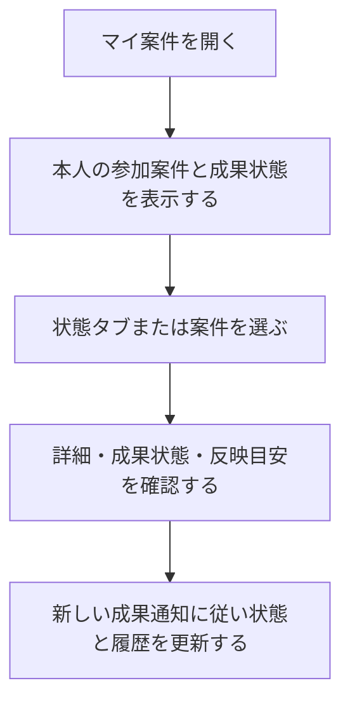

# F05｜マイ案件・成果状態・成果通知 PRD（レビュー前）

> ④業務ルールと⑦以降はユーザーレビュー未完了。機能・画面・操作は現在の4189モックを正とし、優先順位はスプレッドシートを正とする。本PRDはTier1のみを定義する。

参照するモック：`Tameruko-Preview-20261013` の4189（2026-10-15確認）。未接続の外部API・実端末機能は、接続済みとして扱わず末尾に記載する。

| 基本情報 | 内容 |
| --- | --- |
| 機能ID | F05 |
| 概要 | マイ案件・成果状態・成果通知 |
| 対象領域 | アプリ／管理画面／外部連携 |
| 関連機能 | [F04](F04-offer-entry.md)、[F12](F12-points.md) |
| 更新日 | 2026-10-15 |
| 版 | レビュー前（初版未確定） |

## ① 目的・今回作る範囲

目的：参加した案件の進捗と成果を確認できるようにするため

評価指標：成果の未反映件数/成果の反映遅延/問い合わせ解決時間

優先順位は[アプリ詳細要件のTier列](https://docs.google.com/spreadsheets/d/1g00ZxLGprVNT4T4uSmzw--vRpp95HQ1Uq9i8GnJpmS4/edit#gid=1107057215)を正とする。モックに存在してもTier2・Tier3・空欄の要件は本PRDの定義対象に含めない。

| 要件ID | Tier1の範囲 |
| --- | --- |
| F05-1 | NACSがASPごとの成果情報をユーザー・案件・段階に紐付けて取り込むことができる |
| F05-2 | 挑戦中・判定中・承認・否認とポイント処理状態を区別できる |
| F05-3 | ポイント処理システムがステップアップ案件の各承認成果を一度だけ付与できる |
| F05-4 | 運営が未反映成果を照会してユーザーへのポイント付与承認/否認をNACSで手動でできる |
| F05-6 | 成果管理システムがバリューコマースの注文別レポートAPIを定期取得して成果へ反映できる |

要件名に旧モックとの相違がある場合、優先順位は維持し、現在の表示・動きとユーザー指定を②以降へ反映する。実装方式の具体化は仕様設計で扱う。

## ② 画面イメージ

[アプリの該当画面](http://127.0.0.1:4189/mock-app/#mycases)

- 本人の参加案件を挑戦中・判定中・承認・否認の状態別に表示する。成果状態と反映目安を確認できる。
- 案件詳細とヘルプへ進める。
- 成果通知を受け、同一成果・同一段階へのポイントの重複を防ぐ。

## ③ 操作フロー

## ④ 業務ルール・制約

> ユーザーレビュー未完了。アプリ上の表示に関わるルールを記載する。

### 表示する対象ユーザー

| 対象ユーザー | 利用・表示 |
| --- | --- |
| 会員 | 本人の利用状況に対応する参加案件を確認する |
| 非会員（ゲスト） | 本人の利用状況に対応する参加案件を確認する |

### 表示条件

| 状態・条件 | 表示のルール |
| --- | --- |
| 本人の参加案件 | 該当する成果状態の一覧に表示する |
| 挑戦中・判定中・承認・否認 | 案件の状態ごとに分けて表示する |
| 他の利用者の案件 | 表示しない |
| 公開が終了した参加済み案件 | 既存の成果状態を確認する対象として扱う |

### 画面に置く要素・操作

| 画面・要素 | 表示・操作のルール |
| --- | --- |
| 状態タブ | 挑戦中・判定中・承認・否認を切り替える |
| 参加案件の一覧 | 案件名・報酬・成果状態・反映目安を表示する |
| 案件詳細への入口 | 選択した案件の内容を確認する |
| ヘルプへの入口 | 成果反映に関する案内を確認する |

## ⑤ 管理画面

新規作成・変更・削除は、現在の管理画面で操作できる範囲を示す。「外部管理」はNACS・EDOCODE等の担当範囲、「未実装」は操作画面がない項目。削除と公開停止は分けて記載する。

[実行設定の管理画面](http://127.0.0.1:4189/mock-admin/legacy.html#cases)

| 対象項目 | 新規作成 | 変更 | 削除 | 管理画面での操作・反映範囲 |
| --- | --- | --- | --- | --- |
| 利用者の参加案件・成果状態 | 外部管理 | 外部管理 | 外部管理 | 正式な結果はNACS／成果連携。アプリの管理者が任意の成果を入稿する機能ではない。 |
| 成果承認・否認の確認操作 | 確認用のみ | 確認用のみ | 不可 | 管理画面「成果・解禁」は外部通知の再現。実際の成果の生成・承認権限ではない。 |
| マイ案件の表示文言・状態分類 | 不可 | 不可 | 不可 | アプリの共通表示。独立した文言入稿UIはない。 |

## ⑥ 例外処理・エラーハンドリング

| 状況 | 表示・処理・復帰 |
| --- | --- |
| 成果通知が遅れている | 未反映と否認を混同せず、目安とヘルプを表示する。 |
| 通知の再送・順不同 | 成果と段階のIDで照合し、同じ報酬を重ねない。 |

## ⑦ 達成条件・未決事項

> 本節以降はユーザーレビュー未完了。

### Tier1の達成条件

- [ ] F05-1：NACSがASPごとの成果情報をユーザー・案件・段階に紐付けて取り込むことができる。
- [ ] F05-2：挑戦中・判定中・承認・否認とポイント処理状態を区別できる。
- [ ] F05-3：ポイント処理システムがステップアップ案件の各承認成果を一度だけ付与できる。
- [ ] F05-4：運営が未反映成果を照会してユーザーへのポイント付与承認/否認をNACSで手動でできる。
- [ ] F05-6：成果管理システムがバリューコマースの注文別レポートAPIを定期取得して成果へ反映できる。
- [ ] ⑥の対象となる空・失敗・中断などの状態から、表示内容と次の操作を確認できる。

### まだ決まっていないこと

なし。認証・API接続などの具体的な方法は、別途仕様設計で定める。

## モックへの未反映・対象外

### モックへの未反映

| 項目 | 未反映の内容 |
| --- | --- |
| 成果・付与状態の連携 | NACS・EDOCODEの本番成果、訂正・取消と付与状態は未接続 |

### 今回の対象外

| 項目 | 対象外の内容 |
| --- | --- |
| NACS本体の内製 | 成果の取り込み・照会はNACSとの連携範囲として扱う |

## 変更履歴

| 版 | 日付 | 変更内容 |
| --- | --- | --- |
| レビュー前 | 2026-10-15 | F10レビューの共通フィードバックを反映。⑤を管理画面へ変更し、④を対象ユーザー・表示条件・配置要素に整理。例外処理と仕様設計事項の重複を除き、未反映と対象外を別表に分離。個別レビューは未完了。 |
