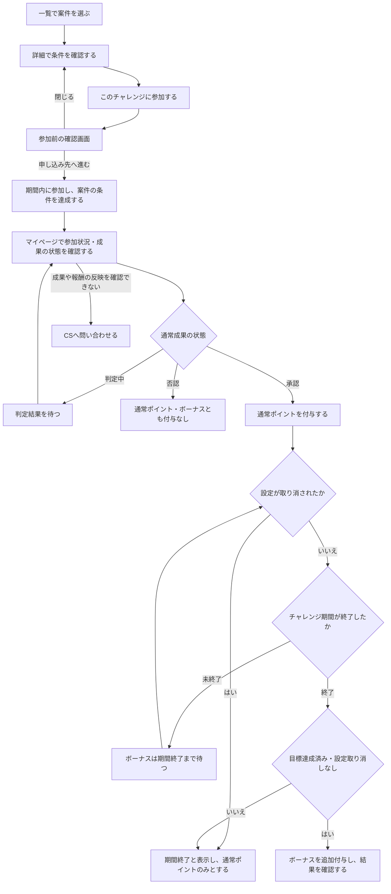

# F06｜チャレンジボーナス（PRD対象外）

[機能要件表の優先順位](https://docs.google.com/spreadsheets/d/1tI26I_4vbSHIOzMdJz7g8-DjeLyyVUKoksVHhZ0AQhU/edit#gid=1107057215)はTier2。本書はチャレンジボーナスのレビュー内容を残す参照メモであり、Tier1への採用・仕様の最終合意を意味しない。

モックを削除・非表示にする指示ではない。Tier1へ変更する場合は、その時点のモックと本書の未反映事項を照合し、採用範囲を確認する。

| レビュー状況 | 内容 |
| --- | --- |
| モックレビュー | 完了（2026-10-20ユーザー共有） |
| PRDレビュー | 担当者レビュー完了（2026-10-20ユーザー確認）。青木さんの①〜④のレビュー指摘を反映（2026-10-22）。⑤以降は未レビュー・最終未合意 |
| 共有メモ | 2 → C |

更新日：2026-10-22。目的・操作・条件・困ったときの対応を整理。見た目は現行モックと[デザイン部品集](../../../mock-app/design-system/app-theme/library.html)を参照し、文字サイズ・配色・背景の値は本文に重複して記載しない。最新mainのPG-F03のW3／W6への統一・説明リンクの右寄せを含む見た目の決定は変更しない。

## ① 目的・対象

目的：運営が、参加を増やしたいアフィリエイト案件にボーナスを設定し、ユーザーの参加を促進するため。

チャレンジボーナスは、その目的のための運用手段である。運営が対象案件・期間・目標・ボーナス額を設定し、ユーザーには「目標を達成すると通常報酬に加えてボーナスを獲得できる」という参加の動機を提供する。

- 会員・ゲストとも、対象条件を満たすチャレンジボーナス付き案件に参加でき、通常報酬・ボーナスの対象となる。アプリの会員登録・SMS認証は参加・報酬獲得の必須条件にしない。各案件の獲得条件・対象外条件と、ボーナスの達成・付与条件はどちらにも適用する。

## ② 表示・操作

確認先：[全件一覧](http://localhost:4189/mock-app/#offers-list/challenge)／[進行中の詳細](http://localhost:4189/mock-app/#offer/marche)／[目標達成済みの詳細](http://localhost:4189/mock-app/#offer/sec)。

### 一覧

ユーザーが参加する案件を選べるよう、得られる報酬だけでなく、目標への進み具合と参加できる残り期間を示す。

| 画面・要素 | 表示内容 | 操作・遷移先 |
| --- | --- | --- |
| 案件カード | 案件名・通常報酬・達成ボーナス・参加人数・ボーナス達成目標人数・残り期間。目標達成前と達成後を区別する | 押すと該当案件の詳細へ進む |
| お得の掲載枠 | 最大4件のチャレンジを表示する | 各案件カードから詳細へ進む |
| すべてのチャレンジを見る | 配信中のチャレンジが5件以上の場合だけ表示する | 専用の全件一覧へ進む。ホームのタブには移動しない |
| 全件一覧 | 配信中のチャレンジを掲載順で全件表示し、固定件数で切らない | 各案件カードから詳細へ進む |
| 全件一覧のヘッダー | 戻るボタンと「チャレンジボーナス」のタイトルのみ。上部タブ・バナー・重複した見出しは表示しない | 戻ると元の画面・スクロール位置へ戻る。直接URLで開いた場合は、お得のおすすめへ戻る |

### 詳細・ヘルプ

合計ポイントが無条件でもらえると誤解しないよう、通常報酬と達成ボーナスを分け、獲得条件を参加前に確認できるようにする。

| 画面・要素 | 表示内容 | 操作・遷移先 |
| --- | --- | --- |
| 報酬・獲得条件 | 通常報酬・達成ボーナス・合計ポイントと、獲得条件・付与目安。定額案件の合計は「通常報酬＋達成ボーナス」 | 参加前に内容を確認する。閲覧だけでは参加人数・成果・ポイントは変わらない |
| このチャレンジに参加する | 案件への参加ボタン | 通常案件と同じ参加前の確認画面へ進む。別途、事前エントリーは不要 |
| チャレンジボーナスとは | チャレンジの説明・付与ルールを確認するリンク | ヘルプをアプリ内のブラウザで開き、閉じると元の画面へ戻る。閲覧だけでは参加人数・成果・ポイントは変わらない |
| ヘルプ内の付与ルール | 「ボーナスは、チャレンジ期間が終了し、成功している場合に付与します。通常ポイントの付与時にチャレンジが終了・成功していれば同時に付与し、通常ポイントが先に付与された場合は、チャレンジ期間の終了時に成功していれば追加で付与します。」 | 説明を確認し、ヘルプを閉じて元の画面へ戻る |

## ③ 参加からボーナス確認まで

申し込み先への移動・トラッキング許可の案内は[F04](F04-offer-entry.md)に従う。マイページで参加案件のステータスを確認でき、未反映の場合はCS（カスタマーサポート）へ問い合わせる。成果の状態表示は[F05](F05-my-offers.md)と整合させる。ボーナスの付与時期は④に従う。

チャレンジ期間終了前は、マイページで自分がチャレンジボーナスに参加しているかを確認できるようにする。「チャレンジボーナス参加中」などの参加状況を表示し、ボーナスの付与予定・確定を示す表示とは区別する。通常成果の判定中・承認・否認とは別の状態として扱う。

## ④ 条件とルール

### 参加人数の集計と表示

| 項目 | 定義・用途 | 設定・更新と表示 |
| --- | --- | --- |
| ボーナス達成目標人数 | チャレンジボーナスの達成判定に使う人数の基準。参加人数がこの人数以上になると達成とする | 公開前に設定し、公開中は変更しない。一覧・詳細で参加人数とともに表示する |
| 参加人数 | チャレンジに参加した人数の実績。成果件数ではなく人数として集計し、目標との比較・達成判定に使う | 実際の参加状況を更新して一覧・詳細へ表示する。ASPから返された承認・否認・重複などの成果状態も連携し、訂正を反映する。一度達成した後の人数減少の扱いは「達成表示・掲載」に従う |

### 達成・ボーナス付与の条件

通常ポイントは各ユーザーの案件成果に対する報酬、ボーナスはチャレンジ全体の目標達成を条件とする追加報酬として分ける。このため、目標未達成でも承認された成果の通常ポイントは付与する。

| 条件 | 通常ポイント | ボーナスポイント |
| --- | --- | --- |
| 期間内に参加し、通常成果が承認され、チャレンジが成功して終了した | 付与する | 付与する。目標達成前・達成後の参加を問わず、期間終了後に承認された人も対象とする |
| 期間内に参加して通常成果が承認され、設定取り消しがなく、チャレンジ期間がまだ終了していない | 付与する | まだ付与しない。目標達成済みでも期間終了を待つ |
| 期間内に参加して通常成果が承認されたが、目標未達成で期間が終了した | 付与する | 付与しない |
| 運営が設定を取り消し、通常成果は承認された | 付与する | 参加済みでも付与しない |
| 通常成果が判定中 | まだ付与しない | チャレンジが成功していてもまだ付与しない |
| 通常成果が否認された | 付与しない | 付与しない |

運営による掲載終了は新規参加の受付を終了する操作であり、期間内に参加済みのユーザーの報酬対象条件は変更しない。設定の取り消しとは区別する。

### 達成表示・掲載

- 参加人数がボーナス達成目標人数以上になると「達成」となる。達成しただけでは個々のユーザーにボーナスを付与しない。
- 目標達成後に成果の否認・重複の除外などで参加人数が目標を下回っても、チャレンジ全体を失敗には戻さず、達成済みの扱いを維持する。チャレンジ全体の達成と個人の成果承認を分け、対象条件を満たし、通常成果が承認された人にだけボーナスを付与する。否認された人には付与しない。付与時期は下記に従い、運営による設定取り消しは別途失敗として扱う。
- 目標達成後も、掲載期間内で運営が掲載終了していない間は案件を表示する。

### 終了時の表示

目標未達成で期間が終了した場合や、運営が設定を取り消して失敗扱いとなった場合も、ユーザー向けには「失敗」ではなく「期間終了」と表示する。表示文言によって、上記の報酬付与条件は変更しない。

### 付与時期

期間中の達成表示だけでボーナスを先に付与せず、チャレンジ期間の終了・成功と、通常成果の承認による通常ポイント付与の両方が揃った時点で付与する。通常ポイントはチャレンジ期間の終了を待たずに付与する。

通常ポイント付与時にチャレンジ期間が終了・成功していれば、通常ポイントと同時にボーナスを付与する。通常ポイントが先に付与された場合は、チャレンジ期間の終了時に成功していれば追加で付与する。チャレンジが成功せずに終了した、設定が取り消された、または通常成果が否認された場合は、ボーナスを付与しない。

いずれもボーナス対象条件を満たす人への付与とし、同じ成果にボーナスを重ねて付与しない。運営による掲載終了とチャレンジ期間の終了は区別する。

## ⑤ 運営の設定

> ⑤以降は相互レビュー未完了。

確認先：[ACSの管理モック](http://localhost:4189/mock-nacs/#challenges)。

運営は公開前に条件を決め、公開中は目標・期間・ボーナス額を固定する。これにより、参加者が確認した条件を途中で変更しない。掲載を終了する操作は、参加済みの人の報酬条件を変更する操作とは分ける。

| 項目 | 新規作成・変更 | 停止・取り消し |
| --- | --- | --- |
| 対象案件・達成ボーナス | ACSで設定する。ボーナス額は案件ごとに設定し、公開中は変更できない。通常報酬・案件本文は対象案件の編集画面で変更する。 | 公開／停止を切り替える。入稿ミスを修正できるよう、運営は管理画面からチャレンジ設定を取り消せる。取り消したチャレンジは失敗とし、参加済みの人も通常成果が承認された場合の通常ポイントのみとする。 |
| 開始日・終了日・ボーナス達成目標人数 | 公開前に設定し、公開中は変更できない。 | 運営の操作でチャレンジボーナスの掲載を終了できる。期間内参加者の報酬対象条件は維持する。 |

- ボーナス額は案件に応じて設定し、通常ポイントより大きい額に限定しない。
- 「掲載終了」は新規参加の受付を終了し、参加済みの人の報酬対象条件を維持する操作。「設定の取り消し」はチャレンジを失敗とし、ボーナスを付与しない操作として区別する。

### 既存の検討要件（今回変更しない）

F06-6／ADM-F04-2（Tier2）の「運営が強調する案件とボタン文言を設定・変更・解除する」要件は維持する。管理画面・アプリ表示は未実装。表示位置・押下時の動作・文字数上限・同時設定件数は未決とし、同じ施策として見積もりを二重計上しない。

## ⑥ 困ったときの対応

案件がない状態と一時的な表示失敗を区別し、ユーザーが次に何をすればよいか分かるようにする。報酬の反映を確認できない場合も、確認先と問い合わせ先を示す。

- 参加前確認を閉じた場合は案件詳細に戻る。申し込み先を開けない場合などはF04の案内に従う。
- 掲載案件が0件・案件の取得失敗・ヘルプの表示失敗・申し込み途中の掲載終了を区別し、状態ごとの案内と、再試行・戻る・問い合わせの入口を設ける。
- 画面を閉じたり戻ったりするだけでは、報酬を確定しない。
- 成果やボーナスが反映されない場合は、マイページで参加案件のステータスを確認し、CSへ問い合わせる。

## 確認事項（2026-10-20）

未決の条件・操作を以下に記録する。確定仕様ではない。

ヘルプの正式URL・内容はビジネス側で定義する。仮ページを正式な案内として扱わない。

SUR・定率案件・再参加の扱いは、現時点では対象に含めるかどうかを定義せず、後日ASPに確認します。

## モック未反映

今回の変更はPRDのみ。既存モックのレビュー完了は、以下の新しいレビュー内容の反映完了を意味しない。

| 項目 | モック未反映の内容 |
| --- | --- |
| 対象・付与条件 | 会員・ゲスト共通の対象条件、期間内参加・終了後承認と未達成時の扱いを一連の動作として反映・確認する必要がある。SUR・定率案件・再参加の採否は未定義であり、モックの制限を確定仕様とは扱わない。 |
| 人数・達成状態 | 目標人数と参加人数の区別、成果状態の訂正後も達成済みの扱いを維持するルールは未反映。 |
| 運営の設定 | 公開中の目標・期間・ボーナス額の変更禁止、掲載終了と設定取り消しの区別、取り消し時は失敗扱いとして承認済み成果の通常報酬のみとする扱いは未反映。現行モックの「ボーナスは通常ポイントより大きい」制限も未変更。 |
| 終了時の表示 | 未達成・設定取り消しの場合に、ユーザー向けの表示を「失敗」ではなく「期間終了」とする対応が必要。 |
| 状態確認・例外対応 | マイページでのチャレンジ参加状況の表示と、確認からCS問い合わせまでの案内、0件・取得失敗・ヘルプ表示失敗・申し込み途中の掲載終了を区別する対応は未反映。 |

チャレンジ期間の終了・成功と通常ポイント付与の両方が揃った時点でのボーナス付与、達成前後を問わない対象条件はモック未反映。現行モックの仮の付与処理を確定仕様にしない。

### 変更履歴

| 日付 | 変更 |
| --- | --- |
| 2026-10-20 | 担当者レビューを反映。参加促進の運用手段という目的、対象者・対象案件・参加と報酬の条件・運営操作・例外対応を整理し、確認事項とモック未反映を分離。見た目の詳細・デモ操作の説明はモック参照とし、既存の表示決定・検討要件・履歴を維持。Tier2・相互レビュー待ち・最終未合意。 |
| 2026-10-19 | 一覧カードを共通部品化、全件表示ボタンをPG-A06へ統一。ヘルプを外部ページのアプリ内WebViewへ変更。強調案件・ボタン文言設定をF06-6／ADM-F04-2のtier2として指定シートへ追加する。既存tier・合意状態は維持。 |
| 2026-10-19 | 一覧の「(最大)」を削除し、詳細へ集約。お得のチャレンジボーナス枠を添付の淡いピンクへ変更し、次の見出し前でグレーへ切替。全件表示の遷移先を専用の戻る＋タイトル画面に変更し、配信中の全件を同じ2列カードで表示する。 |
| 2026-10-19 | ユーザーの色の試用指定に合わせ、チャレンジ枠の背景を#FCE9E1へ変更。専用背景トークンを使用し、他のブランド色と背景の切替範囲は維持。 |
| 2026-10-19 | チャレンジ用の文字定義とのずれを修正。案件名を14pxから12pxへ戻し、説明リンクを10px（360px以下9px）・見出し隣4px、カードまで8pxへ統一。状態ラベルは共通の400を適用。部品集のPG-P11とPRDも同じ個別定義に訂正。 |
| 2026-10-19 | 詳細の合計ポイント見出しをチャレンジボーナス見出しと同じ16pxへ統一。合計20pxは維持して通常ポイントと矢印を追加し、参加人数を合計と同じ20px／600へ統一。人数の色・報酬計算・達成判定は維持。 |
| 2026-10-19 | ユーザー指定でSURをチャレンジボーナス対象外に変更。初期・6件表示デモを非SURへ差替え、旧SUR枠も一覧・詳細・告知で除外。新規設定・公開と旧SUR成果への追加ボーナス付与を防止し、成果・残高・履歴と通常SURの進捗を維持。 |
| 2026-10-19 | ここまでの一覧・詳細修正を再照合。背景#FCE9E1、5件以上の全件表示、2列タイル、WebViewヘルプ、通常ポイント比較、人数の文字、SUR対象外を現行状態として維持。最大表記の説明をF03・F04へ整合し、事前エントリーを要求しない参加導線を明記。強調表示設定はTier2・未実装を維持。 |
| 2026-10-20 | ユーザー共有のモックレビュー完了と、メンバーによるPRDレビュー待ちを別々に記録。共有メモ「2 → C」を原文保持。 |
| 2026-10-20 | 部品集PG-F03のW3／W6に合わせ、一覧の固定400／700と詳細の補足・状態の太字を共通トークンへ統一。報酬行高を揃え、詳細の合計単位への通常案件用16px上書きを除外。個別指定の数値サイズ・色・条件・Tier2の位置づけは維持。 |
| 2026-10-20 | 一覧の「チャレンジボーナスとは」を右寄せに変更し、右列タイルの右端へ揃える。トロフィーと見出しは左揃え、文字サイズとカードまでの8pxは維持。 |

※引き継ぎ案の参照：[10/19 15:19](https://docs.google.com/document/d/1PXj0KrXTcYsVmOwxJ3abgr6EeseirGgHkhdbsRtfQ7o/edit)／[10/19 08:23](https://docs.google.com/document/d/1tve5mNDjj--U-TokFs9mGxPNLrj36Mexlw_-TVZzE18/edit)。
