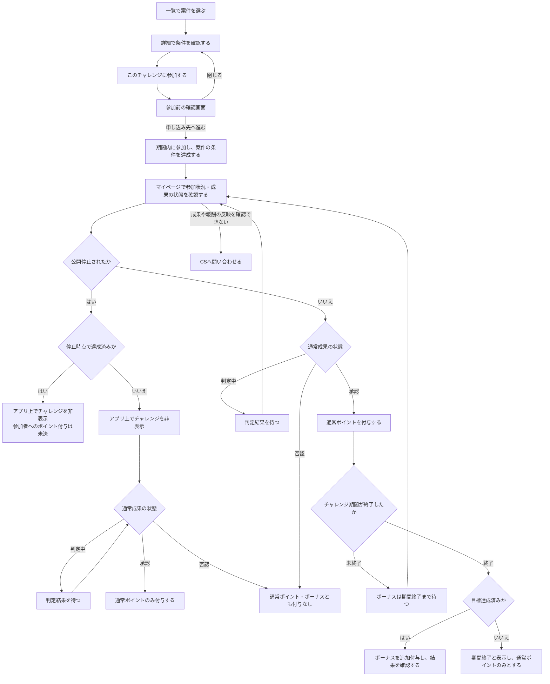

# F06｜チャレンジボーナス PRD

チャレンジボーナスと本書に記載する運営設定をTier1の開発対象とする。未決事項・モック未反映の内容は本文に記載する。

| レビュー状況 | 内容 |
| --- | --- |
| モックレビュー | 完了（2026-10-20ユーザー共有） |
| PRDレビュー | 担当者レビュー完了（2026-10-20ユーザー確認）。相互レビュー指摘の修正確認待ち・最終未合意 |
| 版 | レビュー前（初版未確定） |
| 優先順位 | Tier1 |
| 共有メモ | 2 → C |

更新日：2026-10-23。見た目は現行モックと[デザイン部品集](../../../mock-app/design-system/app-theme/library.html)を参照する。

## ① 目的・対象

目的：運営が、参加を増やしたいアフィリエイト案件にボーナスを設定し、ユーザーの参加を促進するため。

チャレンジボーナスは、その目的のための運用手段である。運営が対象案件・期間・目標・ボーナス額を設定し、ユーザーには「目標を達成すると通常報酬に加えてボーナスを獲得できる」という参加の動機を提供する。

- 会員・ゲストとも、対象条件を満たすチャレンジボーナス付き案件に参加でき、通常報酬・ボーナスの対象となる。アプリの会員登録・SMS認証は参加・報酬獲得の必須条件にしない。各案件の獲得条件・対象外条件と、ボーナスの達成・付与条件はどちらにも適用する。

## ② 表示・操作

確認先：[全件一覧](http://localhost:4189/mock-app/#offers-list/challenge)／[進行中の詳細](http://localhost:4189/mock-app/#offer/marche)／[目標達成済みの詳細](http://localhost:4189/mock-app/#offer/sec)。

### 一覧

ユーザーが参加する案件を選べるよう、得られる報酬だけでなく、目標への進み具合と参加できる残り期間を示す。

| 画面・要素 | 表示内容 | 操作・遷移先 |
| --- | --- | --- |
| 案件カード | 案件名・通常報酬・達成ボーナス・参加人数・ボーナス達成目標人数・残り期間。目標達成前と達成後を区別する | 押すと該当案件の詳細へ進む |
| お得の掲載枠 | 最大4件のチャレンジを表示する | 各案件カードから詳細へ進む |
| すべてのチャレンジを見る | 配信中のチャレンジが5件以上の場合だけ表示する | 専用の全件一覧へ進む。ホームのタブには移動しない |
| 全件一覧 | 配信中のチャレンジを掲載順で全件表示し、固定件数で切らない | 各案件カードから詳細へ進む |
| 全件一覧のヘッダー | 戻るボタンと「チャレンジボーナス」のタイトルのみ。上部タブ・バナー・重複した見出しは表示しない | 戻ると元の画面・スクロール位置へ戻る。直接URLで開いた場合は、お得のおすすめへ戻る |

### 詳細・ヘルプ

合計ポイントが無条件でもらえると誤解しないよう、通常報酬と達成ボーナスを分け、獲得条件を参加前に確認できるようにする。

| 画面・要素 | 表示内容 | 操作・遷移先 |
| --- | --- | --- |
| 報酬・獲得条件 | 通常報酬・達成ボーナス・合計ポイントと、獲得条件・付与目安。定額案件の合計は「通常報酬＋達成ボーナス」 | 参加前に内容を確認する。閲覧だけでは参加人数・成果・ポイントは変わらない |
| このチャレンジに参加する | 案件への参加ボタン | 通常案件と同じ参加前の確認画面へ進む。別途、事前エントリーは不要 |
| チャレンジボーナスとは | チャレンジの説明・付与ルールを確認するリンク | ヘルプをアプリ内のブラウザで開き、閉じると元の画面へ戻る。閲覧だけでは参加人数・成果・ポイントは変わらない |
| ヘルプ内の付与ルール | 公開停止されていないチャレンジの付与条件・時期を説明する。ボーナスは期間終了・成功と通常成果の承認が揃った時点で付与する。通常ポイントが先に付与された場合は、期間終了・成功時に追加で付与する | ヘルプを閉じて元の画面へ戻る。公開停止時の扱いは④に従い、達成済みで停止した場合の付与を確約しない |

## ③ 参加からボーナス確認まで

申し込み先への移動・トラッキング許可の案内は[F04](F04-offer-entry.md)に従う。マイページで参加案件のステータスを確認でき、未反映の場合はCS（カスタマーサポート）へ問い合わせる。成果の状態表示は[F05](F05-my-offers.md)と整合させる。ボーナスの付与時期は④に従う。

チャレンジ期間終了前は、マイページで自分がチャレンジボーナスに参加しているかを確認できるようにする。「チャレンジボーナス参加中」などの参加状況を表示し、ボーナスの付与予定・確定を示す表示とは区別する。通常成果の判定中・承認・否認とは別の状態として扱う。

## ④ 条件とルール

### 参加人数の集計と表示

| 項目 | 定義・用途 | 設定・更新と表示 |
| --- | --- | --- |
| ボーナス達成目標人数 | チャレンジボーナスの達成判定に使う人数の基準。参加人数がこの人数以上になると達成とする | 公開前に設定し、公開中は変更しない。一覧・詳細で参加人数とともに表示する |
| 参加人数 | チャレンジに参加した人数の実績。成果件数ではなく人数として集計し、目標との比較・達成判定に使う | 実際の参加状況を更新して一覧・詳細へ表示する。ASPから返された承認・否認・重複などの成果状態も連携し、訂正を反映する。一度達成した後の人数減少の扱いは「達成表示・掲載」に従う |

### 達成・ボーナス付与の条件

通常ポイントは各ユーザーの案件成果に対する報酬、ボーナスはチャレンジ全体の目標達成を条件とする追加報酬として分ける。このため、目標未達成でも承認された成果の通常ポイントは付与する。次の表は公開停止されていないチャレンジの条件とし、停止した場合は後述の「公開停止時の扱い」に従う。

| 条件 | 通常ポイント | ボーナスポイント |
| --- | --- | --- |
| 期間内に参加し、通常成果が承認され、チャレンジが成功して終了した | 付与する | 付与する。目標達成前・達成後の参加を問わず、期間終了後に承認された人も対象とする |
| 期間内に参加して通常成果が承認され、チャレンジ期間がまだ終了していない | 付与する | まだ付与しない。目標達成済みでも期間終了を待つ |
| 期間内に参加して通常成果が承認されたが、目標未達成で期間が終了した | 付与する | 付与しない |
| 通常成果が判定中 | まだ付与しない | チャレンジが成功していてもまだ付与しない |
| 通常成果が否認された | 付与しない | 付与しない |

運営による掲載終了は新規参加の受付を終了する操作であり、期間内に参加済みのユーザーの報酬対象条件は変更しない。下記の公開停止とは区別する。

### 公開停止時の扱い

停止したチャレンジはアプリ上で非表示となる。一律に失敗扱いとはせず、停止時点の状態に応じて扱う。

| 停止時点の状態 | ポイント付与・対応 |
| --- | --- |
| チャレンジ達成済み | 参加した人へのポイント付与可否・方法は未決。申し送り事項として残す |
| チャレンジ未達成で、参加した人がいる | 通常成果が承認された場合の通常ポイントのみを付与する。ボーナスは付与しない |
| チャレンジに参加した人がいない | ポイント付与などの対応なし |

### 達成表示・掲載

- 参加人数がボーナス達成目標人数以上になると「達成」となる。達成しただけでは個々のユーザーにボーナスを付与しない。
- 目標達成後に成果の否認・重複の除外などで参加人数が目標を下回っても、チャレンジ全体を失敗には戻さず、達成済みの扱いを維持する。チャレンジ全体の達成と個人の成果承認を分け、対象条件を満たし、通常成果が承認された人にだけボーナスを付与する。否認された人には付与しない。公開停止された場合は「公開停止時の扱い」を優先する。
- 目標達成後も、掲載期間内で運営が掲載終了・公開停止していない間は案件を表示する。

### 終了時の表示

目標未達成で期間が終了した場合、ユーザー向けには「失敗」ではなく「期間終了」と表示する。公開停止したチャレンジは非表示とし、「期間終了」の表示で代替しない。

### 付与時期

以下は公開停止されていないチャレンジに適用する。期間中の達成表示だけでボーナスを先に付与せず、チャレンジ期間の終了・成功と、通常成果の承認による通常ポイント付与の両方が揃った時点で付与する。通常ポイントはチャレンジ期間の終了を待たずに付与する。

通常ポイント付与時にチャレンジ期間が終了・成功していれば、通常ポイントと同時にボーナスを付与する。通常ポイントが先に付与された場合は、チャレンジ期間の終了時に成功していれば追加で付与する。チャレンジが成功せずに終了した、または通常成果が否認された場合は、ボーナスを付与しない。途中で公開停止された場合は「公開停止時の扱い」に従う。

いずれもボーナス対象条件を満たす人への付与とし、同じ成果にボーナスを重ねて付与しない。運営による掲載終了とチャレンジ期間の終了は区別する。

## ⑤ 運営の設定

> 相互レビュー指摘の修正確認待ち。

確認先：[アフィリエイト管理システムの管理モック](http://localhost:4189/mock-nacs/#challenges)。

運営は公開前に条件を決め、公開中は目標・期間・ボーナス額を固定する。これにより、参加者が確認した条件を途中で変更しない。掲載を終了する操作は、参加済みの人の報酬条件を変更する操作とは分ける。

### 一覧画面

| 要素 | 表示内容 | 操作時の振る舞い |
| --- | --- | --- |
| 登録済みチャレンジ | 管理名・開催期間・公開／停止の状態。未登録の場合は登録がないことを表示する | 一覧で登録状況を確認する |
| 新規登録 | チャレンジを追加する入口 | 新規作成画面へ進む |
| 編集 | 各チャレンジの編集ボタン | 選択したチャレンジの編集画面へ進む |

### 新規作成画面

| 要素 | 表示・入力内容 | 操作時の振る舞い |
| --- | --- | --- |
| 管理名 | チャレンジを識別する名称 | 入力した名称を保存する |
| 対象案件 | チャレンジを設定する案件 | 案件を選択し、チャレンジに紐づける |
| 開始日・終了日 | チャレンジの開催期間 | 期間を設定する |
| ボーナス達成目標人数 | 達成判定に用いる人数 | 目標人数を設定する。参加人数の実績は手入力しない |
| 達成ボーナス | 達成時に付与するボーナスポイント | 対象案件のチャレンジボーナス額を設定する |
| 公開状態 | 公開／停止 | 保存時に選択した状態を反映する |
| 保存して反映 | 入力した設定の保存 | 必須項目・入力値に問題がなければ登録する。問題があれば保存せず、修正箇所を案内する |

### 編集画面

| 要素 | 表示・入力内容 | 操作時の振る舞い |
| --- | --- | --- |
| 管理名・対象案件 | 保存済みの名称・対象案件 | 設定内容を確認・編集する |
| 開始日・終了日・ボーナス達成目標人数・達成ボーナス | 保存済みのチャレンジ条件 | 公開前は編集可能。公開中は変更できない |
| 通常ポイント | 対象案件の通常報酬 | 参照のみ。チャレンジ設定では通常報酬を変更しない |
| 通常ポイント・案件詳細を編集 | 対象案件の編集への入口 | 対象案件の編集画面へ進み、通常報酬・案件本文を編集する |
| アプリで確認 | 対象案件の確認用リンク | アプリの対象案件詳細を開く |
| 公開状態 | 保存済みの公開／停止の状態 | 停止して保存するとチャレンジをアプリ上で非表示にする。参加者へのポイント付与は④の「公開停止時の扱い」に従う |
| 保存して反映 | 変更した設定の保存 | 変更可能な項目を保存し、反映する。入力に問題があれば保存せず、修正箇所を案内する |

### 新規作成・編集の可否

○＝設定・変更できる、×＝この画面では設定・変更できない。

| 操作 | 管理名 | 対象案件 | 開始日・終了日 | 目標人数 | 達成ボーナス | 公開状態 | 参加人数の実績 | 通常報酬・案件本文 |
| --- | --- | --- | --- | --- | --- | --- | --- | --- |
| 新規作成 | ○ | ○ | ○ | ○ | ○ | ○ | × | × |
| 編集（公開前） | ○ | ○ | ○ | ○ | ○ | ○ | × | × |
| 編集（公開中） | ○ | ○ | × | × | × | ○ | × | × |

通常報酬・案件本文は対象案件の編集画面で扱う。参加人数は実際の参加状況から集計する。公開後に停止した状態を、公開前とは扱わない。停止によって目標・期間・ボーナス額の変更を可能にする仕様は定義しない。

「掲載終了」は新規参加の受付を終了し、参加済みの人の報酬対象条件を維持する操作。「公開停止」はアプリ上でチャレンジを非表示にする操作で、付与の扱いは停止時点の達成状況・参加者の有無によって分ける。

### 強調案件・ボタン文言の設定

F06-6／ADM-F04-2（Tier1）として、運営が強調する案件とボタン文言を設定・変更・解除できるようにする。管理画面・アプリ表示は未実装。表示位置・押下時の動作・文字数上限・同時設定件数は未決とし、同じ施策として見積もりを二重計上しない。

## ⑥ 困ったときの対応

案件がない状態と一時的な表示失敗を区別し、ユーザーが次に何をすればよいか分かるようにする。報酬の反映を確認できない場合も、確認先と問い合わせ先を示す。

| パターン | 発生条件 | 表示内容 | ユーザーが取れる操作・結果 |
| --- | --- | --- | --- |
| 掲載案件なし | 一覧の取得には成功したが、掲載対象が0件 | 現在参加できるチャレンジがないことを案内する | 戻る操作で元の画面へ戻る。直接URLで開いた場合は、お得のおすすめへ戻る |
| 案件の取得失敗 | 通信などの問題で一覧・詳細を取得できない | 取得できなかったことを案内する。0件とは扱わない | 再試行で取得し直す。戻る操作で元の画面へ戻る |
| ヘルプの表示失敗 | ヘルプを開けない | 説明ページを表示できないことを案内する | 再試行で開き直す。閉じると元の画面へ戻る |
| 参加前確認の中断 | 参加前の確認画面を閉じる | 元の案件詳細を表示する | 条件を再確認して参加操作をやり直せる。閉じるだけでは報酬を確定しない |
| 申し込み先への移動失敗 | 申し込み先を開けない | F04のエラー案内に従う | 再試行・戻るなど、F04で定義する操作と復帰先に従う |
| 申し込み途中の掲載終了 | 閲覧・申し込み中に掲載期間が終了、または運営が掲載を終了する | 新規参加の受付が終了したことを案内する | 元の画面へ戻る。参加済みの場合はマイページで成果の状態を確認でき、④の報酬対象条件は維持する |
| 閲覧・申し込み中の公開停止 | 運営がチャレンジを停止する | チャレンジを非表示にし、現在利用できないことを案内する | 元の画面へ戻る。参加済みの場合のポイント付与は④に従う。達成済みで停止した場合の付与可否は確約しない |
| 成果・報酬の未反映 | 参加後、成果や通常ポイント・ボーナスの反映を確認できない | マイページで参加案件の状態と、④の付与条件・時期を確認する案内 | 状態を確認し、解消しない場合はCSへ問い合わせる。確認・問い合わせだけで報酬を確定しない |

## 申し送り事項

未決の条件・操作を以下に記録する。確定仕様ではない。

ヘルプの正式URL・内容はビジネス側で定義する。仮ページを正式な案内として扱わない。

SUR・定率案件・再参加の扱いは、現時点では対象に含めるかどうかを定義せず、後日ASPに確認します。

公開停止時にチャレンジ達成済みだった場合、参加した人へのポイント付与可否・方法は未決。

## モック未反映

今回の変更はPRDのみ。既存モックのレビュー完了は、以下の新しいレビュー内容の反映完了を意味しない。

| 項目 | モック未反映の内容 |
| --- | --- |
| 対象・付与条件 | 会員・ゲスト共通の対象条件、期間内参加・終了後承認と未達成時の扱いを一連の動作として反映・確認する必要がある。SUR・定率案件・再参加の採否は未定義であり、モックの制限を確定仕様とは扱わない。 |
| 人数・達成状態 | 目標人数と参加人数の区別、成果状態の訂正後も達成済みの扱いを維持するルールは未反映。 |
| 運営の設定 | 公開中の目標・期間・ボーナス額の変更禁止、掲載終了と公開停止の区別、停止時点の状態に応じた付与条件は未反映。達成済みで停止した場合の付与可否・方法は未決。 |
| 終了・停止時の表示 | 未達成で期間が終了した場合は「期間終了」と表示し、公開停止したチャレンジは非表示にする対応を揃える必要がある。 |
| 状態確認・例外対応 | マイページでのチャレンジ参加状況の表示と、確認からCS問い合わせまでの案内、0件・取得失敗・ヘルプ表示失敗・申し込み途中の掲載終了を区別する対応は未反映。 |

チャレンジ期間の終了・成功と通常ポイント付与の両方が揃った時点でのボーナス付与、達成前後を問わない対象条件はモック未反映。現行モックの仮の付与処理を確定仕様にしない。

### 変更履歴

初版未確定。今回のPRDレビューが完了した時点を第1版とする。

※引き継ぎ案の参照：[10/19 15:19](https://docs.google.com/document/d/1PXj0KrXTcYsVmOwxJ3abgr6EeseirGgHkhdbsRtfQ7o/edit)／[10/19 08:23](https://docs.google.com/document/d/1tve5mNDjj--U-TokFs9mGxPNLrj36Mexlw_-TVZzE18/edit)。
