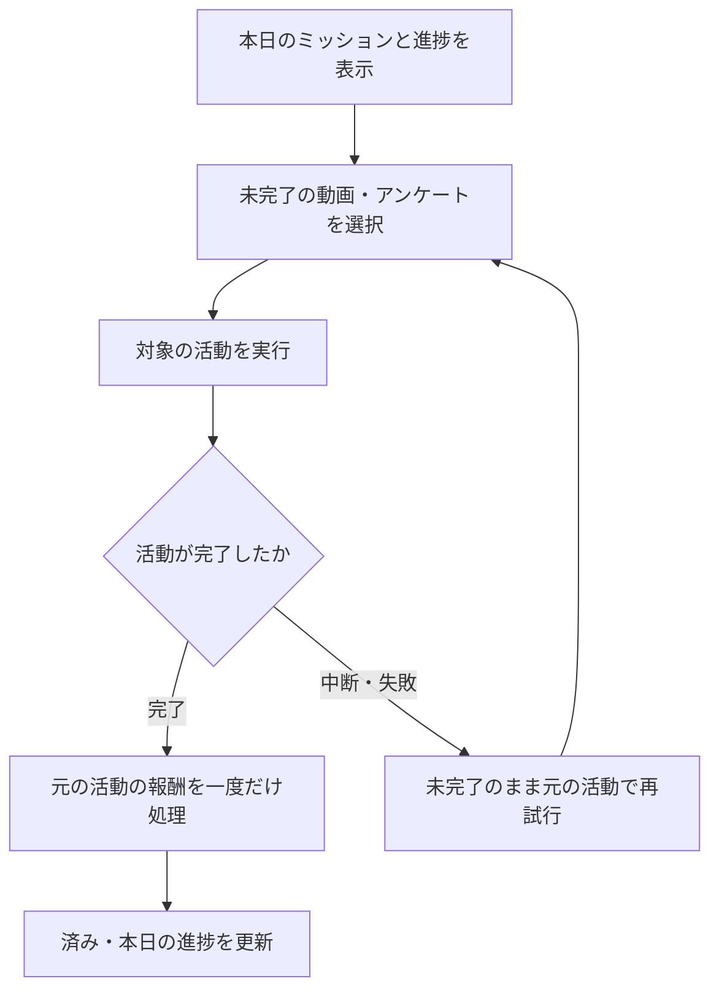

# F07｜デイリーミッション PRD（レビュー前）

> ④業務ルールと⑦以降はユーザーレビュー未完了。機能・画面・操作は現在の4189モックを正とし、優先順位はスプレッドシートを正とする。本PRDはTier1のみを定義する。

参照するモック：`Tameruko-Preview-20261013` の4189（2026-10-15確認）。未接続の外部API・実端末機能は、接続済みとして扱わず末尾に記載する。

| 基本情報 | 内容 |
| --- | --- |
| 機能ID | F07 |
| 概要 | デイリーミッション |
| 対象領域 | アプリ／管理画面／外部連携 |
| 関連機能 | [F09](F09-rewarded-video.md)、[F10](F10-surveys.md) |
| 更新日 | 2026-10-15 |
| 版 | レビュー前（初版未確定） |

## ① 目的・今回作る範囲

目的：毎日の動画・アンケート等の利用を促し、継続利用につなげるため

評価指標：ミッション表示数/対象活動への遷移率/活動完了率/翌日以降の継続率

優先順位は[アプリ詳細要件のTier列](https://docs.google.com/spreadsheets/d/1g00ZxLGprVNT4T4uSmzw--vRpp95HQ1Uq9i8GnJpmS4/edit#gid=1107057215)を正とする。モックに存在してもTier2・Tier3・空欄の要件は本PRDの定義対象に含めない。

| 要件ID | Tier1の範囲 |
| --- | --- |
| F07-1 | 当日の共通ミッションと達成状況を確認できる |
| F07-2 | ミッションからタスクに設定したポイント獲得の活動を実行できる |
| F07-3 | 持ち出しのタスクは動画リワード広告を見たら受け取れるようにする |
| F07-4 | 登録された共通ミッションを現在の一覧形式で確認できる（先頭最大5件・もっと見るなし） |
| F07-5 | 運営が共通タスクと日次更新ルールを設定できる |
| F07-6 | 活動報酬を扱える（現モックでは独立の追加ボーナスを設けず、元の活動報酬のみ） |
| F07-7 | 初回ミッションの報酬完了を閉じた後に通知・ATTの許諾案内を確認できる |
| F07-9 | ミッション経由の活動報酬を一度だけ受け取れ、完了を一覧へ反映できる（追加の受取操作なし） |

管理側は[管理画面詳細要件のTier列](https://docs.google.com/spreadsheets/d/1g00ZxLGprVNT4T4uSmzw--vRpp95HQ1Uq9i8GnJpmS4/edit#gid=1341040600)にある以下のTier1を関連範囲とする。NACS本体の内製要件にはしない。

| 要件ID | Tier1の運用範囲 |
| --- | --- |
| ADM-F05-1 | 運営担当者がホームのデイリーミッションの文言・遷移先・表示順を設定できる |
| ADM-F05-2 | 運営担当者がホームのデイリーミッション項目を追加・削除できる |
| ADM-F05-6 | 運営担当者が持ち出しタスクの報酬受取に動画視聴を必要とする条件を設定できる |
| ADM-F05-7 | ミッション報酬を扱える（現モックでは独立ボーナスの条件・報酬入力は設けない） |

要件名に旧モックとの相違がある場合、優先順位は維持し、現在の表示・動きとユーザー指定を②以降へ反映する。実装方式の具体化は仕様設計で扱う。

## ② 画面イメージ

[アプリの該当画面](http://127.0.0.1:4189/mock-app/#home/daily)

- 本日の進捗をプログレスバーで表示し、動画・アンケートのミッション名・報酬・達成状態を1行にまとめる。
- 共通設定の有効なミッションを先頭から最大5件表示する。「もっと見る」は置かない。
- ミッションから対象の動画・アンケートへ進む。活動が完了すると済みになり、同じ活動への追加のミッション報酬・追加の受取操作は設けない。

## ③ 操作フロー

## ④ 業務ルール・制約

> ユーザーレビュー未完了。アプリ上の表示に関わるルールを記載する。

### 表示する対象ユーザー

| 対象ユーザー | 利用・表示 |
| --- | --- |
| 会員 | 全員共通の本日のミッションを表示する |
| 非会員（ゲスト） | 全員共通の本日のミッションを表示する |

### 表示条件

| 状態・条件 | 表示のルール |
| --- | --- |
| 有効な共通ミッション | 設定された順で先頭から最大5件を表示する |
| 未完了 | 対象の活動へ進む入口を表示する |
| 活動完了後 | ミッションを済みとし、本日の進捗を更新する |

### 画面に置く要素・操作

| 画面・要素 | 表示・操作のルール |
| --- | --- |
| 本日の進捗バー | 対象ミッションの完了状況を表示する |
| ミッション行 | ミッション名・活動報酬・達成状態を1行にまとめる |
| 動画・アンケートへの入口 | 選択した対象の活動を開始する |

## ⑤ 管理画面

新規作成・変更・削除は、現在の管理画面で操作できる範囲を示す。「外部管理」はNACS・EDOCODE等の担当範囲、「未実装」は操作画面がない項目。削除と公開停止は分けて記載する。

[実行設定の管理画面](http://127.0.0.1:4189/mock-admin/legacy.html#missions)

| 対象項目 | 新規作成 | 変更 | 削除 | 管理画面での操作・反映範囲 |
| --- | --- | --- | --- | --- |
| 共通のアンケートミッション行 | 可能 | 可能 | 可能 | 現在の画面では既存のアンケートから追加し、タイトル・説明・リンク・有効状態・順序を変更する。 |
| 既存の動画ミッション行 | 不可 | 可能 | 可能 | 動画の追加専用UIはない。既存行の編集・上下移動・削除は可能。 |
| 利用者ごとのグループ配信 | 未実装 | 未実装 | 未実装 | 現在は全員共通の1グループ。旧グループデータは退避し、実行対象にしない。 |
| ミッション元の報酬額 | 対象外 | F09・F10で変更 | 対象外 | 活動元の報酬を使用する。現在のミッション編集画面に報酬の独立入力欄はない。 |

## ⑥ 例外処理・エラーハンドリング

| 状況 | 表示・処理・復帰 |
| --- | --- |
| 対象のアンケートがない | 回答可能な対象だけを表示する。存在しない回答先へ進めない。 |
| 動画中断・通信失敗 | 未完了のままにし、元の活動で再試行する。 |
| 同じ活動の完了・受取を繰り返す | 元の活動報酬を一度だけ処理する。独立したミッション報酬や追加の受取操作は設けない。 |

## ⑦ 達成条件・未決事項

> 本節以降はユーザーレビュー未完了。

### Tier1の達成条件

- [ ] F07-1：当日の共通ミッションと達成状況を確認できる。
- [ ] F07-2：ミッションからタスクに設定したポイント獲得の活動を実行できる。
- [ ] F07-3：持ち出しのタスクは動画リワード広告を見たら受け取れるようにする。
- [ ] F07-4：登録された共通ミッションを現在の一覧形式で確認できる（先頭最大5件・もっと見るなし）。
- [ ] F07-5：運営が共通タスクと日次更新ルールを設定できる。
- [ ] F07-6：活動報酬を扱える（現モックでは独立の追加ボーナスを設けず、元の活動報酬のみ）。
- [ ] F07-7：初回ミッションの報酬完了を閉じた後に通知・ATTの許諾案内を確認できる。
- [ ] F07-9：ミッション経由の活動報酬を一度だけ受け取れ、完了を一覧へ反映できる（追加の受取操作なし）。
- [ ] ①の管理側Tier1に対応する操作について、⑤の新規作成・変更・削除可否と反映範囲を確認できる。
- [ ] ⑥の対象となる空・失敗・中断などの状態から、表示内容と次の操作を確認できる。

### まだ決まっていないこと

なし。認証・API接続などの具体的な方法は、別途仕様設計で定める。

## モックへの未反映・対象外

### モックへの未反映

| 項目 | 未反映の内容 |
| --- | --- |
| 日次更新・活動連携 | 本番の日替わり更新と動画・アンケートの完了結果の反映は未接続 |
| 管理設定の同期 | 本番アプリへの共通ミッション設定の配信は未接続 |
| 動画行の再追加・復元 | 現在の管理画面に動画ミッションの新規追加・削除後の復元操作はない |

### 今回の対象外

| 項目 | 対象外の内容 |
| --- | --- |
| なし | — |

## 変更履歴

| 版 | 日付 | 変更内容 |
| --- | --- | --- |
| レビュー前 | 2026-10-15 | F10レビューの共通フィードバックを反映。⑤を管理画面へ変更し、④を対象ユーザー・表示条件・配置要素に整理。例外処理と仕様設計事項の重複を除き、未反映と対象外を別表に分離。個別レビューは未完了。 |
