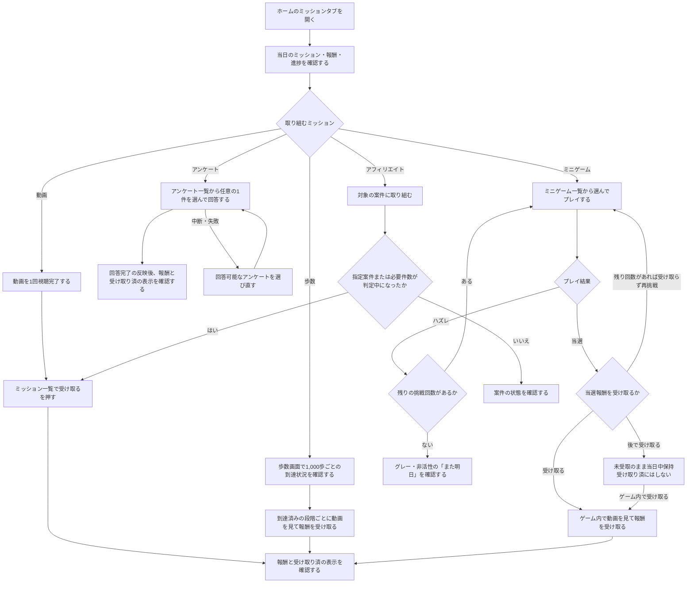

# F07｜デイリーミッション PRD（レビュー前）

今回の動画導線・アンケートの達成／受取ルールは、2026-10-23のユーザー確認に基づく。[2026-10-22の議事録](https://docs.google.com/document/d/1oCU_tK4lcAvC-Yp-RZAAZ26Cg6E-vUGR7DfAfcYuLpI/edit)の関連箇所は00:53:12〜00:55:32、01:13:25、01:21:53。

| 基本情報 | 内容 |
| --- | --- |
| 機能ID | F07 |
| 概要 | デイリーミッション |
| 対象領域 | アプリ／管理画面／外部連携 |
| 関連機能 | [F05](F05-my-offers.md)、[F08](F08-walking.md)、[F09](F09-rewarded-video.md)、[F10](F10-surveys.md)、[F11](F11-mini-games.md) |
| 更新日 | 2026-10-23 |
| 版 | レビュー前（初版未確定） |

## ① 目的・今回作る範囲

目的：毎日のルーティンと期間限定のお仕事を分けて案内し、継続利用と対象案件の利用につなげるため

評価指標：ミッション表示数/対象活動への遷移率/活動完了率/翌日以降の継続率

対象は[アプリ詳細要件](https://docs.google.com/spreadsheets/d/1tI26I_4vbSHIOzMdJz7g8-DjeLyyVUKoksVHhZ0AQhU/edit#gid=1107057215)のTier1とする。

| 要件ID | Tier1の範囲 |
| --- | --- |
| F07-1 | 当日のミッションと達成状況を確認できる |
| F07-2 | カテゴリーごとの活動条件に従ってミッションを達成できる |
| F07-3 | デイリー・期間限定の各区分で有効なミッションを最大5件確認できる |
| F07-4 | 毎日の進捗・受取状態を日次更新し、期間限定ミッションの記録を掲載期間中保持できる |
| F07-5 | 動画・アンケート・歩数・ミニゲームは活動報酬のみ、アフィリエイトは追加のミッション報酬を受け取れる |
| F07-6 | 初回ミッションの報酬完了を閉じた後に通知・ATTの許諾案内を確認できる |
| F07-8 | アンケートは回答完了通知、歩数・ミニゲームは活動元の受取結果で受取済となり、動画・アフィリエイトは一覧で受け取れる |
| F07-9 | アンケート案件の最大報酬を確認できる。当日初回のAPI取得を想定（取得方法は要相談） |

管理側の対象は[管理画面詳細要件](https://docs.google.com/spreadsheets/d/1tI26I_4vbSHIOzMdJz7g8-DjeLyyVUKoksVHhZ0AQhU/edit#gid=1341040600)の以下のTier1とする。

| 要件ID | Tier1の運用範囲 |
| --- | --- |
| ADM-F05-1 | 運営担当者がミッション一覧で表示順・停止・配信再開を設定できる |
| ADM-F05-2 | 運営担当者が毎日・期間限定ミッションをカテゴリー別に登録・編集・削除できる |
| ADM-F05-5 | 運営担当者がカテゴリー別の活動条件と、アフィリエイトの追加ミッション報酬を設定できる |

## ② 画面イメージ

ミッションの操作は現行アプリの専用コンパクト寸法（高さ30px・文字13px）を維持する。通常ボタンの大・中・小とは区別し、部品集も同じ寸法を使用する。ミッション内の現行16pxの余白は、共通カードの12pxとは区別して維持する。

ホーム上部のタブ名は「ミッション」とする。枠内の「デイリーミッション」「期間限定ミッション」の区分名は変更しない。

- ユーザー画面は1つの共通枠に「デイリーミッション」「期間限定ミッション」をまとめ、見出しと区切り線で区分する。各区分にミッション名・報酬・達成状態を表示する。進捗バーと達成件数はデイリー区分のみに表示する。
- 「デイリーミッション」には毎日繰り返せる動画・歩数・ミニゲーム・アンケートを表示する。「期間限定ミッション」には掲載開始日・終了日を設定したアフィリエイト・アンケートを表示し、各行に終了日を表示する。
- 各区分で有効なミッションを先頭から最大5件表示する。

## ③ 操作フロー

アンケート・歩数・ミニゲームは他の入口から活動しても同じ扱いとする。既に「受け取る」が表示されているミッションは受取操作へ進める。ミニゲームは報酬を受け取らず、残り回数があれば再挑戦することもできる。「受け取り済」のミッションは状態を確認する。

## ④ 業務ルール・制約

### 表示する対象ユーザー

| 対象ユーザー | 利用・表示 |
| --- | --- |
| 会員 | 全員共通の本日のミッションを表示する |
| 非会員（ゲスト） | 全員共通の本日のミッションを表示する |

### 表示条件

#### ミッションの種類と表示期間

| 種類 | 表示 | 進捗・受取状態 |
| --- | --- | --- |
| 毎日繰り返す | デイリーミッション区分に、設定順で先頭最大5件 | 日本時間0時に日次更新 |
| 期間限定 | 掲載開始日〜終了日（両日を含む）に、期間限定ミッション区分へ設定順で先頭最大5件 | 期間中は日付をまたいで進捗・未受取・受取済みを保持 |

期間限定ミッションは、掲載期間前・終了後には表示せず、報酬も受け取れない。

#### 状態ごとの表示

| 状態 | 表示 |
| --- | --- |
| 未達成 | 対象の活動へ進む入口 |
| 達成済み・未受取（動画・アフィリエイト） | 「受け取る」。ミッション一覧で受け取る |
| 活動元で受取可能（歩数・ミニゲーム） | 同じ「受け取る」CTA。活動元の画面へ進む |
| 受け取れずに終了したミニゲーム | 「また明日」をグレー・非活性で表示する。達成件数に含めない |
| 受取済み | 「受け取り済」 |

#### カテゴリー別の状態更新

| カテゴリー | 達成を反映するタイミング | 受け取り済みを反映するタイミング |
| --- | --- | --- |
| 動画 | 対象の1回の視聴完了時 | 一覧から報酬を受け取ったとき |
| アンケート | 任意の1件の回答完了通知を受信したとき | 同通知の受信時。ミッション側の受取操作は不要 |
| 歩数 | F08の1,000歩ごとの段階に到達したとき | F08で対象段階の動画視聴・報酬受取が完了したとき |
| ミニゲーム | 対象ゲームで当選したとき。途中のハズレは未達成を維持し、残り回数があれば再挑戦できる | F11で当選報酬の動画視聴・受取が完了したとき。当選だけでは「受け取り済」にしない。すべてハズレなど、受取可能な報酬も残り回数もなく終了した場合は「また明日」 |
| アフィリエイト | 指定案件または必要件数の案件が掲載期間内に「判定中」になったとき | 一覧からミッション報酬を受け取ったとき |

歩数・ミニゲームの活動元で受取可能な場合も、動画・アフィリエイトと同じ「受け取る」CTAを使用し、活動元へ進む。フォント・ボタン形状は既存の共通部品に揃える。

達成時に進捗を更新する。歩数の到達と報酬受取は区別し、受取前に「受け取り済」にしない。ミニゲームはゲーム内で実際に当選報酬を受け取った時に初めて「受け取り済」とする。当選報酬を受け取らずに再挑戦した場合は、古い当選結果を受取済として扱わない。途中のハズレでは再挑戦でき、受取可能な報酬も残り回数もなく終了した場合は「また明日」とする。同じ報酬を再付与しない。

### カテゴリー別の達成条件と報酬

| カテゴリー | 達成条件 | 受け取る報酬 |
| --- | --- | --- |
| 動画 | 選んだ動画ミッションで動画を1回視聴完了する | ミッション経由で保留した活動報酬を一覧から受け取る |
| アンケート | 毎日：当日の任意の1件の回答完了通知を受信。期間限定：掲載期間内の任意の1件の回答完了通知を受信 | F10のアンケート本来の活動報酬のみ。ミッション側では保留・追加付与・受取操作を行わない |
| ミニゲーム | 対象のミニゲームで当選する | F11の活動報酬のみ。報酬はゲーム内で動画視聴後に受け取り、受取完了後だけ「受け取り済」と表示する。受取前は再挑戦でき、受取可能な報酬も残り回数もなく終了した場合は「また明日」とする |
| 歩数 | F08の1,000歩ごとの段階に到達する（最大10,000歩） | F08の活動報酬のみ。1,000歩ごとの到達済み段階について、動画視聴・報酬受取完了後に「受け取り済」を反映する |
| アフィリエイト・指定案件 | 運営が指定した案件が掲載期間内に「判定中」になる | 設定したミッション報酬 |
| アフィリエイト・件数 | 掲載期間内に「判定中」になった異なる案件が設定件数に達する | 設定したミッション報酬 |

**カテゴリー別の補足**

- 動画・歩数：1回分の活動・達成ごとに別ミッションとする。動画は1再生、歩数はF08の1,000歩ごとの段階への到達で達成し、報酬受取はF08の動画視聴条件に従う。
- 動画：入口はデイリーミッションに一本化する。元の活動報酬と二重付与せず、追加ボーナスは設けない。
- アンケート：毎日・期間限定の両方で設定できる。入口や回答先を指定せず、任意の1件の回答完了通知で達成・受け取り済みにする。アンケート本来の報酬はF10で扱い、同じ回答報酬を両区分で二重付与しない。
- アフィリエイト・指定案件：期間限定ミッションとして設定する。閲覧・クリック・挑戦中のみでは達成せず、案件本来の報酬の承認は待たない。
- アフィリエイト・件数：同じ案件の重複成果・同じ通知の再送を複数件として数えない。

**進捗・受取の共通ルール**

- 達成・受取はユーザー別に管理する。アンケート・歩数・ミニゲームの達成にミッション経由を必須としない。活動元で報酬を扱い、ミッション側では保留・追加付与・受取操作を行わない。
- 毎日ミッションは日別、期間限定ミッションはミッション別に一度だけ受け取れる。
- 期間限定では掲載期間前の成果を含めず、期間内の異なる日の成果を合算する。
- アフィリエイトの「判定中」になった記録は、後続の承認で失わない。通常報酬とミッション報酬は別の付与として扱う。

#### 歩数段階とミッションの対応

| 項目 | ルール |
| --- | --- |
| 段階 | F08に合わせ、1,000〜10,000歩を1,000歩ごとの10段階として固定する |
| 設定 | 管理画面で各歩数ミッションの対象段階を1つ選択する。同じ段階は重複登録できない |
| 表示順・削除 | 対象段階を表示順とは別に保持する。並べ替えや他の行の削除・再追加で、残した行の対象段階を変更しない |
| 再追加 | 削除した段階を再び選択できる。別の行の段階へ自動的に置き換えない |
| 表示枠 | 登録できる10段階とアプリに表示する最大5件の枠を分けて管理する。表示は他カテゴリーを含めた配信順に従う |
| 受取反映 | 指定段階の到達とF08での報酬受取完了を反映し、別の段階の受取で受取済にしない |

### アンケートの表示ポイント取得（要相談）

以下は想定する動作。APIによる取得方法・取得タイミング・当日中の保持方法・取得失敗時の再試行は、F10（アンケート）の仕様と合わせて相談し、確定する。

| 項目 | 想定する動作（要相談） |
| --- | --- |
| 取得タイミング | 日本時間の当日、初めてミッション画面を開いた際にAPIから回答可能なアンケート案件を取得する |
| 表示額 | 取得した案件のユーザー向け報酬額のうち最大の数値を「pt（最大）」で表示する。ミッションの追加報酬ではない |
| 当日中の再表示 | 取得結果を当日分として保持し、再描画・画面再訪・再読み込みでは再取得しない。翌日は初回表示時に取得する |
| 取得中・失敗・案件なし | 取得中は「取得中」、失敗時は「取得できません」を表示し、未取得の数字を確定表示しない。案件なしは0pt（最大）とする |

### 報酬額と表示名称

| カテゴリー | 報酬額・名称 |
| --- | --- |
| 動画 | 1再生10pt |
| アンケート | 回答可能案件の最大報酬額を「pt（最大）」で表示。取得は当日初回のAPI呼び出しを想定するが、取得方法は要相談。実付与額は回答した案件の報酬額とする |
| ミニゲーム | サイコロは50pt（最大）。ミッション名は管理画面で設定した名称を保持する |
| 歩数 | 1,000歩ごとの到達済み段階につき、動画視聴後に10ptを受け取る |

報酬表示は活動元の設定と一致させる。動画・アンケート・歩数・ミニゲームには追加ミッション報酬を設けない。

### 画面に置く要素・操作

| 画面・要素 | 表示・操作のルール |
| --- | --- |
| 進捗バー | デイリー区分のみに「今日の進捗」とバー・達成件数を表示する。表示対象が1件以上あり全件達成したときはバーを虹色にし「達成！」と表示する。期間限定区分には進捗エリアを表示しない |
| ミッション行 | ミッション名・報酬・達成状態を1行にまとめる。アンケート・ミニゲームの報酬は最大額を「pt（最大）」で表示する。ミッション名は管理画面で設定した名称を表示し、特定の名称へ自動変換しない。アンケート・歩数・ミニゲームの報酬は活動報酬を示し、ミッションの追加報酬として表示しない |
| 活動への入口 | 動画は再生、アンケートはアンケート一覧、ミニゲームはミニゲーム一覧、歩数は歩数画面、アフィリエイトは案件詳細または案件一覧へ進む |

## ⑤ 管理画面

ミッションの登録・編集・停止・再開は自社管理画面で行う。アフィリエイトの案件情報・成果ステータスはEDOCODE社のアフィリエイト管理システム（ACS）から連携し、元の活動報酬の設定はF08〜F11で扱う。

### 操作できる範囲

| 対象項目 | 新規作成 | 変更 | 削除 |
| --- | --- | --- | --- |
| 共通ミッション行 | 可能 | 可能 | 可能（編集画面） |
| 掲載期間 | 可能 | 可能 | 行と同時に削除 |
| 停止期間 | 可能 | 可能 | 両日付を空欄にして解除 |
| 達成条件 | 可能 | 可能 | 行と同時に削除 |
| アフィリエイトのミッション報酬 | 可能 | 可能 | 行と同時に削除 |
| 動画・アンケート・歩数・ミニゲーム元の報酬額 | 対象外 | F09・F10・F08・F11で変更 | 対象外 |

### 画面ごとの操作

| 画面 | 表示・操作 |
| --- | --- |
| ミッション一覧（入口） | 登録済みミッションの種類・カテゴリー・掲載期間・配信状態を表示。停止・配信再開・表示順変更を操作する |
| 新規登録画面 | 一覧の「新規登録」から開く。種類（毎日繰り返す／期間限定）・カテゴリー・タイトル・説明・掲載／停止期間・カテゴリー別の達成条件・報酬を入力し、「登録する」で保存する。「キャンセル」で一覧へ戻る |
| 編集画面 | 各行の「編集」から開く。登録済みの内容を表示し、変更可能な項目を修正して「変更を保存」で保存する。「このミッションを削除」で削除し、「キャンセル」で一覧へ戻る。一覧で設定した停止状態は維持する |

### 設定項目と反映ルール

#### 掲載・停止期間

| 項目 | 入力・対象 | 反映ルール |
| --- | --- | --- |
| 掲載期間 | 期間限定は開始日・終了日が必須で変更可能。毎日は入力欄なし | 掲載期間内に表示する |
| 停止期間 | 両種類で開始日・終了日を任意設定。一覧にも表示 | 日本時間の開始日0時〜終了日末は非表示・受取不可 |
| 停止終了 | 設定した停止期間の終了翌日 | 自動再開。ただし手動停止中・掲載期間外は再開しない |
| 停止期間の解除 | 開始日・終了日を両方空欄にする | 停止期間を解除する |
| 入力エラー | 片側のみ・不正な日付・開始日と終了日の逆転 | 保存しない |
| 停止中の記録 | 達成・受取記録 | 削除せず、毎日／期間限定それぞれの更新ルールを維持する |

#### 達成条件・遷移先

| カテゴリー | F07で扱う条件・設定 |
| --- | --- |
| 動画 | 1ミッションにつき1回の視聴完了。複数回分は別ミッションにする。入口はデイリーミッションへ一本化 |
| アンケート | 任意の1件の回答完了。指定アンケート・複数件の条件は設定しない |
| 歩数 | 固定の1,000〜10,000歩の10段階から対象を1つ選択する。重複は登録できない。保存した段階を表示順・削除・再追加と独立して保持する。F07独自の任意歩数や報酬額は設定しない |
| ミニゲーム | 対象ゲームの当選を反映し、受取済への更新はゲーム内の報酬受取完了時とする。受取前は再挑戦でき、受取可能な報酬も残り回数もなく終了した場合は「また明日」 |
| アフィリエイト | 「指定案件」または「任意の案件を指定件数利用する」を選ぶ。指定案件では対象案件、件数条件では必要件数を設定する |
| 遷移先 | アンケートはアンケート一覧、ミニゲームはミニゲーム一覧へ進む。その他はカテゴリー・対象案件に応じて設定する |

#### 報酬

| カテゴリー | 報酬の管理元 | 受取・反映ルール |
| --- | --- | --- |
| 動画 | F09の活動報酬 | ミッション一覧で受け取る |
| アンケート | F10の活動報酬 | 回答完了通知で自動的に受け取り済みになる |
| 歩数 | F08の活動報酬 | 1,000歩ごとの到達済み段階を1段階ずつ、動画視聴後に受け取る。その結果をミッションへ反映する |
| ミニゲーム | F11の活動報酬 | 報酬はゲーム内で動画視聴後に受け取り、受取完了を反映して「受け取り済」とする。未受取の当選だけでは受取済にしない。受取可能な報酬も残り回数もなく終了した場合は「また明日」。追加付与なし |
| アフィリエイト | F07のミッション報酬 | 1〜99,999ptの整数を設定。達成時の金額を受取まで保持する |

動画・アンケート・歩数・ミニゲームには独立した追加ミッション報酬を設定しない。アンケート・歩数・ミニゲームの報酬はF07で保留せず、一覧での受取操作も設けない。歩数・ミニゲーム内の動画は、F09の単独動画の日次回数に含めない。

## ⑥ 例外処理・エラーハンドリング

| 状況 | 表示・処理・復帰 |
| --- | --- |
| アンケート最大額の取得中・失敗 | 想定：数字の代わりに「取得中」または「取得できません」を表示し、回答完了・受取済にはしない。取得・再試行方法は要相談 |
| 対象のアンケートがない | 回答可能な対象だけを表示する。存在しない回答先へ進めない。 |
| アンケートの回答中断・回答完了通知が未着 | 回答開始や画面から戻っただけでは達成にしない。回答完了通知の受信まで未完了のままとする |
| 歩数・ミニゲームの活動結果が未反映 | 条件達成を確認できるまで未完了のままとする。同じ活動結果の再反映で進捗や報酬を重複反映しない |
| 動画中断・通信失敗 | 未完了のままにし、元の活動で再試行する。 |
| 報酬受取処理の失敗・結果不明 | 受取済にせず結果を確認する。同じ報酬の再試行では二重付与しない |
| 同じ活動の完了・受取を繰り返す | 同じミッション報酬を重複して付与しない。動画・アンケートは同じ活動報酬も重複させない。アンケートの同じ回答完了通知が再送されても、進捗や報酬を重複反映しない。 |
| 設定値・指定案件が不正 | 保存せず入力エラーを表示する。既存の設定を部分的に更新しない。 |

## ⑦ 達成条件・未決事項

### まだ決まっていないこと

| 関連要件 | 確認が必要な事項 |
| --- | --- |
| F07-2・3 | 達成済み行を次の行へ差し替える運用の有無。他の入口で完了したゲームを同種の複数ミッション行へどう反映するか |
| F07-2・ADM-F05-5 | 歩数は固定10段階から対象を選択し、表示順とは分離する方針。本番の実装方法、既存の並び順番号からの移行、掲載中の段階変更を既存の進捗へ適用する方法はエンジニアと確認する。削除・再追加で2,000歩が重複したケースを、移行と受入確認に含める |
| F07-4・8 | 活動日と回答完了通知・成果通知の受信日が異なる場合、どの日・掲載期間の達成として扱うか。日次更新・掲載終了後に届く通知の扱い |
| ADM-F05-2・5 | 対象の歩数段階を含む掲載中の条件変更・削除を、既に進行中・達成済みのユーザーへどう適用するか。達成済みアフィリエイトの報酬額を受取まで保持するルールは維持する |
| F07-9 | 要相談：アンケート最大報酬の取得方法・取得タイミング・当日中の保持方法・取得失敗時の再試行。④の想定動作をF10の仕様と合わせて確認し、確定する |
| F07-6 | アンケートの自動受取など、報酬完了ダイアログを経由しない場合の許諾案内タイミング。活動元の案内との重複を避ける |

上記は未決事項であり、確定した動作として扱わない。認証・API接続などの実装方式は別途仕様設計で定める。

## ⑧ システム連携

| 連携対象 | 本番環境での処理 |
| --- | --- |
| 共通設定 | 自社管理画面で保存した配信設定をアプリへ反映する。掲載・停止期間と手動停止を適用する |
| 日次更新 | 日本時間0時を境に毎日の進捗・受取状態を更新する。期間限定の記録は掲載期間内で保持する |
| アンケート | 最大報酬の表示は、当日初回のミッション画面表示時にAPIで回答可能案件を取得する想定（取得方法は要相談。④参照）。回答完了通知を受信し、対象ミッションを自動的に受け取り済へ更新する |
| 歩数・ミニゲーム | F08・F11の活動結果と受取結果を反映する。歩数は段階到達と報酬受取完了を分けて管理する。ゲームはF11での報酬受取完了後に受取済表示とする |
| アフィリエイト | ACSから連携する判定中の成果で条件を判定する。同一案件・成果通知を重複集計しない |
| ポイント付与 | 活動・ミッション・対象日または掲載期間に対応する受取記録を保持し、再操作・通知再送で重複付与しない |

## 変更履歴

| 版 | 日付 | 変更内容 |
| --- | --- | --- |
| レビュー前 | 2026-10-26 | アンケート最大報酬の当日初回API取得・当日保持・取得中／失敗／案件なしの表示を想定動作として残し、取得方法は「要相談」と明記。F07-9・表示報酬・例外処理・未決事項・システム連携の関連記述を統一。 |
| レビュー前 | 2026-10-26 | ユーザー確認により、ミニゲームの受取完了時の状態更新と歩数の固定10段階設定は#35の仕様に揃える。報酬額の記載（動画10pt・歩数1段階10pt・サイコロ最大50pt）は維持し、管理画面の操作名を「編集」に統一。アンケートAPIの記載は変更せず、追加判断は保留する。 |
| レビュー前 | 2026-10-23 | 管理画面の達成条件・報酬設定をカテゴリー別に整理。動画・アンケート・ゲームの回数と歩数条件を固定表示にし、追加報酬入力はアフィリエイトに限定。一覧に条件・報酬、詳細に受取方法と遷移先を表示する。 |
| レビュー前 | 2026-10-23 | 削除・統合済み行を除き採番を繰り上げ。旧F07-4〜10をF07-3〜9へ、旧ADM-F05-7をADM-F05-5へ変更。本文・受入条件・要件一覧を同期。以下の履歴の番号は変更当時の番号。 |
| レビュー前 | 2026-10-23 | 全要件を活動元と再照合。F07-3・ADM-F05-6を重複として削除し、カテゴリー別の達成・報酬・受取条件へ集約。受入条件をID別に整理し、5件枠への割当・遅延通知・設定変更・取得再試行・許諾案内の未決事項を明示。 |
| レビュー前 | 2026-10-23 | 要件の過不足を整理。F07-10（アンケートの当日初回API取得・最大額表示）をF07-1から分離。F07-5を日次更新・期間内保持へ整理し、管理設定はADM-F05-2・7へ集約。重複するADM-F05-5は統合先を明記。 |
| レビュー前 | 2026-10-23 | 要件名・達成条件を本番環境で満たすべき動作へ統一。F07とADM-F05の要件IDをスプレッドシートと対応させ、表示・1回単位の活動・一覧遷移・活動元報酬・受取状態・日次API取得と連携要件を整理。 |
| レビュー前 | 2026-10-23 | 動画10pt・歩数1段階10pt・サイコロ最大50pt、アンケートの最大案件報酬表示、共通CTA・既存フォント・虹色の全件達成表示を定義。 |
| レビュー前 | 2026-10-23 | 動画は1再生、ゲームは1プレイ、歩数はF08の1,000歩ごとの段階に対応。アンケートは任意1件の回答完了通知で受取済とし、歩数・ゲームは活動元の受取結果を反映。4活動の追加ボーナスを廃止し、アフィリエイトのみ追加ミッション報酬を設定する。 |
| レビュー前 | 2026-10-22 | 毎日・期間限定を1枠に表示。各区分最大5件、掲載・停止期間、手動停止と自動再開、進捗・受取状態の保持、アフィリエイトの判定中による達成を定義。 |
| レビュー前 | 2026-10-23 | ミッション専用ボタンを現行の30px・13pxで部品集へ統一。現行16pxの内側余白をミッション専用の定義へ移し、共通カード余白12pxとの干渉を解消。 |
| レビュー前 | 2026-10-22 | 個別設定と一覧に停止期間を追加。期間中の非表示・受取制御、終了翌日の自動再開、手動停止・掲載期間の優先を反映。 |
| レビュー前 | 2026-10-22 | 管理画面の入口をミッション一覧へ変更。一覧で停止・配信再開・並べ替え、個別ページで新規作成・詳細設定・削除を操作する。詳細編集では一覧の停止状態を維持する。 |
| レビュー前 | 2026-10-22 | 期間限定ミッションの進捗エリア（文言・バー・達成件数）を非表示に変更。各ミッションの達成判定・受取状態の保持は変更しない。 |
| レビュー前 | 2026-10-22 | 表示確認用として「クレジットカードを1枚作る」を期間限定ミッションへ仮登録。対象は架空のサンプルライフカード、報酬100pt・掲載期間2026/09/01〜12/31はデモ値であり、確定した運用条件ではない。 |
| レビュー前 | 2026-10-22 | ユーザー指定により、運用を毎日繰り返すミッションと期間限定ミッションの2種類に整理し、ユーザー画面では1つの外枠内にまとめて表示する。期間の設定・変更、アフィリエイトの指定案件／件数と判定中での達成を反映。アンケートは両方で設定可能とし、期間をまたぐ進捗保持・受取の重複防止をモックと本文・達成条件へ反映。 |
| レビュー前 | 2026-10-15 | F10レビューの共通フィードバックを反映。⑤を管理画面へ変更し、④を対象ユーザー・表示条件・配置要素に整理。例外処理と仕様設計事項の重複を除き、未反映と対象外を別表に分離。個別レビューは未完了。 |
