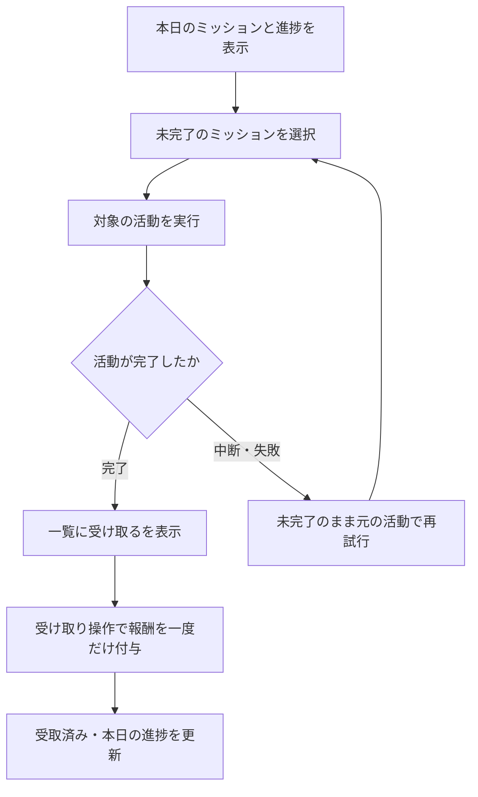

# F07｜デイリーミッション PRD（レビュー前）

> ④業務ルールと⑦以降はユーザーレビュー未完了。機能・画面・操作は現在の4189モックを正とし、優先順位はスプレッドシートを正とする。本PRDはTier1のみを定義する。

参照するモック：`Tameruko-Preview-20261013` の4189（2026-10-15確認）。未接続の外部API・実端末機能は、接続済みとして扱わず末尾に記載する。

| 基本情報 | 内容 |
| --- | --- |
| 機能ID | F07 |
| 概要 | デイリーミッション |
| 対象領域 | アプリ／管理画面／外部連携 |
| 関連機能 | [F05](F05-my-offers.md)、[F08](F08-walking.md)、[F09](F09-rewarded-video.md)、[F10](F10-surveys.md)、[F11](F11-mini-games.md) |
| 更新日 | 2026-10-23 |
| 版 | レビュー前（初版未確定） |

## ① 目的・今回作る範囲

目的：毎日のルーティンと期間限定のお仕事を分けて案内し、継続利用と対象案件の利用につなげるため

評価指標：ミッション表示数/対象活動への遷移率/活動完了率/翌日以降の継続率

優先順位は[アプリ詳細要件のTier列](https://docs.google.com/spreadsheets/d/1tI26I_4vbSHIOzMdJz7g8-DjeLyyVUKoksVHhZ0AQhU/edit#gid=1107057215)を正とする。モックに存在してもTier2・Tier3・空欄の要件は本PRDの定義対象に含めない。

| 要件ID | Tier1の範囲 |
| --- | --- |
| F07-1 | 毎日の共通ミッションと期間限定ミッションを1つの枠内で区分して確認できる |
| F07-2 | ミッションからタスクに設定したポイント獲得の活動を実行できる |
| F07-3 | 持ち出しのタスクは動画リワード広告を見たら受け取れるようにする |
| F07-4 | 各区分に有効なミッションを先頭最大5件表示し、もっと見るは置かない |
| F07-5 | 運営が共通タスクと日次更新ルールを設定できる |
| F07-6 | 動画・アンケートの活動報酬、および歩数・ミニゲーム・アフィリエイトの達成に設定したミッション報酬を扱える |
| F07-7 | 初回ミッションの報酬完了を閉じた後に通知・ATTの許諾案内を確認できる |
| F07-9 | 達成後に一覧から報酬を一度だけ受け取り、受取済みへ更新できる |

管理側は[管理画面詳細要件のTier列](https://docs.google.com/spreadsheets/d/1tI26I_4vbSHIOzMdJz7g8-DjeLyyVUKoksVHhZ0AQhU/edit#gid=1341040600)にある以下のTier1を関連範囲とする。NACS本体の内製要件にはしない。

| 要件ID | Tier1の運用範囲 |
| --- | --- |
| ADM-F05-1 | 運営担当者がホームのデイリーミッションの文言・遷移先・表示順を設定できる |
| ADM-F05-2 | 運営担当者がホームのデイリーミッション項目を追加・削除できる |
| ADM-F05-6 | 運営担当者が持ち出しタスクの報酬受取に動画視聴を必要とする条件を設定できる |
| ADM-F05-7 | 歩数・ミニゲーム・アフィリエイトの達成条件とミッション報酬を設定できる |

要件名に旧モックとの相違がある場合、優先順位は維持し、現在の表示・動きとユーザー指定を②以降へ反映する。実装方式の具体化は仕様設計で扱う。

## ② 画面イメージ

ミッションの操作は現行アプリの専用コンパクト寸法（高さ30px・文字13px）を維持する。通常ボタンの大・中・小とは区別し、部品集も同じ寸法を使用する。ミッション内の現行16pxの余白は、共通カードの12pxとは区別して維持する。

ホーム上部のタブ名は「ミッション」とする。枠内の「デイリーミッション」「期間限定ミッション」の区分名は変更しない。

[アプリの該当画面](http://127.0.0.1:4189/mock-app/#home/daily)

- ユーザー画面は1つの共通枠に「デイリーミッション」「期間限定ミッション」をまとめ、見出しと区切り線で区分する。各区分にミッション名・報酬・達成状態を表示する。進捗バーと達成件数はデイリー区分のみに表示する。
- 「デイリーミッション」には毎日繰り返せる動画・歩数・ミニゲーム・アンケートを表示する。「期間限定ミッション」には掲載開始日・終了日を設定したアフィリエイト・アンケートを表示し、各行に終了日を表示する。
- 各区分で有効なミッションを先頭から最大5件表示する。「もっと見る」は置かない。
- 未達成のミッションから対象の活動へ進む。条件達成後は「受け取る」を表示し、受取成功後に「受け取り済み」へ更新する。

## ③ 操作フロー

## ④ 業務ルール・制約

> ユーザーレビュー未完了。アプリ上の表示に関わるルールを記載する。

### 表示する対象ユーザー

| 対象ユーザー | 利用・表示 |
| --- | --- |
| 会員 | 全員共通の本日のミッションを表示する |
| 非会員（ゲスト） | 全員共通の本日のミッションを表示する |

### 表示条件

| 状態・条件 | 表示のルール |
| --- | --- |
| 毎日繰り返すミッション | デイリーミッション区分に設定順で先頭最大5件を表示する。進捗と受取状態は日本時間0時で日次更新する |
| 期間限定ミッション | 掲載開始日〜終了日（両日を含む）の間、期間限定ミッション区分に設定順で先頭最大5件を表示する。期間前・終了後は表示せず受け取れない。期間中は日付をまたいで進捗・未受取・受取済みを保持する |
| 未完了 | 対象の活動へ進む入口を表示する |
| 条件達成後・未受取 | 「受け取る」を表示し、本日の進捗を更新する |
| 報酬受取後 | 「受け取り済み」を表示し、同じミッションで再付与しない |

### カテゴリー別の達成条件と報酬

| カテゴリー | 達成条件・報酬 |
| --- | --- |
| 動画 | 当日の視聴完了回数が設定回数に達する。ミッション経由で保留した活動報酬を一覧から受け取る。元の活動報酬との二重付与はしない |
| アンケート | 毎日・期間限定の両方で設定できる。毎日は当日、期間限定は掲載期間内の回答完了件数が設定件数に達すると達成する。ミッション経由で保留した活動報酬を一覧から受け取る。同じ回答報酬を両区分で二重付与しない |
| ミニゲーム | 当日のミニゲームのプレイ完了回数が設定回数に達する。ゲーム本来の報酬とは別に設定したミッション報酬を受け取れる |
| 歩数 | 歩数連携済みの当日の歩数が設定歩数に達する。歩数本来の報酬とは別に設定したミッション報酬を受け取れる |
| アフィリエイト・指定案件 | 期間限定ミッションとして設定する。運営が指定した案件が掲載期間内に「判定中」になると、設定したミッション報酬を受け取れる。閲覧・クリック・挑戦中のみでは達成せず、案件本来の報酬の承認は待たない |
| アフィリエイト・件数 | 掲載期間内に「判定中」になった異なる案件が設定件数に達すると、設定したミッション報酬を受け取れる。同じ案件の重複成果・同じ通知の再送を複数件として数えない |

達成・受取はユーザー別に管理する。毎日ミッションは日別、期間限定ミッションはミッション別に一度だけ受け取れる。期間限定では掲載期間前の成果は含めず、期間内の異なる日の成果を合算する。判定中になった記録は後続の承認で失わず、アフィリエイトの通常報酬とミッション報酬は別の付与として扱う。

### 画面に置く要素・操作

| 画面・要素 | 表示・操作のルール |
| --- | --- |
| 進捗バー | デイリー区分のみに「今日の進捗」とバー・達成件数を表示する。期間限定区分には進捗エリアを表示しない |
| ミッション行 | ミッション名・活動報酬・達成状態を1行にまとめる |
| 活動への入口 | 動画・アンケート・ミニゲーム・歩数・案件詳細または案件一覧へ進む |

## ⑤ 管理画面

新規作成・変更・削除は、現在の管理画面で操作できる範囲を示す。「外部管理」はNACS・EDOCODE等の担当範囲、「未実装」は操作画面がない項目。削除と公開停止は分けて記載する。

[実行設定の管理画面](http://127.0.0.1:4208/mock-admin/#missions)

| 対象項目 | 新規作成 | 変更 | 削除 | 管理画面での操作・反映範囲 |
| --- | --- | --- | --- | --- |
| 共通ミッション行 | 可能 | 可能 | 可能 | 入口は登録済みミッションの一覧とし、種類・カテゴリー・掲載期間・配信状態を表示する。一覧で停止・配信再開・表示順変更を操作する。「新規登録」または各行の「詳細設定」から個別ページを開き、毎日繰り返す／期間限定の種類、カテゴリー、タイトル・説明・達成条件・報酬を設定する。表示チェックボックスは置かず、削除は個別ページで操作する。 |
| 掲載期間 | 可能 | 可能 | 行と同時に削除 | 期間限定ミッションに掲載開始日・終了日を必須で設定し、変更できる。毎日ミッションには期間入力欄を設けない。 |
| 停止期間 | 可能 | 可能 | 両日付を空欄にして解除 | 両種類のミッションで停止開始日・停止終了日を任意設定し、一覧にも表示する。日本時間の開始日0時〜終了日末まで非表示・受取不可とし、翌日に自動再開する。手動停止・掲載期間外は自動再開しない。停止で達成・受取記録は削除せず、各種類の既存の更新ルールを維持する。片側のみ・不正日・逆転は保存しない。 |
| 達成条件 | 可能 | 可能 | 行と同時に削除 | 回数・件数・歩数を設定する。アフィリエイトは「指定案件」または「任意の案件を指定件数利用する」を選択し、指定案件の場合は対象案件を選ぶ。遷移先はカテゴリー・対象案件に応じて設定する。 |
| ミッション報酬 | 可能 | 可能 | 行と同時に削除 | 歩数・ミニゲーム・アフィリエイトは1〜99,999ptの整数を設定する。達成時の金額を受取まで保持する。 |
| 利用者ごとのグループ配信 | 未実装 | 未実装 | 未実装 | 現在は全員共通の1グループ。旧グループデータは退避し、実行対象にしない。 |
| 動画・アンケート元の報酬額 | 対象外 | F09・F10で変更 | 対象外 | 活動元の報酬を使用し、この2カテゴリーには独立した追加報酬を設定しない。 |

## ⑥ 例外処理・エラーハンドリング

| 状況 | 表示・処理・復帰 |
| --- | --- |
| 対象のアンケートがない | 回答可能な対象だけを表示する。存在しない回答先へ進めない。 |
| 動画中断・通信失敗 | 未完了のままにし、元の活動で再試行する。 |
| 同じ活動の完了・受取を繰り返す | 同じミッション報酬を重複して付与しない。動画・アンケートは同じ活動報酬も重複させない。 |
| 設定値・指定案件が不正 | 保存せず入力エラーを表示する。既存の設定を部分的に更新しない。 |

## ⑦ 達成条件・未決事項

> 本節以降はユーザーレビュー未完了。

### Tier1の達成条件

- [ ] ミッションの操作は現行アプリの専用コンパクト寸法（高さ30px・文字13px）を維持する。通常ボタンの大・中・小とは区別し、部品集も同じ寸法を使用する。ミッション内の現行16pxの余白は、共通カードの12pxとは区別して維持する。

- [ ] F07-1：デイリーミッションと期間限定ミッションが1つの外枠内に表示され、見出しで区別できる。
- [ ] F07-2：ミッションからタスクに設定したポイント獲得の活動を実行できる。
- [ ] F07-3：持ち出しのタスクは動画リワード広告を見たら受け取れるようにする。
- [ ] F07-4：各区分に有効な先頭最大5件を表示し、期間限定は掲載期間外に表示しない。
- [ ] F07-5：運営が共通タスクと日次更新ルールを設定できる。
- [ ] F07-6：動画・アンケートは元の活動報酬を重複付与せず、歩数・ミニゲーム・アフィリエイトは設定したミッション報酬を受け取れる。
- [ ] F07-7：初回ミッションの報酬完了を閉じた後に通知・ATTの許諾案内を確認できる。
- [ ] F07-9：条件達成後に一覧で「受け取る」を表示し、受取後は再読み込み・再操作しても二重付与しない。
- [ ] アフィリエイトは指定案件または必要件数と掲載期間を設定でき、期間内に「判定中」になった時点で受け取れる。「挑戦中」や掲載期間前の成果は数えない。
- [ ] 毎日の進捗・受取は翌日に更新され、期間限定の進捗・受取状態は日付変更・再読み込みで失われない。アンケートは両方で設定でき、同じ回答の報酬は一度だけ付与する。
- [ ] ①の管理側Tier1に対応する操作について、⑤の新規作成・変更・削除可否と反映範囲を確認できる。
- [ ] ⑥の対象となる空・失敗・中断などの状態から、表示内容と次の操作を確認できる。

### まだ決まっていないこと

なし。認証・API接続などの具体的な方法は、別途仕様設計で定める。

## モックへの未反映・対象外

### モックへの未反映

| 項目 | 未反映の内容 |
| --- | --- |
| 日次更新・活動連携 | 本番の日替わり更新と各カテゴリーの活動結果・ASPからの判定中通知の連携は未接続。モック内の活動・成果データで再現する |
| 管理設定の同期 | 本番アプリへの共通ミッション設定の配信は未接続 |

### 今回の対象外

| 項目 | 対象外の内容 |
| --- | --- |
| なし | — |

## 変更履歴

| 版 | 日付 | 変更内容 |
| --- | --- | --- |
| レビュー前 | 2026-10-23 | ミッション専用ボタンを現行の30px・13pxで部品集へ統一。現行16pxの内側余白をミッション専用の定義へ移し、共通カード余白12pxとの干渉を解消。 |
| レビュー前 | 2026-10-22 | 個別設定と一覧に停止期間を追加。期間中の非表示・受取制御、終了翌日の自動再開、手動停止・掲載期間の優先を反映。 |
| レビュー前 | 2026-10-22 | 管理画面の入口をミッション一覧へ変更。一覧で停止・配信再開・並べ替え、個別ページで新規作成・詳細設定・削除を操作する。詳細編集では一覧の停止状態を維持する。 |
| レビュー前 | 2026-10-22 | 期間限定ミッションの進捗エリア（文言・バー・達成件数）を非表示に変更。各ミッションの達成判定・受取状態の保持は変更しない。 |
| レビュー前 | 2026-10-22 | 表示確認用として「クレジットカードを1枚作る」を期間限定ミッションへ仮登録。対象は架空のサンプルライフカード、報酬100pt・掲載期間2026/09/01〜12/31はデモ値であり、確定した運用条件ではない。 |
| レビュー前 | 2026-10-22 | ユーザー指定により、運用を毎日繰り返すミッションと期間限定ミッションの2種類に整理し、ユーザー画面では1つの外枠内にまとめて表示する。期間の設定・変更、アフィリエイトの指定案件／件数と判定中での達成を反映。アンケートは両方で設定可能とし、期間をまたぐ進捗保持・受取の重複防止をモックと本文・達成条件へ反映。 |
| レビュー前 | 2026-10-15 | F10レビューの共通フィードバックを反映。⑤を管理画面へ変更し、④を対象ユーザー・表示条件・配置要素に整理。例外処理と仕様設計事項の重複を除き、未反映と対象外を別表に分離。個別レビューは未完了。 |
