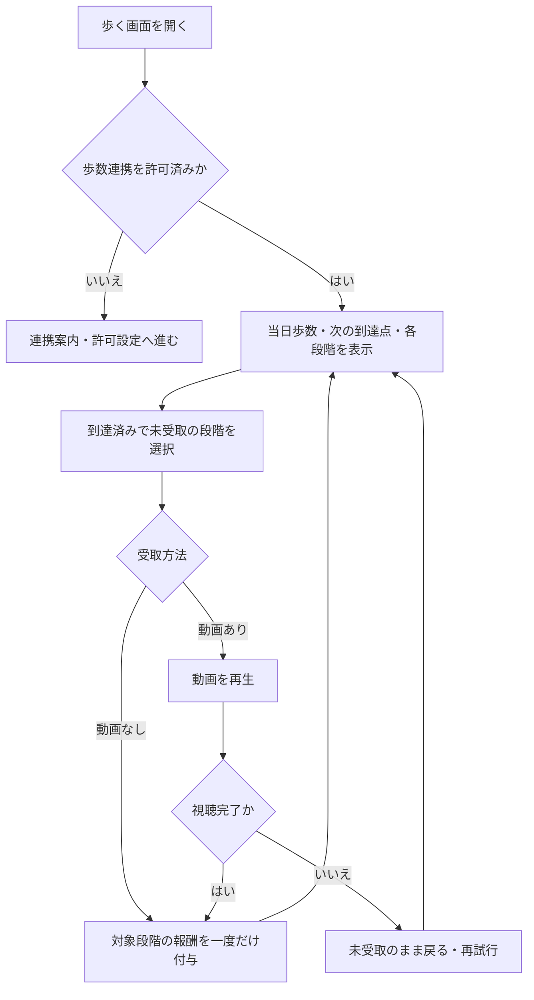

# F08｜歩数によるポイント獲得 PRD（レビュー前）

> ④業務ルールと⑦以降はユーザーレビュー未完了。機能・画面・操作は現在の4189モックを正とし、優先順位はスプレッドシートを正とする。本PRDはTier1のみを定義する。

参照するモック：`Tameruko-Preview-20261013` の4189（2026-10-15確認）。未接続の外部API・実端末機能は、接続済みとして扱わず末尾に記載する。

| 基本情報 | 内容 |
| --- | --- |
| 機能ID | F08 |
| 概要 | 歩数によるポイント獲得 |
| 対象領域 | アプリ／管理画面／外部連携 |
| 関連機能 | [F09](F09-rewarded-video.md)、[F12](F12-points.md) |
| 更新日 | 2026-10-15 |
| 版 | レビュー前（初版未確定） |

## ① 目的・今回作る範囲

目的：日常の歩行をポイント獲得と継続利用につなげるため

評価指標：歩数連携の許可率/利用日数/目標歩数への到達率/報酬受取率

優先順位は[アプリ詳細要件のTier列](https://docs.google.com/spreadsheets/d/1g00ZxLGprVNT4T4uSmzw--vRpp95HQ1Uq9i8GnJpmS4/edit#gid=1107057215)を正とする。モックに存在してもTier2・Tier3・空欄の要件は本PRDの定義対象に含めない。

| 要件ID | Tier1の範囲 |
| --- | --- |
| F08-1 | 【iOS】ヘルスケア機能と連携させて、歩数計測の許諾・設定案内を確認できる |
| F08-2 | 【Android】Recording APIと連携させて、歩数計測の許諾・設定案内を確認できる |
| F08-3 | 当日の歩数と受取可能な報酬を確認できる |
| F08-4 | 到達した歩数の報酬を重複せず受け取りできる |
| F08-5 | 運営が歩数報酬と日次上限を設定できる |
| F08-6 | 歩数報酬の獲得完了を閉じた後にATTの設定案内を確認できる |
| F08-7 | 動画リワード広告を見た場合と動画リワード広告を見なかった場合で受け取れるptの数を変更できる |

管理側は[管理画面詳細要件のTier列](https://docs.google.com/spreadsheets/d/1g00ZxLGprVNT4T4uSmzw--vRpp95HQ1Uq9i8GnJpmS4/edit#gid=1341040600)にある以下のTier1を関連範囲とする。NACS本体の内製要件にはしない。

| 要件ID | Tier1の運用範囲 |
| --- | --- |
| ADM-F06-2 | 運営担当者が歩いてためる画面の報酬条件を設定できる |

要件名に旧モックとの相違がある場合、優先順位は維持し、現在の表示・動きとユーザー指定を②以降へ反映する。実装方式の具体化は仕様設計で扱う。

## ② 画面イメージ

[アプリの該当画面](http://127.0.0.1:4189/mock-app/#home/steps)

- 当日歩数、次のポイントまでの残り歩数、マイルストーンの達成・受取状態を表示する。
- 1,000歩ごとに最大10,000歩までの目標を並べ、スクロールで各段階を確認できる。
- 歩数連携が未許諾・拒否・利用不可の場合は案内を表示し、達成後は動画あり／なしの受取を選べる。

## ③ 操作フロー

## ④ 業務ルール・制約

> ユーザーレビュー未完了。アプリ上の表示に関わるルールを記載する。

### 表示する対象ユーザー

| 対象ユーザー | 利用・表示 |
| --- | --- |
| 会員 | 当日の歩数・到達状況・報酬を確認する |
| 非会員（ゲスト） | 当日の歩数・到達状況・報酬を確認する |

### 表示条件

| 状態・条件 | 表示のルール |
| --- | --- |
| 当日の歩数を表示できる | 現在歩数と次のポイントまでの残り歩数を表示する |
| 目標まで未到達 | 該当段階を未達成として表示する |
| 到達済み・未受取 | 受取可能な段階として表示する |
| 受取済み | 該当段階を受取済みとして表示する |

### 画面に置く要素・操作

| 画面・要素 | 表示・操作のルール |
| --- | --- |
| 現在歩数・残り歩数 | 当日の実績と次の到達点を表示する |
| マイルストーン | 1,000歩間隔で最大10,000歩までの10段階を並べ、スクロールで確認する |
| 受取ボタン | 達成した段階の報酬を受け取る |
| 動画あり・動画なしの選択 | それぞれの獲得ポイントを表示して受取方法を選ぶ |

## ⑤ 管理画面

新規作成・変更・削除は、現在の管理画面で操作できる範囲を示す。「外部管理」はNACS・EDOCODE等の担当範囲、「未実装」は操作画面がない項目。削除と公開停止は分けて記載する。

[実行設定の管理画面](http://127.0.0.1:4189/mock-admin/legacy.html#points)

| 対象項目 | 新規作成 | 変更 | 削除 | 管理画面での操作・反映範囲 |
| --- | --- | --- | --- | --- |
| 歩数間隔・目標歩数・動画あり／なし報酬 | 不可 | 可能 | 不可 | 既存の付与設定を編集して保存する。現在の入力範囲は歩数間隔100〜100,000歩、目標100〜1,000,000歩。表示側は現モックの上限10,000歩に合わせる。日時指定の予約変更は管理側Tier2のため本PRDでは定義しない。 |
| 既存の歩数設定値 | 不可 | 可能 | 不可 | 設定項目自体の新規作成・削除UIはない。値を更新する。 |
| 歩数機能のアプリ別ON/OFF | 不可 | 可能 | 不可 | 機能設定の構想画面。保存した設定と実行画面の接続範囲を区別する。 |

## ⑥ 例外処理・エラーハンドリング

| 状況 | 表示・処理・復帰 |
| --- | --- |
| 歩数が未連携・拒否・取得不可 | それぞれの案内と設定への入口を表示する。 |
| 歩数の遅延・重複受取 | 採用歩数と受取済みの段階を保持し、同じ段階に重ねて付けない。 |
| 受取用の動画が完了しない | 動画ありの報酬を付けず、受取状態を保持して再試行へ戻る。 |

## ⑦ 達成条件・未決事項

> 本節以降はユーザーレビュー未完了。

### Tier1の達成条件

- [ ] F08-1：【iOS】ヘルスケア機能と連携させて、歩数計測の許諾・設定案内を確認できる。
- [ ] F08-2：【Android】Recording APIと連携させて、歩数計測の許諾・設定案内を確認できる。
- [ ] F08-3：当日の歩数と受取可能な報酬を確認できる。
- [ ] F08-4：到達した歩数の報酬を重複せず受け取りできる。
- [ ] F08-5：運営が歩数報酬と日次上限を設定できる。
- [ ] F08-6：歩数報酬の獲得完了を閉じた後にATTの設定案内を確認できる。
- [ ] F08-7：動画リワード広告を見た場合と動画リワード広告を見なかった場合で受け取れるptの数を変更できる。
- [ ] ①の管理側Tier1に対応する操作について、⑤の新規作成・変更・削除可否と反映範囲を確認できる。
- [ ] ⑥の対象となる空・失敗・中断などの状態から、表示内容と次の操作を確認できる。

### まだ決まっていないこと

| 確認事項 | 相談先 |
| --- | --- |
| 日中に報酬設定を変えた場合、変更前の達成分にどの報酬を適用するか | 事業・運用 |

## モックへの未反映・対象外

### モックへの未反映

| 項目 | 未反映の内容 |
| --- | --- |
| OS歩数の取得 | iOS・Androidの実歩数取得、端末との同期は未接続 |
| 報酬の連携 | 正式な動画完了結果・EDOCODEへの歩数報酬付与は未接続 |
| 管理設定と歩数上限 | 現在の管理画面の目標入力範囲と、アプリ表示の10,000歩上限は未整合 |

### 今回の対象外

| 項目 | 対象外の内容 |
| --- | --- |
| なし | — |

## 変更履歴

| 版 | 日付 | 変更内容 |
| --- | --- | --- |
| レビュー前 | 2026-10-15 | F10レビューの共通フィードバックを反映。⑤を管理画面へ変更し、④を対象ユーザー・表示条件・配置要素に整理。例外処理と仕様設計事項の重複を除き、未反映と対象外を別表に分離。個別レビューは未完了。 |
