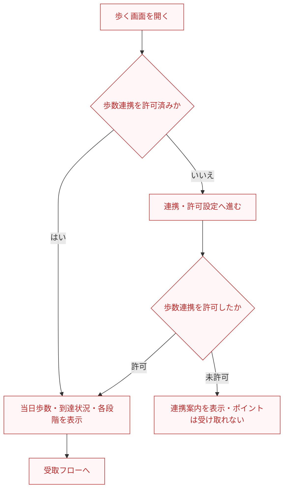
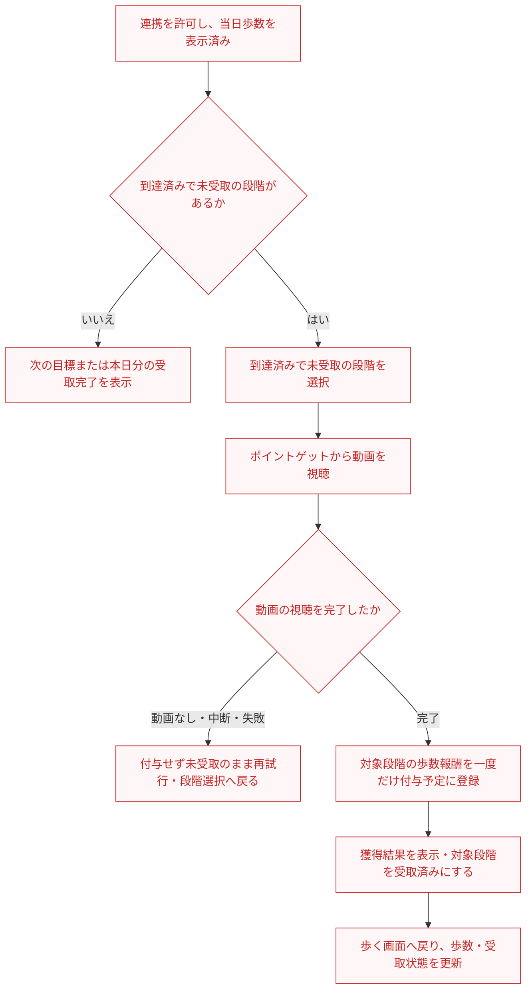

# F08｜歩数によるポイント獲得 PRD（レビュー前）

赤字はF08レビュー開始時点（main 8f6cd5a）からの修正・追記。版はレビュー前のまま、モックは未変更。

> ④業務ルールはユーザーレビュー未完了。機能・画面・操作は本リポジトリの歩数モックを基準とし、今回のユーザー指定を優先する。優先順位はスプレッドシートを正とし、本PRDはTier1のみを定義する。

参照するモック：本リポジトリの歩数画面（ローカル4189、2026-10-20に画面要素・操作をコードで照合）。未接続の外部API・実端末機能は、接続済みとして扱わず末尾に記載する。

| 基本情報 | 内容 |
| --- | --- |
| 機能ID | F08 |
| 概要 | 歩数によるポイント獲得 |
| 対象領域 | アプリ／管理画面／外部連携 |
| 関連機能 | [F09](F09-rewarded-video.md)、[F12](F12-points.md) |
| 更新日 | 2026-10-20 |
| 版 | レビュー前（初版未確定） |
| モックレビュー | 完了（2026-10-20ユーザー共有） |
| PRDレビュー | メンバーによるレビュー待ち |
| 共有メモ | 1 → A |

## ① 目的・今回作る範囲

目的：日常の歩行をポイント獲得と継続利用につなげるため

優先順位は[アプリ詳細要件のTier列](https://docs.google.com/spreadsheets/d/1tI26I_4vbSHIOzMdJz7g8-DjeLyyVUKoksVHhZ0AQhU/edit#gid=1107057215)を正とする。モックに存在してもTier2・Tier3・空欄の要件は本PRDの定義対象に含めない。

| 要件ID | Tier1の範囲 |
| --- | --- |
| F08-1 | 【iOS】ヘルスケア機能と連携させて、歩数計測の許諾・設定案内を確認できる |
| F08-2 | 【Android】Recording APIと連携させて、歩数計測の許諾・設定案内を確認できる |
| F08-3 | 当日の歩数と受取可能な報酬を確認できる |
| F08-4 | 到達した歩数の報酬を重複せず受け取りできる |
| F08-5 | 運営が歩数報酬と日次上限を設定できる（日次上限の意味・設定可能な範囲は⑥の確認事項W1で協議） |
| F08-6 | 歩数報酬の獲得完了を閉じた後にATTの設定案内を確認できる |
| F08-7 | 歩数報酬は動画リワード広告の視聴完了後にのみ受け取れる。動画なし・中断・失敗の場合は付与せず再試行できる |

管理側は[管理画面詳細要件のTier列](https://docs.google.com/spreadsheets/d/1tI26I_4vbSHIOzMdJz7g8-DjeLyyVUKoksVHhZ0AQhU/edit#gid=1341040600)にある以下のTier1を関連範囲とする。NACS本体の内製要件にはしない。

| 要件ID | Tier1の運用範囲 |
| --- | --- |
| ADM-F06-2 | 運営担当者が歩いてためる画面の報酬条件を設定できる |

要件名に旧モックとの相違がある場合、優先順位は維持し、現在の表示・動きとユーザー指定を②以降へ反映する。実装方式の具体化は仕様設計で扱う。

## ② 画面イメージ

[アプリの該当画面](http://127.0.0.1:4189/mock-app/#home/steps)

- 「毎日10,000歩チャレンジ」の見出しと「今日の歩数」、靴・旗・進捗バー、0歩から目標歩数までの目盛りを表示する。
- 1,000歩ごとに最大10,000歩までの目標を並べ、スクロールで各段階を確認できる。
- 歩数連携が未許可・拒否の場合は「歩数を連携する」から許可設定へ進む。許可後は当日歩数・到達状況を再取得し、到達済みで未受取の段階の受取へ進める。未許可のままでは受け取れない。
- 到達済みで未受取の段階がある場合は、画面下の「ポイントを獲得する」から「ポイントゲット」を開き、「動画を見て○pt」で動画を視聴する。動画なしではポイントを付与せず、未受取のまま再試行する。

- 見出しは「毎日10,000歩チャレンジ」。靴の上の吹き出しは0歩で「スタート」、目標到達時に「目標達成」だけを表示し、途中の5,000歩・6,000歩等は表示しない。0歩の「スタート」は未連携の初期表示でも表示する。
- 下部の横スクロールは歩数とアイコンで到達・受取状態を示し、「受取可能」「獲得済み」「スタート」の状態テキストは付けない。上部の吹き出しや画面下の受取操作は別の要素として維持する。

## ③ 操作フロー

歩数連携を許可した場合は、許可済みの利用者と同じ受取フローへ合流する。横スクロールの段階表示は状況確認用で、画面下のボタンから次の到達済み・未受取の1段階を受取対象として選ぶ。到達済みの段階がない場合は受取へ進まない。

連携・許可のフローの「受取フローへ」から、受取のフローへ続く。

### 連携・許可のフロー

### 受取のフロー

再試行は「到達済みで未受取の段階を選択」へ戻る。獲得後は歩く画面へ戻る。

歩数報酬の動画は、単独の「動画を見る」の日次上限には含めない。歩数の到達条件・受取段階の上限はF08、動画の年齢別配信・視聴成立の確認は[F09](F09-rewarded-video.md)、ポイント確定・残高・履歴は[F12](F12-points.md)を参照する。

## ④ 業務ルール・制約

> ユーザーレビュー未完了。アプリ上の表示に関わるルールを記載する。

### 表示する対象ユーザー

| 対象ユーザー | 利用・表示 |
| --- | --- |
| 会員 | 当日の歩数・到達状況・報酬を確認する |
| 非会員（ゲスト） | 当日の歩数・到達状況・報酬を確認する |

### 表示条件

| 状態・条件 | 表示のルール |
| --- | --- |
| 歩数連携が許可済み | 当日の歩数・進捗バー・段階ごとの到達／受取状態を表示する |
| ポイント付与条件に未到達 | 該当段階は未到達のポイントアイコンで表示する。到達済み・未受取の段階が1つもない場合、ボタンは「次の目標まで歩こう」と表示し、非活性にする。全段階受取済みの表示との優先順位は⑥の確認事項W2で協議する |
| ポイント付与条件に到達済みだが未受取 | 該当段階を受取可能なポイントアイコンで表示し、画面下の「ポイントを獲得する」を活性にする。動画視聴が完了するまで受取済みにしない |
| ポイントを受取済み | 該当段階はチェックアイコンで表示し、同じ段階を再度受け取れない。本日分の全段階が受取済みなら「本日分はすべて獲得済み」と表示する |

状態は各段階に対して判定する。例えば2,500歩で1,000歩分を受取済みの場合、1,000歩は受取済み、2,000歩は到達済み・未受取、3,000歩以降は未到達・未受取になる。段階欄には「受取可能」「獲得済み」等の状態テキストを追加しない。

### 画面に置く要素・操作

| 画面・要素 | 表示・操作のルール |
| --- | --- |
| 見出し・今日の歩数 | 「毎日10,000歩チャレンジ」「今日の歩数」と歩数・単位を表示する。未連携の初期表示は0歩とする |
| 靴・旗・進捗バー | 今日の歩数に応じて靴の到達位置を表示する。同一セッション・同日内で歩数が増えた場合に靴が進む。 |
| 靴の上の吹き出し | 0歩では「スタート」、目標到達時は「目標達成」を表示し、途中の歩数では吹き出しを表示しない |
| 歩数ごとの段階表示・横スクロール | 0歩の靴アイコンと、1,000歩ごとに10,000歩までのポイント／チェックアイコンを並べる。横スクロールと下の操作バーで確認する。段階を押して直接受け取る操作にはしない |
| 歩数連携のボタン | 未許可・拒否時は「歩数を連携する」を表示する。iOSはヘルスケア、Androidは身体活動へのアクセスの案内へ進む |
| 受取前のボタン | 到達済み・未受取の段階があれば「ポイントを獲得する」、なければ「次の目標まで歩こう」を表示する。1回の操作で次の未受取段階を対象にする。全段階受取済みの表示との優先順位は⑥の確認事項W2で協議する |
| ポイントゲット | 動画のイラストと「動画を見て○pt」「とじる」を表示する。「動画なしで受け取る」は表示しない。閉じた場合は付与せず未受取のままにする |
| 獲得完了の画面 | 動画視聴完了・受取処理成功後に獲得ポイントを表示する。閉じた後に、対象条件を満たす場合はATTの設定案内を表示する |
| 本日分の受取完了 | 全段階を受取済みなら、受取ボタンの代わりに「本日分はすべて獲得済み」を表示する |

## ⑤ 管理画面

[付与設定（歩数・動画）](http://127.0.0.1:4189/mock-admin/index.html#points)

| 対象項目 | Tier | 新規作成 | 変更 | 削除 | 管理画面での操作・反映範囲 |
| --- | --- | --- | --- | --- | --- |
| 歩数達成・動画視聴完了時の1回の付与ポイント | Tier1 | 不可 | 可能 | 不可 | 1段階の達成後に動画を見て受け取るポイント数（pt）を編集して保存する。受取画面の表示額と付与額に反映する。単独動画の付与設定は変更しない |
| ポイント獲得までの歩数間隔 | Tier1 | 不可 | 要確認 | 不可 | ⑥の確認事項W1を参照 |
| 1日の目標歩数 | Tier1 | 不可 | 要確認 | 不可 | ⑥の確認事項W1を参照 |

動画なしの付与ポイントは、今回の「動画視聴完了が受取の必須条件」という要件では使用しない。現モックの管理画面に残る「歩数達成・動画なし」の設定項目は未反映として扱う。現在の付与設定画面で編集できるのは成人向けの値であり、未成年向けの動画視聴報酬の編集UIは未実装。

設定範囲は⑥の確認事項W1、設定変更の反映時点はW3を参照する。

## ⑥ 例外処理・エラーハンドリング

| 状況 | 表示・処理・復帰 |
| --- | --- |
| 歩数が未連携・拒否・取得不可 | それぞれの案内と設定への入口を表示する。 |
| 歩数の遅延・重複受取 | 採用歩数と受取済みの段階を保持し、同じ段階に重ねて付けない。 |
| 動画を見ない・中断・失敗する | ポイントを付与せず、対象段階は未受取のままにする。再試行から同じ段階の動画視聴に戻れる。 |

### 確認事項（メンバー協議）

以下は未決事項であり、採用済みの仕様として扱わない。

| ID | 確認事項 |
| --- | --- |
| W1 | F08-5の「日次上限」は目標歩数・受取段階数・付与ポイント数のどれを指すか、運営が設定できる範囲を確認する。ポイント獲得までの歩数間隔と1日の目標歩数を管理画面で変更できるようにするかも協議し、①と⑤の記載を揃える。変更を採用する場合は、④の段階表示も設定値に合わせるか、どこまで・何段階を表示し横スクロールでどう確認するか、設定可能な範囲を合わせて確認する。旧モックの入力範囲（歩数間隔100〜100,000歩、目標100〜1,000,000歩）は本番要件として採用しない。最新main（c0860f7）の管理画面は歩数間隔・上限を固定表示し、変更を受け付けない。現在のモックの固定表示と、本番で変更可能にするかの判断を区別する。 |
| W2 | 全段階受取済みの場合は「本日分はすべて獲得済み」を優先し、「次の目標まで歩こう」は未達成の段階が残り、かつ到達済み・未受取の段階がない場合に表示する、という整理でよいか。既存文言は維持し、表示条件の優先順位を確認する。 |
| W3 | 管理画面の「反映タイミング」と適用日時（日付・時刻）の項目は不要か。即時反映だけにするか、日時指定も必要かを確認する。また、歩数を達成した後、受け取る前に運営が報酬額を変更した場合、その段階の報酬は変更前・変更後のどちらを適用するか、適用の基準時点も合わせて確認する。 |

## モックへの未反映・対象外

### モックへの未反映

| 項目 | 未反映の内容 |
| --- | --- |
| 靴の移動アニメーション | 現モックは同一セッション・同日の前回表示歩数より増えた場合に移動する。初回描画では取得済み歩数の位置を表示する。アプリ未起動中の実歩数同期や、起動時の移動演出は実端末未検証 |
| OS歩数の取得 | iOS・Androidの実歩数取得、端末との同期は未接続 |
| 報酬の連携 | 正式な動画完了結果・EDOCODEへの歩数報酬付与は未接続 |
| 歩数条件の設定可否・可変表示 | 最新mainの管理画面は歩数間隔・上限を固定表示し、変更を受け付けない。条件変更に応じた段階表示・横スクロールは未対応。本番で変更可能にするかは確認事項W1で協議する |
| 動画なし受取の旧処理・説明 | 通常の受取画面は動画視聴ボタンだけだが、内部には動画なし受取処理と旧ヘルプの説明が残る。今回の動画必須の条件を、内部処理・説明・管理画面の「動画なし」設定へ反映する必要がある |
| 未成年向け歩数報酬の編集 | 未成年向けの動画視聴報酬は別値を持つが、現在の付与設定画面では編集できない |

### 今回の対象外

| 項目 | 対象外の内容 |
| --- | --- |
| なし | — |

## 変更履歴

| 版 | 日付 | 変更内容 |
| --- | --- | --- |
| レビュー前 | 2026-10-20 | PR #10の相互レビューを反映。図の作成方針・余白の調整指示を本文から削除し、フローのつながりと戻り先・操作ルールは維持。未到達状態・ボタン・靴の説明を整理。管理設定と段階表示の範囲、受取完了表示の優先順位、設定変更時の未受取報酬の適用を確認事項W1〜W3に集約し、未決のまま明示。作業中に更新されたmainの歩数条件の固定表示を参照情報・未反映表へ反映。モック・他機能のPRDは変更していない。 |
| レビュー前 | 2026-10-20 | 矢印が交差しないよう、③を連携・許可と受取の2図へ分割し、再試行・受取後の戻り先を終点に明記。「ポイント獲得までの歩数間隔と目標歩数を管理画面で設定できるようにするか」をPR時の課題に追加し、⑤の変更可否を要確認にした。モックは変更していない。 |
| レビュー前 | 2026-10-20 | ユーザーのF08レビューを反映。評価指標・⑦を削除。歩数の許可／未許可の分岐と、許可後の受取フローへの合流を追加。動画なし付与を廃し未視聴・中断・失敗は再試行と定義。段階ごとの状態と画面要素をモックに合わせ、⑤をF09と同形式の項目別設定に整理。「反映タイミング・適用日時の項目が必要か」をPR時の確認課題として記録。モック・他機能のPRDは変更していない。 |
| レビュー前 | 2026-10-19 | 毎日10,000歩チャレンジの見出し、スタート／目標達成のみの吹き出し、下部状態テキスト非表示と余白調整を反映。実歩数API・起動時アニメーションの未検証範囲を明記。 |
| レビュー前 | 2026-10-15 | F10レビューの共通フィードバックを反映。⑤を管理画面へ変更し、④を対象ユーザー・表示条件・配置要素に整理。例外処理と仕様設計事項の重複を除き、未反映と対象外を別表に分離。個別レビューは未完了。 |
