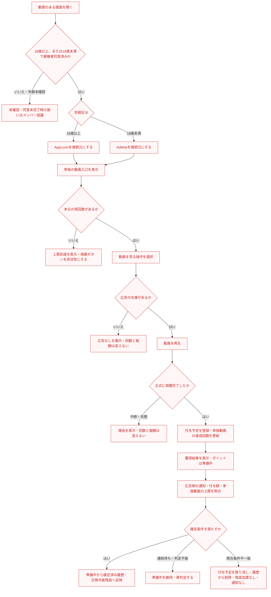

# F09｜動画リワード広告 PRD（第1版）

> 今回の青木レビューで確認した内容を第1版とする。残課題は⑥に記載し、確定事項と区別する。機能・画面・操作は現在の4189モックを基準とし、ユーザー指定の変更を優先する。優先順位はスプレッドシートを正とし、本PRDはTier1のみを定義する。

赤字は今回のF09レビュー開始時点（main 8f6cd5a）からの修正・追記。削除した項目は変更履歴で確認する。

参照するモック：`Tameruko-Preview-20261013` の4189（2026-10-15確認）。未接続の外部API・実端末機能は、接続済みとして扱わず末尾に記載する。

| 基本情報 | 内容 |
| --- | --- |
| 機能ID | F09 |
| 概要 | 動画リワード広告 |
| 対象領域 | アプリ／管理画面／外部連携 |
| 関連機能 | [F01](F01-account.md)、[F07](F07-daily-mission.md)、[F08](F08-walking.md)、[F11](F11-mini-games.md)、[F12](F12-points.md)、[F18](F18-mypage-support.md) |
| 更新日 | 2026-10-20 |
| 版 | 第1版 |
| モックレビュー | 完了（2026-10-20ユーザー共有） |
| PRDレビュー | 青木レビュー完了（2026-10-20）。⑥の残課題は継続確認。PO合意・本番実装完了を示すものではない |
| 共有メモ | 2だが外部連携あり → A |

## ① 目的・今回作る範囲

目的：広告視聴でポイントを獲得できるようにするため

優先順位は[アプリ詳細要件のTier列](https://docs.google.com/spreadsheets/d/1tI26I_4vbSHIOzMdJz7g8-DjeLyyVUKoksVHhZ0AQhU/edit#gid=1107057215)を正とする。モックに存在してもTier2・Tier3・空欄の要件は本PRDの定義対象に含めない。

| 要件ID | Tier1の範囲 |
| --- | --- |
| F09-1 | 動画リワード広告を再生できる |
| F09-2 | 正式な視聴完了を付与予定として登録し、広告側の通知・付与額・対象機能の上限条件の照合後に一度だけ確定できる |
| F09-3 | 広告を配信できない場合・通信に失敗した場合・視聴を中断した場合は、その状態を案内し、視聴可能回数を減らさずに再度視聴を試せるようにする |
| F09-4 | 運営が動画枠の回数・報酬を設定できる（管理画面での付与可能回数の変更可否は残課題） |
| F09-5 | 初回のみ、動画報酬の獲得完了画面を閉じた後にトラッキングの利用目的と、許可を選択するための案内を表示する |
| F09-6 | オンボーディングで生年月日・性別を入力できる |
| F09-7 | 18歳以上にはAppLovinを接続元として動画リワード広告を配信できる |
| F09-8 | 18歳未満で親権者同意が完了したユーザーにはAdMobを接続元として動画リワード広告を配信できる |

F09-7／F09-8は機能要件表の既存IDを維持する。年齢未確認・必要な同意が未完了の場合の扱いは、PR時にメンバーで協議する残課題。

管理側は[管理画面詳細要件のTier列](https://docs.google.com/spreadsheets/d/1tI26I_4vbSHIOzMdJz7g8-DjeLyyVUKoksVHhZ0AQhU/edit#gid=1341040600)にある以下のTier1を関連範囲とする。NACS本体の内製要件にはしない。

| 要件ID | Tier1の運用範囲 |
| --- | --- |
| ADM-F06-1 | 運営担当者が動画広告枠の報酬・回数を設定できる（管理画面での付与可能回数の変更可否は残課題） |

要件名に旧モックとの相違がある場合、優先順位は維持し、現在の表示・動きとユーザー指定を②以降へ反映する。実装方式の具体化は仕様設計で扱う。

## ② 画面イメージ

[アプリの該当画面](http://127.0.0.1:4189/mock-app/#home/daily)

- ホーム画面下から「動画を見て貯める」に遷移し、本日の利用回数・完了状態と報酬を確認できる。
- デイリーミッションから動画を視聴できる。
- 歩数やミニゲーム内の動画も、それぞれの条件に従って視聴・ポイントの受け取りができる。
- 視聴中断・配信なし・通信失敗・報酬受取失敗の場合も画面上でユーザーに表示させる。

## ③ 操作フロー

以下は単独の「動画を見る」から視聴する場合のフロー。年齢・同意の取得は[F01](F01-account.md)で行い、登録済みの状態を確認する。

単独動画の1日の視聴回数上限は、「動画を見る」から単独動画を視聴した場合だけに適用する。デイリーミッションからこの単独動画へ進んだ場合も同じ枠として扱う。歩数・ミニゲーム内の動画は単独動画の回数に含めず、単独動画が上限に達していても、それだけを理由に利用不可にしない。歩数は[F08](F08-walking.md)、ミニゲームは[F11](F11-mini-games.md)の視聴・受取回数と獲得条件を優先する。

## ④ 業務ルール・制約

> 第1版の業務ルール。年齢未確認・必要な同意が未完了の扱い、管理画面での付与可能回数の変更可否は未確定。

### 表示する対象ユーザー

| 対象ユーザー | 利用・表示 |
| --- | --- |
| 会員 | 以下の年齢・同意条件を満たす場合に、動画視聴の入口・残回数・活動報酬を確認する |
| 非会員（ゲスト） | 会員と同じ配信条件を満たす場合に利用できる |

### 表示条件

| 状態・条件 | 表示のルール |
| --- | --- |
| 年齢確認済みの18歳以上 | 動画視聴の入口を表示する |
| 年齢確認済みの18歳未満で、親権者同意が完了 | 動画視聴の入口を表示する |
| 年齢未確認、または18歳未満で親権者同意が未完了 | 未確定。動画の入口・視聴の可否や年齢確認・同意への案内方法をメンバーで協議する |
| 視聴前 | 本日の残回数と獲得報酬を表示する |
| 単独動画の上限到達 | 本日分終了の状態を表示し、単独動画の視聴ボタンを非活性にする |
| 視聴完了・達成登録後 | 対象機能の達成回数・完了状態を更新し、ポイントは付与予定（準備中）として表示する。交換可能残高には加算しない |
| ポイント確定後 | 準備中から確定済みの獲得履歴・交換可能残高へ反映する |
| 照合条件が一致せず付与予定を取り消した場合 | 取り消した付与予定をポイント履歴から削除し、交換可能残高には加えない。ユーザーへの取り消し通知は行わない |

### 接続元の切り替え

| 年齢区分 | 接続元 | 配信条件 |
| --- | --- | --- |
| 18歳以上 | AppLovin | 生年月日が確認済みであること |
| 18歳未満 | AdMob | 生年月日・親権者同意が確認済みであること |
| 年齢未確認／必要な同意が未完了 | 未確定 | 利用・表示・案内の扱いはメンバー協議。配信可否を確定した仕様として扱わない |

この表を動画リワードの出し分けの定義元とする。歩数・ミニゲーム内の動画にも同じ年齢・同意条件を適用するが、視聴・受取回数やポイント額は各機能の要件に従う。

生年月日の取得・年齢区分・親権者同意の取得と保持は[F01](F01-account.md)を参照する。年齢情報や同意状態が更新された場合は、次の表示・再生前に配信可否と接続元を再判定する。実際のSDK接続・広告リクエストの年齢処理・法令対応は本番実装時に別途確認する。

### 画面に置く要素・操作

| 画面・要素 | 表示・操作のルール |
| --- | --- |
| 動画を見る入口 | ホーム画面下の「動画を見て貯める」やデイリーミッションから動画を再生する |
| 本日の利用回数・報酬 | 単独動画は、その利用者に適用されるAppLovin／AdMob別の設定値から表示・付与する。モック初期値は固定要件にしない |
| 機能内の動画 | 歩数・ミニゲームの要件に応じた視聴条件と獲得報酬を表示する |
| 報酬獲得の画面 | 正式な視聴完了と達成登録の成功後に獲得結果を表示する。付与予定の登録成功とポイント確定を区別する |
| 初回獲得後の案内 | 報酬完了画面を閉じた後にトラッキングの利用目的と、許可を選択するための案内を表示する |
| 報酬状況の確認・問い合わせ | 動画視聴後の報酬状況は、[F12のポイント履歴](F12-points.md)で確認できる。報酬が反映されない場合は、[F18のマイページ](F18-mypage-support.md)の「お問い合わせ」から問い合わせできる。既存の導線を利用する |

### 動画ポイントの登録・確定条件

タメルコの[動画リワード仕様「3.2・3.6」](https://github.com/ca-media-poi/poikatsu-spec/blob/f11f656f80a7032564376300645e34d5dada40b9/docs/domains/video-reward.md)と[ポイント自動判定](https://github.com/ca-media-poi/poikatsu-spec/blob/f11f656f80a7032564376300645e34d5dada40b9/docs/jobs/point-auto-review.md)に沿う。視聴完了直後の即時確定にはしない。単独動画の上限を他機能へ適用しない点は、今回のユーザー指定を優先する。

1. 正式な視聴完了後、サーバーが達成報告を検証・受理した時点で、ポイントを付与予定として登録する。達成回数・完了状態は対象機能の要件に従って更新する。
2. 以下をすべて満たした付与予定を、自動判定で一度だけ確定する。

| 確認対象 | 確定に必要な条件 |
| --- | --- |
| 視聴成立の照合 | 同じユーザー・同じ広告配信元・同じ広告達成IDのS2S通知が届いている。広告達成IDが空のものは確定しない |
| 付与額 | 開始日時の時点で適用される接続元・対象機能の付与設定と一致する |
| 単独動画の回数上限 | 「動画を見る」からの単独動画について、開始日時が属する当日（JST）の単独動画の達成回数が上限以内である。付与予定の登録時と確定時の両方で確認する |
| 歩数・ミニゲーム内の動画 | F08／F11で定めた条件・上限を満たす。単独動画の回数上限は判定に使わない |

3. 確定後にのみ交換可能残高へ反映する。同じ視聴・付与依頼の再送で付与予定や確定済みポイントを増やさない。付与結果が不明な場合は同じ依頼を照会して整合させる。
4. 照合条件の不一致が確定した場合は、付与予定を取り消し、取り消した付与予定をポイント履歴から削除する。交換可能残高には加えず、ユーザーへの取り消し通知は行わない。通知待ち・判定情報を取得できない場合は、不一致と扱わず「準備中」を維持して再判定する。

S2S通知は達成報告より先に届く場合もある。到着順を問わず同じ視聴を照合し、通知だけでは付与しない。ポイントの準備中／確定済み・残高・履歴・失効の共通ルールは[F12](F12-points.md)を参照する。自動判定の実行間隔・API方式などは仕様設計で定め、確定までの固定時間を保証するものではない。

## ⑤ 管理画面

[付与設定（歩数・動画）](http://127.0.0.1:4189/mock-admin/index.html#points)

運営が変更する項目と反映範囲を以下に定義する。モックの編集UIが不足する項目は末尾の「モックへの未反映」に記録する。

今回は、運営による動画機能の停止・再開設定は設けない。AppLovin・AdMobとの連携上、この方針で支障がないかは⑥の残課題として担当者に確認する。

| 対象項目 | Tier | 新規作成 | 変更 | 削除 | 管理画面での操作・反映範囲 |
| --- | --- | --- | --- | --- | --- |
| AppLovinの単独動画1回の付与ポイント | Tier1 | 不可 | 可能 | 不可 | AppLovin経由の単独動画1回あたりのポイント数（pt）を編集して保存する。表示する報酬と付与額に反映し、AdMobの設定は変更しない。 |
| AdMobの単独動画1回の付与ポイント | Tier1 | 不可 | 可能 | 不可 | AdMob経由の単独動画1回あたりのポイント数（pt）を編集して保存する。表示する報酬と付与額に反映し、AppLovinの設定は変更しない。 |
| AppLovinの単独動画1日の達成可能回数 | Tier1 | 不可 | 要確認 | 不可 | AppLovin経由の単独動画の上限回数を管理画面で変更できるかはメンバー協議。変更を採用する場合、残回数・視聴可否・登録と確定の上限判定に反映する。歩数・ミニゲームの回数には適用しない。 |
| AdMobの単独動画1日の達成可能回数 | Tier1 | 不可 | 要確認 | 不可 | AdMob経由の単独動画の上限回数を管理画面で変更できるかはメンバー協議。変更を採用する場合、残回数・視聴可否・登録と確定の上限判定に反映する。歩数・ミニゲームの回数には適用しない。 |

AppLovinとAdMobの付与額は独立して設定できる。付与可能回数を管理画面で変更できるかは残課題とし、回数の設定項目は確認中の案として扱う。現在のモックの付与設定画面で編集できるのは成人向けの値であり、AdMob向けの編集UIは未実装。単独動画の設定を、歩数・ミニゲームの付与設定へ流用しない。

反映タイミングについて、タメルコには適用日時を指定した予約変更がある（[既存仕様「3.1」](https://github.com/ca-media-poi/poikatsu-spec/blob/f11f656f80a7032564376300645e34d5dada40b9/docs/domains/video-reward.md)）。今回のTier1は保存時の反映を扱い、日時指定の予約変更は機能要件表のADM-F06-3（Tier2）で管理する。付与額や上限の照合には、その視聴の開始日時の時点で適用される設定を使う。

## ⑥ 例外処理・エラーハンドリング

| 状況 | 表示・処理・復帰 |
| --- | --- |
| 広告なし | アプリ側で理由を表示し、回数や報酬を誤って消費しない。案内文の例：「現在、表示できる広告がありません」。時間をおいて再度視聴を試せる。 |
| 通信・読み込み失敗 | アプリ側で理由を表示し、再読み込みさせる。失敗時は回数や報酬を誤って消費しない。案内文の例：「広告を読み込めませんでした。時間をおいて再度お試しください」。 |
| 視聴中断 | 中断した状態を画面上で表示する。未完了の視聴には付与せず、回数を消費しない。 |

広告配信元が自動で案内画面を出す前提にはせず、アプリ側で状態に応じた案内を表示する。

### 残課題

- 年齢未確認／必要な同意が未完了の場合の利用・表示・案内をどうするか。メンバーで協議する。
- 動画の付与可能回数を管理画面上で変更できるか。現モックの成人向け回数編集UIの存在と、本番要件の採否は区別してメンバーで協議する。
- 運営による動画機能の停止・再開設定を設けない方針について、AppLovin・AdMobとの連携上の支障がないかを連携担当者に確認する。

## モックへの未反映・対象外

### モックへの未反映

| 項目 | 未反映の内容 |
| --- | --- |
| 動画広告の接続 | 広告SDKによる実配信、正式な視聴完了通知・収益計測は未接続 |
| ポイント付与 | 本番の視聴結果とEDOCODEの付与処理は未接続 |
| 準備中から確定までの照合 | モックはS2S通知との照合・通知未到達の保留／取り消し・本番ポイント基盤の結果照会を再現していない。画面上の獲得演出だけで本番の確定条件を満たしたと扱わない |
| AdMob向け付与設定の編集 | AdMob向けの回数・報酬は別値を持つが、現在の付与設定画面では編集できない |

### 今回の対象外

| 項目 | 対象外の内容 |
| --- | --- |
| なし | — |

## 変更履歴

| 版 | 日付 | 変更内容 |
| --- | --- | --- |
| 第1版 | 2026-10-20 | PR #8の追加レビューを反映。照合不一致が確定した付与予定の取り消し・履歴削除・残高加算なし・通知なしを明記し、通知待ちの保留と区別。F12のポイント履歴・F18の問い合わせ導線を参照し、管理要件から公開状態を削除。停止・再開設定を設けない方針と連携担当者への確認事項、広告なし・読み込み失敗時のアプリ側の案内例を追加。先に反映済みのF09-3・F09-5の表現と既存の残課題は維持。最新mainの見出し「動画を見て貯める」に表記を統一。モック・他機能のPRDは変更していない。 |
| 第1版 | 2026-10-20 | ユーザー指定により、今回レビューFIXした内容を第1版とした。⑥は広告なし・通信失敗・視聴中断の3項目に整理。年齢未確認／必要な同意が未完了時の扱いと、動画の付与可能回数を管理画面で変更できるかはメンバー協議の残課題としてPR時に共有する。モック・他機能のPRDは変更していない。 |
| レビュー前 | 2026-10-20 | ユーザーのF09レビューを反映。評価指標・シーケンス図・⑦を削除。F09-7／8を機能要件表の既存IDに揃え、年齢・同意条件を明記。単独動画の上限と歩数・ミニゲームの条件を分離し、AppLovin／AdMob別の付与額・回数設定を⑤に整理。変更箇所を赤字にした。モック・F08・F10は変更していない。 |
| レビュー前 | 2026-10-20 | 管理画面レビューにより、運用項目でない「動画設定項目自体・新しい外部広告枠」を⑤から削除。実行用の付与設定とアプリ別の構想設定を区別し、未成年向け編集UI・アプリ別設定連動の不足を明記。画面上の回数・報酬は固定値ではなく適用中設定を参照するよう記載。モックは変更していない。 |
| レビュー前 | 2026-10-20 | ユーザー合意に基づき、タメルコの付与予定→S2S・付与額・回数上限の照合→確定を明記。③に年齢・同意による出し分けと正常系の連携シーケンスを追加し、⑥の保留・取り消し・再処理、⑦の達成条件、モック未反映を更新。共通事項はF01・F12を参照し、F09以外のPRD・モックは変更していない。 |
| レビュー前 | 2026-10-16 | 年齢区分に応じた広告接続元（成人AppLovin・未成年AdMob）と、年齢確認・親権者同意後の配信条件を追加。 |
| レビュー前 | 2026-10-15 | F10レビューの共通フィードバックを反映。⑤を管理画面へ変更し、④を対象ユーザー・表示条件・配置要素に整理。例外処理と仕様設計事項の重複を除き、未反映と対象外を別表に分離。個別レビューは未完了。 |
