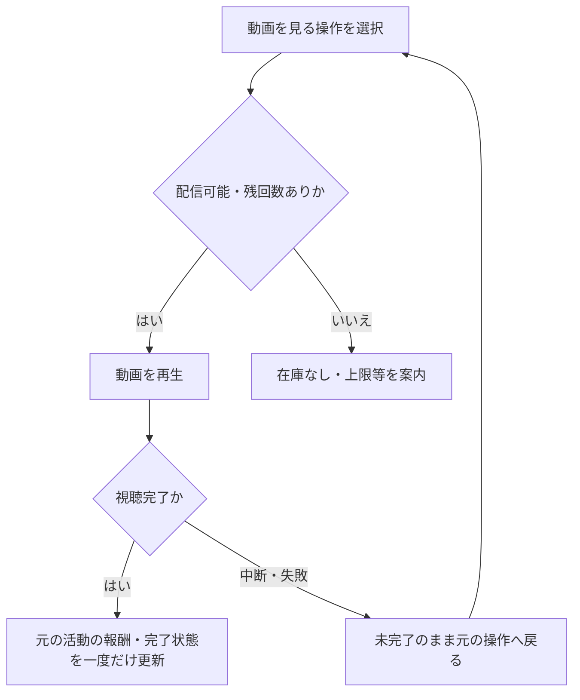

# F09｜動画リワード広告 PRD（レビュー前）

> ④業務ルールと⑦以降はユーザーレビュー未完了。機能・画面・操作は現在の4189モックを正とし、優先順位はスプレッドシートを正とする。本PRDはTier1のみを定義する。

参照するモック：`Tameruko-Preview-20261013` の4189（2026-10-15確認）。未接続の外部API・実端末機能は、接続済みとして扱わず末尾に記載する。

| 基本情報 | 内容 |
| --- | --- |
| 機能ID | F09 |
| 概要 | 動画リワード広告 |
| 対象領域 | アプリ／管理画面／外部連携 |
| 関連機能 | [F07](F07-daily-mission.md)、[F08](F08-walking.md)、[F11](F11-mini-games.md)、[F12](F12-points.md) |
| 更新日 | 2026-10-15 |
| 版 | レビュー前（初版未確定） |

## ① 目的・今回作る範囲

目的：広告視聴でポイントを獲得できるようにするため

評価指標：広告要求数・配信数/視聴完了数/報酬確定数/広告収益・付与費用

優先順位は[アプリ詳細要件のTier列](https://docs.google.com/spreadsheets/d/1g00ZxLGprVNT4T4uSmzw--vRpp95HQ1Uq9i8GnJpmS4/edit#gid=1107057215)を正とする。モックに存在してもTier2・Tier3・空欄の要件は本PRDの定義対象に含めない。

| 要件ID | Tier1の範囲 |
| --- | --- |
| F09-1 | 動画リワード広告を再生できる |
| F09-2 | 正式な視聴完了に対して一度だけ報酬を付与できる |
| F09-3 | 広告在庫なし・失敗・中断から再試行できる |
| F09-4 | 運営が動画枠の回数・報酬・公開状態を設定できる |
| F09-5 | 初回のみ、動画報酬の獲得完了を閉じた後にATTの設定案内を確認できる |
| F09-6 | オンボーディングで生年月日・性別を入力できる |
| F09-7 | 年齢区分に応じて、18歳以上にはAppLovin、18歳未満にはAdMobを接続元として動画リワード広告を配信できる（未成年は年齢確認・親権者同意後） |

管理側は[管理画面詳細要件のTier列](https://docs.google.com/spreadsheets/d/1g00ZxLGprVNT4T4uSmzw--vRpp95HQ1Uq9i8GnJpmS4/edit#gid=1341040600)にある以下のTier1を関連範囲とする。NACS本体の内製要件にはしない。

| 要件ID | Tier1の運用範囲 |
| --- | --- |
| ADM-F06-1 | 運営担当者が動画広告枠の報酬・回数・公開状態を設定できる |

要件名に旧モックとの相違がある場合、優先順位は維持し、現在の表示・動きとユーザー指定を②以降へ反映する。実装方式の具体化は仕様設計で扱う。

## ② 画面イメージ

[アプリの該当画面](http://127.0.0.1:4189/mock-app/#home/daily)

- デイリーミッションから動画を視聴し、本日の利用回数・完了状態と報酬を確認できる。
- 歩数やミニゲーム内の動画も、それぞれの受取条件に従って実行する。
- 視聴中断・配信なし・通信失敗・報酬受取失敗の状態を確認用設定で再現する。

## ③ 操作フロー

## ④ 業務ルール・制約

> ユーザーレビュー未完了。アプリ上の表示に関わるルールを記載する。

### 表示する対象ユーザー

| 対象ユーザー | 利用・表示 |
| --- | --- |
| 会員 | 動画視聴の入口・残回数・活動報酬を確認する |
| 非会員（ゲスト） | 動画視聴の入口・残回数・活動報酬を確認する |

### 表示条件

| 状態・条件 | 表示のルール |
| --- | --- |
| 対象年齢・対象枠の条件に合う | 利用できる動画視聴の入口を表示する |
| 視聴前 | 本日の残回数と獲得報酬を表示する |
| 視聴完了後 | 報酬と完了状態を更新する |

### 接続元の切り替え

| 年齢区分 | 接続元 | 配信条件 |
| --- | --- | --- |
| 18歳以上 | AppLovin | 生年月日が確認済みであること |
| 18歳未満 | AdMob | 生年月日・親権者同意が確認済みであること |
| 年齢未確認／同意未完了 | なし | 動画リワードの入口を配信対象外にする |

これはモック上の配信判定であり、実際のSDK接続・広告リクエストの年齢処理・法令対応は本番実装時に別途確認する。

### 画面に置く要素・操作

| 画面・要素 | 表示・操作のルール |
| --- | --- |
| 動画を見る入口 | デイリーミッション等から動画を再生する |
| 本日の利用回数・報酬 | 単独動画は現設定で1日3回、1回100ptを表示する |
| 機能内の動画 | 歩数・サイコロゲームの受取条件に応じた報酬を表示する |
| 報酬獲得の画面 | 正式な視聴完了後に獲得結果を表示する |
| 初回獲得後の案内 | 報酬完了画面を閉じた後にATT設定の案内を表示する |

## ⑤ 管理画面

新規作成・変更・削除は、現在の管理画面で操作できる範囲を示す。「外部管理」はNACS・EDOCODE等の担当範囲、「未実装」は操作画面がない項目。削除と公開停止は分けて記載する。

[実行設定の管理画面](http://127.0.0.1:4189/mock-admin/legacy.html#points)

| 対象項目 | 新規作成 | 変更 | 削除 | 管理画面での操作・反映範囲 |
| --- | --- | --- | --- | --- |
| 単独動画の回数・報酬 | 不可 | 可能 | 不可 | 既存の付与設定を編集して保存する。日時指定の予約変更は管理側Tier2のため本PRDでは定義しない。 |
| 動画設定項目自体・新しい外部広告枠 | 不可 | 不可 | 不可 | 既存の回数・報酬項目を使う。広告SDKの枠追加UIはない。 |
| 動画機能のアプリ別ON/OFF | 不可 | 可能 | 不可 | 構想設定の変更。実SDKへの配信設定反映は未接続。 |

## ⑥ 例外処理・エラーハンドリング

| 状況 | 表示・処理・復帰 |
| --- | --- |
| 広告なし・通信失敗 | 理由を表示し、回数や報酬を誤って消費しない。 |
| 中断・完了通知の再送 | 未完了では付けず、同じ完了イベントで二重付与しない。 |

## ⑦ 達成条件・未決事項

> 本節以降はユーザーレビュー未完了。

### Tier1の達成条件

- [ ] F09-1：動画リワード広告を再生できる。
- [ ] F09-2：正式な視聴完了に対して一度だけ報酬を付与できる。
- [ ] F09-3：広告在庫なし・失敗・中断から再試行できる。
- [ ] F09-4：運営が動画枠の回数・報酬・公開状態を設定できる。
- [ ] F09-5：初回のみ、動画報酬の獲得完了を閉じた後にATTの設定案内を確認できる。
- [ ] F09-6：オンボーディングで生年月日・性別を入力できる。
- [ ] F09-7：18歳以上にはAppLovin、18歳未満にはAdMobを接続元として動画リワード広告を配信できる。
- [ ] ①の管理側Tier1に対応する操作について、⑤の新規作成・変更・削除可否と反映範囲を確認できる。
- [ ] ⑥の対象となる空・失敗・中断などの状態から、表示内容と次の操作を確認できる。

### まだ決まっていないこと

なし。認証・API接続などの具体的な方法は、別途仕様設計で定める。

## モックへの未反映・対象外

### モックへの未反映

| 項目 | 未反映の内容 |
| --- | --- |
| 動画広告の接続 | 広告SDKによる実配信、正式な視聴完了通知・収益計測は未接続 |
| ポイント付与 | 本番の視聴結果とEDOCODEの付与処理は未接続 |

### 今回の対象外

| 項目 | 対象外の内容 |
| --- | --- |
| なし | — |

## 変更履歴

| 版 | 日付 | 変更内容 |
| --- | --- | --- |
| レビュー前 | 2026-10-16 | 年齢区分に応じた広告接続元（成人AppLovin・未成年AdMob）と、年齢確認・親権者同意後の配信条件を追加。 |
| レビュー前 | 2026-10-15 | F10レビューの共通フィードバックを反映。⑤を管理画面へ変更し、④を対象ユーザー・表示条件・配置要素に整理。例外処理と仕様設計事項の重複を除き、未反映と対象外を別表に分離。個別レビューは未完了。 |
