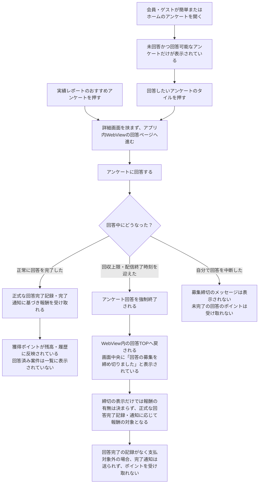

# F10｜アンケート PRD（第1版）

> 第1版：2026-10-15。ここまでのレビュー指定を反映。④および末尾の「モックへの未反映・対象外」はユーザーレビュー未完了。

参照するモック：`Tameruko-Preview-20261013` の[4189](http://127.0.0.1:4189/mock-app/#surveys)。現在の画面・操作を基準とし、今回提示されたアンケート側仕様を優先する。未接続の本番API・WebView連携と、今回仕様のモック未反映は末尾で区別する。

| 基本情報 | 内容 |
| --- | --- |
| 機能ID | F10 |
| 概要 | 届いているアンケートを確認し、WebViewで回答して、外部の完了通知に基づく報酬を受け取る |
| 対象領域 | アプリ／アンケート提供側／ポイント基盤 |
| 関連機能 | [F02：ホーム](F02-home.md)、[F07：ミッション](F07-daily-mission.md)、[F12：ポイント](F12-points.md)、[F15：バナー](F15-ad-placements.md)、[F18：マイページ・問い合わせ](F18-mypage-support.md) |
| 更新日 | 2026-10-15 |
| 版 | 第1版 |

## ① 目的・今回作る範囲

目的：回答できるアンケートへ迷わず進み、回答完了後のポイントを正しく受け取れるようにするため

優先順位は[アプリ詳細要件のTier列](https://docs.google.com/spreadsheets/d/1g00ZxLGprVNT4T4uSmzw--vRpp95HQ1Uq9i8GnJpmS4/edit#gid=1107057215)を正とする。モックに存在してもTier2・Tier3・空欄の要件は本PRDの定義対象に含めない。

| 要件ID | Tier1の範囲 |
| --- | --- |
| F10-1 | アプリ上で届いているアンケートのタイトル・所要時間・報酬を確認できる |
| F10-2 | 一覧にあるタイルを押したら、回答ページへWebViewで遷移する |
| F10-3 | 外部の回答完了通知に基づいて、ユーザーが報酬を受け取りできる |
| F10-4 | ユーザーが簡単（アンケート一覧）画面で残高を確認してポイント獲得履歴へ移動できる |
| F10-6 | 実績レポートのおすすめアンケートを選択すると、詳細画面を挟まず回答へ進める |

管理側は[管理画面詳細要件のTier列](https://docs.google.com/spreadsheets/d/1g00ZxLGprVNT4T4uSmzw--vRpp95HQ1Uq9i8GnJpmS4/edit#gid=1341040600)にある以下のTier1を関連範囲とする。NACS本体の内製要件にはしない。

| 要件ID | Tier1の運用範囲 |
| --- | --- |
| ADM-F06-4 | 運営担当者が通常アンケートの種別ごとの還元率を設定できる |

要件名に旧モックとの相違がある場合、優先順位は維持し、現在の表示・動きとユーザー指定を②以降へ反映する。実装方式の具体化は仕様設計で扱う。

## ② 画面イメージ

| 画面 | 入口／参照 | 表示・遷移 |
| --- | --- | --- |
| アンケート一覧 | 簡単／ホームカテゴリ「アンケート」→ `#surveys` | タイトルは「アンケートでためる」。未回答かつ回答可能な案件だけを表示し、件数と回答済み欄は表示しない |
| 実績レポートのおすすめ | レポートのアンケートを選択 | 詳細画面を挟まず、WebViewの回答ページへ進む |
| 回答ページ | アンケート提供側の回答URL | アプリ内WebViewで回答する |
| 募集満了時の回答TOP | アンケート側のWebView内画面 | 回答中でも強制終了して回答TOPへ戻り、画面中央に「回答の募集を締め切りました」と表示する。アプリのアンケート一覧へ戻すこととは区別する |
| ポイント獲得履歴 | 一覧画面の残高を押す | 本人のポイント履歴を表示する |

バナーの入稿・掲載位置・サイズ・余白・配信条件は[F15](F15-ad-placements.md)で管理する。ホームのアンケートから別の一覧を作らず、旧URL `#home/survey` も共通一覧へつなぐ。

## ③ 操作フロー

### 一覧・レポートから回答する



募集満了は、他の利用者の回答による回収上限到達、または配信終了時刻の到来を指す。利用者本人の回答が正常完了として記録される「回答完了」と区別する。

報酬は正式な回答完了記録と提供側の完了通知に基づいて扱う。募集締切メッセージが表示されたことだけで、付与済み・付与対象外とは判断しない。回答完了記録がなく支払対象外と判定された回答には完了通知が送られず、ポイントも付与しない。

認証・セッションの引き継ぎ、通知受付・付与APIの具体的な処理方法は仕様設計で定める。本PRDでは利用者の操作と結果を定義する。

## ④ 業務ルール・制約

> ユーザーレビュー未完了。ここではアプリ上の表示に関わるルールを記載する。

### 表示する対象ユーザー

| 対象ユーザー | 利用・表示 |
| --- | --- |
| 会員 | アンケートを利用でき、回答可能な案件を表示する |
| 非会員（ゲスト） | アンケートを利用でき、回答可能な案件を表示する |

### アンケートの表示条件

| アンケートの状態 | 一覧への表示 |
| --- | --- |
| 回答前 | 未回答かつアンケート提供側が回答可能としている案件を表示する |
| 回答済み | 表示しない |
| 募集終了 | 表示しない |

### 画面に置く要素・操作

| 画面・要素 | 表示・操作のルール |
| --- | --- |
| 一覧の見出し | 「アンケートでためる」と表示する |
| アンケートのタイル | タイトル・所要時間・報酬を表示し、タイル全体を押すと回答ページへWebViewで進む |
| 一覧の入口 | ホームカテゴリのアンケートと下部の簡単は同じ一覧を開く |
| 実績レポートのおすすめ | アンケートのエリアを押すと詳細・条件画面を挟まず回答へ進む |

一覧の取得単位はアンケート提供側の仕様に従い、アプリ側で独自の取得上限を決めない。バナーの表示・入稿ルールは[F15](F15-ad-placements.md)で管理する。

## ⑤ 管理画面

[ライフサーベイの還元率管理画面](http://127.0.0.1:4189/mock-admin/legacy.html#survey)

| 対象項目 | Tier | 新規作成 | 変更 | 削除 | 管理画面での操作・反映範囲 |
| --- | --- | --- | --- | --- | --- |
| アンケート種別（本調査・スクリーニング）のユーザー還元率 | Tier1 | 不可 | 可能 | 不可 | 種別ごとに還元率（%）を入力し、算出された1問あたり（デモグラは1回あたり）のユーザー還元ポイントを確認して保存する。 |
| 種別ごとの表示セクションの追加・削除 | Tier2 | 可能 | — | 可能 | 種別ごとの表示セクションを追加・削除する。種別そのものの追加・削除とは区別する。 |

### 接続するアンケートツールと基準ポイント

現在の接続対象は、弊社が内製しているアンケートツール「ライフサーベイ」。今後は外部のアンケートツールも接続していく。

基準ポイントは、各アンケートツール側と契約を結んで与えられる値。ツールごと・アンケート種別ごとの契約値として保持し、ユーザーへのポイント算出に直接使用する。回答通知から取得する値ではない。

ライフサーベイは自社ツールのため、アンケート実施単価がスクリーニング1円／問、本調査10円／問、ツール側の取り分が50%であることが分かっている。一方、外部のアンケートツールからは基準ポイントのみが与えられ、実施単価やツール側の取り分が提供される前提にはしない。

このため、実施単価・売上単価・取り分・配分率はシステムで保持せず、管理画面にも表示しない。円換算や取り分から基準ポイントを算出する処理も設けない。ライフサーベイの単価・取り分は契約背景の説明であり、システムの設定項目ではない。

### 回答通知とポイント計算

回答通知として返される項目は「アンケート種別」と「回答設問数」のみ。報酬額・基準ポイント・還元率が通知される前提にはしない。接続元ツールと通知された種別に対応する契約上の基準ポイント、および自社で設定したユーザー還元率を用いる。

本調査・スクリーニングは通知された回答設問数を計算に使う。ライフサーベイのデモグラは回答完了1回につき100pt固定とし、通知された設問数・ユーザー還元率を計算に使わない。

以下はライフサーベイの値。外部ツールに同じ値や種別・固定報酬の扱いを一律適用せず、各契約に従う。

| アンケート種別 | 基準ポイント・固定報酬 | 管理画面での操作 |
| --- | --- | --- |
| 本調査 | 500pt／問 | 基準ポイントは閲覧のみ。還元率を入力する。 |
| スクリーニング | 50pt／問 | 基準ポイントは閲覧のみ。還元率を入力する。 |
| デモグラ | 100pt／回（固定報酬） | 閲覧のみ。還元率の変更・保存は不可。 |

- デモグラは100pt／回固定。還元率入力と保存ボタンを無効化し、保存処理でも変更を拒否する。
- 本調査・スクリーニングで入力する値はユーザー還元率（%）。上記の基準ポイントはシステムで保持し、管理画面では変更できない。
- 管理画面では、ツール側との契約で与えられた基準ポイントを閲覧専用で表示する。本調査・スクリーニングは、その契約値に対するユーザー還元率を入力し、算出結果を確認する。ライフサーベイのデモグラは100pt／回の固定表示とし、還元率の入力対象に含めない。売上単価・メディア配分率は、列・説明文・注記を含め管理画面に表示しない。システムでも保持しない。入力変更に応じて結果をプレビューする。
- 「換算例」やサンプル案件による例示は表示しない。プレビューは実際の入力値から算出した設定結果とする。
- 還元率が100%を超えた場合、入力欄・算出ポイントを赤くし、「100%を超えています。ユーザーへの還元が基準ポイントを上回ります」と文字でも警告する。保存時に警告ダイアログを表示し、確認すると100%超でも保存できる。キャンセル時は保存しない。
- 100%以下であっても、その他の費用を含めた事業全体の黒字を保証するものではない。

### ライフサーベイの計算式

```text
本調査・スクリーニング：
基準ポイント／問 ＝ 本調査500pt、スクリーニング50pt
最終付与ポイント ＝ 回答した設問数 × 基準ポイント／問 × ユーザー還元率 ÷ 100

デモグラ：
基準ポイント／回 ＝ 100pt（ユーザー指定値）
最終付与ポイント ＝ 100pt（固定。還元率を適用しない）
※回答完了1回につき算出し、設問数は掛けない。
```

回答完了記録・完了通知による付与条件は③・⑥に従う。設問数だけで未完了の回答へ付与しない。

## ⑥ 例外処理・エラーハンドリング

| 状況 | 表示・処理・復帰 |
| --- | --- |
| 一覧取得中 | 読み込み中の表示にする |
| 回答可能な案件がない | 空の案内を表示する。件数は表示しない |
| 一覧取得失敗 | 失敗と再読み込みを案内する。空状態に置き換えない |
| 回答URL不備・WebView起動失敗 | エラーを案内して再試行できるようにする。本番ではダミー回答へ進めない |
| 回答中の回収上限到達・配信期間終了（`failed_precondition`） | アンケート側が回答を強制終了してWebView内の回答TOPへ戻す。画面中央に「回答の募集を締め切りました」を表示する。通常の404・500エラーとは別に扱う |
| 募集満了後、回答完了が記録されていない | 原則として支払対象外となり、完了通知は送られず、ユーザーへの報酬・ポイントも付与しない。画面のエラー表示だけで支払・付与の可否を判断しない |
| 利用者自身による中断 | 募集締切メッセージは表示しない。回答が完了していなければポイントを付与しない |
| 報酬がまだ反映されていない | 受取済みの表示や残高加算を先に行わない |
| 同じ回答への重複操作 | 同じ回答の報酬が重複して増えない |

## モックへの未反映・対象外

### モックへの未反映

⑤の固定単価・メディア配分額・基準ポイント・還元結果プレビュー・100%超警告を管理画面モックに反映済み。換算例は削除済み。100%超は入力時に警告し、保存時の警告ダイアログで確認すると保存できる。デモグラは100pt／回固定で、還元率の入力・保存は不可。アプリ側の付与計算は円建て報酬額を使っており、設問数ベースへの変更は未反映。

| 項目 | 未反映の内容 |
| --- | --- |
| WebView | 現行モックは別タブと外部ブラウザー用接続口。アプリ内WebViewの実装・実機確認は未実施 |
| 回答・付与の連携 | 固定サンプルとローカル保存。実一覧API・完了通知・EDOCODE台帳は未接続 |
| 募集満了時の回答TOP・案内 | 今回提示されたアンケート側仕様を優先。現モックの「募集終了時はメッセージなし」という挙動は未更新。回答の強制終了・回答TOPへの遷移・締切メッセージの表示は、今回モック本体へ反映していない |

### 今回の対象外

| 項目 | 対象外の内容 |
| --- | --- |
| なし | — |

## 変更履歴

| 版 | 日付 | 変更内容 |
| --- | --- | --- |
| 第1版 | 2026-10-15 | ここまでのレビュー指定を反映して第1版に整理。Tier1の範囲、会員・非会員の利用、回答への直接遷移、募集満了時の動き、表示条件と管理画面を整理。モック未反映・今回の対象外を分離。④と⑦以降の未レビュー表示を維持。 |
| 第1版（表現修正） | 2026-10-15 | ③のフロー図の構成・分岐・接続は元のまま維持し、文章だけをユーザーの操作・見える状態・受ける動作の表現に修正。 |
| 第1版（表示項目修正） | 2026-10-15 | ④の「画面に置く要素・操作」から残高を削除。アンケートツール側から対象外案件は連携されないため、「アンケートの表示条件」から対象外の行を削除。 |
| 第1版（還元仕様修正） | 2026-10-15 | ⑤を設問数×固定単価×ポイント換算係数×還元率の仕様へ更新。換算例を廃止し、設定結果プレビュー・100%超警告を定義。表示セクションの追加・削除をTier2として明記。未指定事項とモック未反映を明記。 |
| 第1版（単価訂正） | 2026-10-15 | スクリーニングの単価を1問1円、100%還元時の基準ポイントを1問100ptに訂正。 |
| 第1版（契約配分反映） | 2026-10-15 | ツール売上の50%がメディアへ配分される契約条件を反映。100%ユーザー還元時の基準をスクリーニング50pt／問、本調査500pt／問に変更し、計算式・管理表示・達成条件を更新。 |
| 第1版（管理画面反映） | 2026-10-15 | 固定単価・50%配分・50pt／500pt基準・還元率入力と結果プレビューを管理画面に反映。100%超は警告して保存不可、デモグラは単価未定で操作不可。Tier2の表示セクション追加・削除を案内。 |
| 第1版（デモグラ単価確定） | 2026-10-15 | デモグラをスクリーニングと同じ売上単価1円／問、メディア配分0.5円／問、基準50pt／問に設定。管理画面の還元率入力・保存を有効化。 |
| 第1版（ツール名・配分表示） | 2026-10-15 | 管理画面にライフサーベイの名称を明記し、メディア配分欄を全種別50%の率表示に統一。 |
| 第1版（管理画面の列整理） | 2026-10-15 | 管理画面から売上単価／問・メディア配分率の2列を削除。算出用の固定値と計算式は維持。 |
| 第1版（100%超の保存） | 2026-10-15 | 100%超も警告ダイアログで確認後に保存可能とし、キャンセル時は保存しない。 |
| 第1版（デモグラ単位訂正） | 2026-10-15 | デモグラを設問数によらず回答完了1回1円・基準50pt／回に訂正。管理画面の単位・プレビュー・計算式と達成条件を更新。 |
| 第1版（デモグラ基準訂正） | 2026-10-15 | ユーザー指定によりデモグラの基準を100pt／回へ訂正。管理画面・計算式・達成条件に反映し、契約配分との整合は要確認と明記。 |
| 第1版（デモグラ固定報酬） | 2026-10-15 | デモグラを100pt／回固定とし、還元率の入力・保存を無効化。保存処理でも変更を拒否する。 |
| 第1版（構成整理） | 2026-10-15 | ユーザー指定により⑦「達成条件・未決事項」を全削除。「まだ決まっていないこと」の2項目と本文の重複する未決注記を削除。 |
| 第1版（非表示項目の明記） | 2026-10-15 | 売上単価・メディア配分率は内部計算用とし、管理画面の列・説明文・注記には表示しないことを明記。 |
| 第1版（保持項目の訂正） | 2026-10-15 | 売上単価・メディア配分率を非保持とし、円換算・配分計算を削除。基準ポイントを直接使用する仕様に統一。 |
| 第1版（接続ツール・通知仕様） | 2026-10-15 | ライフサーベイが自社内製であることと今後の外部接続方針を追加。基準ポイントは契約で与えられる値、回答通知は種別・回答設問数のみと明記。単価・配分率の非保持と管理表示の説明を整理。 |
