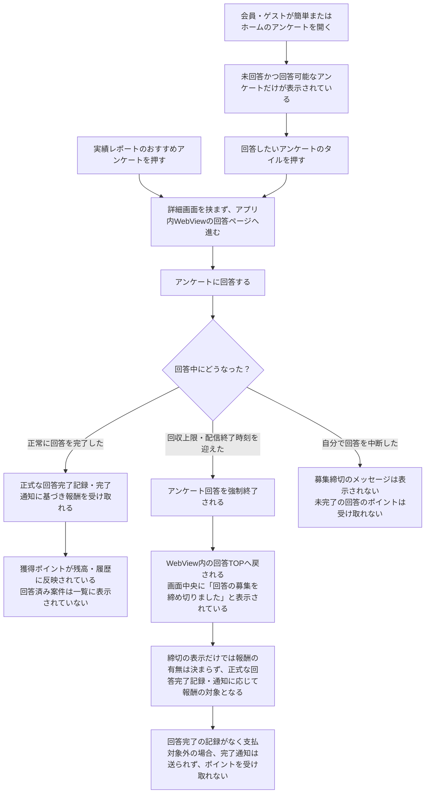

# F10｜アンケート PRD（第1版）

> 第1版：2026-10-16。ここまでのレビュー指定を反映。④および末尾の「モックへの未反映・対象外」はユーザーレビュー未完了。

参照するモック：`Tameruko-Preview-20261013` の[4189](http://127.0.0.1:4189/mock-app/#surveys)。現在の画面・操作を基準とし、今回提示されたアンケート側仕様を優先する。未接続の本番API・WebView連携と、今回仕様のモック未反映は末尾で区別する。

| 基本情報 | 内容 |
| --- | --- |
| 機能ID | F10 |
| 概要 | 届いているアンケートを確認し、WebViewで回答して、外部の完了通知に基づく報酬を受け取る |
| 対象領域 | アプリ／アンケート提供側／ポイント基盤 |
| 関連機能 | [F02：ホーム](F02-home.md)、[F07：ミッション](F07-daily-mission.md)、[F12：ポイント](F12-points.md)、[F15：バナー](F15-ad-placements.md)、[F18：マイページ・問い合わせ](F18-mypage-support.md) |
| 更新日 | 2026-10-16 |
| 版 | 第1版 |

## ① 目的・今回作る範囲

目的：回答できるアンケートへ迷わず進み、回答完了後のポイントを正しく受け取れるようにするため

優先順位は[アプリ詳細要件のTier列](https://docs.google.com/spreadsheets/d/1g00ZxLGprVNT4T4uSmzw--vRpp95HQ1Uq9i8GnJpmS4/edit#gid=1107057215)を正とする。モックに存在してもTier2・Tier3・空欄の要件は本PRDの定義対象に含めない。

| 要件ID | Tier1の範囲 |
| --- | --- |
| F10-1 | アプリ上で届いているアンケートのタイトル・所要時間・報酬を確認できる |
| F10-2 | 一覧にあるタイルを押したら、回答ページへWebViewで遷移する |
| F10-3 | 外部の回答完了通知に基づいて、ユーザーが報酬を受け取りできる |
| F10-4 | ユーザーが簡単（アンケート一覧）画面で残高を確認してポイント獲得履歴へ移動できる |
| F10-6 | 実績レポートのおすすめアンケートを選択すると、詳細画面を挟まず回答へ進める |

管理側は[管理画面詳細要件のTier列](https://docs.google.com/spreadsheets/d/1g00ZxLGprVNT4T4uSmzw--vRpp95HQ1Uq9i8GnJpmS4/edit#gid=1341040600)にある以下のTier1を関連範囲とする。NACS本体の内製要件にはしない。

| 要件ID | Tier1の運用範囲 |
| --- | --- |
| ADM-F06-4 | 運営担当者が配信元ごとの還元率を設定できる |

要件名に旧モックとの相違がある場合、優先順位は維持し、現在の表示・動きとユーザー指定を②以降へ反映する。実装方式の具体化は仕様設計で扱う。

## ② 画面イメージ

| 画面 | 入口／参照 | 表示・遷移 |
| --- | --- | --- |
| アンケート一覧（LIFE Survey） | 簡単／ホームカテゴリ「アンケート」→ `#surveys` | 「LIFE Survey」セクションとして表示する。未回答かつ回答可能な案件だけを表示し、件数と回答済み欄は表示しない |
| アンケート一覧（リサーチプラスネットワーク） | `#surveys` | 「リサーチプラスネットワーク」セクションとして表示する。未回答かつ回答可能な案件だけを表示し、LIFE Surveyとは別に報酬を表示する |
| 配信がない場合 | アンケート一覧 | 該当するアンケートがないセクションは、見出し・枠・余白を表示せず、上下を詰めて表示する |
| 実績レポートのおすすめ | レポートのアンケートを選択 | 詳細画面を挟まず、WebViewの回答ページへ進む |
| 回答ページ | アンケート提供側の回答URL | アプリ内WebViewで回答する |
| 募集満了時の回答TOP | アンケート側のWebView内画面 | 回答中でも強制終了して回答TOPへ戻り、画面中央に「回答の募集を締め切りました」と表示する。アプリのアンケート一覧へ戻すこととは区別する |
| ポイント獲得履歴 | 一覧画面の残高を押す | 本人のポイント履歴を表示する |

バナーの入稿・掲載位置・サイズ・余白・配信条件は[F15](F15-ad-placements.md)で管理する。ホームのアンケートから別の一覧を作らず、旧URL `#home/survey` も共通一覧へつなぐ。

## ③ 操作フロー

### 一覧・レポートから回答する

募集満了は、他の利用者の回答による回収上限到達、または配信終了時刻の到来を指す。利用者本人の回答が正常完了として記録される「回答完了」と区別する。

報酬は正式な回答完了記録と提供側の完了通知に基づいて扱う。募集締切メッセージが表示されたことだけで、付与済み・付与対象外とは判断しない。回答完了記録がなく支払対象外と判定された回答には完了通知が送られず、ポイントも付与しない。

認証・セッションの引き継ぎ、通知受付・付与APIの具体的な処理方法は仕様設計で定める。本PRDでは利用者の操作と結果を定義する。

## ④ 業務ルール・制約

> ユーザーレビュー未完了。ここではアプリ上の表示に関わるルールを記載する。

### 表示する対象ユーザー

| 対象ユーザー | 利用・表示 |
| --- | --- |
| 会員 | アンケートを利用でき、回答可能な案件を表示する |
| 非会員（ゲスト） | アンケートを利用でき、回答可能な案件を表示する |

### アンケートの表示条件

| アンケートの状態 | 一覧への表示 |
| --- | --- |
| 回答前 | 未回答かつアンケート提供側が回答可能としている案件を表示する |
| 回答済み | 表示しない |
| 募集終了 | 表示しない |

### 画面に置く要素・操作

| 画面・要素 | 表示・操作のルール |
| --- | --- |
| LIFE Surveyセクションの見出し | 「LIFE Survey」と表示する |
| リサーチプラスネットワークセクションの見出し | 「リサーチプラスネットワーク」と表示する |
| 配信元ごとの表示条件 | LIFE Surveyとリサーチプラスネットワークは、それぞれ回答可能なアンケートが1件以上ある場合だけセクションを表示する。対象がない場合は見出し・枠・余白を表示せず上下を詰める |
| アンケートのタイル | タイトル・所要時間・報酬を表示し、タイル全体を押すと回答ページへWebViewで進む |
| 一覧の入口 | ホームカテゴリのアンケートと下部の簡単は同じ一覧を開く |
| 実績レポートのおすすめ | アンケートのエリアを押すと詳細・条件画面を挟まず回答へ進む |

一覧の取得単位はアンケート提供側の仕様に従い、アプリ側で独自の取得上限を決めない。バナーの表示・入稿ルールは[F15](F15-ad-placements.md)で管理する。

## ⑤ 管理画面

[LIFE Survey／リサーチプラスネットワークの還元率管理画面](http://127.0.0.1:4189/mock-admin/legacy.html#survey)

| 対象項目 | Tier | 新規作成 | 変更 | 削除 | 管理画面での操作・反映範囲 |
| --- | --- | --- | --- | --- | --- |
| LIFE Surveyのユーザー還元率 | Tier1 | 不可 | 可能 | 不可 | LIFE Surveyの還元率（%）を設定し、100%還元時の基準ポイント×還元率で算出されたポイントを確認して保存する。 |
| リサーチプラスネットワークのユーザー還元率 | Tier1 | 不可 | 可能 | 不可 | リサーチプラスネットワークの還元率（%）を設定し、SCRは10問ごとに110pt、本調査は110pt／問を100%還元時の基準として算出されたポイントを確認して保存する。 |
| 種別ごとの表示セクションの追加・削除 | Tier2 | 可能 | — | 可能 | 種別ごとの表示セクションを追加・削除する。種別そのものの追加・削除とは区別する。 |

### 配信元ごとの回答通知とポイント計算

初期リリースから、以下2つのアンケート配信元を接続する。LIFE Surveyとリサーチプラスネットワークは、どちらもアンケートの配信元として同じ扱いにする。

| 配信元 | 計算式 | 条件 |
| --- | --- | --- |
| LIFE Survey | 本調査：回答設問数 × 500pt／問 × LIFE Surveyの還元率 ÷ 100。スクリーニング：回答設問数 × 50pt／問 × LIFE Surveyの還元率 ÷ 100。デモグラ：100pt／回答（固定）。 | 本調査の単価は10円／問、スクリーニングの単価は1円／問。ツール側の取り分は50%。500pt／問・50pt／問・100pt／回答は、当社受取報酬額を100%還元したときのLIFE Surveyの基準ポイント。 |
| リサーチプラスネットワーク | SCR：10問ごとに110pt × リサーチプラスネットワークの還元率 ÷ 100。本調査：回答設問数 × 110pt／問 × リサーチプラスネットワークの還元率 ÷ 100。 | SCRは10問ごとに1.1円＝110pt。本調査は1問あたり1.1円＝110pt／問。110ptは、当社受取報酬額を100%還元したときの基準ポイント。 |

上記の数値と計算式は配信元ごとに適用し、別の配信元へ流用しない。

## ⑥ 例外処理・エラーハンドリング

| 状況 | 表示・処理・復帰 |
| --- | --- |
| 一覧取得中 | 読み込み中の表示にする |
| 回答可能な案件がない | 空の案内を表示する。件数は表示しない |
| 一覧取得失敗 | 失敗と再読み込みを案内する。空状態に置き換えない |
| 回答URL不備・WebView起動失敗 | エラーを案内して再試行できるようにする。本番ではダミー回答へ進めない |
| 回答中の回収上限到達・配信期間終了（`failed_precondition`） | アンケート側が回答を強制終了してWebView内の回答TOPへ戻す。画面中央に「回答の募集を締め切りました」を表示する。通常の404・500エラーとは別に扱う |
| 募集満了後、回答完了が記録されていない | 原則として支払対象外となり、完了通知は送られず、ユーザーへの報酬・ポイントも付与しない。画面のエラー表示だけで支払・付与の可否を判断しない |
| 利用者自身による中断 | 募集締切メッセージは表示しない。回答が完了していなければポイントを付与しない |
| 報酬がまだ反映されていない | 受取済みの表示や残高加算を先に行わない |
| 同じ回答への重複操作 | 同じ回答の報酬が重複して増えない |

## モックへの未反映・対象外

### モックへの未反映

⑤の固定単価・メディア配分額・基準ポイント・還元結果プレビュー・100%超警告を管理画面モックに反映済み。換算例は削除済み。100%超は入力時に警告し、保存時の警告ダイアログで確認すると保存できる。デモグラは100pt／回固定で、還元率の入力・保存は不可。アプリ側の付与計算は円建て報酬額を使っており、設問数ベースへの変更は未反映。

| 項目 | 未反映の内容 |
| --- | --- |
| WebView | 現行モックは別タブと外部ブラウザー用接続口。アプリ内WebViewの実装・実機確認は未実施 |
| 回答・付与の連携 | 固定サンプルとローカル保存。実一覧API・完了通知・EDOCODE台帳は未接続 |
| 募集満了時の回答TOP・案内 | 今回提示されたアンケート側仕様を優先。現モックの「募集終了時はメッセージなし」という挙動は未更新。回答の強制終了・回答TOPへの遷移・締切メッセージの表示は、今回モック本体へ反映していない |

### 今回の対象外

| 項目 | 対象外の内容 |
| --- | --- |
| なし | — |

## 変更履歴

| 版 | 日付 | 変更内容 |
| --- | --- | --- |
| 第1版 | 2026-10-16 | LIFE Surveyとリサーチプラスネットワークを初期リリースから配信元として接続し、配信元ごとのセクション表示・還元率・報酬計算式・管理画面の設定条件を反映した現時点の確定版。 |
