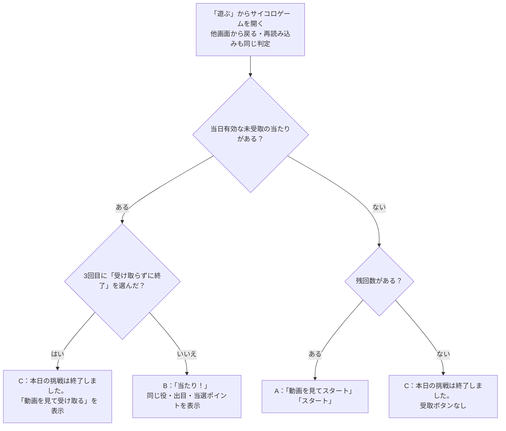
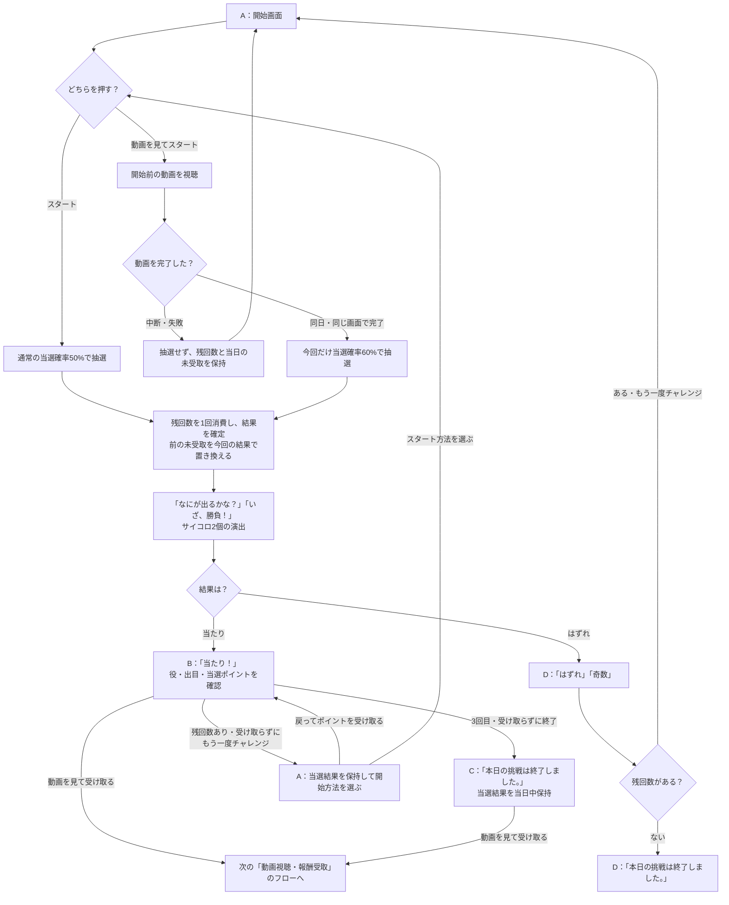
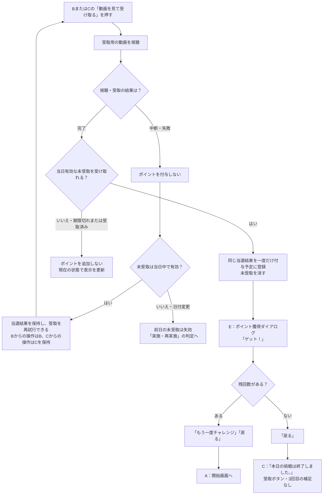

# F11｜ミニゲーム：サイコロゲーム PRD（レビュー前）

| 基本情報 | 内容 |
| --- | --- |
| 機能ID | F11 |
| 概要 | ミニゲーム：サイコロゲーム |
| 対象領域 | アプリ／管理画面／外部連携 |
| 関連機能 | [F09](F09-rewarded-video.md)、[F12](F12-points.md) |
| 更新日 | 2026-10-23 |
| 版 | レビュー前（初版未確定） |

## ① 目的・今回作る範囲

目的：短時間のゲームを毎日アプリを使うきっかけにするため。動画リワードを視聴するトリガーとなるため。

評価指標：参加率／利用回数／継続率／報酬費用。

優先順位は[アプリ詳細要件のtier列](https://docs.google.com/spreadsheets/d/1tI26I_4vbSHIOzMdJz7g8-DjeLyyVUKoksVHhZ0AQhU/edit#gid=1107057215)を正とし、今回の同期では変更しない。

| 要件ID | 優先順位 | 範囲 |
| --- | --- | --- |
| F11-1 | tier1 | サイコロゲームの残回数を確認して抽選できる |
| F11-2 | tier1 | 当たり・ハズレと確定した抽選結果を確認できる |
| F11-3 | tier1 | サイコロゲームで報酬を受け取る前に動画リワード広告を視聴させる |
| F11-4 | tier1 | 運営がサイコロゲームの回数・報酬・公開状態を設定し、固定の当選確率を確認できる |
| F11-5 | 未設定（議論事項） | 抽選前に動画を見て今回の当選確率を上げるか選べる。初回リリースに含めるかを協議する |

管理側の関連tier1は[管理画面詳細要件](https://docs.google.com/spreadsheets/d/1tI26I_4vbSHIOzMdJz7g8-DjeLyyVUKoksVHhZ0AQhU/edit#gid=1341040600)のADM-F07-1（サイコロの回数・報酬・公開状態の設定と固定確率の確認）。

## ② 画面イメージ

[GitHubで共有しているアプリモック](https://github.com/ca-toju/pochipo/tree/main/mock-app)を参照元とする。以下のA〜EはPRD内で画面を参照するための記号。画面に表示する文言は「」で記載する。

### 共通で表示する内容

| 要素 | 表示・操作 |
| --- | --- |
| 入口 | 下部の「遊ぶ」から「サイコロゲーム」を開く |
| ヘッダー | 残高・お知らせを表示する |
| ゲーム名・残回数 | 「サイコロゲーム」と「本日あと N 回」を表示する |
| ナビゲーション | 下部5タブを表示する。ホームの上部カテゴリタブは表示しない |

### A：開始画面

| 状態・要素 | 表示内容 | 操作後の動き |
| --- | --- | --- |
| 残回数あり | 器とサイコロのイラスト、「動画を見てスタート」「スタート」 | 選択した開始方法で抽選へ進む |
| 開始前動画の案内 | 「当選確率20%アップ」 | 「動画を見てスタート」を押すと開始前の動画を視聴する |
| 未受取の当たりを残して再挑戦を選択した場合 | 上記に加えて「戻ってポイントを受け取る」 | 新しい抽選を行わず、保持しているBの当選結果へ戻る |

### 抽選演出

| 要素 | 表示内容 |
| --- | --- |
| 演出中の文言 | 「なにが出るかな？」「いざ、勝負！」 |
| サイコロ | 2個のサイコロによる共通の演出を表示し、確定した結果へ切り替える |
| 演出時間 | 通常の演出は2秒。結果の役にかかわらず共通の1パターンとし、出目が確定する前の動いている状態から結果画面へ切り替える |
| 操作 | 演出中の重複操作を受け付けない |

### B：当たり画面

| 状態・要素 | 表示内容 | 操作後の動き |
| --- | --- | --- |
| 当選結果 | 「当たり！」、役名「Pゾロ」「ゾロ目」「偶数」のいずれか、サイコロ2個の出目、「当選ポイント」とポイント数 | 確定済みの結果を確認する |
| 結果のサイコロ | 2個のサイコロを静止した立体表示にする。Pゾロでは両方の1の目に、ポイントのPマークを赤色ベースにしたものを表示する | 確定した出目を表示し、再抽選しない |
| 報酬受取 | 「動画を見て受け取る」 | 受取用の動画を視聴する。開始前動画とは別に必要 |
| 残回数あり | 「受け取らずにもう一度チャレンジ」と「再挑戦すると今回のポイントはなくなります。」 | Aへ進む。新しい抽選を実行するまでは当選結果を保持する |
| 3回目の当たり・残回数なし | 「受け取らずに終了」 | 当選結果を当日中保持してCへ進む |
| 管理設定により1回目・2回目で回数上限に達した場合 | 「動画を見て受け取る」のみ | 再挑戦・「受け取らずに終了」は表示しない |

### D：はずれ画面

| 状態・要素 | 表示内容 | 操作後の動き |
| --- | --- | --- |
| 抽選結果 | 「はずれ」「奇数」、静止した立体表示のサイコロ2個の出目 | 当選ポイントと受取ボタンは表示しない |
| 残回数あり | 「もう一度チャレンジ」 | Aへ進む |
| 残回数なし | 「本日の挑戦は終了しました。」 | 新しい抽選はできない。画面を開き直すとCを表示する |

### C：本日終了画面

| 状態・要素 | 表示内容 | 操作後の動き |
| --- | --- | --- |
| 共通 | 器とサイコロのイラスト、「本日の挑戦は終了しました。」 | 当日の新しい抽選はできない |
| 3回目の当たりで「受け取らずに終了」を選び、当日中に未受取がある | 「動画を見て受け取る」「※3回目の報酬のみ受け取ることができます。」 | 同じ当選結果の受取用動画へ進む |
| 受取済み・はずれ・期限切れ | 受取ボタンと3回目の補足を表示しない | 次の利用日には、その日の残回数に応じてAへ進む |

終了画面・はずれ画面とも「また明日もチャレンジしてね」は表示しない。

### E：ポイント獲得ダイアログ

| 状態・要素 | 表示内容 | 操作後の動き |
| --- | --- | --- |
| 受取完了 | 共通のポイント獲得ダイアログでコインの挿絵・獲得ポイント・「ゲット！」を表示する | 未受取の当選結果は消える |
| 残回数あり | 「もう一度チャレンジ」「戻る」 | いずれもダイアログを閉じてAへ進む。「もう一度チャレンジ」だけでは抽選しない |
| 残回数なし | 「戻る」 | ダイアログを閉じてCへ戻る。受取ボタンと補足は表示しない |

## ③ 操作フロー

現在のモックの分岐・ボタン名・表示文言を正とする。図の「」はモックの表示文言、ひし形は状態の判定を表す。既存HTML資料のA（開始）・B（当たり）・C（本日終了）の整理を参考にし、現在のモックに合わせてD（はずれ）・E（獲得ダイアログ）を加えた。

### 実施・再実施

上図はゲームが有効な場合のフロー。公開停止時は新しく抽選できない（⑥参照）。前日の未受取は表示判定の前に失効し、翌日の使用回数はリセットする。

### 開始方法の選択・抽選・結果からの操作

「受け取らずにもう一度チャレンジ」を押した時点では、前の当たりは失われない。新しい抽選を実行した時点で置き換わる。動画中の日付変更・画面移動は④・⑥に従い、抽選しない。

### 動画視聴・報酬受取

受取動画中に画面を移動した場合、その移動先では受取完了処理を進めない。再度サイコロゲームを開いたときの状態は「実施・再実施」の図に従う。付与予定から交換可能になるまでの扱いは[F12](F12-points.md)で定義する。

## ④ 業務ルール・制約

> ユーザーレビュー未完了。現在のモックを基準に、利用条件・操作条件・報酬条件を分けて記載する。

### 利用する対象ユーザー

| 対象 | 利用・適用条件 |
| --- | --- |
| 会員 | サイコロゲームを利用できる |
| 非会員（ゲスト） | サイコロゲームを利用できる |
| 新規・継続ユーザー | 共通の確率・報酬・公開状態を適用する |

### 年齢・親権者同意と動画広告の接続元

開始前の確率アップ動画と、当選ポイントの受取動画の両方に、[F09の年齢・同意条件](F09-rewarded-video.md)を適用する。生年月日・親権者同意の取得は[F01](F01-account.md)を参照する。

| 対象 | 動画広告の接続方針 |
| --- | --- |
| 年齢確認済みの18歳以上 | AppLovin |
| 年齢確認済みの18歳未満で、親権者同意が完了 | AdMobを利用する予定。年齢に応じた広告保護設定と、下記の報酬ポリシーの確認を前提とする |
| 年齢未確認・必要な親権者同意が未完了 | 動画の入口・利用可否・確認画面への案内はF09と合わせて協議する |

公式資料の確認（2026-10-23）：

- AdMobは子ども・ティーン向けの年齢処理と広告コンテンツ制限を提供する。親権者のアプリ利用同意だけで、広告に必要な年齢処理・プライバシー設定が完了するとは扱わない。対象年齢・地域と採用SDKに合わせて設定する。[Google公式の年齢処理](https://developers.google.com/admob/android/targeting)、[未成年者向け広告保護ポリシー](https://support.google.com/admob/answer/12171027?hl=ja)。
- AppLovinは、適用法令で「child」に当たるユーザーについてSDKの初期化・利用を禁止している。「AppLovinは18歳未満が一律禁止」という意味ではないが、本アプリではF09に従い18歳未満をAdMobへ振り分ける。[AppLovin公式の子ども向け利用制限](https://support.applovin.com/en/max/android/overview/privacy)。
- AdMobのGoogle配信リワード広告では、現金・ギフトカード等の直接的な金銭報酬を禁止し、ポイント等にもアプリ内利用・譲渡不可などの条件がある。本機能の交換可能ポイントへの適用は確認が必要であり、未成年向け配信が可能という理由だけで採用可能とは確定しない。開始前の確率アップ動画と受取動画の両方について、F09・F12と合わせて広告連携担当者へ確認する。[Google公式の報酬ポリシー](https://support.google.com/admob/answer/7313578?hl=ja)。

### 実施可能な条件と回数の消費

| 状態・操作 | 抽選の可否 | 回数・当選結果の扱い |
| --- | --- | --- |
| 有効かつ残回数あり | 可能 | 現設定は1日3回。管理設定は0〜3回 |
| 残回数なし・公開停止 | 不可 | 上限を超えて新しい抽選を行わない |
| 「スタート」を押す | 可能 | 抽選実行時に1回だけ消費する |
| 「動画を見てスタート」を押す | 動画完了後に可能 | 視聴開始だけでは回数を消費しない。同日・同じ画面で完了した後に抽選する |
| 開始前動画を中断・失敗 | 抽選しない | 回数と当日有効な未受取を保持する |
| 再挑戦の開始画面へ進む・結果へ戻る・報酬を受け取る | それだけでは抽選しない | 回数を消費しない |

### 開始方法ごとの当選確率

| 開始方法 | 当選確率 | 適用範囲・報酬額 |
| --- | --- | --- |
| 「スタート」 | 50% | 通常の抽選。受取用の動画は別途必要 |
| 「動画を見てスタート」の動画完了後 | 60% | 今回の1回のみ。「当選確率20%アップ」は50%からの相対20%増。報酬額は増やさない |

#### 役の判定と固定確率

| 役 | 出目の条件 | 当たり／はずれ | 通常 | 開始前動画完了後 |
| --- | --- | --- | --- | --- |
| Pゾロ | 1・1 | 当たり | 2.78%（1/36） | 3.33%（1/30） |
| ゾロ目 | 2・2〜6・6 | 当たり | 13.89%（5/36） | 16.67%（5/30） |
| 偶数 | ゾロ目以外で合計が偶数 | 当たり | 33.33%（12/36） | 40%（12/30） |
| 奇数 | 合計が奇数 | はずれ・0pt・受取不可 | 50%（18/36） | 40%（12/30） |
| 合計当選率 | Pゾロ・ゾロ目・偶数 | — | 50% | 60% |

2個の出目で判定し、Pゾロ・ゾロ目を偶奇より優先する。通常は36通りが等確率。動画後は当たり3役の比率を保ち、各役内の組合せは等確率とする。役・出目・報酬は抽選時に固定し、同じ結果を表示し直す際に再抽選しない。

### 当たりを受け取る・再挑戦する・終了する

| 選択・条件 | 未受取の扱い | ポイントの扱い |
| --- | --- | --- |
| 当たりが出る | 最新の当たり1件を当日中保持する | 抽選だけではポイントを付与しない |
| 「動画を見て受け取る」を選ぶ | 受取完了までは保持する | 開始前動画を見ていても、受取用動画の完了が必要 |
| 受取用動画を当日中に完了し、未受取が有効 | 受取後に消す | 同じ結果IDについて一度だけ、F12共通の付与予定・準備中と履歴へ登録する |
| 「受け取らずにもう一度チャレンジ」を選ぶ | Aに戻った時点では保持する | まだ付与しない。「戻ってポイントを受け取る」で元の結果へ戻れる |
| 次の抽選を実行する | 前の未受取を失い、新しい当たりが出た場合だけ最新の1件へ置き換える | 前後の当選額を合算しない。次がはずれなら受取対象はなくなる |
| 3回目に「受け取らずに終了」を選ぶ | 当日中保持し、Cに受取導線を表示する | まだ付与しない。Cから同じ結果の動画視聴・受取を行える |
| 受取済みの結果に再度受取操作を行う | 受取対象はない | 二重に付与しない |

付与予定・準備中として登録したポイントが交換可能になるまでの処理はF12の範囲とする。

### 画面を開き直した場合と日付が変わった場合

| 条件 | 表示する画面 | 残回数・報酬の扱い |
| --- | --- | --- |
| 当日有効な未受取あり・終了操作なし | B | 同じ当選結果を表示する。抽選・回数消費をやり直さない |
| 3回目に「受け取らずに終了」済み・当日の未受取あり | 受取導線付きC | 終了操作を保持し、当日中は同じ報酬を受け取れる |
| 未受取なし・残回数あり | A | 残りの回数で新しく抽選できる |
| 未受取なし・残回数なし | 受取導線なしC | 当日は新しく抽選できない |
| 翌日になった | その日の残回数に応じてA／C | 前日の未受取を消す。当日使用回数をリセットし、その日の設定上限を適用する |
| 受取動画中に翌日になった | 前日の報酬は受取不可 | 前日の当たりを付与しない。受取済みのポイントは削除しない |

### モックの表示モード

| 対象 | 扱い |
| --- | --- |
| 「Tier1：サイコロのみ」（初期値） | 「遊ぶ」からサイコロへ直接進む |
| 「全体版：全ミニゲーム」 | 一覧から「サイコロゲーム」を選ぶ。他ゲームはF20の別範囲 |
| モード切替 | モック外側の検証操作で切り替える。残回数・当日未受取・受取済みポイントを変更しない。サイコロの獲得後のボタンは両モードとも②のEに従う |

本番の抽選・対象日・条件版の管理、広告完了検証、排他・二重付与防止の実装方式は仕様設計で定める。現在のモックはブラウザー内で抽選・保存する。

## ⑤ 管理画面

[GitHubで共有している管理画面モック](https://github.com/ca-toju/pochipo/tree/main/mock-admin)のサイコロゲーム設定を参照する。

| 対象項目 | 新規作成 | 変更 | 削除 | 操作・反映範囲 |
| --- | --- | --- | --- | --- |
| 2個・4役・当選確率 | 不可 | 不可（参照のみ） | 不可 | 通常50%・動画後60%の固定表 |
| 役ごとの当選ポイント | 不可 | 可能 | 不可 | Pゾロ・ゾロ目・偶数を1〜99,999ptで保存して以後の抽選へ反映。奇数は0pt固定。保持済みの当選額は書き換えない |
| 公開状態・日次回数 | 不可 | 可能 | 不可 | 有効／停止、0〜3回を設定。既存設定の保存を同じローカルモックのアプリへ反映。停止は削除とは別 |

## ⑥ 例外処理・エラーハンドリング

| 状況 | 表示・処理・復帰 |
| --- | --- |
| 残回数0・公開停止 | 新たに抽選しない。終了または停止の理由を表示 |
| 開始前動画の在庫なし・通信失敗・中断 | エラー案内から再試行できる。抽選・回数消費・確率UPの持越しを行わない |
| 受取動画の失敗・中断・報酬処理エラー | 付与せず、当日有効な同じ未受取を保持して再試行。終了画面からの受取も同じ扱い |
| 動画中の日付変更・前日結果 | 前日の未受取を破棄し付与しない。翌日の残回数へ |
| 連打・同じ結果IDの再受取 | 処理中の重複操作と同じ結果の二重付与予定登録を防ぐ |
| 動画・演出中の画面移動 | 元の処理結果を別画面に表示しない。抽選済みなら消費済み回数と当日未受取を保持 |

## ⑦ 未決事項

| 未決事項 | 相談先 |
| --- | --- |
| 報酬原資・本番の報酬額・運用上の予算上限 | 事業・運用 |
| 正式なサーバー抽選／対象日・時刻基準／広告完了検証／停止中の既存当たり受取／設定条件版の責任分担 | アプリ・サーバー・広告連携担当 |
| F11-5の確率アップ動画を初回リリースに含めるか・採用優先順位 | プロダクト責任者（協議するまではtier未設定を維持） |
| AdMobを使った交換可能ポイントの報酬設計の可否。開始前の確率アップ動画・当選ポイントの受取動画の両方を確認する | 広告連携担当・プロダクト責任者（F09・F12と合わせて確認） |
| 年齢未確認・親権者同意未完了のユーザーの参加・動画視聴・受取導線 | F01・F09担当、プロダクト責任者 |

## モックへの未反映・対象外

| 区分 | 内容 |
| --- | --- |
| 未接続 | 正式なサーバー抽選・本番保存・実広告SDK・広告完了のサーバー検証・本番ポイント付与 |
| 今回の対象外 | 他ゲームF20、本番原資・予算上限の運用機能 |

## レビューログ（チーム確認用・引き渡し前に削除可）

レビュー中の修正指示と議論の温度感を残す。改訂履歴とは別の作業メモであり、未対応を対応済みとして扱わない。

| 対象 | コメント・修正指示 | 状態 |
| --- | --- | --- |
| 開始前の動画モック | 動画を見ただけでポイントがもらえるように見えるので、ここはモック側で直したい。「視聴完了後に当選確率アップでスタートします」など、受取動画と案内を分けよう。 | モック修正待ち（文言案） |
| ポイント履歴 | ゲーム名がサイコロゲームなので、「チンチロで獲得」は「サイコロゲームで獲得」に揃えたい。履歴を登録する側のモックを直す。既に保存した履歴名も揃えるかは実装時に確認。 | モック修正待ち |
| モックの参照元 | ローカルのポート番号は見る人によって意味が変わるのでPRDから削除。GitHubで共有されているモックを参照する。 | PRD反映済み |
| 確率アップ動画 F11-5 | これは初回に入れるか議論したい。いまはtierを決めずに、議論事項として残しておこう。 | 議論事項 |
| 未成年向け広告 | 親の許可がある未成年にはAdMobを出す予定。未成年だから全部受取不可という話ではない。年齢設定に加え、交換できるポイントを報酬にしてよいかは確認してから進めたい。 | PRDに方針・公式資料を追記。広告条件は要確認 |
| 演出・結果の見た目 | 演出2秒、結果は静止した立体サイコロ2個、Pゾロの1の目は赤いPマーク。決めた内容なのでPRDにも書いておく。 | PRD反映済み |
