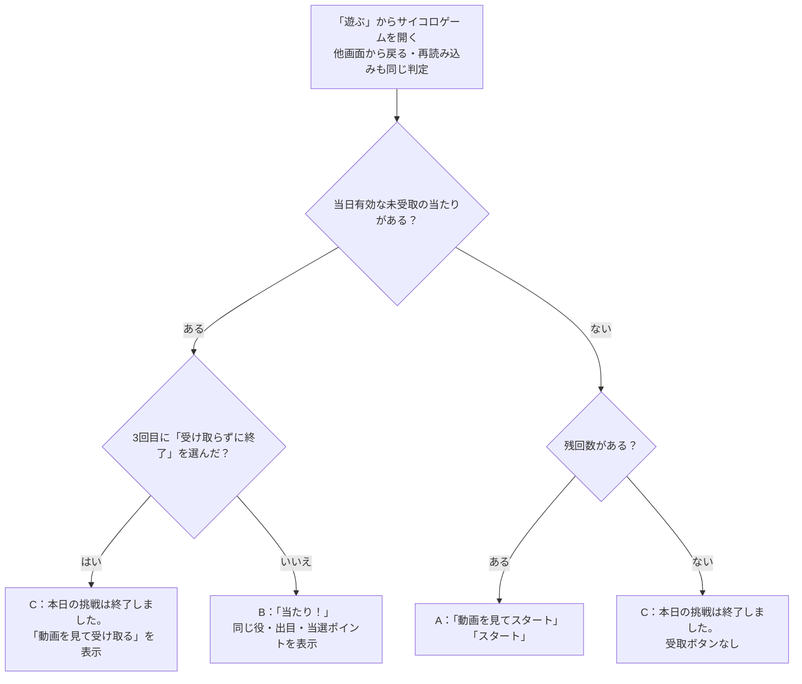
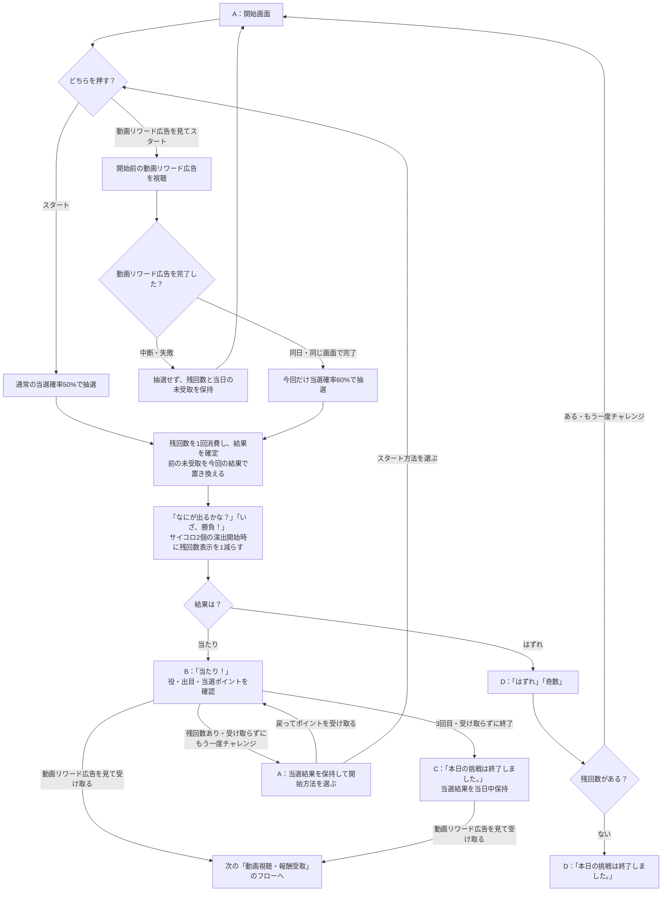
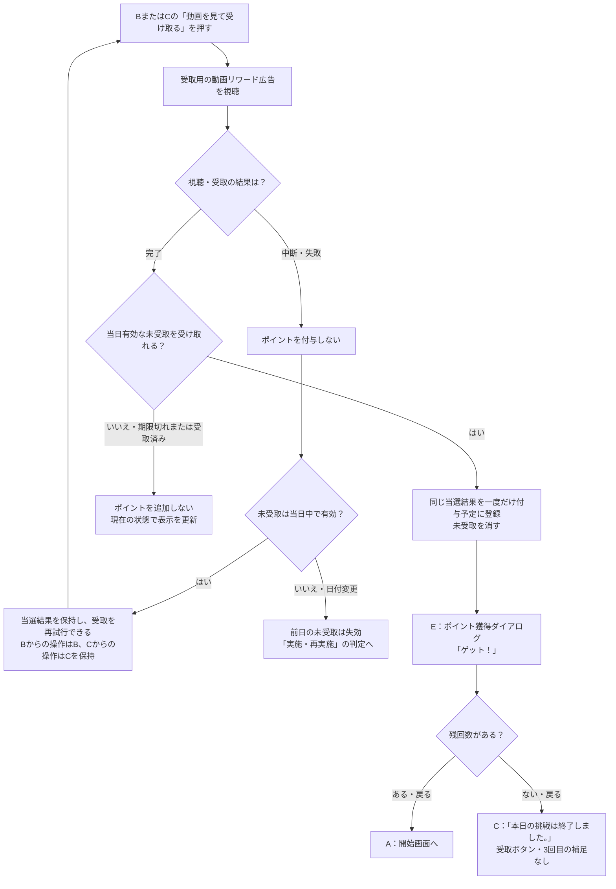

# F11｜ミニゲーム：サイコロゲーム PRD（レビュー前）

| 基本情報 | 内容 |
| --- | --- |
| 機能ID | F11 |
| 概要 | ミニゲーム：サイコロゲーム |
| 対象領域 | アプリ／管理画面／外部連携 |
| 関連機能 | [F09](F09-rewarded-video.md)、[F12](F12-points.md) |
| 更新日 | 2026-10-26 |
| 版 | レビュー前（初版未確定） |

## ① 目的・今回作る範囲

目的：短時間のゲームを毎日アプリを使うきっかけにするため。動画リワード広告を視聴するトリガーとなるため。

評価指標：参加率／利用回数／継続率／報酬費用。

優先順位は[アプリ詳細要件のtier列](https://docs.google.com/spreadsheets/d/1tI26I_4vbSHIOzMdJz7g8-DjeLyyVUKoksVHhZ0AQhU/edit#gid=1107057215)を正とし、今回の同期では変更しない。

| 要件ID | 優先順位 | 範囲 |
| --- | --- | --- |
| F11-1 | tier1 | サイコロゲームの残回数を確認して抽選できる |
| F11-2 | tier1 | 当たり・ハズレと確定した抽選結果を確認できる |
| F11-3 | tier1 | サイコロゲームで報酬を受け取る前に動画リワード広告を視聴させる |
| F11-4 | tier1 | 運営がサイコロゲームの回数・報酬を設定し、固定の当選確率を確認できる |
| F11-5 | 未設定を維持 | 抽選前に、動画リワード広告を視聴して今回の当選確率を上げて開始するか、視聴せず通常の当選確率で開始するかを選べる。※実現方法はエンジニアと要検討。 |

管理側の関連tier1は[管理画面詳細要件](https://docs.google.com/spreadsheets/d/1tI26I_4vbSHIOzMdJz7g8-DjeLyyVUKoksVHhZ0AQhU/edit#gid=1341040600)のADM-F07-1（サイコロの回数・報酬の設定と固定確率の確認）。公開停止の設定は設けない。

## ② 画面イメージ

[GitHubで共有しているアプリモック](https://github.com/ca-toju/pochipo/tree/main/mock-app)を参照元とする。以下のA〜EはPRD内で画面を参照するための記号。画面に表示する文言は「」で記載する。

### 共通で表示する内容

| 要素 | 表示・操作 |
| --- | --- |
| 入口 | 下部の「遊ぶ」から「サイコロゲーム」を開く |
| ヘッダー：残高 | ホームと共通の残高表示を使用する |
| ヘッダー：お知らせ | ホームと共通の「お知らせ」アイコンを表示する。選択するとお知らせ画面へ進む |
| ゲーム名・残回数 | 「サイコロゲーム」と「本日あと N 回」を表示する |
| ナビゲーション | 下部5タブを表示する。ホームの上部カテゴリタブは表示しない |

### A：開始画面

| 状態・要素 | 表示内容 | 操作後の動き |
| --- | --- | --- |
| 残回数あり | 器とサイコロのイラスト、「動画を見てスタート」「スタート」 | 選択した開始方法で抽選へ進む |
| 開始前の動画リワード広告の案内 | 「当選確率20%アップ」 | 「動画を見てスタート」を押すと開始前の動画リワード広告を視聴する |
| 未受取の当たりを残して再挑戦を選択した場合 | 上記に加えて「戻ってポイントを受け取る」 | 新しい抽選を行わず、保持しているBの当選結果へ戻る |

### 抽選演出

| 要素 | 表示内容 |
| --- | --- |
| 演出中の文言 | 「なにが出るかな？」「いざ、勝負！」 |
| サイコロ | 2個のサイコロによる共通の演出を表示し、確定した結果へ切り替える |
| 演出時間 | 通常の演出は2秒。結果の役にかかわらず共通の1パターンとし、出目が確定する前の動いている状態から結果画面へ切り替える |
| 残回数 | 抽選演出の開始時に「本日あと N 回」のNが1減る |

### B：当たり画面

| 状態・要素 | 表示内容 | 操作後の動き |
| --- | --- | --- |
| 当選結果 | 「当たり！」、役名「Pゾロ」「ゾロ目」「偶数」のいずれか、サイコロ2個の出目、「当選ポイント」とポイント数 | 確定済みの結果を確認する |
| 結果のサイコロ | 2個のサイコロを静止した立体表示にする。Pゾロでは両方の1の目に、ポイントのPマークを赤色ベースにしたものを表示する | 確定した出目を表示し、再抽選しない |
| 報酬受取 | 「動画を見て受け取る」 | 受取用の動画リワード広告を視聴する。開始前の動画リワード広告とは別に必要 |
| 残回数あり | 「受け取らずにもう一度チャレンジ」と「再挑戦すると今回のポイントはなくなります。」 | Aへ進む。新しい抽選を実行するまでは当選結果を保持する |
| 3回目の当たり・残回数なし | 「動画を見て受け取る」「受け取らずに終了」。再挑戦のボタンは表示しない | 受取用の動画リワード広告を完了するとEへ進み、「戻る」で受取ボタンのないCへ進む。「受け取らずに終了」はポイントを付与せずCへ進み、当選結果を当日中保持する。終了時点で報酬を放棄・失効させない |
| 管理設定により1回目・2回目で回数上限に達した場合 | 「動画を見て受け取る」のみ | 再挑戦・「受け取らずに終了」は表示しない |

### D：はずれ画面

| 状態・要素 | 表示内容 | 操作後の動き |
| --- | --- | --- |
| 抽選結果 | 「はずれ」「奇数」、静止した立体表示のサイコロ2個の出目 | 当選ポイントと受取ボタンは表示しない |
| 残回数あり | 「もう一度チャレンジ」 | Aへ進む |
| 残回数なし | 「本日の挑戦は終了しました。」 | 新しい抽選はできない。画面を開き直すとCを表示する |

### C：本日終了画面

| 状態・要素 | 表示内容 | 操作後の動き |
| --- | --- | --- |
| 共通 | 器とサイコロのイラスト、「本日の挑戦は終了しました。」 | 当日の新しい抽選はできない |
| 3回目の当たりで「受け取らずに終了」を選び、当日中に未受取がある | 「動画を見て受け取る」「※3回目の報酬のみ受け取ることができます。」 | 同じ当選結果の受取用動画リワード広告へ進む。完了後はEを表示し、「戻る」でCへ戻る。受取後は受取ボタンと補足を消す |
| 未受取のまま他画面へ移動し、当日中に開き直す | 同じ受取ボタン・補足を表示する | 同じCから受け取れる。翌日になると未受取報酬は失効し、受取ボタンと補足を表示しない |
| 受取済み・はずれ・期限切れ | 受取ボタンと3回目の補足を表示しない | 次の利用日には、その日の残回数に応じてAへ進む |

終了画面・はずれ画面とも「また明日もチャレンジしてね」は表示しない。

### E：ポイント獲得ダイアログ

| 状態・要素 | 表示内容 | 操作後の動き |
| --- | --- | --- |
| 受取完了 | 共通のポイント獲得ダイアログでコインの挿絵・獲得ポイント・「ゲット！」を表示する | 未受取の当選結果は消える |
| 残回数あり | 「戻る」の1ボタン | ダイアログを閉じてAへ進む。抽選・回数消費は行わない |
| 残回数なし | 「戻る」 | ダイアログを閉じてCへ戻る。受取ボタンと補足は表示しない |

## ③ 操作フロー

図の「」はアプリの表示文言、ひし形は状態の判定を表す。A（開始）・B（当たり）・C（本日終了）・D（はずれ）・E（ポイント獲得ダイアログ）を参照する。モックへの未反映箇所は末尾に記載する。

### 実施・再実施

前日の未受取は表示判定の前に失効し、翌日の使用回数はリセットする。

### 開始方法の選択・抽選・結果からの操作

「受け取らずにもう一度チャレンジ」を押した時点では、前の当たりは失われない。新しい抽選を実行した時点で置き換わる。動画リワード広告中の日付変更・画面移動は④・⑥に従い、抽選しない。

### 動画リワード広告視聴・報酬受取

受取用の動画リワード広告中に画面を移動した場合、その移動先では受取完了処理を進めない。再度サイコロゲームを開いたときの状態は「実施・再実施」の図に従う。付与予定から交換可能になるまでの扱いは[F12](F12-points.md)で定義する。

## ④ 業務ルール・制約

> ユーザーレビュー未完了。現在のモックを基準に、利用条件・操作条件・報酬条件を分けて記載する。

### 利用する対象ユーザー

| 対象 | 利用・適用条件 |
| --- | --- |
| 会員 | サイコロゲームを利用できる |
| 非会員（ゲスト） | サイコロゲームを利用できる |

動画リワード広告の対象ユーザー、年齢・親権者同意・広告接続元・広告配信条件は、[F09｜動画リワード広告](F09-rewarded-video.md)を参照する。開始前と報酬受取の両方に適用する。

### 実施可能な条件

| 条件 | 抽選の可否・扱い |
| --- | --- |
| 残回数あり | 抽選できる。1日の実施可能回数は管理画面で設定できる |
| 残回数なし | 新しい抽選はできない。当日有効な未受取報酬がある場合の受取は可能 |
| 動画リワード広告を利用する操作 | 視聴の可否はF09の条件に従う |

### 回数を消費するタイミング

通常開始では「スタート」を押して抽選を実行した時点で1回消費する。「動画を見てスタート」では、開始前の動画リワード広告を同日・同じ画面で完了し、抽選を実行した時点で1回消費する。いずれも抽選演出の開始時に「本日あと N 回」のNを1減らす。

動画リワード広告の視聴開始・中断・失敗だけでは回数を消費しない。再挑戦の開始画面へ進む、保持している当選結果へ戻る、報酬を受け取る、ポイント獲得ダイアログを閉じる操作でも回数を消費しない。

### 開始方法ごとの当選確率

| 開始方法 | 当選確率 | 適用範囲・報酬額 |
| --- | --- | --- |
| 「スタート」 | 50% | 通常の抽選。受取用の動画リワード広告は別途必要 |
| 「動画を見てスタート」の動画リワード広告完了後 | 60% | 今回の1回のみ。「当選確率20%アップ」は50%からの相対20%増。報酬額は増やさない |

#### 役の判定と固定確率

| 役 | 出目の条件 | 当たり／はずれ | 通常 | 開始前の動画リワード広告完了後 |
| --- | --- | --- | --- | --- |
| Pゾロ | 1・1 | 当たり | 2.78%（1/36） | 3.33%（1/30） |
| ゾロ目 | 2・2〜6・6 | 当たり | 13.89%（5/36） | 16.67%（5/30） |
| 偶数 | ゾロ目以外で合計が偶数 | 当たり | 33.33%（12/36） | 40%（12/30） |
| 奇数 | 合計が奇数 | はずれ・0pt・受取不可 | 50%（18/36） | 40%（12/30） |
| 合計当選率 | Pゾロ・ゾロ目・偶数 | — | 50% | 60% |

2個の出目で判定し、Pゾロ・ゾロ目を偶奇より優先する。通常は36通りが等確率。動画リワード広告の完了後は当たり3役の比率を保ち、各役内の組合せは等確率とする。役・出目・報酬は抽選時に固定し、同じ結果を表示し直す際に再抽選しない。

### 未受取報酬とポイント付与

| 定義 | 扱い |
| --- | --- |
| 保持対象・期限 | 最新の当たり1件を当日中保持する。翌日には失効する |
| 再挑戦・終了を選んだ時点 | 未受取報酬を保持する。「受け取らずに終了」だけで放棄・失効した扱いにしない |
| 次の抽選を実行した時点 | 前の未受取報酬を失い、新しい当たりが出た場合だけ最新の1件へ置き換える。次がはずれなら受取対象はなくなる。前後の当選額は合算しない |
| 付与の条件・タイミング | 当日有効な未受取報酬について、受取用の動画リワード広告を完了した後に、一度だけF12共通の付与予定・準備中と履歴へ登録する。抽選しただけでは付与しない |
| 開始前の動画リワード広告 | 完了していても、ポイント付与には別途、受取用の動画リワード広告の完了が必要 |
| 受取完了後 | 未受取報酬を消す。同じ結果IDへの二重付与はしない |

付与予定・準備中として登録したポイントが交換可能になるまでの処理は[F12](F12-points.md)の範囲とする。

### 画面を開き直した場合と日付が変わった場合

| 条件 | 表示する画面 | 残回数・報酬の扱い |
| --- | --- | --- |
| 当日有効な未受取あり・終了操作なし | B | 同じ当選結果を表示する。抽選・回数消費をやり直さない |
| 3回目に「受け取らずに終了」済み・当日の未受取あり | 受取導線付きC | 終了操作を保持し、当日中は同じ報酬を受け取れる |
| 未受取なし・残回数あり | A | 残りの回数で新しく抽選できる |
| 未受取なし・残回数なし | 受取導線なしC | 当日は新しく抽選できない |
| 翌日になった | その日の残回数に応じてA／C | 前日の未受取を消す。当日使用回数をリセットし、その日の設定上限を適用する |
| 受取用の動画リワード広告中に翌日になった | 前日の報酬は受取不可 | 前日の当たりを付与しない。受取済みのポイントは削除しない |

## ⑤ 管理画面

[GitHubで共有している管理画面モック](https://github.com/ca-toju/pochipo/tree/main/mock-admin)のサイコロゲーム設定を参照する。

| 設定項目 | 設定内容 | 入力条件 | 変更の反映タイミング |
| --- | --- | --- | --- |
| 1日の実施可能回数 | 1人が1日に抽選できる回数上限 | 0以上の整数。0回では新規抽選不可。現在のモックの入力上限は「モックへの反映状態」を参照 | 保存後の次回抽選可否判定から反映する。詳細は下記 |
| Pゾロの当選ポイント | Pゾロの報酬額（pt） | 1〜99,999ptの整数 | 保存後の新しい抽選に適用する。保持済みの当選額は変更しない |
| ゾロ目の当選ポイント | ゾロ目の報酬額（pt） | 1〜99,999ptの整数 | 保存後の新しい抽選に適用する。保持済みの当選額は変更しない |
| 偶数の当選ポイント | 偶数の報酬額（pt） | 1〜99,999ptの整数 | 保存後の新しい抽選に適用する。保持済みの当選額は変更しない |

実施可能回数の変更は保存後の次回抽選可否判定から反映する。当日の使用済み回数をリセットしない。使用済み回数が新しい上限以上なら残回数を0とし、それ以上は抽選できない。当日有効な未受取報酬は回数設定の変更だけでは失効させない。

2個のサイコロ・4役・通常50%／開始前の動画リワード広告完了後60%の当選確率は固定・参照のみ。奇数は0pt固定。公開停止・再開の設定項目は設けない。

## ⑥ 例外処理・エラーハンドリング

| 状況 | 表示・処理・復帰 |
| --- | --- |
| 残回数0 | 新たに抽選しない。「本日の挑戦は終了しました。」と表示する。当日有効な未受取報酬の導線はCの定義に従う |
| 開始前の動画リワード広告の在庫なし・通信失敗・中断 | エラー案内から再試行できる。抽選・回数消費・確率UPの持越しを行わない |
| 受取用の動画リワード広告の失敗・中断・報酬処理エラー | 付与せず、当日有効な同じ未受取を保持して再試行。終了画面からの受取も同じ扱い |
| 動画リワード広告中の日付変更・前日結果 | 前日の未受取を破棄し付与しない。翌日の残回数へ |
| 連打・同じ結果IDの再受取 | 処理中の重複操作と同じ結果の二重付与予定登録を防ぐ |
| 動画リワード広告・演出中の画面移動 | 元の処理結果を別画面に表示しない。抽選済みなら消費済み回数と当日未受取を保持 |

## ⑦ 未決事項

| 未決事項 | 相談先 |
| --- | --- |
| 報酬原資・本番の報酬額・運用上の予算上限 | 事業・運用 |
| 正式なサーバー抽選／対象日・時刻基準／広告完了検証／設定条件版の責任分担 | アプリ・サーバー・広告連携担当 |
| F11-5の開始方法の選択・確率アップの実現方法 | エンジニア・プロダクト責任者（選択できる方針は合意済み。実現方法を検討する） |
| AdMobを使った交換可能ポイントの報酬設計の可否。開始前の確率アップ動画リワード広告・当選ポイントの受取用の動画リワード広告の両方を確認する | 広告連携担当・プロダクト責任者（F09・F12と合わせて確認） |

## モックへの反映状態

| 区分 | 内容 |
| --- | --- |
| 未接続 | 正式なサーバー抽選・本番保存・実広告SDK・広告完了のサーバー検証・本番ポイント付与 |
| 今回の対象外 | 他ゲームF20、本番原資・予算上限の運用機能 |

### モックの表示モード

| 対象 | 扱い |
| --- | --- |
| 「Tier1：サイコロのみ」（初期値） | 「遊ぶ」からサイコロへ直接進む |
| 「全体版：全ミニゲーム」 | 一覧から「サイコロゲーム」を選ぶ。他ゲームはF20の別範囲 |
| モード切替 | モック外側の検証操作で切り替える。残回数・当日未受取・受取済みポイントを変更しない |

### 合意済み・モック修正待ち

| 対象 | 現在のモックと修正内容 |
| --- | --- |
| Eのボタン | 現モックは残回数ありで「もう一度チャレンジ」「戻る」の2つ。合意した仕様は残回数にかかわらず「戻る」の1つ |
| 公開停止 | 現モックの管理画面には有効／停止の設定がある。公開停止・再開の設定と、停止状態による画面分岐を削除する。「遊ぶ」タブと当日有効な未受取報酬の受取導線は維持する |
| 開始前の動画リワード広告の案内 | 完了するとポイントがもらえると読める案内を、当選確率アップで開始する案内に変更する |
| ポイント履歴の名称 | 「チンチロで獲得」を「サイコロゲームで獲得」に揃える |
| 実施可能回数の入力 | 現モックは0〜3回の整数。業務上の入力上限を3回に固定する要件とは区別する |

現在のモックはブラウザー内で抽選・保存する。本番の抽選・対象日・条件版の管理、広告完了検証、排他・二重付与防止の実装方式は仕様設計で定める。

## レビューログ（チーム確認用・引き渡し前に削除可）

レビュー中の修正指示と議論の温度感を残す。改訂履歴とは別の作業メモであり、未対応を対応済みとして扱わない。

| 対象 | コメント・修正指示 | 状態 |
| --- | --- | --- |
| 開始前の動画リワード広告モック | 動画リワード広告を見ただけでポイントがもらえるように見えるので、ここはモック側で直したい。「視聴完了後に当選確率アップでスタートします」など、受取用の動画リワード広告と案内を分けよう。 | モック修正待ち（文言案） |
| ポイント履歴 | ゲーム名がサイコロゲームなので、「チンチロで獲得」は「サイコロゲームで獲得」に揃えたい。履歴を登録する側のモックを直す。既に保存した履歴名も揃えるかは実装時に確認。 | モック修正待ち |
| モックの参照元 | ローカルのポート番号は見る人によって意味が変わるのでPRDから削除。GitHubで共有されているモックを参照する。 | PRD反映済み |
| 確率アップの開始方法 F11-5 | 確率アップして開始するか、通常確率で開始するかを選べる方針で進めよう。採否の議論は終了。実現方法はエンジニアと要検討。 | 方針合意・PRD反映済み。実現方法は要検討 |
| 年齢・広告条件の整理 | 同じ条件を複数のPRDで管理するとずれそうなので、年齢・親権者同意・広告接続元はF09への参照にまとめよう。調査した交換可能ポイントの報酬条件はF09・F12と合わせて確認したい。 | F09参照へ整理済み。報酬条件は要確認 |
| 演出・結果の見た目 | 演出2秒、結果は静止した立体サイコロ2個、Pゾロの1の目は赤いPマーク。決めた内容なのでPRDにも書いておく。 | PRD反映済み |
| Eのポイント獲得ダイアログ | 同じ開始画面へ戻るボタンが2つあるので、「戻る」だけでOK。残回数ありはA、なしはCへ戻す。 | 2026-10-26合意・PRD反映済み。モック修正待ち |
| 公開停止 | 停止の設定自体を削除でOK。「遊ぶ」タブと未受取報酬を受け取る導線は残す。 | 2026-10-26合意・PRD反映済み。モック修正待ち |
| 青木レビュー | 3回目のB→E→C／B→C→E→Cを明記。残回数の減るタイミング、実施条件と報酬定義の重複、管理画面の表も整理しよう。 | 2026-10-26 PRD反映済み |
