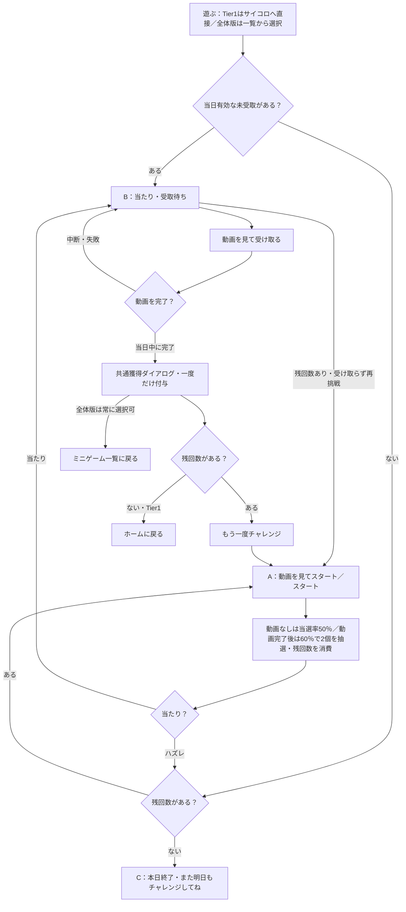

# F11｜ミニゲーム：サイコロゲーム PRD（レビュー前）

> ④業務ルールと⑦以降はユーザーレビュー未完了。本日の変更箇所はローカル4180モックとユーザー指定を参照し、優先順位はスプレッドシートを正とする。本PRDは実装対象のTier1を制御し、モックは将来予定のゲームも含む全体版を保持する。

参照するモック：本リポジトリのローカル4180（2026-10-19の変更箇所を照合）。未接続の外部API・実端末機能は、接続済みとして扱わず末尾に記載する。

| 基本情報 | 内容 |
| --- | --- |
| 機能ID | F11 |
| 概要 | ミニゲーム：サイコロゲーム |
| 対象領域 | アプリ／管理画面／外部連携 |
| 関連機能 | [F09](F09-rewarded-video.md)、[F12](F12-points.md) |
| 更新日 | 2026-10-23 |
| 版 | レビュー前（初版未確定） |

## ① 目的・今回作る範囲

目的：短時間のゲームを毎日アプリを使うきっかけにするため

評価指標：参加率/利用回数/継続率/報酬費用

優先順位は[アプリ詳細要件のTier列](https://docs.google.com/spreadsheets/d/1tI26I_4vbSHIOzMdJz7g8-DjeLyyVUKoksVHhZ0AQhU/edit#gid=1107057215)を正とする。モックに存在してもTier2・Tier3・空欄の要件は本PRDの定義対象に含めない。

| 要件ID | Tier1の範囲 |
| --- | --- |
| F11-1 | サイコロゲームの残回数を確認して抽選できる |
| F11-2 | 当たり・ハズレと確定した抽選結果を確認できる |
| F11-3 | サイコロゲームで報酬を受け取る前に動画リワード広告を視聴させる |
| F11-4 | 運営がサイコロゲームの報酬・確率・公開状態を設定できる |

管理側は[管理画面詳細要件のTier列](https://docs.google.com/spreadsheets/d/1tI26I_4vbSHIOzMdJz7g8-DjeLyyVUKoksVHhZ0AQhU/edit#gid=1341040600)にある以下のTier1を関連範囲とする。NACS本体の内製要件にはしない。

| 要件ID | Tier1の運用範囲 |
| --- | --- |
| ADM-F07-1 | 運営担当者がチンチロの回数・当選確率・報酬・公開状態を設定できる |

要件名に旧モックとの相違がある場合、優先順位は維持し、現在の表示・動きとユーザー指定を②以降へ反映する。実装方式の具体化は仕様設計で扱う。

## ② 画面イメージ

[アプリの該当画面](http://127.0.0.1:4180/mock-app/#home/minigames)

- モック右側の検証操作に「Tier1：サイコロのみ」「全体版：全ミニゲーム」の切替を置く。初期値はTier1。アプリ内には切替を置かず、PRDで実装範囲を管理する。切替は残回数・当日未受取・受取済みポイントを変更しない。
- Tier1では「遊ぶ」からサイコロ画面へ直接進み、「〈ミニゲーム一覧」を置かない。全体版では従来の一覧（サイコロ・おみくじ・ルーレット）と一覧へ戻る操作を保持する。
- 「遊ぶ」タブのミニゲーム一覧・各ゲーム画面では、ホーム共通ヘッダー（残高・お知らせ）を表示し、ホームの上部カテゴリタブのみ非表示にする。下部メニューと個別ゲームのタイトル・戻る操作は維持する。
- サイコロゲームは現設定で1日3回。2個のサイコロの役判定を使い、残回数と未受取結果を表示する。新規・継続ユーザー共通で、通常当選率50%、開始前動画の視聴完了後は60%（相対20%アップ）とする。
- サイコロの未受取の当たりは抽選した当日中のみ受取可能。翌日には未受取結果を削除し、残回数を3へリセットする。受取動画が日付をまたいでも前日の当たりは受取不可。受取済みポイントは削除しない。モックは「確認する日付」で日付変更を再現する。抽選日を持たない旧未受取データは受取不可として消去する。
- サイコロは結果によらない共通1パターンの2個のサイコロのアニメーションを表示し、2秒で結果画面へ切り替える。投げ入れから1回目の衝突までは動き・タイミングを保持する。その後は転がり続けず、左右へ跳ね返り、右側のサイコロだけが一度お椀の内側に当たってから戻り、2回目は左側が斜め下から入り、右側が上から縦に落ちる軌道でサイコロ同士の衝突を見せる。2回目の反動で離れている途中に結果へ切り替え、演出内で結果の出目を確定させない。おみくじ・ルーレットは従来の演出を表示し、当選報酬は動画完了後に受け取る。「あとで受け取る」ボタンは置かない。
- サイコロの結果は当たり／はずれを明示したカードで表示する。当たりは既存のコーラルと白による淡い放射背景・紙吹雪・白い円形パネル、はずれは淡いグレー背景・白い円形パネルとする。フォントは既存の共通規定を使用する。当たり／はずれを32pxで上部に置き、円形パネル内は役名20px、静止した立体サイコロ2個、当選ポイントの順とする。結果画面に立体の器は表示しない。Pゾロでは2個のサイコロの上面の1の目を、既存のポイントコイン画像を赤色ベースにしたPマークで表示する。その他の役の出目と当選ポイントのコインは従来表示を使用する。当選ポイントは24px、単位12px、コイン24pxの控えめな表示とする。奇数は必ずはずれ・0ptとし、受取ボタンと当選ポイントを表示しない。 「また明日もチャレンジしてね」は残回数0の本日終了（C）のはずれ枠内のみ表示する。残回数があり「もう一度チャレンジ」が表示されるはずれ画面には表示しない。回数終了時の枠外表示は「本日の挑戦は終了しました。」のみとし、「また明日！」は表示しない。Pゾロ・ゾロ目は偶奇判定より優先する。過去に旧抽選で報酬付きとして保存された奇数結果も受取不可とする。
- サイコロゲームの結果見出しは「Pゾロ」「ゾロ目」「偶数」「奇数」の4種類のみとし、「4の目」等の旧役名や「（5・5・4）」等の具体的な出目を表示しない。表示上はピンゾロ・その他のゾロ目を優先し、それ以外は出目の合計の偶奇で分類する。結果表示と奇数の0pt・受取不可処理を反映済み。演出・結果の表示は2個へ変更済み。抽選・結果とも実際に2個を使用し、役と出目・報酬を一致させる。通常は36通りを等確率で扱う。動画後は当たり3役の比率を保ったまま当選率を60%へ上げ、役内の組合せは等確率とする。旧3個の同日未受取結果は金額を保持して2個の表示へ変換し、再抽選しない。
- 当選結果では「当たったポイントを自分のものに！」の案内を表示しない。受取ボタンは「動画を見て受け取る」とし、ボタン内にポイント数を入れない。結果のポイント数は別の報酬表示に残す。 当選時の受取・再挑戦の2つのボタンは、スタート画面と同じ286px幅・中央揃え・48px以上の高さ・16px文字・上下間隔とし、表示テキストだけを「動画を見て受け取る」「受け取らずにもう一度チャレンジ」とする。おみくじ・ルーレットの報酬表示は数値40px・単位15px・コイン36pxとし、サイコロは上記の結果カード内の24px・12px・24pxを使用する。

- 一覧カードの表示文言は「遊ぶ」とし、サイコロのハズレ時に残回数がある場合の再挑戦は「もう一度チャレンジ」とする。当選時の再挑戦ボタンは「受け取らずにもう一度チャレンジ」とし、「次はハズレになることもあります。」は表示しない。 未受取結果がある状態の開始画面でも「再挑戦すると、未受取の○ptはなくなります。」の案内は表示しない。 未受取結果へ戻るリンクは「戻ってポイントを受け取る」とし、「スタート」との間隔を従来16pxの半分の8pxにする。各ゲームの開始画面は、上の主ボタンを「動画を見てスタート」、下の白抜きボタンを「スタート」とする。主ボタンの直上には、先端まで一本につながった2pxの黒枠・白背景・黒文字の小さな吹き出しで「当選確率20%アップ」を表示する。吹き出しの大きさは維持し、主ボタンとの間隔は従来22pxの半分の11pxとする。 吹き出しと上下の開始ボタンのまとまりは、内部の間隔を維持して従来より24px下げ、ユーザー提示範囲の縦中央へ近づける。本日の残回数は各ゲームのタイトルと同じ行の右端に表示する。 開始画面の2行の補足「当選確率UPは今回のみ。獲得ポイントは変わりません。」「当選ポイントの受け取りには動画視聴が必要です。」は表示しない。上下の開始ボタンは共通幅318pxから32px（約2文字分）短い286pxとし、中央揃えで右端のおすすめ表示との間隔を確保する。狭い画面では利用可能幅から32pxの余白を確保する。個別ゲーム名は維持する。動画による当選確率UP・通常の開始操作の違い、報酬受取条件や未受取結果を失う注意事項は保持し、読み上げ用ラベルでも操作を区別する。

- ポイント受取完了はデイリーミッションと同じ報酬獲得ダイアログ（コインの挿絵・ポイント・「ゲット！」）を使用する。残回数がある場合は主ボタン「もう一度チャレンジ」、副ボタン「ミニゲーム一覧に戻る」を表示する。残回数0の場合は「ミニゲーム一覧に戻る」のみとする。Tier1では残回数ありは「もう一度チャレンジ」のみ、残回数0は「ホームに戻る」のみを表示する。全体版では上記の一覧へ戻る操作を表示する。再挑戦は開始方法の選択画面へ戻り、その操作だけでは回数を消費しない。

### 2個のサイコロの抽選確率

| 役 | 条件 | 通常 | 動画視聴後 |
| --- | --- | --- | --- |
| Pゾロ | 1・1 | 2.78%（1/36） | 3.33%（1/30） |
| ゾロ目 | 2・2〜6・6 | 13.89%（5/36） | 16.67%（5/30） |
| 偶数 | ゾロ目以外で合計が偶数 | 33.33%（12/36） | 40%（12/30） |
| 奇数・ハズレ | 合計が奇数 | 50%（18/36） | 40%（12/30） |
| 合計当選率 | Pゾロ・ゾロ目・偶数 | 50% | 60% |

- 再入場時は当日未受取があればB、なければ残回数ありはA、0回はCへ分岐する。Cへの再入場でも「また明日もチャレンジしてね」を表示し、旧文言を使用しない。

## ③ 操作フロー

## ④ 業務ルール・制約

> ユーザーレビュー未完了。アプリ上の表示に関わるルールを記載する。

### 表示する対象ユーザー

| 対象ユーザー | 利用・表示 |
| --- | --- |
| 会員 | サイコロゲームの残回数と結果を確認する |
| 非会員（ゲスト） | サイコロゲームの残回数と結果を確認する |

### 表示条件

| 状態・条件 | 表示のルール |
| --- | --- |
| 抽選前 | 本日の残回数を表示する。現設定では1日3回 |
| 当たり | 確定した役と報酬、受取動画への入口を表示する |
| ハズレ | 確定した結果と残回数を表示する |
| 報酬受取後 | 獲得結果と更新された残回数を表示する |

### 画面に置く要素・操作

| 画面・要素 | 表示・操作のルール |
| --- | --- |
| 遊ぶタブ | Tier1はサイコロへ直接。全体版は一覧からゲーム画面へ進む |
| サイコロ・結果の演出 | 共通1パターンの動作を途中で切り、静止した立体サイコロ2個と当たり／はずれを表示する |
| 残回数 | 本日の参加可能回数を表示する |
| 報酬の受取 | 動画の視聴完了後に獲得結果を表示する |

## ⑤ 管理画面

新規作成・変更・削除は、現在の管理画面で操作できる範囲を示す。「外部管理」はNACS・EDOCODE等の担当範囲、「未実装」は操作画面がない項目。削除と公開停止は分けて記載する。

[実行設定の管理画面](http://127.0.0.1:4180/mock-admin/#chinchiro)

| 対象項目 | 新規作成 | 変更 | 削除 | 管理画面での操作・反映範囲 |
| --- | --- | --- | --- | --- |
| 2個のサイコロ・4役・確率 | 不可 | 固定表を参照 | 不可 | 通常50%・動画後60%の表を表示。旧3個のウェイト・初期応援テーブルは使用しない。 |
| 役ごとの当選ポイント | 不可 | 可能 | 不可 | Pゾロ・ゾロ目・偶数を1〜99,999ptで保存し実抽選へ反映。奇数は0pt固定。 |
| 有効状態・日次回数 | 不可 | 可能 | 不可 | 既存のサイコロゲーム設定を変更。管理画面は0〜3回で設定可能。アプリと実抽選に同じ上限を適用する。 |

## ⑥ 例外処理・エラーハンドリング

| 状況 | 表示・処理・復帰 |
| --- | --- |
| 本日の回数終了・機能停止 | 開始不可と理由を表示する。 |
| 動画失敗・日付変更・重複受取 | 結果IDと対象日を照合し、同じ報酬を重ねない。 |

## ⑦ 達成条件・未決事項

> 本節以降はユーザーレビュー未完了。

### Tier1の達成条件

- [ ] 下部タブ・一覧カードは「遊ぶ」、サイコロのハズレ時の再挑戦は「もう一度チャレンジ」、当選時の再挑戦は「受け取らずにもう一度チャレンジ」、各ゲームの開始画面の上の主ボタンは「動画を見てスタート」、下の白抜きボタンは「スタート」と表示され、主ボタン直上の「当選確率20%アップ」とタイトル右端の本日の残回数を確認でき、個別ゲーム名・抽選回数・確率・報酬・動画条件は変更されない。

- [ ] サイコロの全結果で投げ入れから2回のサイコロ同士の衝突と跳ね返りへ続き、その間に片方だけお椀に当たる共通のアニメーションを2秒で切り替え、結果画面に静止した立体サイコロ2個・役名・当たり／はずれが表示される。当たりの装飾と既存の色・文字規定を確認できる。
- [ ] Tier1／全体版を切り替え、入口・戻る操作・受取後の操作を確認できる。残回数と未受取を保持し、再入場は残回数でA／Cへ分岐する。
- [ ] 抽選結果は2個・4役に一致し、通常50%・動画後60%の表を実抽選と管理画面の双方で確認できる。
- [ ] F11-1：サイコロゲームの残回数を確認して抽選できる。
- [ ] F11-2：当たり・ハズレと確定した抽選結果を確認できる。
- [ ] F11-3：サイコロゲームで報酬を受け取る前に動画リワード広告を視聴させる。
- [ ] F11-4：運営がサイコロゲームの報酬・確率・公開状態を設定できる。
- [ ] ①の管理側Tier1に対応する操作について、⑤の新規作成・変更・削除可否と反映範囲を確認できる。
- [ ] ⑥の対象となる空・失敗・中断などの状態から、表示内容と次の操作を確認できる。

### まだ決まっていないこと

| 確認事項 | 相談先 |
| --- | --- |
| サイコロゲームの報酬原資・運用上の予算上限 | 事業・運用 |

## モックへの未反映・対象外

### モックへの未反映

| 項目 | 未反映の内容 |
| --- | --- |
| 抽選・広告・付与の連携 | サーバーでの正式な抽選、実動画視聴・ポイント付与は未接続 |

### 今回の対象外

| 項目 | 対象外の内容 |
| --- | --- |
| なし | — |

## 変更履歴

| 版 | 日付 | 変更内容 |
| --- | --- | --- |
| レビュー前 | 2026-10-23 | モックのTier1直接表示／全体版一覧の切替を追加。2個の実抽選と通常50%・動画後60%の固定表、専用管理設定を反映。C再入場とフローのA／C分岐・受取後操作を整合。 |
| レビュー前 | 2026-10-23 | ミニゲームの受取完了をデイリーミッションの共通獲得ダイアログへ統一。操作文言は「もう一度チャレンジ」「ミニゲーム一覧に戻る」。 |
| レビュー前 | 2026-10-23 | 2回目の衝突を、左の斜め移動と右の縦方向の跳ね返り・落下に変更。お椀への接触と全体2秒は維持。 |
| レビュー前 | 2026-10-23 | 2回目のサイコロ同士の衝突前に、右側だけがお椀の内側に当たって戻る動作を追加。2秒の結果切替を維持。 |
| レビュー前 | 2026-10-23 | 衝突後の転がりを廃止し、跳ね返って再衝突する計2回の衝突へ変更。結果切替は2秒を維持。 |
| レビュー前 | 2026-10-23 | 結果のサイコロ2個を静止した立体表示へ変更。演出と同じ立体素材を再利用し、Pゾロの赤いPは上面に保持。 |
| レビュー前 | 2026-10-23 | Pゾロの1の目を、既存ポイントコインの赤色版Pマークに変更。 |
| レビュー前 | 2026-10-23 | 終盤の不自然な加速を修正。衝突後の回転を一定速度にし、2秒で結果に切り替える。 |
| レビュー前 | 2026-10-23 | 終盤の減速と小さな揺れを連続回転に変更。衝突と左右別の軌道、2秒の結果切替を保持し、動いている途中で結果を表示する。 |
| レビュー前 | 2026-10-23 | 結果切替を2秒へ変更。投げ入れ・衝突を保持し、衝突後の片方を奥への跳ね返りと揺れに変更。 |
| レビュー前 | 2026-10-23 | 投げ入れの動きを復元し、器に入った後の転がりを追加。演出全体は1.7秒で結果へ切替。 |
| レビュー前 | 2026-10-23 | サイコロ演出を約1.3秒から約3秒へ延長。回転・跳ね返りを繰り返し、停止せず結果画面へ切り替える。 |
| レビュー前 | 2026-10-23 | サイコロ演出を共通1パターン・途中終了へ変更。結果を平面サイコロ2個、円形パネル、当たりの放射背景・紙吹雪で再構成。色と文字は既存トーンを踏襲。抽選テーブルは既存のまま表示変換。 |
| レビュー前 | 2026-10-23 | 「また明日もチャレンジしてね」を残回数0の本日終了（C）のみに限定。再挑戦可能なはずれ画面から削除。 |
| レビュー前 | 2026-10-23 | サイコロの未受取結果の有効期限を当日限りに変更。翌日の受取・日跨ぎ動画からの付与を防ぎ、旧未日付結果も破棄。ハズレ時の再挑戦を「もう一度チャレンジ」へ変更。 |
| レビュー前 | 2026-10-23 | はずれ枠内を「また明日もチャレンジしてね」へ変更。枠外の回数終了案内から「また明日！」のみ削除。 |
| レビュー前 | 2026-10-23 | 奇数が旧抽選報酬により当たり表示される不整合を修正。奇数の抽選結果は0pt、未受取報酬を生成せず、旧保存結果の受取と当たり表示も防止。 |
| レビュー前 | 2026-10-23 | サイコロの結果を当たり／はずれが判別できるカードに変更。役名を主役にし、ポイント表示を24pxへ縮小。 |
| レビュー前 | 2026-10-23 | サイコロの結果見出しを「Pゾロ／ゾロ目／偶数／奇数」に限定し、旧役名と具体的な出目のテキストを削除。 |
| レビュー前 | 2026-10-23 | ユーザーの明確化に従い、「遊ぶ」タブの残高・お知らせヘッダーを復元し、ホームのカテゴリタブのみ非表示とした。 |
| レビュー前 | 2026-10-23 | ユーザーから再度削除の指定を受け、「遊ぶ」タブのホーム共通ヘッダーと上部カテゴリタブを非表示に変更。 |
| レビュー前 | 2026-10-23 | ユーザー指定で直前のヘッダー非表示を取り消し、「遊ぶ」タブのホーム共通ヘッダーと上部カテゴリタブを復元。 |
| レビュー前 | 2026-10-23 | 「遊ぶ」タブの一覧・各ゲームからホーム共通ヘッダーと上部カテゴリタブを除外。下部メニューとゲーム固有の見出し・戻る操作は維持。 |
| レビュー前 | 2026-10-23 | 吹き出しの表示文言と読み上げ用ラベルを「当選確率20%アップ」に変更。今回は表示の更新のみ。2個のサイコロへの変更・抽選確率の更新・確率表の表示操作は未反映。 |
| レビュー前 | 2026-10-23 | 「当たりに戻る」を「戻ってポイントを受け取る」に変更し、「スタート」との間隔を16pxから8pxへ短縮。 |
| レビュー前 | 2026-10-23 | 再挑戦の開始画面から未受取ポイントがなくなる旨の案内を削除。 |
| レビュー前 | 2026-10-23 | 当選時の再挑戦を「受け取らずにもう一度チャレンジ」へ変更し、次はハズレになる旨の文を削除。受取・再挑戦ボタンの幅・中央位置・文字・上下間隔をスタートボタンと共通化。 |
| レビュー前 | 2026-10-23 | 当選結果の案内文を削除し、受取ボタンをポイント数なしの「動画を見て受け取る」へ変更。報酬表示の数値・単位を文字規定で1段階縮小し、コインの寸法も調整。 |
| レビュー前 | 2026-10-23 | 確率アップの吹き出しを先端まで一本につながった2pxの黒枠・白背景・黒文字に変更。大きさを保ち、主ボタンとの間隔を22pxから11pxへ短縮。 |
| レビュー前 | 2026-10-23 | ユーザー指定で各ゲームの開始画面の補足2行を削除。上下の開始ボタンを32px短くし、右端のおすすめ表示との接触を解消。 |
| レビュー前 | 2026-10-23 | 各ゲームの開始ボタンを上「動画を見てスタート」、下「スタート」に変更。主ボタン直上の吹き出しに「当選確率20%アップ」、タイトル右端に本日の残回数を表示。読み上げ用ラベルも合わせ、抽選・広告・報酬の処理は維持。 |
| レビュー前 | 2026-10-19 | 下部タブおよびゲームの開始・再挑戦の表記を「遊ぶ」に統一。既存の抽選・広告視聴・報酬条件は維持。 |
| レビュー前 | 2026-10-15 | F10レビューの共通フィードバックを反映。⑤を管理画面へ変更し、④を対象ユーザー・表示条件・配置要素に整理。例外処理と仕様設計事項の重複を除き、未反映と対象外を別表に分離。個別レビューは未完了。 |
