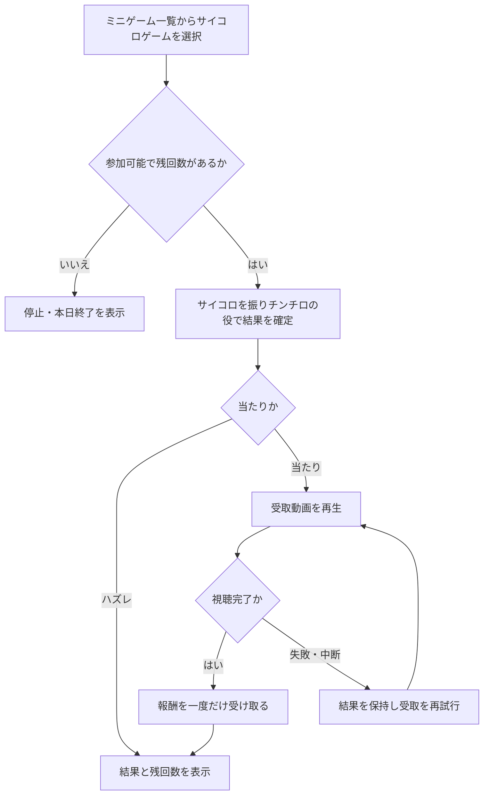

# F11｜ミニゲーム：サイコロゲーム PRD（レビュー前）

> ④業務ルールと⑦以降はユーザーレビュー未完了。機能・画面・操作は現在の4189モックを正とし、優先順位はスプレッドシートを正とする。本PRDはTier1のみを定義する。

参照するモック：`Tameruko-Preview-20261013` の4189（2026-10-15確認）。未接続の外部API・実端末機能は、接続済みとして扱わず末尾に記載する。

| 基本情報 | 内容 |
| --- | --- |
| 機能ID | F11 |
| 概要 | ミニゲーム：サイコロゲーム |
| 対象領域 | アプリ／管理画面／外部連携 |
| 関連機能 | [F09](F09-rewarded-video.md)、[F12](F12-points.md) |
| 更新日 | 2026-10-15 |
| 版 | レビュー前（初版未確定） |

## ① 目的・今回作る範囲

目的：短時間のゲームを毎日アプリを使うきっかけにするため

評価指標：参加率/利用回数/継続率/報酬費用

優先順位は[アプリ詳細要件のTier列](https://docs.google.com/spreadsheets/d/1g00ZxLGprVNT4T4uSmzw--vRpp95HQ1Uq9i8GnJpmS4/edit#gid=1107057215)を正とする。モックに存在してもTier2・Tier3・空欄の要件は本PRDの定義対象に含めない。

| 要件ID | Tier1の範囲 |
| --- | --- |
| F11-1 | サイコロゲームの残回数を確認して抽選できる |
| F11-2 | 当たり・ハズレと確定した抽選結果を確認できる |
| F11-3 | サイコロゲームで報酬を受け取る前に動画リワード広告を視聴させる |
| F11-4 | 運営がサイコロゲームの報酬・確率・公開状態を設定できる |

管理側は[管理画面詳細要件のTier列](https://docs.google.com/spreadsheets/d/1g00ZxLGprVNT4T4uSmzw--vRpp95HQ1Uq9i8GnJpmS4/edit#gid=1341040600)にある以下のTier1を関連範囲とする。NACS本体の内製要件にはしない。

| 要件ID | Tier1の運用範囲 |
| --- | --- |
| ADM-F07-1 | 運営担当者がチンチロの回数・当選確率・報酬・公開状態を設定できる |

要件名に旧モックとの相違がある場合、優先順位は維持し、現在の表示・動きとユーザー指定を②以降へ反映する。実装方式の具体化は仕様設計で扱う。

## ② 画面イメージ

[アプリの該当画面](http://127.0.0.1:4189/mock-app/#home/minigames)

- 下部メニューのミニゲーム一覧からサイコロゲームを選択する。
- サイコロゲームは現設定で1日3回。チンチロの役判定を使い、残回数と未受取結果を表示する。
- 結果に応じたイラスト・アニメーションを表示し、当選報酬は動画完了後に受け取る。「あとで受け取る」ボタンは置かない。

## ③ 操作フロー

## ④ 業務ルール・制約

> ユーザーレビュー未完了。アプリ上の表示に関わるルールを記載する。

### 表示する対象ユーザー

| 対象ユーザー | 利用・表示 |
| --- | --- |
| 会員 | サイコロゲームの残回数と結果を確認する |
| 非会員（ゲスト） | サイコロゲームの残回数と結果を確認する |

### 表示条件

| 状態・条件 | 表示のルール |
| --- | --- |
| 抽選前 | 本日の残回数を表示する。現設定では1日3回 |
| 当たり | 確定した役と報酬、受取動画への入口を表示する |
| ハズレ | 確定した結果と残回数を表示する |
| 報酬受取後 | 獲得結果と更新された残回数を表示する |

### 画面に置く要素・操作

| 画面・要素 | 表示・操作のルール |
| --- | --- |
| ミニゲーム一覧のサイコロゲーム | 選択するとゲーム画面へ進む |
| サイコロ・結果の演出 | チンチロの役に応じたアニメーション・結果を表示する |
| 残回数 | 本日の参加可能回数を表示する |
| 報酬の受取 | 動画の視聴完了後に獲得結果を表示する |

## ⑤ 管理画面

新規作成・変更・削除は、現在の管理画面で操作できる範囲を示す。「外部管理」はNACS・EDOCODE等の担当範囲、「未実装」は操作画面がない項目。削除と公開停止は分けて記載する。

[実行設定の管理画面](http://127.0.0.1:4189/mock-admin/legacy.html#chinchiro)

| 対象項目 | 新規作成 | 変更 | 削除 | 管理画面での操作・反映範囲 |
| --- | --- | --- | --- | --- |
| サイコロの役ごとの確率ウェイト・倍率・固定pt・基準pt | 不可 | 可能 | 不可 | チンチロ設定の固定の役を編集する。役の新規作成・削除は不可。 |
| 有効状態・日次回数 | 不可 | 可能 | 不可 | 既存のサイコロゲーム設定を変更。ゲーム表示側では1日3回の上限も適用する。 |

## ⑥ 例外処理・エラーハンドリング

| 状況 | 表示・処理・復帰 |
| --- | --- |
| 本日の回数終了・機能停止 | 開始不可と理由を表示する。 |
| 動画失敗・日付変更・重複受取 | 結果IDと対象日を照合し、同じ報酬を重ねない。 |

## ⑦ 達成条件・未決事項

> 本節以降はユーザーレビュー未完了。

### Tier1の達成条件

- [ ] F11-1：サイコロゲームの残回数を確認して抽選できる。
- [ ] F11-2：当たり・ハズレと確定した抽選結果を確認できる。
- [ ] F11-3：サイコロゲームで報酬を受け取る前に動画リワード広告を視聴させる。
- [ ] F11-4：運営がサイコロゲームの報酬・確率・公開状態を設定できる。
- [ ] ①の管理側Tier1に対応する操作について、⑤の新規作成・変更・削除可否と反映範囲を確認できる。
- [ ] ⑥の対象となる空・失敗・中断などの状態から、表示内容と次の操作を確認できる。

### まだ決まっていないこと

| 確認事項 | 相談先 |
| --- | --- |
| サイコロゲームの報酬原資・運用上の予算上限 | 事業・運用 |

## モックへの未反映・対象外

### モックへの未反映

| 項目 | 未反映の内容 |
| --- | --- |
| 抽選・広告・付与の連携 | サーバーでの正式な抽選、実動画視聴・ポイント付与は未接続 |

### 今回の対象外

| 項目 | 対象外の内容 |
| --- | --- |
| なし | — |

## 変更履歴

| 版 | 日付 | 変更内容 |
| --- | --- | --- |
| レビュー前 | 2026-10-15 | F10レビューの共通フィードバックを反映。⑤を管理画面へ変更し、④を対象ユーザー・表示条件・配置要素に整理。例外処理と仕様設計事項の重複を除き、未反映と対象外を別表に分離。個別レビューは未完了。 |
