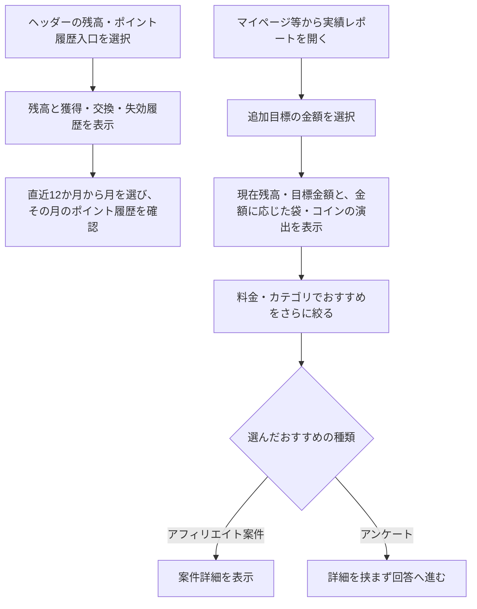
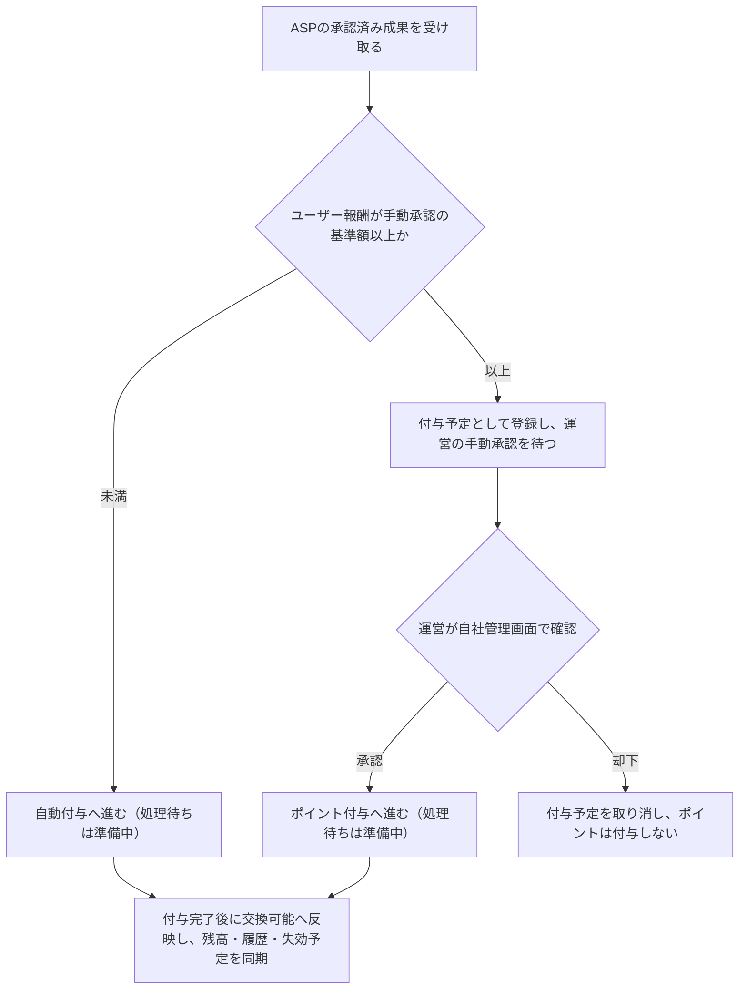

# F12｜ポイント残高・履歴・確定処理 PRD（レビュー前）

> ④業務ルールと⑦以降はユーザーレビュー未完了。本日の変更箇所はローカル4180モックとユーザー指定を参照し、優先順位はスプレッドシートを正とする。本PRDはTier1のみを定義する。

参照するモック：本リポジトリのローカル4180（2026-10-19の変更箇所を照合）。未接続の外部API・実端末機能は、接続済みとして扱わず末尾に記載する。

| 基本情報 | 内容 |
| --- | --- |
| 機能ID | F12 |
| 概要 | ポイント残高・履歴・確定処理 |
| 対象領域 | アプリ／管理画面／外部連携 |
| 関連機能 | [F05](F05-my-offers.md)、[F10](F10-surveys.md)、[F13](F13-point-exchange.md)、[F18](F18-mypage-support.md) |
| 更新日 | 2026-10-20 |
| 版 | レビュー前（初版未確定） |

## ① 目的・今回作る範囲

目的：ユーザーが獲得・失効の履歴、付与待ちのポイント、実際に交換できる残高を区別し、期限内にポイントを利用できるようにするため

評価指標：付与成功率/処理中ポイントの滞留/残高と履歴の差額/ポイントに関する問い合わせ件数

優先順位は[アプリ詳細要件のTier列](https://docs.google.com/spreadsheets/d/1tI26I_4vbSHIOzMdJz7g8-DjeLyyVUKoksVHhZ0AQhU/edit#gid=1107057215)を正とする。モックに存在してもTier2・Tier3・空欄の要件は本PRDの定義対象に含めない。

| 要件ID | Tier1の範囲 |
| --- | --- |
| F12-1 | ユーザーが自分の有効なポイント残高と総獲得ポイントを確認できる |
| F12-2 | ユーザーがポイントの付与・消費・失効の履歴を新しい順に確認できる |
| F12-3 | ポイント基盤が同じ付与依頼に対してポイントを一度だけ付与できる |
| F12-4 | ユーザーが直近のポイント失効予定数と失効日を確認できる |
| F12-5 | 運営担当者が失敗したポイント失効処理を未処理分から再実行できる |
| F12-6 | ユーザーが直近12か月から月を選び、その月のポイント履歴を確認できる |
| F12-7 | ポイント基盤が新規ユーザーの作成時に、本人専用のポイント口座を残高0pt・履歴なしで新しく作成できる |
| F12-8 | ポイント基盤が有効期限の近いポイントから順に消費できる |
| F12-9 | ポイント基盤が残高不足の消費を拒否できる |
| F12-10 | ポイント基盤が取引履歴・失効予定・残高を一括で更新できる |
| F12-11 | ポイント基盤が毎月1日に期限切れポイントを失効できる |
| F12-14 | ユーザーが追加で貯めたい金額を選び、現在残高・目標金額と、金額に応じて大きくなる袋の表示を確認できる |
| F12-15 | ユーザーが追加目標に応じたおすすめ案件を確認し、利用可能な案件へ進める |
| F12-16 | ユーザーがおすすめ案件を料金と案件カテゴリで複数選択して絞り込める |

管理側は[管理画面詳細要件のTier列](https://docs.google.com/spreadsheets/d/1tI26I_4vbSHIOzMdJz7g8-DjeLyyVUKoksVHhZ0AQhU/edit#gid=1341040600)にある以下のTier1を関連範囲とする。NACS本体の内製要件にはしない。

| 要件ID | Tier1の運用範囲 |
| --- | --- |
| ADM-F08-2 | 権限を持つ運営担当者が、ASPで承認されたアフィリエイト成果のうち、設定した基準額以上の報酬について、自社管理画面でポイント付与の承認・却下を行える |
| ADM-F08-3 | ポイント連携システムが一意の付与依頼IDで照合し、未処理分だけを再処理できる |
| ADM-F08-6 | 運営担当者が会員の有効残高・ポイント履歴・失効予定を照会できる |
| ADM-F08-7 | 運営担当者が失敗したポイント失効処理を未処理分から再実行できる |

要件名に旧モックとの相違がある場合、優先順位は維持し、現在の表示・動きとユーザー指定を②以降へ反映する。実装方式の具体化は仕様設計で扱う。

## ② 画面イメージ

[アプリの該当画面](http://127.0.0.1:4180/mock-app/#points)

- 有効な保有ポイントと円相当額、総獲得ポイント、直近の失効予定、獲得・交換・失効履歴を表示する。
- マイページの「実績レポート」から、本人の有効残高・準備中・交換可能・総獲得ポイント・履歴・失効予定をまとめて確認できる。マイページと実績レポートは同じポイント口座の情報を参照し、付与・交換・失効の結果を同期する。
- 履歴を新しい順に表示する。直近12か月から月を選び、その月のポイント履歴に絞り込める。月別の獲得ポイント合計や、その合計を比較するグラフは表示しない。
- マイページと実績レポートの失効予定は、共通して「今月末の失効予定」と表示し、今月末に失効する未使用ポイント数と失効日を示す。両画面で同じ利用者・確認日時点の値を表示する。翌月以降の予定はこの欄に含めず、該当がない場合は0ptと表示する。
- 実績レポートの表示案（モックで確認中）：棒グラフの代わりにお金の袋のイラストを表示する。追加目標が大きいほど袋を大きくし、金額を切り替えるとコインが降る短いアニメーションを再生する。
- 追加で貯めたい金額は500円・1,000円・3,000円・5,000円・10,000円・20,000円相当から選ぶ。20,000円相当は10,000円相当の右横に表示する。初期値・保存済みの値が選択肢にない場合は、最も近い金額に置き換える。
- 選んだ目標に合う報酬の案件を探せるよう、おすすめは「ひとつ前の選択金額〜選択した金額」の範囲に絞る。下限・上限の両方を含み、500円は500円以下の報酬がある案件を対象とする。残高を加えた合計金額ではなく、追加で貯めたい金額を基準とする。
- 「今のポイント」「頑張ったら貯まるポイント（現在残高＋追加目標）」と増えるポイント・円相当額は数値で表示する。袋の大きさは選択金額の段階を表す演出であり、残高の増加や報酬付与を意味しない。端末で動きを減らす設定をしている場合は、袋の大きさと数値だけ更新し、アニメーションを抑える。
- 「あといくら貯めたい？」で金額を選び、おすすめ案件を料金・細分化したカテゴリで複数条件を絞る。「どうやって貯めたい？」の選択枠は表示しない。おすすめは5件から最大10件まで開閉し、アンケートは選択後に直接回答へ進む。

- ホームの初心者マーク「いくら貯める？」から開いた場合は、レポートの「今のポイントと目標」の見出しが上端に来るよう移動する。見出し・現在ポイント・目標の数値と袋の表示から確認でき、下の金額選択欄の途中へ飛ばさない。入口の仕様は[F02](F02-home.md)を参照。

ヘッダーの残高は、マイページの「あなたのポイント」と同じ本人の有効残高（失効分を除いた交換可能ポイント）を100pt＝1円相当で表示する。準備中は含めない。従来の固定見本額は使用せず、付与確定・交換・失効・利用者切替後に同じ残高へ更新する。取り消し線の比較額も、その残高を基準に算出する。

## ③ 操作フロー

### アフィリエイト報酬の確定

## ④ 業務ルール・制約

> ユーザーレビュー未完了。アプリ上の表示に関わるルールを記載する。

### 表示する対象ユーザー

| 対象ユーザー | 利用・表示 |
| --- | --- |
| 会員 | 本人の残高・履歴・実績レポートを確認する |
| 非会員（ゲスト） | 本人の残高・履歴・実績レポートを確認する |

ポイント口座の新規作成は、まだ口座を持たないユーザーを対象とする。ゲストから会員登録する場合は既存のポイント口座を引き継ぎ、残高・付与予定・総獲得ポイント・履歴をリセットしない。

### ポイントのステータスと残高

承認されたことと、実際にポイントを使えることを混同させないため、以下を区別する。

| 状態 | 意味・残高への扱い |
| --- | --- |
| 挑戦中 | ユーザーが案件に取り組んでいる段階。参加しただけでは準備中や交換可能のポイントに加算しない。 |
| 準備中 | 運営側またはASP側で承認され、付与予定になっているが、まだウォレットへの付与が完了していない状態。ASP承認後の高額報酬の手動承認待ち、運営承認後や自動付与の処理待ちも含む。交換可能残高・総獲得ポイントには含めない。 |
| 交換可能 | 必要な承認とウォレットへの付与が完了した、有効かつ未使用のポイント。実際の交換には[F13](F13-point-exchange.md)の会員登録・認証・最低交換額等の条件も適用する。 |

案件の成果を確認している「判定中」と、承認後の付与待ちである「準備中」は異なる。[F05](F05-my-offers.md)の案件の成果状態を、本節のウォレットへの反映状態で置き換えない。

総獲得ポイントは付与が完了した加算ポイントの累計、合算ポイントは有効残高と準備中の合計とする。総獲得・合算・交換可能を同じ意味で表示しない。マイページと実績レポートでは、同じ利用者・同じ更新時点の残高と履歴・失効予定を揃える。

### 表示条件

| 状態・条件 | 表示のルール |
| --- | --- |
| 有効な残高 | 100pt＝1円相当でポイントと円相当額を表示する |
| 獲得・交換・失効の履歴 | 新しい順に表示する |
| 履歴の月選択 | 直近12か月から選んだ月の付与・消費・失効の履歴を表示する。月別の獲得ポイント合計は表示しない |
| 目標選択後 | 現在の保有ポイントと追加目標の合計を比較して表示する |
| おすすめ候補 | 未利用の案件と未回答・回答可能なアンケートを表示する |

### 目標金額ごとのおすすめ範囲

| 追加で貯めたい金額 | 表示する案件の報酬（円相当） |
| --- | --- |
| 500円 | 500円以下（報酬がある案件） |
| 1,000円 | 500〜1,000円 |
| 3,000円 | 1,000〜3,000円 |
| 5,000円 | 3,000〜5,000円 |
| 10,000円 | 5,000〜10,000円 |
| 20,000円 | 10,000〜20,000円 |

両端を含むため、境界の報酬は隣り合う2つの目標で候補となる。金額範囲に料金・カテゴリの条件を重ねて絞り込む。同じ軸の複数選択はOR、異なる軸はAND、未選択の軸は制限なしとする。範囲外の案件で件数を埋めず、該当がなければ0件の案内を表示する。

金額範囲・料金・カテゴリの条件を満たした案件は、EPCが高い順に並べて最大10件を表示する。カテゴリの分散やアンケートの優先表示による並べ替えは行わない。EPC順のモック内共通ルールに合わせ、未取得の案件は取得済みの案件より後ろに置き、EPCが同じ場合は案件IDの降順とする。

金額範囲の判定には、ユーザーが獲得できる最大報酬の円相当額を使う。参加可能なチャレンジボーナスがある案件は、通常の最大報酬にそのボーナスを加えた合計額で判定する。アンケートも最大報酬に同じ金額範囲を適用する。おすすめ一覧の「最大○円相当」も判定に用いた額に揃え、範囲と表示額が食い違わないようにする。最大額は条件達成時の金額であり、獲得を保証するものではない。実際の付与条件・時期は各案件・チャレンジボーナスの仕様に従う。

候補の利用条件は今回変更しない。モックでは既存どおり定率案件・SUR案件をおすすめ候補から除外する。終了・非公開・ユーザーが対象外のチャレンジボーナスは加算しない。EPCはモックの案件データ・既存の見本値を使用し、本番ASPからの取得を実装済みとは扱わない。

### ポイントの有効期限・失効

期限切れによる残高の減少をユーザーが確認できるように、失効分は残高から除外しても履歴に残す。

- 確定済みの加算ポイントの失効日は、原則として獲得日（ウォレットへの付与が確定した日）の属する月に5ヶ月を加えた月の末日とする。例えば1月30日獲得分は6月30日が失効日となる。同じ月に獲得したポイントは同じ失効日となり、付与予定の登録日やASPの承認日は起点にしない。
- 連続ログインボーナスと運営付与には、それぞれ既定の有効期間を適用する。このルールは連続ログインボーナス機能を新たに提供することを意味しない。
- 失効日当日までは保有ポイントに含め、交換に利用できる。翌日から未消費分を保有ポイント・合算ポイントの計算から除外する。準備中のポイントはこの失効処理の対象にしない。
- 期限内に使えるポイントを先に利用できるよう、消費・交換には失効日が近いポイントから充当する。失効するのは未消費の残りのみとする。
- 失効履歴には、失効日翌日の日付と失効したポイント数を減算として表示する。付与・消費の履歴と合わせて新しい順に並べる。失効処理を再実行しても同じ分を二重に減算・記録しない。
- 総獲得ポイントは、確定した加算ポイントの累計を示すため、交換や失効では減らさない。
- 「今月末の失効予定」には、今月末までに失効する有効な未使用ポイントのうち、最も近い失効日に期限を迎える分を合計し、その失効日とともに表示する。現行の月末失効ルールでは今月末日分の合計となる。該当がなければ0ptとし、翌月以降の最短失効分を今月分として表示しない。

### 高額なアフィリエイト報酬の手動承認

不正付与を防ぎ、計測された成果と付与対象・金額の対応を確認できるよう、ASPによる成果の承認と、自社によるポイント付与の最終承認を分ける。

- 手動承認の基準額の初期値は**10,000円相当**とする。権限を持つ運営担当者が、自社管理画面で基準額を変更できる。
- 判定する金額は、ユーザーへ付与する報酬の円相当額とする。広告主からの売上額や商品の購入金額ではない。100pt＝1円相当のため、初期値は1,000,000ptに相当する。
- 基準額と同額の報酬も手動承認の対象とする。初期値では10,000円相当以上が手動承認、10,000円相当未満が自動付与の対象となる。
- 手動承認はASPが承認した成果だけを対象とし、ASPで判定中・否認の成果を自社の手動承認だけで付与対象にはしない。
- 運営の手動承認待ちは「準備中（付与予定）」とし、保有ポイント・交換可能ポイント・総獲得ポイントには含めない。合算ポイントには付与予定分として含める。
- 運営が承認すると付与処理へ進む。実際に付与が完了した時点で、付与予定を保有ポイントへ移し、交換可能ポイントと総獲得ポイントに反映する。承認済みでも処理待ちは準備中のままとする。却下した場合は付与予定を取り消し、ポイントを付与しない。
- ASPの成果状態と自社の付与承認状態は別に管理する。自社でポイント付与を却下しても、ASPの「承認」を「否認」に書き換えない。
- 同じ成果の再連携や承認操作の再実行によって、ポイントを二重に付与しない。

### 画面に置く要素・操作

| 画面・要素 | 表示・操作のルール |
| --- | --- |
| 残高・総獲得ポイント | 本人の有効残高と獲得実績を表示する |
| 失効予定 | 「今月末の失効予定」として、今月末までの最短失効日と対象の未使用ポイント数を表示する。該当なしは0pt |
| ポイント履歴 | 獲得・交換・失効の内容を確認する |
| 目標の袋・コイン演出 | 追加目標に応じて袋の大きさを変え、金額変更時にコインを降らせる。現在残高・目標・増加分は数値で示す |
| 目標金額の選択 | あといくら貯めたいかを選ぶ |
| もっと絞る | 料金と細分化したカテゴリを複数選択する |
| おすすめの案件リスト | 最初5件、もっと見るで最大10件を表示し、案件は詳細、アンケートは回答へ直接進む |

## ⑤ 管理画面

新規作成・変更・削除は、現在の管理画面で操作できる範囲を示す。「外部管理」はNACS・EDOCODE等の担当範囲、「未実装」は操作画面がない項目。削除と公開停止は分けて記載する。

[実行設定の管理画面](http://127.0.0.1:4180/mock-admin/#review)

| 対象項目 | 新規作成 | 変更 | 削除 | 管理画面での操作・反映範囲 |
| --- | --- | --- | --- | --- |
| 付与予定の承認・却下・自動判定実行 | 不可 | 処理可能 | 不可 | 審査・交換上限で既存の付与予定を処理する。取引を自由入力・編集する画面ではない。 |
| アフィリエイト報酬の手動承認基準額 | 初期値を用意（モック未実装） | 変更可能（モック未実装） | 対象外 | 初期値10,000円相当。円相当額で設定し、保存した基準額以上のユーザー報酬を手動承認の対象とする。 |
| ポイント取引・残高・獲得履歴 | 外部管理 | 外部管理 | 外部管理 | EDOCODEのポイント基盤の依頼範囲。自社画面から任意の残高を入稿しない。 |
| おすすめの絞り込み・目標 | 対象外 | 対象外 | 対象外 | ユーザー自身の選択。管理画面の案件入稿とは別。 |

アフィリエイト報酬の手動承認では、対象ユーザー・案件・成果、ASPの承認状態、ユーザーへの付与予定ポイントと円相当額、自社の承認待ち／承認済み／却下の状態を確認できるようにする。ASPの承認済み成果に対して、運営が「承認」または「却下」を実行する。承認後はポイント付与の処理結果を確認でき、失敗・結果不明は付与完了と区別する。

付与・失効の処理に失敗した場合は、権限を持つ運営担当者が対象・処理状態・エラー内容を確認し、未処理分だけを再実行できるようにする。再実行の結果も確認でき、処理済みのポイントを二重に付与・失効させない。具体的な管理画面の操作とポイント基盤側の運用手順は、開発時に担当範囲を整理する。

## ⑥ 例外処理・エラーハンドリング

| 状況 | 表示・処理・復帰 |
| --- | --- |
| 未付与・処理中・結果不明 | 受取成功と区別し、同じ依頼IDで照合・再試行する。 |
| 手動承認後の付与失敗・結果不明 | 管理画面で対象の成果と処理状態を確認し、同じ付与依頼で照合・再試行する。承認ボタンを押しただけで付与完了と表示せず、二重付与を防ぐ。 |
| 失効処理の失敗・一部完了・結果不明 | 完了済み分を照合し、未処理分だけを再実行する。期限切れ分を交換可能に戻さず、再実行で同じ残高を二重に減算したり失効履歴を重複させたりしない。 |
| 候補0件・履歴0件 | 空の案内を表示し、存在しない案件や履歴を補わない。 |

## ⑦ 達成条件・未決事項

> 本節以降はユーザーレビュー未完了。

### Tier1の達成条件

- [ ] ホームからの目標入口で「今のポイントと目標」の見出し・目標の表示が最初に表示される。既存の金額選択・おすすめ計算は維持する。

- [ ] F12-1：ユーザーが自分の有効なポイント残高と総獲得ポイントを確認できる。
- [ ] 挑戦中・承認後の準備中・付与完了後の交換可能を区別できる。承認済みでも付与処理待ちの分は交換可能残高・総獲得ポイントに含めない。
- [ ] マイページの実績レポートから本人の残高・履歴・失効予定を確認でき、付与・交換・失効後も両画面の同じ項目の値が一致する。
- [ ] 原則の失効日は獲得月＋5ヶ月の月末となる（1月30日獲得→6月30日）。今月末までの対象がない場合、失効予定は翌月分ではなく0ptを表示する。
- [ ] F12-2：ユーザーがポイントの付与・消費・失効の履歴を新しい順に確認できる。
- [ ] F12-3：ポイント基盤が同じ付与依頼に対してポイントを一度だけ付与できる。
- [ ] F12-4：ユーザーが直近のポイント失効予定数と失効日を確認できる。
- [ ] F12-5：運営担当者が失敗したポイント失効処理を未処理分から再実行できる。
- [ ] 付与・失効の失敗、一部完了、結果不明を確認して未処理分だけを再実行でき、残高・履歴への二重反映が起きない。
- [ ] F12-6：ユーザーが直近12か月から月を選び、その月のポイント履歴を確認できる。
- [ ] F12-7：ポイント基盤が新規ユーザーの作成時に、本人専用のポイント口座を残高0pt・履歴なしで新しく作成できる。ゲストから会員登録する場合は既存の口座を引き継ぎ、ポイントや履歴をリセットしない。
- [ ] F12-8：ポイント基盤が有効期限の近いポイントから順に消費できる。
- [ ] F12-9：ポイント基盤が残高不足の消費を拒否できる。
- [ ] F12-10：ポイント基盤が取引履歴・失効予定・残高を一括で更新できる。
- [ ] F12-11：ポイント基盤が毎月1日に期限切れポイントを失効できる。
- [ ] 失効日当日のポイントを交換でき、翌日から未消費分が保有・合算ポイントから除外される。失効履歴は残り、総獲得ポイントは減らない。
- [ ] 失効日の近いポイントから消費され、全額消費済みのポイントを失効として再減算しない。
- [ ] モックで月初を飛ばして確認日を進めても、未処理の期限切れ分が失効履歴に一度だけ表示される。
- [ ] F12-14：ユーザーが追加で貯めたい金額を選び、現在残高・目標金額と金額に応じた袋の表示を確認できる。
- [ ] 全6選択肢で追加目標が大きいほど袋が大きくなる。金額を切り替えるとコインが降り、短時間で終了する。連続操作でも古い演出を重ねず、最後に選んだ金額に一致する。動きを減らす設定でも数値・選択・おすすめの操作は利用できる。
- [ ] F12-15：ユーザーが追加目標に応じたおすすめ案件を確認し、利用可能な案件へ進める。「どうやって貯めたい？」の見出し・選択肢・枠は表示しない。
- [ ] F12-16：ユーザーがおすすめ案件を料金と案件カテゴリで複数選択して絞り込める。
- [ ] 6つの目標それぞれで表の報酬範囲だけが候補となり、下限・上限を含む。金額範囲と料金・カテゴリの条件を満たした候補から最大10件を表示し、範囲外の案件で補充しない。
- [ ] 絞り込み後にEPC降順で並べ、先頭5件と「もっと見る」の残りも同じ順序を維持する。未取得は末尾、同値は案件ID降順とし、カテゴリ・アンケート優先で順序を変えない。
- [ ] 参加可能なチャレンジボーナスを含む最大報酬で金額範囲を判定し、一覧の表示額も一致する。アンケートにも最大報酬で同じ範囲を適用する。ボーナスの加算によって上限を超えた案件は、その目標の候補から外れる。
- [ ] ①の管理側Tier1に対応する操作について、⑤の新規作成・変更・削除可否と反映範囲を確認できる。
- [ ] ASP承認済みのアフィリエイト報酬について、基準額未満は自動付与、基準額以上（同額を含む）は手動承認待ちに振り分けられる。
- [ ] 手動承認基準額の初期値は10,000円相当で、権限を持つ運営担当者が管理画面から変更できる。
- [ ] 手動承認待ちの報酬は交換に利用できず、運営の承認後に一度だけ付与される。却下・付与失敗・結果不明を付与完了と区別できる。
- [ ] ⑥の対象となる空・失敗・中断などの状態から、表示内容と次の操作を確認できる。

- [ ] ヘッダーの円相当額が本人の有効残高・マイページと一致し、0pt・付与確定・交換・失効・利用者切替後も固定値に戻らない。準備中だけが増えた場合は有効残高を増やさない。

### まだ決まっていないこと

| 確認事項 | 相談先 |
| --- | --- |
| 各案件への料金・カテゴリタグの付け方と、タグ未設定時の扱いは、バンドルの仕様に依存するため後日確認する。 | バンドル仕様の担当者 |
| 選択した目標金額・料金・カテゴリの保持は、開発時に負荷への影響を確認してから決める。画面遷移・再読み込み・次回起動後の保持範囲と保存方式は現時点では確定しない。 | 開発・事業 |
| 取引履歴の保存・表示期間の正式値 | 事業・ポイント基盤 |
| 手動承認基準額の判定単位：SURは段階ごとの報酬か案件の合計報酬か。チャレンジボーナスは通常報酬と合算するか、別に判定するか。 | 事業・ポイント基盤 |
| 手動承認基準額を変更した場合、すでに手動承認待ちの報酬にも新しい基準額を適用するか。 | 事業・運営 |

## モックへの未反映・対象外

### モックへの未反映

| 項目 | 未反映の内容 |
| --- | --- |
| ポイント基盤との連携 | EDOCODEの正式な残高・取引・失効予定の取得と各画面への同期は未接続 |
| 承認後の処理待ち・障害復旧 | バックエンド処理待ちの再現、付与・失効エラーの一覧確認と未処理分の再実行を一連で行う運用画面は未実装。 |
| 高額なアフィリエイト報酬の振り分け・基準額設定 | 現行モックは、金額によらずアフィリエイト報酬を手動承認待ちに登録する。基準額の設定・変更と、基準額未満の自動付与への振り分けは未実装。 |
| おすすめの実データ | 本番案件・アンケートの取得と利用状態の照合は未接続 |

### 今回の対象外

| 項目 | 対象外の内容 |
| --- | --- |
| なし | — |

## 変更履歴

| 版 | 日付 | 変更内容 |
| --- | --- | --- |
| レビュー前 | 2026-10-20 | ユーザーが共有した議事録の内容を反映。失効日の算出、今月末の失効予定、挑戦中・準備中・交換可能の区別、付与完了時点での残高反映、手動承認の目的、障害時の再実行と画面間同期を明記。モックは変更しない。 |
| レビュー前 | 2026-10-20 | 目標金額・絞り込み条件の保持を、開発時に負荷への影響を確認する後日確認事項として整理。モックの保持動作は変更しない。 |
| レビュー前 | 2026-10-20 | 料金・カテゴリタグの付与ルールと未設定時の扱いは、バンドル仕様に依存する後日確認事項として整理。モックの分類処理は変更しない。 |
| レビュー前 | 2026-10-20 | おすすめの金額判定をチャレンジボーナス込みの最大報酬に統一。アンケートも最大報酬で同じ範囲を適用し、この判定基準を未決事項から除外。 |
| レビュー前 | 2026-10-20 | 目標の金額範囲・料金・カテゴリで絞ったおすすめをEPC降順へ変更。カテゴリ分散・アンケート優先による並べ替えを廃止。 |
| レビュー前 | 2026-10-20 | 目標ごとのおすすめ報酬範囲を「ひとつ前の金額〜選択金額」に変更。最小500円は500円以下とし、両端を含む範囲で絞り込む。 |
| レビュー前 | 2026-10-19 | ホームの「いくら貯める？」からの遷移位置を「今のポイントと目標」の見出しに統一。目標・報酬計算は変更しない。 |
| レビュー前 | 2026-10-15 | F10レビューの共通フィードバックを反映。⑤を管理画面へ変更し、④を対象ユーザー・表示条件・配置要素に整理。例外処理と仕様設計事項の重複を除き、未反映と対象外を別表に分離。個別レビューは未完了。 |
| レビュー前 | 2026-10-20 | ヘッダーの固定見本額を撤去し、マイページと同じ本人の有効残高を表示する方針・確認条件を反映。 |
| レビュー前 | 2026-10-20 | ユーザー指定により実績レポート内の「ためる／ためたい／ため方」を「貯める／貯めたい／貯め方」に統一。画面固有の表記ルールとして記録。 |
