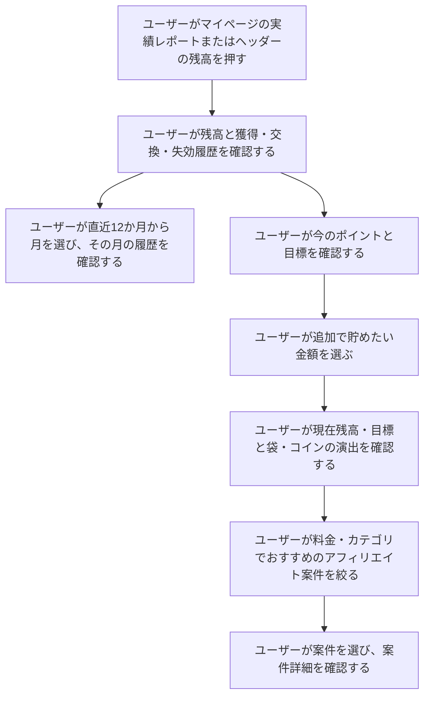
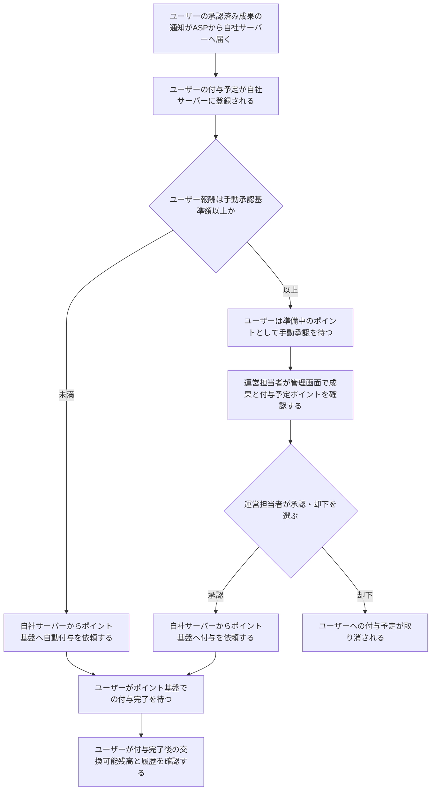

# F12｜ポイント残高・履歴・確定処理 PRD（レビュー前）

> 優先順位はスプレッドシートを正とする。本PRDはTier1のみを定義する。

参照するモック：本リポジトリのローカル4180（2026-10-19の変更箇所を照合）。未接続の外部API・実端末機能は、接続済みとして扱わず末尾に記載する。

| 基本情報 | 内容 |
| --- | --- |
| 機能ID | F12 |
| 概要 | ポイント残高・履歴・確定処理 |
| 対象領域 | アプリ／管理画面／外部連携 |
| 関連機能 | [F05](F05-my-offers.md)、[F10](F10-surveys.md)、[F13](F13-point-exchange.md)、[F18](F18-mypage-support.md) |
| 更新日 | 2026-10-22 |
| 版 | レビュー前（初版未確定） |

## ① 目的・今回作る範囲

目的：ユーザーが獲得・失効の履歴、付与待ちのポイント、実際に交換できる残高を区別し、期限内にポイントを利用できるようにするため

優先順位は[アプリ詳細要件のTier列](https://docs.google.com/spreadsheets/d/1tI26I_4vbSHIOzMdJz7g8-DjeLyyVUKoksVHhZ0AQhU/edit#gid=1107057215)を正とする。モックに存在してもTier2・Tier3・空欄の要件は本PRDの定義対象に含めない。

| 要件ID | Tier1の範囲 |
| --- | --- |
| F12-1 | ユーザーが自分の交換可能ポイントと累計ポイントを確認できる |
| F12-2 | ユーザーがポイントの付与・消費・失効の履歴を新しい順に確認できる |
| F12-3 | ポイント基盤が同じ付与依頼に対してポイントを一度だけ付与できる |
| F12-4 | ユーザーが今月末に失効する未使用ポイントの合計を確認できる |
| F12-6 | ユーザーが過去12か月分から月を選び、その月のポイント履歴を確認できる |
| F12-7 | ポイント基盤が新規ユーザーの作成時に、本人専用のポイント口座を残高0pt・履歴なしで新しく作成できる |
| F12-8 | ポイント基盤が有効期限の近いポイントから順に消費できる |
| F12-9 | ポイント基盤が残高不足の消費を拒否できる |
| F12-10 | ポイント基盤が取引履歴・失効予定・残高を一括で更新できる |
| F12-11 | ポイント基盤が毎月1日に期限切れポイントを失効できる |
| F12-14 | ユーザーが追加で貯めたい金額を選び、現在残高・目標金額と、金額に応じて大きくなる袋の表示を確認できる |
| F12-15 | ユーザーが追加目標に応じたおすすめ案件を確認し、利用可能な案件へ進める |
| F12-16 | ユーザーがおすすめ案件を料金と案件カテゴリで複数選択して絞り込める |

管理側は[管理画面詳細要件のTier列](https://docs.google.com/spreadsheets/d/1tI26I_4vbSHIOzMdJz7g8-DjeLyyVUKoksVHhZ0AQhU/edit#gid=1341040600)にある以下のTier1を関連範囲とする。ACSはEDOCODE社が運営するアフィリエイト管理システムを利用する想定とし、ACS本体の内製要件にはしない。

| 要件ID | Tier1の運用範囲 |
| --- | --- |
| ADM-F08-2 | 権限を持つ運営担当者が、ASPで承認されたアフィリエイト成果のうち、設定した基準額以上の報酬について、自社管理画面でポイント付与の承認・却下を行える |
| ADM-F08-6 | 運営担当者が会員の交換可能ポイント・ポイント履歴・失効予定を照会できる |

要件名に旧モックとの相違がある場合、優先順位は維持し、現在の表示・動きとユーザー指定を②以降へ反映する。実装方式の具体化は仕様設計で扱う。

## ② 画面イメージ

[マイページ](http://127.0.0.1:4180/mock-app/#mypage)／[実績レポート](http://127.0.0.1:4180/mock-app/#points)

### マイページ／実績レポート共通

| 表示項目 | 内容 |
| --- | --- |
| あなたのポイント | 準備中と交換可能の合計をポイント数と円相当額で表示する |
| ポイントの内訳 | 準備中・交換可能を分けて表示する |
| 今月末の失効予定 | 今月末に失効する未使用ポイントの合計を表示する。該当がなければ0ptとする |
| 画面間の整合 | 同じ利用者・同じ更新時点のポイント口座を参照し、付与・交換・失効の結果を同期する |
| ポイント表示のサイズ | マイページを基準に表示領域と数値・単位のサイズを揃える |
| 交換への入口 | 交換CTAから[F13](F13-point-exchange.md)のポイント交換へ進む |

### マイページ

| 表示・操作 | 内容 |
| --- | --- |
| ポイントの確認 | 共通のポイント表示と内訳・今月末の失効予定を確認できる |
| 実績レポートへの入口 | 「実績レポート」から累計ポイント・獲得・交換・失効履歴・今のポイントと目標を確認できる |

### 実績レポート

| 表示・操作 | 内容 |
| --- | --- |
| 累計ポイント | アプリを利用開始してから、ポイント付与が完了した加算ポイントの合計を表示する |
| 獲得・交換・失効履歴 | 新しい順に過去12か月分を表示し、その範囲から月を選んで絞り込める |
| 円相当額 | ポイント数を100で割った値の小数点以下を切り捨てる。元のポイント数は丸めない |
| 今のポイントと目標 | 現在の交換可能ポイントと、交換可能ポイントに追加目標を加えた値を、ポイント数と円相当額で表示する |
| 追加目標 | 500円・1,000円・3,000円・5,000円・10,000円・20,000円相当から選ぶ。初期値・保存済みの値が選択肢にない場合は、最も近い金額に置き換える |
| 袋・コインの演出 | 追加目標が大きいほど袋を大きくし、金額変更時にコインが降る短いアニメーションを再生する。動きを減らす設定時は数値と袋の大きさだけ更新する |
| おすすめ案件 | 追加目標に応じたアフィリエイト案件を最初5件、もっと見るで最大10件表示する。料金・案件カテゴリで複数選択して絞り込める。案件を選ぶと案件詳細へ進む |
| ホームからの入口 | 初心者マーク「いくら貯める？」から開くと「今のポイントと目標」の見出しが上端に来る。入口の仕様は[F02](F02-home.md)を参照する |

ヘッダーの残高表示は④「表示条件」に従う。

## ③ 操作フロー

### アフィリエイト報酬の確定

## ④ 業務ルール・制約

### 表示する対象ユーザー

| 対象ユーザー | 利用・表示 |
| --- | --- |
| 会員 | 本人の残高・履歴・実績レポートを確認する |
| 非会員（ゲスト） | 本人の残高・履歴・実績レポートを確認する |

### ポイント口座の作成・引き継ぎ

| 利用開始のパターン | 口座の扱い | 初期状態・引き継ぐ情報 |
| --- | --- | --- |
| ポイント口座を持たないユーザーが利用を開始する | 本人専用のポイント口座を新規作成する | 残高0pt・履歴なしで開始する |
| ゲストから会員登録する | ゲスト利用中のポイント口座を引き継ぐ | 交換可能ポイント・準備中・累計ポイント・履歴を引き継ぎ、リセットしない |

### ポイントの定義と状態

| 用語 | 定義 |
| --- | --- |
| 累計ポイント | アプリを利用開始してから、ポイント付与が完了した加算ポイントの合計。交換・失効では減らさない |
| あなたのポイント | 準備中と交換可能の合計 |
| 準備中 | ASPの承認済み成果通知を自社サーバーで受け取り、付与予定として保持しているが、ポイント基盤で付与が完了していないポイント。手動承認待ち・承認後の通知や付与処理待ち・自動付与の処理待ちを含む。交換可能・累計ポイントには含めない |
| 交換可能 | 必要な承認とポイント基盤での付与が完了した、有効かつ未使用のポイント。実際の交換にはF13の会員登録・認証・最低交換額等の条件を適用する |

| 区別するもの | ルール |
| --- | --- |
| 案件の成果状態とポイントの状態 | F05の「判定中」は案件の成果確認の状態であり、承認後の付与待ちを表す「準備中」と区別する |
| 承認と付与完了 | 手動承認待ちの段階ではポイント基盤へ付与依頼を送らない。承認後も付与完了を確認するまでは準備中とする |
| 画面間の同期 | マイページと実績レポートの同じ項目は、同じ利用者・同じ更新時点の値に揃える |

### 表示条件

| 項目 | 表示のルール |
| --- | --- |
| ポイントと円相当額 | 100pt＝1円相当で表示する。実績レポートの円相当額は小数点以下を切り捨て、元のポイント数は丸めない |
| ヘッダーの残高 | 本人の交換可能ポイントを円相当額で表示し、準備中は含めない。「あなたのポイント」とは区別する。付与完了・交換・失効・利用者切替後に更新し、固定の見本額は使用しない。取り消し線の比較額も交換可能ポイントを基準に算出する |
| 獲得・交換・失効履歴 | 新しい順に表示する |
| 履歴の月選択 | 過去12か月分から選んだ月の獲得・交換・失効履歴を表示する |
| 目標選択後 | 現在の交換可能ポイントと、交換可能ポイントに追加目標を加えた値を比較する。袋・コインは演出であり、ポイントの増加や付与を意味しない |
| おすすめ候補 | 公開・配信対象のアフィリエイト案件を候補とする。利用済み・参加済みかどうかでは制御しない。報酬範囲・料金・案件カテゴリ・並び順・表示件数は下表に従う |

### 目標金額ごとのおすすめ範囲

| 追加で貯めたい金額 | 表示する案件の報酬（円相当） |
| --- | --- |
| 500円 | 500円以下（報酬がある案件） |
| 1,000円 | 500〜1,000円 |
| 3,000円 | 1,000〜3,000円 |
| 5,000円 | 3,000〜5,000円 |
| 10,000円 | 5,000〜10,000円 |
| 20,000円 | 10,000〜20,000円 |

| 判定項目 | ルール |
| --- | --- |
| 基準金額 | 交換可能ポイントを加えた合計ではなく、追加で貯めたい金額を基準とする |
| 範囲の境界 | 下限・上限の両方を含む。境界の報酬は隣り合う2つの目標で候補となる |
| 利用歴 | 利用履歴・参加履歴・成果状態による除外は行わない。利用済みでも公開状態・OS等の配信条件と絞り込み条件を満たせば含める |
| 絞り込み | 報酬範囲に料金・案件カテゴリの条件を重ねる。同じ軸の複数選択はOR、異なる軸はAND、未選択の軸は制限なし |
| 表示件数 | 最初5件、もっと見るで最大10件。範囲外の案件で補充せず、該当がなければ0件の案内を表示する |
| 並び順 | EPC降順。EPC未取得は取得済みより後ろ、同値は案件ID降順。カテゴリ分散やアンケート優先の並べ替えは行わない |
| EPCの取得 | 接続先ASPのAPIから取得した値を使用し、自社では再計算しない。API連携は今後実装する |
| 報酬範囲の判定 | ユーザーが獲得できる最大報酬の円相当額を使用する。参加可能なチャレンジボーナスは通常の最大報酬に加算する。終了・非公開・ユーザーが対象外のボーナスは加算しない |
| 一覧の報酬表記 | 「最大○円相当」は範囲判定に使用した額に揃える。獲得保証ではなく、実際の付与条件・時期は各案件・チャレンジボーナスの仕様に従う |

### 取引履歴の保存・表示期間

| 項目 | ルール |
| --- | --- |
| 保存期間 | 記録の種類に応じ、適用法令で定められた保存期間を満たすように保存する |
| 画面での表示期間 | 過去12か月分 |
| 表示対象期間を過ぎた履歴 | 画面に表示されなくなったことを理由に削除せず、法定保存期間が満了するまで保持する |

### ポイントの有効期限・失効

| 項目 | ルール |
| --- | --- |
| 失効日 | 原則、ポイント基盤への付与が完了した日の属する月に5か月を加えた月の末日。同じ月の獲得分は同じ失効日とする。例：1月30日獲得分は6月30日。付与予定の登録日・ASP承認日は起点にしない |
| 交換できる期間 | 失効日当日まで交換に利用できる |
| 失効対象 | 期限切れの未使用ポイントのみ。翌日から交換可能・あなたのポイントの計算から除外する。準備中は失効処理の対象外 |
| 消費順序 | 失効日が近いポイントから消費・交換に充当する |
| 失効履歴 | 失効日翌日の日付で失効ポイントを減算として記録し、獲得・交換履歴と合わせて新しい順に表示する。再処理で二重に減算・記録しない |
| 累計ポイント | 交換・失効では減らさない |
| 今月末の失効予定 | 今月末に失効する未使用ポイントの合計。該当なしは0pt。翌月以降の予定や失効日の重複表示は含めない |

### 高額なアフィリエイト報酬の手動承認

ASPによる成果の承認と、自社によるポイント付与の承認を分け、成果・付与対象・報酬額の対応を確認する。

| 項目 | ルール |
| --- | --- |
| 成果通知の受信 | ASPからの通知をまず自社サーバーで受信・保持し、ASP承認済み成果を付与予定として管理する |
| 基準額 | 初期値1,000,000pt。権限を持つ運営担当者が自社管理画面で変更できる |
| 判定する金額 | ユーザーに付与する報酬のポイント数。広告主の売上額・商品の購入金額ではない |
| 手動承認の対象 | 基準額以上（同額を含む）。基準額未満は自社サーバーで判定後、ポイント基盤へ自動付与を依頼する |
| SUR案件 | 段階ごとの報酬で判定する。案件全体の合計報酬では判定しない |
| チャレンジボーナス | 通常報酬とボーナスの合計ポイント数で判定する |
| 基準額変更時 | 既存の手動承認待ちも再判定する。新基準額未満は自動付与へ進め、以上は手動承認待ちを継続する。付与完了済み・却下済みは再判定しない |
| ASPの承認条件 | ASP承認済み成果だけを付与対象とする。ASPで判定中・否認の成果を自社承認だけで付与しない |
| 手動承認待ち | 準備中に含める。交換可能・累計ポイントには含めず、あなたのポイントには付与予定分として含める |
| 自社で承認した後 | 自社サーバーからポイント基盤へ付与依頼を通知する。承認済みでも通知・付与処理待ちは準備中のまま |
| 付与完了時 | ポイント基盤の付与完了を確認した時点で準備中を解消し、交換可能・累計ポイント・獲得履歴に反映する。あなたのポイントは準備中と交換可能の合計として更新する |
| 却下時 | 自社サーバーの付与予定を取り消し、ポイント基盤へ依頼しない。ASPの承認状態は書き換えない |
| 二重付与防止 | 同じ成果の再連携・承認操作の再実行でもポイントを二重に付与しない |

### 画面に置く要素・操作

#### マイページ

| 要素 | 表示・操作 |
| --- | --- |
| あなたのポイント | 準備中と交換可能の合計をポイント数と円相当額で表示する |
| ポイントの内訳 | 準備中・交換可能を分けて表示する |
| 今月末の失効予定 | 今月末に失効する未使用ポイントの合計を表示する |
| 交換CTA | [F13](F13-point-exchange.md)のポイント交換へ進む |
| 実績レポート | 実績レポート画面へ進む |

#### 実績レポート画面

| 要素 | 表示・操作 |
| --- | --- |
| あなたのポイント・内訳 | あなたのポイント・準備中・交換可能を表示する。サイズはマイページに揃える |
| 累計ポイント | アプリを利用開始してからポイント付与が完了した加算ポイントの合計を表示する |
| 今月末の失効予定 | 今月末に失効する未使用ポイントの合計を表示する |
| 交換CTA | [F13](F13-point-exchange.md)のポイント交換へ進む |
| 獲得・交換・失効履歴 | 過去12か月分を新しい順に表示する。月を選んで絞り込める |
| 今のポイントと目標 | 現在の交換可能ポイントと、交換可能ポイントに追加目標を加えた値をポイント数・円相当額で表示する |
| 目標金額の選択 | 追加で貯めたい金額を6つの選択肢から選ぶ |
| 袋・コイン演出 | 追加目標に応じて袋の大きさを変え、金額変更時にコインを降らせる |
| もっと絞る | 料金・案件カテゴリを複数選択する |
| おすすめ案件リスト | 最初5件、もっと見るで最大10件を表示し、選択すると案件詳細へ進む |

## ⑤ 管理画面

[管理画面](http://127.0.0.1:4180/mock-admin/#review)

| 対象項目 | 新規作成 | 変更 | 削除 | 管理画面での操作・反映範囲 |
| --- | --- | --- | --- | --- |
| アフィリエイト報酬の手動承認 | 不可 | 承認・却下可能 | 不可 | 権限を持つ運営担当者が、対象ユーザー・案件・成果・ASPの承認状態・付与予定ポイントと円相当額・自社の承認待ち／承認済み／却下の状態を確認する。ASP承認済み成果に対して承認・却下を実行し、承認後にポイント基盤へ付与依頼を通知する。 |
| アフィリエイト報酬の手動承認基準額 | 初期値を用意 | 変更可能 | 不可 | 初期値1,000,000pt。権限を持つ運営担当者がポイント数を入力して保存する。既存の手動承認待ちへの適用は④に従う。 |
| 会員のポイント情報の照会 | 不可 | 不可（照会のみ） | 不可 | 対象会員の交換可能ポイント・獲得／交換／失効履歴・今月末の失効予定を確認する。 |

承認操作とポイント付与完了は区別する。付与失敗や処理の成否を確認できない場合の照合・再処理は、⑥に従いバックエンド側で行う。

## ⑥ 例外処理・エラーハンドリング

「処理の成否を確認できない状態」とは、ポイント処理を依頼した後、通信断やタイムアウトなどにより、自社サーバーで成功・失敗を確認できない状態を指す。実際には処理が完了している可能性があるため、失敗と決めつけて新しい依頼を作らず、同じ処理依頼IDで結果を照合する。照合・必要な再処理はバックエンド側で行う。この表現は内部の処理状態を説明するもので、ユーザー画面にそのまま表示する文言ではない。

| 状況 | 表示・処理・復帰 |
| --- | --- |
| 未付与・処理中・処理の成否を確認できない状態 | 付与完了と区別する。照合・再処理はバックエンド側で行い、同じ付与依頼IDを使って二重付与を防ぐ。 |
| 手動承認後の付与失敗・処理の成否を確認できない状態 | 承認ボタンを押しただけで付与完了と表示しない。照合・再処理はバックエンド側で対応する。 |
| 失効処理の失敗・一部完了・処理の成否を確認できない状態 | 期限切れ分を交換可能に戻さず、同じ残高を二重に減算したり失効履歴を重複させたりしない。 |
| 候補0件・履歴0件 | 空の案内を表示し、存在しない案件や履歴を補わない。 |

## ⑦ まだ決まっていないこと

| 確認事項 | 相談先 |
| --- | --- |
| 各案件への料金・カテゴリタグの付け方と、タグ未設定時の扱いは、バンドルの仕様に依存するため後日確認する。 | バンドル仕様の担当者 |
| 選択した目標金額・料金・カテゴリの保持は、開発時に負荷への影響を確認してから決める。画面遷移・再読み込み・次回起動後の保持範囲と保存方式は現時点では確定しない。 | 開発・事業 |

## モックへの未反映・対象外

### モックへの未反映

| 項目 | 未反映の内容 |
| --- | --- |
| ポイント基盤との連携 | EDOCODEの正式な残高・取引・失効予定の取得と各画面への同期は未接続 |
| 成果通知の受信・承認後の通知と処理待ち | ASP成果通知を自社サーバーで受信・保持し、手動承認後にポイント基盤へ付与依頼を送る本番連携と、付与処理待ち・失敗・処理の成否を確認できない状態の連携は未接続。 |
| 高額なアフィリエイト報酬の振り分け・基準額設定 | ポイント単位での基準額の入力・保存・再表示は実装済み。成果の自動振り分けは未実装で、現行モックは金額によらず手動承認待ちに登録する。SURの段階単位・ボーナス合算での基準額判定、基準額変更時の既存承認待ちの再判定も未実装。 |
| おすすめの候補・実データ | 本番のアフィリエイト案件・EPCのASP API取得は未接続。現行モックには利用歴による候補除外、定率・SUR案件の除外、アンケート候補が残っており、今回の仕様との整合は未反映。 |
| ポイント表示のサイズ・円相当額の端数 | 実績レポートをマイページのポイント表示サイズに揃える変更と、実績レポートの円相当額を小数点以下切り捨てに統一する変更は未反映。 |
| 取引履歴の法定保存 | 適用法令に応じた保存・削除制御は本番バックエンド側の対応範囲であり、ローカルモックでは実装していない。 |

### 今回の対象外

| 項目 | 対象外の内容 |
| --- | --- |
| 付与失敗時の管理画面からの再実行 | エラー一覧・再実行・復旧結果確認の専用管理機能は開発対象外。復旧はバックエンド側で対応する。 |

## 変更履歴

2026-10-22：②・④を画面別と表形式に整理。累計ポイント・あなたのポイントの定義を統一し、案件への取り組み状態をポイント状態から除外。⑤は管理画面の操作・照会に限定し、⑦の達成条件を削除。未決事項は維持。

2026-10-22：「結果不明」を「処理の成否を確認できない状態」に変更し、通信断・タイムアウト時の意味と、同じ処理依頼IDで照合することを明記。

| 版 | 日付 | 変更内容 |
| --- | --- | --- |
| レビュー前 | 2026-10-21 | 削除済み要件F12-5を範囲・達成条件から削除。同内容のADM-F08-7と失効再実行に関する運営操作の記載も削除し、通常の失効処理と二重減算防止は維持。 |
| レビュー前 | 2026-10-20 | ユーザーが共有した議事録の内容を反映。失効日の算出、今月末の失効予定、準備中・交換可能の区別、付与完了時点での残高反映、手動承認の目的、障害時の再実行と画面間同期を明記。モックは変更しない。 |
| レビュー前 | 2026-10-20 | 目標金額・絞り込み条件の保持を、開発時に負荷への影響を確認する後日確認事項として整理。モックの保持動作は変更しない。 |
| レビュー前 | 2026-10-20 | 料金・カテゴリタグの付与ルールと未設定時の扱いは、バンドル仕様に依存する後日確認事項として整理。モックの分類処理は変更しない。 |
| レビュー前 | 2026-10-20 | おすすめの金額判定をチャレンジボーナス込みの最大報酬に統一。アンケートも最大報酬で同じ範囲を適用し、この判定基準を未決事項から除外。 |
| レビュー前 | 2026-10-20 | 目標の金額範囲・料金・カテゴリで絞ったおすすめをEPC降順へ変更。カテゴリ分散・アンケート優先による並べ替えを廃止。 |
| レビュー前 | 2026-10-20 | 目標ごとのおすすめ報酬範囲を「ひとつ前の金額〜選択金額」に変更。最小500円は500円以下とし、両端を含む範囲で絞り込む。 |
| レビュー前 | 2026-10-19 | ホームの「いくら貯める？」からの遷移位置を「今のポイントと目標」の見出しに統一。目標・報酬計算は変更しない。 |
| レビュー前 | 2026-10-15 | F10レビューの共通フィードバックを反映。⑤を管理画面へ変更し、④を対象ユーザー・表示条件・配置要素に整理。例外処理と仕様設計事項の重複を除き、未反映と対象外を別表に分離。個別レビューは未完了。 |
| レビュー前 | 2026-10-20 | ヘッダーの固定見本額を撤去し、マイページと同じ本人の有効残高を表示する方針・確認条件を反映。 |
| レビュー前 | 2026-10-20 | ユーザー指定により実績レポート内の「ためる／ためたい／ため方」を「貯める／貯めたい／貯め方」に統一。画面固有の表記ルールとして記録。 |
| レビュー前 | 2026-10-22 | 管理画面「審査・交換上限」に手動承認基準額（初期値10,000円相当）の入力・保存・判定条件プレビューを実装。成果振り分けへの連動は未実装として維持。 |
| レビュー前 | 2026-10-22 | 手動承認基準額をポイント単位（初期値1,000,000pt）へ変更。管理画面の判定条件プレビューとモック説明文を削除。 |
| レビュー前 | 2026-10-22 | 付与失敗時の復旧をバックエンド側の対応に変更。ADM-F08-3を管理画面の運用範囲から削除し、専用のエラー一覧・再実行・復旧確認を対象外へ整理。例外処理・達成条件・未反映事項を整合し、二重付与防止は維持。 |
| レビュー前 | 2026-10-22 | レビューフィードバックを反映。マイページ内の表示と実績レポートを区別し、今月末の失効予定はポイント合計のみ表示。不要な評価指標・注記を削除し、ACSの呼称・役割を整理。フローを利用者視点へ変更し、追加目標の増加分表示を削除。EPCは今後ASP APIから取得する仕様とし、手動承認はSUR段階ごと・ボーナス合算・既存承認待ちへの新基準額適用を決定事項へ移行。 |
| レビュー前 | 2026-10-22 | PR #22の確認事項6点を決定方針へ反映。ポイント表示面をマイページに統一し、実績レポートの円相当額は端数切り捨て。ASP成果通知は自社サーバーで保持し、手動承認後にポイント基盤へ通知する。おすすめの利用歴による制御を行わず、定率・SUR除外の記載を削除。履歴は法定保存期間を満たして保存し、画面表示は過去12か月分とする。モックの追加変更は行わない。 |
