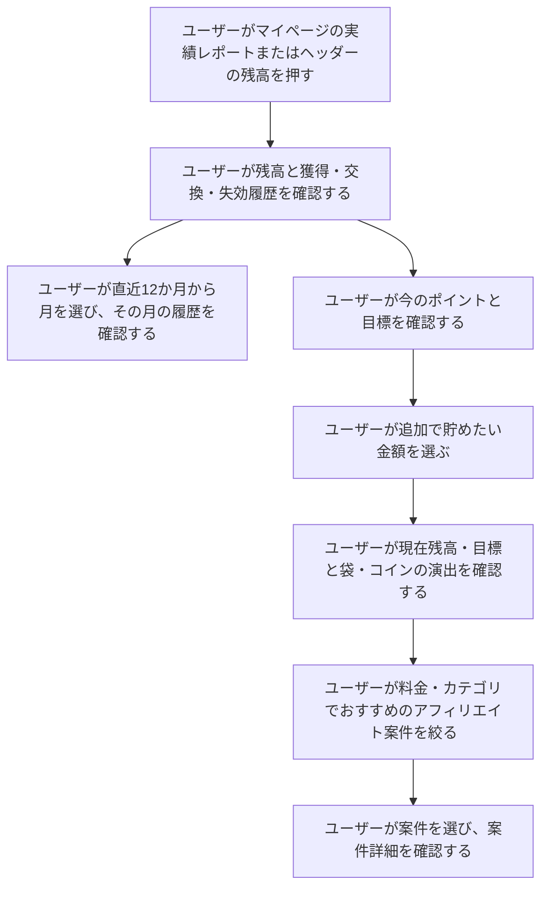
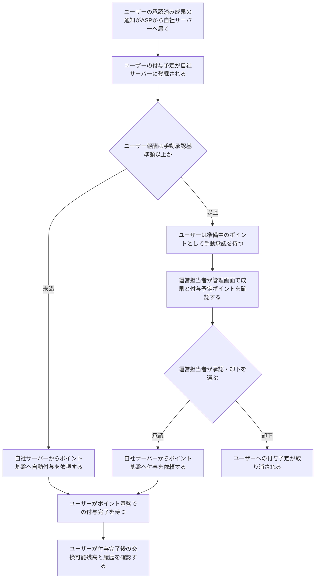

# F12｜ポイント残高・履歴・確定処理 PRD（レビュー前）

> 優先順位はスプレッドシートを正とする。本PRDはTier1のみを定義する。

参照するモック：本リポジトリのローカル4180（2026-10-19の変更箇所を照合）。未接続の外部API・実端末機能は、接続済みとして扱わず末尾に記載する。

| 基本情報 | 内容 |
| --- | --- |
| 機能ID | F12 |
| 概要 | ポイント残高・履歴・確定処理 |
| 対象領域 | アプリ／管理画面／外部連携 |
| 関連機能 | [F05](F05-my-offers.md)、[F10](F10-surveys.md)、[F13](F13-point-exchange.md)、[F18](F18-mypage-support.md) |
| 更新日 | 2026-10-22 |
| 版 | レビュー前（初版未確定） |

## ① 目的・今回作る範囲

目的：ユーザーが獲得・失効の履歴、付与待ちのポイント、実際に交換できる残高を区別し、期限内にポイントを利用できるようにするため

優先順位は[アプリ詳細要件のTier列](https://docs.google.com/spreadsheets/d/1tI26I_4vbSHIOzMdJz7g8-DjeLyyVUKoksVHhZ0AQhU/edit#gid=1107057215)を正とする。モックに存在してもTier2・Tier3・空欄の要件は本PRDの定義対象に含めない。

| 要件ID | Tier1の範囲 |
| --- | --- |
| F12-1 | ユーザーが自分の有効なポイント残高と総獲得ポイントを確認できる |
| F12-2 | ユーザーがポイントの付与・消費・失効の履歴を新しい順に確認できる |
| F12-3 | ポイント基盤が同じ付与依頼に対してポイントを一度だけ付与できる |
| F12-4 | ユーザーが今月末に失効する未使用ポイントの合計を確認できる |
| F12-6 | ユーザーが過去12か月分から月を選び、その月のポイント履歴を確認できる |
| F12-7 | ポイント基盤が新規ユーザーの作成時に、本人専用のポイント口座を残高0pt・履歴なしで新しく作成できる |
| F12-8 | ポイント基盤が有効期限の近いポイントから順に消費できる |
| F12-9 | ポイント基盤が残高不足の消費を拒否できる |
| F12-10 | ポイント基盤が取引履歴・失効予定・残高を一括で更新できる |
| F12-11 | ポイント基盤が毎月1日に期限切れポイントを失効できる |
| F12-14 | ユーザーが追加で貯めたい金額を選び、現在残高・目標金額と、金額に応じて大きくなる袋の表示を確認できる |
| F12-15 | ユーザーが追加目標に応じたおすすめ案件を確認し、利用可能な案件へ進める |
| F12-16 | ユーザーがおすすめ案件を料金と案件カテゴリで複数選択して絞り込める |

管理側は[管理画面詳細要件のTier列](https://docs.google.com/spreadsheets/d/1tI26I_4vbSHIOzMdJz7g8-DjeLyyVUKoksVHhZ0AQhU/edit#gid=1341040600)にある以下のTier1を関連範囲とする。ACSはEDOCODE社が運営するアフィリエイト管理システムを利用する想定とし、ACS本体の内製要件にはしない。

| 要件ID | Tier1の運用範囲 |
| --- | --- |
| ADM-F08-2 | 権限を持つ運営担当者が、ASPで承認されたアフィリエイト成果のうち、設定した基準額以上の報酬について、自社管理画面でポイント付与の承認・却下を行える |
| ADM-F08-6 | 運営担当者が会員の有効残高・ポイント履歴・失効予定を照会できる |

要件名に旧モックとの相違がある場合、優先順位は維持し、現在の表示・動きとユーザー指定を②以降へ反映する。実装方式の具体化は仕様設計で扱う。

## ② 画面イメージ

[アプリの該当画面](http://127.0.0.1:4180/mock-app/#points)

- マイページ内では、有効な保有ポイントと円相当額、準備中・交換可能の内訳、総獲得ポイント、今月末の失効予定を確認できる。ポイントを獲得した記録・交換で使った記録・期限切れで失効した記録は、マイページ内の「実績レポート」から確認する。
- マイページの「実績レポート」から、本人の有効残高・準備中・交換可能・総獲得ポイント・獲得・交換・失効履歴・今月末の失効予定をまとめて確認できる。マイページと実績レポートは同じポイント口座の情報を参照し、付与・交換・失効の結果を同期する。
- 実績レポートのポイント表示面は、マイページのポイント表示面を基準に、表示領域とポイント数値・単位のサイズを揃える。
- 実績レポートの円相当額は、ポイント数を100で割った値の小数点以下を切り捨てて表示する。ポイント残高・付与額の数値自体は丸めない。
- 獲得・交換・失効履歴を新しい順に表示する。ユーザーが画面で確認できる期間は過去12か月分とし、その範囲から月を選んで絞り込める。月別の獲得ポイント合計や、その合計を比較するグラフは表示しない。
- マイページと実績レポートの失効予定は、共通して「今月末の失効予定」と表示し、今月末に失効する未使用ポイントの合計を示す。両画面で同じ利用者・確認日時点の値を表示する。翌月以降の予定はこの欄に含めず、該当がない場合は0ptと表示する。
- 実績レポートの今のポイントと目標の表示：お金の袋のイラストを表示する。追加目標が大きいほど袋を大きくし、金額を切り替えるとコインが降る短いアニメーションを再生する。
- 追加で貯めたい金額は500円・1,000円・3,000円・5,000円・10,000円・20,000円相当から選ぶ。初期値・保存済みの値が選択肢にない場合は、最も近い金額に置き換える。
- 選んだ目標に合う報酬の案件を探せるよう、おすすめは「ひとつ前の選択金額〜選択した金額」の範囲にあるアフィリエイト案件に絞る。下限・上限の両方を含み、500円は500円以下の報酬がある案件を対象とする。残高を加えた合計金額ではなく、追加で貯めたい金額を基準とする。
- 「今のポイント」「頑張ったら貯まるポイント（現在残高＋追加目標）」はポイント数と円相当額を数値で表示する。袋の大きさは選択金額の段階を表す演出であり、残高の増加や報酬付与を意味しない。端末で動きを減らす設定をしている場合は、袋の大きさと数値だけ更新し、アニメーションを抑える。
- 「あといくら貯めたい？」で金額を選び、おすすめ案件を料金・細分化したカテゴリで複数条件を絞る。おすすめのアフィリエイト案件は5件から最大10件まで開閉し、選択すると案件詳細へ進む。

- ホームの初心者マーク「いくら貯める？」から開いた場合は、レポートの「今のポイントと目標」の見出しが上端に来るよう移動する。入口の仕様は[F02](F02-home.md)を参照。

ヘッダーの残高は、マイページの「あなたのポイント」と同じ本人の有効残高（失効分を除いた交換可能ポイント）を100pt＝1円相当で表示する。準備中は含めない。従来の固定見本額は使用せず、付与確定・交換・失効・利用者切替後に同じ残高へ更新する。取り消し線の比較額も、その残高を基準に算出する。

## ③ 操作フロー

### アフィリエイト報酬の確定

## ④ 業務ルール・制約

### 表示する対象ユーザー

| 対象ユーザー | 利用・表示 |
| --- | --- |
| 会員 | 本人の残高・履歴・実績レポートを確認する |
| 非会員（ゲスト） | 本人の残高・履歴・実績レポートを確認する |

ポイント口座の新規作成は、まだ口座を持たないユーザーを対象とする。ゲストから会員登録する場合は既存のポイント口座を引き継ぎ、残高・付与予定・総獲得ポイント・履歴をリセットしない。

### ポイントのステータスと残高

承認されたことと、実際にポイントを使えることを混同させないため、以下を区別する。

| 状態 | 意味・残高への扱い |
| --- | --- |
| 挑戦中 | ユーザーが案件に取り組んでいる段階。参加しただけでは準備中や交換可能のポイントに加算しない。 |
| 準備中 | ASPからの承認済み成果通知を自社サーバーで受け取り、付与予定として保持しているが、ポイント基盤での付与が完了していない状態。手動承認待ち、手動承認後の通知・付与処理待ち、自動付与の処理待ちを含む。手動承認待ちの段階ではポイント基盤へ付与依頼を送らない。交換可能残高・総獲得ポイントには含めない。 |
| 交換可能 | 必要な承認とウォレットへの付与が完了した、有効かつ未使用のポイント。実際の交換には[F13](F13-point-exchange.md)の会員登録・認証・最低交換額等の条件も適用する。 |

案件の成果を確認している「判定中」と、承認後の付与待ちである「準備中」は異なる。[F05](F05-my-offers.md)の案件の成果状態を、本節のウォレットへの反映状態で置き換えない。

総獲得ポイントは付与が完了した加算ポイントの累計、合算ポイントは有効残高と準備中の合計とする。総獲得・合算・交換可能を同じ意味で表示しない。マイページと実績レポートでは、同じ利用者・同じ更新時点の残高と履歴・失効予定を揃える。

### 表示条件

| 状態・条件 | 表示のルール |
| --- | --- |
| 有効な残高 | 100pt＝1円相当でポイントと円相当額を表示する |
| 獲得・交換・失効の履歴 | 新しい順に表示する |
| 履歴の月選択 | 過去12か月分から選んだ月の付与・消費・失効の履歴を表示する。月別の獲得ポイント合計は表示しない |
| 目標選択後 | 現在の保有ポイントと追加目標の合計を比較して表示する |
| おすすめ候補 | 利用済み・参加済みかどうかによる制御は行わず、公開・配信対象のアフィリエイト案件を候補とする。目標金額・料金・カテゴリの絞り込み、EPC順、最大10件の表示上限は共通ルールを適用する |

### 目標金額ごとのおすすめ範囲

| 追加で貯めたい金額 | 表示する案件の報酬（円相当） |
| --- | --- |
| 500円 | 500円以下（報酬がある案件） |
| 1,000円 | 500〜1,000円 |
| 3,000円 | 1,000〜3,000円 |
| 5,000円 | 3,000〜5,000円 |
| 10,000円 | 5,000〜10,000円 |
| 20,000円 | 10,000〜20,000円 |

案件の利用履歴・参加履歴・成果状態による候補の除外は行わない。利用済みの案件も、公開状態・OS等の配信条件と指定した絞り込み条件を満たす場合は候補に含める。

両端を含むため、境界の報酬は隣り合う2つの目標で候補となる。金額範囲に料金・カテゴリの条件を重ねて絞り込む。同じ軸の複数選択はOR、異なる軸はAND、未選択の軸は制限なしとする。範囲外の案件で件数を埋めず、該当がなければ0件の案内を表示する。

金額範囲・料金・カテゴリの条件を満たした案件は、EPCが高い順に並べて最大10件を表示する。カテゴリの分散やアンケートの優先表示による並べ替えは行わない。EPC順の共通ルールに合わせ、未取得の案件は取得済みの案件より後ろに置き、EPCが同じ場合は案件IDの降順とする。

金額範囲の判定には、ユーザーが獲得できる最大報酬の円相当額を使う。参加可能なチャレンジボーナスがある案件は、通常の最大報酬にそのボーナスを加えた合計額で判定する。おすすめ一覧の「最大○円相当」も判定に用いた額に揃え、範囲と表示額が食い違わないようにする。最大額は条件達成時の金額であり、獲得を保証するものではない。実際の付与条件・時期は各案件・チャレンジボーナスの仕様に従う。

終了・非公開・ユーザーが対象外のチャレンジボーナスは加算しない。EPCは接続先ASPのAPIから取得した値を使用し、自社では再計算しない。API連携は今後実装する。

### 取引履歴の保存・表示期間

- 取引履歴は、適用法令で定められた保存期間を満たすように保存する。記録の種類に応じた法定保存期間に従って管理する。
- ユーザーがアプリの画面で確認できる履歴は、過去12か月分とする。
- 画面の表示対象から外れたことを理由に取引履歴を削除せず、法定保存期間が満了するまで保持する。

### ポイントの有効期限・失効

期限切れによる残高の減少をユーザーが確認できるように、失効分は残高から除外しても履歴に残す。

- 確定済みの加算ポイントの失効日は、原則として獲得日（ウォレットへの付与が確定した日）の属する月に5ヶ月を加えた月の末日とする。例えば1月30日獲得分は6月30日が失効日となる。同じ月に獲得したポイントは同じ失効日となり、付与予定の登録日やASPの承認日は起点にしない。
- 失効日当日までは保有ポイントに含め、交換に利用できる。翌日から未消費分を保有ポイント・合算ポイントの計算から除外する。準備中のポイントはこの失効処理の対象にしない。
- 期限内に使えるポイントを先に利用できるよう、消費・交換には失効日が近いポイントから充当する。失効するのは未消費の残りのみとする。
- 失効履歴には、失効日翌日の日付と失効したポイント数を減算として表示する。付与・消費の履歴と合わせて新しい順に並べる。失効処理を再実行しても同じ分を二重に減算・記録しない。
- 総獲得ポイントは、確定した加算ポイントの累計を示すため、交換や失効では減らさない。
- 「今月末の失効予定」には、今月末に失効する未使用ポイントの合計を表示する。該当するポイントがない場合は0ptとする。

### 高額なアフィリエイト報酬の手動承認

不正付与を防ぎ、計測された成果と付与対象・金額の対応を確認できるよう、ASPによる成果の承認と、自社によるポイント付与の最終承認を分ける。

ASPからの成果通知は、まず自社サーバーで受信して保持する。ASPで承認された成果は、自社サーバーで付与予定として管理し、手動承認の対象については、運営が承認した後に自社サーバーからポイント基盤のサーバーへ付与依頼の通知を送る。手動承認前・却下時には、ポイント基盤へ付与依頼を送らない。基準額未満の自動付与対象は、自社サーバーで判定後にポイント基盤へ付与依頼を送る。

- 手動承認の基準額の初期値は**1,000,000pt**とする。権限を持つ運営担当者が、自社管理画面で基準額を変更できる。
- 判定対象はユーザーへ付与する報酬のポイント数とする。広告主からの売上額や商品の購入金額ではない。
- SUR案件は、各段階で付与する報酬ごとに基準額を判定する。案件全体の合計報酬では判定しない。
- チャレンジボーナスが付く報酬は、通常報酬とボーナスの合計ポイント数で基準額を判定する。
- 基準額を変更した場合は、すでに手動承認待ちの報酬も新しい基準額で再判定する。新しい基準額未満となった報酬は自動付与へ進み、基準額以上は手動承認待ちを継続する。付与完了済み・却下済みの報酬は再判定しない。
- 基準額と同額の報酬も手動承認の対象とする。初期値では1,000,000pt以上が手動承認、1,000,000pt未満が自動付与の対象となる。
- 手動承認はASPが承認した成果だけを対象とし、ASPで判定中・否認の成果を自社の手動承認だけで付与対象にはしない。
- 運営の手動承認待ちは「準備中（付与予定）」とし、保有ポイント・交換可能ポイント・総獲得ポイントには含めない。合算ポイントには付与予定分として含める。
- 運営が手動承認すると、自社サーバーからポイント基盤のサーバーへ付与依頼の通知を送る。ポイント基盤から付与完了の結果を確認した時点で、自社サーバーの付与予定を解消し、保有ポイント・交換可能ポイント・総獲得ポイントと履歴に反映する。承認済みでも通知・付与処理待ちは準備中のままとする。却下した場合は自社サーバーの付与予定を取り消し、ポイント基盤には付与依頼を送らない。
- ASPの成果状態と自社の付与承認状態は別に管理する。自社でポイント付与を却下しても、ASPの「承認」を「否認」に書き換えない。
- 同じ成果の再連携や承認操作の再実行によって、ポイントを二重に付与しない。

### 画面に置く要素・操作

| 画面・要素 | 表示・操作のルール |
| --- | --- |
| 残高・総獲得ポイント | 本人の有効残高と獲得実績を表示する |
| 失効予定 | 「今月末の失効予定」として、今月末に失効する未使用ポイントの合計を表示する。該当なしは0pt。失効日を重ねて表示しない |
| ポイント履歴 | 獲得・交換・失効の内容を確認する |
| 目標の袋・コイン演出 | 追加目標に応じて袋の大きさを変え、金額変更時にコインを降らせる。現在残高・目標はポイント数と円相当額で示す |
| 目標金額の選択 | あといくら貯めたいかを選ぶ |
| もっと絞る | 料金と細分化したカテゴリを複数選択する |
| おすすめの案件リスト | 最初5件、もっと見るで最大10件を表示し、選択すると案件詳細へ進む |

## ⑤ 管理画面

新規作成・変更・削除は、現在の管理画面で操作できる範囲を示す。「外部管理」はEDOCODE社が運営するアフィリエイト管理システム「ACS」またはポイント基盤側の担当範囲、「未実装」は操作画面がない項目。削除と公開停止は分けて記載する。

[実行設定の管理画面](http://127.0.0.1:4180/mock-admin/#review)

| 対象項目 | 新規作成 | 変更 | 削除 | 管理画面での操作・反映範囲 |
| --- | --- | --- | --- | --- |
| 付与予定の承認・却下・自動判定実行 | 不可 | 処理可能 | 不可 | 審査・交換上限で既存の付与予定を処理する。取引を自由入力・編集する画面ではない。 |
| アフィリエイト報酬の手動承認基準額 | 初期値を用意 | 変更可能 | 対象外 | 初期値1,000,000pt。ポイント数で設定し、保存した基準額以上のユーザー報酬を手動承認の対象とする。 |
| ポイント取引・残高・獲得履歴 | 外部管理 | 外部管理 | 外部管理 | EDOCODEのポイント基盤の依頼範囲。自社画面から任意の残高を入稿しない。 |
| おすすめの絞り込み・目標 | 対象外 | 対象外 | 対象外 | ユーザー自身の選択。管理画面の案件入稿とは別。 |

アフィリエイト報酬の手動承認では、対象ユーザー・案件・成果、ASPの承認状態、ユーザーへの付与予定ポイントと円相当額、自社の承認待ち／承認済み／却下の状態を確認できるようにする。自社サーバーで受け取ったASP承認済み成果に対して、運営が「承認」または「却下」を実行する。承認後に自社サーバーからポイント基盤へ付与依頼を通知する。付与失敗・結果不明は付与完了と区別する。

付与失敗時の照合・再処理はバックエンド側で対応する。管理画面には、失敗した付与処理のエラー一覧・再実行・復旧結果確認の専用機能を設けない。同一の付与依頼IDで照合し、残高・履歴への二重反映を防ぐ。

## ⑥ 例外処理・エラーハンドリング

| 状況 | 表示・処理・復帰 |
| --- | --- |
| 未付与・処理中・結果不明 | 付与完了と区別する。照合・再処理はバックエンド側で行い、同じ付与依頼IDを使って二重付与を防ぐ。 |
| 手動承認後の付与失敗・結果不明 | 承認ボタンを押しただけで付与完了と表示しない。照合・再処理はバックエンド側で対応する。 |
| 失効処理の失敗・一部完了・結果不明 | 期限切れ分を交換可能に戻さず、同じ残高を二重に減算したり失効履歴を重複させたりしない。 |
| 候補0件・履歴0件 | 空の案内を表示し、存在しない案件や履歴を補わない。 |

## ⑦ 達成条件・未決事項

### Tier1の達成条件

- [ ] ホームからの目標入口で「今のポイントと目標」の見出し・目標の表示が最初に表示される。既存の金額選択・おすすめ計算は維持する。

- [ ] F12-1：ユーザーが自分の有効なポイント残高と総獲得ポイントを確認できる。
- [ ] 挑戦中・承認後の準備中・付与完了後の交換可能を区別できる。承認済みでも付与処理待ちの分は交換可能残高・総獲得ポイントに含めない。
- [ ] マイページの実績レポートから本人の残高・履歴・失効予定を確認でき、付与・交換・失効後も両画面の同じ項目の値が一致する。
- [ ] 実績レポートのポイント表示領域とポイント数値・単位のサイズが、マイページのポイント表示面に揃っている。
- [ ] 実績レポートの円相当額は小数点以下を切り捨てて表示され、元のポイント数は変わらない。
- [ ] 原則の失効日は獲得月＋5ヶ月の月末となる（1月30日獲得→6月30日）。今月末に失効する対象がない場合、失効予定は翌月分ではなく0ptを表示する。
- [ ] F12-2：ユーザーがポイントの付与・消費・失効の履歴を新しい順に確認できる。
- [ ] F12-3：ポイント基盤が同じ付与依頼に対してポイントを一度だけ付与できる。
- [ ] F12-4：ユーザーが今月末に失効する未使用ポイントの合計を確認できる。
- [ ] バックエンド側で同じ付与依頼を再処理しても、残高・履歴への二重反映が起きない。
- [ ] F12-6：ユーザーが過去12か月分から月を選び、その月のポイント履歴を確認できる。
- [ ] 取引履歴が適用法令で定められた期間保存され、画面の表示対象期間を過ぎたことだけを理由に削除されない。
- [ ] F12-7：ポイント基盤が新規ユーザーの作成時に、本人専用のポイント口座を残高0pt・履歴なしで新しく作成できる。ゲストから会員登録する場合は既存の口座を引き継ぎ、ポイントや履歴をリセットしない。
- [ ] F12-8：ポイント基盤が有効期限の近いポイントから順に消費できる。
- [ ] F12-9：ポイント基盤が残高不足の消費を拒否できる。
- [ ] F12-10：ポイント基盤が取引履歴・失効予定・残高を一括で更新できる。
- [ ] F12-11：ポイント基盤が毎月1日に期限切れポイントを失効できる。
- [ ] 失効日当日のポイントを交換でき、翌日から未消費分が保有・合算ポイントから除外される。失効履歴は残り、総獲得ポイントは減らない。
- [ ] 失効日の近いポイントから消費され、全額消費済みのポイントを失効として再減算しない。
- [ ] モックで月初を飛ばして確認日を進めても、未処理の期限切れ分が失効履歴に一度だけ表示される。
- [ ] F12-14：ユーザーが追加で貯めたい金額を選び、現在残高・目標金額と金額に応じた袋の表示を確認できる。
- [ ] 全6選択肢で追加目標が大きいほど袋が大きくなる。金額を切り替えるとコインが降り、短時間で終了する。連続操作でも古い演出を重ねず、最後に選んだ金額に一致する。動きを減らす設定でも数値・選択・おすすめの操作は利用できる。
- [ ] F12-15：ユーザーが追加目標に応じたおすすめ案件を確認し、案件詳細へ進める。
- [ ] おすすめ候補は利用済み・参加済み・成果状態によって除外されない。同じ配信条件・絞り込み条件を満たす場合、利用歴があっても候補に含まれる。
- [ ] F12-16：ユーザーがおすすめ案件を料金と案件カテゴリで複数選択して絞り込める。
- [ ] 6つの目標それぞれで表の報酬範囲だけが候補となり、下限・上限を含む。金額範囲と料金・カテゴリの条件を満たした候補から最大10件を表示し、範囲外の案件で補充しない。
- [ ] 絞り込み後にEPC降順で並べ、先頭5件と「もっと見る」の残りも同じ順序を維持する。未取得は末尾、同値は案件ID降順とし、カテゴリ・アンケート優先で順序を変えない。
- [ ] 参加可能なチャレンジボーナスを含む最大報酬で金額範囲を判定し、一覧の表示額も一致する。ボーナスの加算によって上限を超えた案件は、その目標の候補から外れる。
- [ ] ①の管理側Tier1に対応する操作について、⑤の新規作成・変更・削除可否と反映範囲を確認できる。
- [ ] ASP承認済み成果の通知がまず自社サーバーで受信・保持され、基準額未満は自動付与、基準額以上（同額を含む）は手動承認待ちに振り分けられる。
- [ ] 手動承認対象は運営の承認後にのみ、自社サーバーからポイント基盤へ付与依頼が送られる。手動承認前・却下時には送られない。
- [ ] 手動承認基準額の初期値は1,000,000ptで、権限を持つ運営担当者が管理画面から変更できる。
- [ ] SURは段階ごとの報酬、チャレンジボーナスは通常報酬と合算したポイントで手動承認基準額を判定する。
- [ ] 基準額変更時は既存の手動承認待ちにも適用し、新基準額未満は自動付与へ進む。二重付与は起こさない。
- [ ] おすすめの並び順には接続先ASPのAPIから取得したEPCを使う。EPCが提供されない案件は末尾に表示する。
- [ ] 手動承認待ちの報酬は交換に利用できず、運営の承認後に一度だけ付与される。却下・付与失敗・結果不明を付与完了と区別できる。
- [ ] ⑥の対象となる空・失敗・中断などの状態から、表示内容と次の操作を確認できる。

- [ ] ヘッダーの円相当額が本人の有効残高・マイページと一致し、0pt・付与確定・交換・失効・利用者切替後も固定値に戻らない。準備中だけが増えた場合は有効残高を増やさない。

### まだ決まっていないこと

| 確認事項 | 相談先 |
| --- | --- |
| 各案件への料金・カテゴリタグの付け方と、タグ未設定時の扱いは、バンドルの仕様に依存するため後日確認する。 | バンドル仕様の担当者 |
| 選択した目標金額・料金・カテゴリの保持は、開発時に負荷への影響を確認してから決める。画面遷移・再読み込み・次回起動後の保持範囲と保存方式は現時点では確定しない。 | 開発・事業 |

## モックへの未反映・対象外

### モックへの未反映

| 項目 | 未反映の内容 |
| --- | --- |
| ポイント基盤との連携 | EDOCODEの正式な残高・取引・失効予定の取得と各画面への同期は未接続 |
| 成果通知の受信・承認後の通知と処理待ち | ASP成果通知を自社サーバーで受信・保持し、手動承認後にポイント基盤へ付与依頼を送る本番連携と、付与処理待ち・失敗・結果不明の状態連携は未接続。 |
| 高額なアフィリエイト報酬の振り分け・基準額設定 | ポイント単位での基準額の入力・保存・再表示は実装済み。成果の自動振り分けは未実装で、現行モックは金額によらず手動承認待ちに登録する。SURの段階単位・ボーナス合算での基準額判定、基準額変更時の既存承認待ちの再判定も未実装。 |
| おすすめの候補・実データ | 本番のアフィリエイト案件・EPCのASP API取得は未接続。現行モックには利用歴による候補除外、定率・SUR案件の除外、アンケート候補が残っており、今回の仕様との整合は未反映。 |
| ポイント表示のサイズ・円相当額の端数 | 実績レポートをマイページのポイント表示サイズに揃える変更と、実績レポートの円相当額を小数点以下切り捨てに統一する変更は未反映。 |
| 取引履歴の法定保存 | 適用法令に応じた保存・削除制御は本番バックエンド側の対応範囲であり、ローカルモックでは実装していない。 |

### 今回の対象外

| 項目 | 対象外の内容 |
| --- | --- |
| 付与失敗時の管理画面からの再実行 | エラー一覧・再実行・復旧結果確認の専用管理機能は開発対象外。復旧はバックエンド側で対応する。 |

## 変更履歴

| 版 | 日付 | 変更内容 |
| --- | --- | --- |
| レビュー前 | 2026-10-21 | 削除済み要件F12-5を範囲・達成条件から削除。同内容のADM-F08-7と失効再実行に関する運営操作の記載も削除し、通常の失効処理と二重減算防止は維持。 |
| レビュー前 | 2026-10-20 | ユーザーが共有した議事録の内容を反映。失効日の算出、今月末の失効予定、挑戦中・準備中・交換可能の区別、付与完了時点での残高反映、手動承認の目的、障害時の再実行と画面間同期を明記。モックは変更しない。 |
| レビュー前 | 2026-10-20 | 目標金額・絞り込み条件の保持を、開発時に負荷への影響を確認する後日確認事項として整理。モックの保持動作は変更しない。 |
| レビュー前 | 2026-10-20 | 料金・カテゴリタグの付与ルールと未設定時の扱いは、バンドル仕様に依存する後日確認事項として整理。モックの分類処理は変更しない。 |
| レビュー前 | 2026-10-20 | おすすめの金額判定をチャレンジボーナス込みの最大報酬に統一。アンケートも最大報酬で同じ範囲を適用し、この判定基準を未決事項から除外。 |
| レビュー前 | 2026-10-20 | 目標の金額範囲・料金・カテゴリで絞ったおすすめをEPC降順へ変更。カテゴリ分散・アンケート優先による並べ替えを廃止。 |
| レビュー前 | 2026-10-20 | 目標ごとのおすすめ報酬範囲を「ひとつ前の金額〜選択金額」に変更。最小500円は500円以下とし、両端を含む範囲で絞り込む。 |
| レビュー前 | 2026-10-19 | ホームの「いくら貯める？」からの遷移位置を「今のポイントと目標」の見出しに統一。目標・報酬計算は変更しない。 |
| レビュー前 | 2026-10-15 | F10レビューの共通フィードバックを反映。⑤を管理画面へ変更し、④を対象ユーザー・表示条件・配置要素に整理。例外処理と仕様設計事項の重複を除き、未反映と対象外を別表に分離。個別レビューは未完了。 |
| レビュー前 | 2026-10-20 | ヘッダーの固定見本額を撤去し、マイページと同じ本人の有効残高を表示する方針・確認条件を反映。 |
| レビュー前 | 2026-10-20 | ユーザー指定により実績レポート内の「ためる／ためたい／ため方」を「貯める／貯めたい／貯め方」に統一。画面固有の表記ルールとして記録。 |
| レビュー前 | 2026-10-22 | 管理画面「審査・交換上限」に手動承認基準額（初期値10,000円相当）の入力・保存・判定条件プレビューを実装。成果振り分けへの連動は未実装として維持。 |
| レビュー前 | 2026-10-22 | 手動承認基準額をポイント単位（初期値1,000,000pt）へ変更。管理画面の判定条件プレビューとモック説明文を削除。 |
| レビュー前 | 2026-10-22 | 付与失敗時の復旧をバックエンド側の対応に変更。ADM-F08-3を管理画面の運用範囲から削除し、専用のエラー一覧・再実行・復旧確認を対象外へ整理。例外処理・達成条件・未反映事項を整合し、二重付与防止は維持。 |
| レビュー前 | 2026-10-22 | レビューフィードバックを反映。マイページ内の表示と実績レポートを区別し、今月末の失効予定はポイント合計のみ表示。不要な評価指標・注記を削除し、ACSの呼称・役割を整理。フローを利用者視点へ変更し、追加目標の増加分表示を削除。EPCは今後ASP APIから取得する仕様とし、手動承認はSUR段階ごと・ボーナス合算・既存承認待ちへの新基準額適用を決定事項へ移行。 |
| レビュー前 | 2026-10-22 | PR #22の確認事項6点を決定方針へ反映。ポイント表示面をマイページに統一し、実績レポートの円相当額は端数切り捨て。ASP成果通知は自社サーバーで保持し、手動承認後にポイント基盤へ通知する。おすすめの利用歴による制御を行わず、定率・SUR除外の記載を削除。履歴は法定保存期間を満たして保存し、画面表示は過去12か月分とする。モックの追加変更は行わない。 |
