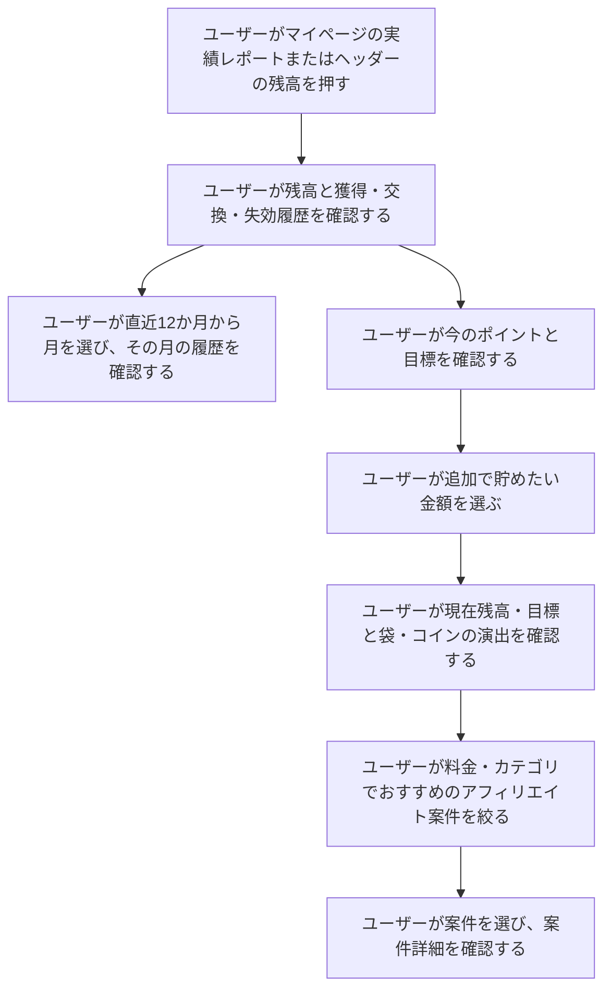
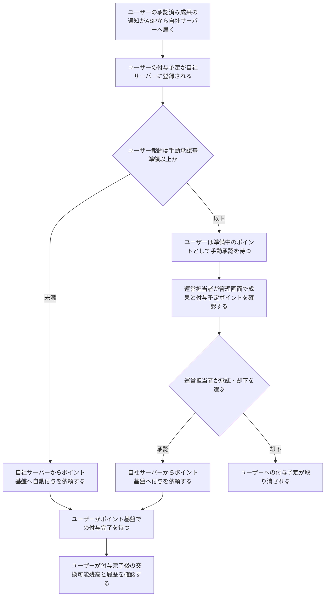

# F12｜ポイント残高・履歴・確定処理 PRD（レビュー前）

> 優先順位はスプレッドシートを正とする。本PRDはTier1のみを定義する。

参照するモック：本リポジトリのローカル4180（2026-10-19の変更箇所を照合）。未接続の外部API・実端末機能は、接続済みとして扱わず末尾に記載する。

| 基本情報 | 内容 |
| --- | --- |
| 機能ID | F12 |
| 概要 | ポイント残高・履歴・確定処理 |
| 対象領域 | アプリ／管理画面／外部連携 |
| 関連機能 | [F05](F05-my-offers.md)、[F10](F10-surveys.md)、[F13](F13-point-exchange.md)、[F18](F18-mypage-support.md) |
| 更新日 | 2026-10-28 |
| 版 | レビュー前（初版未確定） |

## ① 目的・今回作る範囲

目的：ユーザーが獲得・失効の履歴、付与待ちのポイント、実際に交換できる残高を区別し、期限内にポイントを利用できるようにするため

優先順位は[アプリ詳細要件のTier列](https://docs.google.com/spreadsheets/d/1tI26I_4vbSHIOzMdJz7g8-DjeLyyVUKoksVHhZ0AQhU/edit#gid=1107057215)を正とする。モックに存在してもTier2・Tier3・空欄の要件は本PRDの定義対象に含めない。

| 要件ID | Tier1の範囲 |
| --- | --- |
| F12-1 | ユーザーが自分の交換可能ポイントと累計ポイントを確認できる |
| F12-2 | ユーザーがポイントの付与・消費・失効の履歴を新しい順に確認できる |
| F12-3 | ポイント基盤が同じ付与依頼に対してポイントを一度だけ付与できる |
| F12-4 | ユーザーが今月末に失効する未使用ポイントの合計を確認できる |
| F12-6 | ユーザーが過去12か月分から月を選び、その月のポイント履歴を確認できる |
| F12-7 | ポイント基盤が新規ユーザーの作成時に、本人専用のポイント口座を残高0pt・履歴なしで新しく作成できる |
| F12-8 | ポイント基盤が有効期限の近いポイントから順に消費できる |
| F12-9 | ポイント基盤が残高不足の消費を拒否できる |
| F12-10 | ポイント基盤が取引履歴・失効予定・残高を一括で更新できる |
| F12-11 | ポイント基盤が毎月1日に期限切れポイントを失効できる |
| F12-14 | ユーザーが追加で貯めたい金額を選び、現在残高・目標金額と、金額に応じて大きくなる袋の表示を確認できる |
| F12-15 | ユーザーが追加目標に応じたおすすめ案件を確認し、利用可能な案件へ進める |
| F12-16 | ユーザーがおすすめ案件を料金と案件カテゴリで複数選択して絞り込める |

管理側は[管理画面詳細要件のTier列](https://docs.google.com/spreadsheets/d/1tI26I_4vbSHIOzMdJz7g8-DjeLyyVUKoksVHhZ0AQhU/edit#gid=1341040600)にある以下のTier1を関連範囲とする。ACSはEDOCODE社が運営するアフィリエイト管理システムを利用する想定とし、ACS本体の内製要件にはしない。

| 要件ID | Tier1の運用範囲 |
| --- | --- |
| ADM-F08-2 | 権限を持つ運営担当者が、ASPで承認されたアフィリエイト成果のうち、設定した基準額以上の報酬について、自社管理画面でポイント付与の承認・却下を行える |
| ADM-F08-6 | 運営担当者が会員の交換可能ポイント・ポイント履歴・失効予定を照会できる |

要件名に旧モックとの相違がある場合、優先順位は維持し、現在の表示・動きとユーザー指定を②以降へ反映する。実装方式の具体化は仕様設計で扱う。

## ② 画面イメージ

[マイページ](http://127.0.0.1:4180/mock-app/#mypage)／[実績レポート](http://127.0.0.1:4180/mock-app/#points)

### マイページ／実績レポート共通

| 表示する要素 | 表示形式 |
| --- | --- |
| あなたのポイント | ポイント数・円相当額 |
| ポイントの内訳 | 準備中・交換可能を分けて表示 |
| 今月末の失効予定 | ポイント数 |

表示領域・数値・単位のサイズはマイページに揃える。各値の定義は④-2、換算・更新・履歴の表示条件は④-4に従う。

ポイント履歴（実績レポート）の交換エリアは、マイページと同じ順序で「交換状態の案内 → ギフトアイコン付きの『好きなポイントに交換』ボタン → 今月末の失効予定」を表示する。交換ボタンはデザインコンポーネントの標準サイズ（高さ48px・丸い形状・共通コーラル）を使い、左右の位置・幅とボタン下の失効予定の配置を揃える。履歴画面のボタンの縦位置はマイページより上でよく、位置合わせのための大きな空白を設けない。

| 操作する要素 | 遷移先 |
| --- | --- |
| 交換CTA | [F13](F13-point-exchange.md)のポイント交換 |

### マイページ

| 操作する要素 | 遷移先 |
| --- | --- |
| 実績レポート | 実績レポート画面 |

### 実績レポート

| 表示する要素 | 表示形式 |
| --- | --- |
| 累計ポイント | ポイント数 |
| 獲得・交換・失効履歴 | 取引履歴の一覧 |
| 今のポイント・頑張ったら貯まるポイント | ポイント数・円相当額 |
| おすすめ案件 | 案件の一覧 |

| 操作する要素 | 操作 | 操作後の表示・遷移 |
| --- | --- | --- |
| 履歴の月選択 | 月を選ぶ | 選択月の履歴に絞り込む |
| あといくら貯めたい？ | 追加目標の金額を選ぶ | 目標の数値・袋・おすすめ案件を更新する |
| もっと絞る | 料金・案件カテゴリを複数選択する | 条件に合うおすすめ案件を表示する |
| もっと見る | 一覧を開閉する | おすすめ案件の表示件数を切り替える |
| おすすめ案件 | 案件を選ぶ | 案件詳細へ進む |

選択金額・目標の計算方法・候補条件・並び順・件数は④-5に従う。

| 演出の対象 | 発生条件 | 見た目の変化 |
| --- | --- | --- |
| 袋 | 追加目標を選ぶ | 大きい目標ほど袋を大きくする |
| コイン | 目標金額を変更する | コインが袋に入り、口元へ積もって外へ溢れる演出を1回再生する。袋は最後まで閉じず、開いた袋と内外のコインを残して停止する。連続操作では前の演出を止め、最後の選択に合わせる |
| 袋・コイン | 初期表示・再表示、端末が動きを減らす設定 | 演出を再生せず、選択中の金額に対応する開いた袋と内外のコインを表示する。演出中に動きを減らす設定へ変えた場合も同じ最終状態へ切り替える |

巾着袋は別途確認済みの `Tameruko_Point_Animation_20261026_v3` のチェック柄・黒い輪郭・コーラルピンクの紐を使用する。袋中央のマークと落下・積み上げ・溢れるコインは、同梱のコインアイコンで統一する。アニメーション部分のみを組み込み、画面の文字とボタンは現行デザインコンポーネントを維持する。「今のポイント」は本人の有効残高、「頑張ったら貯まるポイント」はその残高＋追加目標を表示し、単体モックの固定残高30,000ptは使用しない。

| 追加目標（円相当） | 投入コイン数 | 外に溢れるコイン数 | 演出時間 |
| --- | --- | --- | --- |
| 500円 | 10枚 | 2枚 | 4.55秒 |
| 1,000円 | 20枚 | 2枚 | 5.15秒 |
| 3,000円 | 30枚 | 4枚 | 5.35秒 |
| 5,000円 | 40枚 | 8枚 | 5.55秒 |
| 10,000円 | 50枚 | 32枚 | 5.75秒 |
| 20,000円 | 60枚 | 64枚 | 5.95秒 |

目標・絞り込みの操作や演出でポイントを付与しない。絞り込みだけでは演出を始め直さず、画面を離れると演出を停止する。確認条件は、全6段階の終了時に袋が開いて内外のコインが残ること、連続切替・再表示・動きを減らす設定でも残高と最後の選択が一致することとする。

ホームの初心者マーク「いくら貯める？」から開くと、「今のポイントと目標」の見出しが上端に来る。入口は[F02](F02-home.md)を参照する。

ホームの残高からポイント履歴を開いた場合は、下部タブの「ホーム」を選択したままにする。ホーム内の各カテゴリ・ホーム経由のアンケートから開く場合も同じ。再読み込みや「戻る／進む」で履歴へ戻っても入口に対応する選択を維持し、マイページから開き直した履歴は「マイページ」を選択する。直接開いた履歴の既定選択は「マイページ」、目標への直接リンクは「ホーム」とする。

「準備中」「交換可能」の内訳は共通スタイルを使い、コイン・最大8桁の数字（カンマ区切り）・ptを各欄の1行に収める。数値は従来の24pxから最大18pxへ縮小し、狭い欄では幅に応じて縮小する。ptは12px、コインは数値と同じ1emとする。

「準備中」「交換可能」のラベルは、マイページとポイント履歴の両方で各欄の左寄せにする。

ポイント履歴全体の文字は現行デザインコンポーネントのPG-F03を参照し、書体はヒラギノ角ゴを優先、本文・補助文字はW3（300）、見出し・数値・ボタンはW6（600）とする。本文14px・見出し16px・補助文字12px、本文行高160%・見出し140%を基本とし、残高や内訳の数値は共通部品の専用サイズを維持する。大ボタンの文字は共通の16px、合計残高のptは14px・W3。目標・おすすめ・履歴・絞り込みも同じルールを使用し、旧W4や画面固有の10〜11px指定で上書きしない。

## ③ 操作フロー

### アフィリエイト報酬の確定

## ④ 業務ルール・制約

### 1. 誰のポイントを管理するか

| 利用者区分 | 管理・表示する情報 |
| --- | --- |
| 会員 | 本人のポイント口座の情報 |
| 非会員（ゲスト） | 本人のポイント口座の情報 |

**口座の作成**

口座を持たないユーザーには、本人専用の口座を残高0pt・履歴なしで作成する。

**会員登録時の引き継ぎ**

ゲストから会員登録する場合は、既存口座の交換可能・準備中・累計ポイント・履歴を引き継ぎ、リセットしない。

### 2. 各ポイント区分が何を意味するか

| 用語 | 意味 | 集計対象・計算方法 |
| --- | --- | --- |
| 準備中 | 付与予定として保持しているが、ポイント基盤で付与が完了していないポイント | 未完了の付与予定ポイントを合計する |
| 交換可能 | 必要な承認と付与が完了した、有効かつ未使用のポイント | 付与完了分のうち、消費・失効していないポイントを合計する |
| あなたのポイント | 準備中を含めた本人のポイント | 準備中＋交換可能 |
| 累計ポイント | アプリを利用開始してから付与が完了した加算ポイントの合計 | 準備中は含めず、交換・失効では減らさない |

アフィリエイト報酬の準備中には、ASP承認済み成果の手動承認待ち・承認後の通知や付与処理待ち・自動付与の処理待ちを含む。[F05](F05-my-offers.md)の「判定中」は案件の成果確認の状態であり、ポイントの「準備中」とは区別する。

### 3. いつポイントが増える・減るか

#### ポイント数が変わるとき

| 確認された出来事 | 準備中 | 交換可能 | 累計ポイント |
| --- | --- | --- | --- |
| ASP承認済み成果の付与予定を自社サーバーに登録 | 対象分を加算 | 変更なし | 変更なし |
| 自社の承認操作が完了 | 変更なし | 変更なし | 変更なし |
| 自社の却下によって付与予定を取消 | 対象分を除外 | 変更なし | 変更なし |
| ポイント基盤で付与完了を確認 | 対象分を除外 | 対象分を加算 | 対象分を加算 |
| 交換による消費が成立 | 変更なし | 消費分を減算 | 変更なし |
| 未使用ポイントの有効期限が終了 | 変更なし | 失効分を減算 | 変更なし |

「あなたのポイント」は、増減後の準備中と交換可能から④-2に従って算出する。手動承認待ち・付与依頼の送信・付与処理待ちの間はポイント数を変えない。

処理順は③に従う。ASP承認済み成果の通知はまず自社サーバーで受信・保持する。自動付与対象は判定後、手動承認対象は自社の承認後にポイント基盤へ付与依頼を送る。手動承認前・却下時には送らず、自社で却下してもASPの承認状態は書き換えない。

#### 高額なアフィリエイト報酬の承認条件

手動承認基準額の初期値は1,000,000ptとする。変更操作は⑤で定義する。

**判定対象とする成果**

| ASPの成果状態 | ポイント付与の判定対象 |
| --- | --- |
| 承認済み | 対象 |
| 判定中 | 対象外 |
| 否認 | 対象外 |

**基準額と比較する報酬の単位**

通常案件とSUR案件では、次の単位でユーザー報酬を判定する。

| 案件の種類 | 判定する報酬の単位 |
| --- | --- |
| 通常案件 | 対象成果に対して付与する報酬 |
| SUR案件 | 各段階で付与する報酬。案件全体の合計は使わない |

上記の報酬にチャレンジボーナスが付く場合は、通常報酬とボーナスの合計ポイント数を基準額と比較する。

**自動付与・手動承認の振り分け**

| ユーザー報酬と基準額の関係 | 振り分け先 |
| --- | --- |
| 基準額未満 | 自動付与 |
| 基準額以上（同額を含む） | 手動承認待ち |

**基準額を変更した場合**

| 変更時点の自社の処理状態 | 再判定の扱い |
| --- | --- |
| 手動承認待ち | 新しい基準額で上表の振り分けを適用する |
| 付与完了済み | 再判定しない |
| 却下済み | 再判定しない |

#### 交換による消費

| 交換可能ポイントと消費額の関係 | 消費の可否 |
| --- | --- |
| 消費額以上 | 消費できる |
| 消費額未満 | 消費を拒否する |

準備中は交換に利用できない。消費は失効日が近いポイントから充当し、成立した消費を交換履歴に記録する。数値への影響は「ポイント数が変わるとき」に従う。

ログイン・SMS認証・交換先への遷移・交換申請の状態は[F13](F13-point-exchange.md)に従う。

#### 有効期限と失効

| 起点 | 失効日の算出 | 交換に利用できる期限 |
| --- | --- | --- |
| ポイント基盤で付与が完了した日 | 獲得月＋5か月の月末。例：1月30日獲得分は6月30日 | 失効日当日まで |

原則として同じ月の獲得分は同じ失効日とする。付与予定登録日・ASP承認日は起点にしない。

失効日の翌日（毎月1日）に、期限切れの未使用ポイントを失効させる。準備中は失効対象にしない。失効履歴は失効日翌日の日付で、失効したポイント数を減算として記録する。数値への影響は「ポイント数が変わるとき」に従う。

#### 二重処理の防止・履歴の保存

| 対象処理 | 再実行・更新時に守ること |
| --- | --- |
| 付与 | 同じ成果の再連携・承認操作の再実行でも一度だけ付与する |
| 消費・失効 | 同じポイントを重複して減算・記録しない。全額消費済みのポイントを失効として減算しない |
| 取引の反映 | 取引履歴・失効予定・残高を一括で更新する |
| 障害時の照合・再処理 | バックエンド側で、⑥に従い同じ処理依頼IDで照合する |

取引履歴は、記録の種類に応じた法定保存期間を満たすように保存する。画面の表示対象期間を過ぎただけでは削除しない。

### 4. ポイント情報を画面にどう反映するか

| 表示項目 | 参照する値 | 表示形式 |
| --- | --- | --- |
| あなたのポイント・内訳・累計ポイント | 本節2で定義した各値 | ポイント数。②の指定箇所では円相当額も表示する |
| ヘッダーの残高 | 交換可能ポイント | 円相当額。準備中は含めない |
| ヘッダーの取り消し線の比較額 | 交換可能ポイント | 交換可能ポイントを基準に比較額を算出する |
| 獲得・交換・失効履歴 | 本人の過去12か月分の取引履歴 | 新しい順。選択した月で絞り込む |
| 今月末の失効予定 | 今月末に失効する未使用ポイントの合計 | ポイント数。該当なしは0pt。翌月以降の予定は含めず、失効日は重ねて表示しない |

| 換算対象 | 換算式 | 端数の扱い |
| --- | --- | --- |
| ポイント数から円相当額 | ポイント数÷100（100pt＝1円相当） | 実績レポートは小数点以下切り捨て。元のポイント数は丸めない |

マイページ・実績レポート・ヘッダーは、同じ利用者・同じ更新時点の口座情報を参照する。付与完了・交換・失効・利用者切替後に該当する値を更新し、固定の見本額は使わない。

### 5. 追加目標とおすすめ案件をどう決めるか

#### 追加目標の計算

追加で貯めたい金額は500円・1,000円・3,000円・5,000円・10,000円・20,000円相当から選ぶ。初期値・保存済みの値が選択肢にない場合は、最も近い選択金額に置き換える。

| 表示する値 | 計算方法 |
| --- | --- |
| 今のポイント | 現在の交換可能ポイント |
| 頑張ったら貯まるポイント | 交換可能ポイント＋追加目標のポイント数 |

袋・コインの表示方法は②に従う。演出によって残高が増えたり報酬が付与されたりするものではない。

#### おすすめ案件の報酬範囲

交換可能ポイントを加えた目標合計ではなく、追加で貯めたい金額を基準とする。下限・上限の両方を含む。

| 追加で貯めたい金額 | 対象案件の報酬（円相当） |
| --- | --- |
| 500円 | 500円以下（報酬がある案件） |
| 1,000円 | 500〜1,000円 |
| 3,000円 | 1,000〜3,000円 |
| 5,000円 | 3,000〜5,000円 |
| 10,000円 | 5,000〜10,000円 |
| 20,000円 | 10,000〜20,000円 |

#### 候補に含める案件

公開状態・OS等の配信条件を満たすアフィリエイト案件を対象とする。利用済み・参加済みかどうかや成果状態によっては除外しない。

#### 絞り込み条件の組み合わせ

| 選択の状態 | 条件の組み合わせ方 |
| --- | --- |
| 料金・案件カテゴリの同じ軸で複数選択 | ORで判定する |
| 報酬範囲・料金・案件カテゴリの異なる軸を組み合わせる | ANDで判定する |
| 未選択の軸 | その軸では制限しない |

すべての条件を満たす案件がなければ0件の案内を表示し、範囲外の案件で補充しない。

#### 報酬額とチャレンジボーナス

| 算出する値 | 基準となる金額 | 加算するボーナス |
| --- | --- | --- |
| 範囲判定・一覧の「最大○円相当」 | ユーザーが獲得できる通常の最大報酬の円相当額 | 参加可能なチャレンジボーナス。終了・非公開・ユーザーが対象外のものは加算しない |

最大額は獲得保証ではなく、実際の付与条件・時期は各案件・チャレンジボーナスの仕様に従う。

#### 並び順・表示件数

| EPCの取得状態 | 表示する位置 |
| --- | --- |
| 取得済み | 未取得の案件より前 |
| 未取得 | 取得済みの案件より後ろ |

取得済みの案件はEPC降順とし、同値の場合は案件ID降順とする。

EPCは接続先ASPのAPIから取得し、自社では再計算しない。API連携は今後実装する。カテゴリ分散やアンケート優先の並べ替えは行わない。

| 表示の段階 | 表示件数 |
| --- | --- |
| 初期表示 | 最初5件 |
| 「もっと見る」で展開後 | 最大10件 |

## ⑤ 管理画面

[管理画面](http://127.0.0.1:4180/mock-admin/#review)

| 対象項目 | 新規作成 | 変更 | 削除 | 実行できる操作 |
| --- | --- | --- | --- | --- |
| アフィリエイト報酬の手動承認 | 不可 | 承認・却下可能 | 不可 | 権限を持つ運営担当者が、ASP承認済み成果に対して承認・却下を実行する |
| 手動承認基準額 | 初期値を用意 | 変更可能 | 不可 | 権限を持つ運営担当者がポイント数を入力して保存する |
| 会員のポイント情報 | 不可 | 不可（照会のみ） | 不可 | 対象会員のポイント情報を照会する |

| 確認する画面・項目 | 確認できる情報 |
| --- | --- |
| 手動承認 | 対象ユーザー・案件・成果・ASP承認状態・付与予定ポイントと円相当額・自社の承認待ち／承認済み／却下の状態 |
| 会員のポイント情報 | 交換可能ポイント・獲得／交換／失効履歴・今月末の失効予定 |

承認後の付与依頼、基準額の初期値・判定条件・既存の承認待ちへの適用は④-3に従う。障害時の照合・再処理は⑥に従う。

## ⑥ 例外処理・エラーハンドリング

「処理の成否を確認できない状態」とは、ポイント処理を依頼した後、通信断やタイムアウトなどにより、自社サーバーで成功・失敗を確認できない状態を指す。実際には処理が完了している可能性があるため、失敗と決めつけて新しい依頼を作らず、同じ処理依頼IDで結果を照合する。照合・必要な再処理はバックエンド側で行う。この表現は内部の処理状態を説明するもので、ユーザー画面にそのまま表示する文言ではない。

| 状況 | 表示・状態の扱い | バックエンド側の対応 |
| --- | --- | --- |
| 未付与・処理中・処理の成否を確認できない状態 | 付与完了と区別する | 同じ付与依頼IDで照合・再処理し、二重付与を防ぐ |
| 手動承認後の付与失敗・処理の成否を確認できない状態 | 承認操作だけで付与完了と表示しない | 照合・再処理を行う |
| 失効処理の失敗・一部完了・処理の成否を確認できない状態 | 期限切れ分を交換可能に戻さない | 同じ残高を二重に減算せず、失効履歴を重複させない |
| 候補0件・履歴0件 | 空の案内を表示する | 存在しない案件・履歴を補わない |

## ⑦ まだ決まっていないこと

| 確認事項 | 相談先 |
| --- | --- |
| 各案件への料金・カテゴリタグの付け方と、タグ未設定時の扱いは、バンドルの仕様に依存するため後日確認する。 | バンドル仕様の担当者 |
| 選択した目標金額・料金・カテゴリの保持は、開発時に負荷への影響を確認してから決める。画面遷移・再読み込み・次回起動後の保持範囲と保存方式は現時点では確定しない。 | 開発・事業 |

## モックへの未反映・対象外

### モックへの未反映

| 項目 | 未反映の内容 |
| --- | --- |
| ポイント基盤との連携 | EDOCODEの正式な残高・取引・失効予定の取得と各画面への同期は未接続 |
| 成果通知の受信・承認後の通知と処理待ち | ASP成果通知を自社サーバーで受信・保持し、手動承認後にポイント基盤へ付与依頼を送る本番連携と、付与処理待ち・失敗・処理の成否を確認できない状態の連携は未接続。 |
| 高額なアフィリエイト報酬の振り分け・基準額設定 | ポイント単位での基準額の入力・保存・再表示は実装済み。成果の自動振り分けは未実装で、現行モックは金額によらず手動承認待ちに登録する。SURの段階単位・ボーナス合算での基準額判定、基準額変更時の既存承認待ちの再判定も未実装。 |
| おすすめの候補・実データ | 本番のアフィリエイト案件・EPCのASP API取得は未接続。現行モックには利用歴による候補除外、定率・SUR案件の除外、アンケート候補が残っており、今回の仕様との整合は未反映。 |
| 円相当額の端数 | 実績レポートの円相当額を小数点以下切り捨てに統一する変更は未反映。ポイント表示サイズ・位置・交換CTAの統一はPR #25でmainに反映済み。 |
| 取引履歴の法定保存 | 適用法令に応じた保存・削除制御は本番バックエンド側の対応範囲であり、ローカルモックでは実装していない。 |

### 今回の対象外

| 項目 | 対象外の内容 |
| --- | --- |
| 付与失敗時の管理画面からの再実行 | エラー一覧・再実行・復旧結果確認の専用管理機能は開発対象外。復旧はバックエンド側で対応する。 |

## 変更履歴

2026-10-22：利用者区分と口座イベントを分離。ポイントの増減は同種の出来事に統一し、処理順は③へ参照。承認条件をASP状態・報酬単位・基準額比較・変更時の再判定に分割。おすすめ候補・絞り込み・並び順も分類軸ごとに整理。

2026-10-22：既存要件を維持し、定義・条件・処理・数値への影響・表示形式を別の列に分離。情報の種類が異なる表を分割し、管理画面の操作と確認情報も分離。

2026-10-22：青木さんの追加レビューに沿って④を対象口座・ポイントの定義・増減・画面反映・目標とおすすめの5項目に再構成。画面要素・操作は②へ集約し、定義の重複を整理。

2026-10-22：②・④を画面別と表形式に整理。累計ポイント・あなたのポイントの定義を統一し、案件への取り組み状態をポイント状態から除外。⑤は管理画面の操作・照会に限定し、⑦の達成条件を削除。未決事項は維持。

2026-10-22：「結果不明」を「処理の成否を確認できない状態」に変更し、通信断・タイムアウト時の意味と、同じ処理依頼IDで照合することを明記。

| 版 | 日付 | 変更内容 |
| --- | --- | --- |
| レビュー前 | 2026-10-28 | 確認済みのチェック柄巾着袋アニメーションをポイント履歴の目標表示へ組み込み。コーラルの紐・同梱コイン・開いたまま溢れて終わる6段階を移植。連続切替・画面離脱での停止、初期表示と動きを減らす設定の最終状態表示を反映。実残高・既存フォント・目標とおすすめの計算は維持。 |
| レビュー前 | 2026-10-28 | ポイント履歴全体のフォントをPG-F03と共通ボタンへ統一。履歴本文・補助文字・目標・おすすめ・絞り込みの旧サイズとW4指定、残高ptの強制太字、交換ボタンの14px上書きを整理。ブラウザー確認はユーザー指定により省略。 |
| レビュー前 | 2026-10-28 | ユーザー指定により、ポイント履歴の「準備中」「交換可能」のラベルをマイページと同じ左寄せに修正。 |
| レビュー前 | 2026-10-28 | ユーザー指定により、ポイント履歴の交換状態・ギフト付き交換ボタン・失効予定をマイページと共通化。ボタンは標準48pxとし、個別の40px指定と過大な上余白を撤去。ホームから履歴へ進んだときのホーム選択と、再読み込み・履歴移動・マイページからの再入場の確認条件を追加。ローカルモックへ反映。 |
| レビュー前 | 2026-10-23 | マイページ・ポイント履歴の準備中／交換可能を共通の最大18px・幅に応じた縮小へ変更。コイン＋最大8桁（カンマ付き）＋ptを1行に収める。 ローカルモックへ反映・未push。 |
| レビュー前 | 2026-10-21 | 削除済み要件F12-5を範囲・達成条件から削除。同内容のADM-F08-7と失効再実行に関する運営操作の記載も削除し、通常の失効処理と二重減算防止は維持。 |
| レビュー前 | 2026-10-20 | ユーザーが共有した議事録の内容を反映。失効日の算出、今月末の失効予定、準備中・交換可能の区別、付与完了時点での残高反映、手動承認の目的、障害時の再実行と画面間同期を明記。モックは変更しない。 |
| レビュー前 | 2026-10-20 | 目標金額・絞り込み条件の保持を、開発時に負荷への影響を確認する後日確認事項として整理。モックの保持動作は変更しない。 |
| レビュー前 | 2026-10-20 | 料金・カテゴリタグの付与ルールと未設定時の扱いは、バンドル仕様に依存する後日確認事項として整理。モックの分類処理は変更しない。 |
| レビュー前 | 2026-10-20 | おすすめの金額判定をチャレンジボーナス込みの最大報酬に統一。アンケートも最大報酬で同じ範囲を適用し、この判定基準を未決事項から除外。 |
| レビュー前 | 2026-10-20 | 目標の金額範囲・料金・カテゴリで絞ったおすすめをEPC降順へ変更。カテゴリ分散・アンケート優先による並べ替えを廃止。 |
| レビュー前 | 2026-10-20 | 目標ごとのおすすめ報酬範囲を「ひとつ前の金額〜選択金額」に変更。最小500円は500円以下とし、両端を含む範囲で絞り込む。 |
| レビュー前 | 2026-10-19 | ホームの「いくら貯める？」からの遷移位置を「今のポイントと目標」の見出しに統一。目標・報酬計算は変更しない。 |
| レビュー前 | 2026-10-15 | F10レビューの共通フィードバックを反映。⑤を管理画面へ変更し、④を対象ユーザー・表示条件・配置要素に整理。例外処理と仕様設計事項の重複を除き、未反映と対象外を別表に分離。個別レビューは未完了。 |
| レビュー前 | 2026-10-20 | ヘッダーの固定見本額を撤去し、マイページと同じ本人の有効残高を表示する方針・確認条件を反映。 |
| レビュー前 | 2026-10-20 | ユーザー指定により実績レポート内の「ためる／ためたい／ため方」を「貯める／貯めたい／貯め方」に統一。画面固有の表記ルールとして記録。 |
| レビュー前 | 2026-10-22 | 管理画面「審査・交換上限」に手動承認基準額（初期値10,000円相当）の入力・保存・判定条件プレビューを実装。成果振り分けへの連動は未実装として維持。 |
| レビュー前 | 2026-10-22 | 手動承認基準額をポイント単位（初期値1,000,000pt）へ変更。管理画面の判定条件プレビューとモック説明文を削除。 |
| レビュー前 | 2026-10-22 | 付与失敗時の復旧をバックエンド側の対応に変更。ADM-F08-3を管理画面の運用範囲から削除し、専用のエラー一覧・再実行・復旧確認を対象外へ整理。例外処理・達成条件・未反映事項を整合し、二重付与防止は維持。 |
| レビュー前 | 2026-10-22 | レビューフィードバックを反映。マイページ内の表示と実績レポートを区別し、今月末の失効予定はポイント合計のみ表示。不要な評価指標・注記を削除し、ACSの呼称・役割を整理。フローを利用者視点へ変更し、追加目標の増加分表示を削除。EPCは今後ASP APIから取得する仕様とし、手動承認はSUR段階ごと・ボーナス合算・既存承認待ちへの新基準額適用を決定事項へ移行。 |
| レビュー前 | 2026-10-22 | PR #22の確認事項6点を決定方針へ反映。ポイント表示面をマイページに統一し、実績レポートの円相当額は端数切り捨て。ASP成果通知は自社サーバーで保持し、手動承認後にポイント基盤へ通知する。おすすめの利用歴による制御を行わず、定率・SUR除外の記載を削除。履歴は法定保存期間を満たして保存し、画面表示は過去12か月分とする。モックの追加変更は行わない。 |
