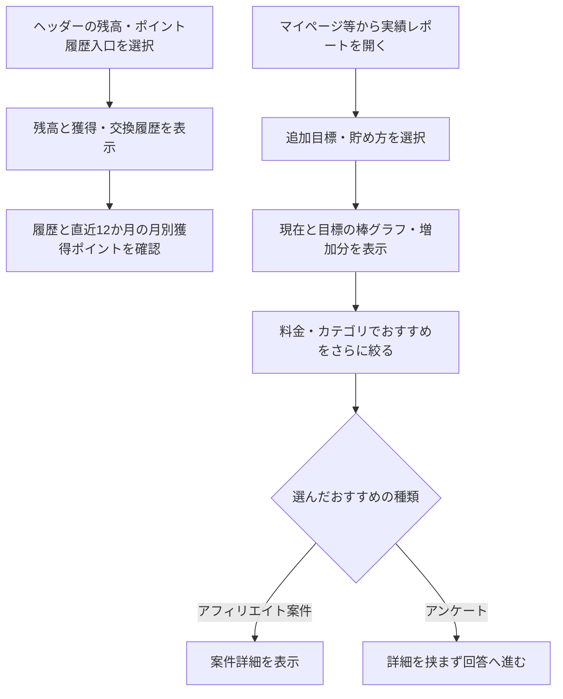

# F12｜ポイント残高・履歴・確定処理 PRD（レビュー前）

> ④業務ルールと⑦以降はユーザーレビュー未完了。本日の変更箇所はローカル4180モックとユーザー指定を参照し、優先順位はスプレッドシートを正とする。本PRDはTier1のみを定義する。

参照するモック：本リポジトリのローカル4180（2026-10-19の変更箇所を照合）。未接続の外部API・実端末機能は、接続済みとして扱わず末尾に記載する。

| 基本情報 | 内容 |
| --- | --- |
| 機能ID | F12 |
| 概要 | ポイント残高・履歴・確定処理 |
| 対象領域 | アプリ／管理画面／外部連携 |
| 関連機能 | [F10](F10-surveys.md)、[F13](F13-point-exchange.md)、[F18](F18-mypage-support.md) |
| 更新日 | 2026-10-20 |
| 版 | レビュー前（初版未確定） |

## ① 目的・今回作る範囲

目的：獲得したポイントと交換できる残高を正しく把握できるようにするため

評価指標：付与成功率/処理中ポイントの滞留/残高と履歴の差額/ポイントに関する問い合わせ件数

優先順位は[アプリ詳細要件のTier列](https://docs.google.com/spreadsheets/d/1tI26I_4vbSHIOzMdJz7g8-DjeLyyVUKoksVHhZ0AQhU/edit#gid=1107057215)を正とする。モックに存在してもTier2・Tier3・空欄の要件は本PRDの定義対象に含めない。

| 要件ID | Tier1の範囲 |
| --- | --- |
| F12-1 | ユーザーが自分の有効なポイント残高と総獲得ポイントを確認できる |
| F12-2 | ユーザーがポイントの付与・消費・失効の履歴を新しい順に確認できる |
| F12-3 | ポイント基盤が同じ付与依頼に対してポイントを一度だけ付与できる |
| F12-4 | ユーザーが直近のポイント失効予定数と失効日を確認できる |
| F12-5 | 運営担当者が失敗したポイント失効処理を未処理分から再実行できる |
| F12-6 | ユーザーが直近12か月の月別獲得ポイントを確認できる |
| F12-7 | ポイント基盤が新規ユーザーの作成時にポイント口座を初期化できる |
| F12-8 | ポイント基盤が有効期限の近いポイントから順に消費できる |
| F12-9 | ポイント基盤が残高不足の消費を拒否できる |
| F12-10 | ポイント基盤が取引履歴・失効予定・残高を一括で更新できる |
| F12-11 | ポイント基盤が毎月1日に期限切れポイントを失効できる |
| F12-14 | ユーザーが追加で貯めたい金額を選び、現在残高と目標をグラフで比較できる |
| F12-15 | ユーザーが貯め方を選び、利用可能なおすすめ案件へ進める |
| F12-16 | ユーザーがおすすめ案件を料金と案件カテゴリで複数選択して絞り込める |

管理側は[管理画面詳細要件のTier列](https://docs.google.com/spreadsheets/d/1tI26I_4vbSHIOzMdJz7g8-DjeLyyVUKoksVHhZ0AQhU/edit#gid=1341040600)にある以下のTier1を関連範囲とする。NACS本体の内製要件にはしない。

| 要件ID | Tier1の運用範囲 |
| --- | --- |
| ADM-F08-2 | 権限を持つ運営担当者が、NACSで承認されたアフェリエイト案件のみを対象に、ユーザーへのポイント付与の承認・却下ができる |
| ADM-F08-3 | ポイント連携システムが一意の付与依頼IDで照合し、未処理分だけを再処理できる |
| ADM-F08-6 | 運営担当者が会員の有効残高・ポイント履歴・失効予定を照会できる |
| ADM-F08-7 | 運営担当者が失敗したポイント失効処理を未処理分から再実行できる |

要件名に旧モックとの相違がある場合、優先順位は維持し、現在の表示・動きとユーザー指定を②以降へ反映する。実装方式の具体化は仕様設計で扱う。

## ② 画面イメージ

[アプリの該当画面](http://127.0.0.1:4180/mock-app/#points)

- 有効な保有ポイントと円相当額、総獲得ポイント、直近の失効予定、獲得・交換・失効履歴を表示する。
- 履歴を新しい順に表示する。直近12か月の月別獲得ポイントを確認できる。
- 実績レポートは現在のポイントと目標達成時のポイントを棒グラフで比較し、矢印・増える部分の色・＋ptと円相当の差分を表示する。
- 「あといくら貯めたい？」「どうやって貯めたい？」から選び、料金・細分化したカテゴリで複数条件を絞る。おすすめは5件から最大10件まで開閉し、アンケートは選択後に直接回答へ進む。

- ホームの初心者マーク「いくら貯める？」から開いた場合は、レポートの「今のポイントと目標」の見出しが上端に来るよう移動する。見出し・現在ポイントと目標の比較グラフから確認でき、下の金額選択欄の途中へ飛ばさない。入口の仕様は[F02](F02-home.md)を参照。

ヘッダーの残高は、マイページの「あなたのポイント」と同じ本人の有効残高（失効分を除いた交換可能ポイント）を100pt＝1円相当で表示する。準備中は含めない。従来の固定見本額は使用せず、付与確定・交換・失効・利用者切替後に同じ残高へ更新する。取り消し線の比較額も、その残高を基準に算出する。

## ③ 操作フロー

## ④ 業務ルール・制約

> ユーザーレビュー未完了。アプリ上の表示に関わるルールを記載する。

### 表示する対象ユーザー

| 対象ユーザー | 利用・表示 |
| --- | --- |
| 会員 | 本人の残高・履歴・実績レポートを確認する |
| 非会員（ゲスト） | 本人の残高・履歴・実績レポートを確認する |

### 表示条件

| 状態・条件 | 表示のルール |
| --- | --- |
| 有効な残高 | 100pt＝1円相当でポイントと円相当額を表示する |
| 獲得・交換・失効の履歴 | 新しい順に表示する |
| 月別の獲得実績 | 直近12か月の実績を表示する |
| 目標選択後 | 現在の保有ポイントと追加目標の合計を比較して表示する |
| おすすめ候補 | 未利用の案件と未回答・回答可能なアンケートを表示する |

### 画面に置く要素・操作

| 画面・要素 | 表示・操作のルール |
| --- | --- |
| 残高・総獲得ポイント | 本人の有効残高と獲得実績を表示する |
| 失効予定 | 直近の失効日とポイント数を表示する |
| ポイント履歴 | 獲得・交換・失効の内容を確認する |
| 比較の棒グラフ | 現在と目標を比較し、矢印・増加分の色・＋pt・円相当の差分を表示する |
| 目標金額・貯め方の選択 | あといくら貯めたいか、どうやって貯めたいかを選ぶ |
| もっと絞る | 料金と細分化したカテゴリを複数選択する |
| おすすめの案件リスト | 最初5件、もっと見るで最大10件を表示し、案件は詳細、アンケートは回答へ直接進む |

## ⑤ 管理画面

新規作成・変更・削除は、現在の管理画面で操作できる範囲を示す。「外部管理」はNACS・EDOCODE等の担当範囲、「未実装」は操作画面がない項目。削除と公開停止は分けて記載する。

[実行設定の管理画面](http://127.0.0.1:4180/mock-admin/#review)

| 対象項目 | 新規作成 | 変更 | 削除 | 管理画面での操作・反映範囲 |
| --- | --- | --- | --- | --- |
| 付与予定の承認・却下・自動判定実行 | 不可 | 処理可能 | 不可 | 審査・交換上限で既存の付与予定を処理する。取引を自由入力・編集する画面ではない。 |
| ポイント取引・残高・獲得履歴 | 外部管理 | 外部管理 | 外部管理 | EDOCODEのポイント基盤の依頼範囲。自社画面から任意の残高を入稿しない。 |
| おすすめの絞り込み・目標 | 対象外 | 対象外 | 対象外 | ユーザー自身の選択。管理画面の案件入稿とは別。 |

## ⑥ 例外処理・エラーハンドリング

| 状況 | 表示・処理・復帰 |
| --- | --- |
| 未付与・処理中・結果不明 | 受取成功と区別し、同じ依頼IDで照合・再試行する。 |
| 候補0件・履歴0件 | 空の案内を表示し、存在しない案件や履歴を補わない。 |

## ⑦ 達成条件・未決事項

> 本節以降はユーザーレビュー未完了。

### Tier1の達成条件

- [ ] ホームからの目標入口で「今のポイントと目標」の見出し・比較グラフが最初に表示される。既存の金額選択・おすすめ計算は維持する。

- [ ] F12-1：ユーザーが自分の有効なポイント残高と総獲得ポイントを確認できる。
- [ ] F12-2：ユーザーがポイントの付与・消費・失効の履歴を新しい順に確認できる。
- [ ] F12-3：ポイント基盤が同じ付与依頼に対してポイントを一度だけ付与できる。
- [ ] F12-4：ユーザーが直近のポイント失効予定数と失効日を確認できる。
- [ ] F12-5：運営担当者が失敗したポイント失効処理を未処理分から再実行できる。
- [ ] F12-6：ユーザーが直近12か月の月別獲得ポイントを確認できる。
- [ ] F12-7：ポイント基盤が新規ユーザーの作成時にポイント口座を初期化できる。
- [ ] F12-8：ポイント基盤が有効期限の近いポイントから順に消費できる。
- [ ] F12-9：ポイント基盤が残高不足の消費を拒否できる。
- [ ] F12-10：ポイント基盤が取引履歴・失効予定・残高を一括で更新できる。
- [ ] F12-11：ポイント基盤が毎月1日に期限切れポイントを失効できる。
- [ ] F12-14：ユーザーが追加で貯めたい金額を選び、現在残高と目標をグラフで比較できる。
- [ ] F12-15：ユーザーが貯め方を選び、利用可能なおすすめ案件へ進める。
- [ ] F12-16：ユーザーがおすすめ案件を料金と案件カテゴリで複数選択して絞り込める。
- [ ] ①の管理側Tier1に対応する操作について、⑤の新規作成・変更・削除可否と反映範囲を確認できる。
- [ ] ⑥の対象となる空・失敗・中断などの状態から、表示内容と次の操作を確認できる。

- [ ] ヘッダーの円相当額が本人の有効残高・マイページと一致し、0pt・付与確定・交換・失効・利用者切替後も固定値に戻らない。準備中だけが増えた場合は有効残高を増やさない。

### まだ決まっていないこと

| 確認事項 | 相談先 |
| --- | --- |
| 取引履歴の保存・表示期間の正式値 | 事業・ポイント基盤 |

## モックへの未反映・対象外

### モックへの未反映

| 項目 | 未反映の内容 |
| --- | --- |
| ポイント基盤との連携 | EDOCODEの正式な残高・取引・失効予定の取得と各画面への同期は未接続 |
| おすすめの実データ | 本番案件・アンケートの取得と利用状態の照合は未接続 |

### 今回の対象外

| 項目 | 対象外の内容 |
| --- | --- |
| なし | — |

## 変更履歴

| 版 | 日付 | 変更内容 |
| --- | --- | --- |
| レビュー前 | 2026-10-19 | ホームの「いくら貯める？」からの遷移位置を「今のポイントと目標」の見出しに統一。目標・報酬計算は変更しない。 |
| レビュー前 | 2026-10-15 | F10レビューの共通フィードバックを反映。⑤を管理画面へ変更し、④を対象ユーザー・表示条件・配置要素に整理。例外処理と仕様設計事項の重複を除き、未反映と対象外を別表に分離。個別レビューは未完了。 |
| レビュー前 | 2026-10-20 | ヘッダーの固定見本額を撤去し、マイページと同じ本人の有効残高を表示する方針・確認条件を反映。 |
| レビュー前 | 2026-10-20 | ユーザー指定により実績レポート内の「ためる／ためたい／ため方」を「貯める／貯めたい／貯め方」に統一。画面固有の表記ルールとして記録。 |
