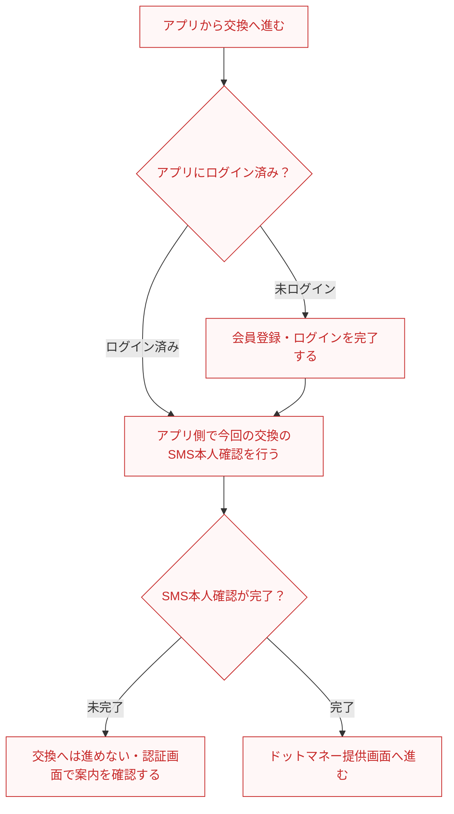

# F13｜ポイント交換 PRD（第1版）

赤字はF13レビュー開始時点（main f7cc7df）からの修正・追記。2026-10-22にユーザーレビュー完了。モックは未変更。

> ユーザーレビュー完了。レビュー内容を第1版として整理。機能・動作要件は本PRDに従い、画面イメージはモックを参照する。優先順位はスプレッドシートを正とする。本PRDはTier1のみを定義する。

参照するモック：本リポジトリの `mock-app/`。本番要件とモックの対応状況は分け、未接続の外部API・実端末機能は末尾の参考欄に記載する。

| 基本情報 | 内容 |
| --- | --- |
| 機能ID | F13 |
| 概要 | ポイント交換 |
| 対象領域 | アプリ／サーバー／外部連携 |
| 関連機能 | [F01](F01-account.md)、[F12](F12-points.md) |
| 更新日 | 2026-10-22 |
| 版 | 第1版（ユーザーレビュー完了） |

## ① 目的・今回作る範囲

目的：ためたポイントを希望する交換先で使えるようにするため

優先順位は[アプリ詳細要件のTier列](https://docs.google.com/spreadsheets/d/1tI26I_4vbSHIOzMdJz7g8-DjeLyyVUKoksVHhZ0AQhU/edit#gid=1107057215)を正とする。モックに存在してもTier2・Tier3・空欄の要件は本PRDの定義対象に含めない。

| 要件ID | Tier1の範囲 |
| --- | --- |
| F13-1 | 【アプリ側】ユーザーが交換のたびにSMS認証を完了して、ドットマネーの交換画面へ進める |
| F13-2 | 【ドットマネー側】ユーザーが交換先一覧から希望の交換先を選び、初回の規約同意・口座開設を進められる |
| F13-3 | 【アプリ側＋ドットマネー側】ユーザーがポイントを入力・確認して申請できる（ドットマネー側：入力・確認画面／アプリ側：残高・金額の検証） |
| F13-4 | 【アプリ側＋ドットマネー側】ユーザーが交換結果を確認し、交換先への申請を続けられる（ドットマネー側：交換結果・交換先への手続き／アプリ側：ポイント残高・履歴の反映） |
| F13-5 | 【アプリ側】ユーザーが交換の受付状況とポイント残高を確認でき、連打や再試行でもポイントが二重に減らない |
| F13-6 | 【アプリ側＋ドットマネー側】中断・失敗後も重複なく交換を続けられる（アプリ側：送金予約の保持・再試行・二重消費防止／ドットマネー側：重複付与防止・交換先への手続き） |
| F13-7 | 【アプリ側＋ドットマネー側】ユーザーが交換できない理由と次の操作を確認できる（アプリ側：認証・ポイント消費・送金エラー／ドットマネー側：入力・口座・交換先の案内） |

要件ID・要件名・Tierは、2026-10-22に機能要件表の「アプリ機能一覧_詳細要件tier表」112〜118行と照合。アプリ側とドットマネー側の分担は、各要件名の記載に従う。ドットマネー側の記載は担当範囲を示すものであり、本PRDではドットマネー側の画面・要素・操作は定義しない。

## ② 画面イメージ

[アプリの該当画面](http://localhost:4189/mock-app/#exchange-destinations)

- マイページまたは実績レポートの交換導線から、アプリ側の認証を経てドットマネー提供画面へ進む。入口画面は[F18](F18-mypage-support.md)・[F12](F12-points.md)、認証画面は[F01](F01-account.md)を参照する。
- 交換時はアプリをログインした状態・都度のSMS本人確認を必須とする。
- アプリ側の認証完了後、ドットマネーのExchangeOEM提供画面へ遷移する。交換手続きはドットマネー側の画面で行う。ドットマネー側の画面構成・文言・操作は本PRDの定義対象外とする。

現モックの実接続状況は末尾の「参考：モックの対応状況（本番要件とは別）」に記載する。

## ③ 操作フロー

未ログインの場合は会員登録・ログインの完了後に、ログイン済みの場合と同じSMS本人確認へ進む。ログインを中断した場合は交換へ進まない。SMS本人確認は交換のたびに行い、確認が完了するまでドットマネーの交換画面へ進めない。認証の画面・操作・エラーは[F01](F01-account.md)に従う。ドットマネー側の画面遷移は本フローでは定義しない。

## ④ 業務ルール・制約

> アプリ側の交換条件と連携処理を記載する。

### 表示する対象ユーザー

| 対象ユーザー | 利用・表示 |
| --- | --- |
| 会員 | 本人確認後にポイント交換を申請する |
| 非会員（ゲスト） | 会員登録・ログインの案内から認証へ進む |

### 交換に進める条件（アプリ側）

F13では交換時の条件と接続先だけを定義する。会員登録・ログイン・SMS本人確認の画面要素や操作は[F01](F01-account.md)に従う。

| アプリのログイン状態 | 今回の交換のSMS本人確認 | 進める先 |
| --- | --- | --- |
| 未ログイン | 判定しない（以前の確認結果は利用不可） | F01の会員登録・ログインへ進む。完了後、今回の交換のSMS本人確認を行う |
| ログイン済み | 未完了 | F01のSMS本人確認へ進む。完了まではドットマネー提供画面へ進めない |
| ログイン済み | 完了 | ドットマネー提供画面へ進む。新しい交換では改めてSMS本人確認を行う |

### ポイント→マネーへの交換状態（アプリ側の連携処理）

対象は今回の交換申請。アプリ側で保持・判定する状態と処理のみを記載し、ドットマネー側の表示内容・操作は定義しない。マネー付与成功と、ドットマネー側で行う交換先への申請・反映完了は区別する。

| 状態 | 判定する条件 | アプリ側の処理 |
| --- | --- | --- |
| 未申請 | 今回の交換申請を確定していない | ポイントを消費しない |
| 処理中 | 申請確定後、処理中または送信待ちであることが確認できている | 同じ申請の状態を保持する。送信待ちの再試行でも別申請を作らず、ポイントを重複消費しない |
| マネーへの交換完了 | ドットマネーへのマネー付与成功が確認できている | 付与結果を記録する。ポイント残高・履歴の反映はF12に従い、同じ申請のポイントを再消費しない |
| 失敗 | 申請処理またはマネー付与の失敗が確定している | 理由とポイントの消費状況を保持する。再申請・返還の条件は接続設計で確認し、結果不明とは分ける |
| 結果不明 | 申請確定後、通信断などにより処理中・成功・失敗のいずれかを確認できない | 同じ申請の結果を照会する。成功・失敗と断定せず、新しい申請を作らない |

### サーバー側の交換運用

| 処理 | サーバー側の要件 |
| --- | --- |
| 送金予約・送信状態・エラーの照会 | 交換申請に対応する送金予約・送信状態・エラーを、サーバー側で照会・確認できるようにする |
| 未送信の送金予約の再試行 | 送金処理システムが同じ予約を再試行し、二重送金・二重消費を防ぐ |
| 流量キャップ | サービス全体の交換流量キャップをサーバー側で設定・管理し、交換申請時に判定する。上限を超える申請は成立させず、ポイントを消費しない |

流量キャップの上限値・集計期間・未設定時の扱いなどの詳細はサーバー側の仕様設計で定める。

### 交換条件と管理主体の確認

| 交換の段階 | 適用する条件 |
| --- | --- |
| アプリのポイント→マネー | 交換レート・最低交換額・交換単位はドットマネーとの連携条件に従う |
| マネー→各交換先 | 最低交換額・交換単位などは各交換先の条件に従う |

交換先・交換レート・最低交換額・交換単位の管理主体と具体的な設定方法は、ドットマネーとの接続設計で確認する。自社管理画面の設定機能としては定義しない。

### 画面に置く要素・操作（参照先）

| 対象 | 定義先 |
| --- | --- |
| 会員登録・ログイン・SMS本人確認・本人確認完了の画面、操作、認証エラー | [F01｜会員登録・認証・利用者情報](F01-account.md) |
| 実績レポートの交換入口、ポイント残高・履歴の表示 | [F12｜ポイント残高・履歴・確定処理](F12-points.md) |
| マイページの交換入口 | [F18｜マイページ・ヘルプ・問い合わせ](F18-mypage-support.md) |

ポイントの二重消費・二重付与を防ぐため、アプリ側のサーバーで交換申請ID・送金予約・ポイント消費・付与結果を対応づける。送信が失敗しても新規申請にせず、同じ予約の状態を確認して再試行する。これらはアプリ内に新たな操作画面を設ける要件ではなく、ドットマネーとの接続を支える処理とする。口座の管理・マネー付与・各交換先への申請／振込等はドットマネー側が担当する。

## ⑤ 管理画面

本機能の管理画面要件はなし。

## ⑥ 例外処理・エラーハンドリング

| 状況 | アプリ側の処理・復帰 |
| --- | --- |
| アプリ側の残高・金額検証、または流量キャップ判定で不成立 | アプリ側で理由を返し、交換申請を成立させない。ポイントを消費しない。 |
| アプリ側の送金連携で通信断・結果不明 | 同じ交換申請IDで状態を確認・再処理する。成否を確認できないまま新しい申請を作らず、ポイントを重複消費しない。 |
| 連打・再試行・中断後の再開 | 記録済みの交換申請とポイント消費を確認し、同じ申請を引き継ぐ。ポイントを再消費しない。 |

## 参考：モックの対応状況（本番要件とは別）

| 項目 | 未反映の内容 |
| --- | --- |
| ドットマネー・ポイント管理基盤の連携 | ExchangeOEMの提供画面をローカルで再現。実際の口座開設・API送信・ポイント消費・マネー付与・交換先への申請／反映は未接続。商品ID・口座・連携先は架空の確認用データ |
| 認証連携 | F01で定義する本番認証は未接続。F13からの認証呼び出し・完了後の交換導線との接続を確認する |
| 流量キャップの設定 | 現モックの管理画面には旧「日次交換総額上限」設定が残る。本番ではサーバー側の設定・判定とし、この管理画面機能は提供しない。本番サーバーでの設定・判定は未接続 |
| 送金状況の照会・再試行 | モックはローカルデータによる処理確認用。本番でのサーバー側照会・未送信予約の再試行は未接続。管理画面からの照会・再試行機能は本番要件に含めない |

## 今回の対象外

| 項目 | 対象外の内容 |
| --- | --- |
| ドットマネー側の画面仕様 | 画面構成・表示要素・文言・操作・交換先への申請状態はドットマネー側で定義する。本PRDでは定義しない |

## 変更履歴

| 版 | 日付 | 変更内容 |
| --- | --- | --- |
| 第1版 | 2026-10-22 | ユーザーレビュー完了時点を初版として作成。機能要件表のF13-1〜F13-7に整合。交換時のログイン・都度SMS本人確認、未ログイン／ログイン済みの分岐、アプリ側の交換状態・重複消費防止・例外処理を整理。認証・残高履歴・交換入口はF01・F12・F18を参照し、ドットマネー側の画面仕様は対象外とする。送金予約・送信状態・エラーの照会、未送信予約の再試行、流量キャップはサーバー側の要件へ整理し、①の管理側要件と⑤の管理画面要件を削除。評価指標・更新手順・対象外の案件運用要件も削除。交換条件の管理主体は接続設計で確認する。モックの対応状況は本番要件と別の参考欄に整理。モックは変更していない。 |
