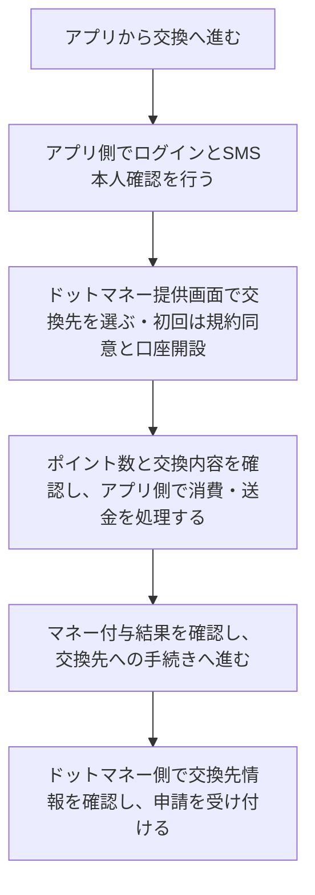

# F13｜ポイント交換 PRD（レビュー前）

> ④業務ルールと⑦以降はユーザーレビュー未完了。機能・画面・操作は本リポジトリのモックを参照し、優先順位はスプレッドシートを正とする。本PRDはTier1のみを定義する。

参照するモック：本リポジトリの `mock-app/`（2026-10-21のExchangeOEM方式の変更を照合）。未接続の外部API・実端末機能は、接続済みとして扱わず末尾に記載する。

| 基本情報 | 内容 |
| --- | --- |
| 機能ID | F13 |
| 概要 | ポイント交換 |
| 対象領域 | アプリ／管理画面／外部連携 |
| 関連機能 | [F01](F01-account.md)、[F12](F12-points.md) |
| 更新日 | 2026-10-21 |
| 版 | レビュー前（初版未確定） |

## ① 目的・今回作る範囲

目的：ためたポイントを希望する交換先で使えるようにするため

評価指標：交換完了率/交換処理時間/結果不明・失敗件数

優先順位は[アプリ詳細要件のTier列](https://docs.google.com/spreadsheets/d/1tI26I_4vbSHIOzMdJz7g8-DjeLyyVUKoksVHhZ0AQhU/edit#gid=1107057215)を正とする。モックに存在してもTier2・Tier3・空欄の要件は本PRDの定義対象に含めない。

| 要件ID | Tier1の範囲 |
| --- | --- |
| F13-1 | ユーザーがタメルコポイントを手数料0円でドットマネーへ交換できる |
| F13-2 | ユーザーが有効なポイント残高の範囲で交換金額を指定して申請できる |
| F13-3 | ユーザーが交換後のドットマネー額とポイント残高を確認できる |
| F13-6 | ユーザーが交換時に必要なSMS認証を完了して交換画面へ進むことができる |
| F13-7 | 【アプリ側＋ドットマネー側】口座状態に応じて交換を制御できる（ドットマネー側：口座状態・利用制限の管理／アプリ側：取得した状態に基づくポイント消費・送金可否の判定） |
| F13-8 | 【アプリ側・サーバー処理】交換申請に対する送金予約とポイント消費を一度だけ記録できる |
| F13-9 | 【アプリ側・サーバー処理】保存した送金予約をドットマネーAPIへ送り、付与結果を記録できる |
| F13-10 | 【アプリ側・サーバー処理】送信失敗時に同じ送金予約を再試行できる |
| F13-11 | ユーザーが交換エラーの種類に応じた案内を確認できる |

管理側は[管理画面詳細要件のTier列](https://docs.google.com/spreadsheets/d/1tI26I_4vbSHIOzMdJz7g8-DjeLyyVUKoksVHhZ0AQhU/edit#gid=1341040600)にある以下のTier1を関連範囲とする。NACS本体の内製要件にはしない。

| 要件ID | Tier1の運用範囲 |
| --- | --- |
| ADM-F08-4 | 運営担当者がサービス全体の日次交換総額上限を設定できる |
| ADM-F08-5 | 運営担当者が対象インストール案件の利用制限を解除・再設定できる |
| ADM-F08-8 | 運営担当者がドットマネー交換の送金予約・送信状態・エラーを照会できる |
| ADM-F08-9 | 送金処理システムが未送信のドットマネー送金予約を再試行できる |

要件名に旧モックとの相違がある場合、優先順位は維持し、現在の表示・動きとユーザー指定を②以降へ反映する。実装方式の具体化は仕様設計で扱う。

## ② 画面イメージ

[アプリの該当画面](http://127.0.0.1:4204/mock-app/#exchange-destinations)

- マイページまたは履歴から交換へ進み、本人確認後、ドットマネー提供画面で交換先・利用ポイント数を選び、交換を申請する。
- 交換時は会員ログイン・都度のSMS本人確認・交換先の連携を確認する。
- 「タメルコポイントからマネーへの交換完了」と「交換先への申請受付」を区別する。申請受付をギフト発行・振込等の反映完了として表示しない。
- 処理中・交換完了・交換不可・結果不明の状態を表示し、同じ申請を二重に作らない。モックは提供画面の操作を再現するもので、実際の交換・送信は行わない。

## ③ 操作フロー

## ④ 業務ルール・制約

> ユーザーレビュー未完了。アプリ上の表示に関わるルールを記載する。

### 表示する対象ユーザー

| 対象ユーザー | 利用・表示 |
| --- | --- |
| 会員 | 本人確認後にポイント交換を申請する |
| 非会員（ゲスト） | 会員登録・ログインの案内から認証へ進む |

### 表示条件

| 状態・条件 | 表示のルール |
| --- | --- |
| 会員が交換を開始 | 毎回SMS本人確認を表示する |
| 本人確認と交換先の連携を確認済み | 交換ポイントの指定・確認画面を表示する |
| 交換が完了 | 交換した額と更新後の残高を表示する |
| マネー付与が完了・交換先への申請前 | マネーへの交換完了と案内し、交換先への手続きを続ける。交換先への反映完了とは表示しない |
| 交換先への申請を受付済み | 申請受付と表示する。反映時期・交換先の利用制限はドットマネー側の条件に従う |

### 画面に置く要素・操作

| 画面・要素 | 表示・操作のルール |
| --- | --- |
| 交換への入口 | マイページまたは履歴からドットマネーへの交換へ進む |
| SMS本人確認 | アプリ側で電話番号・確認コードの入力を表示する。説明は「SMSを受信できる携帯電話番号を入力してください。」とし、「交換のたびにSMS認証が必要です。」は表示しない。認証を都度行う条件自体は維持する |
| 交換先の選択・初回同意 | ドットマネー提供画面で交換先を選ぶ。初回は規約同意・口座開設を行い、口座が利用できる場合にポイント入力へ進む |
| 交換ポイントの入力 | ドットマネー提供画面で交換可能残高と入力額を表示する。モック用設定は100pt＝1マネー、最低100pt・100pt単位、タメルコからドットマネーへの手数料0円。交換先別の最低額・レート・手数料は本番の契約設定に従う |
| 申請内容の確認・実行 | 交換額と交換後の残高を確認して申請する |
| 交換結果 | 交換完了とポイント履歴への入口を表示する |

ポイントの二重消費・二重付与を防ぐため、アプリ側のサーバーで交換申請ID・送金予約・ポイント消費・付与結果を対応づける。送信が失敗しても新規申請にせず、同じ予約の状態を確認して再試行する。これらはアプリ内に新たな操作画面を設ける要件ではなく、ドットマネーとの接続を支える処理とする。口座の管理・マネー付与・各交換先への申請／振込等はドットマネー側が担当する。

## ⑤ 管理画面

新規作成・変更・削除は、現在の管理画面で操作できる範囲を示す。「外部管理」はNACS・EDOCODE等の担当範囲、「未実装」は操作画面がない項目。削除と公開停止は分けて記載する。

[実行設定の管理画面](http://127.0.0.1:4204/mock-admin/legacy.html#review)

| 対象項目 | 新規作成 | 変更 | 削除 | 管理画面での操作・反映範囲 |
| --- | --- | --- | --- | --- |
| サービス全体の日次交換総額上限 | 不可 | 可能 | 不可 | 審査・交換上限で既存値を更新する。項目の追加・削除はない。 |
| 交換先・交換レート・最低額・単位 | 外部管理／要確認 | 外部管理／要確認 | 外部管理／要確認 | 交換連携側の設定。自社管理画面には交換先の作成・編集・削除UIがない。 |
| 利用者の交換申請・実残高 | 不可 | 照会・復旧は外部連携 | 不可 | EDOCODEと交換サービスの取引に従う。モックの送信・復旧は実交換ではない。 |

## ⑥ 例外処理・エラーハンドリング

| 状況 | 表示・処理・復帰 |
| --- | --- |
| 残高不足・上限・口座停止 | 交換不可の理由を表示し、申請を成立させない。 |
| 口座状態による制限 | モックではACTIVEは利用可、FROZENはマネー付与とマネー利用を区別し、付与可能でも交換先への利用は停止する。BLACK・INVALIDは付与不可とする。利用制限の解除はドットマネー側の案内につなぐ |
| 通信断・結果不明 | 取引IDを保持して結果を再照会する。二重送信しない。 |
| マネー付与後の中断 | 既存申請の続きから交換先への手続きへ進み、ポイントを再消費しない。別の交換を始める際は改めて本人確認する |

## ⑦ 達成条件・未決事項

> 本節以降はユーザーレビュー未完了。

### Tier1の達成条件

- [ ] F13-1：ユーザーがタメルコポイントを手数料0円でドットマネーへ交換できる。
- [ ] F13-2：ユーザーが有効なポイント残高の範囲で交換金額を指定して申請できる。
- [ ] F13-3：ユーザーが交換後のドットマネー額とポイント残高を確認できる。
- [ ] F13-6：ユーザーが交換時に必要なSMS認証を完了して交換画面へ進むことができる。
- [ ] F13-7：ドットマネー側の口座状態をアプリ側が確認し、マネー付与の可否と交換先への利用可否を区別できる。
- [ ] F13-8：アプリ側のサーバー処理が送金予約とポイント消費をまとめて一度だけ記録できる。
- [ ] F13-9：アプリ側のサーバー処理が保存済みの送金予約をドットマネーへ送信し、結果を記録できる。
- [ ] F13-10：送信失敗・再読み込み・連打でも同じ予約を再確認し、ポイント消費・マネー付与を重複させない。
- [ ] 本人確認からドットマネー提供画面へ進み、初回同意・交換先選択・入力・確認・マネー付与・交換先への申請受付の各状態を区別できる。
- [ ] SMS案内の文言を短くしても、交換ごとの認証は省略されない。
- [ ] F13-11：ユーザーが交換エラーの種類に応じた案内を確認できる。
- [ ] ①の管理側Tier1に対応する操作について、⑤の新規作成・変更・削除可否と反映範囲を確認できる。
- [ ] ⑥の対象となる空・失敗・中断などの状態から、表示内容と次の操作を確認できる。

### まだ決まっていないこと

本番の交換先・商品ID・レート・最低交換額・手数料は、ドットマネーとの契約設定に合わせて確認する。モックの交換先と数値は本番条件の確定を意味しない。認証・API接続などの具体的な方法は、別途仕様設計で定める。

## モックへの未反映・対象外

### モックへの未反映

| 項目 | 未反映の内容 |
| --- | --- |
| ドットマネー・EDOCODEの連携 | ExchangeOEMの提供画面をローカルで再現。実際の口座開設・API送信・ポイント消費・マネー付与・交換先への申請／反映は未接続。商品ID・口座・連携先は架空の確認用データ |
| SMS認証 | 実際のSMS送信・認証は未接続 |

### 今回の対象外

| 項目 | 対象外の内容 |
| --- | --- |
| なし | — |

## 変更履歴

| 版 | 日付 | 変更内容 |
| --- | --- | --- |
| レビュー前 | 2026-10-21 | ExchangeOEM方式のモックに合わせ、アプリ側とドットマネー側の担当、初回同意、マネー付与と交換先申請の区別、再試行・口座状態の扱いを反映。SMSの案内文を短縮し、都度認証は維持。モック値と未接続範囲を明記。 |
| レビュー前 | 2026-10-15 | F10レビューの共通フィードバックを反映。⑤を管理画面へ変更し、④を対象ユーザー・表示条件・配置要素に整理。例外処理と仕様設計事項の重複を除き、未反映と対象外を別表に分離。個別レビューは未完了。 |
