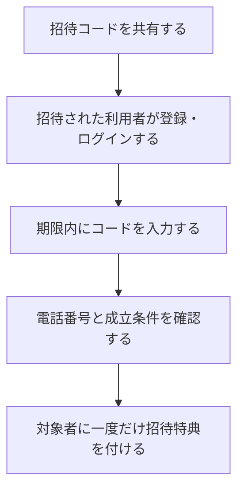

# F14｜友達招待 PRD（レビュー前）

> ④業務ルールと⑦以降はユーザーレビュー未完了。機能・画面・操作は現在の4189モックを正とし、優先順位はスプレッドシートを正とする。本PRDはTier1のみを定義する。

参照するモック：`Tameruko-Preview-20261013` の4189（2026-10-15確認）。未接続の外部API・実端末機能は、接続済みとして扱わず末尾に記載する。

| 基本情報 | 内容 |
| --- | --- |
| 機能ID | F14 |
| 概要 | 友達招待 |
| 対象領域 | アプリ／管理画面／外部連携 |
| 関連機能 | [F01](F01-account.md)、[F12](F12-points.md)、[F18](F18-mypage-support.md) |
| 更新日 | 2026-10-15 |
| 版 | レビュー前（初版未確定） |

## ① 目的・今回作る範囲

目的：利用者からの紹介で新しい利用者を増やすため

評価指標：招待コード共有数・適用数/招待成立数/不正件数/報酬費用

優先順位は[アプリ詳細要件のTier列](https://docs.google.com/spreadsheets/d/1g00ZxLGprVNT4T4uSmzw--vRpp95HQ1Uq9i8GnJpmS4/edit#gid=1107057215)を正とする。モックに存在してもTier2・Tier3・空欄の要件は本PRDの定義対象に含めない。

| 要件ID | Tier1の範囲 |
| --- | --- |
| F14-1 | 自分の招待コードを確認して共有できる |
| F14-2 | 友達の招待コードを入力して適用結果を確認できる |
| F14-3 | 招待成立時に双方の報酬を重複なく受け取りできる |
| F14-4 | 運営が招待の条件・停止・不正判定を管理できる |

管理側は[管理画面詳細要件のTier列](https://docs.google.com/spreadsheets/d/1g00ZxLGprVNT4T4uSmzw--vRpp95HQ1Uq9i8GnJpmS4/edit#gid=1341040600)にある以下のTier1を関連範囲とする。NACS本体の内製要件にはしない。

| 要件ID | Tier1の運用範囲 |
| --- | --- |
| ADM-F13-1 | 運営担当者が友達招待の成立条件・双方の報酬・上限を設定できる |
| ADM-F13-2 | 運営担当者が招待コードの適用結果と双方の報酬付与状況を照会できる |
| ADM-F13-3 | 運営担当者が友達招待の停止と不正判定を管理できる |

要件名に旧モックとの相違がある場合、優先順位は維持し、現在の表示・動きとユーザー指定を②以降へ反映する。実装方式の具体化は仕様設計で扱う。

## ② 画面イメージ

[アプリの該当画面](http://127.0.0.1:4189/mock-app/#invite)

- 自分の招待コードを共有し、招待された利用者がコードを入力する。
- コード入力はアプリ開始から72時間以内。会員登録・電話番号登録を確認して特典を受け取る。
- 招待のタイトル・イラスト・コード・共有操作、マイページの招待バナーを表示する。

## ③ 操作フロー

## ④ 業務ルール・制約

> ユーザーレビュー未完了。アプリ上の表示に関わるルールを記載する。

### 表示する対象ユーザー

| 対象ユーザー | 利用・表示 |
| --- | --- |
| 会員 | 自分の招待コードを共有し、招待の適用結果を確認する |
| 非会員（ゲスト） | 招待の案内を確認し、特典受取に必要な会員登録・電話番号登録へ進む |

### 表示条件

| 状態・条件 | 表示のルール |
| --- | --- |
| 招待する側 | 本人の招待コードと共有操作を表示する |
| 招待された側 | アプリ開始から72時間以内に入力する招待コード欄を表示する |
| 有効なコードを適用し、会員登録・電話番号登録を完了 | 双方の招待特典の結果を表示する |

### 画面に置く要素・操作

| 画面・要素 | 表示・操作のルール |
| --- | --- |
| タイトル・イラスト | 友達招待の説明を表示する |
| 本人の招待コード・コピー | 紹介コードを確認して共有する |
| 招待コード入力 | 友達から受け取ったコードを入力する |
| 登録・電話番号の確認 | 特典受取に必要な登録状態を確認する |
| 招待特典 | 現モックの双方5,000ptと適用結果を表示する |

## ⑤ 管理画面

新規作成・変更・削除は、現在の管理画面で操作できる範囲を示す。「外部管理」はNACS・EDOCODE等の担当範囲、「未実装」は操作画面がない項目。削除と公開停止は分けて記載する。

| 対象項目 | 新規作成 | 変更 | 削除 | 管理画面での操作・反映範囲 |
| --- | --- | --- | --- | --- |
| 招待報酬・入力期限・成立条件・上限 | 未実装 | 未実装 | 未実装 | 設定モデルはあるが、現在の管理画面に専用の入稿・変更・削除UIはない。 |
| 利用者の招待コード・適用履歴 | 不可 | 不可 | 不可 | コードは会員に紐付けて発行。利用者が入力し、成立結果を記録する。 |

## ⑥ 例外処理・エラーハンドリング

| 状況 | 表示・処理・復帰 |
| --- | --- |
| 自己招待・無効コード・期限外 | 入力箇所に理由を表示し、成立や報酬付与にしない。 |
| 同じコードを再送・同時操作 | 被招待者のIDで重複を防ぐ。 |

## ⑦ 達成条件・未決事項

> 本節以降はユーザーレビュー未完了。

### Tier1の達成条件

- [ ] F14-1：自分の招待コードを確認して共有できる。
- [ ] F14-2：友達の招待コードを入力して適用結果を確認できる。
- [ ] F14-3：招待成立時に双方の報酬を重複なく受け取りできる。
- [ ] F14-4：運営が招待の条件・停止・不正判定を管理できる。
- [ ] ①の管理側Tier1に対応する操作について、⑤の新規作成・変更・削除可否と反映範囲を確認できる。
- [ ] ⑥の対象となる空・失敗・中断などの状態から、表示内容と次の操作を確認できる。

### まだ決まっていないこと

| 確認事項 | 相談先 |
| --- | --- |
| 招待特典の原資・上限、不正と判断した場合の取り扱い | 事業・運用 |

## モックへの未反映・対象外

### モックへの未反映

| 項目 | 未反映の内容 |
| --- | --- |
| 招待・報酬の連携 | 本番のコード適用・成立判定とEDOCODEへの特典付与は未接続 |
| 招待設定・状態照会の管理画面 | 条件・報酬・停止の設定、適用結果・不正判定の専用操作画面は未実装 |

### 今回の対象外

| 項目 | 対象外の内容 |
| --- | --- |
| なし | — |

## 変更履歴

| 版 | 日付 | 変更内容 |
| --- | --- | --- |
| レビュー前 | 2026-10-15 | F10レビューの共通フィードバックを反映。⑤を管理画面へ変更し、④を対象ユーザー・表示条件・配置要素に整理。例外処理と仕様設計事項の重複を除き、未反映と対象外を別表に分離。個別レビューは未完了。 |
