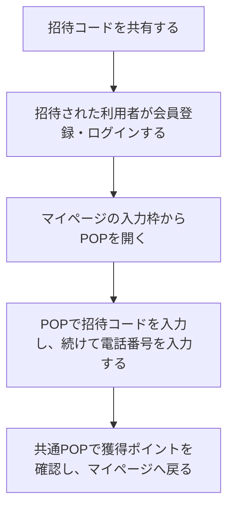

# F14｜友達招待 PRD（レビュー前）

本PRDはTier1のみを定義する。

参照するモック：本リポジトリの `mock-app/`・`mock-admin/`（2026-10-28確認）。未接続の外部API・実端末機能は、接続済みとして扱わず末尾に記載する。

| 基本情報 | 内容 |
| --- | --- |
| 機能ID | F14 |
| 概要 | 友達招待 |
| 対象領域 | アプリ／管理画面／外部連携 |
| 関連機能 | [F01](F01-account.md)、[F12](F12-points.md)、[F18](F18-mypage-support.md) |
| 更新日 | 2026-10-28 |
| 版 | レビュー前（初版未確定） |

## ① 目的・今回作る範囲

目的：利用者からの紹介で新しい利用者を増やすため

| 要件ID | Tier1の範囲 |
| --- | --- |
| F14-1 | 自分の招待コードを確認して共有できる |
| F14-2 | 友達の招待コードを入力して適用結果を確認できる |
| F14-3 | 招待成立時に双方の報酬を重複なく受け取りできる |
| F14-4 | 運営が友達招待の成立条件・双方の報酬・上限・開始／停止を設定できる |

管理側は[管理画面詳細要件のTier列](https://docs.google.com/spreadsheets/d/1tI26I_4vbSHIOzMdJz7g8-DjeLyyVUKoksVHhZ0AQhU/edit#gid=1341040600)にある以下のTier1を関連範囲とする。

| 要件ID | Tier1の運用範囲 |
| --- | --- |
| ADM-F13-1 | 運営担当者が友達招待の成立条件・双方の報酬・上限・開始／停止を設定できる |

## ② 画面イメージ

[アプリの該当画面](http://127.0.0.1:4195/mock-app/#invite)

- 自分の招待コードを共有し、招待された利用者がマイページの入力枠からPOPを開き、招待コード入力・電話番号入力・特典獲得まで進む。オンボーディング完了後はホームへ進む。
- ユーザーID発行から72時間以内に、会員登録（未登録の場合）の後、POP内で招待コード入力→電話番号入力の順に完了し、双方が特典ポイントを受け取る。招待案内は「特典ポイント」と表記し、バナー画像と特典受取POPには報酬ポイント数を表示する。
- 友達招待の詳細ページでは、白背景の紹介コード欄に「あなたの紹介コード」・本人のコード・主要色で塗りつぶした「紹介コードをコピーする」ボタン・説明文を表示する。
- 紹介コード欄に続き、4枚の手順カード、シェアボタン、概要・ポイント付与・成立条件・お問い合わせを縦スクロールで確認できる。
- ホームでは、ユーザーID発行後72時間の間は、下部ナビ「マイページ」の上に「招待コードはこちら」の吹き出しを表示する。「いくら貯める？」と文字サイズ・太さ・文字間隔・行高を揃え、チャコールグレー（#373F45）背景・白文字とし、同色のしっぽでマイページを指す。

## ③ 操作フロー

## ④ 業務ルール・制約

### 表示する対象ユーザー

| 対象ユーザー | 利用・表示 |
| --- | --- |
| 会員 | 自分の招待コードを共有し、招待の適用結果を確認する |
| 非会員（ゲスト） | 招待の案内を確認し、特典受取に必要な会員登録・電話番号登録へ進む |

### 表示条件

| 状態・条件 | 表示のルール |
| --- | --- |
| 招待する側 | 本人の招待コードと共有操作を表示する |
| 招待された側 | ユーザーID発行から72時間未満・コード未適用の間だけ入力導線を表示する。会員登録後、POP内でコード入力→電話番号入力へ進む |
| ホームの招待吹き出し | ユーザーID発行から72時間未満かつ招待コード未適用の場合に表示。72時間経過・コード適用後は非表示。残り時間のカウントダウンは表示しない。 |
| 有効なコードを適用し、会員登録・電話番号登録を完了 | 双方の招待特典の結果を表示する |

### 画面に置く要素・操作

#### 1. 入口：ホームからマイページへ

| 画面・入口 | 表示内容 | 押した後の動き |
| --- | --- | --- |
| ホーム：招待案内の吹き出し | 下部ナビのマイページ上に「招待コードはこちら」。チャコールグレー（#373F45）背景・白文字。スクロール中も位置を維持する | マイページを開く。表示対象は④表示条件に従う |
| マイページ：友達を招待するバナー | 淡い黄色の背景・コイン・吹き出しの画像。画像内の報酬額は表示可とし、運用で随時差し替える | 自分のコードを送るための「友達招待」詳細ページを開く（下記2） |
| マイページ：友達から招待された方 | 見出し「友達から招待された方」、説明「招待コード入力は、アプリ開始から72時間有効です。」、アイコン・矢印 | 受け取ったコードを入力するPOPを開く（下記3）。ユーザーID発行から72時間未満かつコード未適用の場合に表示し、期限到達・適用後は枠全体を非表示にする |

#### 2. 友達を招待する：詳細ページからコードを共有する

| 場面 | 表示内容 | 操作・次の動き |
| --- | --- | --- |
| 詳細ページを開く | ヘッダー「友達招待」。白背景に「あなたの紹介コード」・本人のコード・主要色で塗りつぶした「紹介コードをコピーする」ボタン・説明文 | コピーボタンで本人のコードをコピーする |
| 招待方法・条件を確認する | ①コードを送る、②友達がアプリを始めて会員登録・ログインする、③マイページのPOPでコード・電話番号を入力する、④双方へポイントが付与される、の4枚の手順カード。STEP 2の見出しは「友達にタメルコを始めてもらう」。続けて概要・ポイント付与・成立条件・お問い合わせを配置する | 縦スクロールで確認する。案内文は「お互いに特典ポイントがもらえる」と表記する |
| 手順カードの下のシェアボタンを押す | OS標準の共有画面（ハーフモーダル） | インストール済みアプリとOSの対応状況に応じて共有先を選ぶ。コード入りメッセージを共有先アプリへ引き継ぎ、利用者が送信・投稿する。メッセージの報酬表記は「特典ポイント」とする |
| OS共有が非対応・起動失敗の場合 | LINE・X・メール・メッセージのコピーを選べる代替メニュー | アプリ画面下端から開くハーフモーダルで共有先を選ぶ。内容が収まらない場合はモーダル内をスクロールする |
| 共有をキャンセルする | 友達招待の詳細ページ | 詳細ページを維持し、コードのコピーや共有をやり直せる |

#### 3. 招待を受ける：POP内でコード入力から特典受取まで進む

マイページを背景にしたまま、以下の順に進む。

| 順番・場面 | 表示内容 | 操作・次の動き |
| --- | --- | --- |
| 会員登録・ログインが必要な場合 | 会員登録・ログイン画面 | 登録・ログイン後にマイページへ戻り、招待コード入力POPを開く |
| ① 招待コードを入力する | 招待コードの入力欄・「次へ」 | 有効なコードを入力すると、同じPOP内で電話番号入力へ切り替わる。エラー時は入力内容と理由を表示する |
| ② 電話番号を入力する | 「特典を受け取るために電話番号を入力してください。」、携帯電話番号の入力欄・「特典を受け取る」・「招待コードの入力に戻る」 | 登録済みの電話番号は初期表示する。「特典を受け取る」で成立条件を確認し、付与成功後に獲得POPを表示する。補助リンクではコード入力へ戻る |
| ③ 獲得ポイントを確認する | 他機能と共通の獲得POP。コイン画像・受取額（例：5,000pt）・「ゲット！」・「戻る」。金額は管理画面の招待された側の設定額を反映する | 「戻る」でPOPを閉じ、マイページに戻る。再読み込みでは再表示・再付与しない |
| 入力の途中で閉じる | 背景のマイページ | 特典付与前は付与せず、マイページを維持する |

コード入力・電話番号入力のPOPは、共通の獲得POPと同じ幅・高さ・角丸・表示位置にする。「次へ」「特典を受け取る」は獲得POPの「戻る」と同じ幅・高さ・下端位置に揃える。文章と入力欄はCTAより上に均等に配置し、コード入力へ戻る補助リンクは主要CTAの上に置く。入力欄は選択時も通常の枠線を維持する。

獲得履歴の友達招待行は「特典ポイント」と表記する。具体的な報酬額はバナー画像と獲得POPに表示する。説明文には句読点を付け、自然に漢字で表記できる動詞は漢字にする。

## ⑤ 管理画面

| 要件ID | 設定項目 | 設定内容 |
| --- | --- | --- |
| ADM-F13-1 | 成立条件 | 会員登録・電話番号登録・有効なコード適用の1条件とする |
| ADM-F13-1 | 双方の報酬 | 招待する側・招待された側の特典ポイントをそれぞれ0以上の整数で設定する |
| ADM-F13-1 | 上限 | 招待者ごとの成立件数上限（1件以上）と、特典ポイントの総額上限（0以上）を設定する |
| ADM-F13-1 | 開始・停止 | 友達招待の開始・停止を切り替える。停止中はコードの適用と特典付与を受け付けず、ホームとマイページのコード入力案内を非表示にする |

設定を保存すると受付・成立判定・以後の特典付与へ反映する。付与済みの特典は変更せず、保存操作を変更ログに記録する。

## ⑥ 例外処理・エラーハンドリング

| 状況 | 表示・処理・復帰 |
| --- | --- |
| 自己招待・無効コード・期限外 | 入力箇所に理由を表示し、成立や報酬付与にしない。 |
| 同じコードを再送・同時操作 | 被招待者のIDで重複を防ぐ。 |

## ⑦ 達成条件・未決事項

### Tier1の達成条件

- [ ] F14-1：自分の招待コードを確認して共有できる。
- [ ] F14-1：シェアボタンで端末標準の共有先選択が開き、対応するLINE・SNSなどへコード入りメッセージを引き継げる。非対応・起動失敗時は代替メニューから共有先を選べ、キャンセルでは送信せず元の詳細ページへ戻る。
- [ ] F14-1：スマホではOS標準の共有シートを表示する（高さ・共有先はOSの制御に従う）。PCモックなどOS共有非対応の場合は、アプリプレビューの下端から開くハーフモーダルで共有先選択を再現する。内容が収まらない場合はモーダル内をスクロールできる。
- [ ] F14-1／F14-3：友達招待の詳細・共有メッセージ・獲得履歴の該当行に具体的な報酬額を表示しない。報酬額を変えても「特典ポイント」の表記を維持する。バナー画像内と特典受取POPには報酬額を表示する。バナー画像は運用で随時差し替える。
- [ ] F14-1：マイページのバナーから詳細ページを開き、コードのコピー・シェアと4枚の手順、成立条件を縦スクロールで確認できる。
- [ ] F14-2：マイページの入力枠からPOPを開き、ページ遷移せず招待コード入力→電話番号入力→共通の特典受取POPへ進める。中断時はマイページを維持し、付与成功前には特典を付けない。オンボーディングからはコード入力へ誘導しない。
- [ ] F14-2：ホームの招待吹き出しが72時間未満・コード未適用時だけ表示され、タップでマイページに進める。72時間ちょうど・期限超過・適用済みでは表示されない。
- [ ] F14-2：マイページの「友達から招待された方」も同じ条件で枠全体を非表示にする。期限到達後に空枠・余白を残さず、招待する側のバナーは維持する。
- [ ] F14-3：招待成立時に双方の報酬を重複なく受け取りできる。特典付与に成功すると共通のポイント受取POPが表示され、管理画面に設定した受取額を数値とptで表示する。「戻る」を押すとマイページへ戻る。失敗・再読み込み・適用済みの再送ではPOPを表示しない。
- [ ] F14-4：運営が友達招待の成立条件・双方の報酬・上限・開始／停止を設定できる。
- [ ] ADM-F13-1：成立条件・双方の特典ポイント・上限・開始／停止を保存し、再表示して設定内容を確認できる。保存した設定が招待の受付・成立判定・特典付与に反映される。
- [ ] ⑥の対象となる空・失敗・中断などの状態から、表示内容と次の操作を確認できる。

### まだ決まっていないこと

| 確認事項 | 相談先 |
| --- | --- |
| 招待特典の原資・上限 | 事業・運用 |
| 招待を停止した場合の、受付済み・成立前の招待の取り扱い | 事業・運用 |

## モックへの未反映・対象外

### モックへの未反映

| 項目 | 未反映の内容 |
| --- | --- |
| 招待・報酬の連携 | 本番のコード適用・成立判定とEDOCODEへの特典付与は未接続 |
| 会員・電話番号の連携 | 実際の会員連携・電話番号登録のAPIは未接続 |
| 招待案内の期限判定 | ユーザーID発行日時を起点とする本番の時刻連携は未接続 |
| 招待設定の本番保存 | 成立条件・双方の報酬・上限・開始／停止の設定とアプリへの反映は操作可能。本番の保存API・権限管理は未接続 |

## 変更履歴

| 版 | 日付 | 変更内容 |
| --- | --- | --- |
| レビュー前 | 2026-10-28 | 画面要素・操作を入口、友達を招待する導線、招待を受ける導線の順に再構成。共有先・代替操作・キャンセルを詳細ページからの共有に集約。 |
| レビュー前 | 2026-10-28 | マイページの招待入力をPOP化。招待コード・電話番号・特典獲得までページ遷移せず進め、閉じるとマイページを維持する。 |
| レビュー前 | 2026-10-28 | 招待コードの確認・適用完了画面を廃止し、特典受取POPの「戻る」でマイページへ戻る導線に変更。 |
| レビュー前 | 2026-10-28 | 成立条件を会員登録・電話番号登録・有効なコード適用の1条件へ修正。特典受取は共通POPの数値表示を使用し、管理画面で設定した受取額と「戻る」を表示する。 |
| レビュー前 | 2026-10-28 | 会員登録・招待案内の期間・共有画面の表記を整理。管理画面に成立条件・双方の報酬・上限・開始／停止を追加。特典受取に共通POPを使用し、コード入力はマイページからの導線とした。 |
| レビュー前 | 2026-10-28 | 管理要件をADM-F13-1へ集約し、成立条件・双方の報酬・上限・開始／停止に整理。画面要素を詳細ページ・マイページ／入力・ホーム・共通ルールに分け、表示と操作を別列に整理。評価指標と不要な注記を削除し、達成条件・未反映事項を更新。 |
| レビュー前 | 2026-10-27 | 数値を伴わない「pt」は「ポイント」と表記するルールへ変更。詳細・共有文・完了・履歴を「特典ポイント」に統一し、数字付きの5,000ptバナーは維持。 |
| レビュー前 | 2026-10-27 | バナー画像はポイント数を表示してよく、運用で随時差し替える方針に変更。元の「5,000pt」のバナーを復元し、その他の招待報酬表示は「特典pt」を維持。 |
| レビュー前 | 2026-10-27 | 共有先選択をOSのハーフモーダルとして確認できるよう整理。対応端末ではOS共有を呼び、PCモックの代替メニューはアプリ画面下端に固定したハーフモーダルへ変更。 |
| レビュー前 | 2026-10-27 | マイページの招待バナーを以前のコイン入り画像デザインへ戻し、報酬額非表示を維持して「特典pt」の画像へ差し替え。 |
| レビュー前 | 2026-10-27 | シェア操作をOS標準の共有先選択へ整理し、LINE・SNSへのメッセージ引き継ぎ、キャンセル、非対応時のLINE・X・メール・コピーの代替メニューを記載・実装。共有先での送信・投稿は利用者が行う。 |
| レビュー前 | 2026-10-27 | アプリ内の友達招待報酬額を非表示にし、「特典pt」へ統一。数値入りのバナー画像をテキスト表示へ変更し、詳細・適用完了・共有メッセージ・履歴の招待行にも反映。内部の報酬設定と集計処理は維持。 |
| レビュー前 | 2026-10-27 | STEP 2と成立条件の「はじめる」を「始める」へ統一。今後の動詞表記にも漢字を使うルールを記録。 |
| レビュー前 | 2026-10-27 | 「招待の手順」より上だけFigma参照前の紹介コード・塗りつぶしのコピーボタン・説明文へ戻した。4枚の手順カードとその下の説明・シェア操作は維持。 |
| レビュー前 | 2026-10-27 | 招待バナー遷移先の詳細ページをFigmaのスクロール構成へ更新。共有欄・4枚の手順・条件説明を配置し、会員要素と人物イラストは除外。既存のコード入力・電話番号登録の遷移を維持し、モックの説明を実際の操作順に合わせた。 |
| レビュー前 | 2026-10-27 | 友達招待画面の上部の説明・イラスト枠を削除。紹介コード・コピー操作・招待の流れ・FAQは維持。 |
| レビュー前 | 2026-10-27 | マイページの招待入力枠をホームの招待吹き出しと同じ表示条件へ統一。72時間以降・コード適用済みの場合は枠全体を非表示にし、未反映事項から除外。 |
| レビュー前 | 2026-10-27 | 説明文・サブテキストの句読点ルールを記載し、マイページの招待入力案内の文末に句点を追加。 |
| レビュー前 | 2026-10-27 | 招待案内の吹き出しだけ黒背景・白文字に変更。文字サイズは維持。 |
| レビュー前 | 2026-10-27 | ホーム下部のマイページ上に招待コード案内の吹き出しを追加。表示期限・適用済み非表示・タップ先と達成条件を記載。 |
| レビュー前 | 2026-10-15 | F10レビューの共通フィードバックを反映。⑤を管理画面へ変更し、④を対象ユーザー・表示条件・配置要素に整理。例外処理と仕様設計事項の重複を除き、未反映と対象外を別表に分離。 |

### 管理権限

友達招待の報酬・上限・開始・停止・再開はadminまたは管理者が操作できる。運用担当者は設定を閲覧できる。
