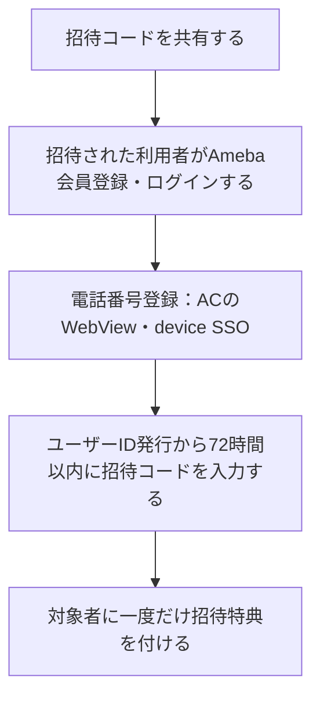

# F14｜友達招待 PRD（レビュー前）

> ④業務ルールと⑦以降はユーザーレビュー未完了。優先順位はスプレッドシートを正とする。本PRDはTier1のみを定義し、確定仕様とモックの未反映事項を区別する。

参照するモック：本リポジトリの `mock-app/`・`mock-admin/`（2026-10-27確認）。未接続の外部API・実端末機能は、接続済みとして扱わず末尾に記載する。

| 基本情報 | 内容 |
| --- | --- |
| 機能ID | F14 |
| 概要 | 友達招待 |
| 対象領域 | アプリ／管理画面／外部連携 |
| 関連機能 | [F01](F01-account.md)、[F12](F12-points.md)、[F18](F18-mypage-support.md) |
| 更新日 | 2026-10-27 |
| 版 | レビュー前（初版未確定） |

## ① 目的・今回作る範囲

目的：利用者からの紹介で新しい利用者を増やすため

評価指標：招待コード共有数・適用数/招待成立数/不正件数/報酬費用

優先順位は[アプリ詳細要件のTier列](https://docs.google.com/spreadsheets/d/1tI26I_4vbSHIOzMdJz7g8-DjeLyyVUKoksVHhZ0AQhU/edit#gid=1107057215)を正とする。モックに存在してもTier2・Tier3・空欄の要件は本PRDの定義対象に含めない。

| 要件ID | Tier1の範囲 |
| --- | --- |
| F14-1 | 自分の招待コードを確認して共有できる |
| F14-2 | 友達の招待コードを入力して適用結果を確認できる |
| F14-3 | 招待成立時に双方の報酬を重複なく受け取りできる |
| F14-4 | 運営が招待の条件・停止・不正判定を管理できる |

管理側は[管理画面詳細要件のTier列](https://docs.google.com/spreadsheets/d/1tI26I_4vbSHIOzMdJz7g8-DjeLyyVUKoksVHhZ0AQhU/edit#gid=1341040600)にある以下のTier1を関連範囲とする。NACS本体の内製要件にはしない。

| 要件ID | Tier1の運用範囲 |
| --- | --- |
| ADM-F13-1 | 運営担当者が友達招待の成立条件・双方の報酬・上限を設定できる |
| ADM-F13-2 | 運営担当者が招待コードの適用結果と双方の報酬付与状況を照会できる |
| ADM-F13-3 | 運営担当者が友達招待の停止と不正判定を管理できる |

要件名に旧モックとの相違がある場合、優先順位は維持し、現在の表示・動きとユーザー指定を②以降へ反映する。実装方式の具体化は仕様設計で扱う。

## ② 画面イメージ

[アプリの該当画面](http://127.0.0.1:4222/mock-app/#invite)

- 自分の招待コードを共有し、招待された利用者がコードを入力する。
- ユーザーID発行から72時間以内に、Ameba会員登録（未登録の場合）→電話番号登録→招待コード入力の順に完了し、双方が特典ポイントを受け取る。バナー以外では友達招待の報酬ポイント数は表示しない。
- 招待コード・共有操作、マイページの招待バナーを表示する。詳細ページの「招待の手順」より上はFigma参照前の表示とし、「あなたの紹介コード」・コード・塗りつぶしのコピーボタン・説明文を白背景に配置する。共有見出し・ピンクの共有カード・上部シェアボタンは置かない。
- バナーから開く詳細ページは、紹介コード欄の下に、[Figmaの友達招待ページ](https://www.figma.com/design/OxKHX6jb2qWVEOs3UkzP8W/?node-id=56114-65284)を参考にした4枚の手順カード→概要・ポイント付与・成立条件・お問い合わせを縦スクロールで確認する構成とする。人物イラストとAmeba会員の表記・登録案内はモックに取り込まない。会員登録の表記は現モックの一般的な会員登録・ログインに合わせる。
- オンボーディング後のホームでは、下部ナビ「マイページ」の上に「招待コードはこちら」の吹き出しを表示する。「いくら貯める？」と文字サイズ・太さ・文字間隔・行高を揃え、以前の目標案内と同じチャコールグレー（#373F45）背景・白文字を用い、同色のしっぽでマイページを指す。

## ③ 操作フロー

## ④ 業務ルール・制約

> ユーザーレビュー未完了。アプリ上の表示に関わるルールを記載する。

### 表示する対象ユーザー

| 対象ユーザー | 利用・表示 |
| --- | --- |
| 会員 | 自分の招待コードを共有し、招待の適用結果を確認する |
| 非会員（ゲスト） | 招待の案内を確認し、特典受取に必要な会員登録・電話番号登録へ進む |

### 表示条件

| 状態・条件 | 表示のルール |
| --- | --- |
| 招待する側 | 本人の招待コードと共有操作を表示する |
| 招待された側 | ユーザーID発行から72時間未満・コード未適用の間だけ入力導線を表示する。会員登録・電話番号登録を済ませてコード入力へ進む |
| ホームの招待吹き出し | ユーザーID発行から72時間未満かつ招待コード未適用の場合に表示。72時間経過・コード適用後は非表示。残り時間のカウントダウンは表示しない。 |
| 有効なコードを適用し、会員登録・電話番号登録を完了 | 双方の招待特典の結果を表示する |

### 画面に置く要素・操作

| 画面・要素 | 表示・操作のルール |
| --- | --- |
| 友達招待画面の上部 | ヘッダー「友達招待」の下はFigma参照前の紹介コード欄へ戻す。「あなたの紹介コード」・コード・主要色で塗りつぶした「紹介コードをコピーする」ボタン・説明文を白背景に表示する。 |
| 本人の招待コード・コピー | 紹介コードを確認して共有する |
| マイページの招待バナー | 以前の淡い黄色・コイン・吹き出しの「5,000pt」画像を使用する。バナーは報酬額の非表示ルールの対象外とし、報酬額を表示してよい。運用時はその都度最新の画像に差し替える。タップ先は友達招待の詳細ページ。 |
| 招待コードのシェア | 4枚の手順の下にシェアボタンを置く。タップするとOS標準の共有画面を開き、LINE・SNS・メールなどから共有先を選んで、招待コード入りメッセージを各アプリの送信・投稿画面へ引き継ぐ。候補は端末にインストールされたアプリ・OSの対応状況に従い、固定しない。送信・投稿は利用者が共有先で行う。キャンセル時は詳細ページを維持する。非対応・共有画面を開けない環境では、LINE・X・メール・メッセージのコピーを選べる代替メニューを表示する。 |
| 詳細ページの手順 | ①コードを送る、②友達がアプリを始めて会員登録・ログインする、③マイページからコードを入力し、電話番号未登録なら続く案内で登録する、④成立後に双方へポイント付与、の4枚を上から読む。③は現モックの操作順を説明しており、実サービスの正式な順序への変更ではない。 |
| 招待コード入力 | 友達から受け取ったコードを入力する |
| マイページの招待入力枠 | 「友達から招待された方」の枠は、ユーザーID発行から72時間未満かつコード未適用の場合だけ表示する。72時間ちょうど以降はアイコン・見出し・説明・矢印を含め枠全体を非表示にし、空の枠を残さない。自分が友達を招待するバナーは維持する。 |
| 説明文・サブテキストの表記 | 文章には句読点を付け、漢字で自然に表記できる動詞は漢字にする。STEP 2の見出しは「友達にタメルコを始めてもらう」とする。マイページの招待入力案内は「招待コード入力は、アプリ開始から72時間有効です。」と表示する。見出し「友達から招待された方」は変更しない。 |
| 招待コードはこちら | ホーム下部のマイページに紐付けて固定表示し、スクロールしても位置を維持。吹き出しのタップでマイページへ進む。 |
| 登録・電話番号の確認 | 特典受取に必要な登録状態を確認する |
| 招待特典 | 報酬額を表示せず、「お互いに特典ポイントがもらえる」「特典ポイントを獲得しました。」と案内する。数値を伴わない「pt」は使わず「ポイント」と表記する。詳細ページ・適用完了・共有メッセージ・獲得履歴の友達招待行に適用する。画像を随時差し替えるマイページのバナーは例外として報酬額を表示してよい。内部の付与設定・残高集計は維持する。 |

## ⑤ 管理画面

管理画面のダッシュボードからホーム・マイページのモックを開き、招待案内を確認できる。招待の条件・停止を変更する操作ではない。

新規作成・変更・削除は、現在の管理画面で操作できる範囲を示す。「外部管理」はNACS・EDOCODE等の担当範囲、「未実装」は操作画面がない項目。削除と公開停止は分けて記載する。

| 対象項目 | 新規作成 | 変更 | 削除 | 管理画面での操作・反映範囲 |
| --- | --- | --- | --- | --- |
| 招待報酬・入力期限・成立条件・上限 | 未実装 | 未実装 | 未実装 | 設定モデルはあるが、現在の管理画面に専用の入稿・変更・削除UIはない。 |
| 利用者の招待コード・適用履歴 | 不可 | 不可 | 不可 | コードは会員に紐付けて発行。利用者が入力し、成立結果を記録する。 |

## ⑥ 例外処理・エラーハンドリング

| 状況 | 表示・処理・復帰 |
| --- | --- |
| 自己招待・無効コード・期限外 | 入力箇所に理由を表示し、成立や報酬付与にしない。 |
| 同じコードを再送・同時操作 | 被招待者のIDで重複を防ぐ。 |

## ⑦ 達成条件・未決事項

> 本節以降はユーザーレビュー未完了。

### Tier1の達成条件

- [ ] F14-1：自分の招待コードを確認して共有できる。
- [ ] F14-1：シェアボタンで端末標準の共有先選択が開き、対応するLINE・SNSなどへコード入りメッセージを引き継げる。非対応・起動失敗時は代替メニューから共有先を選べ、キャンセルでは送信せず元の詳細ページへ戻る。
- [ ] F14-1：スマホではOS標準の共有シートを表示する（高さ・共有先はOSの制御に従う）。PCモックなどOS共有非対応の場合は、アプリプレビューの下端から開くハーフモーダルで共有先選択を再現する。内容が収まらない場合はモーダル内をスクロールできる。
- [ ] F14-1／F14-3：友達招待の詳細・適用完了・共有メッセージ・獲得履歴の該当行に具体的な報酬額を表示しない。報酬額を変えても「特典ポイント」の表記を維持する。バナー画像内の報酬額は表示してよく、運用で随時差し替える。
- [ ] F14-1：マイページのバナーから詳細ページを開き、コードのコピー・シェアと4枚の手順、成立条件を縦スクロールで確認できる。詳細ページにAmeba会員要素・人物イラストを表示しない。
- [ ] F14-2：友達の招待コードを入力して適用結果を確認できる。
- [ ] F14-2：ホームの招待吹き出しが72時間未満・コード未適用時だけ表示され、タップでマイページに進める。72時間ちょうど・期限超過・適用済みでは表示されない。
- [ ] F14-2：マイページの「友達から招待された方」も同じ条件で枠全体を非表示にする。期限到達後に空枠・余白を残さず、招待する側のバナーは維持する。
- [ ] F14-3：招待成立時に双方の報酬を重複なく受け取りできる。
- [ ] F14-4：運営が招待の条件・停止・不正判定を管理できる。
- [ ] ①の管理側Tier1に対応する操作について、⑤の新規作成・変更・削除可否と反映範囲を確認できる。
- [ ] ⑥の対象となる空・失敗・中断などの状態から、表示内容と次の操作を確認できる。

### まだ決まっていないこと

| 確認事項 | 相談先 |
| --- | --- |
| 招待特典の原資・上限、不正と判断した場合の取り扱い | 事業・運用 |

## モックへの未反映・対象外

### モックへの未反映

| 項目 | 未反映の内容 |
| --- | --- |
| 招待・報酬の連携 | 本番のコード適用・成立判定とEDOCODEへの特典付与は未接続 |
| 会員連携・電話番号登録・コード入力の順序 | 提供された仕様ではAmeba会員登録→電話番号登録（ACのWebView・device SSO）→コード入力の順に完了する。現モックのコード入力→電話番号確認はこの順序に未対応。友達招待でSMS認証画面は起動しない。実会員連携・電話番号登録は未接続。 |
| 招待吹き出しの時刻判定 | ローカルモックではデモ日付と利用開始日で判定。本番ではユーザーID発行日時を起点とし、ダウンロード日時を直接取得しているわけではない。 |
| 招待設定・状態照会の管理画面 | 条件・報酬・停止の設定、適用結果・不正判定の専用操作画面は未実装 |

### 今回の対象外

| 項目 | 対象外の内容 |
| --- | --- |
| なし | — |

## 変更履歴

| 版 | 日付 | 変更内容 |
| --- | --- | --- |
| レビュー前 | 2026-10-27 | 数値を伴わない「pt」は「ポイント」と表記するルールへ変更。詳細・共有文・完了・履歴を「特典ポイント」に統一し、数字付きの5,000ptバナーは維持。 |
| レビュー前 | 2026-10-27 | バナー画像はポイント数を表示してよく、運用で随時差し替える方針に変更。元の「5,000pt」のバナーを復元し、その他の招待報酬表示は「特典pt」を維持。 |
| レビュー前 | 2026-10-27 | 共有先選択をOSのハーフモーダルとして確認できるよう整理。対応端末ではOS共有を呼び、PCモックの代替メニューはアプリ画面下端に固定したハーフモーダルへ変更。 |
| レビュー前 | 2026-10-27 | マイページの招待バナーを以前のコイン入り画像デザインへ戻し、報酬額非表示を維持して「特典pt」の画像へ差し替え。 |
| レビュー前 | 2026-10-27 | シェア操作をOS標準の共有先選択へ整理し、LINE・SNSへのメッセージ引き継ぎ、キャンセル、非対応時のLINE・X・メール・コピーの代替メニューを記載・実装。共有先での送信・投稿は利用者が行う。 |
| レビュー前 | 2026-10-27 | アプリ内の友達招待報酬額を非表示にし、「特典pt」へ統一。数値入りのバナー画像をテキスト表示へ変更し、詳細・適用完了・共有メッセージ・履歴の招待行にも反映。内部の報酬設定と集計処理は維持。 |
| レビュー前 | 2026-10-27 | STEP 2と成立条件の「はじめる」を「始める」へ統一。今後の動詞表記にも漢字を使うルールを記録。 |
| レビュー前 | 2026-10-27 | 「招待の手順」より上だけFigma参照前の紹介コード・塗りつぶしのコピーボタン・説明文へ戻した。4枚の手順カードとその下の説明・シェア操作は維持。 |
| レビュー前 | 2026-10-27 | 招待バナー遷移先の詳細ページをFigmaのスクロール構成へ更新。共有欄・4枚の手順・条件説明を配置し、Ameba会員要素と人物イラストは除外。既存のコード入力・電話番号登録の遷移を維持し、モックの説明を実際の操作順に合わせた。 |
| レビュー前 | 2026-10-27 | 友達招待画面の上部の説明・イラスト枠を削除。紹介コード・コピー操作・招待の流れ・FAQは維持。 |
| レビュー前 | 2026-10-27 | マイページの招待入力枠をホームの招待吹き出しと同じ表示条件へ統一。72時間以降・コード適用済みの場合は枠全体を非表示にし、未反映事項から除外。 |
| レビュー前 | 2026-10-27 | 説明文・サブテキストの句読点ルールを記載し、マイページの招待入力案内の文末に句点を追加。 |
| レビュー前 | 2026-10-27 | 招待案内の吹き出しだけ黒背景・白文字に変更。文字サイズは維持。 |
| レビュー前 | 2026-10-27 | ホーム下部のマイページ上に招待コード案内の吹き出しを追加。表示期限・適用済み非表示・タップ先と達成条件を記載。 |
| レビュー前 | 2026-10-15 | F10レビューの共通フィードバックを反映。⑤を管理画面へ変更し、④を対象ユーザー・表示条件・配置要素に整理。例外処理と仕様設計事項の重複を除き、未反映と対象外を別表に分離。個別レビューは未完了。 |
