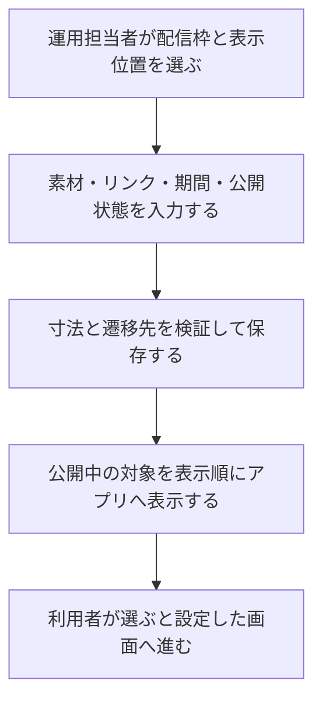

# F15｜バナー・テキスト広告・起動時POPUP・画面間広告 PRD（レビュー前）

> ④業務ルールと⑦以降はユーザーレビュー未完了。本日の変更箇所はローカル4180モックとユーザー指定を参照し、優先順位はスプレッドシートを正とする。本PRDはTier1のみを定義する。

参照するモック：本リポジトリのローカル4180（2026-10-19の変更箇所を照合）。未接続の外部API・実端末機能は、接続済みとして扱わず末尾に記載する。

| 基本情報 | 内容 |
| --- | --- |
| 機能ID | F15 |
| 概要 | バナー・テキスト広告・起動時POPUP・画面間広告 |
| 対象領域 | アプリ／管理画面／外部連携 |
| 関連機能 | [F02](F02-home.md)、[F10](F10-surveys.md)、[F16](F16-campaign-pages.md) |
| 更新日 | 2026-10-19 |
| 版 | レビュー前（初版未確定） |

## ① 目的・今回作る範囲

目的：案件やキャンペーンへの案内を運用で届けられるようにするため

評価指標：表示数/クリック数・遷移数/成果数/表示頻度による離脱

優先順位は[アプリ詳細要件のTier列](https://docs.google.com/spreadsheets/d/1tI26I_4vbSHIOzMdJz7g8-DjeLyyVUKoksVHhZ0AQhU/edit#gid=1107057215)を正とする。モックに存在してもTier2・Tier3・空欄の要件は本PRDの定義対象に含めない。

| 要件ID | Tier1の範囲 |
| --- | --- |
| F15-1 | 運営が起動時POPUP/画面間・バナー・テキスト広告の内容と遷移先を入稿できる |
| F15-2 | 運営が掲載期間・公開停止を設定できる |
| F15-4 | テキスト広告をモックで指定した箇所に表示できる |
| F15-5 | 起動時POPUP・画面間広告を表示できる |
| F15-6 | 運営が広告の表示・クリック結果を確認できる |
| F15-8 | 広告素材のGIF等の形式を扱うことができる |

管理側は[管理画面詳細要件のTier列](https://docs.google.com/spreadsheets/d/1tI26I_4vbSHIOzMdJz7g8-DjeLyyVUKoksVHhZ0AQhU/edit#gid=1341040600)にある以下のTier1を関連範囲とする。NACS本体の内製要件にはしない。

| 要件ID | Tier1の運用範囲 |
| --- | --- |
| ADM-F02-1 | 運営担当者がホーム・カテゴリ別画面・お得内などの掲載枠を選んでバナー広告を登録できる |
| ADM-F02-2 | 運営担当者がお得画面の検索窓下にテキスト広告を登録できる |
| ADM-F02-3 | 運営担当者が掲載広告の遷移先をURLで設定できる |
| ADM-F02-4 | 運営担当者が広告の掲載開始・終了・公開停止を設定できる |
| ADM-F02-5 | 運営担当者が掲載枠に合う画像だけを入稿できる |
| ADM-F02-6 | 運営担当者が保存前の入稿をプレビューで確認して修正できる |
| ADM-F02-7 | 運営担当者が通常バナー枠へ複数画像を登録してカルーセル配信できる |
| ADM-F02-8 | 運営担当者が起動時POPUP・画面間広告の掲載枠と基本表示頻度を設定できる |
| ADM-F10-1 | 運営担当者が画面・掲載枠・広告ごとの表示数とクリック数を確認できる |

要件名に旧モックとの相違がある場合、優先順位は維持し、現在の表示・動きとユーザー指定を②以降へ反映する。実装方式の具体化は仕様設計で扱う。

## ② 画面イメージ

[アプリの該当画面](http://127.0.0.1:4180/mock-app/#home)

- ホーム・カテゴリ・アンケート・お得・起動時・タブ切替時の広告を、登録した画像・リンク・期間・公開状態で表示する。
- 通常画像バナーは1登録1画像。公開中の対象を表示し、0枚なら枠ごと隠す。管理側の複数画像登録はADM-F02-7のTier1として扱うが、アプリ側のカルーセル操作F15-3は本PRDの達成条件に含めない。
- ホームの複数枚バナーは、下のページ表示点（直径6px）の上下に同じ5pxの余白を設ける。点の下側の従来の余白に揃え、バナー画像に点が接近しないようにする。点のある場合の下部表示帯は16px。
- アンケートのバナーは「おすすめアンケート／回答できるアンケート」セクションの上。320×100素材を同じ比率で表示し、上下12pxの共通余白を使う。
- POPUP・画面間広告は300×250の単独表示。表示頻度・停止・ほかの操作との競合を制御する。

- お得の「おすすめ」「高還元」「すぐできる」はそれぞれ上部PRバナーを表示する。おすすめの「もっと見る」から開く「新着」「ポイント高還元順」の独立一覧ではバナーを表示しない。
- お得の検索中は検索窓下のテキスト広告（告知ピル）を非表示にする。通常表示に戻ると再表示する。検索中も上部PRバナーは維持する。
- おすすめだけに企業リンク5枠を表示する。画像・遷移先の設定と表示寸法は[F03](F03-offer-list.md)を参照し、高還元・すぐできるには企業リンク欄と余白を出さない。

## ③ 操作フロー

## ④ 業務ルール・制約

> ユーザーレビュー未完了。アプリ上の表示に関わるルールを記載する。

### 表示する対象ユーザー

| 対象ユーザー | 利用・表示 |
| --- | --- |
| 会員 | 配信条件に合う広告を表示する |
| 非会員（ゲスト） | 配信条件に合う広告を表示する |

### 表示条件

| 状態・条件 | 表示のルール |
| --- | --- |
| 公開中・掲載期間内 | 設定された画面・位置へ対象の広告を表示する |
| 非公開・掲載期間外 | 表示しない |
| 画像・テキスト広告の設定 | 登録した画像・文言と遷移先に従う |

### 画面に置く要素・操作

| 画面・要素 | 表示・操作のルール |
| --- | --- |
| 通常の画像バナー | 登録した画像とリンクを表示する |
| アンケート上部のバナー | 「おすすめアンケート／回答できるアンケート」セクションの上に320×100の比率で表示し、上下12pxの余白を設ける。セクション名はF10に従う |
| その他の画像バナー | デイリー中部320×50、通常上部・特集320×100、カテゴリ下部300×250、歩く下部300×300の素材を使う |
| テキスト広告 | 登録した文言を表示し、設定された遷移先へ進む |
| 起動時POPUP・画面間広告 | 300×250の画像と遷移先・閉じる操作を表示する |

## ⑤ 管理画面

新規作成・変更・削除は、現在の管理画面で操作できる範囲を示す。「外部管理」はNACS・EDOCODE等の担当範囲、「未実装」は操作画面がない項目。削除と公開停止は分けて記載する。

[実行設定の管理画面](http://127.0.0.1:4180/mock-admin/#banners)

| 対象項目 | 新規作成 | 変更 | 削除 | 管理画面での操作・反映範囲 |
| --- | --- | --- | --- | --- |
| 画像バナー・テキスト広告の登録 | 可能 | 可能 | 可能 | 配信枠と表示位置を選び、画像／文言・管理名・リンク・期間・公開状態を保存する。複製も可能。 |
| バナー表示順・公開停止／再開 | 不可 | 可能 | 不可 | 並び替えと公開状態を変更する。元のレコード削除は上の削除操作。 |
| 起動POPUP・画面間広告の配信設定 | 可能 | 可能 | 可能 | 該当枠の広告レコードを管理する。配信頻度は既存設定値の変更。 |
| お得の上部PR枠 | 可能 | 可能 | 可能 | おすすめ・高還元・すぐできるを別々の配信位置として設定する。独立した「もっと見る」一覧には表示しない |

## ⑥ 例外処理・エラーハンドリング

| 状況 | 表示・処理・復帰 |
| --- | --- |
| 画像寸法違い・リンク不備 | 保存せず、入力を保持して修正を案内する。 |
| 配信0件・期間終了 | 対象の広告枠を非表示にする。 |
| 動画や本人確認中に広告が競合 | 重要な操作を妨げない。連続表示を制御する。 |

## ⑦ 達成条件・未決事項

> 本節以降はユーザーレビュー未完了。

### Tier1の達成条件

- [ ] お得3タブの上部PR枠を維持し、「もっと見る」遷移先は非表示、検索中は告知ピルだけを非表示にできる。

- [ ] F15-1：運営が起動時POPUP/画面間・バナー・テキスト広告の内容と遷移先を入稿できる。
- [ ] F15-2：運営が掲載期間・公開停止を設定できる。
- [ ] F15-4：テキスト広告をモックで指定した箇所に表示できる。
- [ ] F15-5：起動時POPUP・画面間広告を表示できる。
- [ ] F15-6：運営が広告の表示・クリック結果を確認できる。
- [ ] F15-8：広告素材のGIF等の形式を扱うことができる。
- [ ] ①の管理側Tier1に対応する操作について、⑤の新規作成・変更・削除可否と反映範囲を確認できる。
- [ ] ⑥の対象となる空・失敗・中断などの状態から、表示内容と次の操作を確認できる。

### まだ決まっていないこと

なし。認証・API接続などの具体的な方法は、別途仕様設計で定める。

## モックへの未反映・対象外

### モックへの未反映

| 項目 | 未反映の内容 |
| --- | --- |
| 管理画面の旧タブ名 | 一部の配信位置ラベルに「ガポガポ」「クレカ」が残る。アプリの最新表示名は「高還元」「カード」。設定キー・配信先は変えない |
| 素材・配信の連携 | 本番の画像保存・広告配信、表示数・クリック数の記録と照会は未接続 |

### 今回の対象外

| 項目 | 対象外の内容 |
| --- | --- |
| ASP案件本体の素材管理 | NACS側の担当範囲。自社の広告枠へ入稿するバナー素材と分ける |

## 変更履歴

| 版 | 日付 | 変更内容 |
| --- | --- | --- |
| レビュー前 | 2026-10-19 | お得3タブのPRバナーと独立一覧での非表示、検索中の告知ピル非表示、おすすめ限定の企業リンクについてF03と整合。 |
| レビュー前 | 2026-10-15 | F10レビューの共通フィードバックを反映。⑤を管理画面へ変更し、④を対象ユーザー・表示条件・配置要素に整理。例外処理と仕様設計事項の重複を除き、未反映と対象外を別表に分離。個別レビューは未完了。 |
| レビュー前 | 2026-10-20 | ホームバナー下のページ表示点の上側余白を下側と同じ5pxへ統一。点のあるバナーの下部表示帯を16pxとし、画像と点の近接を解消。 |
