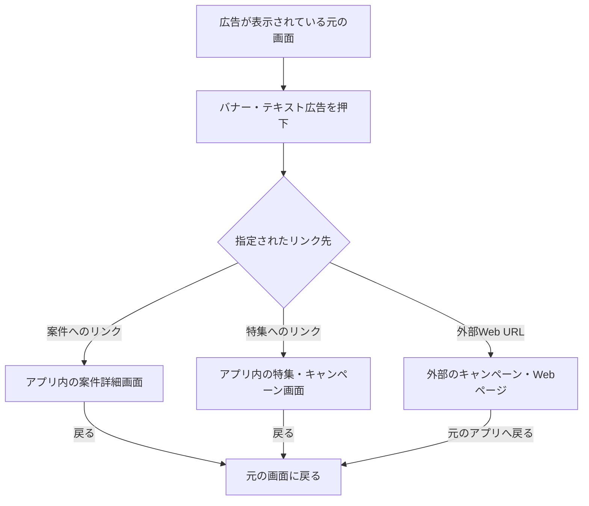

# F15｜バナー・テキスト広告・起動時POPUP・画面間広告 PRD

> 2026-10-23のユーザーレビューFIXを第1版とする。本リポジトリのモックとユーザー指定を参照し、優先順位はスプレッドシートと今回のレビューでの指定に基づく。本PRDはTier1のみを定義する。「要確認」の項目は引き続き未確定とし、モックへの未反映は末尾に記載する。

参照するモック：本リポジトリの `mock-app/`・`mock-admin/`（2026-10-21の変更箇所を照合）。未接続の外部API・実端末機能は、接続済みとして扱わず末尾に記載する。

| 基本情報 | 内容 |
| --- | --- |
| 機能ID | F15 |
| 概要 | バナー・テキスト広告・起動時POPUP・画面間広告 |
| 対象領域 | アプリ／管理画面／外部連携 |
| 関連機能 | [F02](F02-home.md)、[F10](F10-surveys.md)、[F12](F12-points.md)、[F16](F16-campaign-pages.md) |
| 更新日 | 2026-10-23 |
| 版 | 第1版 |

## ① 目的・今回作る範囲

目的：案件・キャンペーンへの案内と必要な情報を運用で届け、案件の実施率を高める。表示・クリックのログで、広告が正しく配信されていることを確認する。

バナー広告は管理画面からの自社入稿に限定し、ネットワーク広告は配信しない。

評価指標：表示数/クリック数・遷移数/成果数/表示頻度による離脱

[アプリ詳細要件のTier列](https://docs.google.com/spreadsheets/d/1tI26I_4vbSHIOzMdJz7g8-DjeLyyVUKoksVHhZ0AQhU/edit#gid=1107057215)（2026-10-23確認）に基づき、以下をTier1の範囲とする。カルーセルはアプリの表示・操作と管理画面の入稿・配信の両方を含む。

| 要件ID | Tier1の範囲 |
| --- | --- |
| F15-1 | 運営が起動時POPUP/画面間・バナー・テキスト広告の内容と遷移先を入稿できる |
| F15-2 | 運営が掲載期間・公開停止を設定できる |
| F15-3 | アプリ上で複数バナーを横スクロールで表示できる |
| F15-4 | テキスト広告をモックで指定した箇所に表示できる |
| F15-5 | 起動時POPUP・画面間広告を表示できる |
| F15-6 | 広告の表示・クリック結果をログで取得できる（管理画面での閲覧は必須としない） |

管理側は[管理画面詳細要件のTier列](https://docs.google.com/spreadsheets/d/1tI26I_4vbSHIOzMdJz7g8-DjeLyyVUKoksVHhZ0AQhU/edit#gid=1341040600)にある以下のTier1を関連範囲とする。NACS本体の内製要件にはしない。

| 要件ID | Tier1の運用範囲 |
| --- | --- |
| ADM-F02-1 | 運営担当者がホーム・カテゴリ別画面・お得内などの掲載枠を選んでバナー広告を登録できる |
| ADM-F02-2 | 運営担当者がお得画面の検索窓下にテキスト広告を登録できる |
| ADM-F02-3 | 運営担当者が掲載広告の遷移先をURLで設定できる |
| ADM-F02-4 | 運営担当者が広告の掲載開始・終了・公開停止を設定できる |
| ADM-F02-5 | 運営担当者が掲載枠に合う画像だけを入稿できる |
| ADM-F02-6 | 運営担当者が保存前の入稿をプレビューで確認して修正できる |
| ADM-F02-7 | 運営担当者が通常バナー枠へ複数画像を登録してカルーセル配信できる |
| ADM-F02-8 | 運営担当者が起動時POPUP・画面間広告の掲載枠と基本表示頻度を設定できる |

## ② 画面イメージ・広告の種類

[アプリの該当画面](http://127.0.0.1:4204/mock-app/#home)

| 種類・掲載枠 | 概要 |
| --- | --- |
| テキスト広告 | 短い文言で案件・キャンペーンを案内する |
| カルーセル広告 | 同じ掲載枠で画像バナーを複数枚表示し、横スクロールで切り替えて案件・キャンペーンを紹介する |
| バナー広告（320×100） | 画面上部や特集の画像で案件・キャンペーンへ案内する |
| バナー広告（300×250） | カテゴリ下部の画像で案件・キャンペーンへ案内する |
| バナー広告（300×300） | 歩く画面下部の正方形画像で案内する |
| 起動時POPUP | 起動時に案件・キャンペーンを案内する |
| 画面間広告 | お仕事のポイント獲得の区切りに案内する |

## ③ 操作フロー

利用者が広告を押してから、指定されたリンク先へ進み、元の画面へ戻るまでの画面遷移を示す。バナー・カルーセル内の各バナー・テキスト広告・起動時POPUP・画面間広告に共通で適用する。

外部Webページの開き方（アプリ内ブラウザー／外部ブラウザー）と具体的な戻る操作は、リンク先の扱いをレビューする際に定める。

## ④ 広告ごとの仕様・配置・表示ルール

サイズは幅×高さ（px）で表す。

### 自社入稿広告の共通ルール

テキスト広告・画像バナー・カルーセル・起動時POPUP・画面間広告に適用する。

| 項目 | 内容 |
| --- | --- |
| 表示対象 | 会員・非会員（ゲスト）のうち、配信条件に合う利用者。 |
| 掲載条件 | 公開中・掲載期間内の広告を表示する。 |
| 配信0件 | 対象の枠をとるつめにする（枠とその余白を残さず、後続のコンテンツを詰める）。 |
| 遷移先 | アプリ内リンク、任意のドメインのhttp／https URLを設定できる。URLのパス・クエリ・フラグメントを保持する。 |
| 表示・クリックログ | 画面・掲載枠・広告ID・遷移先を識別して、実際の表示とクリックを記録する。再描画による重複記録を除く。 |

### テキスト広告

#### 素材・入稿仕様

| 項目 | 内容 |
| --- | --- |
| 文字数 | 上限・文字の数え方・超過時の扱いは要確認。 |

#### 配置

| 項目 | 内容 |
| --- | --- |
| 掲載場所 | お得・おすすめの検索窓下。 |

#### 表示・並び替えのルール

| 項目 | 内容 |
| --- | --- |
| 表示順 | 管理画面で保存した順に表示する。編集・停止／再開・再読み込み後も順番を維持する。 |
| 追加・複製 | 一覧の末尾に追加する。 |

### 画像広告の共通仕様

バナー広告・カルーセルの画像・起動時POPUP・画面間広告に適用する。

#### 素材・入稿仕様

| 項目 | 内容 |
| --- | --- |
| 登録単位 | 1登録につき1画像。 |
| ファイル形式・容量 | 採用する静止画像の形式・容量上限は要確認。 |

### カルーセル広告

#### 素材・入稿仕様

| 項目 | 内容 |
| --- | --- |
| 使用する素材 | 掲載枠に対応するサイズの画像バナーを使用する。サイズは下記のサイズ別バナーで定義する。 |

#### 配置

| 項目 | 内容 |
| --- | --- |
| 対応する掲載枠 | ホームの複数枚バナー。対応する掲載枠の個別一覧は要確認。 |

#### 表示・並び替えのルール

| 項目 | 内容 |
| --- | --- |
| 表示枚数 | 通常枠は1〜5枚。 |
| 切替操作 | 横スクロールでバナーを切り替える。 |
| 表示順 | 管理画面で並び替えられる。並び替えの単位・反映タイミング、配信候補の選び方は要確認。 |
| 新規・複製・再公開時の順序 | 要確認。 |
| 自動切替・ページ送り | 自動切替の有無・間隔、表示点を押した場合の動作、最後から先頭への循環は要確認。 |
| 初期表示・復帰時 | 最初の表示位置、リンク先から戻った際の位置は要確認。 |
| 1枚の場合 | 表示点・切替操作の扱いは要確認。 |

### バナー広告（320×100）

#### 素材・入稿仕様

| 項目 | 内容 |
| --- | --- |
| アスペクト比 | 16:5 |
| 入稿サイズ | 320×100px。 |

#### 配置

| 項目 | 内容 |
| --- | --- |
| ホーム | デイリー・チャレボ・ゲーム・買い物・カード・歩くの各上部。 |
| アンケート | 「おすすめアンケート／回答できるアンケート」セクションの上。セクション名はF10に従う。 |
| お得 | おすすめ・高還元・すぐできるの各上部PR枠。 |
| 特集 | 個別の配置場所は要確認。 |

#### 表示ルール

| 項目 | 内容 |
| --- | --- |
| お得の独立一覧 | おすすめの「もっと見る」から開く「新着」「ポイント高還元順」の独立一覧には表示しない。 |

### バナー広告（300×250）

#### 素材・入稿仕様

| 項目 | 内容 |
| --- | --- |
| アスペクト比 | 6:5 |
| 入稿サイズ | 300×250px。 |

#### 配置

| 項目 | 内容 |
| --- | --- |
| 掲載場所 | ホームのゲーム・買い物・カードの各カテゴリ下部。 |

### バナー広告（300×300）

#### 素材・入稿仕様

| 項目 | 内容 |
| --- | --- |
| アスペクト比 | 1:1 |
| 入稿サイズ | 300×300px。 |

#### 配置

| 項目 | 内容 |
| --- | --- |
| 掲載場所 | ホーム・歩く画面の下部。 |

### 起動時POPUP・画面間広告の共通仕様

#### 素材・入稿仕様

| 項目 | 内容 |
| --- | --- |
| 使用する素材 | バナー広告（300×250）の素材仕様に従う。 |

#### 配置・表示ルール

| 項目 | 内容 |
| --- | --- |
| 表示枚数 | 1回につき1枚表示する。 |
| 閉じる操作 | 閉じるボタンで広告を閉じ、元の画面に戻る。 |

### 起動時POPUP

#### 表示・並び替えのルール

| 項目 | 内容 |
| --- | --- |
| 表示タイミング・回数 | 短時間の再起動で繰り返し表示しないよう、ユーザーごとに「期間の数値＋単位（日・時間・分）＋回数」で上限を設定する。バナー別ではなく起動時POPUP全体で数え、各起動で1枚だけ表示する。表示した場合だけ回数を消費し、再読み込み・閉じる操作で回数を戻さない |
| 時間帯の判定 | 日本時間の固定時間帯で判定する。「3時間に1回」は0〜3時、3〜6時、6〜9時…の各時間帯で最初の起動時に表示する。前回表示からの経過時間ではない。時間・分は毎日0時を起点とし、割り切れない最後の枠は24時まで。日は期間設定の開始日の0時を起点とする。未使用回数は繰り越さない |
| 頻度の変更 | 次の起動から新しい上限で判定し、新しい時間帯に含まれる表示済み回数を引き継ぐ。 |
| 表示順 | 配信条件を満たす上位1件を表示する。表示順が未設定の間はランダムとし、設定後は編集・再読み込みで順番を維持する。 |
| 新規追加 | 設定済みの順番の末尾へ追加する。 |

### 画面間広告

#### 表示ルール

| 項目 | 内容 |
| --- | --- |
| 表示タイミング | お仕事を終えた区切りで表示するため、①ポイント獲得が設定したn回に達するごと、②ポイント獲得後に実績レポートを確認し、左上の「戻る」を押したとき、のいずれかで1枚表示する。2条件は独立し、両方を満たす必要はない。通常のタブ移動では表示しない |
| 獲得回数の数え方 | ユーザーごとに、お仕事の報酬が準備中ポイントに入った時点で1回と数える。準備中から交換可能になっても同じ報酬を数え直さない。準備中を経ず即時付与するお仕事は最初の付与時に数える。未完了・受取前・0ポイント・運営付与・交換・失効は数えない。再起動・日付変更で回数をリセットしない |
| 実績レポートからの戻り | n回に達していなくても、新たなポイント獲得後に実績レポートを見て左上の「戻る」を押すと表示する。新たな獲得のない開き直しでは再表示しない。レポート内の絞り込み・交換先への移動・下部タブ・ブラウザーの戻るはこの条件に含めない |
| ほかの案内との重複 | 獲得完了・許可案内・ほかのダイアログが表示中なら、割り込まず、その回の画面間広告は表示しない。案内を閉じた後の繰り延べ表示も行わない。回答中・動画再生中・交換手続き中には割り込まない。 |

## ⑤ 管理画面

[バナー・テキスト広告の管理画面](http://127.0.0.1:4204/mock-admin/#banners)

「配信枠一覧」から掲載枠を選び、「登録済み広告一覧」から新規登録・編集へ進む。以下の表の「バナー広告」には、カルーセルを構成する各画像・起動時POPUP・画面間広告を含む。素材の規格・掲載場所・アプリでの表示条件は④に従う。

### 配信枠一覧画面

#### 閲覧できる内容

| 項目 | 内容 |
| --- | --- |
| 配信枠 | 掲載枠名、掲載画面、入稿サイズまたはテキスト形式。 |
| 登録状況 | 枠ごとの登録数、公開状態・掲載期間に基づく配信状況（期間内・予約・停止／期間終了・未登録）。 |

掲載枠は画像16枠・テキスト1枠の計17枠とする。広告が未登録でも入稿先として表示する。

| 掲載場所 | 枠数 |
| --- | --- |
| ホーム：デイリーの上部、チャレボの上部、ゲーム・買い物・カード・歩くの各上部・下部 | 10 |
| アンケート一覧の上部 | 1 |
| お得：おすすめ・高還元・すぐできるの各上部 | 3 |
| 起動時POPUP、画面間広告 | 2 |
| お得・おすすめの検索窓下（テキスト広告） | 1 |

#### 操作できる内容

| 操作 | 内容 |
| --- | --- |
| 検索・絞り込み | 掲載枠名などのキーワード検索と、掲載画面による絞り込み。 |
| 管理する | 選択した枠の登録済み広告一覧を開く。 |
| その他の掲載設定 | サイドタブ・キャンペーンページの画像設定へ進む。 |

### 登録済み広告一覧画面

#### 閲覧できる内容

| 対象 | 閲覧項目 |
| --- | --- |
| 掲載枠 | 選択中の掲載枠、サイズ・形式、登録数。 |
| 各広告共通 | 管理名、掲載開始日・終了日、配信状態（配信中・予約中・停止中・期間終了）。 |
| バナー広告 | 登録画像数。 |
| テキスト広告 | テキスト広告であることを示す種別。文言は編集画面で確認する。 |

#### 操作できる内容

| 操作 | テキスト広告 | バナー広告 |
| --- | --- | --- |
| 新規登録 | 選択中の枠に広告を追加する画面を開く。 | 同左。 |
| 編集 | 選択した広告の編集画面を開く。 | 同左。 |
| 停止・再開 | 広告を残したまま公開状態を切り替える。 | 同左。 |
| 並び替え | ハンドルのドラッグまたは上下矢印キーで順番を変更し、自動保存する。 | 通常バナー・起動時POPUPで同じ操作ができる。画面間広告には並び替え操作を設けない。 |
| 複製 | 同じ掲載枠に複製用フォームを開く。 | 複製用フォームを開き、複製先の画面・掲載枠を選べる。 |
| 削除 | 確認後に広告を削除する。 | 同左。 |

複製は元の素材・文言・リンク・掲載期間を引き継ぎ、管理名に「複製」を付ける。公開状態の初期値は停止とし、フォームを保存した時点で別の広告として登録する。バナー広告は複製時に公開状態も選択でき、複製先の入稿サイズに合わせて画像を差し替えられる。

### 新規登録画面

選択した掲載枠を表示し、その枠に入稿する。通常の新規登録では、フォーム内で掲載枠を変更しない。

#### 入稿項目

○は入力する項目、—は入力欄を設けない項目を表す。

| 項目 | テキスト広告 | バナー広告 | 入力内容 |
| --- | --- | --- | --- |
| 管理名 | ○ | ○ | 管理画面で広告を識別する名前。必須。 |
| 掲載開始日・終了日 | ○ | ○ | 広告を掲載する期間。必須。 |
| リンク先 | ○ | ○ | 広告を押したときの遷移先。必須。 |
| 広告テキスト | ○ | — | 表示する文言。必須。 |
| 画像 | — | ○ | 掲載枠の入稿サイズに合う画像1枚。必須。選択した画像とサイズの案内を確認できる。 |

カルーセルの画像も1登録につき1枚とし、同じ掲載枠に複数の広告を登録して構成する。

#### 保存・確認操作

| 操作・設定 | 内容 |
| --- | --- |
| プレビュー | 保存前の入力を掲載画面で確認する。詳細は下記「新規登録・編集共通のプレビュー」に従う。 |
| 追加して反映 | 入力内容を保存し、登録済み広告一覧に戻る。公開状態は自動で「公開」とする。 |
| キャンセル・閉じる | 入力内容を保存せず、登録済み広告一覧に戻る。 |

公開状態・対象者・優先度の入力欄は設けない。新規のテキスト広告は全員対象・優先度50の既存初期値を使用する。

### 編集画面

登録済みの内容を表示する。入稿項目は新規登録画面と共通とし、選択中の掲載枠は変更しない。

| 項目・操作 | テキスト広告 | バナー広告 |
| --- | --- | --- |
| 管理名・掲載期間・リンク先 | 登録値の閲覧・変更。 | 同左。 |
| 素材 | 広告テキストの閲覧・変更。 | 登録画像の閲覧・差し替え。 |
| 公開状態 | 一覧画面の停止・再開操作で変更する。 | 編集画面でも「公開／停止」を選択できる。 |
| プレビュー | 変更中の文言を確認する。 | 差し替えた画像を確認する。 |
| 更新して反映 | 変更内容を保存し、登録済み広告一覧に戻る。 | 同左。 |
| キャンセル・閉じる | 変更を保存せず、登録済み広告一覧に戻る。 | 同左。 |

テキスト広告の公開状態・対象者・優先度は、編集フォームからの保存で変更しない。

### 起動時POPUP・画面間広告の枠単位の表示設定

該当枠の画面に表示し、広告ごとの入稿フォームとは別に「表示設定を保存」で反映する。登録済み広告一覧・新規登録・編集のいずれからも確認・変更できる。

| 掲載枠 | 閲覧・入力できる項目 | 入力・反映ルール |
| --- | --- | --- |
| 起動時POPUP | 期間の数値、単位（日・時間・分）、表示回数。 | 期間の数値・回数は正の整数。表示回数の判定と変更時の扱いは④に従う。 |
| 画面間広告 | 枠全体の配信状態（配信する／停止する）、ポイント獲得何回ごとに表示するか。 | 獲得回数は1以上の整数。変更前の獲得回数を保ち、次の獲得から新しい値で判定する。実績レポートから戻る条件は④に従う。 |

### 新規登録・編集共通のプレビュー

| 項目 | 内容 |
| --- | --- |
| 表示内容 | 入力中の画像または広告テキストを、別ウィンドウのアプリの該当掲載枠で確認する。再度開いた場合は最新の入力を表示する。 |
| 利用条件 | 必要な素材・文言と有効なリンク先を入力して利用する。保存前・停止中・掲載期間外でも確認できる。 |
| 保存・公開への影響 | 入力内容の保存、公開状態や掲載設定の変更は行わない。テキスト広告のプレビューでは外部リンクへ遷移しない。 |
| 画面間広告 | ポイント獲得や実績レポートから戻る操作を待たずに確認できる。 |

## ⑥ 例外処理・エラーハンドリング

| 状況 | 表示・処理・復帰 |
| --- | --- |
| 画像寸法違い・リンク不備 | 保存せず、入力を保持して修正を案内する。 |
| 配信0件・期間終了 | ④の共通ルールに従う。 |
| 動画や本人確認中に広告が競合 | 重要な操作を妨げない。連続表示を制御する。 |

## モックへの未反映・対象外

### モックへの未反映

| 項目 | 未反映の内容 |
| --- | --- |
| デイリー中部の旧320×50枠 | 現在の掲載対象から除外。モックの初期データには登録・表示対象がないが、管理画面の入稿先・プレビュー・アプリの表示処理には旧枠が残る。 |
| レシートの掲載枠 | レシートは初期提供に含めないため、掲載場所・管理画面の入稿先から除外。旧320×50枠と合わせて計17枠に整理する変更はモック未反映。 |
| 素材・配信の連携 | 本番の画像保存・広告配信は未接続 |
| 表示・クリックログ | ローカル記録はあるが、本番イベント基盤への接続は未完了。F15-6の本番対応が完了したとは扱わない。 |
| テキスト広告の検索時の表示 | モックには検索時にテキスト広告を非表示にする処理が残っており、今回削除した仕様との整合は未反映。 |
| 画面間広告とほかの案内の重複 | 重複した回は表示せず、案内を閉じた後にも繰り延べ表示しない仕様はモック未反映。 |
| ネットワーク広告の見本 | モックにはデイリーミッション下の広告見本が残る。バナー広告を自社入稿に限定する今回の仕様との整合は未反映。 |

### 今回の対象外

| 項目 | 対象外の内容 |
| --- | --- |
| ASP案件本体の素材管理 | NACS側の担当範囲。自社の広告枠へ入稿するバナー素材と分ける |

## 変更履歴

| 版 | 日付 | 内容 |
| --- | --- | --- |
| 第1版 | 2026-10-23 | PRDレビューFIX。広告種類ごとの素材・配置・表示ルールと管理画面ごとの入稿・閲覧・操作を整理。カルーセルをアプリ・管理画面ともTier1とし、バナー広告は自社入稿に限定。320×50・レシートの掲載枠を除外し、画面間広告はほかの案内と重複した回に表示しない。 |
