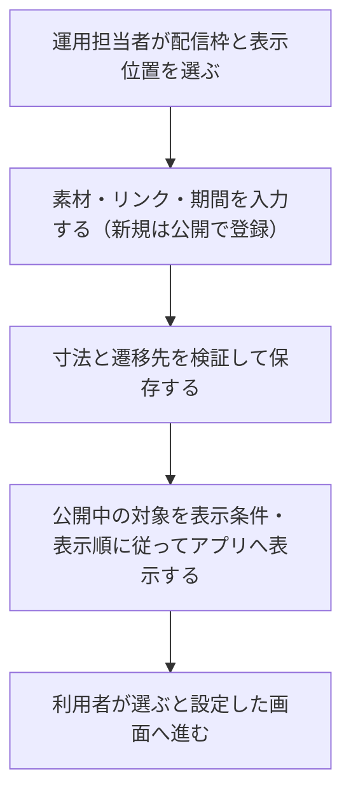

# F15｜バナー・テキスト広告・起動時POPUP・画面間広告 PRD（レビュー前）

> ④業務ルールと⑦以降はユーザーレビュー未完了。本日の変更箇所は本リポジトリのモックとユーザー指定を参照し、優先順位はスプレッドシートを正とする。本PRDはTier1のみを定義する。

参照するモック：本リポジトリの `mock-app/`・`mock-admin/`（2026-10-21の変更箇所を照合）。未接続の外部API・実端末機能は、接続済みとして扱わず末尾に記載する。

| 基本情報 | 内容 |
| --- | --- |
| 機能ID | F15 |
| 概要 | バナー・テキスト広告・起動時POPUP・画面間広告 |
| 対象領域 | アプリ／管理画面／外部連携 |
| 関連機能 | [F02](F02-home.md)、[F10](F10-surveys.md)、[F12](F12-points.md)、[F16](F16-campaign-pages.md) |
| 更新日 | 2026-10-21 |
| 版 | レビュー前（初版未確定） |

## ① 目的・今回作る範囲

目的：案件やキャンペーンへの案内を運用で届けられるようにするため

評価指標：表示数/クリック数・遷移数/成果数/表示頻度による離脱

優先順位は[アプリ詳細要件のTier列](https://docs.google.com/spreadsheets/d/1tI26I_4vbSHIOzMdJz7g8-DjeLyyVUKoksVHhZ0AQhU/edit#gid=1107057215)を正とする。モックに存在してもTier2・Tier3・空欄の要件は本PRDの定義対象に含めない。

| 要件ID | Tier1の範囲 |
| --- | --- |
| F15-1 | 運営が起動時POPUP/画面間・バナー・テキスト広告の内容と遷移先を入稿できる |
| F15-2 | 運営が掲載期間・公開停止を設定できる |
| F15-4 | テキスト広告をモックで指定した箇所に表示できる |
| F15-5 | 起動時POPUP・画面間広告を表示できる |
| F15-6 | 運営が広告の表示・クリック結果を確認できる |
| F15-8 | 広告素材のGIF等の形式を扱うことができる |

管理側は[管理画面詳細要件のTier列](https://docs.google.com/spreadsheets/d/1tI26I_4vbSHIOzMdJz7g8-DjeLyyVUKoksVHhZ0AQhU/edit#gid=1341040600)にある以下のTier1を関連範囲とする。NACS本体の内製要件にはしない。

| 要件ID | Tier1の運用範囲 |
| --- | --- |
| ADM-F02-1 | 運営担当者がホーム・カテゴリ別画面・お得内などの掲載枠を選んでバナー広告を登録できる |
| ADM-F02-2 | 運営担当者がお得画面の検索窓下にテキスト広告を登録できる |
| ADM-F02-3 | 運営担当者が掲載広告の遷移先をURLで設定できる |
| ADM-F02-4 | 運営担当者が広告の掲載開始・終了・公開停止を設定できる |
| ADM-F02-5 | 運営担当者が掲載枠に合う画像だけを入稿できる |
| ADM-F02-6 | 運営担当者が保存前の入稿をプレビューで確認して修正できる |
| ADM-F02-7 | 運営担当者が通常バナー枠へ複数画像を登録してカルーセル配信できる |
| ADM-F02-8 | 運営担当者が起動時POPUP・画面間広告の掲載枠と基本表示頻度を設定できる |
| ADM-F10-1 | 運営担当者が画面・掲載枠・広告ごとの表示数とクリック数を確認できる |

要件名に旧モックとの相違がある場合、優先順位は維持し、現在の表示・動きとユーザー指定を②以降へ反映する。実装方式の具体化は仕様設計で扱う。

## ② 画面イメージ

[アプリの該当画面](http://127.0.0.1:4204/mock-app/#home)

- ホーム・カテゴリ・アンケート・お得・起動時・お仕事のポイント獲得の区切りの広告を、登録した画像・リンク・期間・公開状態で表示する。画面間広告の2つの表示条件は④に従う。
- 通常画像バナーは1登録1画像。公開中の対象を表示し、0枚なら枠ごと隠す。管理側の複数画像登録はADM-F02-7のTier1として扱うが、アプリ側のカルーセル操作F15-3は本PRDの達成条件に含めない。
- ホームの複数枚バナーは、下のページ表示点（直径6px）の上下に同じ5pxの余白を設ける。点の下側の従来の余白に揃え、バナー画像に点が接近しないようにする。点のある場合の下部表示帯は16px。
- アンケートのバナーは「おすすめアンケート／回答できるアンケート」セクションの上。320×100素材を同じ比率で表示し、上下12pxの共通余白を使う。
- POPUP・画面間広告は300×250の単独表示。表示頻度・停止・ほかの操作との競合を制御する。
- ホームのデイリーミッション下（旧「動画を見て貯める」の位置）に、AppLovin／AdMobから配信する広告バナー枠を設ける。モックの試作サイズは300×300px・中央配置とし、現在は広告見本を表示する。SDK接続・実配信と、配信サービス側の対応サイズ確認は未実施。

- お得の「おすすめ」「高還元」「すぐできる」はそれぞれ上部PRバナーを表示する。おすすめの「もっと見る」から開く「新着」「ポイント高還元順」の独立一覧ではバナーを表示しない。
- お得の検索中は検索窓下のテキスト広告（告知ピル）を非表示にする。通常表示に戻ると再表示する。検索中も上部PRバナーは維持する。
- おすすめだけに企業リンク5枠を表示する。画像・遷移先の設定と表示寸法は[F03](F03-offer-list.md)を参照し、高還元・すぐできるには企業リンク欄と余白を出さない。

## ③ 操作フロー

## ④ 業務ルール・制約

> ユーザーレビュー未完了。アプリ上の表示に関わるルールを記載する。

### 表示する対象ユーザー

| 対象ユーザー | 利用・表示 |
| --- | --- |
| 会員 | 配信条件に合う広告を表示する |
| 非会員（ゲスト） | 配信条件に合う広告を表示する |

### 表示条件

| 状態・条件 | 表示のルール |
| --- | --- |
| 公開中・掲載期間内 | 設定された画面・位置へ対象の広告を表示する |
| 非公開・掲載期間外 | 表示しない |
| 画像・テキスト広告の設定 | 登録した画像・文言と遷移先に従う |
| リンク先URL | 外部のキャンペーンやWebページへも案内できるよう、アプリ内リンクに加え、任意のドメインのhttp／https URLを登録できる。画像バナー・テキスト広告・起動時POPUP・画面間広告に共通で適用する。タップすると登録されたリンク先へ進む。URLのパス・クエリ・フラグメントを保持する |
| 登録できないリンク | 不正なURL、スクリプト実行・ファイル参照などのURL、認証情報を含むURLは保存せず、修正を案内する。アプリ内の案件・特集リンクは存在を確認する |

### 画面に置く要素・操作

| 画面・要素 | 表示・操作のルール |
| --- | --- |
| 通常の画像バナー | 登録した画像とリンクを表示する |
| アンケート上部のバナー | 「おすすめアンケート／回答できるアンケート」セクションの上に320×100の比率で表示し、上下12pxの余白を設ける。セクション名はF10に従う |
| その他の画像バナー | デイリー中部320×50、通常上部・特集320×100、カテゴリ下部300×250、歩く下部300×300の素材を使う |
| テキスト広告 | 登録した文言を管理画面で指定した順に表示し、設定された遷移先へ進む。停止・期間外・対象外の広告は表示せず、残った広告の相対的な順番は維持する |
| 起動時POPUP・画面間広告 | 300×250の画像と遷移先・閉じる操作を表示する |
| 画面間広告の表示形式 | 起動時POPUPと同じ中央表示・サイズ・フォーマットに統一する。右上の「×」で閉じ、下部の「あとで見る」エリアと広告を囲む全画面枠は表示しない。表示タイミング・頻度は画面間広告の設定に従う |
| 画面間広告の表示タイミング | お仕事を終えた区切りで表示するため、①ポイント獲得が設定したn回に達するごと、②ポイント獲得後に実績レポートを確認し、左上の「戻る」を押したとき、のいずれかで1枚表示する。2条件は独立し、両方を満たす必要はない。通常のタブ移動では表示しない |
| 獲得回数の数え方 | ユーザーごとに、お仕事の報酬が準備中ポイントに入った時点で1回と数える。準備中から交換可能になっても同じ報酬を数え直さない。準備中を経ず即時付与するお仕事は最初の付与時に数える。未完了・受取前・0ポイント・運営付与・交換・失効は数えない。再起動・日付変更で回数をリセットしない |
| 実績レポートからの戻り | n回に達していなくても、新たなポイント獲得後に実績レポートを見て左上の「戻る」を押すと表示する。新たな獲得のない開き直しでは再表示しない。レポート内の絞り込み・交換先への移動・下部タブ・ブラウザーの戻るはこの条件に含めない |
| ほかの案内との重複 | 獲得完了・許可案内・ほかのダイアログが表示中なら、それらを閉じてから画面間広告を表示する。回答中・動画再生中・交換手続き中には割り込まない。配信候補がなければ、その広告表示はスキップして操作を続ける |
| 起動時POPUPの閉じ方 | 右上の「×」で閉じる。「あとで見る」ボタンと、そのボタンを配置する下部エリアは表示しない |
| 起動時POPUPの表示回数 | 短時間の再起動で繰り返し表示しないよう、ユーザーごとに「期間の数値＋単位（日・時間・分）＋回数」で上限を設定する。バナー別ではなく起動時POPUP全体で数え、各起動で1枚だけ表示する。表示した場合だけ回数を消費し、再読み込み・閉じる操作で回数を戻さない |
| 表示時間帯 | 日本時間の固定時間帯で判定する。「3時間に1回」は0〜3時、3〜6時、6〜9時…の各時間帯で最初の起動時に表示する。前回表示からの経過時間ではない。時間・分は毎日0時を起点とし、割り切れない最後の枠は24時まで。日は期間設定の開始日の0時を起点とする。未使用回数は繰り越さない |
| 頻度の変更・停止 | 頻度を保存すると次の起動から新しい上限で判定し、新しい時間帯に含まれる表示済み回数を引き継ぐ。停止はバナー一覧で行い、配信候補が0件なら表示しない |

## ⑤ 管理画面

新規作成・変更・削除は、現在の管理画面で操作できる範囲を示す。「外部管理」はNACS・EDOCODE等の担当範囲、「未実装」は操作画面がない項目。削除と公開停止は分けて記載する。

[実行設定の管理画面](http://127.0.0.1:4204/mock-admin/#banners)

配信枠一覧はアプリモックの掲載場所と名称に合わせ、画像18枠・テキスト1枠の計19枠とする。未登録・停止・期間外の枠はアプリで非表示となるが、管理画面には入稿先として残す。サイドタブ・キャンペーンページの画像は「その他の掲載設定」で管理する。

| 掲載場所 | 枠数 |
| --- | --- |
| ホーム：デイリーの上部・中部、チャレボの上部、ゲーム・買い物・カード・歩くの各上部・下部 | 11 |
| アンケート一覧の上部、レシートの上部 | 2 |
| お得：おすすめ・高還元・すぐできるの各上部 | 3 |
| 起動時POPUP、画面間広告 | 2 |
| お得・おすすめの検索窓下（テキスト広告） | 1 |

画像枠の保存前プレビューは各掲載画面の該当位置に表示する。画面間広告はプレビューでポイント獲得や実績レポートから戻る操作を待たずに表示する。プレビューは公開済み広告や掲載設定を変更しない。

テキスト広告の新規・編集フォームでも「プレビュー」から、入力中の文言を「お得・おすすめ」の検索窓下で確認できる。広告テキストと有効なリンク先を入力すると、保存前・停止中・掲載期間外でも確認できる。プレビューでは保存・公開・外部リンクへの遷移を行わず、表示を確認するだけとする。文言を変更して再度プレビューすると最新の入力を表示する。

| 対象項目 | 新規作成 | 変更 | 削除 | 管理画面での操作・反映範囲 |
| --- | --- | --- | --- | --- |
| 画像バナー・テキスト広告の登録 | 可能 | 可能 | 可能 | 配信枠と表示位置を選び、画像／文言・管理名・リンク・期間を入力して保存する。公開状態の入力可否は下記に従う。複製も可能。 |
| バナー表示順・公開停止／再開 | 不可 | 可能 | 不可 | 並び替えと公開状態を変更する。元のレコード削除は上の削除操作。 |
| テキスト広告の表示順 | 新規は末尾に追加 | 可能 | 不可 | 登録済み一覧のハンドルをドラッグして並び替える。上下矢印キーでも操作可能。変更を保存し、アプリの検索窓下にも同じ順番を反映する。編集・停止／再開・再読み込みで順番を維持し、複製は末尾に追加する |
| テキスト広告の入力項目 | 可能 | 可能 | — | 新規・編集フォームには管理名、掲載開始日・終了日、広告テキスト、リンク先を表示し、優先度・公開状態・対象者は表示しない。既存広告の配信設定は編集で変更しない。新規は公開・全員対象・優先度50の既存初期値を使用する。停止／再開は一覧で操作する |
| 新規広告の公開状態 | 自動設定 | 登録後に可能 | — | 新規の画像バナー・テキスト広告（起動時POPUP・画面間広告を含む）では公開状態の入力項目を表示しない。「公開」で登録し、掲載開始日から終了日まで配信対象とする。登録後の編集・停止／再開は引き続き可能。コピー時は従来どおり停止状態を初期値とする |
| 起動POPUP・画面間広告の配信設定 | 可能 | 可能 | 可能 | 該当枠の広告レコードを管理する。配信頻度は既存設定値の変更。 |
| 画面間広告の獲得回数 | 可能 | 可能 | — | 「ポイント獲得何回ごとに表示するか」を1以上の整数で設定する。変更前の獲得回数を保ち、次の獲得から新しい値で判定する。実績レポートから戻る条件はこの回数とは独立する。旧タブ切り替え回数・最短表示間隔・1起動中の表示上限は使用しない |
| 起動時POPUPの頻度入力 | 可能 | 可能 | — | 期間の数値・日／時間／分の選択・回数を入力する。「起動ごとに表示／1日1回／表示しない」の選択欄は設けない。期間・回数は正の整数とする |
| 起動時POPUPの表示順 | 新規は設定済みの順番の末尾へ追加 | 可能 | — | 登録済み一覧のハンドルをドラッグ、または上下矢印キーで並び替える。変更は自動保存し、配信条件を満たす上位1件を表示する。停止・期間外は飛ばす。表示順が未設定の間はランダムとし、編集・再読み込みで保存済みの順番を維持する |
| お得の上部PR枠 | 可能 | 可能 | 可能 | おすすめ・高還元・すぐできるを別々の配信位置として設定する。独立した「もっと見る」一覧には表示しない |

## ⑥ 例外処理・エラーハンドリング

| 状況 | 表示・処理・復帰 |
| --- | --- |
| 画像寸法違い・リンク不備 | 保存せず、入力を保持して修正を案内する。 |
| 配信0件・期間終了 | 対象の広告枠を非表示にする。 |
| 動画や本人確認中に広告が競合 | 重要な操作を妨げない。連続表示を制御する。 |

## ⑦ 達成条件・未決事項

> 本節以降はユーザーレビュー未完了。

### Tier1の達成条件

- [ ] お得3タブの上部PR枠を維持し、「もっと見る」遷移先は非表示、検索中は告知ピルだけを非表示にできる。

- [ ] F15-1：運営が起動時POPUP/画面間・バナー・テキスト広告の内容と遷移先を入稿できる。
- [ ] アプリ内リンク・外部Web URLの登録、再編集、配信表示、タップ時の遷移を確認できる。不正なURLは保存できない。
- [ ] 新規広告には公開状態の入力項目がなく、公開で登録される。掲載期間外は表示せず、登録後は編集・停止／再開できる。
- [ ] テキスト広告は新規・編集時とも優先度・公開状態・対象者の入力を求めず、編集後も既存の配信設定と一覧の停止／再開を維持する。
- [ ] テキスト広告の保存前の文言をお得・おすすめの検索窓下でプレビューできる。空欄・文字数超過・不正なリンクは修正を案内し、プレビューで保存済みの広告・公開状態を変更しない。
- [ ] テキスト広告を一覧から並び替えるとアプリの表示順も変わり、再読み込み後も保持される。非表示の広告を除いても相対順を維持し、新規・複製は末尾に追加する。
- [ ] 配信枠一覧の19枠がアプリの掲載場所と対応し、画像18枠すべてを該当位置でプレビューできる。
- [ ] F15-2：運営が掲載期間・公開停止を設定できる。
- [ ] F15-4：テキスト広告をモックで指定した箇所に表示できる。
- [ ] F15-5：起動時POPUP・画面間広告を表示できる。
- [ ] 画面間広告は獲得n回ごと、または獲得後の実績レポートの戻る操作で表示し、同じ報酬の確定時や通常のタブ移動では新たな表示条件を発生させない。
- [ ] 起動時POPUPは設定した固定時間帯・回数に従い、同じ時間帯の上限到達後は表示せず、次の時間帯で再び表示できる。
- [ ] F15-6：運営が広告の表示・クリック結果を確認できる。
- [ ] F15-8：広告素材のGIF等の形式を扱うことができる。
- [ ] ①の管理側Tier1に対応する操作について、⑤の新規作成・変更・削除可否と反映範囲を確認できる。
- [ ] ⑥の対象となる空・失敗・中断などの状態から、表示内容と次の操作を確認できる。

### まだ決まっていないこと

なし。認証・API接続などの具体的な方法は、別途仕様設計で定める。

## モックへの未反映・対象外

### モックへの未反映

| 項目 | 未反映の内容 |
| --- | --- |
| 素材・配信の連携 | 本番の画像保存・広告配信、表示数・クリック数の記録と照会は未接続 |
| 表示・クリック結果の照会 | モックの「確認→実績→運用枠」に集計欄はあるが、通常バナー・テキスト広告の表示記録との集計接続は未完了。F15-6の達成済みとは扱わない |

### 今回の対象外

| 項目 | 対象外の内容 |
| --- | --- |
| ASP案件本体の素材管理 | NACS側の担当範囲。自社の広告枠へ入稿するバナー素材と分ける |

## 変更履歴

| 版 | 日付 | 変更内容 |
| --- | --- | --- |
| レビュー前 | 2026-10-21 | 全体説明・操作フローもポイント獲得後の広告条件と新規公開設定へ整合。広告実績の未接続範囲を明記。PRDの構成・Tier・仕様状態は維持。 |
| レビュー前 | 2026-10-21 | 画面間広告を獲得n回ごと／獲得後の実績レポートから戻る、の独立した2条件へ変更。管理画面でnを設定し、準備中から確定への二重カウントを防止。 |
| レビュー前 | 2026-10-21 | 起動時POPUPの登録済みバナー一覧で表示順の変更に対応。設定後は配信可能な上位1件を表示する。 |
| レビュー前 | 2026-10-21 | 画面間広告を起動時POPUPと同じ300×250の中央表示へ統一。表示タイミングの設定は維持。 |
| レビュー前 | 2026-10-21 | 起動時POPUPの表示頻度を数値・日／時間／分・回数で設定する方式に変更。日本時間の固定時間帯で表示回数を判定。 |
| レビュー前 | 2026-10-21 | テキスト広告一覧にバナーと共通の並び替え操作を追加。保存した表示順をアプリ側でも使用し、既存広告の配信条件は維持。 |
| レビュー前 | 2026-10-21 | テキスト広告の新規・編集に保存前プレビューを追加。実際のお得画面の検索窓下で入力中の文言を確認可能にした。 |
| レビュー前 | 2026-10-21 | テキスト広告の新規・編集フォームから優先度・公開状態・対象者を非表示にした。既存設定と新規の初期値、一覧からの停止／再開は維持。 |
| レビュー前 | 2026-10-21 | アプリモックを正として配信枠19枠の名称を整合。レシート・歩く下部・おすすめ・画面間広告のプレビューを対応し、アンケートと歩く上部の説明を修正。登録済み広告の配信キー・掲載設定は維持。 |
| レビュー前 | 2026-10-21 | 新規広告の公開状態の入力項目を非表示にし、既存の初期値である公開で登録する。編集・停止／再開とコピー時の停止初期値は維持。 |
| レビュー前 | 2026-10-21 | 広告のリンク先に任意のドメインのhttp／https URLを追加。アプリ内リンクと外部Web URLを登録・再編集・配信できるようにした。 |
| レビュー前 | 2026-10-19 | お得3タブのPRバナーと独立一覧での非表示、検索中の告知ピル非表示、おすすめ限定の企業リンクについてF03と整合。 |
| レビュー前 | 2026-10-15 | F10レビューの共通フィードバックを反映。⑤を管理画面へ変更し、④を対象ユーザー・表示条件・配置要素に整理。例外処理と仕様設計事項の重複を除き、未反映と対象外を別表に分離。個別レビューは未完了。 |
| レビュー前 | 2026-10-20 | ホームバナー下のページ表示点の上側余白を下側と同じ5pxへ統一。点のあるバナーの下部表示帯を16pxとし、画像と点の近接を解消。 |
