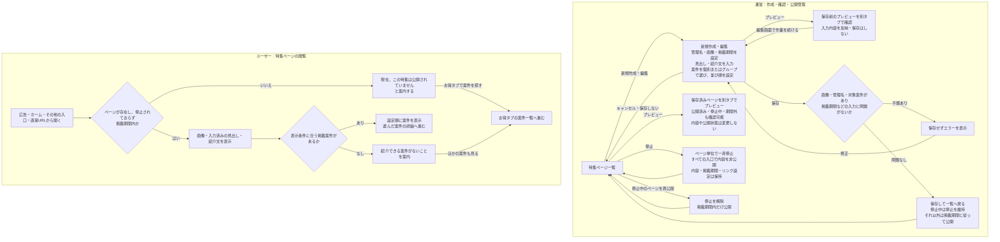

# F16｜特集ページ PRD（レビュー前）

> ユーザーレビュー未完了。本PRDはTier1のみを対象とする。

参照するモック：[アプリ](http://127.0.0.1:4211/mock-app/#feature/autumn-trip)／[管理画面](http://127.0.0.1:4211/mock-admin/#campaigns)

| 基本情報 | 内容 |
| --- | --- |
| 機能ID | F16 |
| 概要 | 対象のアフィリエイト案件をまとめて紹介する特集ページ |
| 対象領域 | アプリ／管理画面／外部連携 |
| 関連機能 | [F03](F03-offer-list.md)、[F04](F04-offer-entry.md)、[F15](F15-ad-placements.md) |
| 更新日 | 2026-10-30 |
| 版 | レビュー前（初版未確定） |

## ① 目的・今回作る範囲

目的：特集ページを通じてユーザーのアフィリエイト案件の利用を増やすとともに、営業が広告主への提案メニューとして活用し、案件単価の引き上げにつなげるため

今回の対象：初回リリースのTier1として、対象のアフィリエイト案件をまとめて紹介する特集ページの作成・編集・公開・停止・再公開を行う。掲載対象は、バンドル属性グループの指定と案件の個別選択で設定する。

優先順位は[アプリ詳細要件のTier列](https://docs.google.com/spreadsheets/d/1tI26I_4vbSHIOzMdJz7g8-DjeLyyVUKoksVHhZ0AQhU/edit#gid=1107057215)を正とする。モックに存在してもTier2・Tier3・空欄の要件は本PRDの定義対象に含めない。

| 要件ID | Tier1の範囲 |
| --- | --- |
| F16-1 | 運営が対象案件を選び、特集ページを作成・編集できる |
| F16-2 | 運営が特集ページの掲載期間を設定し、即時停止・再公開できる |

管理側は[管理画面詳細要件のTier列](https://docs.google.com/spreadsheets/d/1tI26I_4vbSHIOzMdJz7g8-DjeLyyVUKoksVHhZ0AQhU/edit#gid=1341040600)にある以下のTier1を関連範囲とする。NACS本体の内製要件にはしない。

| 要件ID | Tier1の運用範囲 |
| --- | --- |
| ADM-F03-1 | 運営担当者が案件を選択して特集ページを作成できる |
| ADM-F03-2 | 運営担当者が特集ページ上部の画像を入稿できる |
| ADM-F03-3 | 運営担当者がページの公開期間と掲載する案件を設定できる |
| ADM-F03-4 | 運営担当者が特集ページのリンクを広告へ設定できる |

## ② 画面イメージ

[アプリの該当画面](http://127.0.0.1:4211/mock-app/#feature/autumn-trip)

### 特集ページの構成・要素

| 要素 | 表示内容・条件 | 操作・遷移先 |
| --- | --- | --- |
| 戻るボタン | ページ上部に表示する | ホームへ戻る |
| ページ上部の画像 | 登録した画像を表示する | 閲覧する |
| ユーザー向け見出し | 入力されている場合、画像の下に表示する | 閲覧する |
| 紹介文 | 入力されている場合、見出しの下に表示する | 閲覧する |
| 掲載案件 | 公開・OS・利用者条件に合う対象案件を表示する | 押すとその案件の詳細へ進む。参加操作・報酬条件はF04で扱う |
| ほかの案件も見る | ページ下部に表示し、「お得タブでカテゴリから探す」と案内する | お得タブの案件一覧へ進む |

## ③ 操作フロー

プレビューは運営の内容確認用であり、ユーザー向けの公開判定には影響しない。掲載期間を設定していない場合は期間制限なしとして扱う。

## ④ 業務ルール・制約

> ユーザーレビュー未完了。

### 表示する対象ユーザー

| 対象ユーザー | 利用・表示 |
| --- | --- |
| 会員 | 公開中の特集ページと掲載案件を確認する |
| 非会員（ゲスト） | 公開中の特集ページと掲載案件を確認する |

### ページの公開・停止

| 状態・条件 | 表示のルール |
| --- | --- |
| 掲載期間内・公開中のページ | 設定されたページ内容を表示する |
| 即時停止 | ページ単位で一斉に非公開とする。広告枠・ホーム・その他の入口・直接URLのいずれから開いても内容を表示しない。ページ内容・掲載期間・対象案件・リンク設定は保持する |
| 再公開 | 停止を解除する。掲載期間内の場合のみ内容を表示し、期間外は表示しない |
| 掲載開始日前・終了日後のページ | ページ内容を表示しない。直アクセス時の案内と復帰先は⑥に記載する |
| 掲載期間の境界・未設定 | 開始日・終了日を含む。両日を空欄にした場合は期間制限なしとする |

### 掲載案件の条件・並び順

| 状態・条件 | 掲載・並び順のルール |
| --- | --- |
| 掲載されている案件 | 案件自身の公開・OS・利用者条件に合うものを表示する |
| 非公開・期間外の案件 | ページの案件一覧へ表示しない |
| 掲載件数 | 件数の入力欄や件数による上限は設けない。掲載対象として選択した案件のうち、公開・OS・利用者条件に合う案件をすべて表示する |
| 案件ごとの掲載・非掲載 | 個別に選択・解除できる。グループ内の案件でも非掲載にした案件は表示しない。案件自体の配信状態は変更しない |
| 選択したグループの案件追加・削除 | ページの再保存なしで掲載対象へ自動反映する。追加された案件も公開・OS・利用者条件に合う場合だけ表示する |
| 掲載案件の並び | 運営がページ作成・編集時に配置順を設定・変更できる。保存した並び順をページへ反映する。グループ変更による自動更新では設定済みの並びを維持し、新たに追加された案件は末尾に追加する |

### 編集・保存時の反映ルール

| 操作・状態 | 反映のルール |
| --- | --- |
| 特集ページの編集・保存 | 編集した項目だけを更新し、変更していない画像・リンク・対象案件・並び順などの設定を保持する |
| 停止していないページの保存 | 指定した掲載開始日から公開し、掲載終了日の翌日に公開を終了する。将来の掲載開始日を設定したページは保存後も開始日まで非公開とする |
| 掲載期間の変更 | 保存後も開始日・終了日を変更できる。公開状態は変更後の掲載期間と停止状態に従う |
| 停止中の編集・保存 | 内容や掲載期間を編集・保存しても、停止を解除するまで非公開を維持する |

## ⑤ 管理画面

[実行設定の管理画面](http://127.0.0.1:4211/mock-admin/#campaigns)

### 画面構成

| 画面名 | 何ができる画面か | 操作後の結果 |
| --- | --- | --- |
| 一覧画面 | 管理名・掲載期間・公開／停止状態・選択案件・使用している広告枠を確認する | 新規作成・編集へ進み、プレビュー・停止・再公開を操作する。削除時は参照中の広告枠があれば案内して処理を止める |
| 新規作成画面 | 管理名・期間・画像を設定し、掲載案件を個別指定またはグループで選び、プレビューする | 保存成功で一覧へ戻る。入力エラーなら修正する |
| 編集画面 | 登録済みページの設定を変更し、プレビューする | 保存成功で一覧へ戻る。キャンセルで保存せず一覧へ戻る |

### 新規作成・編集の入力項目

| 項目 | 入稿・設定する内容 | 入力・操作の結果 |
| --- | --- | --- |
| 管理名 | 運営がページを識別する名前。必須 | 管理画面の一覧へ反映する |
| ユーザー向け見出し | ユーザーに表示する見出し。管理名とは別に入力する | 入力した場合、ページ上部へ表示する。空欄の場合は表示しない |
| 紹介文 | ページの内容を説明する文章 | 入力した場合、見出しの下へ表示する。空欄の場合は表示しない |
| 掲載開始日 | 公開を開始する日 | 日付の前後関係を検証して保存する |
| 掲載終了日 | 公開を終了する日 | 開始日より前の日は保存しない |
| ページ上部の画像 | ページに表示する画像。必須 | 画像なしでは保存できない。登録・差し替えた画像をページ上部へ反映する |
| バンドル属性グループ | グループ名で検索し、対象を複数選択する | グループ内の案件を掲載対象とし、その後の案件追加・削除もページの再保存なしで自動反映する。同じ案件は重複表示しない |
| 掲載案件の個別指定 | 掲載する案件を1件ずつ選択・解除する。複数選択でき、グループ内の案件も個別に非掲載にできる | 選択した案件をページの掲載対象として保存する。1案件限定の制約や件数入力欄は設けない。件数は選択結果から確認する |
| 掲載案件の並び順 | 掲載対象の案件を並べ替える | 保存すると設定した順にページへ表示する。作成後も編集画面で変更できる |
| プレビュー | 一覧では保存済みのページを、作成・編集画面では保存前の内容を別タブで確認する | 公開済みのページも確認できる。画像・見出し・紹介文・掲載案件・並び順を反映し、保存済みの内容や公開状態は変更しない。運営の内容確認用として、期間外・停止中でもプレビューできる |
| 保存 | 入力内容を検証して登録・更新する | 対象案件がない場合などは保存せず、エラーを表示する |
| キャンセル | 入力内容を保存しない | 一覧画面へ戻る |

### 作成・変更・削除の範囲

| 対象項目 | 新規作成 | 変更 | 削除 | 管理画面での操作・反映範囲 |
| --- | --- | --- | --- | --- |
| 特集ページ | 可能 | 可能 | 条件付き可能 | 特集ページの管理画面で作成・編集。参照している広告枠がある場合は削除を拒否し、参照を外してから削除する。 |
| 特集ページの即時停止・再公開 | 対象外 | 可能 | 対象外 | 一覧からページ単位で停止・再公開する。停止中の編集・保存では停止状態を維持する。 |
| 管理名・対象グループ | 作成時に設定 | 可能 | ページ削除で対応 | 上記の個別項目を設定する。NACSの案件・グループ自体の編集はこの画面で行わない。 |
| 掲載案件の個別指定 | 可能 | 可能 | 選択解除で非掲載 | 案件を1件ずつ追加・解除する。グループ内の案件も非掲載にできる。案件自体は削除しない。 |
| 掲載案件の並び順 | 可能 | 可能 | ページ削除で対応 | 作成・編集画面の↑↓で並び替え、保存後の表示へ反映する。 |
| ページ上部の画像 | 登録可能 | 可能 | 専用UIなし | ページ編集の画像欄から登録・差し替えを行う。 |

## ⑥ 例外処理・エラーハンドリング

| 状況 | 表示・処理・復帰 |
| --- | --- |
| 掲載案件がすべて対象外 | 「現在、紹介できる案件はありません」と表示する。「ほかの案件も見る」からお得タブの案件一覧へ進める。非公開の案件を補充しない。 |
| ページが存在しない・掲載期間外・停止中 | 「現在、この特集は公開されていません」と案内する。ページ内容は表示せず、「お得タブで案件を探す」からお得タブの案件一覧へ進める |
| 参照中ページを削除しようとする | 参照している広告枠を案内し、削除せず維持する。運営はリンク先を変更して再操作する |
| 必須入力不足・不正な掲載期間 | 保存せず、入力エラーを表示する。運営は該当項目を修正して再保存する |

## ⑦ 達成条件・未決事項

> 本節以降はユーザーレビュー未完了。

### Tier1の達成条件

- [ ] F16-1：運営が複数の対象案件を選び、特集ページを作成・編集・保存できる。1案件限定の制約は設けない。
- [ ] 画像がない場合は保存できず、入力エラーを表示する。
- [ ] 管理名と別に見出し・紹介文を入力・編集でき、保存後のページと保存前のプレビューへ反映される。
- [ ] 一覧から公開済みページをプレビューできる。停止中・期間外の内容確認もでき、プレビューで公開状態は変更されない。
- [ ] 運営が掲載案件を個別に選択・解除でき、保存後の掲載対象に反映される。
- [ ] 件数を入力せずに保存でき、個別に非掲載とした案件を除き、掲載可能な選択案件が件数上限で切り捨てられず表示される。プレビューにも同じ選択結果・並び順が反映される。
- [ ] 選択したグループに案件を追加・削除すると、ページを再保存せずに掲載対象が更新される。
- [ ] グループへの案件追加時に既存案件の並びが変わらず、新しい案件が末尾に追加される。
- [ ] 運営が既存ページの案件を並べ替えて保存すると、変更した順で表示され、その後のグループ自動更新でも維持される。
- [ ] 既存の特集ページの一部を編集して保存しても、変更していない画像・リンク・対象案件・並び順などの設定が保持される。
- [ ] F16-2：運営が保存したページの掲載開始日・終了日を設定・変更でき、開始日前は非公開、期間中は公開、終了日後は非公開になる。
- [ ] 一覧から即時停止すると掲載期間内でも内容を表示せず、広告枠・ホーム・その他の入口・直接URLのいずれから開いても非公開案内となる。ページの設定は保持し、編集・保存だけでは再公開しない。
- [ ] 再公開すると掲載期間内だけ内容を表示し、期間外は非公開を維持する。
- [ ] 一覧・新規作成・編集の役割、各入力項目と保存・キャンセルの結果を確認できる。
- [ ] ①の管理側Tier1に対応する操作について、⑤の新規作成・変更・削除可否と反映範囲を確認できる。
- [ ] ⑥の対象となる空・失敗・中断などの状態から、表示内容と次の操作を確認できる。
- [ ] 「ほかの案件も見る」付近と非公開時の誘導文言が「お得タブ」と一致し、お得タブの案件一覧へ進める。

### 相互レビュー用の確認メモ（未合意）

| ID・場所 | 疑問・困ること | 期待する動き（相談案） |
| --- | --- | --- |
| R6｜⑤・⑥／困ったときの対応 | 削除を止める参照元は広告枠だけでよいか。ホーム上部など、ほかの入口も対象に含めるか。 | 対象とする参照元の範囲を決め、参照元名とリンクを変更すべき場所を案内する。 |

## モックへの未反映・対象外

### モックへの未反映

| 項目 | 未反映の内容 |
| --- | --- |
| ページ公開・素材の連携 | 本番の画像保存、ページの保存・公開とアプリ側の表示同期は未接続 |
| 既存データの扱い | 既存の単一案件LPデータを同じ編集画面で開くと1件制限が適用される。複数案件を扱う特集ページとの区別が画面上で不十分 |

### 今回の対象外

| 項目 | 対象外の内容 |
| --- | --- |
| 下書き保存 | 下書き専用の保存状態は設けない。保存・掲載期間・停止／再公開で公開を管理する |

## 変更履歴

| 版 | 日付 | 変更内容 |
| --- | --- | --- |
| レビュー前 | 2026-10-30 | PR #37のPRDに対応するローカルモック修正を最新mainへ統合。個別選択・除外・並び替え・グループ更新、見出し・紹介文、画像必須、保存前／保存済みプレビュー、全入口共通の停止・再公開を反映。後からグループへ追加された案件が末尾になるよう保存順を修正。F02・F14・F17の管理機能は維持。既存単一案件LPの制約と本番連携の未実装は維持。 |
| レビュー前 | 2026-10-23 | 評価指標の記載を削除。お得タブへの誘導と非公開時の案内を具体化し、④を公開・停止／掲載案件／編集・保存の3表に整理。 |
| レビュー前 | 2026-10-23 | 操作フローを運営・ユーザー別に整理。見出し・紹介文、保存前／保存済みのプレビュー、画像必須の検証、停止中の保存・再公開を反映。 |
| レビュー前 | 2026-10-23 | 公開済みページのプレビュー、上部画像の必須化、見出し・紹介文の入力、全入口に適用するページ単位の停止・再公開を定義。 |
| レビュー前 | 2026-10-23 | [10月21日の議事録・文字起こし](https://docs.google.com/document/d/1Vn2q9FJK4KNdXafbfsALaEEX8Q8v4mmFmXdQNyclPdo/edit?tab=t.uvfnty2ypckr)（01:33〜01:36、01:41〜01:44、02:25）に基づき、特集ページの名称・アフィリエイト案件の掲載範囲・グループ指定を整理。画像の必須条件は未合意として分離。 |
| レビュー前 | 2026-10-23 | 初回リリースのTier1を特集ページに限定。複数案件の選択・保存と即時停止・再公開の業務ルール・達成条件を定義。 |
| レビュー前 | 2026-10-23 | LPプレビューで管理画面のデータ受信後に描画が失敗する不具合を修正。プレビュー用の初期化を保存データから分離する。 |
| レビュー前 | 2026-10-23 | 対象外を下書き保存に限定。即時停止・再公開の要否は独立した確認事項とする。 |
| レビュー前 | 2026-10-23 | 件数入力を設けず掲載案件の選択で対象を管理する。個別の掲載・非掲載、並び替え、グループ変更の自動反映を管理画面と表示処理へ反映。 |
| レビュー前 | 2026-10-23 | 目的・ページの種類、画面要素、管理画面の入力・操作、公開条件・例外時の動作を整理。対象範囲・運用条件の未決事項を記載。 |
| レビュー前 | 2026-10-15 | F10レビューの共通フィードバックを反映。⑤を管理画面へ変更し、④を対象ユーザー・表示条件・配置要素に整理。例外処理と仕様設計事項の重複を除き、未反映と対象外を別表に分離。個別レビューは未完了。 |
