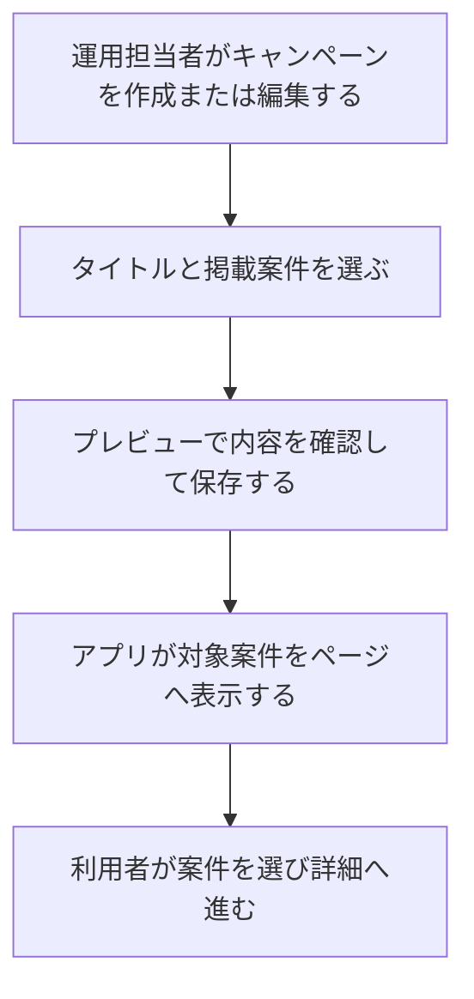

# F16｜キャンペーンページ PRD（レビュー前）

> ④業務ルールと⑦以降はユーザーレビュー未完了。機能・画面・操作は現在の4189モックを正とし、優先順位はスプレッドシートを正とする。本PRDはTier1のみを定義する。

参照するモック：`Tameruko-Preview-20261013` の4189（2026-10-15確認）。未接続の外部API・実端末機能は、接続済みとして扱わず末尾に記載する。

| 基本情報 | 内容 |
| --- | --- |
| 機能ID | F16 |
| 概要 | キャンペーンページ |
| 対象領域 | アプリ／管理画面／外部連携 |
| 関連機能 | [F03](F03-offer-list.md)、[F04](F04-offer-entry.md)、[F15](F15-ad-placements.md) |
| 更新日 | 2026-10-15 |
| 版 | レビュー前（初版未確定） |

## ① 目的・今回作る範囲

目的：案件の魅力をページや記事で伝え、利用につなげるため

評価指標：ページ閲覧数/CTAクリック数/成果数

優先順位は[アプリ詳細要件のTier列](https://docs.google.com/spreadsheets/d/1tI26I_4vbSHIOzMdJz7g8-DjeLyyVUKoksVHhZ0AQhU/edit#gid=1107057215)を正とする。モックに存在してもTier2・Tier3・空欄の要件は本PRDの定義対象に含めない。

| 要件ID | Tier1の範囲 |
| --- | --- |
| F16-1 | 運営が対象案件を選んでキャンペーンページを作成できる |
| F16-2 | 運営がキャンペーンページを公開・終了できる |

管理側は[管理画面詳細要件のTier列](https://docs.google.com/spreadsheets/d/1tI26I_4vbSHIOzMdJz7g8-DjeLyyVUKoksVHhZ0AQhU/edit#gid=1341040600)にある以下のTier1を関連範囲とする。NACS本体の内製要件にはしない。

| 要件ID | Tier1の運用範囲 |
| --- | --- |
| ADM-F03-1 | 運営担当者が案件を選択してキャンペーンページを作成できる |
| ADM-F03-2 | 運営担当者がキャンペーンページ上部の画像を入稿できる |
| ADM-F03-3 | 運営担当者がキャンペーンの公開期間と掲載件数を設定できる |
| ADM-F03-4 | 運営担当者がキャンペーンページのリンクを広告へ設定できる |

要件名に旧モックとの相違がある場合、優先順位は維持し、現在の表示・動きとユーザー指定を②以降へ反映する。実装方式の具体化は仕様設計で扱う。

## ② 画面イメージ

[アプリの該当画面](http://127.0.0.1:4189/mock-app/#feature/autumn-trip)

- キャンペーンページで対象の案件をまとめて表示し、案件詳細へ進める。
- 管理画面で管理名・掲載開始日・終了日・画像・掲載案件を設定する。案件名・ジャンル・選択済みの条件で対象を絞り込む。

## ③ 操作フロー

## ④ 業務ルール・制約

> ユーザーレビュー未完了。アプリ上の表示に関わるルールを記載する。

### 表示する対象ユーザー

| 対象ユーザー | 利用・表示 |
| --- | --- |
| 会員 | 公開中のキャンペーンページと掲載案件を確認する |
| 非会員（ゲスト） | 公開中のキャンペーンページと掲載案件を確認する |

### 表示条件

| 状態・条件 | 表示のルール |
| --- | --- |
| 掲載期間内・公開中のページ | 設定されたページ内容を表示する |
| 掲載されている案件 | 案件自身の公開・OS・利用者条件に合うものを表示する |
| 非公開・期間外の案件 | ページの案件一覧へ表示しない |

### 画面に置く要素・操作

| 画面・要素 | 表示・操作のルール |
| --- | --- |
| ページ上部の画像 | 管理画面で登録した画像を表示する |
| 掲載案件の一覧 | 対象案件をまとめて表示する |
| 案件の選択 | 押すと該当案件の詳細へ進む |

## ⑤ 管理画面

新規作成・変更・削除は、現在の管理画面で操作できる範囲を示す。「外部管理」はNACS・EDOCODE等の担当範囲、「未実装」は操作画面がない項目。削除と公開停止は分けて記載する。

[実行設定の管理画面](http://127.0.0.1:4189/mock-admin/legacy.html#campaigns)

| 対象項目 | 新規作成 | 変更 | 削除 | 管理画面での操作・反映範囲 |
| --- | --- | --- | --- | --- |
| 案件一覧型のキャンペーンページ | 可能 | 可能 | 条件付き可能 | キャンペーンページで作成・編集。参照しているバナー等がある場合は削除を拒否し、参照を外してから削除する。 |
| タイトル・掲載案件／案件タグ | 作成時に設定 | 可能 | ページ削除で対応 | 対象案件やタグを選ぶ。NACSの案件そのものは変更しない。 |
| ページ上部のバナー画像 | 作成時に登録可能 | 可能 | 専用UIなし | ページ編集の画像欄、およびバナー管理のキャンペーン画像編集から登録・差し替えを行う。 |

## ⑥ 例外処理・エラーハンドリング

| 状況 | 表示・処理・復帰 |
| --- | --- |
| 掲載案件がすべて対象外 | 空の案内を表示する。非公開の案件を補充しない。 |
| 参照中ページの削除・無効なリンク | 削除・保存を止め、参照元と修正方法を案内する。 |

## ⑦ 達成条件・未決事項

> 本節以降はユーザーレビュー未完了。

### Tier1の達成条件

- [ ] F16-1：運営が対象案件を選んでキャンペーンページを作成できる。
- [ ] F16-2：運営がキャンペーンページを公開・終了できる。
- [ ] ①の管理側Tier1に対応する操作について、⑤の新規作成・変更・削除可否と反映範囲を確認できる。
- [ ] ⑥の対象となる空・失敗・中断などの状態から、表示内容と次の操作を確認できる。

### まだ決まっていないこと

なし。認証・API接続などの具体的な方法は、別途仕様設計で定める。

## モックへの未反映・対象外

### モックへの未反映

| 項目 | 未反映の内容 |
| --- | --- |
| ページ公開・素材の連携 | 本番の画像保存、ページの保存・公開とアプリ側の表示同期は未接続 |

### 今回の対象外

| 項目 | 対象外の内容 |
| --- | --- |
| なし | — |

## 変更履歴

| 版 | 日付 | 変更内容 |
| --- | --- | --- |
| レビュー前 | 2026-10-15 | F10レビューの共通フィードバックを反映。⑤を管理画面へ変更し、④を対象ユーザー・表示条件・配置要素に整理。例外処理と仕様設計事項の重複を除き、未反映と対象外を別表に分離。個別レビューは未完了。 |
