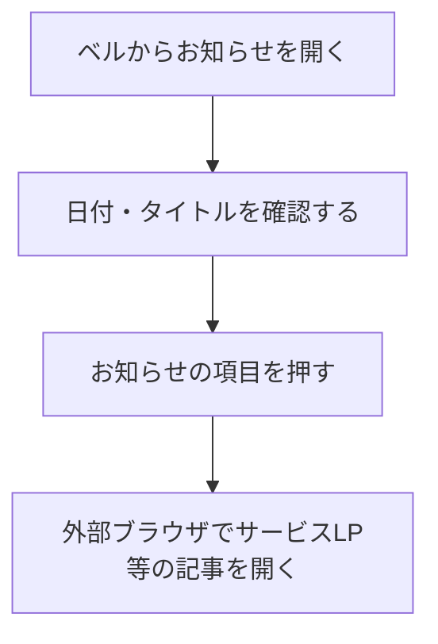

# F17｜プッシュ通知・アプリ内のお知らせ PRD（レビュー前）

> ④業務ルールと⑦以降はユーザーレビュー未完了。お知らせの表示・遷移は2026-10-26のユーザー指定を反映。優先順位はスプレッドシートを正とし、本PRDはTier1のみを定義する。

参照するモック：本リポジトリのローカル4180（2026-10-26のお知らせ変更を反映）。実ブラウザでの表示・操作確認は未実施。未接続の外部API・実端末機能は、接続済みとして扱わず末尾に記載する。

| 基本情報 | 内容 |
| --- | --- |
| 機能ID | F17 |
| 概要 | プッシュ通知・アプリ内のお知らせ |
| 対象領域 | アプリ／管理画面／外部連携 |
| 関連機能 | [F15](F15-ad-placements.md)、[F16](F16-campaign-pages.md)、[F18](F18-mypage-support.md) |
| 更新日 | 2026-10-26 |
| 版 | レビュー前（初版未確定） |

## ① 目的・今回作る範囲

目的：サービスからの大切な案内を届け、お知らせの記事を確認できるようにするため

評価指標：通知の送信要求数・受付数/観測可能な到達数/通知タップ数/お知らせ記事への遷移数・遷移後の利用

優先順位は[アプリ詳細要件のTier列](https://docs.google.com/spreadsheets/d/1tI26I_4vbSHIOzMdJz7g8-DjeLyyVUKoksVHhZ0AQhU/edit#gid=1107057215)を正とする。モックに存在してもTier2・Tier3・空欄の要件は本PRDの定義対象に含めない。

| 要件ID | Tier1の範囲 |
| --- | --- |
| F17-1 | お知らせ機能で運営からユーザーに共有したい情報を確認できる |
| F17-3 | お知らせのタイトルから指定した外部記事URLへ移動できる |
| F17-4 | 運営がプッシュ通知を設定できる（管理画面） |
| F17-7 | ユーザーが通知を許諾・停止し、通知を許諾した場合はプッシュ通知の内容を受信できる |

管理側は[管理画面詳細要件のTier列](https://docs.google.com/spreadsheets/d/1tI26I_4vbSHIOzMdJz7g8-DjeLyyVUKoksVHhZ0AQhU/edit#gid=1341040600)にある以下のTier1を関連範囲とする。NACS本体の内製要件にはしない。

| 要件ID | Tier1の運用範囲 |
| --- | --- |
| ADM-F09-1 | 運営担当者がアプリのお知らせに日付・タイトル・公開状態・外部記事URLを設定できる（記事本文はサービスLP等で管理する） |
| ADM-F09-2 | 運営担当者がプッシュ通知の内容と遷移先を設定して手動配信できる |
| ADM-F09-3 | 配信システムが許諾・配信上限・停止時間帯を守って送信できる |

要件名に旧モックとの相違がある場合、優先順位は維持し、現在の表示・動きとユーザー指定を②以降へ反映する。実装方式の具体化は仕様設計で扱う。

## ② 画面イメージ

| 画面 | 入口／参照 | 表示・遷移 |
| --- | --- | --- |
| お知らせ一覧（標準） | ベル → [お知らせ](http://127.0.0.1:4180/mock-app/#notifications) | サービスからのお知らせを日付・タイトル・右向きシェブロンで表示。項目全体を押すと外部記事を開く |
| 長文の全文表示 | [全文表示モック](http://127.0.0.1:4180/mock-app/?noticePreview=full#notifications) | 標準と同じく、文字数・行数を制限せず全文を折り返す |
| 長文の2行表示（比較用） | [2行表示モック](http://127.0.0.1:4180/mock-app/?noticePreview=two-lines#notifications) | 全文表示版と同じ長いタイトルを最大2行で表示し、超過分は末尾を「…」で省略する |

2行版は表示比較用として用意する。標準仕様は全文表示とし、比較用表示でタイトルの保存内容・文字数上限・記事URLを変更しない。

- ベルからお知らせ一覧を開く。サービスからのお知らせだけを単一の一覧に日付順で表示する。AF案件・広告・キャンペーン枠の紹介は掲載せず、配信済みプッシュからの自動掲載も行わない。
- 一覧の情報は日付とタイトルのみとし、右端にデザインコンポーネント共通の右向きシェブロンを表示する。項目全体を外部記事へのリンクとし、タブ切り替え・「キャンペーン・運営からのお知らせ」の案内文・分類タグ・本文の抜粋・報酬・掲載期間を表示しない。
- タイトルはアンケート一覧と同じく、アプリ独自の文字数上限を設けない。標準表示は行数上限・末尾省略を設けず、長い場合も自然に折り返して全文を表示する。
- お知らせ一覧を開いている間は、通知マークを押す直前に開いていた下部タブの選択状態を保持する。ホームへ切り替えない。
- タイトルを押すと、設定された記事URLを外部ブラウザで開く。記事本文はサービスLP等で管理し、アプリ内の詳細ページは設けない。Webモックでは別タブで開き、記事URLにはサンプルの `https://example.com/notices/...` を使用する。
- 通知許諾・停止・有効な宛先・配信済み状態を確認し、同じ通知を重複送信しない。

- ホーム上部の新着・受取可能状態を示す赤ポチは、ベルのお知らせ・プッシュ通知とは別に管理する。歩く／更新型カテゴリ／アンケートごとの表示・消灯条件は[F02](F02-home.md#ホーム上部の赤ポチ)を正とする。

## ③ 操作フロー

## ④ 業務ルール・制約

> ユーザーレビュー未完了。アプリ上の表示に関わるルールを記載する。

### 表示する対象ユーザー

| 対象ユーザー | 利用・表示 |
| --- | --- |
| 会員 | アプリ内のお知らせを確認する |
| 非会員（ゲスト） | アプリ内のお知らせを確認する |

### 表示条件

| 状態・条件 | 表示のルール |
| --- | --- |
| 運営のお知らせ | 公開対象の情報を日付順に表示する |
| AF案件・広告・キャンペーン枠の紹介 | お知らせ一覧に掲載しない |
| 配信済みプッシュ | 配信済みであることを理由にお知らせ一覧へ自動掲載しない |
| 外部記事URLが未設定・不正 | 一覧に掲載しない。記事URLの設定後に表示対象とする |
| プッシュ通知を許諾済み | 配信対象の通知を受信できる |

### 画面に置く要素・操作

| 画面・要素 | 表示・操作のルール |
| --- | --- |
| ベル・お知らせ一覧 | サービスからのお知らせの日付とタイトルのみを表示し、右端に共通の右向きシェブロン（15×15px・線幅1.5px）を置く。項目全体を押すと外部記事を開く。タブ・案内文・分類タグ・本文の抜粋は設けない。 |
| 下部タブの選択状態 | お知らせへの遷移元の下部タブを選択中として維持する。外部記事を開いた後もアプリ内のお知らせ一覧と選択状態を維持し、再読み込みでも維持する。遷移元がない直接アクセスではホームを選択する。別の下部タブを押した場合は、そのタブへ移動して選択状態を更新する。 |
| お知らせタイトル | アンケート一覧と同じくアプリ独自の文字数上限を設けず、行数制限・末尾省略なしで折り返して全文表示する。右側の矢印に重ねず、長さに応じて項目の高さを広げる。 |
| お知らせ項目全体 | 日付・タイトル・右側の矢印を含む行全体を押すと、設定した記事URLを外部ブラウザで開く。Webモックでは別タブで開く。記事本文はサービスLP等で管理する。 |
| 通知設定 | 通知を許諾・停止する操作へ進む |

## ⑤ 管理画面

新規作成・変更・削除は、現在の管理画面で操作できる範囲を示す。「外部管理」はNACS・EDOCODE等の担当範囲、「未実装」は操作画面がない項目。削除と公開停止は分けて記載する。

| 対象項目 | 新規作成 | 変更 | 削除 | 管理画面での操作・反映範囲 |
| --- | --- | --- | --- | --- |
| 配信メッセージ（構想画面） | 可能 | 停止のみ可能 | 不可 | 複数アプリ管理のメッセージ配信で作成・停止。保存は構想用で、実送信・アプリ一覧への自動接続は未実装。 |
| お知らせの日付・タイトル・公開状態・外部記事URL | 未実装 | 未実装 | 未実装 | サンプルのお知らせを表示。専用の入稿UIはない。AF案件・広告枠からは自動掲載しない。 |
| お知らせ記事の本文 | 外部管理 | 外部管理 | 外部管理 | サービスLP等で管理する。アプリ内に本文の入稿・詳細表示は設けない。 |

## ⑥ 例外処理・エラーハンドリング

| 状況 | 表示・処理・復帰 |
| --- | --- |
| お知らせがない | 新しいお知らせがない案内を表示する。 |
| 許諾取消・退会・配信停止・宛先不備 | 新規送信の対象から外し、実行済みと混同しない。 |

## ⑦ 達成条件・未決事項

> 本節以降はユーザーレビュー未完了。

### Tier1の達成条件

- [ ] お知らせページにはサービスからの案内だけが日付順で表示され、AF案件・広告枠の紹介は掲載されない。配信済みプッシュも自動掲載されない。
- [ ] 各項目の情報は日付とタイトルのみで、右端にデザインコンポーネント共通の右向きシェブロンが表示される。矢印を含む項目全体で外部記事を開ける。タブ・案内文・分類タグ・本文の抜粋・報酬・掲載期間が表示されない。
- [ ] タイトルはアンケートと同じくアプリ独自の文字数上限なしとし、標準表示では行数を制限せず長文も全文表示される。狭い画面でも右側の矢印に文字が重ならない。
- [ ] 比較用URLでは、全文表示版と同じタイトル・外部記事URLを使い、表示だけを最大2行・末尾「…」に切り替える。標準表示・保存データに影響しない。
- [ ] タイトルを押すと外部ブラウザ（Webモックでは別タブ）で設定した記事URLが開く。アプリ内の詳細ページは設けず、記事本文はサービスLP等で管理する。
- [ ] 外部記事URLが未設定・不正なお知らせは一覧に掲載されない。

- [ ] 通知マークのある各画面からお知らせを開いても、元の下部タブの選択が維持される。簡単・遊ぶ・マイページ等から開いた場合にホームへ切り替わらない。外部記事を開いた後と再読み込みでも維持され、別の下部タブを押すと選択が切り替わる。

- [ ] ホームの赤ポチをベル・プッシュ通知の既読と混同せず、F02のタブ別条件に従って表示する。

- [ ] F17-1：お知らせ機能で運営からユーザーに共有したい情報を確認できる。
- [ ] F17-3：お知らせのタイトルから指定した外部記事URLへ移動できる。
- [ ] F17-4：運営がプッシュ通知を設定できる（管理画面）。
- [ ] F17-7：ユーザーが通知を許諾・停止し、通知を許諾した場合はプッシュ通知の内容を受信できる。
- [ ] ①の管理側Tier1に対応する操作について、⑤の新規作成・変更・削除可否と反映範囲を確認できる。
- [ ] ⑥の対象となる空・失敗・中断などの状態から、表示内容と次の操作を確認できる。

### まだ決まっていないこと

なし。認証・API接続などの具体的な方法は、別途仕様設計で定める。

## モックへの未反映・対象外

### モックへの未反映

| 項目 | 未反映の内容 |
| --- | --- |
| プッシュ実配信 | 実端末への送信・許諾との連携は未接続 |
| 運営お知らせの入稿 | 日付・タイトル・公開状態・外部記事URLを設定する専用の編集画面は未実装 |
| 記事URL | モックではサンプルURLを使用。サービスLP等で管理する実際の記事URLへの差し替えは未実施 |
| 配信設定とアプリ一覧 | 構想用の配信メッセージ保存と本番配信・アプリ一覧の自動接続は未実装 |

### 今回の対象外

| 項目 | 対象外の内容 |
| --- | --- |
| なし | — |

## 変更履歴

| 版 | 日付 | 変更内容 |
| --- | --- | --- |
| レビュー前 | 2026-10-26 | モックレビューを反映。タブを廃止し、サービスからのお知らせだけを日付・タイトルで表示。AF案件・広告枠・配信済みプッシュの自動掲載、案内文・タグ・本文抜粋を削除。タイトルから外部記事へ遷移し、本文はサービスLP等で管理する仕様・達成条件を追加してモックに反映。記事URLはユーザー了承のサンプルURL。項目右端に共通シェブロンを配置し、行全体をリンクにした。タイトルはアンケートと同じ文字数上限なし・行数制限なしの全文表示とし、同一タイトルの最大2行省略版を比較用URLとして追加。本文・画面ルール・達成条件・管理項目を今回のユーザー指定に統一。 |
| レビュー前 | 2026-10-20 | お知らせ一覧・詳細表示中の下部タブは遷移元の選択状態を保持する仕様を追加。再読み込み・直接アクセス・別タブ選択時の挙動と達成条件を明記。 |
| レビュー前 | 2026-10-19 | ホーム上部の赤ポチ条件をF02へ集約し、ベル・プッシュ通知との独立性を明記。 |
| レビュー前 | 2026-10-15 | F10レビューの共通フィードバックを反映。⑤を管理画面へ変更し、④を対象ユーザー・表示条件・配置要素に整理。例外処理と仕様設計事項の重複を除き、未反映と対象外を別表に分離。個別レビューは未完了。 |
