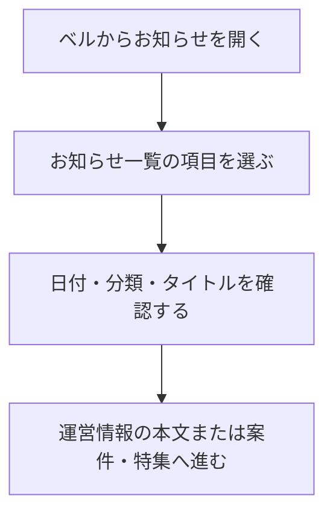

# F17｜プッシュ通知・アプリ内のお知らせ PRD（レビュー前）

> ④業務ルールと⑦以降はユーザーレビュー未完了。本日の変更箇所はローカル4180モックとユーザー指定を参照し、優先順位はスプレッドシートを正とする。本PRDはTier1のみを定義する。

参照するモック：本リポジトリのローカル4180（2026-10-19の変更箇所を照合）。未接続の外部API・実端末機能は、接続済みとして扱わず末尾に記載する。

| 基本情報 | 内容 |
| --- | --- |
| 機能ID | F17 |
| 概要 | プッシュ通知・アプリ内のお知らせ |
| 対象領域 | アプリ／管理画面／外部連携 |
| 関連機能 | [F15](F15-ad-placements.md)、[F16](F16-campaign-pages.md)、[F18](F18-mypage-support.md) |
| 更新日 | 2026-10-20 |
| 版 | レビュー前（初版未確定） |

## ① 目的・今回作る範囲

目的：お得な情報と運営からの大切な案内を届けるため

評価指標：通知の送信要求数・受付数/観測可能な到達数/通知タップ数/キャンペーン閲覧数・遷移後の利用

優先順位は[アプリ詳細要件のTier列](https://docs.google.com/spreadsheets/d/1tI26I_4vbSHIOzMdJz7g8-DjeLyyVUKoksVHhZ0AQhU/edit#gid=1107057215)を正とする。モックに存在してもTier2・Tier3・空欄の要件は本PRDの定義対象に含めない。

| 要件ID | Tier1の範囲 |
| --- | --- |
| F17-1 | お知らせ機能で運営からユーザーに共有したい情報を確認できる |
| F17-3 | お知らせ機能から指定したURLやキャンペーンへ移動できる |
| F17-4 | 運営がプッシュ通知を設定できる（管理画面） |
| F17-7 | ユーザーが通知を許諾・停止し、通知を許諾した場合はプッシュ通知の内容を受信できる |

管理側は[管理画面詳細要件のTier列](https://docs.google.com/spreadsheets/d/1tI26I_4vbSHIOzMdJz7g8-DjeLyyVUKoksVHhZ0AQhU/edit#gid=1341040600)にある以下のTier1を関連範囲とする。NACS本体の内製要件にはしない。

| 要件ID | Tier1の運用範囲 |
| --- | --- |
| ADM-F09-1 | 運営担当者がアプリのお知らせに本文・公開状態・遷移先を設定できる |
| ADM-F09-2 | 運営担当者がプッシュ通知の内容と遷移先を設定して手動配信できる |
| ADM-F09-3 | 配信システムが許諾・配信上限・停止時間帯を守って送信できる |

要件名に旧モックとの相違がある場合、優先順位は維持し、現在の表示・動きとユーザー指定を②以降へ反映する。実装方式の具体化は仕様設計で扱う。

## ② 画面イメージ

[アプリの該当画面](http://127.0.0.1:4180/mock-app/#notifications)

- ベルからお知らせ一覧を開く。運営情報と公開中のキャンペーンを日付順に確認する。
- お知らせ一覧・詳細を開いている間は、通知マークを押す直前に開いていた下部タブの選択状態を保持する。ホームへ切り替えない。
- 運営情報は本文を開き、キャンペーンは対象の案件・特集へ進む。一覧にpt数を必須表示しない。
- 通知許諾・停止・有効な宛先・配信済み状態を確認し、同じ通知を重複送信しない。

- ホーム上部の新着・受取可能状態を示す赤ポチは、ベルのお知らせ・プッシュ通知とは別に管理する。歩く／更新型カテゴリ／アンケートごとの表示・消灯条件は[F02](F02-home.md#ホーム上部の赤ポチ)を正とする。

## ③ 操作フロー

## ④ 業務ルール・制約

> ユーザーレビュー未完了。アプリ上の表示に関わるルールを記載する。

### 表示する対象ユーザー

| 対象ユーザー | 利用・表示 |
| --- | --- |
| 会員 | アプリ内のお知らせを確認する |
| 非会員（ゲスト） | アプリ内のお知らせを確認する |

### 表示条件

| 状態・条件 | 表示のルール |
| --- | --- |
| 運営のお知らせ | 公開対象の情報を日付順に表示する |
| キャンペーン情報 | 公開中・期間内・利用条件に合う情報を表示する |
| プッシュ通知を許諾済み | 配信対象の通知を受信できる |

### 画面に置く要素・操作

| 画面・要素 | 表示・操作のルール |
| --- | --- |
| ベル・お知らせ一覧 | 日付・タイトル・内容の入口を表示する |
| 下部タブの選択状態 | お知らせへの遷移元の下部タブを選択中として維持する。一覧から詳細への移動、詳細から一覧への戻り、再読み込みでも維持する。遷移元がない直接アクセスではホームを選択する。別の下部タブを押した場合は、そのタブへ移動して選択状態を更新する。 |
| 運営情報の本文 | 選択したお知らせの本文を表示する |
| キャンペーンの入口 | 設定された案件・キャンペーンページへ進む |
| 通知設定 | 通知を許諾・停止する操作へ進む |

## ⑤ 管理画面

新規作成・変更・削除は、現在の管理画面で操作できる範囲を示す。「外部管理」はNACS・EDOCODE等の担当範囲、「未実装」は操作画面がない項目。削除と公開停止は分けて記載する。

| 対象項目 | 新規作成 | 変更 | 削除 | 管理画面での操作・反映範囲 |
| --- | --- | --- | --- | --- |
| 配信メッセージ（構想画面） | 可能 | 停止のみ可能 | 不可 | 複数アプリ管理のメッセージ配信で作成・停止。保存は構想用で、実送信・アプリ一覧への自動接続は未実装。 |
| アプリ内の運営お知らせ本文 | 未実装 | 未実装 | 未実装 | 固定の運営お知らせと連携データを表示。専用の本文入稿UIはない。 |
| キャンペーンのお知らせ元 | F15・F16で作成 | F15・F16で変更 | F15・F16で削除 | 公開中・期間内・利用可能な広告／ページから表示対象を作る。 |

## ⑥ 例外処理・エラーハンドリング

| 状況 | 表示・処理・復帰 |
| --- | --- |
| お知らせがない | 新しいお知らせがない案内を表示する。 |
| 許諾取消・退会・配信停止・宛先不備 | 新規送信の対象から外し、実行済みと混同しない。 |

## ⑦ 達成条件・未決事項

> 本節以降はユーザーレビュー未完了。

### Tier1の達成条件

- [ ] 通知マークのある各画面からお知らせを開いても、元の下部タブの選択が維持される。簡単・遊ぶ・マイページ等から開いた場合にホームへ切り替わらない。一覧・詳細間の移動と再読み込みでも維持され、別の下部タブを押すと選択が切り替わる。

- [ ] ホームの赤ポチをベル・プッシュ通知の既読と混同せず、F02のタブ別条件に従って表示する。

- [ ] F17-1：お知らせ機能で運営からユーザーに共有したい情報を確認できる。
- [ ] F17-3：お知らせ機能から指定したURLやキャンペーンへ移動できる。
- [ ] F17-4：運営がプッシュ通知を設定できる（管理画面）。
- [ ] F17-7：ユーザーが通知を許諾・停止し、通知を許諾した場合はプッシュ通知の内容を受信できる。
- [ ] ①の管理側Tier1に対応する操作について、⑤の新規作成・変更・削除可否と反映範囲を確認できる。
- [ ] ⑥の対象となる空・失敗・中断などの状態から、表示内容と次の操作を確認できる。

### まだ決まっていないこと

なし。認証・API接続などの具体的な方法は、別途仕様設計で定める。

## モックへの未反映・対象外

### モックへの未反映

| 項目 | 未反映の内容 |
| --- | --- |
| プッシュ実配信 | 実端末への送信・許諾との連携は未接続 |
| 運営お知らせの入稿 | 本文・公開状態・遷移先を設定する専用の編集画面は未実装 |
| 配信設定とアプリ一覧 | 構想用の配信メッセージ保存と本番配信・アプリ一覧の自動接続は未実装 |

### 今回の対象外

| 項目 | 対象外の内容 |
| --- | --- |
| なし | — |

## 変更履歴

| 版 | 日付 | 変更内容 |
| --- | --- | --- |
| レビュー前 | 2026-10-20 | お知らせ一覧・詳細表示中の下部タブは遷移元の選択状態を保持する仕様を追加。再読み込み・直接アクセス・別タブ選択時の挙動と達成条件を明記。 |
| レビュー前 | 2026-10-19 | ホーム上部の赤ポチ条件をF02へ集約し、ベル・プッシュ通知との独立性を明記。 |
| レビュー前 | 2026-10-15 | F10レビューの共通フィードバックを反映。⑤を管理画面へ変更し、④を対象ユーザー・表示条件・配置要素に整理。例外処理と仕様設計事項の重複を除き、未反映と対象外を別表に分離。個別レビューは未完了。 |
